# Acoustic experiments: history, 2D maps and GPU scaling

This document is the experiment journal and source material for a process video. The chronology below includes accepted and rejected approaches; the detailed entries retain their assumptions and limitations.

**Checkpoint practice**

Commit each completed experiment or independently validated improvement, and checkpoint before replacing an approach. Keep each hypothesis, settings/seeds, code revision, raw measurements, before/after figures, conclusion and rejected variants together. Small edits within a run can share a checkpoint; do not discard the unsuccessful run when saving a better result. Preserve artifact sources so figures can be regenerated. Use the existing journal and archives rather than another tracking system.

Git preserves committed code, not arbitrary chat history, ignored scratch files or footage that was never captured. Promote useful `.context` evidence into the dated archives linked here before finishing an experiment. Record live footage separately when requested; silent offline results do not imply we captured gameplay video. Inspect old code with `git show REVISION:path` without switching the Unity checkout. `git log --date=short --format='%h %ad %s' -- docs/acoustic-experiment-history.md` finds the journal checkpoints.

**Church presentation and process footage — 22 October**

Both visual styles now use one authored Church scene: flat-color low-poly treatment and darker textured PBR treatment. F7/F8 switch styles; physical/acoustic materials remain separate. A CC0 rig with looping idle/run animations follows the existing controller, and a small Built-in pipeline image effect grades the camera. This is a presentation milestone, not an acoustic-fidelity result or a photorealistic art upgrade.

[Matched first-person and animation videos, primary research and controls](scene-presentation.md#verified-capture--22-october-2026). The four silent 8-second clips were rendered offscreen from scripted inputs through the real movement controller, with no foreground player or speaker output. Routes are identical across styles (397 ticks, zero positional delta), all sampled ticks remain grounded, and the rig produces 396 distinct bone poses. Scene checks preserve the authored collider/acoustic/controller definitions. Failed import/animation checks are retained alongside the final proof for the process video. Feature/setup checkpoint `a5aabce` preserves the authored scene and full setup code; a follow-up removes 232 one-off setup lines after validating 16 pixel-identical smoke frames against the full capture.

---

**Conservative edge preprocessing experiment — 22 October**

Tried merging redundant collinear edge segments without changing any triangles. The prototype keeps owner, wedge orientation, material pair and open/solid status, merges only degree-two joints, and remaps every original triangle's edge links. Five geometry controls preserve gaps, bends and material breaks. It is **kept offline**, with no extra production code.

| Highest-detail fixture | Triangles | Original edge segments | Merged edges |
|---|---:|---:|---:|
| Cube | 3,072 | 192 | 12 |
| Cube with material breaks | 3,072 | 192 | 16 |
| Flat sheet | 512 | 64 | 4 |
| Two sheets with a gap | 1,024 | 128 | 8 |
| Bent sheet | 1,024 | 112 | 7 |

The cube saves 14,400 GPU-buffer bytes, but surface triangles and their BVH remain. Topology-run solve medians vary: cube 1.43 → 1.97 ms, material cube 1.59 → 1.39 ms, other shapes roughly unchanged. This is not a reliable universal performance improvement.

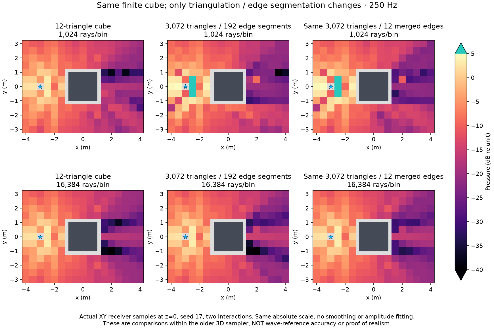

These are actual XY receiver positions through a finite cube at z=0, not infinite-height 2D geometry. Seed 17, 250 Hz, two interactions and a 0.1 s horizon; each query computes three bins. The left column is the **same renderer on a simpler triangulation**, not independent acoustic truth. Shared absolute scale, no fitting/smoothing. Four measurement runs passed; exact sources, controls, raw data and source hashes are archived.

| Rays/bin | 12-triangle cube map | Tessellated cube map | Tessellated + merged edges map | Split / merged complex difference from simple cube |
|---|---:|---:|---:|---:|
| 1,024 | 0.143 s | 0.360 s | 0.285 s | 51.83% / 51.89% |
| 16,384 | 0.435 s | 1.133 s | 1.131 s | 6.83% / 4.72% |

Each map has 195 sampled cells. Timings sum warmed solves including GPU path readback, excluding CPU complex summation, setup and plotting. Stages were sequential on shared hardware; no timing repeats or equal-accuracy speed claim. Nearby seeds 17/29/71/113 were also sampled at 25 fixed probes. Their ray sequences overlap under the current seed construction, so archived variation is not an independent-replicate uncertainty estimate.

**Finding:** shrinking the edge list alone does not remove the renderer's dependence on visual tessellation. The first-reflection estimator samples triangle IDs; the local diffraction proposal sees the blocking triangle's edges. Interior triangles can have no local edge candidates. The shader also scans sibling triangles during first-reflection visibility. These mechanisms remain after edge merging. This audit identifies causes worth isolating, not a proof that they explain every observed discrepancy.

The practical next step is a dedicated acoustic proxy that removes redundant *surface* tessellation while retaining openings, material regions, winding and physical wedges. Keep visual meshes/styles separate from that proxy. Do not add the merger to production based only on a smaller edge count, and do not confuse this experiment with fixing the older 3D sampler's wave-reference error.

[Numerical ledger](benchmarks/edge-preprocess-2026-10-22.json) · [Source, raw results, controls and figure generator](benchmarks/edge-preprocess-2026-10-22.zip).

---

**Finite 3D scaling: material lookup and unchanged bounds — 22 October**

The existing production 3D renderer now reuses its BLAS/TLAS to identify the material containing a ray vertex, and skips rebuilding world bounds for unchanged instance poses. The 442,440-triangle static test falls from **339.41 → 58.47 → 12.86 ms** across the original, material-lookup-only and pose-cache stages. This is **26.39× faster in this measured workload**, with unchanged physics to floating-point precision. Runtime changes total **30 net lines across two existing files**; no runtime dependency or new runtime file was added.

This is the older finite-3D path sampler. The recently improved bounded complete-route prototype remains **2.5D** and has not been ported to arbitrary finite 3D. The production sampler still has severe spatial pressure error; faster geometry processing does not establish high fidelity or DLSS teacher quality.

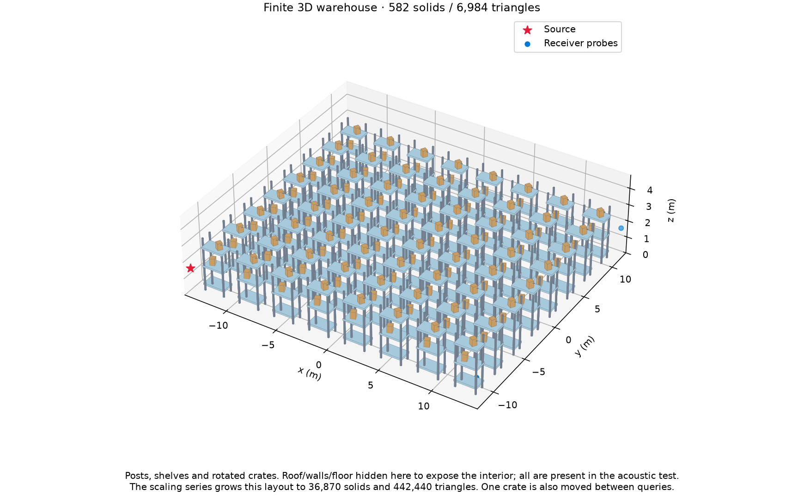

The scale series contains 15–36,870 closed solids: posts, shelves, rotated crates and an enclosure. Each solid has 12 triangles; the largest interior spans 224.5 × 193 × 4.8 m. This stresses many instances and genuine finite edges, not the surface complexity of a detailed scanned mesh. The independent room accuracy case also exercises a 1,634-triangle aggregate mesh. No playable scene or imported environment was added.

**Two changes, measured separately**

1. **Material containment:** surface rays already used BLAS/TLAS, but `MediumAt` still visited every closed volume and scanned its triangles. It now descends the existing TLAS around the query point, finds each candidate in the owner-sorted volume array, and uses the existing BLAS for the oriented boundary test. Nested media, winding and equal-volume owner priority are retained. No extra spatial index or GPU buffer. The linear fallback remains for correctness checks. GPU change checkpoint: `2d9f3fb`.
2. **Unchanged instance bounds:** after the first change, CPU pose/bounds preparation dominated the largest case. Cache the exact position/quaternion for every owner in every frame of the submitted batch; only changed owners need world-bound transforms. Any changed bounds still trigger a full TLAS refit. Bounds-cache checkpoint `47e4fd7` preserves this change and all three measured stages.

```text
Before, each solve:
    transform all instance bounds; refit/upload TLAS if needed
    trace paths through BLAS/TLAS
    at each material query, scan closed volumes and their triangles

After, each solve:
    compare submitted poses with the previous batch
    transform only changed instance bounds; refit/upload TLAS if needed
    trace the same paths through BLAS/TLAS
    at each material query, use TLAS candidates and BLAS boundary intersection
    reduce pressure on GPU; read back three complex-bin results
```

The last reduction is the offline benchmark fixture, not a change to the live audio output path. It transfers 48 bytes per solve (three float4s, including diagnostic counts), and checks its sum against independent double-precision CPU summation on the smaller cases outside timed measurements.

| Solids / triangles | Original ms | Material BVH only ms | + pose cache ms | Original / final |
|---|---:|---:|---:|---:|
| 15 / 180 | 4.99 | 2.48 | 4.44 | 1.12× |
| 150 / 1,800 | 5.97 | 5.94 | 5.52 | 1.08× |
| 582 / 6,984 | 9.09 | 9.21 | 6.38 | 1.43× |
| 2,310 / 27,720 | 18.96 | 11.63 | 7.12 | 2.66× |
| 9,222 / 110,664 | 81.37 | 13.49 | 7.99 | 10.19× |
| 36,870 / 442,440 | 339.41 | 58.47 | 12.86 | 26.39× |

One source/listener pair, 1,024 rays per bin, three bins (0/125/250 Hz), up to eight bounces, seed 17, 0.4 s acoustic horizon; five probes × three repeats. The archive also includes 256 rays/bin and one-crate movement. These are host-observed medians including state preparation/submission, tracing, GPU reduction, blocking readback and finite-output checks. They exclude scene JSON/mesh generation, solver setup, cold dispatch, Unity startup, plotting, audio/DSP and networking. Shared M5 Mac, Metal, Unity 6000.4.1f1, one worker, low priority, audio disabled. No GUI/player window, microphone or speakers used.

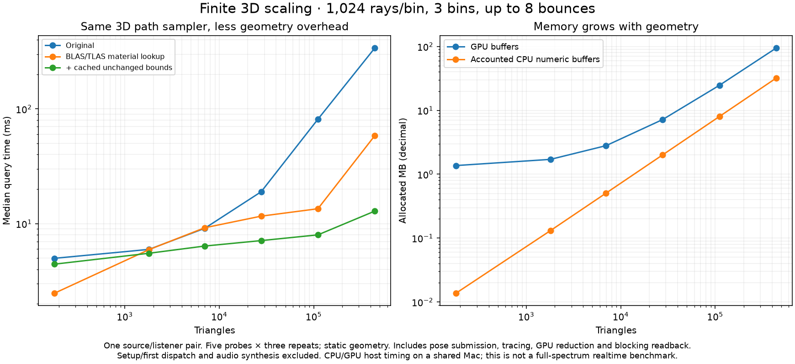

At 442,440 triangles, moving one crate between queries gives **323.29 → 78.47 → 32.26 ms** (10.02× original/final). This measures a sequence of poses and BVH updates, not continuous moving-boundary acoustic accuracy. Static GPU allocations remain **94.54 MB**. Accounted CPU numeric buffers rise **30.97 → 32.00 MB**: the pose cache costs 28 bytes per owner per cached frame, 1.03 MB here. Those figures exclude general managed scene storage and Unity/driver memory. Final setup is 2.33 s and the first solve 0.278 s for this case; setup excludes procedural geometry generation.

The material-only stage's largest static CPU preparation is 42.19 ms, including 37.51 ms for bounds/BVH update. With the cache these become **4.34 ms**, including **1.52 ms**. These components overlap: do not add upload and BVH times. Stages ran sequentially on a shared machine; small-case regressions and timing variation are retained, including 2.48 → 4.44 ms at 180 triangles after adding the cache. The 256-ray cases are not consistently faster than 1,024-ray cases. These measurements do not establish universal speedups.

Scene extent grows at fixed object density, while the 0.4 s horizon stays fixed; several largest-scene receivers are outside that horizon. Therefore a separate **442,440-triangle nearby-receiver control** keeps all five probes 4–8 m from the source, outside solids. All 15 queries have nonzero output. Static median is **314.95 → 10.03 ms (31.40×)**; one-crate movement is **310.92 → 17.86 ms (17.41×)**. Pressure is bit-for-bit identical in this supplemental old/final comparison. It supports the geometry saving within the horizon; it is not a reference-accuracy test. The scale-series curve is not a formal acoustic scaling law.

**Accuracy remains the blocker**

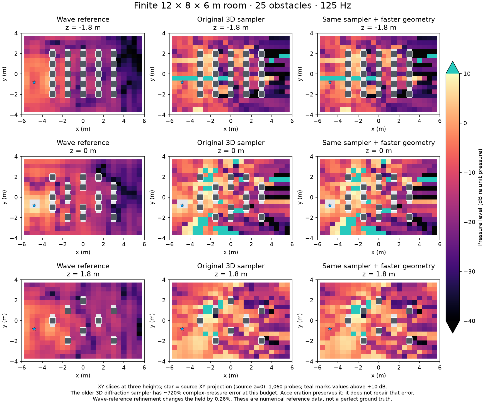

These are 1,060 receiver probes on three XY height slices in a finite 12 × 8 × 6 m room with 25 obstacles, normalized-admittance 0.2 enclosure and rigid obstacles. The old and accelerated 3D fields look the same because these changes preserve the estimator. Absolute pressure scale is shared; teal denotes values above +10 dB. There is no amplitude fitting, smoothing or clipping of recorded values.

At 125 Hz and 1,024 rays/bin, relative complex-pressure L2 error is **719.89%** against the independent FEM reference; only **20.85%** of probe amplitudes lie within ±3 dB. At 256 rays/bin error is **2,488.03%**. The sampler has enormous outliers and incomplete/approximate path physics; this experiment does not isolate all causes. More speed or edge simplification alone cannot establish correctness. The bounded 2.5D integrator's better results must not be attributed to this different 3D algorithm.

The two nonzero-frequency fields are produced together: warmed full-map query time at 1,024 rays/bin is **15.64 → 13.03 → 8.65 s** for the three stages, not that amount per frequency. The existing order-4 FEM reference has 80,033 DOFs. Recorded reference costs are mesh 0.246 s plus solve 8.625 s at 62.5 Hz or 8.021 s at 125 Hz, single CPU thread. These are reused reference runs, not newly timed solves. Refinement changes are 0.080% and 0.260%, respectively; those are observed convergence, not certified error bounds or perfect physical truth. A truncated ray model and steady-state FEM solve also differ in path/time support. This is not an equal-accuracy speed comparison.

Across all main cases, the largest old/final relative pressure difference is **0.0000233%**. The pose-cache stage is bit-for-bit identical to the material-only stage. Final integrated validation passes **14 Unity test cases**: 2D/3D nested/overlapping/moving-media parity, native box/sphere/capsule volumes in BVH and linear modes, BVH/refit controls, material-speed Doppler and boundary clocks. Baseline measurement suites pass 3 + 4 cases; material acceleration 17, pose-cache measurement/controls 13, nearby controls 1 + 1. These overlap and must not be summed as unique coverage. Initial exploratory runs and shader warnings are archived too. Existing compiler warnings remain.

**Geometry preprocessing next, without a new runtime subsystem**

Yes: preprocess a dedicated acoustic representation once per unique mesh, then reuse it across instances. First remove representation noise: weld genuinely duplicate positions while retaining material/topology distinctions, exclude coplanar triangle diagonals, and merge collinear wedge segments only when both adjacent faces and materials agree. Rebuild face-to-edge adjacency and compare pressure to the unsimplified version; changing finite segment parameterization can change a sampler even when the visible shape is identical. Current edge extraction already removes coplanar diagonals; it does not implement general acoustic decimation or collinear-wedge merging.

A flat rectangular face has four boundary sides regardless of its interior render triangulation; those internal diagonals are not physical wedges. Additional lossy decimation needs a measured acoustic error budget over the intended frequency range. Preserve doorways, thin barriers, material boundaries, closed winding and meaningful wedges. Wavelength can inform the budget, but “smaller than a wavelength” is not a safe universal deletion rule. An existing mesh simplifier could handle general geometric reduction; its geometric deviation is not an acoustic-error guarantee. For example, meshoptimizer documents duplicate-vertex welding and topology/seam-aware simplification, while its sloppy variant can merge disjoint features and lose borders. No dependency has been added. [Primary implementation documentation](https://github.com/zeux/meshoptimizer#simplification).

These warehouse solids already have only 12 triangles each. Removing shelves, posts or gaps would change physical geometry, so further reduction requires accuracy measurements. Keep preprocessing an offline import/build step, retain the original geometry for comparison, and validate edge counts, memory, build time, runtime and wave-reference pressure together. It cannot repair the large current 3D estimator error by itself.

Remaining measured scaling costs are per-object state packing/comparison, full TLAS refit/upload when any bounds change, and repeated frequency work. BLAS reuse across identical mesh instances and acoustic proxies are useful next candidates, but this task does not implement them. These tests cover three bins, not full-spectrum realtime audio or trained upscaling.

[Complete numerical ledger](benchmarks/finite3d-scaling-2026-10-22.json) · [Code snapshots, scenes, raw CSVs, tests and reference data](benchmarks/finite3d-scaling-2026-10-22.zip).

---

The preceding offline prototype removes the **quadratic edge-pair buffers and unbounded pair enumeration**. It retains the complete-path diffraction integrator, bounds candidate work, and uses a box BVH for visibility. In the 100-box control, median solve/readback falls from **68.04 to 5.80 ms (11.7×)** with effectively identical pressure. The 2,500-box run completes in **15.45 ms per receiver using 10.15 MB of GPU buffers**. The old descriptor allocation alone would need 33.6 GB there; that allocation is calculated, not a successful old run.

This is a scaling improvement for the **offline two-interaction prototype**, not a production renderer change or proof of ray-tracer scaling at fixed accuracy. There is still linear edge-list preparation per receiver. All seven existing wave-reference maps retain their earlier accuracy; the dense-scene physical error remains large. Some small-scene timings regress. Tests ran silently in the isolated Unity Metal batch runner with audio disabled, one worker and reduced priority.

**Bounded path sampling and BVH visibility — 22 October**

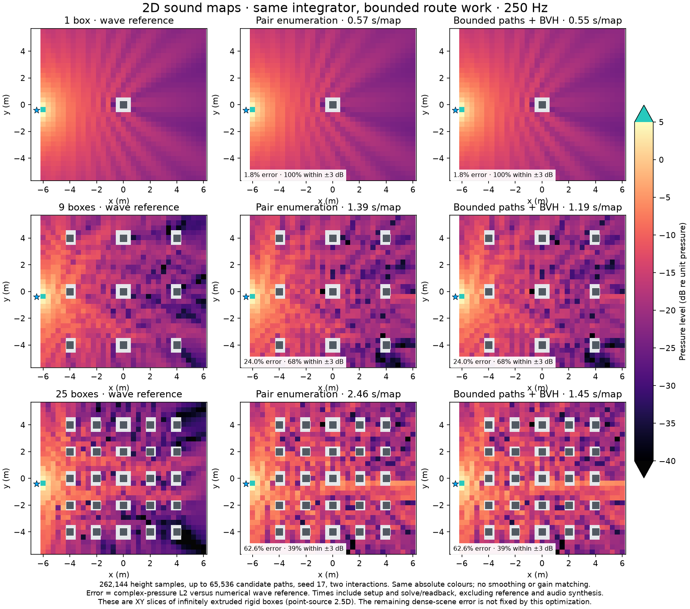

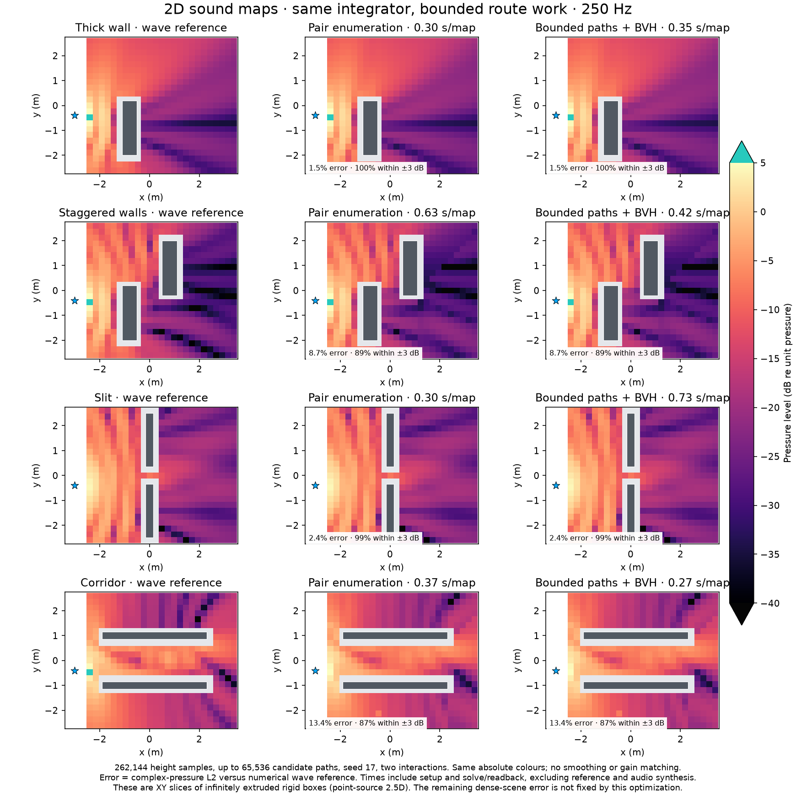

These are XY maps at 250 Hz of a point source and infinitely extruded rigid boxes, with source/listener z=0. This is a 2.5D benchmark, not finite 3D or cylindrical 2D propagation. Both methods use the same signed integrand, path orders, phase, width 1, seed 17, horizon and height-sample budget. No smoothing, gain fitting or amplitude clipping. The numerical wave references retain their earlier refinement qualifications; they are not exact truth.

| Scene | 65K old → new map time | 262K old → new map time | 262K old → new complex-pressure error |
|---|---:|---:|---:|
| 1 box | 0.371 → 0.469 s | 0.569 → 0.546 s | 1.84% → 1.84% |
| 9 boxes | 0.971 → 0.510 s | 1.389 → 1.191 s | 24.03% → 24.03% |
| 25 boxes | 3.557 → 1.314 s | 2.461 → 1.449 s | 62.56% → 62.56% |
| Thick wall | 0.257 → 0.372 s | 0.302 → 0.345 s | 1.46% → 1.46% |
| Staggered walls | 0.238 → 0.164 s | 0.630 → 0.424 s | 8.69% → 8.69% |
| Slit | 0.254 → 0.213 s | 0.299 → 0.735 s | 2.42% → 2.42% |
| Corridor | 0.172 → 0.159 s | 0.369 → 0.267 s | 13.41% → 13.41% |

Across the seven maps (4,842 cells) at both budgets, the largest per-map old/new relative complex-pressure L2 difference is **0.0222%** (25 boxes, 65K). BVH and linear visibility produce **bit-for-bit identical pressure** in every measured comparison. Four seeds on 25 fixed receiver positions per scene are archived; they do not establish high fidelity at larger scales.

These totals include input packing, buffer setup, source/scene preparation, all receiver submissions, GPU dispatches and blocking readbacks. Old and new are freshly measured here: **neither adds archived CPU acoustic-field costs**. New totals also include building the BVH and extra sampling draws. They exclude Unity startup, first compile/warmup, wave solving, capture/CSV export, plotting and audio/DSP. They are component sums and host-observed times, not GPU hardware timestamps. The baseline runs before new variants within each case; new BVH/linear variants rotate order per receiver. One complete map pass is not a statistical performance guarantee.

Full-map timings include small-scene regressions: one box and thick wall at 65K, thick wall and slit at 262K. Three additional 25-probe runs investigated those scenes. Median-of-run median solve times improve by 3–11% in five of six scene/budget combinations, but the 262K slit changes **0.536 → 0.597 ms**, an 11% slowdown by that aggregate. Its individual runs vary substantially (one new run has 1.644 ms median). All raw runs are retained. This does **not** justify a universal “no performance loss” claim or replacing the full-map totals with favorable repeats.

**What changed**

```text
Once per static scene, CPU:
    build a flat box BVH; upload geometry and scrambled sample sequences

For each receiver, GPU:
    mark source-visible / receiver-visible edges and facing faces
    compact into five linear lists
    describe the possible path families by their counts, without a pair table
    if candidate count <= requested path budget S:
        visit every candidate once
    else:
        sample S candidates; retain inverse selection probability
    check the sampled segments through the BVH
    prepare distances and wedge terms for those candidates
    discard candidates that have zero contribution for every height
    distribute N height samples across the remaining candidates
    integrate signed pressure using the existing complete-path height proposal
    add direct and first-order mirror paths
    enumerate second-order mirrors if they fit N; otherwise sample N pairs
    reduce to one complex pressure value and read it back
```

Compaction rejects occluded, degenerate or out-of-horizon paths with zero support. It never discards small or inconvenient pressure values. The code writes the accepted indices into a bounded list.

Four diffraction families remain: one edge, two edges, mirror→edge and edge→mirror. First and second mirror-only paths remain too. At large candidate counts, family selection is proportional to its count, then the two IDs are selected independently. No nearest-edge restriction or shortest-path substitution is introduced.

Let R be the conceptual candidate count and S the selected count. When sampling is needed, each candidate carries **R/S**. Removing zero-support candidates does not renormalize that factor. Each retained candidate gets an average of its height samples, multiplied by its original selection weight and the existing symmetry factor. Candidate draws and height draws are separately scrambled. This preserves the estimator for the covered path model in ideal arithmetic; it does not guarantee low variance, complete physics or exact floating-point probabilities at arbitrary scale. Repeated sampled candidates are retained.

The first implementation integrated a fixed height tile for every candidate, wasting most samples on invalid geometry. It was rejected. The final version validates bounded candidates first and spends the height budget only on supported paths. A 16K path budget preserved the original seven scenes but differed by about **100% relative norm** from the 100-box enumeration estimate. Raising S to 65,536 covers that control's 35–41K candidates and restores agreement. This is an exposed compute/variance budget, not a physical scene cap or a universal optimum.

**Actual scaling**

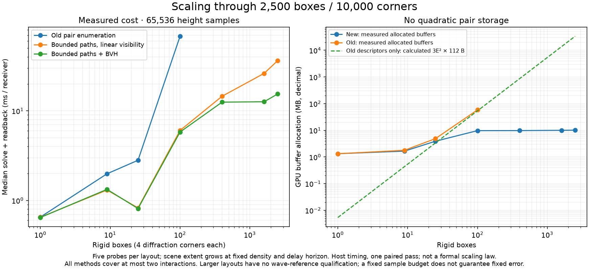

| Boxes / corners | Old enumeration ms | Bounded + linear visibility ms | Bounded + BVH ms | New GPU MB | Candidate count range | Accepted sampled paths |
|---|---:|---:|---:|---:|---:|---:|
| 1 / 4 | 0.65 | 0.65 | 0.65 | 1.32 | 14–23 | 4–6 |
| 9 / 36 | 1.99 | 1.31 | 1.33 | 1.66 | 1,059–1,248 | 235–296 |
| 25 / 100 | 2.81 | 0.83 | 0.81 | 3.90 | 4,451–5,508 | 487–770 |
| 100 / 400 | 68.04 | 6.04 | 5.80 | 9.73 | 35,154–40,977 | 1,116–2,746 |
| 400 / 1,600 | not run | 14.56 | 12.52 | 9.78 | 245,396–280,415 | 554–2,245 |
| 1,600 / 6,400 | not run | 26.21 | 12.63 | 9.99 | 1,806,656–2,142,681 | 128–866 |
| 2,500 / 10,000 | not run | 36.36 | 15.45 | 10.15 | 3,470,786–4,147,871 | 65–510 |

Five probes per layout, 65,536 height samples and up to 65,536 candidate paths. GPU buffer bytes include inputs, BVH, descriptors, counters, scratch, reduction and outputs; they exclude Unity/driver memory. The 100-box allocation falls from **58.29 to 9.73 MB**. At 2,500 boxes, BVH visibility is **2.35× faster** than the new sampler with linear visibility, with bitwise-identical output. The old quadratic implementation was not run above 100 boxes to avoid huge allocations.

Scene extent grows at fixed box density and fixed delay horizon. Visibility, rejection and accepted path counts change, so the runtime curve is not a formal scaling law. BVH/draw input preparation takes approximately 4.7 ms at 100 boxes and 70.5 ms at 2,500 boxes, separate from the per-receiver timings in the table and amortizable over a static scene. The current harness rebuilds it once per case. Static source-visible lists are still recomputed at every receiver.

Only the original seven scenes have wave-reference comparisons. The larger scaling layouts establish finite output, runtime/memory and BVH/linear parity, **not acoustic accuracy**. At 2,500 boxes only 65–510 of 65,536 candidates survive at these five probes. This identifies a remaining sampling-efficiency problem: bounded uniform candidate sampling is scalable in work but can be noisy. The 100-box enumeration result itself is an approximate two-interaction estimate, not independent truth.

Write E for corners/faces, W for boxes, N for height samples, S for candidate budget, M for the second-reflection candidate count, and Q(W) for the actual visibility-query cost:

- Previous geometry preparation: O(E²W) brute-force visibility and O(E²) persistent descriptors.
- New receiver work: **O((E + min(S,R) + min(N,M))·Q(W) + N)** at fixed interaction depth, including a linear number of first reflections and bounded second-reflection samples.
- New persistent storage: **O(W + E + S + N)**. Small scenes allocate only the possible candidate capacity, not the entire requested budget.
- An ideal fixed-N, bounded-depth BVH ray walk is approximately O(N·Q(W)); this prototype still has the extra E term. BVH queries are often efficient but can degrade toward O(W); there is no unconditional logarithmic guarantee.

The serial list/accepted-path compactions are linear in E and bounded S respectively. The prototype does not yet use a parallel prefix scan, source-list reuse, instanced BLAS/TLAS, dynamic BVH refits, or multiple-frequency reuse. Avoid adding those until their cost is measured. The next scaling target is the full per-receiver edge scan and low candidate acceptance; replacing it needs a proposal that retains support and demonstrably reduces variance. Adding samples alone cannot recover unrepresented higher-order paths.

**Verification, code size and checkpoint**

Final suites pass **67 + 4 + 19 Unity test executions**: full maps/additional seeds/controls/small scaling, large scaling, and timing repeats. Each suite also includes the angle control. Independent Python visibility/count/pressure checks cover 22 control positions, including empty scenes, no support, fewer samples than routes, sampled mirror pairs and multiple candidate budgets. Maximum per-case aggregate CPU/GPU discrepancy is **0.00215%**. Existing shader compiler warnings remain; the tests qualify the archived cases, not arbitrary geometry scales. A launch attempt failed during Unity licensing/package-manager initialization before tests ran; its log is retained and excluded from passing results.

The final composed shader is **356 lines versus 385** in the previous prototype; the C# measurement fixture is **74 versus 96**. This is a comparison of those two files only, not a claim that the whole experiment adds no code. The integrand is reused by the build script; plotting, controls and raw evidence stay in the experiment archive. No runtime dependency or live shader variant was added.

The prior implementation is preserved at `5da651f`. This experiment remains offline: rigid extruded rectangles, one frequency and at most two interactions. Arbitrary meshes/materials, higher orders, finite 3D, moving audio, audible artifact behavior and DLSS teacher quality are not validated. The high dense-scene error remains a blocker to calling this a high-fidelity reference.

[Complete numerical ledger](benchmarks/gpu-scalable-2026-10-22.json) · [Source, reproducible inputs, raw results and controls](benchmarks/gpu-scalable-2026-10-22.zip).

---

**Previous experiment: geometry reuse and GPU reflection/mixed paths — 21 October**

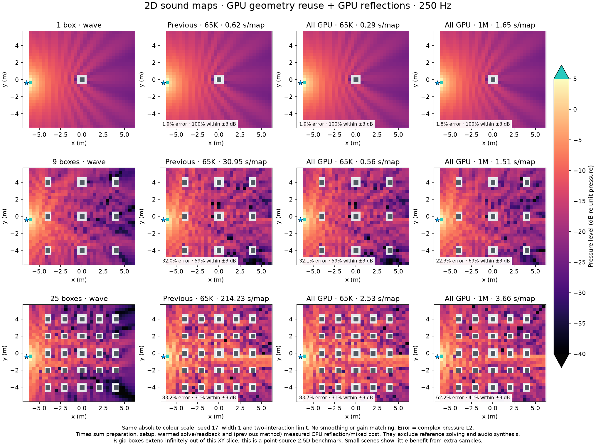

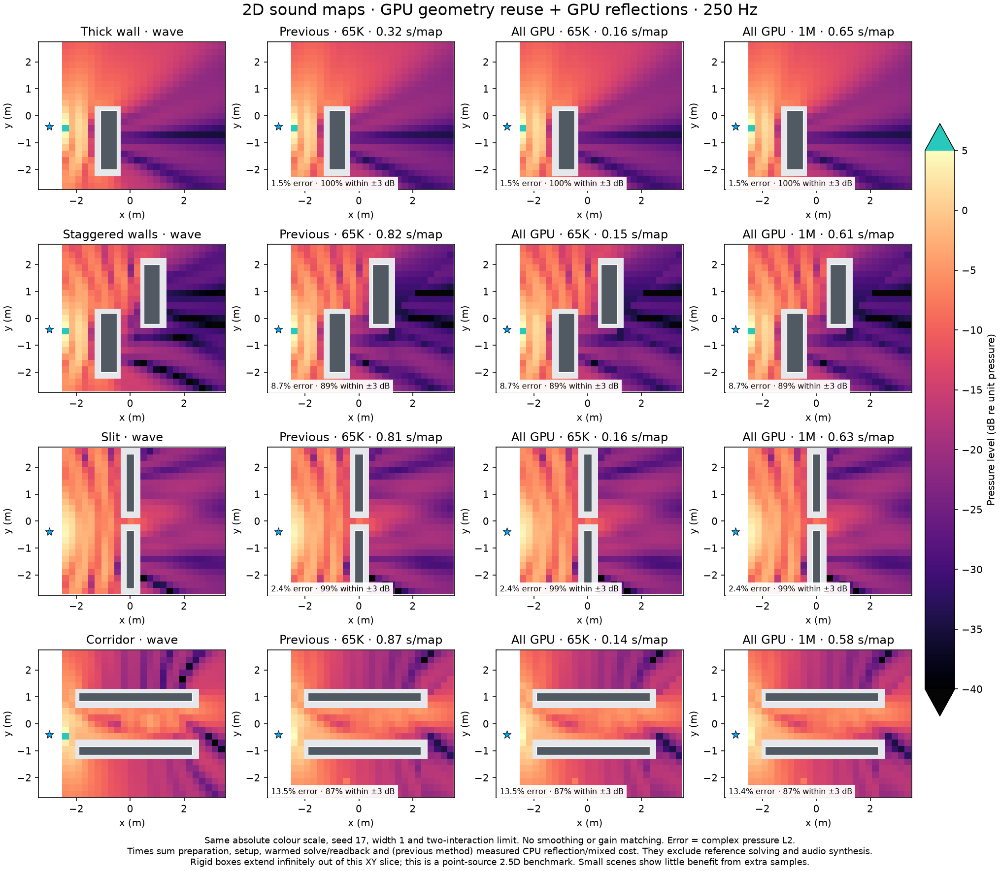

Each map uses seed 17, width 1, a two-interaction limit and 250 Hz. It represents a point source and infinitely extruded rigid boxes: an XY/2.5D benchmark, not finite 3D or strictly cylindrical 2D propagation. Columns share an absolute scale. “Error” is `100 × norm(complex pressure − wave reference) / norm(wave reference)` and includes phase; the ±3 dB metric measures amplitude agreement. Neither is a listening-artifact score. The independent wave solutions retain their earlier refinement qualifications; they are numerical references, not exact truth.

| Scene | Previous 65K error | Previous map time | All GPU 65K time | All GPU 1M error | All GPU 1M time |
|---|---:|---:|---:|---:|---:|
| 1 box | 1.85% | 0.619 s | 0.294 s | 1.83% | 1.652 s |
| 9 boxes | 32.02% | 30.954 s | 0.563 s | 22.29% | 1.510 s |
| 25 boxes | 83.23% | 214.227 s | 2.535 s | 62.23% | 3.664 s |
| Thick wall | 1.46% | 0.322 s | 0.165 s | 1.46% | 0.649 s |
| Staggered walls | 8.69% | 0.822 s | 0.154 s | 8.69% | 0.613 s |
| Slit | 2.37% | 0.808 s | 0.155 s | 2.42% | 0.630 s |
| Corridor | 13.51% | 0.868 s | 0.139 s | 13.41% | 0.582 s |

At the same 65K budget, all-GPU errors are 1.85/32.10/83.69/1.46/8.69/2.36/13.52% in table order: moving the mixed integral from CPU quadrature into the shared Monte Carlo budget slightly changes variance, and does **not** improve accuracy by itself. The time saved permits more samples. For nine boxes, **262K gives 24.03% in 0.754 s**; for 25 boxes, **262K gives 62.56% in 2.844 s**, close to the 1M result. These are useful operating points, not a claim that 1M should become a universal default.

What changed, measured separately:

1. **Geometry reuse:** prepare each pure route's distances and wedge terms once per receiver; every height sample reads them. Modes 0 and 1 produce bit-for-bit identical pressure in the measured cases. At 65K, extra dispatch cost offsets the saving: old/new median solve/readback speed ratios are 0.997–1.010× across the three larger maps. At 1M, the old/new median-time ratio is **1.17× / 1.20× / 1.22×**. Reuse is helpful when enough height samples amortize preparation.
2. **GPU reflections and mixed paths:** GPU image-source geometry enumerates direct, one- and two-face reflections, plus one-reflection/one-edge paths. Pure and mixed diffraction routes share the fixed height-sample budget. No cached CPU acoustic field is added to the new result; the CPU only adds the two returned complex component sums. This removes the large CPU common-field calculation. The final reduction/readback could be combined later.
3. **Spend the saving on samples:** compare 65,536 / 262,144 / 1,048,576 samples without changing proposal width, gain, horizon or covered path orders. Large-scene noise decreases, while several small-scene errors plateau. No amplitude fitting, smoothing, extra physical gains or rejection of inconvenient large contributions is used.

```text
GPU, scene/source setup:
    build edge visibility graph
GPU, each receiver:
    count visible one-edge and two-edge routes
    prepare each route's distances and wedge terms once
    find valid mirror→edge and edge→mirror routes; prepare and compact them
    find valid direct / one-mirror / two-mirror distances
    distribute fixed N height samples across pure + mixed edge routes
    for each sample, in parallel:
        read its prepared geometry
        sample heights with the existing complete-route Cauchy mixture
        add signed pressure × physical phase / sampling probability
    sum sampled pressure and analytic mirror pressure
CPU:
    read back the two component sums and add them
```

This still contains an explicit two-interaction route/face enumeration. It is not a general-depth GPU ray walk. With E edges/faces and W boxes, graph construction and brute-force mirror/mixed visibility cost **O(E²W)**, with **O(E²)** persistent storage. Pure-route preparation is O(E²) candidate/count work plus the valid descriptors; sampling is O(N) bounded-depth integration with prefix-search overhead. Mixed compaction is a serial O(E²) scan. Geometry reuse removes repeated per-sample distance/angle work; it does not remove the dense visibility cost. The 25-box all-GPU 65K solve is slower per receiver than the pure-edge stage because it now includes that work. A scene BVH, sparse visibility and general-depth sampling remain separate future experiments.

**Cost accounting and repeatability**

Totals sum Python input packing, C# file read/buffer allocation/initial upload submission, warmed scene-graph work, receiver input submission, all receiver dispatches, blocking readbacks and finite-value checks. Previous methods additionally include the CPU direct/mirror/mixed calculation: archived 0.3605/30.6905/213.9573 s for the three larger maps, freshly measured 0.1785/0.6891/0.6738/0.7500 s for the four small maps. The large CPU costs were reused instead of rerunning several minutes of identical quadrature; the totals are **sums of measured components from different runs**, not one stopwatch around the old process. Shared fixture allocations include buffers unused by modes 0/1. Results are host-observed solve/readback times, not GPU hardware timestamps.

Unity startup, initial shader compilation/warmup, reference solving, diagnostic exports, plots, broadband bins, time-domain synthesis and networking are excluded. The static graph is timed once per case; receiver-dependent geometry is rebuilt at every map position. Modes rotate execution order per receiver. This is one final map pass, not a statistical hardware speed guarantee. Final Unity test execution took 46 seconds for the whole suite, separate from per-method field costs.

Four seeds were compared on the same 25 evenly spaced receiver IDs in each scene, including seed 17 from the full maps. No proposal tuning was performed on these results. In the nine-box subset, all-GPU mean error changes **31.94% → 23.49%**, and seed-to-seed RMS variation **17.04% → 2.73%** of reference RMS. For 25 boxes, subset mean error changes **108.55% → 87.22%**, and variation **59.12% → 10.68%**. Subset error is higher than full-map error because these are different receiver distributions; it must not be substituted for the full-map score. The much larger remaining discrepancy suggests sampling noise alone is insufficient to explain it, but this experiment does not identify or prove the missing physical contribution. More complete path coverage needs its own controlled comparison.

**Verification and limits**

The final suite passes **70 Unity tests**: 21 full-map cases, 42 additional-seed cases, six geometry/sampling controls and the 115-value angle-control test. All 4,842 spatial cells are evaluated at all three budgets. Independent Python checks verify visibility, mirror lengths, mixed-route eligibility and Monte Carlo pressure at 22 control positions, including empty geometry, short delay support and more routes than samples. Maximum aggregate control discrepancy is **0.00125%** relative norm. Geometry reuse is bit-for-bit identical over the entire measured suite. Across the full maps, GPU direct/mirror pressure matches independent CPU image-source pressure within the declared tolerance (max absolute difference recorded in the ledger).

The controls caught two implementation problems before the final suite: too many read/write buffer bindings on Metal, fixed by declaring integration inputs read-only; and reflections numerically landing at a face endpoint, fixed by rejecting contacts within the precision of the intersection operands. This numerical endpoint margin is not qualified for arbitrary scales or near-degenerate geometry. Initial failed runs remain in the evidence but are not counted as passing. Existing compiler warnings remain; passing tests establish only the tested numerical cases.

Keep this as a reproducible **offline prototype**, not a production renderer or DLSS teacher. It covers static rigid rectangles, source/listener z=0, 250 Hz and at most two interactions; moving geometry, other frequencies/materials, finite 3D and audible temporal continuity are unqualified. Pilot-guided allocation and reuse of sampled paths across frequency bins were **not implemented or benchmarked** in this experiment. The result supports removing the CPU common-field bottleneck and amortizing geometry at larger budgets; it does not yet support claiming realistic dense-scene audio.

[Full metrics and provenance](benchmarks/gpu-route-reuse-2026-10-21.json) · [Source, raw results, controls and pressure arrays](benchmarks/gpu-route-reuse-2026-10-21.zip). The live renderer is unchanged from the previous checkpoint; the prior offline experiment is preserved at `cb0fef8`.

**The history, in order**

| Checkpoint | What we tried | What it established / decision |
|---|---|---|
| `05a5477`, 7 Oct | Explicit visible edge routes, replacing proximity-based diffraction | Better-defined geometry, but a separate route search was not the unified multi-edge ray walk we wanted. Preserved in Git; no comparable wave-reference map from this stage. |
| `343b797`, 7 Oct | Signed diffraction inside the ordinary GPU path loop | Removed four separate edge kernels and their route buffer; multi-edge paths shared the existing audio backend. Numerical controls passed, but later spatial wave comparisons exposed severe variance. |
| `d2f5d47`, 17 Oct | Source-centric, listener-centric, joined and bidirectional MIS sampling, with/without guidance | Joined sampling helped the box example; no universal winner on staggered walls. This was a discretized two-edge integral comparison, **not independent acoustic truth**, and not a complete bidirectional renderer. Tables and code remain at that revision. |
| `3d24edc`, 18 Oct | Shared-solid-face factor and grazing-geometry corrections; conditional next-edge sampling | Kept the physical factor and numerical fixes. The conditional sampler helped a known route but worsened some whole-walk outliers, so it was not shipped. |
| `62f0382`, `1b8fec8`, 18 Oct | Independent BEM and planar FEM wave references | Added a baseline that does not reuse our ray model. Free-space/cylinder controls and refinement checks qualify its numerical accuracy. These references are approximate solutions, not perfect truth. |
| `dcccabb`, 19 Oct | Deterministic edge integration; three local/reachable-edge proposal variants | Isolated sampling error from missing paths. Rejected the three proposal variants: improvements on one layout did not carry across layouts. Kept the integration diagnostic and exact previous-vertex storage. |
| `41faa1b`, 19 Oct | Choose a complete route first; sample heights using that route and Sobol points | Major practical improvement on small scenes. Retained signed pressure and exact probability weights. Its original budget was **per route**, so cost grew with the number of routes. Small-scene maps are below. |
| `1d847f9`, 20 Oct | More mixed mirror/edge paths, peak residual integration, roulette, resonance sums and local wave scattering | No universal speed/accuracy win for the route modifications. Resonance sums passed restricted axial controls; scattering operators passed isolated-cylinder controls. Neither became a general scene solver. |
| `ce17057`, 20 Oct | Analytic/grid SDF marching versus segments, BVH and analytic boxes | SDF was slower and failed some grazing/intersection checks. Kept exact intersections; specialized boxes were promising. This measured geometry queries, not acoustic pressure. |
| `bd33f91`, `7d42a08`, 20 Oct | Larger planar/finite-3D scenes and individual-path diagnosis | Larger scenes revealed enormous multi-edge outliers. Double-precision recomputation agreed with a captured extreme contribution: the problem was not merely float precision. Kept a finite-edge CDF numerical fix, without clipping amplitude. |
| `db295a7`, 21 Oct | Fixed total-budget complete-route Monte Carlo on CPU | Replaced the per-route sample budget with a per-receiver budget. Every route is represented when the budget permits; otherwise route selection is probability-corrected. CPU preparation/integration remained expensive. |
| `8ade051`, `5f25246`, 21 Oct | Give the old GPU walk many more samples | Failed as a remedy. The 9- and 25-box fields still contained enormous outliers at 65,536 rays/bin. These depth-8 runs are not compute-matched to the depth-2 complete-route prototype. |
| `e100724`, 21 Oct | Port complete-route height integration to GPU | Closely matched the CPU estimator and greatly reduced integration time. CPU route preparation and mirror/mixed fields remained. |
| `8e3391d`, 21 Oct | Tune height-proposal widths; stabilize inverse-CDF sampling | Quarter-width guidance improved some full-map results, but held-out gains were mixed. Kept width 1 as default; quarter width remains an experiment. Increasing to 1,048,576 samples improved these maps but did not remove model error. |
| `cb0fef8`, 21 Oct | Build visibility/counts and generate complete routes on GPU | Removed CPU route lists while retaining complete-route height guidance. Full-map equivalence passes; the measured diffraction stage is much faster. Restricted to one/two-edge rigid planar paths for this experiment. |
| `5da651f`, 21 Oct | Reuse route descriptors; compute mirror/mixed fields on GPU; sweep total sample budget | Removes the CPU common-field bottleneck. More samples improve larger maps, but errors plateau and dense-scene fidelity remains poor. Detailed comparisons above. |
| `a24de93`, 22 Oct | Bounded candidate paths, GPU compaction and BVH visibility | Removes quadratic descriptors; 100-box control is 11.7× faster. Original maps retain accuracy; large-scene accuracy and small-scene regressions remain unresolved. |
| `2d9f3fb`, `47e4fd7`, 22 Oct | Finite 3D material BVH queries and cached unchanged instance bounds | Largest static geometry workload is 26.39× faster; nearby-probe control 31.40×. Preserves the older 3D sampler, whose ~720% room error remains unacceptable. Three stages, code, raw data and plots archived above. |
| This edge-preprocessing checkpoint, 22 Oct | Merge collinear wedges while preserving materials, gaps and face links | Edge counts fall up to 16×; query speed and sampling robustness do not consistently improve. Kept offline. Surface tessellation remains the next proxy/sampling target. |

The chronology is a record of accepted and rejected experiments, not a claim that each step improved the renderer. In particular, source/listener/bidirectional sampling was tested on a restricted integral before independent wave references existed. Its earlier “error” cannot be read as error against real-world acoustics. To inspect historical code without switching your Unity checkout, use `git show REVISION:path/to/file`.

**Reading the 2D maps**

Each coloured cell is an actually evaluated receiver position. Blue stars are sources; dark grey boxes are obstacles; light grey cells were not sampled. Every map below uses the same absolute pressure scale, from −40 to +5 dB. **Turquoise means above the colour scale**, not a good result. There is no interpolation, amplitude fitting, per-image normalization or smoothing.

These are XY maps of a 3D point source around infinitely extruded rigid walls—the existing planar acoustic convention. They are not line-source 2D acoustics or finite-height 3D buildings. All shown fields use 250 Hz and seed 17. The reference independently solves the wave equation. For the larger scenes, the last mesh refinement changed whole-field pressure by about 0.13–0.66%, and shadow pressure by at most about 1.21%; that is observed convergence, not a certified absolute error bound.

“Within ±3 dB” means the predicted pressure amplitude is between approximately 0.708 and 1.413 times the reference at that cell. It ignores phase. Complex relative L2 error also compares phase: take the root-sum-square pressure difference across cells and divide by the reference's root-sum-square pressure. Neither metric is a perceptual listening score.

**Earlier small scenes: wall, staggered walls, slit and corridor**

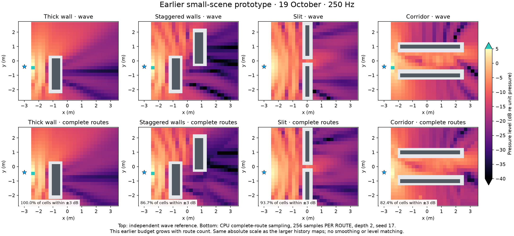

This is the 19 October CPU prototype: 256 samples **per route**, two edge orders, the same supported mirror/mixed paths, and seed 17. Whole-map complex errors are 2.01%, 9.14%, 4.20% and 13.66%, respectively. These are single-seed map scores; the older report's four-seed means and 31-position walking scores are different measurements.

**Larger scenes: the progression**

Read each figure left-to-right, then top-to-bottom. The bottom-left CPU complete-route field was subsequently reproduced by the untuned GPU port. The middle-bottom panel includes both a larger budget and quarter-width tuning; the bottom-right panel tests route-generation speed at the original 65,536-sample budget and width 1. Its similarity to the bottom-left panel is intentional.

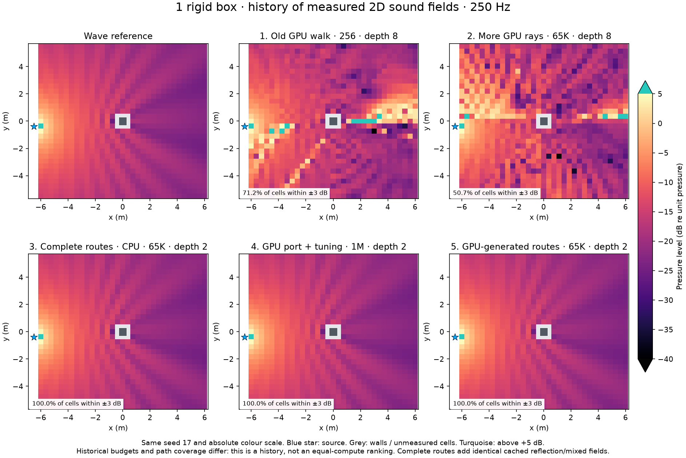

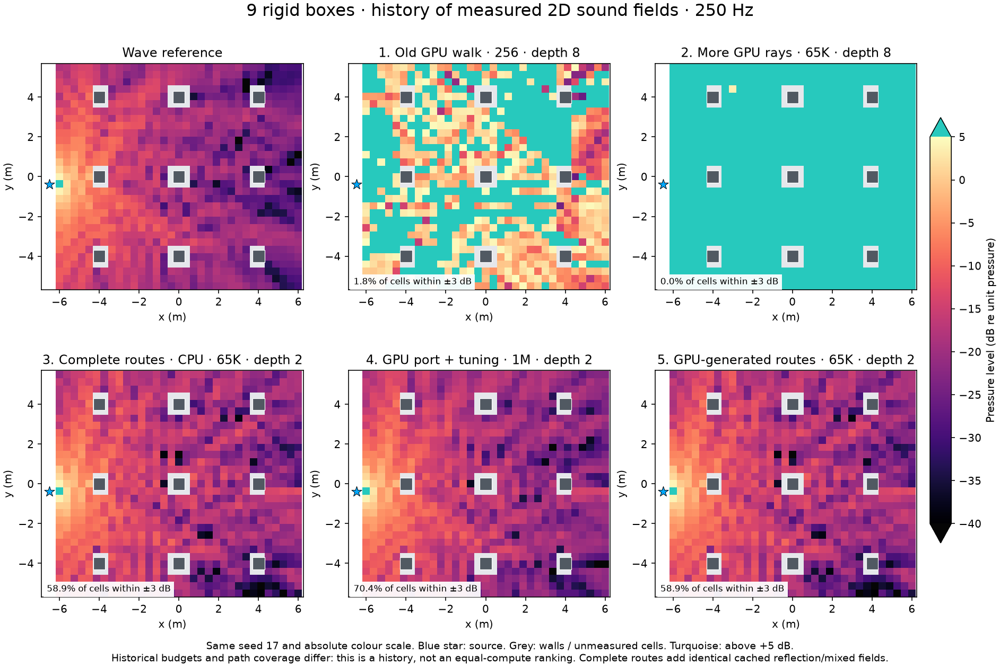

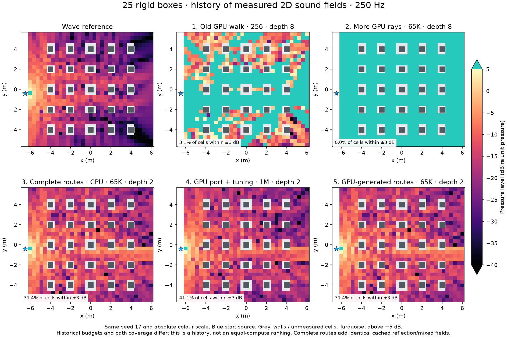

| Complete-route field | 1 box: complex error | 9 boxes: complex error | 25 boxes: complex error |
|---|---:|---:|---:|
| CPU, original width, 65,536 samples | 1.85% | 32.02% | 83.23% |
| GPU integration, original width, 65,536 | 1.85% | 32.02% | 83.23% |
| GPU integration, quarter width, 65,536 | 1.85% | 27.90% | 78.76% |
| GPU integration, quarter width, 1,048,576 | 1.83% | 22.44% | 62.04% |
| **GPU-generated routes, original width, 65,536** | **1.85%** | **32.02%** | **83.23%** |

The old GPU walk uses eight interactions; the complete-route maps use two and include additional cached mirror/mixed classes. Historical comparisons therefore change more than sampling. The new route-generation comparison is narrower: same two-edge estimator, routes, height samples, frequency, seed, delay horizon and cached common field. It is the controlled speed experiment.

**Earlier experiment at cb0fef8: GPU route generation**

Previously:

```text
CPU, scene/source setup:
    find visible edge neighbours and source-visible edges
CPU, each receiver:
    count and choose complete routes
    calculate every chosen route's angular terms and segment lengths
    upload route records and integration steps
GPU:
    sample heights on each route; evaluate signed pressure; reduce
```

Now:

```text
CPU:
    upload box bounds, source, reusable sample coordinates
GPU, scene/source setup:
    build edge-to-edge and source-to-edge visibility
GPU, each receiver:
    find listener-visible edges
    count valid one-edge and two-edge routes; build prefix counts
    launch the configured total sample budget:
        select a complete route using those counts
        calculate its segment lengths and wedge terms
        sample heights conditioned on that complete route
        evaluate signed pressure with the full probability weight
    reduce pressure
```

When route count R is at most sample budget N, each route receives `floor(N/R)` samples and the remainder is distributed once, exactly as in the CPU control. When R exceeds N, each sample selects a route and carries its inverse-probability weight. Routes outside the delay horizon contribute zero; they are not retried or renormalized away. The same-face factor, signed wedge kernel, distance spreading, physical phase and mixture PDFs remain. We reuse the existing integration shader through the experiment's build script rather than writing another DSP/transport stack.

The experiment has a fixed **height-sample budget**, not constant total scene cost. With E edges and W boxes, its simple graph build costs O(E²W) visibility work, once per scene/source setup; receiver preparation costs O(EW + E²); route selection uses prefix searches. Graph storage is O(E²). Each selected route has one or two edges. This is suitable for the measured 4/36/100-edge scenes; it is not a proof of scalability to an entire city. General-depth counting, BVH-backed graph construction and efficient updates for moving geometry are not implemented here.

**Measured cost, including CPU preparation**

Fresh paired measurements on the complete 12 × 11 m maps: 65,536 height samples per receiver, width 1, depth 2, 250 Hz, 0.4 s support, seed 17. The two shader variants ran in the same silent Unity session. These are one-pass map measurements, not repeated statistical performance guarantees.

| Scene | Receiver cells | Previous diffraction stage | GPU-generated diffraction stage | Measured ratio |
|---|---:|---:|---:|---:|
| 1 box | 1,014 | 0.548 s | 0.259 s | 2.1× |
| 9 boxes | 960 | 8.413 s | 0.267 s | 31.5× |
| 25 boxes | 880 | 14.963 s | 0.260 s | 57.5× |

The previous totals include freshly measured CPU route preparation (0.147/8.107/14.571 s), route-input reading, upload submission, GPU integration and blocking result/flag readback. The new totals include input packing, receiver input/submission, warmed scene-graph construction, and receiver preparation/route generation/integration/reduction/readback. One-time buffer allocation, initial random/geometry uploads, first-use compilation, optional diagnostic exports and report generation are excluded. Receiver input/submission totals 0.21–0.25 ms per whole map and is included. These are measured stage totals rather than full-process wall times.

Warm median per-receiver solve/readback was **0.229 → 0.240 ms**, **0.232 → 0.264 ms**, and **0.238 → 0.281 ms**, respectively. The GPU does more work, while the much larger CPU preparation cost disappears. Map totals include outliers; they are not the median multiplied by cell count. Warm scene-graph dispatch/readback took 0.22/0.45/0.17 ms in these runs, near the small-job submission/synchronization floor; that ordering is not a geometry scaling result. No hardware GPU timestamps were collected.

Input files shrink from 1.71/38.67/59.18 MB to about **1.32 MB** each, most of which is the reusable Sobol sequence. The new GPU buffers occupy about 1.32/1.33/1.40 MB. The per-receiver upload is just XY coordinates instead of all route descriptors. The old arrays could have been cached for static receiver positions; this experiment matters when new receiver positions need evaluating.

**These are not full-renderer speedups.** Direct/mirror/mixed fields are still the identical cached CPU arrays. Their earlier whole-map calculation took approximately **0.36/30.69/213.96 seconds**. They are added to every complete-route plot but excluded from both timing columns. Broadband bins, temporal synthesis, HRTFs, moving boundaries and networking are also outside this experiment. The scene graph/counts can be reused across frequencies, but the current prototype still recalculates route descriptors inside each integration dispatch.

**Verification and what remains**

The final runs passed 25 Unity test executions across controls, maps and the added single-edge subset check, including repeated 115-value angle checks. Python checks independently compare GPU visibility, route counts, aggregate pressure and selected per-sample contributions against the CPU implementation. Controls include empty geometry, no physical delay support, first/second order, and more routes than samples for both orders. Full-map route counts match and pure-edge pressure differs from the prepared-route GPU control by **0.00020%, 0.00082% and 0.00071%** in relative norm. All 2,854 map positions are finite and pass the declared aggregate equivalence tolerances.

A small-budget control caught evaluation beyond the intended sample count when the compiler lowered a conditional expression. An explicit guarded sample call fixes it in the experimental shader. Early shader compilation failures and the failed small-budget run remain in the archive; they are not counted as passing validation. The fixture historically named `small-dc` is evaluated at **250 Hz** in this experiment and is not a new DC control.

Keep this as an offline experiment for now. It has not been qualified at near-degenerate float-precision shadow boundaries, other frequencies, arbitrary materials/meshes, higher orders or finite 3D. The new speed result does not repair the large multi-obstacle field error or demonstrate artifact-free moving audio. The next useful work is to remove the remaining CPU mirror/mixed bottleneck and test more complete path coverage against the independent wave maps, while preserving this estimator as a reproducible control. DLSS training still needs a qualified broadband/moving-scene teacher.

**Evidence and reproduction**

- [New timings, quality and hashes](benchmarks/gpu-route-generation-2026-10-21.json), [source, raw inputs/results, plots and controls](benchmarks/gpu-route-generation-2026-10-21.zip).
- Existing detailed history and rejected trials: [cleanup-results.md](cleanup-results.md).
- Prior ledgers: [bounded CPU routes](benchmarks/route-monte-carlo-2026-10-21.json), [GPU port](benchmarks/gpu-route-integration-2026-10-21.json), [GPU sample sweep](benchmarks/gpu-full-2d-maps-2026-10-21.json), [proposal tuning](benchmarks/gpu-sampling-tuning-2026-10-21.json), [transport candidates](benchmarks/transport-candidates-2026-10-20.json), [SDF/BVH](benchmarks/sdf-scaling-2026-10-20.json).

The archive stores paths relative to the project root. Its `README.md` gives the opt-in commands and identifies the existing scientific environment and isolated Unity runner. Source snapshots preserve the current experiment without adding experimental shader variants to the live project's Assets folder. Do not switch the active Unity checkout to inspect older code.
