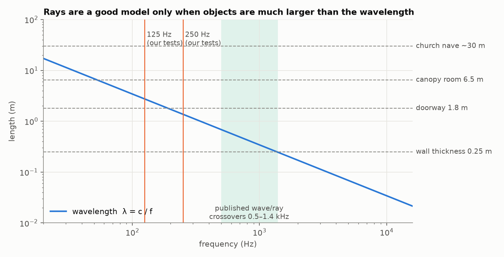
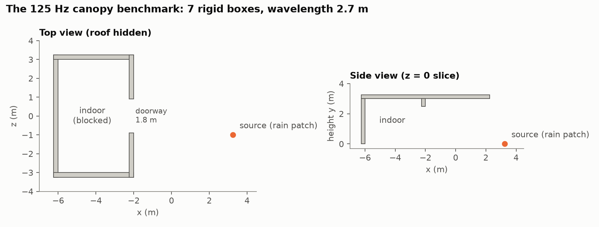
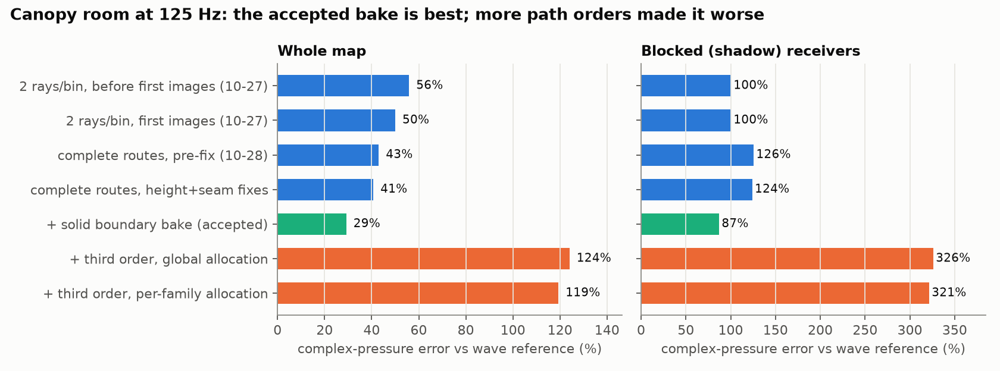
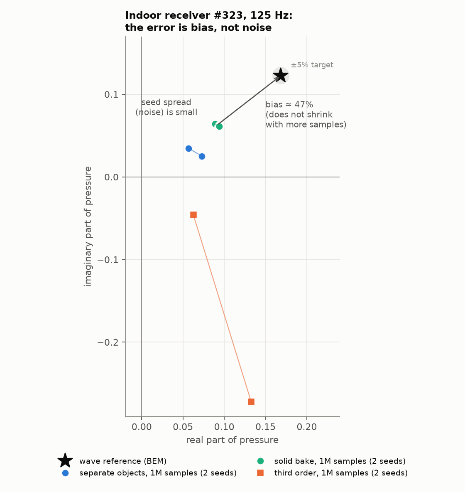
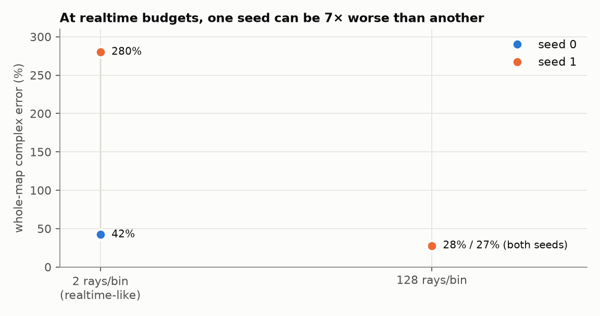
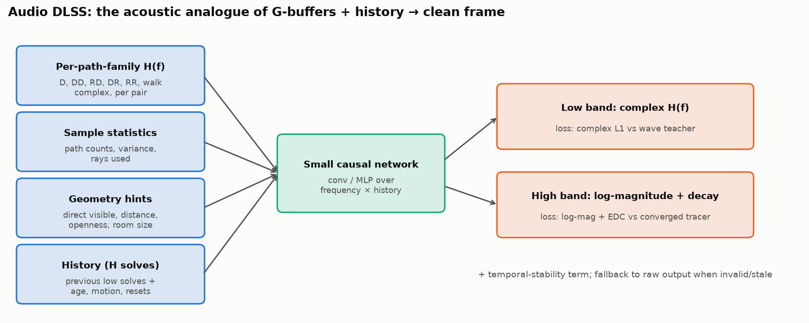
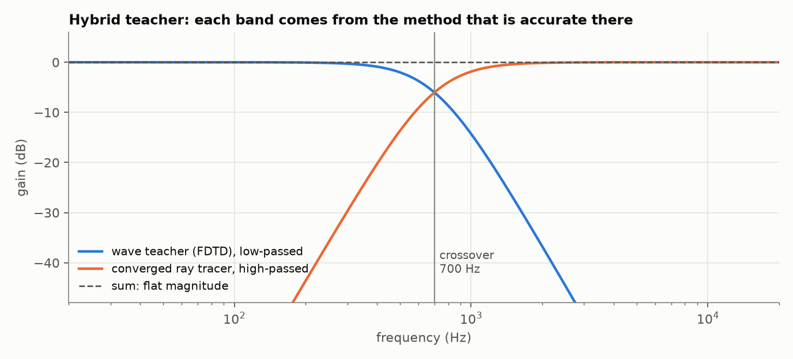
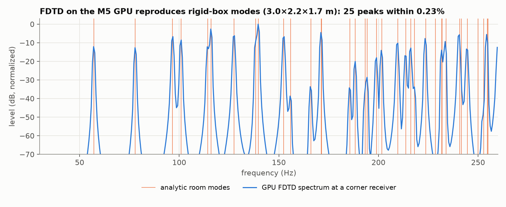
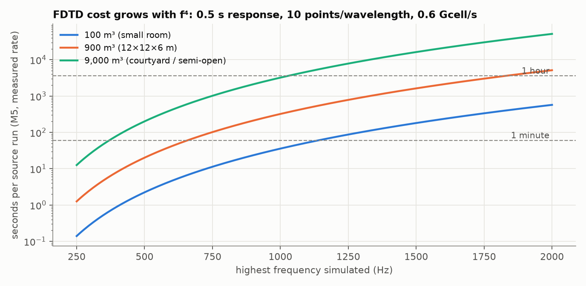
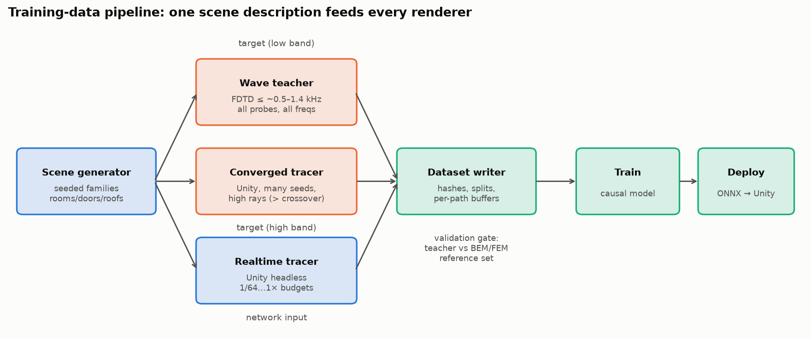

# Audio DLSS: where the renderer stands and how to scale training environments

Written 28 October 2026.
Numbers come from committed benchmark reports (`docs/benchmarks/…`), a literature survey, and one new GPU feasibility run.
Anything marked **[est.]** is an estimate, not a measurement.

**Short version.**
The renderer's remaining error at low frequencies is a *systematic bias*, not sampling noise, and adding more path orders made it worse.
That is the regime where sound behaves like waves, not rays.
The fix the field uses is a **hybrid**: a wave simulation below roughly 0.5–1.4 kHz and ray tracing above.
For us, that hybrid becomes the *training target* for the learned upscaler.
A fused GPU wave solver on this Mac now matches both independent wave references (125 Hz canopy 1.37%, 250 Hz blocks 0.79%), so the stage-1 gate is passed for rigid geometry.
Its second-order dispersion makes complex-accurate data roughly 35 cells per wavelength, far more than first assumed, so a 500 Hz pilot is GPU-hours per scene family, not overnight.
What's missing is a procedural scene generator, wall impedance, and a lower-dispersion scheme before 1 kHz.

**Revised direction, 29 October 2026.**
The upscaler's primary target is now the **converged ray tracer**, not the wave solver.
It learns low ray budget → high ray budget from the same renderer, which keeps inputs and targets in one physical model and makes labels free to generate.
That should generalise to unseen geometry better than learning ray → wave, which would ask the network to infer missing physics.
The cost is that the output inherits the tracer's physics bias (29% whole map / 87% shadow at 125 Hz on the canopy).
That bias is fixed in the tracer itself and measured against the validated FDTD solver, which becomes a validation tool rather than the bulk label source.
Ray → wave remains a secondary experiment on a small FDTD-labelled subset, scored on held-out scene families.
Sections 5–8 below describe the original hybrid-teacher plan; the hybrid crossover stays relevant for that experiment and for qualifying tracer improvements.

---

## 1. What the renderer actually computes

For every source → listener pair, the renderer estimates a **complex frequency response** `H(f)`.
Feed a pure tone at frequency `f` into the source, and `H(f)` tells you how loud (magnitude) and how delayed (phase) it arrives at the listener.
Convolving a dry recording with the corresponding impulse response gives what the listener hears.

A ray tracer builds `H(f)` as a sum over **paths**:

```text
H(f) = Σ over paths k   a_k(f) · exp(−i · 2π f · τ_k)
```

- `τ_k` is the path's travel time (length / speed of sound).
- `a_k(f)` is its strength: spreading loss, wall absorption, and a diffraction coefficient if the path bends around an edge.
- Path families are named by their interactions: **D** = one edge diffraction, **DD** = two edges, **RD** = reflection then edge, **RR** = two reflections, and so on.

Two things can go wrong:

1. **Noise.** We can't enumerate every path, so we sample them randomly. With few samples the sum fluctuates from seed to seed. More samples shrink this.
2. **Bias.** The path model itself is incomplete or wrong. Then even infinitely many samples converge to the wrong answer.

Graphics DLSS only has to fix (1): the rasterizer's physics is the ground truth it upsamples toward.
Our upscaler has to deal with both, and keeping them separate is the central design decision below.

## 2. Why low frequencies are hard for rays

Ray tracing assumes sound travels in straight lines and bounces like light.
That approximation holds when obstacles are **much larger than the wavelength** `λ = c / f` (speed of sound ÷ frequency).



At 125 Hz the wavelength is **2.7 m**.
Our canopy test room is 6.5 m deep with a 1.8 m doorway, so the wavelength is about the size of the doorway and half the room.
In that regime sound **wraps around** openings, the room **resonates** at specific frequencies (standing waves/modes), and nearby paths **interfere** strongly.
A ray model approximates the wrapping with edge diffraction and can't produce modes at all unless it carries enough reflection orders with the exact phase.

Above roughly 1 kHz (λ ≈ 34 cm) the picture flips: walls and doorways are many wavelengths across, rays work well, and wave simulation gets expensive (§5).

### The benchmark scene



Seven rigid boxes form a roofed room with a doorway.
The source sits outside; most receivers inside have **no line of sight**, so everything they hear arrives by diffraction or reflection.
The ground truth is a boundary-element (BEM) wave solution at 125 Hz: 7,904 triangles, 141 s for this single frequency, and it changes by 0.43% under mesh refinement.

## 3. Where the renderer stands today



The error metric is complex relative L2 error: it penalises both wrong loudness and wrong phase across all 1,166 receivers.
- The solid-boundary bake (accepted on 28 October) is the best result: **29% whole map, 87% in the blocked region**.
- Adding third-order paths made it **4× worse** (119–124%).
- In the blocked region the error is still near 100%, i.e. roughly as large as the signal itself.

### Bias or noise? Look at one receiver



Each point is the renderer's complex pressure at indoor receiver #323, with **one million** samples and two different random seeds.
- The two seeds of each variant sit close together: the noise is small.
- Both sit far from the star: the answer is **systematically wrong by about 47%**.
- Going from separate objects to the solid bake moved the estimate toward the truth (that was a real geometric fix).
- Third order scattered it widely: more paths added variance *and* didn't fix the bias.

So at 125 Hz in an enclosed room, spending more rays won't close the gap.
The path model is missing physics: higher-order wave interactions that the room's size makes important.

### At realtime budgets, noise dominates too



At realtime budgets (around 2 rays per frequency bin) the result swings by **7×** between seeds (42% vs 280% whole-map error, diffraction off).
At 128 rays both seeds agree at about 28%.
At 128 complete-route samples in the baked room, five-probe errors are 171% and 400% on two seeds.
These spikes come from rare, very high-weight path samples.

**Consequence.** The upscaler sees inputs that are both noisy (realtime budget) and biased (missing low-frequency physics).
It must learn two different corrections.

## 4. What "audio DLSS" means here

| Graphics DLSS | Our audio upscaler |
|---|---|
| Low-resolution, aliased frame | Low-ray-budget `H(f)` per source/listener pair |
| G-buffers (depth, normals, motion vectors) | Per-path-family sums, path counts, direct-path visibility, distance, room openness |
| Previous frames + motion vectors | Previous low solves + their age, listener/source motion, reset flags |
| Ground truth: offline supersampled render | Ground truth: **wave simulation** below the crossover, **converged ray tracing** above |
| Output: clean high-res frame | Output: clean `H(f)` (complex at low freqs, magnitude + decay at high freqs) |



Why break the input down by path family rather than one summed `H(f)`?
- A single outlier path ruins the sum; separated buffers let the network see *which* family spiked and down-weight it.
- Families have different bias patterns: e.g. DD paths dominate the indoor probe in the baked room.
- It's the same reason graphics denoisers take separate diffuse/specular buffers.

The research survey found **no published network** that takes low-ray-count acoustic ray-tracing output and reconstructs a wave-accurate response.
Existing systems either map a scene description directly to an impulse response (MESH2IR, Listen2Scene), are fitted to one scene (NAF, AV-NeRF, DeepONet), or learn single-object scattering.
The closest methodological relative is the graphics Monte Carlo denoising literature.

## 5. The training target: a hybrid teacher



Each frequency band takes its target from the method that is accurate there:
- **Below the crossover:** a time-domain wave simulation (FDTD, explained below). It captures diffraction, modes and interference exactly, up to the grid's resolution.
- **Above the crossover:** our own Unity ray tracer at a very high ray count, averaged over many seeds. Rays are physically adequate there, and using *our* tracer means the high-band target differs from the realtime input only by noise.
- The two are blended with a crossover filter (Linkwitz-Riley, shown) whose low-pass and high-pass sum to a flat magnitude. GWA calibrated its two bands to 0.5 dB mean error this way.

Published crossovers: AcousticRooms 710 Hz, HiFi-HARP 900 Hz, GWA 1.4 kHz, Treble10 5 kHz.

This also gives the network **two separately measurable residuals**:
- **noise residual** = realtime tracer − converged tracer (pure sampling noise);
- **bias residual** = converged tracer − wave teacher (missing physics, low band only).

Training with separate loss terms tells us which correction the network actually learned.

### Why FDTD rather than the BEM/FEM solvers we already use

BEM and FEM solve **one frequency at a time**.
The canopy reference took 141 s for one frequency; a broadband response needs hundreds of frequencies.

FDTD (finite-difference time-domain) instead simulates the actual pressure wave on a 3D grid, step by step in time:

```text
grid of air cells, spacing dx; walls = cells where air velocity is forced to zero
every time step dt:
    velocity  -= (dt / ρ dx) · (pressure difference between neighbouring cells)
    pressure  -= (ρ c² dt / dx) · (net velocity flowing into the cell)
record pressure at every receiver cell
```

- Fire a short pulse at the source, run until the sound has decayed, and you have the **impulse response at every grid cell at once**.
- A Fourier transform turns each impulse response into `H(f)` at **all frequencies at once**.
- **Reciprocity:** the response from A to B equals the response from B to A, so one run with the source at a *listener* position gives that listener's response to every possible source position.

The grid must resolve the shortest wavelength: about 10 cells per wavelength.
Halving the wavelength halves `dx`, which multiplies cells by 8 and time steps by 2, so **cost grows as f⁴**.
Plain second-order schemes also have a few percent phase error near the top frequency; production tools (PFFDTD) use a 13-point FCC scheme to reduce that and its memory.

### Feasibility run on this Mac

I wrote a minimal FDTD in PyTorch on the M5's GPU ([`fdtd_bench.py`](fdtd_bench.py)) and tested it on the one case with an exact answer: a closed rigid box, whose resonant frequencies are known in closed form.



Every spectral peak between 40 and 260 Hz (25 of them) lands within **0.23%** of an analytic mode, which equals the frequency resolution of the run.
Throughput is **0.56–0.64 billion cell updates per second** across 128³–320³ grids, using unfused PyTorch operations.
A fused Metal kernel should be several times faster **[est., unmeasured]**.

This was a correctness smoke test, not a qualified teacher.

### Stage 1 result: the teacher is qualified for rigid geometry (29 October)

The full validation is in [the FDTD teacher benchmark](../benchmarks/fdtd-teacher-2026-10-28/README.md).
- [`tools/fdtd_wave.py`](../../tools/fdtd_wave.py) runs fused Metal kernels (via PyTorch MPS) with a convolutional PML, exact box walls on velocity faces, and analytically normalised complex output.
- Against the canopy BEM it gives **1.37% whole map, 3.97% shadow, 4.66% at receiver #323**; against the blocks BEM **0.79% / 2.96%**. Nothing is fitted; the declared budget was 5%.
- Its own changes are small: 0.14% for the last grid refinement, 0.006% for a thicker or farther absorbing layer, 0.17% for truncation, and 0.03% against the analytic free field.
- The remaining canopy difference sits in the resonant room interior, where a 0.1 Hz frequency shift changes the field by 1.7%; it is most likely residual BEM mesh error, not proven.
- The lossless floorless room rings for seconds, so the canopy needed 1.2 s of simulated time; absorbing materials will shorten this.
- The PFFDTD Metal fork was checked and not adopted: Cartesian only, first-order boundary absorber rather than a PML, and Metal untested in its CI.
- Throughput is about 1.9–2.3 billion cell updates per second, three to four times the unfused sketch.
- Not yet done: wall impedance (absorbing materials), oblique geometry (staircasing needs its own convergence check), and broadband validation.

### What it costs



Seconds per source run at the measured 0.6 Gcell/s, for a 0.5 s response at 10 cells per wavelength:

| Volume | 500 Hz | 1 kHz | 1.4 kHz | Grid memory at 1.4 kHz |
|---|---:|---:|---:|---:|
| 100 m³ (small room) | 2 s | 36 s | 2.3 min | 0.1 GB |
| 900 m³ (12×12×6 m) | 20 s | 5.4 min | 21 min | 1.0 GB |
| 9,000 m³ (courtyard) | 3.4 min | 54 min | 3.4 h | 9.8 GB |

Open scenes also need an absorbing margin around the domain, which adds volume.
16 GB of RAM caps us at roughly the courtyard at 1 kHz; larger or higher-frequency runs belong on a rented CUDA GPU.

**Prototype budget [est.]:** 500 scenes × ~4 listener runs × ~20 s (900 m³ at 500 Hz) ≈ 11 GPU-hours at the measured rate.
That is overnight on this Mac with throttling, or less with a fused kernel.

**Revised after stage 1.** The table above assumes 10 cells per wavelength, which the stage-1 dispersion measurement puts at about 60% complex error after 10 wavelengths.
About 35 cells per wavelength keeps free-field dispersion near 5% over 10 wavelengths: about 20 GPU minutes per 0.5 s source run for 900 m³ at 500 Hz at the measured 1.9 Gcell/s.
The same pilot is then roughly 670 GPU-hours, so it needs smaller rooms, rented GPUs, or a lower-dispersion scheme (FCC or fourth-order) first; complex-accurate 1 kHz in 900 m³ needs about 17 GiB.

## 6. Scaling environments

### The missing piece: one scene description, every renderer



A **procedural scene generator** writes one seeded scene description (boxes, materials, sources, probe grid).
The same file drives:
1. the FDTD teacher (voxelised);
2. a headless Unity batch render at the converged budget;
3. headless Unity renders at realtime budgets (1/64, 1/16, 1/4, 1×) with several seeds.

Using one description everywhere is what makes the comparison valid: the solid-boundary work showed that representation differences alone cause about 11% field error.

### Scene families

Ordered from easiest to hardest; each tests a specific failure:

| Family | Varies | Tests |
|---|---|---|
| Shoebox rooms | dimensions, materials | modes, decay, reflection phase |
| Rooms + doorway / window | opening size relative to λ, wall depth | diffraction into shadow (our current failure) |
| Coupled rooms, corridors, L-shapes | connection geometry | multi-edge paths, deep shadow |
| Canopies, roofs, overhangs | height, overhang depth, open sides | semi-open propagation (rain, church porch) |
| Barriers and obstacle fields | count, spacing, heights | multiple scattering, outdoor shadowing |
| Furnished interiors | random box "furniture" | clutter and scattering |

Material randomisation should draw from **measured absorption data**, not invented coefficients.

### Splits that measure the real risk

Published work usually holds out unseen receivers or unseen rooms *of the same kind*.
Nobody the survey found holds out a **whole family** (e.g. train on closed rooms, test on roofs/overhangs).
Doing that is the honest test for a shipped upscaler, because a player will walk into geometry types the model never saw.
All seeds, budgets and listeners from one scene stay in the same split.

### How many scenes

Evidence is thin.
AcousticRooms' 260 rooms still show a clear unseen-room gap; MESH2IR used 5,000 scenes.
**Plan [est.]:** ~500 for a pilot, 3,000–10,000 for real training.
Choose the final number by plotting held-out-family error against scene count and stopping where it flattens.

### What each scene stores

One HDF5 or Zarr file per scene, extending the dataset format already specified in `docs/simulation-contracts.md` §9:
- geometry: boxes/mesh, voxel grid, material IDs;
- probe grid positions;
- teacher `H(f)` per (listener, probe), plus a band-limited impulse response;
- tracer outputs at each budget and seed, broken down by path family, with path counts;
- short moving-listener sequences, so the network learns to use history.

Public datasets can't substitute: none stores complex responses on dense probe grids, none covers semi-open scenes, and most (GWA, SoundSpaces, RAF, Treble10) are **non-commercial** licences.
MeshRIR and RAF remain useful as *measured* real-room checks for research.

## 7. Loss design

- **Low band:** complex L1 on `H(f)` against the wave teacher, so phase is learned, not just loudness.
- **High band:** log-magnitude plus an energy-decay-curve (EDC) loss. The RAF benchmark found decay-aware losses clearly improve perceived reverberation metrics.
- **Temporal stability:** penalise frame-to-frame changes the teacher doesn't have (the audio version of DLSS flicker/ghosting).
- **Avoid magnitude-only outputs.** xRIR outputs magnitude spectrograms and must guess phase afterwards; that can't represent the low-band interference we care about.

**Required baseline:** the model must beat simply spending its inference time on more rays.
The spec already demands this comparison at matched total cost.

## 8. Staged plan with gates

| Stage | Work | Gate before moving on |
|---|---|---|
| 1 | Fused GPU FDTD (or verify the PFFDTD Metal fork) with absorbing boundaries and wall impedance | Matches the 125 Hz canopy BEM and the 2D/2.5D reference set within a declared budget, e.g. under 5%. **Passed for rigid walls on 29 October:** canopy 1.37%, 250 Hz blocks 0.79%. Wall impedance remains. |
| 2 | Procedural generator + headless Unity batch renders from the same scene file | Same scene compiles identically to FDTD voxels and Unity primitives; renders reproducible by seed |
| 3 | Dataset writer (hashes, splits, per-family buffers) | Split isolation and identity checks pass |
| 4 | ~500-scene pilot at ≤500 Hz crossover; small causal model | Beats equal-cost extra rays on **held-out families**, measured separately for noise and bias |
| 5 | Scale to 1–1.4 kHz and thousands of scenes on rented GPUs; export to Unity | End-to-end latency/memory within the live budget |

## 9. Other pipeline improvements found during the review

These matter for realism independently of the upscaler:

1. **Validate high frequencies.** Every wave comparison so far is at 125 or 250 Hz. Rays should be accurate at 1–4 kHz; confirm we actually are there before relying on the tracer as the high-band teacher.
2. **Audio synthesis is the realtime bottleneck.** The 98-source rain take spent 29 s in synthesis for 6.5 s of audio (4.5× slower than realtime) versus 1.25 s of transport. An interactive walk also missed audio deadlines, with GPU completion up to 287 ms. This needs profiling and probably source clustering/budgets.
3. **Materials are rigid in every accuracy test.** Real walls absorb with frequency-dependent phase. FDTD supports impedance boundaries, so material presets can be calibrated against measured data within the same teacher.
4. **Moving sources, listeners and geometry** (Doppler, opening doors) are unvalidated against any wave reference.
5. **Automatic solid boundaries** are implemented (`9cff9a3`): the same accurate geometry without a manual bake step. See [acoustic-solid-bake.md](../acoustic-solid-bake.md).

## 10. Risks and unknowns

- The FDTD teacher passed the rigid canopy and blocks comparisons; impedance boundaries, oblique geometry and broadband responses are still unvalidated.
- Second-order dispersion sets the cost: complex-accurate data needs about 35 cells per wavelength, so the overnight pilot estimate was optimistic by more than an order of magnitude.
- A network trained on teacher data inherits the teacher's limits: staircased oblique walls in FDTD, missing physics in the high-band tracer.
- Scene count needed for generalisation is unknown until measured.
- Inference may cost more than the rays it saves; the equal-cost baseline decides.
- Running GPU jobs on this machine competes with Unity and previously made the desktop sluggish; long runs need throttling or a rented GPU.

## Sources

Benchmarks: [solid boundary](../benchmarks/solid-boundary-2026-10-28/README.md), [third order](../benchmarks/third-order-2026-10-28/README.md), [finite diffraction](../benchmarks/finite-diffraction-2026-10-28/README.md), [wave review](../benchmarks/wave-review-2026-10-27/README.md), [cleanup results](../cleanup-results.md).

- GWA dataset (hybrid PFFDTD + GA, crossover calibration): <https://ar5iv.labs.arxiv.org/html/2204.01787>
- PFFDTD solver (MIT): <https://github.com/bsxfun/pffdtd>; fork with Metal engine files, usability unverified: <https://github.com/tobanteAudio/pffdtd>
- SoundSpaces 2.0: <https://ar5iv.labs.arxiv.org/html/2206.08312>
- AcousticRooms / xRIR: <https://arxiv.org/html/2504.10746v1>
- HiFi-HARP: <https://arxiv.org/html/2510.21257v1>
- Treble10: <https://arxiv.org/html/2510.23141v1>
- MESH2IR: <https://ar5iv.arxiv.org/html/2205.09248>
- RAF (measured, decay-aware losses): <https://arxiv.org/html/2403.18821v1>
- MeshRIR (measured dense grid): <https://arxiv.org/pdf/2106.10801>
- RLF (Ubisoft La Forge / Audiokinetic, SIGGRAPH 2026; PFFDTD at 500 Hz as ground truth): <https://arxiv.org/html/2602.06937v2>
- Monte Carlo denoising survey: <https://dl.acm.org/doi/full/10.1145/3768618>

Figures are generated by [`make_figures.py`](make_figures.py); the FDTD trace comes from [`fdtd_bench.py`](fdtd_bench.py) (needs PyTorch with MPS).
