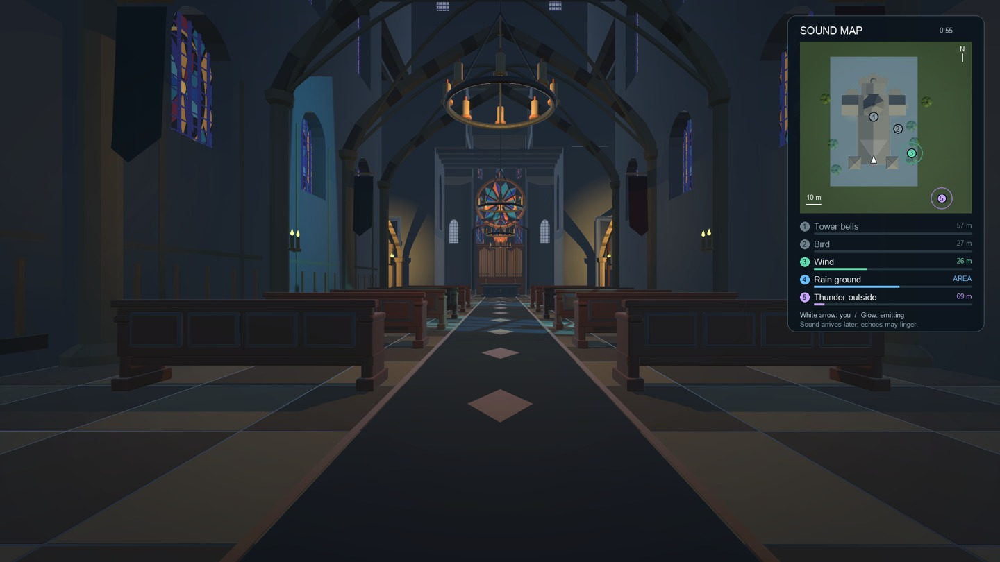

# First-person walkthrough with sound map

The 71-second alternate film keeps the camera at the gameplay head pose throughout, including the bell, bird and storm sections. There are no external camera cuts. The white map arrow and viewing cone track the viewer; numbered markers show sound-source positions, with colors, pulses and relative activity bars during emission. The bird marker follows its recorded flight. Rain highlights the recorded exposed-ground mask rather than a single point in the church.

The local movie is `.context/church-first-person/church-first-person.mp4`; a delivery copy is in the Conductor workspace's `.context/church-walkthrough/`. [Verification](verification.json) records the movie hash, full frame count, camera alignment, numeric parity and decoded audio checks. [Replay verification](replay.json) checks the new capture against reconstruction from compact inputs.

`ChurchPresentationCapture.CaptureSequence -sequenceFirstPerson 1` captures the camera, static scene map and view poses. [The compositor](../../../tools/sequence_movie.py) reads the existing take's events, PCM and source poses to build the overlay. This is an offline film overlay; it does not add a runtime HUD or another audio scheduler. [Reproduction and supported source types](../../scene-presentation.md#first-person-sound-map--25-october-2026).

The source indicators describe emission before propagation. They are not receiver loudness meters or ray/reflection visualizations. Activity bars use each source's short-window PCM envelope and authored gain relative to that source's reference level; they cannot be compared as calibrated SPL. Rain's tint shows its logical emitting mask, not individual drops or the positions of its eight transport samples. The initial overhead map remains static while source/player markers move.

All camera positions and directions are checked against the recorded head/listener. The complete route, scene, acoustic poses, accepted events, clip hashes and voice-stream payload hashes match the original [balanced walkthrough](../church-sequence-2026-10-25/README.md), allowing its verified 32-bounce WAV to be reused. The same 1,040-sample DSP-latency trim and uniform listening gain are applied; physical travel delay and echoes remain intact. Seventeen activity checks cover cue boundaries, bird-call gaps, the looping rain source and the final stop. The finished MP4 is checked for 1080p, 30 fps, 71-second duration, finite decoded audio and no clipping.

Full frame capture, encoding and validation run silently offscreen. Raw frames and audio stay in `.context`; [small capture metadata](capture.json), [activity checks](activity-checks.json), [movie metadata](movie-probe.json) and [the verification script](verification.zip) are retained here.

The first capture was interrupted after frame 1712. A new deterministic run rendered frames 1710–1800; its three overlapping images are pixel-identical to the earlier images, and the earlier numeric payload is an exact prefix of the new take. The finished movie uses 1,710 earlier images plus 91 resumed images. The stationary image at 60 seconds is held through the eleven-second audio tail while the map clock continues; the compositor verifies that all remaining camera poses are stationary. See [resume checks](resume-checks.json).

## Background load

When the user reported lag, this workspace's original capture process was absent. A separate Unity editor running `LaserGame` was sampled near 160% CPU, later dropping near idle; the machine also had about 6 GiB of compressed memory. These observations do not establish a sole cause of intermittent lag, and no unrelated editor was changed or stopped.

The exporter now uses background task policy, `nice 19`, one Unity worker and enforced sleeps between images. Its own launcher stops its process above a 3 GiB resident-memory limit and cleans up its worker on interruption. The compositor and its single encoder thread inherit low CPU priority. Reusing the existing WAV avoids the earlier 7.62 GiB numeric audio workload.

The resumed run measured **16.17 seconds of frame work and 71.22 seconds of enforced idle time**, an **18.51% frame duty cycle**, with **1.06 GB peak sampled resident memory**. Startup, imports and the numeric simulation are outside the frame-duty measurement, so this is not a system-wide utilization cap. All capture/encoding workers finished. [Resource summary](resource-summary.json), [samples](resources.json), [short throttle check](throttle-check.json).
