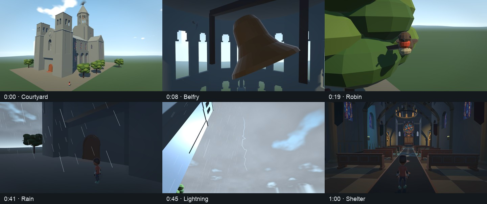

# Church sequence — 25 October 2026

Completed a 71-second, 1920 × 1080, 30 fps film: a walking character encounters tower bells, a calling robin, increasing wind/clouds, rain, then lightning/thunder before entering the church. The bell body/clapper, bird, foliage, lighting, clouds and rain are visible scene behavior. The acoustic listener stays at the character's head during camera cuts.

The local movie is `.context/church-sequence/church-walkthrough.mp4`, with a delivery copy in the Conductor workspace's `.context/church-walkthrough/`. [Artifact locations and movie hash](artifacts.json) identify both the delivered movie and unnormalized float WAV. Large captures stay outside Git.

## Implementation and validation

`SceneSequence` is the shared numeric timeline and evaluator. `SceneSequenceActor` binds it to simulation/replay; separate bell, bird and environment components present the same state. Audio uses the existing Play/Gain/Stop path, explicit sample timestamps and transport. No event-specific ray kernel, object-vibration synthesis or new runtime package was added.

The saved scene retains its 32-bounce profile, materials, geometry and reflections. Its compiled acoustic geometry hash remains `ae3764e138c4da135b3f802dabc7cf5a3b754d854aa5b4958e8b5514ae2bf38f`, matching the earlier Church take. There are 70 acoustic objects, 17,321 primitives, ten registered sources and one mono listener. Five sources are sequence-owned; the organ is idle and four voice slots contain silence in this offline capture.

- [Nine targeted EditMode checks](tests.xml) cover event partition/reset, weather/wetness, integrated wind travel, authoring validation, frozen definitions/restart phase, isolated bindings, silent capture and simulation timestamps.
- [Compact replay](replay.json) reproduces all 3,002 observations across 3,001 ticks and 3,214 events byte-for-byte, with zero position/rotation/velocity error. The engine's actual fixed step is used, including its float quantization.
- [Audio render](render-run.json) completed on Apple M5 / Unity 6000.4.1f1 with GPU Metal transport and synthesis, 32 bounces, two rays per bin, FFT 1,024 / hop 256 and four responses per batch. The 71.02-second WAV took **103.71 seconds**, with **8,183,365,700 bytes (7.62 GiB)** of numeric working storage. This is an offline result.
- [PCM checks](quality.json) find finite samples, the expected silent opening, audible event windows and no full-scale samples. Master peak is 0.548727. The eleven-second tail covers the renderer's measured response support.
- [Movie inspection](movie-probe.json) verifies 2,130 frames, 71 seconds, 44.1 kHz mono AAC and seven chapters. [Decoded AAC checks](movie-audio-check.json) find finite samples, peak 0.830219 and no full-scale samples.

The initial mix masked bells and thunder with rain. Authored gains were adjusted to bell 26, bird 1.4, wind 6, rain 0.1 and thunder 40. These are audibility settings, not calibrated sound-pressure levels. The [mix audit](mix-revision.json) confirms that only source gains changed: geometry, poses, event samples/actions/offsets and visual timing stayed identical. The final numeric capture also [matches the balanced render inputs](numeric-parity.json), including source PCM and silent streams; its only code change restores temporary capture quality settings in `finally`.

The movie removes the renderer's reported **1,040-sample DSP latency**, preserves physical travel delays, and applies one uniform gain of **1.5490401048868632**. There is no per-event post-render compression or normalization. The raw WAV remains unchanged. Validation ran silently; the movie was not auditioned through speakers.

## Reproduction

Use an isolated copy of the current `Assets`, `Packages` and `ProjectSettings`. Keep the source project unchanged during capture/replay. All Unity commands use `-batchmode -force-metal -disable-audio -job-worker-count 1 -projectPath <runner>`; do not add `-nographics` because Metal rendering is required. No Play mode, microphone or network session is started.

1. Run `-executeMethod ChurchPresentationCapture.CaptureSequence -sequenceOutput <new-directory> -quit`. Add `-sequenceStoryboard 1` for framing or `-sequenceTakeOnly 1` for numeric capture only.
2. Restore the runner's original `ProjectSettings/DynamicsManager.asset` and `ProjectSettings/QualitySettings.asset` from the frozen source copy after Unity exits. This Unity version reserializes those older assets on exit. Compact replay intentionally rejects that changed project hash; restoring the original inputs preserves the guard.
3. Run `-executeMethod ChurchPresentationCapture.VerifySequence -sequenceOutput <directory> -quit` to reconstruct from compact inputs and compare poses/events.
4. Run `-executeMethod TakeBatch.Render -takeJob <directory>/render-job.json`. This entry point exits itself. Retain its `audio/run.json` and original WAV.
5. Encode the numbered images with H.264, 30 fps, CRF 18, `yuv420p`, and faststart. Mux the WAV with AAC at 192 kbit/s, trimming only the reported DSP latency. Add `chapters.ffmeta`, apply the uniform listening gain and pad/trim to the planned 71 seconds.

The full image capture produced 1,971 contiguous frames before its process was interrupted during the final interior hold. The movie clones the final image for the remaining 5.3 seconds of that planned hold. The entire numeric take had already completed. State and event timing match the later balanced take; the full audio was rendered to completion independently.

[Authoring/check scripts and capture/replay logs](authoring.zip) preserve the local audio preparation, numeric analyzer, chapter metadata and render job. Runtime/editor implementation is versioned under `Assets`; [source credits](../../../Assets/External/Church/README.md) record the CC0 audio provenance. The sequence and future extension boundaries are described in [the specification](../../simulation-contracts.md#sequenced-church-walkthrough-and-environment-behavior-planned).

## Limits

This is an authored audiovisual demonstration of the existing acoustic renderer, not a validated physical rain or modal-vibration model. Rain uses the existing fixed-site masked plane; its visible streaks use a separate static shelter-height map. Wind moves visual foliage and controls one rustle source. Thunder uses a point recording rather than a distributed lightning channel. The bell and bird recordings retain environmental acoustics from their originals. Wetness persists but does not model drying/runoff. Multiplayer sequence authority, late join, object radiation, physical drop excitation and local weather regions remain deferred.
