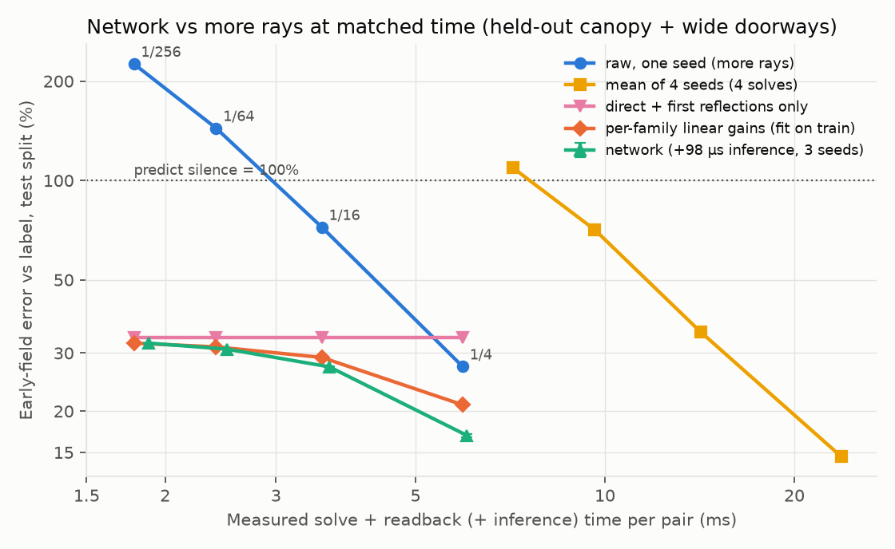
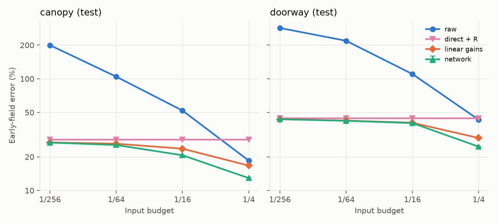
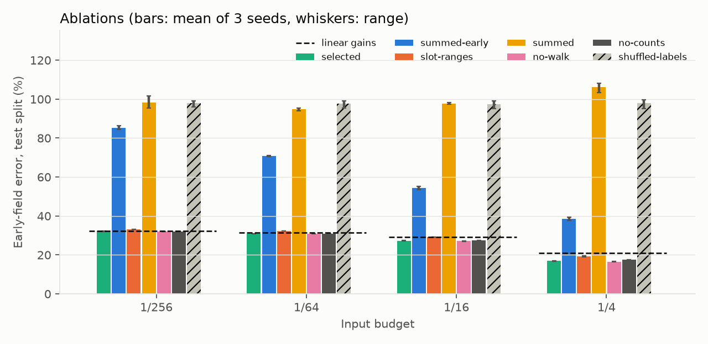
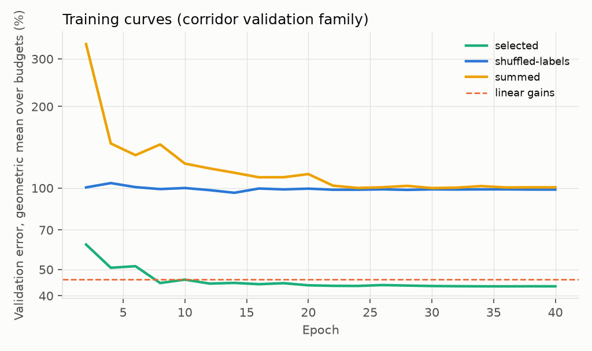
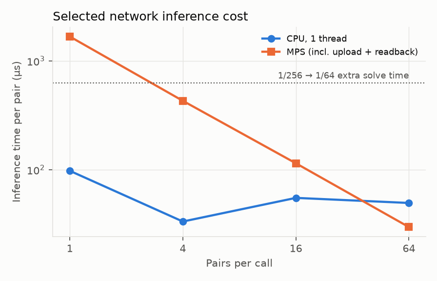

# First audio-DLSS denoiser — 2 November 2026

**Verdict: a small network beats "spend the same time on more rays" by a wide margin, but almost all of that win comes from something that needs no network.**
On the held-out test split (whole canopy family and doorways wider than 1.5 m), the network is 32 / 31 / 27 / 17% wrong at the 1/256 / 1/64 / 1/16 / 1/4 budgets.
The raw tracer is 226 / 144 / 72 / 27%, and spending four times the rays only brings it to 144 / 72 / 27%, so at every budget the network plus its inference time beats the next ray budget.
But keeping the deterministic direct and first-reflection buffers and dropping everything else already gives 33% at every budget, and fixed per-family gains fitted on the training split give 32 / 31 / 29 / 21%, for no inference cost.
Against that stronger bar the network adds nothing at 1/256, half a point at 1/64, 2 points at 1/16 and 4 points (21% to 17%) at 1/4; once its inference time is spent on rays instead, its lead below 1/4 shrinks to between −0.1 and 1.4 points (interpolated), and the next measured ray budget with fixed gains beats it outright at 1.3–1.7× the time.
The useful finding is the per-family breakdown, not the network: without it, both a network and a fixed gain stay at 54% or worse below 1/4.

All numbers are measured on this Mac (Apple M5, 16 GB, shared desktop) under `nice 19`.
The error is the pilot's metric: complex relative L2 `sqrt(sum|x - label|^2 / sum|label|^2)` over receivers and frequencies, averaged as an RMS over scenes, against the 8-seed converged early field (every family except the residual walk).
Predicting silence scores exactly 100% on this metric, so anything above 100% is worse than outputting nothing.
Dataset: `denoise-pilot-v1` (SHA-256 of `dataset.json` `ef63b2f0…`), verified with `tools/dlss_dataset.py verify` (2,496 payload hashes) before every run; see the [pilot report](../denoise-pilot-2026-10-29/README.md).



## Setup

#### Data and splits

The 63 accepted pilot scenes are used; the 9 rejected scenes contribute nothing.
Training: 36 scenes, 1,916 receivers (shoebox, barriers, narrow doorways, sparse furnished).
Validation: 12 corridor scenes, 560 receivers; every dense furnished room was rejected by the pilot's label acceptance, so validation is the corridor family only.
Test: 11 canopy and 4 wide-doorway scenes, 875 receivers.
Each example is one pair (budget, input seed, receiver): 30,656 training pairs, each with 32 frequencies × 8 family buffers.
One model serves all four budgets.

#### Inputs and their runtime source

| Feature | Runtime source |
|---|---|
| Per-family complex buffers `x_f(q)`: direct, R, D, DD, RD, DR, RR, walk | The ordinary solve's read-back path list, binned by slot range (direct, image reflections, walk, complete routes) and, for the five complete-route families, by `TransportSolver.CompleteSampleFamilies()` (an extra synchronous route-table readback). |
| Path counts per family and frequency | Same binning, counting nonzero arrivals. |
| Budget (1/256 … 1/4) | Renderer settings (`raysPerBin`, `completeRouteSamples`). |
| Source–listener distance | Game state. |
| Direct-path visibility | The renderer's deterministic direct path (`pressureGain != 0`), not the generator's analytic flag. |
| Frequency index | Fixed 32-bin grid. |

Not used: the label, other seeds, neighbouring receivers, the analytic line-of-sight flag, world-frame offsets, the per-family peak weights (the task's runtime contract lists buffers, counts and budget only) and scene IDs.
The measured solve times (`seconds-*.f32`) cover the synchronous solve and path readback only; the family binning and the route-table readback are **not** in them and are unmeasured.
The slot-range ablation below shows what is left if only the free slot ranges are used.

#### Normalisation

Each pair is divided by a runtime scale `s` = the median over frequency of `sqrt(sum over early buffers |x_g(q)|^2)`, floored at 1e-6.
The median ignores the few frequencies a spike lands on, and excluding the walk keeps its heavy tail out of the scale.
All features use `x / s`, and the output is multiplied back by `s`, so the model is exactly scale-equivariant (a unit test checks this); it never sees absolute level.
Complex buffers enter as real/imaginary pairs with their magnitude log-compressed (`u · log1p|u| / |u|`, phase kept), plus `log1p|u|`, `log1p(count)`, per-buffer summaries over frequency (log RMS, log peak-to-RMS, mean log count), budget, log distance and visibility.

#### Model

The selected model (`gain-k1-w32`, 4,658 parameters, 145k multiply-accumulates per pair) is a per-frequency MLP shared across the 32 frequencies, with the pair summaries broadcast to every frequency.
It predicts a complex gain per buffer and a complex residual at each frequency: `y(q) = s · (sum_g w_g(q) · u_g(q) + r(q))`, initialised to the raw early sum.
Variants with 1D convolutions over frequency (kernels 3 and 5), a whole-pair MLP and a direct-output head were within 0.1–1 point on validation (candidate table below).

#### Loss

Pseudo-Huber on the complex error divided by the scene's label RMS, `delta^2 (sqrt(1 + (e/delta)^2) - 1)` with `delta = 1` field RMS, masked by the label validity flags and weighted so every scene counts equally.
It is quadratic for ordinary errors, matching the L2 metric, and linear above one field RMS, so a pair whose RR or walk buffer spikes cannot dominate a batch.
Plain squared error reached the same validation error (0.1 point worse), but its early epochs were dominated by those spikes (mean squared error 58 field RMS² at epoch 2, with validation error swinging by up to 12 points between evaluations until epoch 20).
Labels and the scene RMS are used only in the loss.

#### Training and selection

AdamW (learning rate 2e-3 one-cycle, weight decay 1e-4), batch 256, 40 epochs, gradient clipping at 1, CPU with two threads; 70–500 s per run, 0.8 CPU hours for all 28 runs.
Validation was scored every second epoch and the best epoch kept.
Selection rule: the fewest multiply-accumulates among candidates within 0.01 of the lowest mean log validation error over budgets.
This rule was tightened after the sweep, before any test evaluation, to honour the "smallest model that works" requirement: the best-scoring candidate (`gain-k5-w64-d3`, 15× the compute) was 0.8% better on validation.
The test split was first evaluated once for the selected model, its ablations and the baselines; it was then re-evaluated twice to add the slot-range ablation and two fixed-gain baselines, with the selected model untouched and its numbers bit-identical across the three evaluations.

## Results

#### Test split at matched time

| Budget | Solve ms | Raw | Raw, 4× rays | Direct + R only | Linear gains | Linear gains, 4× rays | Mean of 4 seeds | Network (3 seeds, range) | Network ms |
|---|---:|---:|---:|---:|---:|---:|---:|---:|---:|
| 1/256 | 1.78 | 226% | 144% | 33% | 32.1% | 31.3% | 109% | 32.1% (32.1–32.2) | 1.88 |
| 1/64 | 2.41 | 144% | 72% | 33% | 31.3% | 29.1% | 71% | 30.8% (30.8–30.8) | 2.51 |
| 1/16 | 3.55 | 72% | 27% | 33% | 29.1% | 20.9% | 35% | 27.2% (27.2–27.3) | 3.64 |
| 1/4 | 5.94 | 27% | n/a | 33% | 20.9% | n/a | 15% | 16.9% (16.6–17.0) | 6.04 |

- "Solve ms" is the measured synchronous solve and readback per pair on the test split; "Network ms" adds the measured CPU inference for one pair per call (98 µs, below).
- Raw, raw at 4× rays and mean of 4 seeds reproduce the pilot's test baselines exactly (226 / 144 / 72 / 27% and 109 / 71 / 35 / 15%).
- **Linear gains** are eight real gains per budget, fitted by least squares on the training split (direct 1.00, R 0.95–0.97, D 0.25–0.66, DD/RD/DR 0.002–0.20, RR 0.01–0.51, walk 0.00); they cost eight multiplies per entry.
- **Against raw rays the network wins everywhere:** 1/256 + network (1.88 ms, 32%) against 1/64 raw (2.41 ms, 144%); 1/16 + network (3.64 ms, 27.2%) ties 1/4 raw (5.94 ms, 27.3%) in 61% of the time.
- **Against fixed gains plus more rays it does not:** interpolating the fixed-gain curve to the network's total time [est., log-log between measured budgets] gives 32.0 / 31.1 / 28.6% at 1/256 / 1/64 / 1/16, against the network's 32.1 / 30.8 / 27.2%, a difference of −0.1 to +1.4 points; the next budget with fixed gains is better than the network at every step (31.3, 29.1, 20.9%), at 1.3–1.7× the time.
- At 1/4 the network's 16.9% against the fixed gains' 20.9% is its one clear gain; reaching it with rays would take roughly 1.4× the solve time [est., extrapolating the 1/16 → 1/4 fixed-gain slope], and there is no measured budget above 1/4 that is independent of the label.
- Both the network and the fixed gains shrink: they return 90–98% of the label energy (−0.4 dB at 1/256, −0.1 dB at 1/4) where the raw sum returns 6× too much at 1/256.

#### Per family (test)

| Family | Budget | Raw | Direct + R | Linear gains | Network |
|---|---|---:|---:|---:|---:|
| canopy | 1/256 | 200% | 28% | 26.9% | 26.8% (26.8–26.9) |
| canopy | 1/64 | 104% | 28% | 26.2% | 25.5% (25.5–25.6) |
| canopy | 1/16 | 52% | 28% | 23.7% | 20.7% (20.5–20.8) |
| canopy | 1/4 | 19% | 28% | 16.7% | 12.9% (12.5–13.1) |
| doorway | 1/256 | 285% | 44% | 43.4% | 43.5% (43.4–43.6) |
| doorway | 1/64 | 219% | 44% | 42.2% | 42.0% (42.0–42.1) |
| doorway | 1/16 | 110% | 44% | 40.4% | 40.1% (40.1–40.1) |
| doorway | 1/4 | 43% | 44% | 29.5% | 24.7% (24.6–24.8) |

The network's gain over fixed gains is larger in the canopy family (3 points at 1/16, 4 at 1/4) than in wide doorways (0.3 and 5 points).
In wide doorway rooms direct and R alone are 44% wrong, and below 1/4 neither method recovers much of the complete-route remainder.



#### Tails (test; |error| relative to the label's receiver RMS at each frequency)

| Budget | > 1× RMS raw / linear / network | > 3× RMS raw / linear / network | Energy ratio raw / linear / network |
|---|---:|---:|---:|
| 1/256 | 32.1% / 1.6% / 1.6% | 9.00% / 0.00% / 0.00% | 6.05 / 0.90 / 0.90 |
| 1/64 | 27.8% / 1.4% / 1.4% | 5.06% / 0.00% / 0.00% | 3.08 / 0.91 / 0.91 |
| 1/16 | 12.4% / 1.1% / 0.9% | 0.61% / 0.00% / 0.00% | 1.53 / 0.92 / 0.93 |
| 1/4 | 1.4% / 0.4% / 0.3% | 0.02% / 0.00% / 0.00% | 1.07 / 0.94 / 0.98 |

Spikes are removed equally well by the fixed gains: no entry of either is wrong by more than three field RMS.

#### Candidates (validation; corridor family)

| Candidate | Parameters | MACs / pair | 1/256 | 1/64 | 1/16 | 1/4 | Score | Best epoch |
|---|---:|---:|---:|---:|---:|---:|---:|---:|
| gain-k5-w64-d3 | 66,706 | 2,125,824 | 48.2% | 46.9% | 44.6% | 33.8% | 3.761 | 34 |
| gain-k3-w32 | 8,754 | 276,480 | 48.4% | 47.1% | 44.7% | 34.0% | 3.765 | 36 |
| gain-k1-w64 | 13,394 | 421,888 | 48.5% | 47.1% | 44.9% | 34.1% | 3.767 | 36 |
| gain-k1-w32 **(selected)** | 4,658 | 145,408 | 48.6% | 47.2% | 44.9% | 34.2% | 3.769 | 36 |
| gain-k1-w32-mse | 4,658 | 145,408 | 48.6% | 47.3% | 45.0% | 34.3% | 3.770 | 36 |
| flat-w128 | 127,440 | 134,784 | 49.3% | 47.5% | 45.1% | 34.4% | 3.776 | 28 |
| direct-k3-w64 | 28,738 | 913,408 | 49.0% | 47.4% | 45.2% | 34.7% | 3.776 | 40 |
| *raw / linear gains* | | | 471% / 48.8% | 307% / 48.1% | 137% / 46.6% | 67% / 40.5% | | |

Fifteen times more compute, convolutions over frequency or a whole-pair MLP buy at most 0.5 point; the architecture is not the bottleneck.

#### Ablations (selected recipe, 3 initialisation seeds each)

| Variant | Validation 1/256 / 1/64 / 1/16 / 1/4 | Test 1/256 / 1/64 / 1/16 / 1/4 |
|---|---|---|
| selected | 48.6 / 47.3 / 45.0 / 34.3 | 32.1 (32.1–32.2) / 30.8 (30.8–30.8) / 27.2 (27.2–27.3) / 16.9 (16.6–17.0) |
| early families summed, walk separate | 91.7 / 91.9 / 79.5 / 56.0 | 85.1 (84.2–86.3) / 70.7 (70.5–70.9) / 54.4 (53.4–55.1) / 38.6 (37.8–39.3) |
| slot ranges only (direct, R, complete routes summed, walk) | 49.0 / 47.9 / 46.2 / 36.9 | 33.1 (33.1–33.1) / 32.3 (32.2–32.4) / 29.2 (29.1–29.2) / 19.3 (19.0–19.6) |
| everything summed (one buffer, walk included) | 113.9 / 90.9 / 94.8 / 99.1 | 98.4 (95.5–101.7) / 94.9 (94.1–95.5) / 97.7 (97.2–98.2) / 106.1 (103.4–108.2) |
| no walk buffer | 48.6 / 47.1 / 44.8 / 34.1 | 32.0 (32.0–32.1) / 30.7 (30.7–30.8) / 27.0 (27.0–27.1) / 16.5 (16.4–16.7) |
| no counts | 48.6 / 47.3 / 45.0 / 35.0 | 32.0 (32.0–32.1) / 30.8 (30.8–30.8) / 27.3 (27.2–27.4) / 17.4 (17.3–17.5) |
| labels shuffled among a scene's receivers | 98.6 / 97.7 / 97.3 / 96.9 | 97.9 (95.9–99.2) / 97.5 (95.5–99.0) / 97.5 (95.1–99.1) / 97.9 (95.1–99.7) |
| *per-family linear gains* | 48.8 / 48.1 / 46.6 / 40.5 | 32.1 / 31.3 / 29.1 / 20.9 |
| *linear gains on slot ranges* | 48.8 / 48.1 / 46.7 / 41.1 | 33.1 / 32.4 / 30.3 / 22.0 |
| *linear gains on early sum + walk* | 98.0 / 95.7 / 83.3 / 57.6 | 96.0 / 88.1 / 63.0 / 29.3 |
| *raw early sum* | 471.4 / 306.6 / 136.6 / 66.9 | 225.6 / 144.1 / 72.2 / 27.3 |

- **Per-family breakdown is the whole story.** Summing the early families into one buffer costs 22–53 points at every budget, and at 1/4 the summed network (39%) is worse than the raw sum (27%) and than a fixed gain on it (29%), because it cannot tell enumerated routes from subsampled ones.
- **The free slot ranges recover most of it.** Direct, image reflections and the walk are separable by path slot without the route-table readback; with the complete routes summed the network loses 1–2.4 points, most at 1/4.
- **With no breakdown at all, the walk ruins the sum.** One buffer including the residual walk cannot get below silence (95–106%).
- **The walk buffer carries no information**: removing it changes nothing (within 0.4 point), consistent with the pilot finding that it does not converge.
- **Counts help only at 1/4** (0.5 point).
- **No leakage.** With labels shuffled among a scene's receivers the network learns only to predict near-silence (96–99%), so it is not reading scene identity or level from the inputs.



#### Overfitting and seed checks

Validation error flattens after about 20 epochs and does not rise, and the three initialisation seeds agree to within 0.2 point on test below 1/4 and 0.4 point at 1/4 (fig. 5).
The training-split error is 44 / 42 / 39 / 24–40% against validation 49 / 47 / 45 / 34%; the 1/4 training spread comes from seed 0, which keeps RR in sparse furnished rooms (87% wrong there, where RR is subsampled) while matching shoeboxes (6%, where RR is enumerated).
A unit test overfits a small synthetic fixture to confirm units, targets and gradients connect.



#### Inference cost

| Model | Parameters | MACs / pair | CPU 1 thread, batch 1 / 4 / 16 / 64 (µs per pair) | MPS, batch 1 / 4 / 16 / 64 (µs per pair) |
|---|---:|---:|---|---|
| selected | 4,658 | 145,408 | 97.5 / 33.4 / 55.0 / 49.4 | 1669.8 / 428.7 / 114.4 / 29.7 |

Measured in PyTorch 2.15 on the shared M5: median of 200 calls after 20 warm-up calls, host float32 tensors in and out, feature construction included; the MPS figures include upload and readback.
CPU timings are noisy at this scale (batch 16 is slower per pair than batch 4); they are dominated by framework overhead, since 145k multiply-accumulates is about 0.3 MFLOP.
On MPS a single pair costs 1.7 ms, about the whole 1/256 solve, so a GPU model only pays off batched (30 µs per pair at 64 pairs).
The figure uses the conservative CPU batch-1 value (98 µs); with it the network adds 5% to a 1/256 solve and 2% to a 1/4 solve.
A Unity (Sentis or Burst) implementation was not built; its cost is unmeasured.
The fixed gains cost eight multiplies per entry.



## Why the network does not beat more rays by much, and what would change that

- **Information, not capacity.** Below 1/4 the five complete-route families are almost pure noise per pair (the fitted gains for DD, RD and DR are 0.002–0.06), so the best any per-pair estimator can do is keep direct and R and shrink the rest; the remaining 27–33% is the complete-route energy that one low-budget solve does not measure.
  A network fifteen times larger does no better, which points at the inputs.
- **The metric rewards shrinkage.** Predicting silence scores 100%, below the raw tracer at 1/256 and 1/64, so "beats more rays" is easy and uninformative there; fixed gains are the honest bar.
- **Data size** limits the 1/4 regime, where pass-through versus shrink depends on whether a scene's routes are enumerated: 36 training scenes and one validation family are too few to learn that reliably (the seed spread on training furnished rooms shows it).
- **Label noise** is small in the test families (canopy label SE 4.0%, doorway 2.9%) and is not the limit.

What would change the answer:
1. More information per pair: temporal history (several frames of the same pair, the DLSS analogue), or spatial reuse across nearby listeners, which the static pilot cannot provide.
2. A runtime flag or ratio for route coverage (candidate routes versus samples per family), which the renderer knows and which decides whether RR is exact or subsampled.
3. Exhaustive or budget-scaled RR enumeration in the tracer, which removes the largest noise source at no learned cost.
4. More scenes, chiefly to make the 1/4 behaviour robust; plotting held-out error against scene count would show whether it is still falling.
5. A measured cost for the per-family readback; if it is expensive, the slot-range layout (1–2.4 points worse) is the practical input.

## Not done or not verified

- The family binning and route-table readback are not in the measured solve times; the matched-time comparison assumes they are free.
- Inference was timed in PyTorch, not in Unity; no ONNX export or parity check was done.
- Values between measured budgets are log-log interpolations, marked [est.]; nothing above 1/4 is measured independently of the label.
- Validation is one family (corridors), because every dense furnished room was rejected.
- The walk-free label means the network's output has no late field; it inherits the tracer's physics bias (15–51% against FDTD in the pilot).
- The test split was evaluated three times (see Training and selection); the selected model and its numbers did not change.

## Reproduce

```sh
PY=.context/fdtd-teacher/venv/bin/python
nice -n 19 $PY -m unittest discover -s tools -p test_dlss_train.py
nice -n 19 $PY tools/dlss_train.py baselines
nice -n 19 $PY tools/dlss_train.py sweep
nice -n 19 $PY tools/dlss_train.py ablate
nice -n 19 $PY tools/dlss_train.py test
nice -n 19 $PY tools/dlss_train.py timing
$PY docs/benchmarks/denoise-model-2026-11-02/analyze.py
```

Checkpoints, run histories and the raw evaluation files are in `.context/audio-dlss-model/` (`runs/<name>/model.pt`, `metrics.json`, `selection.json`, `test.json`, `timing.json`).
Runs pause on battery through the `tools/dlss_jobs.py` power hook and stop above 4 GiB RSS; a smoke run peaked at 0.8 GiB.

[Machine-readable results](report.json) · [generated tables](tables.md).
