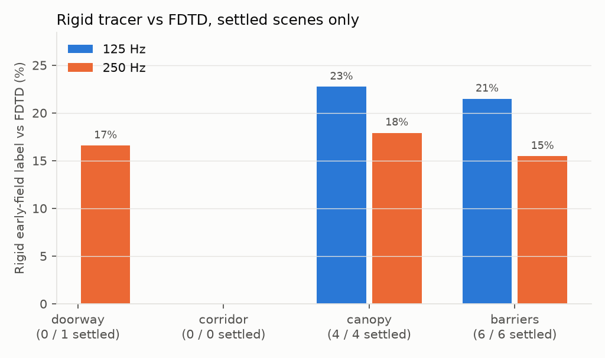
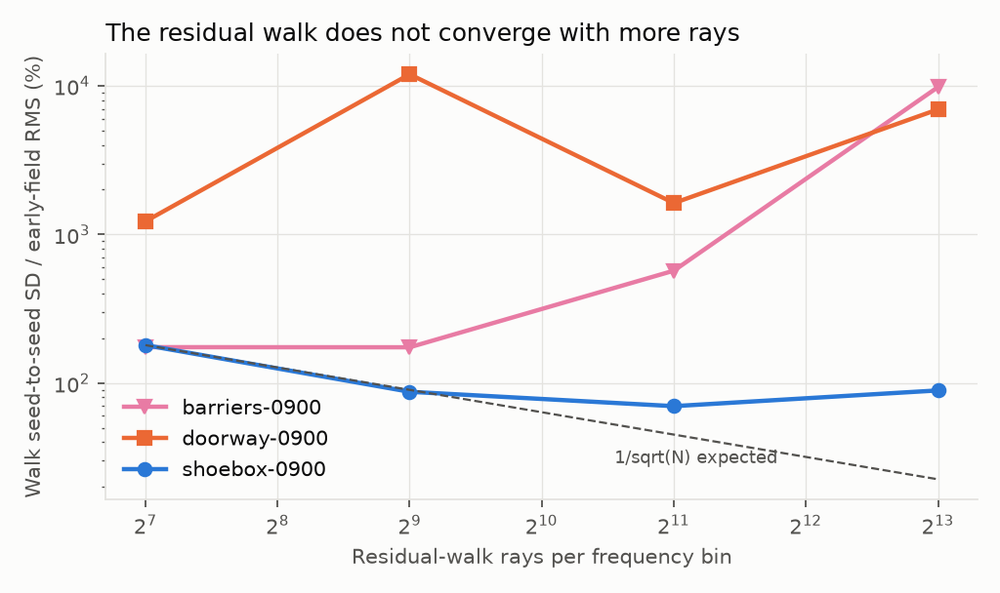
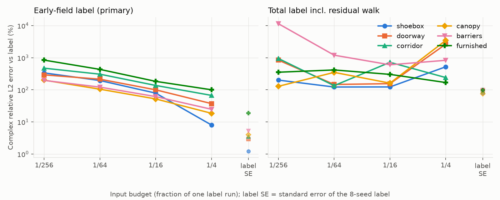
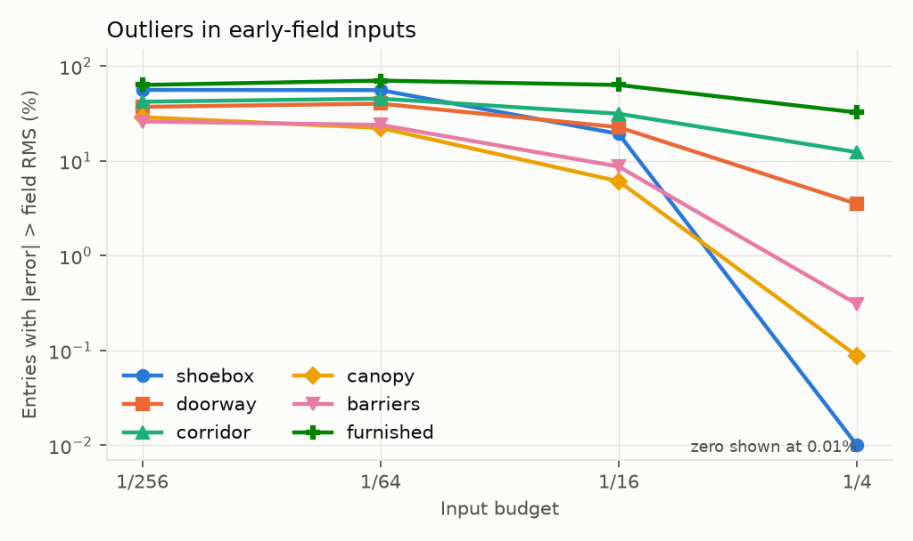
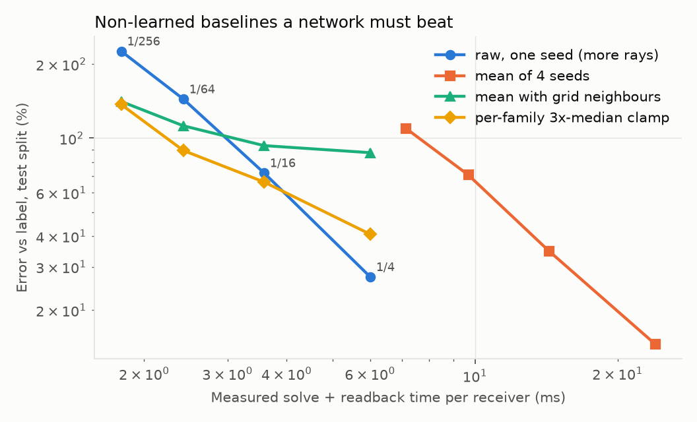
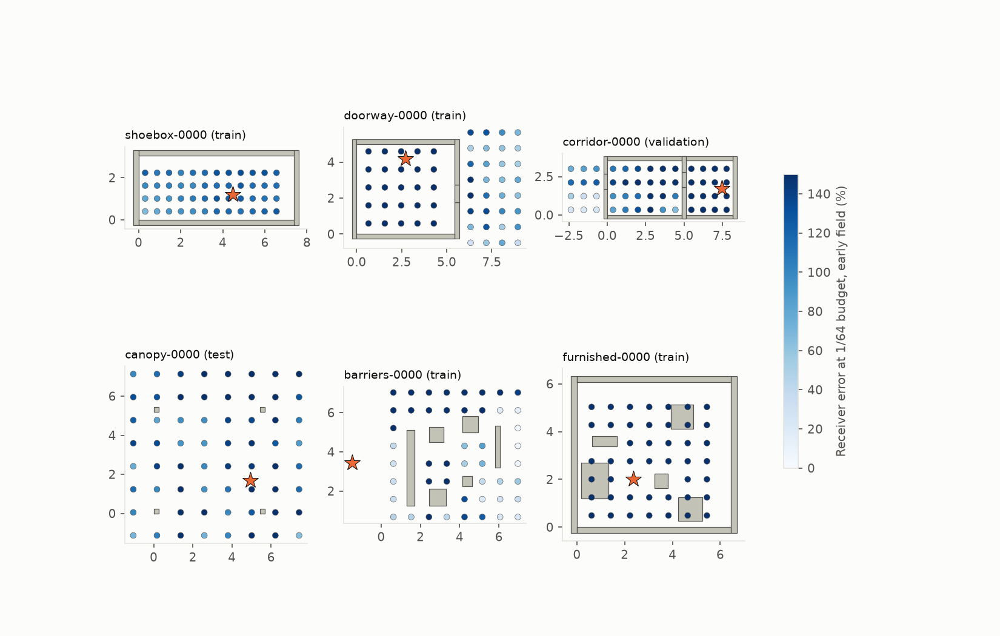

# Audio-DLSS denoiser dataset pilot — 29 October to 1 November 2026

**Verdict: the pipeline works end to end and the early-field labels are usable; the residual walk cannot be labelled yet.**
72 generated scenes (3,731 receivers, 32 frequencies from 125 Hz to 4 kHz) were rendered by our tracer at four realtime budgets and a converged budget, packed into a hashed dataset and verified.
63 scenes pass the predeclared label acceptance; the 9 rejections are 5 furnished rooms (4 of them dense), 3 barrier fields and 1 canopy.
The converged early field (every path family except the residual walk) has a label standard error of 1.2–5.2% in five families and 19% in furnished rooms; single-seed input noise is 6–270 times larger.
The residual walk does not converge with more rays, so it stays in the inputs but not in the label.
How to build and read the dataset: [dataset README](../../audio-dlss/dataset.md).

All numbers are measured on this Mac (Apple M5, 16 GB, Unity 6000.4.1f1 on Metal) under `nice 19`, one job worker and 20% work pacing.
The complex relative L2 error used throughout is `sqrt(sum|x - label|^2 / sum|label|^2)` over receivers and frequencies, averaged as an RMS over scenes; it includes phase.

## Results

#### Label noise (early-field label, K = 8)

| Family | Scenes | Accepted | Label SE (RMS) | Label SE (worst) | Valid entries | Input SD / label SE at 1/256 / 1/64 / 1/16 / 1/4 | Total-label SE |
|---|---:|---:|---:|---:|---:|---:|---:|
| shoebox | 12 | 12 | 1.2% | 2.4% | 100% | 273 / 159 / 65 / 6 | 80% |
| doorway | 12 | 12 | 2.9% | 4.9% | 99% | 101 / 75 / 35 / 13 | 97% |
| corridor | 12 | 12 | 3.5% | 6.0% | 99% | 135 / 89 / 38 / 19 | 90% |
| canopy | 12 | 11 | 4.0% | 8.9% | 97% | 65 / 33 / 17 / 6 | 76% |
| barriers | 12 | 9 | 5.2% | 9.1% | 92% | 49 / 30 / 16 / 6 | 98% |
| furnished | 12 | 7 | 18.9% | 35.5% | 64% | 160 / 83 / 35 / 19 | 99% |
| all | 72 | 63 | 8.4% | 35.5% | 92% | 124 / 73 / 32 / 15 | 90% |

#### Input error against the label (accepted scenes, early field)

| Family | 1/256 | 1/64 | 1/16 | 1/4 | 125–500 Hz at 1/64 | 2–4 kHz at 1/64 |
|---|---:|---:|---:|---:|---:|---:|
| shoebox | 336% | 195% | 79% | 8% | 196% | 193% |
| doorway | 292% | 214% | 100% | 37% | 225% | 211% |
| corridor | 471% | 307% | 137% | 67% | 342% | 299% |
| canopy | 200% | 104% | 52% | 19% | 112% | 103% |
| barriers | 196% | 121% | 61% | 25% | 130% | 119% |
| furnished | 841% | 432% | 183% | 100% | 467% | 421% |
| all | 414% | 242% | 107% | 49% | 261% | 237% |

#### Outliers (early field, all accepted scenes)

| Budget | Median p99 of \|error\| / field RMS | Largest | Entries > 1× RMS | > 3× RMS | Family with the largest error in >1× entries |
|---|---:|---:|---:|---:|---|
| 1/256 | 8.53 | 148 | 41.5% | 16.06% | RR 36%, DD 24%, RD 19% |
| 1/64 | 4.81 | 33 | 41.9% | 11.28% | RR 60%, DD 17%, RD 12% |
| 1/16 | 2.24 | 14 | 23.3% | 2.29% | RR 77%, DD 11%, RD 6% |
| 1/4 | 0.43 | 8 | 6.7% | 0.14% | RR 87%, RD 5%, DD 4% |

#### Baselines on the test split (early field; canopy family and wide doorways)

| Budget | Solve ms | Raw, 1 seed | Raw at the next budget (4× rays) | Mean of 4 seeds (4× solves) | Mean of 2 seeds | Grid-neighbour mean | Family clamp |
|---|---:|---:|---:|---:|---:|---:|---:|
| 1/256 | 1.8 | 226% | 144% | 109% | 159% | 141% | 137% |
| 1/64 | 2.4 | 144% | 72% | 71% | 102% | 112% | 89% |
| 1/16 | 3.6 | 72% | 27% | 35% | 51% | 93% | 66% |
| 1/4 | 6.0 | 27% | n/a | 15% | 20% | 87% | 41% |

## What the measurements say

- **Labels.**
  Closed and semi-open rooms have 1–4% label standard error.
  Barrier fields (5%) and dense furniture (19%) are harder: their diffraction-dominated and many-surface fields need more label samples than K = 8 × 65,536.
  The early-field noise is well behaved (each of the eight seeds holds 9–19% of the label variance in the scenes checked), so more seeds would fix these scenes at proportional cost.
- **Inputs are unbiased and noise-dominated.**
  At every budget the error against the label equals the seed-to-seed spread to within a few percent, and it falls about √4 = 2 per fourfold budget.
  The realtime preset (1/256, 2 rays per bin) is 200–840% wrong; 1/4 of a label run is still 8–100% wrong.
  Errors are nearly flat across frequency (the 125–500 Hz band is up to 15% higher than 2–4 kHz).
- **Spikes come from the complete routes, mostly RR.**
  At 1/64, 42% of receiver-frequency entries are wrong by more than the field's RMS and 11% by more than three times it.
  The family with the largest error in those entries is RR (two reflections) 60% of the time, then DD and RD.
  When the candidate routes (edges, edge pairs, edge–triangle and triangle pairs) outnumber the samples, the tracer draws a random subset of routes, and RR, which is exact when every pair is enumerated, becomes the largest noise source.
- **What a network must beat.**
  On the held-out test split, averaging four seeds beats spending four times the rays at 1/256, ties at 1/64 and loses at 1/16 (35% against 27%), where the tracer's quasi-random draws stratify better within one seed.
  Averaging each receiver with its grid neighbours helps at 1/256 and 1/64 but hurts from 1/16, where it smears phase (an 87–93% floor).
  A per-family clamp at three times the receiver median helps up to 1/16 and hurts at 1/4, because it biases strong legitimate paths.
  Measured solve and readback time is 1.3–2.8 ms per receiver at 1/256 and 4.4–14 ms at 1/4, so fixed overhead dominates the cheapest budgets: four times the rays costs only about 1.3–1.7 times the time, which makes more rays cheaper than four seeds at every budget.
- **Rejected labels.**
  Five of twelve furnished rooms fail acceptance, the four dense ones badly (under 3% of entries valid, label error up to 35%), as do three barrier fields and one canopy (75–77% valid).
  In the dense rooms the triangle pairs outnumber even the 65,536 label samples, so RR is subsampled in the label too: its seed spread is 57–68% of the field, against zero in a sparse furnished room where every pair is enumerated.
  A label budget that scales with the route count, or exhaustive RR enumeration, would fix this.

## Tracer bias against the wave solver

The 24 FDTD scenes (six each of doorway, corridor, canopy and barriers, the cheapest per family) were solved at 3.125 cm (44 points per wavelength at 250 Hz) with every surface rigid, and compared with the same scenes rendered by the tracer with every surface rigid (`tracer-rigid`, same budgets).
The FDTD response is accepted only where it has settled: if it still changes by more than 5% between 0.75 T and T (T = 0.3 s barriers, 0.4 s canopy, 0.6 s corridor, 0.8 s doorway), the lossless room is still ringing and has no single-frequency value yet.
All barrier fields and four of six canopies settle; no corridor and only one doorway (at 250 Hz) does, because rigid rooms with a door ring for seconds.

#### Rigid tracer label against FDTD

| Family | Settled scenes 125 / 250 Hz | 125 Hz early | 125 Hz incl. walk | 125 Hz LoS / shadow | 250 Hz early | 250 Hz incl. walk | 250 Hz LoS / shadow | Label SE 125 / 250 Hz |
|---|---:|---:|---:|---:|---:|---:|---:|---:|
| doorway | 0 / 1 of 6 | n/a | n/a | n/a / n/a | 17% | 17% | 10% / 102% | n/a / 0.9% |
| corridor | 0 / 0 of 6 | n/a | n/a | n/a / n/a | n/a | n/a | n/a / n/a | n/a / n/a |
| canopy | 4 / 4 of 6 | 23% | 691% | 22% / 41% | 18% | 729% | 17% / 47% | 2.9% / 3.2% |
| barriers | 6 / 6 of 6 | 21% | 2484% | 16% / 51% | 15% | 2691% | 11% / 46% | 2.8% / 3.0% |

- In the open families the early-field label is 15–23% from the wave field: 11–22% where the source is visible and 41–51% in shadow.
  That matches the earlier canopy benchmark (29% whole / 87% shadow at 125 Hz) in kind: the tracer's diffraction misses energy in deep shadow.
- **Adding the residual walk makes it far worse** (690–2,700% at both frequencies), which confirms the walk cannot be part of a label.
- The unsettled rooms are 41–136% from the truncated FDTD response; those numbers mix tracer bias with FDTD truncation and are in `report.json` only.
- The rigid and material-preset labels of the same scenes differ by 2–41% (median 8%), so material choice matters about as much as the open-field tracer bias at these frequencies.
- These FDTD fields are the labels for the ray→wave side experiment; the corridor and doorway ones need wall impedance (or several seconds of simulation) before they are usable.



## Calibration findings that changed the protocol

These came from calibration scenes (generator index 900, outside the pilot) and from a first pilot batch that was stopped and archived; none of their numbers are pilot results.

1. **A 5 cm lattice broke the Unity bake.**
   Coordinates such as 0.425 m are not exact in float32, so the solid bake produced sliver triangles and the scene compiler rejected them as degenerate.
   The generator now uses a 1/16 m lattice, exact in float32 and on every FDTD grid of 6.25, 3.125 or 1.5625 cm.
2. **Material presets carry different interior media.**
   The stone and wood presets differ in interior sound speed and damping, which one baked solid cannot hold, so the measurement bakes one solid group per preset.
3. **The residual walk does not converge.**
   With rigid walls the walk only reaches the listener through chains of three or more edges, and with the presets it adds diffuse connections and transmissions; either way its seed-to-seed spread does not fall as rays increase (table below), and single walk paths carry weights up to about 1,000 times the direct sound.
   The primary label is therefore the early field (every family except the walk); the walk stays in the inputs and in an auxiliary total label, whose standard error is 76–99% of the field in every family.
4. **Two label seeds were not enough.**
   With K = 2 every one of the first six barrier-field scenes failed acceptance (early-field label standard error 3.5–16% of the field).
   The pilot uses K = 8, and the near-zero floor of the acceptance rule was set to 5% of the receiver RMS, both before any pilot scene was rendered.

| Scene | Walk rays / bin | Walk SD / early RMS | Walk mean / early RMS | Largest walk path / direct path |
|---|---:|---:|---:|---:|
| barriers-0900 | 128 / 512 / 2,048 / 8,192 | 1.7 / 1.7 / 5.7 / 98 | 0.9 / 0.9 / 2.8 / 69 | 3.8 / 8.0 / 19 / 308 |
| doorway-0900 | 128 / 512 / 2,048 / 8,192 | 12 / 120 / 16 / 69 | 6.1 / 60 / 8.2 / 49 | 146 / 940 / 132 / 600 |
| shoebox-0900 | 128 / 512 / 2,048 / 8,192 | 1.8 / 0.9 / 0.7 / 0.9 | 0.9 / 0.4 / 0.4 / 0.6 | 7.1 / 3.0 / 3.9 / 2.7 |

Four seeds at 128–2,048 rays and two at 8,192; a converging Monte Carlo estimator would fall by a factor of 8 across the table.



A long render also outlived an audio-device change during a battery suspend, and Unity's test runner failed the batch on an unrelated FMOD log although every scene's outputs were complete.
The measurement now ignores audio-device and service logs only, and `tools/dlss_jobs.py` accepts a scene by verifying its payloads (sizes, finite values, scene identity) rather than by the runner's exit code, retrying invalid scenes.

## Figures









## Checks

- **Identity.** For all 72 scenes the Unity bake volume, the FDTD voxel volume at 6.25 and 3.125 cm and the exact box union agree exactly (largest difference 0; largest face snap 0 m).
- **Reproducibility.** Re-rendering `barriers-0000` from its exact `scene.json` bytes gives bit-identical payloads (`tools/dlss_jobs.py reproduce`; timing files excluded).
- **Dataset verification.** `denoise-pilot-v1` (SHA-256 of `dataset.json` `ef63b2f0…`): 72 bundles, 53,616 examples, 2,496 payload hashes and sizes, scene/run identities, the frozen split rule, group isolation and the held-out canopy family all check out; 9 bundles are rejected and contribute no examples.
- **Unit tests.** `tools/test_dlss.py` (17 tests): generator determinism and frozen hashes, float32-exact lattice, FDTD voxel exactness, endpoint clearance, an independent line-of-sight check, split rule, seed streams, packer round trip, label statistics, tamper and identity failures, rejection reporting, render verification and the baselines.
  The Unity check `TakeChecks.CompleteSampleFamiliesMatchDebugCapture` passes, and every render asserts that its family split reconstructs the summed field.

## Throughput

| Stage | Scenes | Wall time (paced) | Scenes per hour | Notes |
|---|---:|---:|---:|---|
| Generate scenes | 72 | 1.8 s | ~140,000 | NumPy only |
| Tracer render, material presets | 72 | 4.6 h | 15.8 | 13 Unity launches; peak process-tree RSS 1.6 GiB; the 8-seed label takes about 90% of it |
| Tracer render, rigid (FDTD subset) | 24 | 1.6 h | 14.7 | peak RSS 2.0 GiB |
| FDTD, 3.125 cm, 125/250 Hz | 24 | 2.1 h (0.42 GPU h) | 11.2 | 2.1 Gcell/s median while busy; 1.0 GiB GPU memory |
| Pack + verify | 72 | 1.5 s + 0.4 s | n/a | 602 MB of run payloads, 12 MB dataset index and derived files |

At 20% pacing the tracer stage scales to about 380 scenes per day on this Mac, so a 500-scene pilot is about 1.3 days and 3,000 scenes about 8 days; unpaced it would be about five times faster.
Time with the worker suspended on battery is excluded.

## Not done or not verified

- No network was trained; the baselines above define the bar.
- The residual walk has no usable label (calibration finding 3); fixing its weights is a tracer change.
- Labels for dense furniture and some barrier fields need more than K = 8 (or exhaustive RR enumeration); acceptance rejects them rather than relaxing the tolerance.
- No corridor and only one doorway FDTD response settled within 0.6–0.8 s, so the bias of closed-ish rooms is unmeasured; it needs wall impedance or multi-second runs.
- FDTD grid convergence was not repeated for these scenes; the 3.125 cm grid relies on the stage-1 study (about 2% free-field dispersion error over seven wavelengths at 250 Hz).
- Materials are the existing presets; the FDTD comparison is rigid only, because FDTD has no wall impedance.
- The pilot is static: one source, receivers on one horizontal grid per scene, no motion or history.
- Throughput is from paced runs on a shared laptop, not a dedicated benchmark.

## Reproduce

```sh
PY=.context/fdtd-teacher/venv/bin/python
sh docs/benchmarks/denoise-pilot-2026-10-29/run_queue.sh          # generate, render, rigid render, FDTD
$PY tools/dlss_dataset.py pack denoise-pilot-v1
$PY tools/dlss_dataset.py verify .context/audio-dlss-data/datasets/denoise-pilot-v1
$PY tools/dlss_dataset.py identity
$PY tools/dlss_jobs.py reproduce barriers-0000
$PY docs/benchmarks/denoise-pilot-2026-10-29/analyze.py .context/audio-dlss-data/datasets/denoise-pilot-v1
# Residual-walk calibration (scenes outside the pilot):
$PY docs/benchmarks/denoise-pilot-2026-10-29/walk_scaling.py prepare .context/audio-dlss-walk
$PY tools/dlss_jobs.py --data .context/audio-dlss-walk render --batch 3
$PY docs/benchmarks/denoise-pilot-2026-10-29/walk_scaling.py analyze .context/audio-dlss-walk
```

[Machine-readable results](report.json) · [generated tables](tables.md) · [walk calibration](walk.json).
