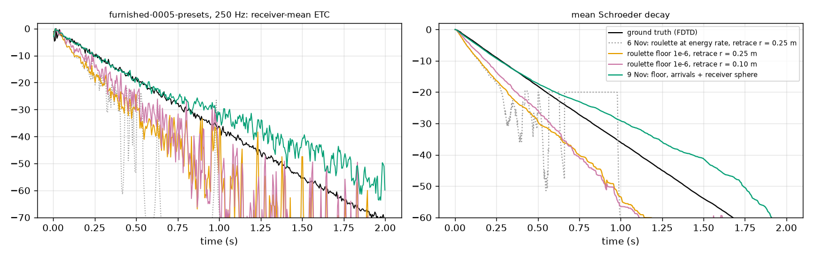
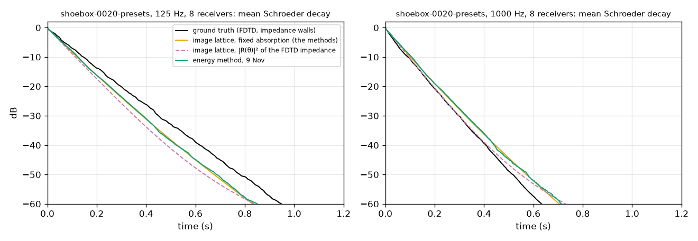
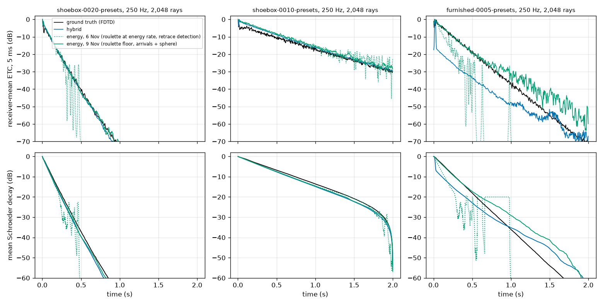
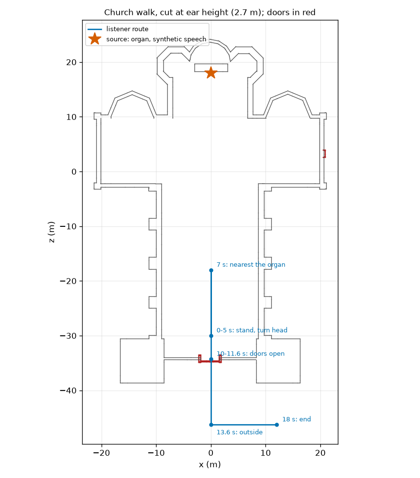
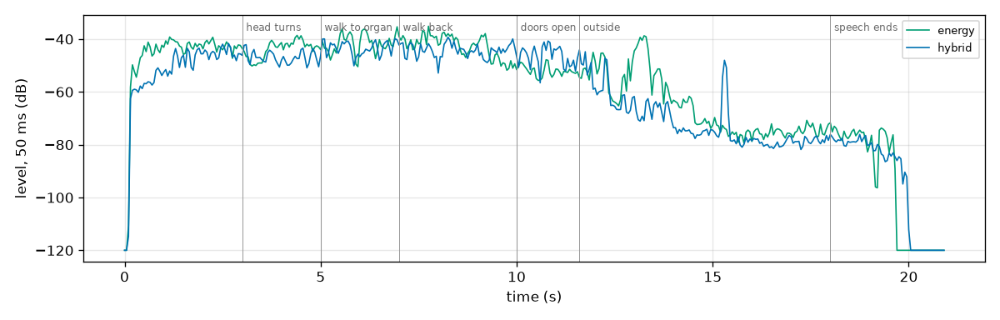

# Energy method: decay diagnosis, discrete arrivals and audio — 9 November 2026

**Verdict: the energy method's closed-room decay error was mostly its own sampling, and that part is fixed; it now renders audio with exact discrete arrivals (crisp echoes with Doppler) over a smooth diffuse tail.**
Two estimator defects caused it: Russian roulette killed paths as fast as their energy decayed, so the late tail was sampled by a handful of paths, and the exact-retrace specular detection was biased low in cluttered rooms.
With both fixed, closed-room T30 error falls from 42% to 26% and the energy-time-curve distance from 19.2 to 5.7 dB (hybrid: 28% and 5.8 dB), and the suite-wide level error from 4.0 to 3.0 dB (hybrid 5.7).
The angle-dependent wall of the ground truth is not the cause: it would make the decay about 9% faster, while the ground truth decays slower than any geometric model at low frequencies.
What remains is shared with the hybrid and with an exact image lattice: low-frequency room modes in the shoeboxes, and a too-slow late decay in the furnished room, where perfectly specular boxes trap sound that wave diffraction would scatter.
Audio: `method = Energy` is now selectable, live and offline through the same code; `Hybrid` stays the default.

All numbers are measured on this Mac (Apple M5, 16 GB, Unity 6000.4.1f1 on Metal) in the isolated runner under `tools/heavy_guard.py` (one heavy job machine-wide, 4 GiB guard, nice 19, one job worker, 50% pacing).
Ground truth, suite and scorer are those of the [method comparison](../method-compare/README.md); the previous energy results are in the [6 November benchmark](../methods-2026-11-06/README.md).

## Part A: why the closed-room decay was wrong

### What the errors were

The 6 November score reported RMS errors; split into bias (mean over receivers) and scatter, they are mostly scatter.
At 2,048 rays, signed errors of the energy method against the ground truth (two seeds):

| Room | Band | EDT bias | T30 RMS | T30 bias | 5 ms windows more than 20 dB below the ground truth |
|---|---|---:|---:|---:|---:|
| shoebox-0020 (wood) | 125 / 500 / 1000 Hz | −18 / −2 / +21% | 32 / 34 / 34% | −10 / +10 / +18% | 47–49% |
| shoebox-0010 (stone) | 125 / 500 Hz | −20 / +2% | (T20) 7 / 19% | (T20) +2 / +16% | 22–39% |
| furnished-0005 | 125 / 250 / 500 Hz | −49 / −44 / −39% | 53 / 56 / 57% | −34 / −20 / −9% | 73–76% |

Half to three quarters of the 5 ms windows of the energy-time curve were empty: that is the 17–25 dB "ETC distance", and the scatter in T30.
The furnished room also had a large real bias: its early decay was 40–50% too short.

### Cause 1: Russian roulette at the energy rate

The walk continued a path with probability `min(1, throughput / probability)`.
With nothing scattering (the suite's walls are smooth), that keeps each path's weight at one and kills it with the wall's absorption: in the wood shoebox 12% of paths die at each bounce, 150 bounces per second, so of 2,048 paths about 300 are left after 0.1 s, 6 after 0.3 s and none after 0.5 s.
The estimate stays unbiased, but the tail the decay metrics read is a few spikes, and nonlinear metrics of a sparse spike train (log levels, line fits) are biased in turn.
**Fix:** roulette starts only below a throughput floor, `min(1, throughput / (probability · 1e-6))` (`methodRouletteFloor`), so every path continues over the first 60 dB of decay and the path count is constant where the metrics look.
On its own (old detection, `-rr6` runs), shoebox T30 RMS fell from 32–34% to 6–16% and the ETC distance from 17 to 4–6 dB; levels did not move (the estimator was unbiased).

### Cause 2: the exact-retrace detection is biased low where visibility is fragmented

A pure specular path cannot be sampled by a walk, so the walk detected it: when a ray passed within `r` of the listener's image, the exact image path was retraced and scored, divided by the probability of a ray falling in that cone.
That probability assumes every ray in the cone follows the same mirror sequence.
Near a visibility boundary part of the cone hits something else, and those rays never score this path: the estimate is low by the blocked fraction, at every such reflection.
In the furnished room 95% of detections failed the retrace (4,595 of 95,596; in the shoeboxes almost none failed), and shrinking the cone from 0.25 to 0.10 m halved the early-decay bias (−48% to −21% at 250 Hz), which is that mechanism.
**Fix:** specular segments are scored by a track-length receiver sphere (as the hybrid's late field): it estimates the energy averaged over the sphere and has no cone to clip.
The low orders, where exact timing matters, became exact discrete arrivals (part B).
The furnished room's early decay bias went from −39…−49% to −4…+14%.



### Not the cause: the wall model

The ground truth's walls are locally reacting impedances chosen to match the presets' random-incidence absorption, so their absorption depends on the angle; the methods use the fixed coefficient.
An incoherent image lattice of the wood shoebox with each model (`lattice.py`, eight receivers) separates the effects:

| shoebox-0020, mean T30 error | 125 Hz | 250 Hz | 500 Hz | 1 kHz |
|---|---:|---:|---:|---:|
| lattice, fixed absorption, vs ground truth | −15% | −6% | +2% | +9% |
| lattice, angle-dependent absorption `1 − R(θ)²` of the impedance, vs ground truth | −23% | −15% | −7% | −1% |
| energy method (after; seed 0 / seed 1) vs fixed-absorption lattice | −0.2 / −0.8% | +0.2 / −0.8% | +0.7 / −0.7% | +1.0 / −1.2% |
| hybrid vs fixed-absorption lattice | −1.2% | −1.3% | −1.5% | −1.6% |

The locally reacting wall absorbs least at normal incidence (`1 − R(0)²` ≈ 0.066 for wood at 125 Hz, against 0.12 random incidence) and most near grazing, so in a specular room it decays about 9% *faster* than the fixed coefficient, the wrong direction at low frequencies.
(The method-comparison page described this the other way round; it is corrected there.)
The ground truth decays slower than both lattices at 125–250 Hz: the modal effect documented with the ground truth (grazing axial and tangential modes, fewer at low frequency), which no geometric method has.
The energy method now reproduces its own model, the fixed-absorption lattice, within 1% in T30 and 0.2 dB in level; its remaining shoebox error is the lattice's.
Using the angle-dependent absorption would not be a principled improvement against this ground truth, so it was not adopted.



### Re-score

The whole suite re-rendered (11 scenes, 256 and 2,048 rays, seeds 0 and 1) and re-scored with `tools/method_compare.py score`:

**Closed rooms** (2,048 rays, all bands with ground truth)

| Metric | energy before | energy after | hybrid |
|---|---:|---:|---:|
| level dB | 2.0 | 2.0 | 3.9 |
| bias dB | +0.7 | +1.5 | +2.5 |
| EDT % | 31.6 | 19.6 | 31.0 |
| T20 % | 38.1 | 22.5 | 13.1 |
| T30 % | 42.4 | 26.4 | 27.5 |
| ETC dB | 19.2 | 5.7 | 5.8 |
| onset ms | 3.0 | 3.2 | 4.6 |

**Open scenes** (2,048 rays, all bands with ground truth)

| Metric | energy before | energy after | hybrid |
|---|---:|---:|---:|
| level dB | 4.4 | 3.2 | 6.0 |
| bias dB | +1.1 | +1.7 | +3.3 |
| EDT % | 248.4 | 203.8 | 425.5 |
| T20 % | 181.1 | 186.9 | 74.7 |
| T30 % | 90.4 | 142.0 | 72.7 |
| ETC dB | 17.8 | 16.6 | 14.9 |
| onset ms | 6.8 | 2.4 | 4.6 |

**All scenes, level error (dB RMS)**

| Budget | energy before | energy after | hybrid |
|---|---:|---:|---:|
| 256 | 4.92 | 3.08 | 9.56 |
| 2,048 | 4.04 | 3.04 | 5.68 |

Mean busy time per solve in the measurement harness (GPU work plus readback, one receiver, 2,048 rays): energy before 47 ms, after 69 ms, hybrid 102 ms.



Reading:
- Closed rooms: EDT, T30 and the energy-time curves now match or beat the hybrid's, with half its level error; T20 is still worse (22.5% against 13.1%), mostly the furnished room's slow late decay.
- The level bias in closed rooms rose from +0.7 to +1.5 dB: the furnished room moved from −1.3 dB (the detection's under-count) to +1.7 dB.
  Its late decay is now too slow (T30 +21…+52%), as the hybrid's (+12…+60%): with perfectly specular boxes, geometric acoustics traps grazing ray families that wave diffraction at the box edges would mix and absorb; neither method has edge scattering in the reverberant field.
- Open scenes: level error 4.4 → 3.2 dB.
  The open T30 average rose only through `doorway-0008` (201 → 411%): its receivers outside the room now see the room's tail through the doorway, sampled sparsely at 2,048 rays (the tail used to be cut off by roulette); every other open scene is unchanged or better.
  Barriers moved from +3.0 to +3.7 dB bias: DR is now exact instead of under-detected, which exposes more of the known UTD double-diffraction excess over thin walls.
- Cost: 2–82 ms GPU per solve at 2,048 rays, 1.5–2.7× the 6 November solve (constant path count), except the stone shoebox, which halved (no retraces).

## Part B: discrete arrivals and the diffuse field

Each solve now has two disjoint outputs (`MethodEnergy.hlsl`; contract in [simulation contracts](../../simulation-contracts.md#energy-method-audio-v1)):

1. **Discrete arrivals**, enumerated exactly from the source, one GPU thread per candidate: the direct sound (with wall transmission), every mirror plane (first order) and ordered pair of planes (second order), and the UTD edge routes D, DD, RD and DR.
   A specular candidate is retraced and accepted only if each hit lies on its plane, so each image path appears once; second-order images that two orderings would reach (perpendicular walls) are found once, through the ordering that is geometrically valid.
   Each arrival carries its exact delay, eight band energies, arrival direction and delay rate.
2. **The diffuse histogram**: the energy walk with exactly those path classes excluded (no direct connection, no D/DD/RD connection from the source, no sphere score for pure reflections from the source up to the enumerated order, none for one reflection after an edge ray from the source).

Why enumeration and not the walk's own detections: at 2,048 rays a second-order image 10 m away is detected by some ray in a quarter of solves or fewer, so detected arrivals would flicker in and out between solves; enumerated ones never do.
Exclusion is by class, so arrivals plus histogram estimate exactly what the walk alone estimates.
A family is enumerated only up to 2^18 candidates; above that the walk keeps it.
In the Church (12,761 triangles, 4,864 mirror planes, 10,249 diffracting edges) that means the direct sound, all first-order images and every single-edge route are exact arrivals, and second-order and two-interaction edge paths stay in the diffuse field.

## Part C: audio

- **Arrivals** become `RayTransport.Path` entries (one per FFT bin, gain √E(f) from the band energies with the comparison's power-complementary bands, no phase) in a layout of their own, and play through the existing delayed-path synthesis: continuous path clocks with Doppler, per-band filters, HRTF, sample-accurate transitions, on the GPU and in the CPU reference.
  The strongest 64 per source/listener pair (`methodArrivalSlots`) become paths; the rest go to the diffuse field, never lost.
  Identities depend only on the geometry (plane multiset, edge and plane indices), so a moving listener keeps continuous clocks.
- **Doppler**: retarded delays for moving sources (image sources move with the mirrored velocity) and delay rate `1 − (c − v_L·u_arr) / (c − v_S·u_emit)`.
- **Diffuse field**: the histogram is written in the hybrid late field's layout (pair, head-frame direction, band, partition bins) and plays through the same late noise synthesis (`LateReverb.cs`, `GpuAudio.Late.cs`): fixed seeded noise, envelopes crossfaded over one response step, so movement changes the envelope and never re-randomises the noise; the walk's seed is fixed, so the estimate itself changes smoothly with movement.
- Live and offline both construct the same `TransportSolver(..., methodAudio: true)` and the same audio backends.

## Validation

New checks (`Assets/Tests/Editor/EnergyAudioChecks.cs`, categories `Methods` and `Slow`):

| Check | Result |
|---|---|
| Rigid shoebox, α = 0.1: arrivals are the image lattice up to second order | 25 arrivals for 25 images, each once; delays within 2 µs, band energies within 1e-4, directions within 1e-4; no diffuse energy before the first third-order image |
| Arrivals + diffuse = walk alone (arrivals switched off), band totals | scattering room 1.0022; rigid cube seen only through edges (D, DD, RD, DR) 1.039–1.044 (tolerance 6%, the walk's own DD sampling noise) |
| Moving source 15 m/s, listener 5 m/s, both: direct and reflected arrival vs `Doppler.Direct` of the (image) source | delays exact to 1e-7 s; delay rates within 1e-7 (one end moving) and 4e-5 (both) |
| Audio pitch, source receding at 30 m/s from the listener towards a wall | direct 919.54 Hz (theory 919.57), reflection 1095.83 Hz (theory 1095.85) |
| CPU reference vs GPU audio, walking and turning listener, scattering room | relative error 2.7e-6 (mono), 5.1e-5 (binaural) |
| No clicks across solves: walking, turning listener, 440 Hz tone; high-frequency energy folded by phase of the response step | every phase within 0.01 dB of the median |
| Live vs offline: one recorded walk rendered offline (CPU reference, GPU one and three responses per batch) and live (GPU, two per batch) | all four agree within the asserted 1e-3 relative error; the offline report names `energy-arrivals-diffuse-v1` |

The existing method checks all pass unchanged in their assertions (free field exact, rigid plane image exact now, image lattice total 0.995 with the worst 20 ms window 5.7%, Eyring T60 0.613 s vs 0.585 s, half-plane UTD +0.28 dB vs BTM, DD over a 2 m wall +0.5…+1.6 dB, over the suite's 0.25 m walls +4.6…+8.1 dB as before).

Regression, `tools/unity_tests.py full` (three fresh processes):

| Batch | Result | Wall | Peak footprint |
|---|---|---:|---:|
| Quick (all non-Slow `TakeChecks`) | 316 passed, 9 skipped (opt-in measurements), 0 failed | 98 s | 2.86 GiB |
| Slow renderer checks | 18 passed, 0 failed | 101 s | 3.13 GiB |
| Method checks (category `Methods`, with the 11 new cases) | 21 passed, 1 skipped (pressure DD, known gap), 0 failed | 26 s | 2.59 GiB |

The default method is unchanged (`Hybrid`); the renderer's `Transport.compute` and the pressure kernel's behaviour are unchanged (`MethodCommon.hlsl` only gained a state offset and a histogram offset, both zero for the pressure loop).

## Listening render

Page: `.context/energy-audio/listen/index.html` (open from the file system; scene map, both renders with one shared gain, level over time).

The take is the Church speech walk (`.context/church-motion/speech-full/take`): the organ plays synthetic speech; the listener stands, turns the head, walks to the organ and back, opens the doors and walks outside (18 s plus a 3 s tail).
Both renders use the same DSP (Spectral, FFT 1,024, hop 256, 1,024-sample steps, windowed sinc), binaural output, air absorption and a 2 s horizon; only the method differs.
The energy render uses 2,048 rays, 64 arrival slots and a 0.5 m receiver sphere; in the Church (4,864 mirror planes, 10,249 diffracting edges) its exact arrivals are the direct sound, every first-order reflection and every single-edge diffraction path, and second-order and two-edge paths join the diffuse tail.
The hybrid uses the Church preset's transport (first-order images from 128 sampled candidates, the late energy field with 512 rays per band, no diffraction).





What you will hear, and what the levels show:
- Inside, the energy render is 2–4 dB louder from the first moment; the hybrid's sampled mirror candidates (128 of 12,761 triangles) almost never hit a valid first-order image (it never held more than one delayed path at a time), so it is mostly direct sound plus its late field.
- The energy render holds up to 64 discrete arrivals at once; their delays and directions follow the walk continuously, and the reverberant tail does not flicker or re-randomise.
- Outside, the energy render is about 6 dB louder than the hybrid, which has no diffraction here (the energy render bends sound around the door frame with its single-edge routes), with a clear rise at 12.8–13.5 s while the listener walks back through the line of sight of the open doors.
- At the doorway itself (10–11.6 s, doors opening) the energy render is about 6 dB quieter than the hybrid; the cause was not investigated.
- The hybrid shows one isolated loud event at 15.3 s (probably a sampled image found once); neither render has spikes otherwise (one 5 ms frame each more than 20 dB above its local median).

| Render | Wall time for 21 s of audio (50% pacing) | Peak memory | Most delayed paths at once |
|---|---:|---:|---:|
| energy | 199 s | 2.40 GiB | 64 |
| hybrid | 194 s | 3.68 GiB | 1 |

Neither is realtime on this machine at these settings; the hybrid's peak (above this task's 3.5 GiB target, below the 4 GiB guard) is its filter storage for 129 candidate paths per bin at FFT 1,024 (1.09 GB), the energy render's 64 slots need 1 MB.

## What is not verified

- Exact phase is not rendered; arrivals are band-energy envelopes (the earlier listening test, exact ground-truth responses against the same 1 ms band envelopes with random phase, sounded identical).
- Specular orders above two, and above the plane-count limit (in the Church: above one), are heard as diffuse noise, not as distinct echoes.
- The audio checks use small synthetic rooms; the Church render is listened to, not scored against a reference.
- The furnished room's too-slow late decay and the thin-wall UTD double-diffraction excess remain (model limits shared with the hybrid).
- Doppler of moving reflecting surfaces is not modelled (geometry frozen per solve); with both ends moving, the delay rate has an O(v²/c²) error from the unretarded arrival direction.
- Two seeds per budget only; seed spreads are rough.
- The click check was not shown to fail on an injected click; it rests on the folding argument.
- The 6 dB lower level at the Church doorway (10–11.6 s) compared with the hybrid is unexplained.
- Live rendering is checked against offline output in a small room; the Church scene was not played live, and neither method is realtime there at these settings.

## Reproduce

```sh
PY=.context/fdtd-teacher/venv/bin/python
B=docs/benchmarks/energy-audio-2026-11-09
$PY tools/unity_tests.py run "TakeChecks" --category Methods          # method and energy-audio checks
$PY tools/method_runs.py jobs suite-energy --scenes <suite ids> --methods energy --budgets 256 2048 --seeds 0 1
nice -n 19 $PY tools/method_runs.py render suite-energy               # raw outputs (move old energy outputs aside first)
$PY tools/method_runs.py pack && $PY tools/method_compare.py score
$PY $B/rescore.py                                                     # before/after table
$PY tools/method_runs.py jobs goalA-rr6 --scenes shoebox-0020-presets shoebox-0010-presets furnished-0005-presets \
    --methods energy --budgets 2048 --seeds 0 1 --suffix rr6         # diagnosis: roulette floor with the 6 November retrace detection (that shader)
$PY $B/lattice.py shoebox-0020-presets 1.5 && $PY $B/figures.py       # wall law and figures
nice -n 19 $PY $B/listen.py render energy && nice -n 19 $PY $B/listen.py render hybrid && $PY $B/listen.py page
```
