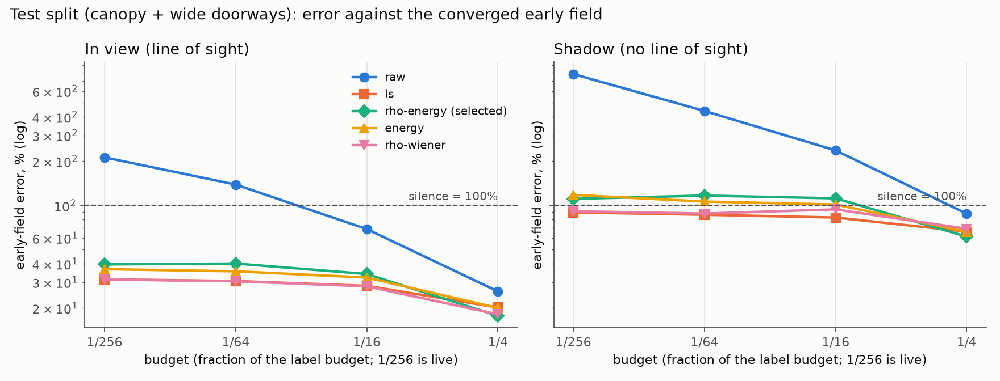
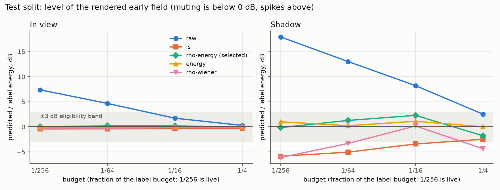
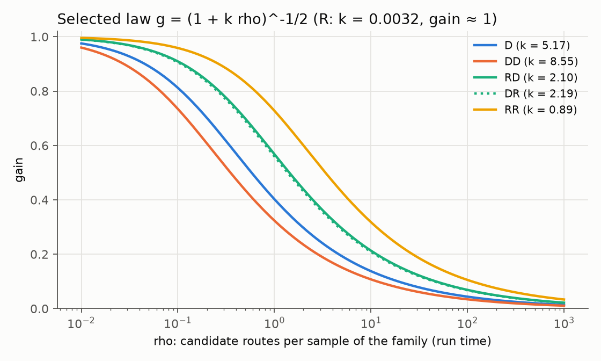

# Per-path-family gains as a network-free denoiser — 3 November 2026

**Verdict: shipped as an opt-in renderer setting (`familyGains`, default off).**
Fixed per-family gains remove the raw tracer's spikes, but the least-squares gains of the denoiser report do it by muting the shadow.
On held-out test receivers without line of sight they render the early field 5.9 dB too quiet at the live budget (1/256), and their 90% error there is barely better than silence (100%).
The selected, pre-registered alternative keeps every family's expected energy instead: `g = (1 + k·rho)^-1/2`, where `rho` is that family's candidate routes per sample at run time.
At 1/256 it is 40% wrong in view and 111% in shadow, at −0.2 dB in shadow, against raw 212% and 783% at +7.4 and +17.9 dB, and least squares 31% and 90% at −0.4 and −5.9 dB.
So it trades 8 points of in-view error and 21 points of shadow error for an unmuted shadow; in the shadow it fixes the level, not the content.
The pre-registered default-on checks pass, but the default stays off: the shadow content is still not recovered, the default renderer is the unbiased reference every check and dataset relies on, no shipped scene enables complete routes, and live scenes lie far outside the fitted `rho` range (see "Decision").

All numbers are measured on this Mac (Apple M5, 16 GB, shared desktop) under `nice 19`.
Dataset: `denoise-pilot-v1` (SHA-256 of `dataset.json` `ef63b2f0…`), the 63 accepted scenes, same splits as the [denoiser report](../denoise-model-2026-11-02/README.md): train 36 scenes, validation 12 (corridors), test 15 (canopy and wide doorways).
Error metric as there: complex relative L2 over receivers and the 32 frequencies against the 8-seed converged early field (every family except the residual walk), RMS over scenes; silence scores exactly 100%.
The least-squares row reproduces that report's fixed-gain baseline exactly (32.1 / 31.3 / 29.1 / 20.9% overall on test), and the raw row its raw baseline (225.6 / 144.1 / 72.2 / 27.3%).



## Question and protocol

Least-squares gains win mostly by shrinkage: DD, RD and DR gains of 0.002–0.003 at 1/256.
That lowers average error but may mute the sound that matters most behind walls, where diffraction is the only path.

**In view versus shadow.**
Receivers are split by the scene generator's analytic line of sight.
Each subset is scored against its own label energy, so the shadow number says how wrong the shadow field is, not how small it is; a scene enters a subset only if it has receivers there.
Test: 760 in-view receivers in 15 scenes, 115 shadow receivers in 12 scenes; validation 378 / 182 receivers (12 / 8 scenes); train 1,555 / 361 (36 / 20 scenes).

**Level.**
"Energy" is the predicted over the label energy of a subset (summed over receivers, frequencies and seeds, averaged over scenes, in dB).
Muting is below 0 dB, spikes above.

**Candidates** (all fitted on train only; direct sound is fixed at gain 1 everywhere, because it is deterministic, and the walk is not part of this label):

| Candidate | Gain of family f |
|---|---|
| `raw` | 1 (current renderer) |
| `ls` | least squares per family and budget (the denoiser report's baseline) |
| `ls-shadow` | least squares with shadow receivers given half of every scene's weight |
| `energy` | per family and budget, `sqrt(label energy / input energy)`: preserves each family's expected energy |
| `rho-wiener` | `1 / (1 + k_f·rho)`, one `k` per family, least squares over all budgets jointly |
| `rho-energy` | `(1 + k_f·rho)^-1/2` with the same `k`: the energy-preserving form of `rho-wiener` |

`rho` is a run-time quantity, the candidate routes per sample of the path's family, exactly as the shader samples them.
First-order images: primitives over mirror candidates (1 when every primitive is a candidate).
Complete routes: total candidates over samples when every candidate is enumerated (all families share the samples); otherwise each nonempty family draws `samples / families` routes from its own `size_f` candidates, and `rho_f = size_f · families / samples` is the route's inclusion weight.
A Monte Carlo estimate's relative variance grows with `rho`, so `1 / (1 + k·rho)` is the Wiener gain of a family whose noise-to-signal ratio is `k·rho`, and its square root keeps that family's expected energy.
Because `rho` comes from the scene size and the budget, these laws need no table per budget and no interpolation rule: every budget and scene size has a defined gain.

**Selection rule**, committed before any validation or test evaluation (`c77be8c`, `analyze.py` `RULE`):

1. Eligible: the validation energy ratio is within ±3 dB in view and in shadow, at every budget.
2. Among eligible candidates, lowest validation score wins: the mean over the four budgets of `(ln error_view + ln error_shadow) / 2`, so the 182 shadow receivers weigh as much as the 378 in view.
3. Default on only if, on test at 1/256, the selected candidate beats raw in view and in shadow, its energy is within ±3 dB in both, and its rigid-tracer shadow error against FDTD is not above raw's.

The rule was set after looking at the training split only.
An earlier draft used the mean of per-band dB levels as the guard; on train no candidate passed it, because a dB mean is biased low for any noisy estimate (an energy-exact estimate scored −3.4 dB in shadow), so the guard was changed to the energy ratio before validation was run.
The test split was evaluated once, for all six candidates, after `selection.json` was written; the selection cannot see test.

## Results

#### Validation (corridors; selection)

| Candidate | Score | Eligible | View error 1/256 / 1/64 / 1/16 / 1/4 | Shadow error | View energy dB | Shadow energy dB |
|---|---:|---|---|---|---|---|
| raw | 5.675 | no | 466 / 302 / 132 / 64 | 1001 / 582 / 367 / 206 | +13.6 / +10.1 / +4.3 / +1.4 | +20.0 / +15.3 / +11.6 / +7.2 |
| ls | 4.161 | no | 48.1 / 47.4 / 45.8 / 39.7 | 93.0 / 92.6 / 91.3 / 87.7 | −1.1 / −1.0 / −0.9 / −0.4 | −6.6 / −5.8 / −4.0 / −1.1 |
| ls-shadow | 4.169 | no | 48.4 / 47.6 / 45.9 / 40.2 | 92.8 / 92.5 / 91.3 / 91.8 | −1.4 / −1.2 / −1.1 / −0.4 | −6.9 / −6.0 / −4.0 / −0.3 |
| energy | 4.463 | yes | 64.5 / 65.9 / 61.1 / 46.9 | 125 / 125 / 137 / 123 | +0.1 / +0.4 / +0.5 / +0.3 | +0.3 / +0.6 / +2.6 / +2.9 |
| rho-wiener | 4.132 | no | 47.9 / 46.9 / 45.3 / 35.3 | 93.5 / 92.0 / 90.2 / 81.6 | −1.0 / −0.9 / −0.7 / −0.6 | −6.6 / −5.9 / −4.0 / −2.4 |
| **rho-energy** | 4.345 | **yes** | 63.3 / 64.9 / 55.7 / 39.3 | 107 / 115 / 116 / 97 | +0.0 / +0.4 / +0.2 / −0.0 | −2.3 / −0.6 / +1.0 / +0.8 |

Every least-squares form mutes the corridor shadow by 4–7 dB below 1/4 and is not eligible; `rho-energy` scores better than `energy` and is selected.
Weighting shadow receivers in the fit (`ls-shadow`) changes almost nothing: on train at 1/256, D carries 63% of the shadow label energy but adds noise of 105% of it, and DD, RD and DR each carry 13–18% while adding 11–20 times the label energy in noise, so no fixed gain recovers them.

#### Test (canopy and wide doorways, evaluated once)

| Candidate | Budget | View error | Shadow error | View energy dB | Shadow energy dB |
|---|---|---:|---:|---:|---:|
| raw | 1/256 | 212.2% | 783.1% | +7.4 | +17.9 |
| raw | 1/64 | 138.6% | 439.2% | +4.7 | +13.0 |
| raw | 1/16 | 68.9% | 236.7% | +1.7 | +8.2 |
| raw | 1/4 | 26.0% | 87.8% | +0.3 | +2.5 |
| ls | 1/256 | 31.4% | 89.6% | −0.4 | −5.9 |
| ls | 1/64 | 30.6% | 86.3% | −0.4 | −5.1 |
| ls | 1/16 | 28.3% | 82.6% | −0.4 | −3.4 |
| ls | 1/4 | 20.2% | 66.2% | −0.3 | −2.5 |
| **rho-energy** | 1/256 | 39.6% | 110.7% | +0.0 | −0.2 |
| **rho-energy** | 1/64 | 40.2% | 116.6% | +0.2 | +1.3 |
| **rho-energy** | 1/16 | 34.1% | 111.6% | +0.2 | +2.3 |
| **rho-energy** | 1/4 | 17.7% | 61.3% | −0.1 | −1.8 |

The other three candidates are in [tables.md](tables.md); `rho-wiener` matches `ls` in view (31.3 / 30.4 / 28.1 / 18.1%) and mutes the shadow by up to 6.1 dB, and `energy` is 36.8 / 35.6 / 32.3 / 20.0% in view and 118 / 106 / 101 / 66% in shadow, level-correct.
Over all receivers `rho-energy` is 40.6 / 41.3 / 35.3 / 18.6% (`ls` 32.1 / 31.3 / 29.1 / 20.9%).
At 1/4 it is the best candidate in view and in shadow, because it passes enumerated small scenes through (gain near 1) while shrinking subsampled ones, which a single table per budget cannot do.



| Test family | Candidate | View 1/256 / 1/64 / 1/16 / 1/4 | Shadow | Shadow energy dB |
|---|---|---|---|---|
| canopy | raw | 194 / 102 / 50 / 18 | 590 / 332 / 183 / 77 | +15.5 / +10.7 / +6.3 / +2.3 |
| canopy | ls | 26.2 / 25.5 / 23.0 / 16.1 | 89.2 / 85.6 / 81.7 / 63.3 | −6.8 / −5.7 / −3.6 / −2.4 |
| canopy | rho-energy | 35.2 / 32.8 / 26.3 / 11.9 | 105 / 102 / 107 / 55 | −0.7 / +0.2 / +2.2 / −2.3 |
| doorway | raw | 257 / 209 / 104 / 41 | 1069 / 598 / 318 / 106 | +20.6 / +15.6 / +10.5 / +2.9 |
| doorway | ls | 42.5 / 41.3 / 39.5 / 28.5 | 90.3 / 87.9 / 84.6 / 71.7 | −4.5 / −4.0 / −3.2 / −2.6 |
| doorway | rho-energy | 49.9 / 55.6 / 49.6 / 28.1 | 121 / 141 / 120 / 72 | +0.7 / +2.8 / +2.5 / −1.0 |

#### Against the wave solver (rigid walls, FDTD, settled scenes only)

The rigid tracer's low-budget inputs, with the same gains, against FDTD at 125 and 250 Hz (pilot's settled scenes; the gains were fitted on material presets, so this also checks transfer).
"Label" is the converged 8-seed rigid tracer, i.e. the best any gain could approach.

| Family (split), Hz | Candidate | View error 1/256 / 1/64 / 1/16 / 1/4 | Shadow error | Label view / shadow |
|---|---|---|---|---|
| canopy (test, 3 scenes), 125 | raw | 262 / 115 / 48 / 22 | 430 / 211 / 115 / 43 | 19.2 / 30.2 |
| | ls | 38.0 / 36.3 / 34.1 / 27.2 | 78.6 / 59.3 / 47.4 / 34.0 | |
| | rho-energy | 46.5 / 40.6 / 27.6 / 21.3 | 83.7 / 50.7 / 67.7 / 49.6 | |
| canopy (test, 3 scenes), 250 | raw | 241 / 109 / 44 / 18 | 400 / 233 / 143 / 56 | 13.5 / 42.6 |
| | ls | 36.6 / 34.6 / 31.9 / 24.2 | 77.3 / 61.4 / 56.9 / 38.2 | |
| | rho-energy | 44.6 / 40.0 / 23.7 / 16.9 | 80.0 / 66.3 / 81.2 / 52.6 | |
| barriers (train, 6 scenes), 125 | raw | 247 / 126 / 61 / 21 | 521 / 374 / 168 / 65 | 15.9 / 50.5 |
| | ls | 29.2 / 25.8 / 23.8 / 19.4 | 88.5 / 77.4 / 71.9 / 59.0 | |
| | rho-energy | 34.0 / 27.9 / 26.3 / 20.4 | 87.8 / 82.3 / 68.3 / 58.7 | |

Against the wave field both gain laws are 5–6 times better than raw at 1/256 in shadow, and within a few points of each other; neither reaches the converged tracer's own shadow bias (30–51%), which no gain can remove.
Canopy has 3 settled scenes among the accepted ones; the single settled wide doorway is in [tables.md](tables.md).

## Decision

**Shipped: `rho-energy`, as `TakeRender.Settings.familyGains`, default off.**
Its pre-registered default-on checks pass on test at 1/256 (view 39.6% < 212.2%, shadow 110.7% < 783.1%, energy +0.0 / −0.2 dB, FDTD canopy shadow 83.7 / 80.0% ≤ 430 / 400%).
The default stays off, deliberately, against that rule's literal outcome:

- **The shadow content is not recovered.** At 1/256 the shadow field is 111% wrong: right level, wrong phases.
  The gains remove spikes and keep the level; they do not denoise the diffracted field.
  Only more samples per diffraction route can.
- **Off is the unbiased estimator.** Any shrinkage biases every sampled family toward zero.
  The statistical checks, the dataset generator and every benchmark assume the unbiased renderer; a biased default would silently change all of them.
- **Nothing shipped would change.** Church and TrainStation render with `completeRouteSamples = 0` (the legacy walk), where these families do not exist; the setting is rejected there by validation.
- **Extrapolation.** The fit saw `rho` up to 2.1 for D and 228–300 for DD/RD/DR/RR, and only enumerated mirrors (`rho` = 1).
  A 12,761-triangle Church with complete routes at 256 samples with its preset (diffraction off) would have `rho` of about 6×10^5 for RR and 100 for mirrors (R gain 0.87); the law is defined there but not validated.

**Walk: left ungained (gain 1), and justified rather than refit.**
The early-field label cannot value the walk, so any fit against it returns zero.
Against walk-including labels from the residual-walk re-renders (2 November, `label-after`; rendered with a since-rejected edge-choice variant of the walk shader, which leaves the early families and the expected walk unchanged), the open scenes' converged walk is 0.3–3.4% of the early field, so its gain changes their expected total by at most that.
At low budgets it still spikes there (barriers-0001 at 1/256: a 646% walk buffer, error 26% with walk gain 0 against 645% with gain 1; canopy-0000 at 1/64: 33 against 43%), so least squares would pick about 0 from two training scenes.
In closed rooms the walk is the only late field (its unconverged label is 22–3,743% of the early field), so a global walk gain of 0 would delete room reverberation, and no converged label exists to fit any other value.
A scalar gain cannot tell open from closed scenes; the walk's room spikes need the walk fixed, not gained.



#### Gains of the selected law in pilot scenes (`R`, `D`, `DD`, `RD`, `DR`, `RR`; direct and walk 1)

| Scene (edges, triangles) | 1/256 | 1/64 | 1/16 | 1/4 |
|---|---|---|---|---|
| canopy-0002 (18, 20) | 1.00 / 0.60 / 0.14 / 0.25 / 0.25 / 0.36 | 1.00 / 0.83 / 0.26 / 0.46 / 0.45 / 0.61 | 1.00 / 0.59 / 0.50 / 0.76 / 0.75 / 0.87 | 1.00 / 0.83 / 0.75 / 0.92 / 0.92 / 0.96 |
| barriers-0001 (48, 48) | 1.00 / 0.41 / 0.05 / 0.10 / 0.10 / 0.16 | 1.00 / 0.67 / 0.10 / 0.20 / 0.20 / 0.30 | 1.00 / 0.88 / 0.20 / 0.38 / 0.37 / 0.54 | 1.00 / 0.51 / 0.41 / 0.68 / 0.67 / 0.82 |
| furnished-0003 (108, 124) | 1.00 / 0.29 / 0.02 / 0.04 / 0.04 / 0.06 | 1.00 / 0.52 / 0.05 / 0.09 / 0.08 / 0.12 | 1.00 / 0.77 / 0.09 / 0.17 / 0.17 / 0.24 | 1.00 / 0.92 / 0.18 / 0.32 / 0.32 / 0.44 |
| *ls (any scene)* | 0.95 / 0.25 / 0.002 / 0.003 / 0.002 / 0.010 | 0.96 / 0.38 / 0.007 / 0.012 / 0.017 / 0.041 | 0.96 / 0.47 / 0.025 / 0.058 / 0.061 / 0.161 | 0.97 / 0.66 / 0.12 / 0.20 / 0.20 / 0.51 |

`k` = 0.0032 (R), 5.17 (D), 8.55 (DD), 2.10 (RD), 2.19 (DR), 0.889 (RR), power 1/2.
D's gain is not monotone in budget when a scene crosses from subsampled to enumerated routes (barriers-0001: 0.88 at 1/16, 0.51 at 1/4), because enumeration gives D fewer samples per route (`rho` 0.06 → 0.56) while removing all route-selection noise from DD–RR.

## Implementation

- **Setting:** `TakeRender.Settings.familyGains` (Inspector tooltip; "Family gains" in the take editor's transport settings).
  `TakeRender.Validate` rejects it unless the transport is raytraced with complete routes (`completeRouteSamples > 0`, bounces > 0) and First Images reflection sampling, the configuration the gains were fitted for.
- **Data:** [`Assets/Resources/Acoustics/FamilyGains.json`](../../../Assets/Resources/Acoustics/FamilyGains.json) holds the method, the formula, `k` per family, the power, the fitted `rho` range per family and provenance (dataset SHA-256, `selection.json` SHA-256, fit time).
  It is written by `analyze.py export` and read by `FamilyGainTable` ([`FamilyGains.cs`](../../../Assets/Scripts/Simulation/FamilyGains.cs)), which validates it.
  Offline render reports record its SHA-256 as `familyGainsHash`.
- **Where:** the family of a complete-route sample is decided only on the GPU (the audio stage sees anonymous paths), so the gain is a small pass over the transport's own path slots, run right after the kernel that wrote them: `GainMirrors` after `PrepareMirrors` (first-order images) and `GainComplete2D/3D` after each site's `IntegrateComplete` (D, DD, RD, DR, RR), before the next site reuses the route tables ([`FamilyGains.hlsl`](../../../Assets/Shaders/FamilyGains.hlsl)).
  It repeats the integrator's sample-to-route mapping, multiplies each path's complex pressure by its family's gain, and leaves every other field alone.
  Summation is linear, so this equals gaining each family's sum, and both audio backends (GPU and CPU reference) consume the same gained paths.
  Direct sound and the walk are never touched.
- **Off is unchanged:** with the setting off the pass is not dispatched and no existing kernel was edited.
  A first version multiplied inside the transport kernels behind a uniform branch; that changed the compiled kernels enough to move unrelated arrivals by a few float32 ulps (first-order images by up to 4×10^-7 of their RMS), so it was replaced, and with gains off the shipped design renders the pilot's early families and the current walk bit for bit (below).
  The ray debugger shows ungained (physical) arrivals.
- **Parameters** (`k`, power) are bound per dispatch through the command buffer, so transports with different settings can share one compute shader.

#### Verification

Six pilot scenes (one per family: barriers-0001, canopy-0002, corridor-0002, doorway-0002, furnished-0003, shoebox-0000) were re-rendered by the dataset pipeline at the four input budgets with their pilot seeds, once with gains off and once on ([`verify.json`](verify.json), `verify.py`):

- **Off reproduces the existing renderer bit for bit:** every early family of all 24 scene-budgets equals the pilot payload, and all eight families of three scenes (barriers, canopy, shoebox) equal a render made with the shaders as they were before this change (`c77be8c`, unchanged since `69c84b9`) at all four budgets.
- **On equals off times the offline law:** per family, `|on − g·off|` is at most 3.4×10^-6 of that family's RMS (float32 rounding), with `g` computed in Python from the scene's edge and triangle counts, the budget and `FamilyGains.json`.
  This checks the shader's `rho` (including the edge count), `k` and power against the analysis.
- **Direct and walk are unchanged** with gains on (bitwise equal in all 24 scene-budgets).

#### Tests

New checks in [`FamilyGainChecks.cs`](../../../Assets/Tests/Editor/FamilyGainChecks.cs) (all pass on Metal):

- `FamilyGainsOfOneReproduceEveryPath` (3D at 256 and 4,096 samples, planar at 256): a unit table (`k` = 0) reproduces every path bit for bit; the shipped table changes them.
- `FamilyGainsScaleOnlyTheirFamily` (subsampled and enumerated): each path equals the ungained path times `table.Gain(family, rho)`, with the family from `CompleteSampleFamilies` and slot ranges, every non-pressure byte identical, direct and walk untouched, and `rho` equal to the closed form for the fixture (24 edges, 24 triangles, 20 mirror candidates).
- `FamilyGainsKeepCpuAndGpuAudioInParity`: spectral CPU reference and GPU audio agree with gains on (same tolerance as `GpuAudioParity`).
- `FamilyGainsNeedCompleteRoutesAndFirstImages`, `ShippedFamilyGainTableIsProvenancedData`: validation and the data asset.
- `CompleteSampleFamiliesMatchDebugCapture` now shares the two-wall fixture and still passes.

The full `TakeChecks` suite with the final shaders: 337 cases, 329 passed, 0 failed, 8 skipped (the opt-in measurements, including `MeasureFamilyGainCost`); 10.6 minutes in the isolated runner, peak 1.37 GiB.

#### Cost

`MeasureFamilyGainCost` (opt-in) alternates 300 synchronous solves with gains off and on in one process at the live budget (2 rays per bin, 256 complete samples, 32 bounces; two-wall fixture, so the pass is a relatively large share), after 20 warm-up solves ([`cost.json`](cost.json)):

| FFT (bins) | Paths per solve | Median off | Median on | Median paired difference (10th–90th percentile) |
|---|---:|---:|---:|---:|
| 64 (33) | 11,385 | 0.634 ms | 0.609 ms | −0.030 ms (−0.20 to +0.11) |
| 1,024 (513) | 176,985 | 0.995 ms | 1.053 ms | +0.039 ms (−0.24 to +0.20) |

The difference is within the run-to-run spread of these shared-machine solves (about ±0.2 ms); the pass adds two dispatches per pair and emission site and one read-modify-write per mirror and complete-route slot.
The dataset re-renders (paced, interleaved off/on) agree: median per-receiver solve times at 1/256 are 1.2–2.2 ms either way, with off/on ratios scattered from 0.47 to 1.25 by machine load.

## Not done or not verified

- **No listening A/B.** No existing take renders with complete routes (Church and TrainStation use the legacy walk), and the only short self-contained take (the 4-second Church weather preview) has 17,321 triangles and rain/wind planes with 192 and 24 emission sites; complete routes multiply per site, so a raw-versus-gains render would be a new, unvalidated and expensive preset rather than an A/B of the live one.
  Not attempted.
- The fit covers `rho` ≤ 2.1 (D), ≤ 228–300 (DD–RR) and enumerated mirrors only; larger scenes extrapolate.
- 2D (planar) renders use the same law; the dataset is 3D only, so the planar gains are unfitted (the unit-gain and parity checks cover planar plumbing only).
- Validation is one family (corridors); test is canopy and wide doorways; the shadow subsets are 115 test and 182 validation receivers.
- The walk evidence uses the 2 November `label-after` renders (edge-choice variant of the walk); no walk label was re-rendered with the final shader.
- The metric is a 125 Hz–4 kHz complex field at static receivers; perceived quality of level-preserving noise in shadow against muting was not measured.

## Reproduce

```sh
PY=.context/fdtd-teacher/venv/bin/python
B=docs/benchmarks/family-gains-2026-11-03
nice -n 19 $PY $B/analyze.py select     # train + validation only -> selection.json
nice -n 19 $PY $B/analyze.py test       # all candidates on test, FDTD and walk checks -> report.json, tables.md
$PY $B/analyze.py export                # -> Assets/Resources/Acoustics/FamilyGains.json
$PY $B/analyze.py figures
# Renderer against the offline law (six pilot scenes, gains off and on):
$PY $B/verify.py prepare .context/family-gains/verify barriers-0001 canopy-0002 corridor-0002 doorway-0002 furnished-0003 shoebox-0000
nice -n 19 $PY tools/dlss_jobs.py --data .context/family-gains/verify render --batch 12
$PY $B/verify.py compare .context/family-gains/verify
nice -n 19 $PY tools/dlss_jobs.py test FamilyGain
ACOUSTIC_FAMILY_GAIN_COST=$PWD/$B/cost.json nice -n 19 $PY tools/dlss_jobs.py test MeasureFamilyGainCost
nice -n 19 $PY tools/dlss_jobs.py test TakeChecks
```

The before-change comparison rendered the three `-off` scenes into a separate root (`.context/family-gains/verify-head`) with `Assets/Shaders/Transport.hlsl` and `CompleteDiffraction.hlsl` temporarily checked out from `c77be8c` (the gain pass lives in new files only).

Re-running `select` rewrites `selection.json` with a new timestamp (and so a new SHA-256 in the asset's provenance); the fitted numbers are deterministic.
Unity runs use the isolated runner (`.context/gpu-audio/runner`) under the dataset guards: nice 19, one job worker, 20% work pacing, 4 GiB process-tree guard, suspended on battery.

[Machine-readable results](report.json) · [selection](selection.json) · [verification](verify.json) · [generated tables](tables.md).
