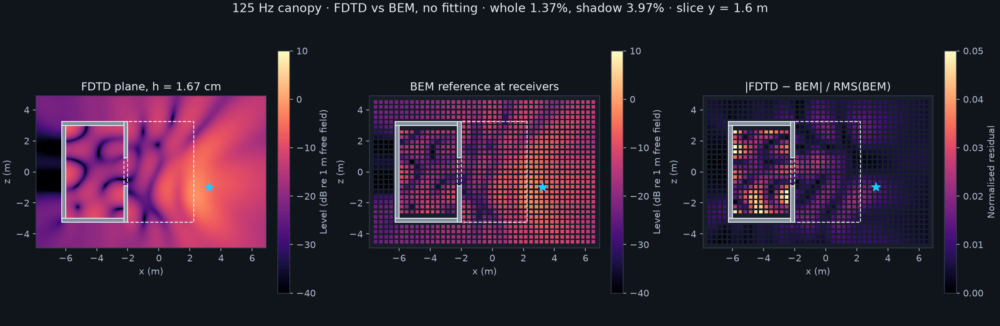
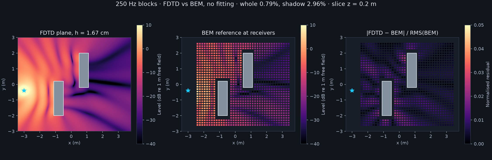
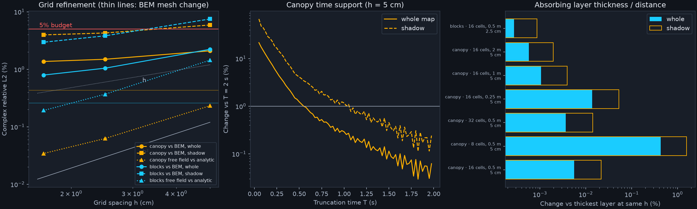

# FDTD low-frequency teacher, stage-1 gate — 28 October 2026

**Verdict: PASS. Both fixtures are inside the declared 5% whole-map budget: canopy 1.37% (shadow 3.97%, receiver #323 4.66%) and blocks 0.79% (shadow 2.96%), with no fitting.**
The canopy residual is larger than either solver's own refinement change; it sits in the resonant room interior and is most likely residual BEM mesh error (diagnosed below, not proven).

A new 3D time-domain wave solver ([`tools/fdtd_wave.py`](../../../tools/fdtd_wave.py)) reproduces both independent BEM references without any gain, phase or normalization fitting.
Its own numerical changes (grid refinement, absorbing layer, time support, analytic free field) were measured separately and sit well below the declared 5% budget.
The budget, metric, reference files and reported grid level were committed in [`budget.json`](budget.json) (`aa23be6`), and the run protocol in `5c1446b`, before any FDTD field was compared with a BEM field.

| 125 Hz canopy vs BEM (1,166 receivers) | h = 5 cm | 2.5 cm | **1.67 cm (reported)** |
|---|---:|---:|---:|
| Whole-map complex relative L2 | 2.09% | 1.49% | **1.37%** |
| Shadow region (293 receivers) | 5.90% | 4.28% | **3.97%** |
| Indoor receiver #323 | 6.60% | 4.95% | **4.66%** |

| 250 Hz blocks vs BEM (1,178 receivers) | h = 5 cm | 2.5 cm | **1.67 cm (reported)** |
|---|---:|---:|---:|
| Whole-map complex relative L2 | 2.23% | 1.05% | **0.79%** |
| Shadow region (712 receivers) | 7.50% | 3.82% | **2.96%** |

At #323 the reference is 0.168523 + 0.122584i; the reported FDTD value is 0.174619 + 0.115033i.
For scale, the accepted ray renderer is 29.2% whole / 86.9% shadow on the same canopy, and 47% at #323.





## Self-consistency evidence

| Check (declared limit) | Canopy | Blocks |
|---|---:|---:|
| Free field vs analytic `exp(-ikr)/r`, finest grid (≤ 1%) | 0.034% | 0.193% |
| Finest grid-pair change 2.5 → 1.67 cm (≤ 1%) | 0.14% / 0.35% | 0.27% / 0.88% |
| Absorbing layer: 16 cells / 0.5 m vs 32 cells / 2 m (≤ 1%) | 0.0056% / 0.022% (5 cm) | 0.00027% / 0.00086% (2.5 cm) |
| Truncation: response at 0.75 T vs T (≤ 1%) | 0.32% / 1.22%* | 0.00008% / 0.00032% |
| Observed refinement order, whole / shadow | 1.73 / 1.83 | 1.73 / 1.59 |
| Estimated remaining discretization error at 1.67 cm, whole / shadow | 0.14% / 0.32% | 0.27% / 0.97% |
| BEM's own last mesh-refinement change, whole / shadow | 0.43% / 1.36% | 0.26% / 0.98% |

\* The declared limit is met on the whole map. The shadow change between 0.9 s and 1.2 s is 1.22%; against the 2 s run the 1.2 s shadow change is 0.67%, and the reported shadow error moves from 3.97% by at most that amount.



- **Analytic free field.** The same receivers, source and grids with the walls removed reproduce `exp(-ikr)/r` to 0.232% / 0.063% / 0.034% (canopy) and 1.443% / 0.369% / 0.193% (blocks) at 5 / 2.5 / 1.67 cm.
  The error falls at roughly second order down to about 0.03%, so the source normalization, time stamps, receiver interpolation and absorbing layer carry no hidden gain or phase.
- **Grid refinement.** All three spacings place every box face exactly on a velocity face (largest snap 7e-16 m), so the study isolates dispersion and edge resolution from staircasing.
  The observed order is below two, which is expected: the rigid box edges carry a singular field, and the diffracted (shadow) field converges more slowly than the free field.
  Richardson extrapolation from the three levels gives 1.25% / 3.67% (canopy) and 0.57% / 2.13% (blocks) whole / shadow against BEM.
  For the blocks, that residual is the size of the BEM's own mesh change.
  For the canopy it is several times larger than either solver's own change; the next section diagnoses why.
- **Absorbing layer.** Changing the CPML from 16 cells at 0.5 m to 8–32 cells at 0.25–2 m changes the canopy field by at most 0.014% whole / 0.053% shadow, except an 8-cell layer (0.43% / 1.57%).
  The 0.25 m margin is the closest the layer gets to the open floor of the room and to the receivers; it still changes only 0.014%.
- **Time support.** The canopy is a lossless, floorless room with a doorway; its modes ring for seconds (receiver energy −50 dB at 1 s, −63 dB at 1.5 s).
  A long 2 s run at 5 cm shows that truncating at 1.2 s changes the response by 0.17% whole / 0.67% shadow relative to 2 s.
  1.2 s was fixed from that run before any BEM comparison and used at every level.
  The blocks scene decays in tens of milliseconds; 0.12 s changes it by less than 0.0001%.

## Why the canopy residual is 1.4%, not 0.1%

The FDTD canopy field is converged to about 0.15% (grid), 0.006% (layer) and 0.2% (time support), yet it differs from the BEM by 1.37% whole / 3.97% shadow, and the residual map is concentrated inside the room (indoor receivers 4.4%, outdoor lit receivers 0.9%).
The lossless room is lightly damped, and 125 Hz sits on the flank of its resonances.
Evaluating the same finest FDTD run off 125 Hz, as a diagnostic only, shows how sharp that is:

| FDTD evaluated at | 124.8 Hz | 124.9 Hz | **125.0 Hz** | 125.1 Hz | 125.2 Hz |
|---|---:|---:|---:|---:|---:|
| Change vs FDTD at 125 Hz | 3.27% | 1.67% | 0 | 1.74% | 3.57% |
| Whole-map error vs BEM at 125 Hz | 2.33% | 1.03% | **1.37%** | 2.92% | 4.68% |
| Shadow error vs BEM at 125 Hz | 5.50% | 2.38% | **3.97%** | 8.17% | 12.89% |

A 0.08% offset in effective frequency, wavenumber or room size moves the field by about 1.7% whole and 4% indoors.
The FDTD's measured free-field phase-velocity error at 1.67 cm (125 Hz) is about 0.007%, ten times too small to explain the offset.
The BEM's indoor field is still changing 1.6% between its 0.35 m and 0.25 m meshes (6.1% from 0.5 m), so its resonant interior is the less converged of the two.
The most likely cause is therefore residual BEM mesh error in the resonant room, but this is not proven: a finer BEM mesh (or an independent third solver) is needed to close it.
The reported numbers are the unshifted 125 Hz field; nothing above is applied as a correction.
For training data, the same sensitivity means single-frequency targets in lightly damped spaces are ill-conditioned; absorbing materials (stage 2) will broaden the resonances.

## Design

- **Backend: fused Metal kernels through PyTorch MPS** (`torch.mps.compile_shader`).
  Two kernels per time step (velocity, then pressure) carry rigid faces and CPML memory updates inline; PyTorch only owns buffers, source injection and receiver gathering.
  It needs no build step, keeps the solver in one 500-line Python file, and the same kernels can be ported to CUDA for rented GPUs in stage 5.
  A NumPy transcription of the scheme checks the kernels to float32 rounding (`test_metal_matches_reference`).
- **PFFDTD Metal fork, checked and not adopted** (about 15 minutes, no build).
  Its Metal 3D engine exists but is Cartesian only (no FCC kernel), and its domain boundary is a first-order impedance ABC, not a PML.
  The README still says CPU only, CI does not exercise Metal, and the pipeline needs conan, HDF5 and a SketchUp/JSON triangle voxelizer.
  An exterior scene like the canopy needs a real absorbing layer, so this would have meant adding one to a fork rather than using it.
- **Scheme.** Staggered pressure / scaled-velocity (Yee) grid, second order in space and time, Courant number 0.99/√3.
  Rigid boxes are cell sets; any face between a solid and an air cell has zero normal velocity, so axis-aligned walls lie exactly on velocity faces.
- **Absorbing layer.** Convolutional PML on all six faces, cubic σ profile, design reflection 1e-6, κ = 1, no frequency shift (low frequencies are absorbed as well as high ones).
  Memory variables exist only inside the layer slabs.
- **Source and normalization.** A zero-mean derivative-of-Gaussian volume velocity (peak 150 Hz canopy, 300 Hz blocks) is spread to the eight surrounding cells with trilinear weights.
  The response is `H = 4π P(ω) / (iω̃ Q(ω))` with the DFTs evaluated at the exact sample times (pressure at n·dt, source at (n+½)·dt) and `ω̃ = 2 sin(ω dt/2)/dt`, the scheme's own time derivative.
  This gives the renderer/reference convention `exp(+iωt)` with free field `exp(-ikr)/r` analytically, with no calibration against either BEM; the analytic free-field run is the check.
  `test_response_is_independent_of_pulse` confirms two pulse widths give the same response.
- **Receivers.** Trilinear interpolation of cell-centred pressure; solid cells get zero weight and the rest are renormalized (a rigid ghost value).
  The reference receivers are at least 12 cm from any wall, so no stencil touches a solid at these spacings.
- **Geometry.** The canopy's faces sit on a 0.05 m lattice (the doorway jambs are at ±0.9 m, not on the 0.125 m lattice), and the blocks' on 0.1 m, so 5, 2.5 and 1.67 cm are all exact.
- **Throttling.** Every run used `nice -n 19`, 20% GPU work pacing in batches of about 0.1 s of GPU time, a 4 GiB guard on driver-allocated or resident memory, and a pause while the Mac ran on battery.
  The finest canopy grid used 3.57 GiB of GPU memory.

## Throughput and projected cost

Sustained GPU-busy throughput was 1.86 Gcell/s (median of paced runs above 30 M cells; range 1.26–2.05), counting every cell including CPML and solids.
An unpaced cubic-grid benchmark gives 2.2–2.3 Gcell/s, about three times the earlier unfused PyTorch sketch (0.6).
The kernels move roughly 50 bytes per cell update, so this is about 70% of the memory bandwidth; another large gain would need temporal blocking or a lower-memory scheme.

Second-order dispersion is the cost driver, not geometry.
The free-field runs fit a phase lag of 6.3/ppw² radians per wavelength travelled plus a 6.0/ppw² amplitude bias (ppw = points per wavelength).
At the plan's assumed 10 ppw that is about 60% complex error after 10 wavelengths; complex accuracy near 5% needs about 35 ppw at 10 wavelengths.

| Frequency | ppw | Spacing | Cells | GPU memory | GPU min, 0.5 s | GPU min, 1 s | Dispersion error at 10 λ | across 17.5 m |
|---:|---:|---:|---:|---:|---:|---:|---:|---:|
| 500 Hz | 10 | 6.86 cm | 5 M | 0.1 GiB | 0.2 | 0.4 | 60% | 140% |
| 500 Hz | 20 | 3.43 cm | 31 M | 0.6 GiB | 2.5 | 4.9 | 16% | 40% |
| 500 Hz | 35 | 1.96 cm | 146 M | 2.5 GiB | 20.1 | 40.1 | 5% | 13% |
| 500 Hz | 50 | 1.37 cm | 401 M | 6.8 GiB | 78.8 | 157.6 | 3% | 6% |
| 1000 Hz | 10 | 3.43 cm | 31 M | 0.6 GiB | 2.5 | 4.9 | 60% | 194% |
| 1000 Hz | 20 | 1.72 cm | 213 M | 3.6 GiB | 33.4 | 66.8 | 16% | 78% |
| 1000 Hz | 35 | 0.98 cm | 1,059 M | 17.5 GiB | 290.9 | 581.8 | 5% | 26% |
| 1000 Hz | 50 | 0.69 cm | 2,998 M | 49.0 GiB | 1,176.7 | 2,353.3 | 3% | 13% |

12 × 12 × 6.25 m interior plus a 16-cell CPML on every side, at the measured 1.86 Gcell/s; multiply by five for 20% pacing.
Dispersion errors are free-field only; boundary and edge errors add to them.

So 500 Hz teacher data for a 900 m³ room is practical on this Mac at 20–35 ppw (2.5–20 GPU minutes per source for 0.5 s, five times that paced).
Complex-accurate 1 kHz needs 17–49 GiB and hours per source; that belongs on a rented GPU and, more importantly, on a lower-dispersion scheme (FCC, compact fourth order, or a dispersion-optimized stencil) before scaling.
Lossy materials will shorten the needed time support well below the canopy's 1.2 s; a lossless semi-open room is the worst case.

## Limits and what is unverified

- **Staircasing.** Oblique or curved geometry would be staircased: wall position errors up to half a cell and first-order surface-area and diffraction-edge errors.
  Stage-2 generators should keep walls on the grid lattice where possible, and any oblique family needs its own convergence check (PFFDTD's effective-surface-area correction is the established mitigation).
- Only rigid, lossless boxes were tested; impedance (absorbing) walls, air absorption and moving geometry are not implemented.
- Both comparisons are single-frequency, at 125 and 250 Hz; the broadband impulse responses are produced but not validated against a broadband reference.
- The BEM references are numerical, not ground truth; the canopy FDTD–BEM residual exceeds both solvers' own refinement changes and is attributed, unproven, to the BEM's resonant interior.
- Throughput was measured on a shared laptop under pacing; GPU clocks vary between batches.
  The early free-field runs' `wallSeconds` exclude system sleep (fixed in `f1fc58c`, which changed only pacing and timing code, not the kernels); GPU-busy times are unaffected.
- A planned 2.5 cm repeat of the canopy layer study (`canopy-pml32-m0.5-h25`) was dropped after the 5 cm study showed a 0.006% change; the blocks layer check was run at 2.5 cm.

## Reproduce

Create the environment, extract the existing wave references, run the tests, the cases, and the analysis:

```sh
uv venv --python 3.12 .context/fdtd-teacher/venv
VIRTUAL_ENV=.context/fdtd-teacher/venv uv pip install -r tools/fdtd-requirements.txt
mkdir -p .context/fdtd-teacher/evidence && (cd .context/fdtd-teacher/evidence && \
  unzip -q ../../../docs/benchmarks/wave-review-2026-10-27/evidence.zip)
nice -n 19 .context/fdtd-teacher/venv/bin/python -m unittest discover -s tools -p test_fdtd_wave.py -v

# One worker at a time; skips finished cases; pauses on battery.
sh docs/benchmarks/fdtd-teacher-2026-10-28/run_queue.sh canopy-long-h50 \
  canopy-free-h50 canopy-free-h25 canopy-free-h17 blocks-free-h50 blocks-free-h25 blocks-free-h17 \
  canopy-h50 canopy-h25 canopy-h17 blocks-h50 blocks-h25 blocks-h17 blocks-pml32-m2-h25 \
  canopy-pml8-m0.5-h50 canopy-pml32-m0.5-h50 canopy-pml16-m0.25-h50 canopy-pml16-m1-h50 \
  canopy-pml16-m2-h50 canopy-pml32-m2-h50

nice -n 19 .context/fdtd-teacher/venv/bin/python tools/fdtd_wave.py bench --sizes 192 256 384 \
  > .context/fdtd-teacher/logs/bench.json
nice -n 19 .context/fdtd-teacher/venv/bin/python docs/benchmarks/fdtd-teacher-2026-10-28/analyze.py --package
```

`study.py --list` prints every case.
The paced runs took about 8 hours inside the solver (10 hours elapsed including a battery pause), most of it the 1.67 cm canopy run: 59 GPU minutes, about 5 hours paced.

[Machine-readable results](report.json) · [declared budget](budget.json) · [run evidence](evidence.zip): every run's complex receiver field, truncation curve, metadata and log, plus plane maps for the two reported runs; the full receiver impulse responses stay in `.context/fdtd-teacher/runs` (hashes in the archive manifest).
`analyze.py --runs <extracted>/runs` reproduces the report and figures from the archive alone.
