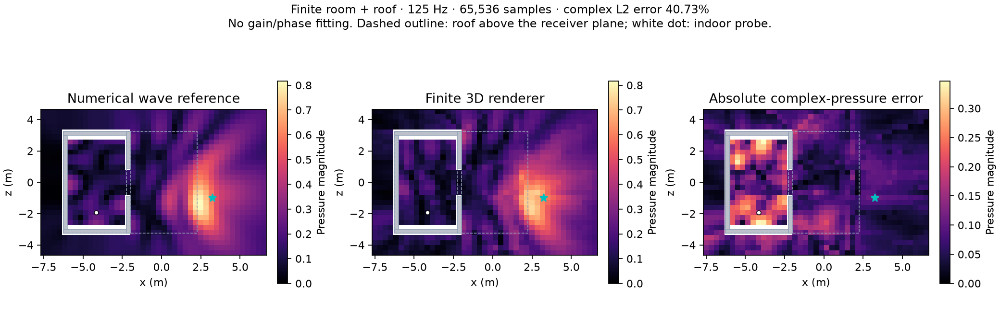

# Finite 3D diffraction adaptation — 28 October

The target remains the actual finite room and roof. Two independently reproduced
3D defects are corrected in the complete-route adapter. The full-room quality
gate **still fails**: at 125 Hz, whole-map complex-pressure error improves from
43.04% to **40.73%**, while shadow-region error remains **123.94%** (previously
125.51%). All 1,166 receivers return nonzero pressure; this does not establish a
correct room response. `completeRouteSamples` remains opt-in, with default zero;
the Church/rain presets are not promoted.

## Corrections and controls

1. **Unequal endpoint heights.** The finite Cauchy proposal incorrectly used total
   3D remaining path distance as a transverse radius. This moved its narrow peak
   away from the physical eta-zero location. The remaining legs are now projected
   into the current edge's transverse plane. The uniform support and exact PDF
   remain; there is no weight clipping. Six independent finite-edge cases at
   unequal heights, two seeds and four frequencies now pass. Four of the six
   failed before the change. `asymmetric_reference.py` uses double-precision
   adaptive integration; tolerance refinement changes components by under 8e-9.

2. **Surface paths across mesh joins.** A cube split into two touching objects
   previously produced DC pressure 0.01113 where independent second-order
   quadrature gives 0.16099. Internal faces incorrectly obstructed paths along
   the outer surface; the old shared-face factor also depended on owner IDs.
   Complete finite DD paths now use exterior-limit visibility in world space.
   Half multiplicity requires the whole segment to be covered by the union of
   coplanar triangles. A genuine gap retains full multiplicity. Four controls
   check an off-centre join/gap and rigidly rotated copies against independent
   outer-edge integrals. A midpoint-only or owner-only rule cannot pass them.

The visibility displacement is twice the existing 0.1 mm tolerance. Physical
vertices, path lengths, delays, PDFs, signs, materials and emission clocks are
unchanged. The shared planar integral and the residual 32-interaction walk are
unchanged. This correction applies to the complete finite two-edge connection;
it does not make the existing deeper walk complete or repair all its geometry
assumptions.

The along-face half factor follows the independent
[EDtoolbox implementation](https://github.com/upsvensson/Edge-diffraction-Matlab-toolbox/blob/master/toolbox/internal/EDwedge2nd.m).
The reference code and cube quadrature are retained in the evidence archive.
They validate these integrals, not a complete full-wave room model.

## What the room audit found



The reference is the unchanged finite 3D canopy BEM solution, not a recording.
Its last refinement changes pressure by 0.43% overall and 1.36% in shadow.
The renderer uses 65,536 complete samples, two residual rays/bin, 32 interaction
slots, seed 0 and physical 1.25 s support. All comparisons retain the original
pressure and phase; no gain fitting, phase fitting or audio normalization is used.

At indoor receiver 323, reference pressure is **0.16852 + 0.12258i** (amplitude
0.20839). The final 65,536-sample result is **0.06673 - 0.00958i** (amplitude
0.06742). Raising the budget to 1,048,576 samples still gives:

| Seed | Final complex pressure | Relative complex error at this receiver |
| --- | --- | ---: |
| 0 | 0.05661 + 0.03473i | 68.27% |
| 17 | 0.07262 + 0.02525i | 65.57% |

More samples alone do not close this gap. Before the seam correction, the same
million-sample probes gave 0.04080 + 0.01888i and 0.05299 + 0.01391i.

**Physical boundary representation remains unresolved.** An exact exterior
union mesh of the same seven finite boxes gives 0.11937 + 0.05545i and
0.10487 + 0.08514i at 262,144 samples. Its physical union has area 233.25 m² and volume 28.0625 m³;
no roof or wall height was changed. This diagnostic improves the result but is
not an integrated replacement for the scene geometry. In a second layout,
splitting an illuminated cube into touching objects still changes its complete
field by **11.37% / 11.44%** across two seeds, three receivers and four frequencies.
Single- and double-edge terms both change. Fixing the outer DD connection is not
full invariance to mesh partitioning: internal/overlapping boundaries can still
create nonphysical wedges. The audit retains this failure explicitly.

A sound next geometry step is to derive an acoustic exterior boundary with
material ownership from the physical union, separately from visual mesh pieces,
and validate equivalent representations before adding more routes. The finite
room also needs an order-convergence study: D/DD/RD/DR/RR cover at most two early
interactions, while the residual walk does not enumerate all higher-order mixed
or image paths. These are distinct from structural vibration, which remains
deferred. Neither additional samples nor a geometry bake alone has been shown
to recover the full room field.

## Cost, budget and validation

At 128 samples, the five fixed probes have **418.96% / 316.92%** complex error
for seeds 0 / 17. This remains an unusable rain budget. No new rain WAV was
played or normalized. The coverage check needs no new persistent GPU buffers;
its scratch-free interval union scans coplanar triangles and has worst-case
O(P²) work per qualifying connection. It is not a city-scale geometry solution.
The final full-map median solve/readback is 5.56 ms per receiver on this run;
this is a paced offline measurement, not a realtime audio deadline or a paired
performance guarantee.

`validation.json` separates correctness tests from measurements. The 18-case
adaptation run has 14 correctness checks plus four measurement cases; measurement
success means finite output and consistent capture, not agreement with BEM.
The final run adds eight audio/batching/deep-walk checks and three measurements.
Together, **22 correctness cases and seven measurement cases pass** on the final
source. The physical room gate remains failed.
`families.csv` decomposes D, DD, RD, DR and RR and asserts that their complex sum
reconstructs the actual complete path buffer. Explicit outward-solid mesh input
is available in the measurement harness; cavity fixtures keep their prior winding.

All Unity work ran in the isolated runner, nice 19, one job worker, explicit 20%
work/CPU pacing and a sampled 3 GiB parent-RSS guard. Cold debug compilation is
now warmed before the measurement work timer. The original convergence run
unnecessarily paced the cold compilation and is retained, along with its idle
stack sample. It was not a live renderer or audio playback run.

`evidence.zip` retains source snapshots, hashes, raw scene/field/family inputs,
reference data, XML results, resource logs and failed trials. The initial
coverage trial had a shader compile error from the reserved identifier `pass`;
the corrected run uses `scan`. Neither that trial nor the failed pre-fix controls
is counted as passing validation. Earlier adjacent-endpoint proposal results
remain as a rejected intermediate experiment; the accepted proposal projects
the remaining transverse legs.

## Reproduction

Extract `evidence.zip` at the repository root to restore its relative `.context`
inputs. Use an isolated Unity 6000.4.1f1 project and the guarded runner; do not
run batch tests against a foreground project. The test methods and inputs are
opt-in. Paths in the case-list files may need rebasing to the local checkout.

With NumPy, SciPy and Matplotlib available:

```sh
OPENBLAS_NUM_THREADS=1 OMP_NUM_THREADS=1 VECLIB_MAXIMUM_THREADS=1 \
  .context/wave-planar/venv/bin/python \
  docs/benchmarks/finite-diffraction-2026-10-28/asymmetric_reference.py
OPENBLAS_NUM_THREADS=1 OMP_NUM_THREADS=1 VECLIB_MAXIMUM_THREADS=1 \
  .context/wave-planar/venv/bin/python \
  docs/benchmarks/finite-diffraction-2026-10-28/analyze.py "$PWD"
OPENBLAS_NUM_THREADS=1 OMP_NUM_THREADS=1 VECLIB_MAXIMUM_THREADS=1 \
  .context/wave-planar/venv/bin/python \
  docs/benchmarks/finite-diffraction-2026-10-28/plot.py "$PWD"
```
