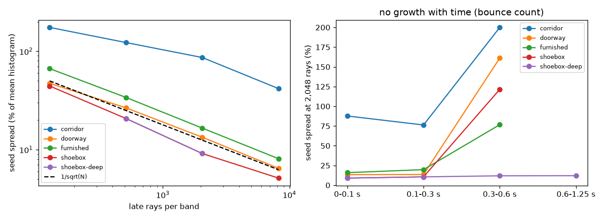
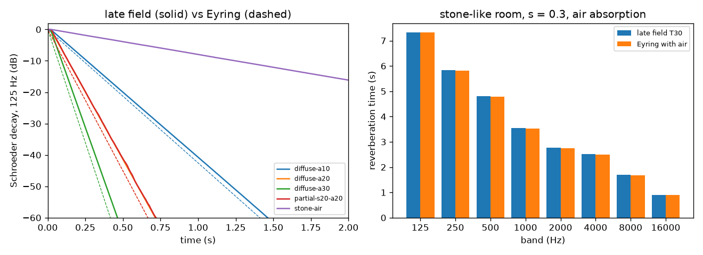
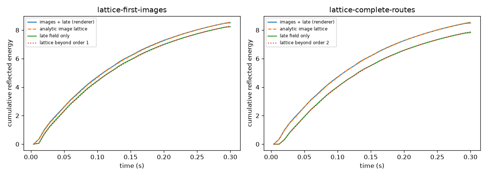
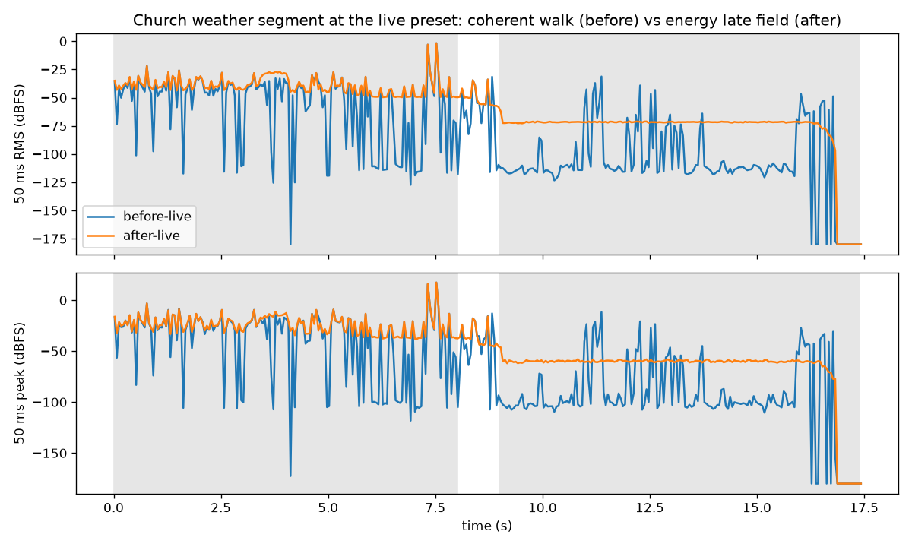

# Energy late field replaces the coherent walk — 4 November 2026

**Verdict: the late field now converges and is physically grounded, and the Church's late-field spikes are gone.**
In closed pilot rooms the late field's seed spread halves for every fourfold increase in rays (as 1/√N should), instead of growing with bounce count.
In diffuse test rooms its decay times are within 0–7% of Eyring and its level within 0.6 dB of Barron's revised diffuse-field theory; with the first images it reproduces the exact image lattice of a rigid room within 0.7%, so nothing is counted twice.
In the Church weather walk the closed interior changes from sporadic walk spikes (quarter-second level spread 66 dB) to a steady late field (0.25 dB), and solving is 43% cheaper.
The loud doorway transient at 7.5 s is unchanged: it is in the phase-exact early part, identical in both renders.

The renderer is now the standard room-acoustics hybrid (Vorländer 1989; Savioja & Svensson 2015).
Direct sound, first-order images and the opt-in complete early routes stay phase-exact.
Everything later is computed as energy by stochastic ray tracing and played back as noise shaped by that energy (Polack 1993).
The coherent residual walk is gone; old takes still render, under solver contract v14.

All numbers are measured on this Mac (Apple M5, 16 GB, Unity 6000.4.1f1 on Metal) under `nice 19`, one job worker and 20% work pacing, paused on battery power.

## Why the walk had to go

The walk carried diffusely scattered sound as a signed pressure.
Its branch weights were square roots of energy fractions, which add up to 1.3–1.4 per bounce, and with its edge/surface coin flip a path's weight grew about 2.6 times per bounce over up to 32 bounces ([residual-walk benchmark](../residual-walk-2026-11-02/README.md)).
In closed rooms that makes the variance grow exponentially with depth, so the tail never converges and shows up as spikes.
Diffusely scattered sound has no meaningful mean pressure; only its energy is physical, which is what the replacement computes.

## What changed

- **Early, phase-exact (unchanged):** direct sound with transmission, first-order images, and with `completeRouteSamples > 0` the signed D/DD/RD/DR/RR routes.
- **Late, energy (new, `Assets/Shaders/LateEnergy.hlsl`):** `lateRays` rays per octave band (8 bands, 125 Hz–16 kHz) and source/listener pair.
  A ray's weight never grows: absorption and air loss multiply it by factors no larger than one, and transmission, diffuse and specular continuations are chosen with their energy fractions.
- **Detection:** diffuse rain (every scattered fraction is connected to the listener with the Lambert law) plus a receiver sphere (default 0.5 m) for segments after a specular reflection or a transmission.
  This covers both kinds of late energy with low variance: the scattered part deterministically at every bounce, and the specular part where nothing else can reach it.
- **No double counting:** a path is never scored when the early part holds it: no scattering and either no reflection, or no transmission and at most the early image order of specular reflections (1, or 2 with complete routes).
  No edge diffraction in the late field.
- **Histogram:** per pair, six head-frame directions × 8 bands × time bins of one DSP partition, summed with exact integer atomics, so it is reproducible bit for bit.
- **Directional choice:** six direction bins weighted by the KEMAR HRTF's band energy give each ear its own late envelope (left/right level differences of the late field), and two noises are mixed to the HRTF's diffuse-field interaural coherence.
  Limits: no interaural time structure or sharp localization in the late field; head turns update at the solve rate.
- **Synthesis (`LateReverb.cs`, `GpuAudio.Late.cs`):** fixed seeded band-split noise, gained per band and partition by the histogram envelope, convolved with each source's emitted signal (rain bursts summed with their amplitudes) by partitioned convolution.
  It shares the early paths' delay origin, crossfades between solves over one response step, never re-randomises (fixed noise, fixed seeds), and runs in both Spectral and IR synthesis, CPU and GPU, live and offline.
- **Removed:** the walk loop, its edge sampler, its debug slots, walk-only tests and `WalkDiagnostics`.
  `raysPerBin` now only drives the `PrimitiveBaseline` mirrors and the First Images candidate floor; `maxBounces` caps interactions of every path.

The exact contract is in [simulation contracts](../../simulation-contracts.md#late-energy-field-v14).

## Results

Tolerances were fixed before the benchmark runs: decay times T20/T30 within 10% of Eyring in diffuse rooms, reflected level within 1 dB of the diffuse-field prediction, early images plus late field within 3% of the analytic image lattice.
All pass.

### Convergence (closed pilot scenes)

Seed spread is the standard deviation across four seeds of the direction-summed late histogram, relative to its mean, energy-weighted over 8 receivers, 8 bands and all time bins (dataset settings: 8 kHz, 8 ms bins, 32 bounces, 1.25 s).

| Scene | 128 rays/band | 512 | 2,048 | 8,192 | Solve, 8,192 rays |
|---|---:|---:|---:|---:|---:|
| shoebox-0900 | 44% | 21% | 9.1% | 5.1% | 25 ms |
| doorway-0900 | 47% | 27% | 13% | 6.5% | 28 ms |
| furnished-0000 | 67% | 34% | 17% | 8.1% | 76 ms |
| corridor-0000 | 175% | 123% | 87% | 42% | 50 ms |

Each fourfold step divides the spread by 1.8–2.3 (1/√N predicts 2); the corridor (two coupled spaces seen through an opening) starts much noisier but also halves at the top.
The coherent walk in the same kind of rooms did not converge at all (shoebox 127% / 27% / 22% / 72% of the early field at 128 / 512 / 2,048 / 8,192 rays per bin, doorway up to 13,574%; [residual-walk benchmark](../residual-walk-2026-11-02/README.md)).
**No growth with bounce count:** with a 1,024-interaction cap, so rays reach the 1.25 s horizon, the shoebox spread at 2,048 rays is 9.0 / 10.6 / 11.9 / 12.1% in the 0–0.1 / 0.1–0.3 / 0.3–0.6 / 0.6–1.25 s windows.
At the dataset's 32-bounce cap the 0.3–0.6 s window is noisy and later windows are empty, because those rays have already used their interactions: the bounce cap, not the estimator, ends the tail.



### Decay times and level (8 × 6 × 4 m room, 4,096 rays per band, 4 receivers 1.5–5 m from the source)

| Room | T20 | T30 | Eyring | Sabine | T30 vs Eyring | EDT | Reflected level vs Barron |
|---|---:|---:|---:|---:|---:|---:|---:|
| α = 0.1, s = 1 | 1.443 s | 1.443 s | 1.411 s | 1.486 s | +2.3% | 1.457 s | +0.26 … −0.06 dB |
| α = 0.2, s = 1 | 0.696 s | 0.697 s | 0.666 s | 0.743 s | +4.6% | 0.720 s | +0.45 … −0.01 dB |
| α = 0.3, s = 1 | 0.446 s | 0.445 s | 0.417 s | 0.495 s | +6.9% | 0.474 s | +0.59 … +0.12 dB |
| α = 0.2, s = 0.2 | 0.694 s | 0.697 s | 0.666 s | 0.743 s | +4.8% | 0.688 s | +0.12 … −0.02 dB |
| stone-like, s = 0.3, air on, 125 Hz–16 kHz | | | | | −0.1 … +1.1% per band | | −0.19 … +0.09 dB |

Decay curves are Schroeder integrals of direct sound + first images + late field, averaged over the receivers (EDT includes the direct sound, as in ISO 3382).
"Reflected level vs Barron" compares images + late energy with `16π/A · exp(−13.82 r / (c T))` (Barron & Lee's revised theory), receiver by receiver.
The measured decays lie between Eyring and Sabine, closer to Eyring, as expected for a diffusely reflecting shoebox; the stone-like room with air absorption (T = 0.9–7.3 s across bands) matches Eyring with the air term `4mV` within 1.1% in every band.



### No double counting (rigid 5 × 4 × 3 m room, α = 0.05, no scattering, 65,536 rays)

| Early part | First images (+ RR) / lattice orders ≤ order | Late field / lattice beyond order | Images + late / whole lattice |
|---|---:|---:|---:|
| First images (order 1) | 1.0000 | 0.9946 | 0.9948 |
| With complete routes (order 2) | 1.0000 | 0.9927 | 0.9933 |

The analytic lattice sums `(1−α)^k / L²` over every image to 0.3 s.
The late field holds no energy before the first image of the next order (checked in `LateSpecularEnergyCompletesTheImageLattice`), and with complete routes the second-order (RR) images move from the late field to the early part exactly.



### Church weather walk, before and after (live preset)

The weather walkthrough take's 5–21 s (outside in rain and wind, through the door, closed interior), rendered at the Church live preset: FFT 128 / hop 32, 2,048-sample steps, 32 bounces, 1.25 s horizon, GPU spectral, mono.
Before: `2166d3c` (coherent walk, v13). After: v14 with the default 512 late rays per band.

| Window | RMS before → after | Peak before → after | Quarter-second spread | Spikes (5 ms frames 20 dB over local median) |
|---|---:|---:|---:|---:|
| Outside 0–4 s | −35.0 → −32.7 dBFS | 0.69 → 0.69 | 9.2 → 10.8 dB | 318 → 61 |
| Doorway 4–8 s | −18.3 → −18.3 dBFS | 7.32 → 7.31 | 27.1 → 24.6 dB | 261 → 69 |
| Closed interior 9–16 s | −50.6 → −71.4 dBFS | 0.26 → 0.0048 | 66.4 → 0.25 dB | 152 → 0 |

- The interior before was walk spikes on silence: their difference from the after render carries the whole before level (−50.6 dBFS).
  After, the interior hears a steady late field, about 39 dB below outside.
- The doorway's 7.3 peak (311 samples above full scale in both) is one event at 7.54 s, identical in both renders: rain impacts near the listener in the early part, not the late field.
- Outside, the late field adds 2.3 dB of reverberant rain; the spike count falls because isolated walk arrivals no longer stand out of the background.
- Truncation: the Church presets keep 32 bounces and a 1.25 s horizon, so the stone church's late field stops after about a second; its materials (α ≈ 0.03) predict several seconds of reverberation.
  Raising the horizon and bounce cap is a separate preset decision (cost below).

Listening page: `.context/late-energy/listen/index.html` (both WAVs share one gain, DSP latency trimmed).



### Cost

| Church segment, per 46 ms response | Before (walk) | After (late energy) |
|---|---:|---:|
| Transport solve | 21.9 ms (max 78) | 12.4 ms (max 71) |
| DSP (GPU spectral + late convolution) | 785 ms | 501 ms |
| Numeric working storage | 7.20 GiB | 5.78 GiB |

Both renders are far from realtime here, as before: the DSP time is dominated by 192 retained rain bursts, each with its own direct and first-image filters, not by the late field.
The late tracer itself costs 7–48 ms per solve for 4,096 rays per band in the test rooms (up to 8,192 interactions) and 4–22 ms at 512–2,048 rays with 32 bounces in the pilot scenes.

### Regression

The full `TakeChecks` suite passes: 331 cases, 323 passed, 0 failed, 8 skipped (opt-in measurements).
New checks: image-lattice partition (two early orders), Eyring decay, energy conservation in a lossless room, synthesis envelope (largest 8-partition level error 0.56 dB), static-scene reproducibility, and CPU/GPU parity of the late audio in Spectral and IR, mono and binaural, 3D and 2D (relative error 1e-6 to 2.4e-5).
Walk-specific checks were removed (`SurfaceBranchWeightsPreservePressure`, `WalkEdgeRunsStopAtTheCompleteRouteOrder`, `CompleteMirrorsPreserveAllThirtyTwoWalkInteractions`, `TunedEarlyRoutesPreserveExistingDeeperInteractions`, and walk-diffraction duplicates of the tuned-route checks); walk-diffraction checks that had no tuned-route twin now run on the complete routes.
Synthetic DSP checks that wrote arrivals into walk slots now use the baseline-mirror slots.

### Audio-DLSS

The walk family no longer exists; the dataset keeps its family axis with an always-zero `walk` slot so older renders stay readable.
The late field is not a complex pressure, so it cannot join the complex labels, but it is now a usable label of its own: a reproducible per-band, per-direction energy-time histogram whose error falls as 1/√N, also in the closed families where the walk had to be excluded.

## What remains

- **Church preset:** the 32-bounce cap and 1.25 s horizon truncate the stone church's late field; a longer horizon needs a cost decision.
- **Rare branches:** sound entering a closed room through walls (`t ≈ 1e-4`) is sampled by its energy fraction, so at small budgets few rays carry it; splitting at transmissive surfaces would lower that variance.
- **Late-field limits:** no diffraction, no Doppler, six-direction energy resolution, diffuse-field interaural coherence, plane sources averaged over their emission density.
- **Edge chains:** D³ and longer remain unmodelled, as before.
- **Realtime:** dense rain sources are still DSP-bound.


## Reproduce

```sh
PY=.context/fdtd-teacher/venv/bin/python
B=docs/benchmarks/late-energy-2026-11-04
$PY $B/late.py jobs                                   # job lists in .context/late-energy/jobs
nice -n 19 $PY $B/unity.py tests TakeChecks.MeasureLateEnergy ACOUSTIC_LATE_JOBS=$PWD/.context/late-energy/jobs/rooms.json
nice -n 19 $PY $B/unity.py tests TakeChecks.MeasureLateEnergy ACOUSTIC_LATE_JOBS=$PWD/.context/late-energy/jobs/lattice.json
nice -n 19 $PY $B/unity.py tests TakeChecks.MeasureLateEnergy ACOUSTIC_LATE_JOBS=$PWD/.context/late-energy/jobs/convergence.json
# Church: derive the 16 s weather segment (5-21 s of the weather walkthrough take), then render it.
nice -n 19 $PY $B/unity.py segment .context/weather-fix/capture-v3/take .context/late-energy/church/segment-take 5 21
nice -n 19 $PY $B/unity.py render .context/late-energy/church/live-job.json .context/late-energy/church/after-live
nice -n 19 $PY $B/unity.py tests TakeChecks                       # regression suite
$PY $B/late.py report                                 # figures, report.json, listening page
```

The "before" Church render used the shaders and scripts of `2166d3c` (the runner's `provenance.json` records `Transport.hlsl` with that commit's hash); render it from an isolated copy of that commit.
`unity.py` reuses `tools/dlss_jobs.py`: isolated runner sync (and pruning of deleted sources), nice 19, one job worker, 20% pacing, 4 GiB process-tree guard and suspension on battery.

[Machine-readable results](report.json).
