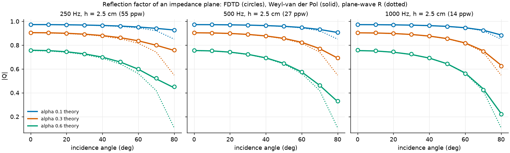
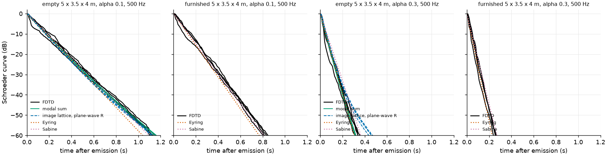

# Method comparison: wave ground truth and scoring harness — 6 November 2026

**Purpose.**
The acoustic methods (`hybrid`, the v14 renderer; `pressure`, one coherent path-tracing loop; `energy`, one energy path-tracing loop) are judged against one wave ground truth with one harness, before any architecture decision.
This page describes the ground truth (an FDTD solver with absorbing walls), the benchmark suite, the common output format, the scoring harness and viewer, and how to run a method through it.

**Status, 6 November 2026: the ground truth is validated and the harness works, but the suite's ground truth has not been generated yet.**
The FDTD absorbing walls match the analytic reflection factor of an impedance plane within 0.015 at every angle up to 80°, are stable and passive, and are converged under grid refinement; room decay agrees with a modal reference but not with the declared incoherent image reference (details and the reason below).
The harness scores ground truth against itself at exactly zero and recovers a known perturbation in the unit tests.
The ground-truth queue (`run_queue.sh gt refine assemble`, about 55 GPU minutes) is waiting on the machine-wide heavy-job guard: macOS memory pressure has stayed at "warning" with swap nearly full (15.7 of 16 GB) from other applications, and the guard starts jobs only at normal pressure.

All numbers are measured on this Mac (Apple M5, 16 GB) under `nice 19` with one GPU worker and a pause on battery power; the validation runs used 20% GPU work pacing and a 4 GiB guard, the ground-truth runs the machine-wide heavy-job guard (`tools/heavy_guard.py`: start only at normal memory pressure, 50% pacing, stop on memory shortage).

## Wall absorption in the FDTD

The validated rigid solver ([FDTD teacher benchmark](../fdtd-teacher-2026-10-28/README.md)) now supports locally reacting walls with a real, frequency-independent impedance `Z`.

**Boundary scheme.**
On a velocity face between an air cell and a wall cell, the boundary pressure is the mean of the air cell and a ghost cell inside the wall, and it equals `Z` times the time-centred normal velocity into the wall.
Eliminating the ghost gives a closed face update, `u⁺ (y + λ) = u⁻ (y − λ) + 2 λ y p_air` with `y = ρc/Z` and `λ` the Courant number (sign flipped for a wall on the low side), in the same fused Metal kernel as before.
It is unconditionally stable for `y ≥ 0`: the leapfrog energy `|p|² + u⁻·u⁺` is conserved to 1e-4 with rigid walls and never grows with any admittance (tested for `y` = 0.02, 1 and 20 in a closed box over 6,000 steps).
Rigid walls are `y = 0` and give exactly the old solver; the NumPy transcription check now covers impedance faces too.

**From the presets' absorption to an impedance.**
The renderer's presets (`Assets/Materials/Church stone|wood|glass.asset`) carry one absorption coefficient per frequency, a diffuse-field (random-incidence) quantity like every tabulated coefficient.
For each band, every wall becomes the locally reacting surface whose Paris random-incidence absorption equals the preset's absorption at that band centre:

```text
alpha_st(zeta) = 8/zeta² · (zeta + 1 − 1/(1+zeta) − 2 ln(1+zeta)),   zeta = Z/(ρc) on the hard branch zeta ≥ 1.567
```

**Incidence assumption, stated:** the match holds in a diffuse field; at a single reflection the wall absorbs `1 − |R(θ)|²` with `R(θ) = (zeta cos θ − 1)/(zeta cos θ + 1)`, less than `alpha` near grazing and more near normal incidence (stone at 125 Hz: `alpha` 0.025, zeta 309; wood 0.12, zeta 58).
The per-band admittance is published in every suite `scene.json` (`materials.<name>.admittance`), so a method can use the very same wall (`|R(θ)|²`) or the angle-independent `absorption`; it records which in `meta.json` `wallModel`.

**Why one run per band.**
Each octave band is a separate FDTD run with that band's impedance, band-filtered with that band's filter.
The absorption is then exactly the preset's value in each band (the presets vary by less than 10% within an octave), the boundary stays a plain real impedance with no fitted recursive filter, and each band uses its own grid: a band needs 10 points per wavelength at the top of its filter (2 fc), so the 125 and 250 Hz bands are almost free next to the 500 Hz band (cost grows as f⁴).
A frequency-dependent impedance in one broadband run would need a fitted, passivity-checked IIR admittance per material and the finest grid everywhere, for no gain in this suite.
Scattering and transmission are zero in the suite: the wave reference has smooth, opaque walls.

### Validation

Tolerances were declared in `tools/method_compare_validate.py` (`TOLERANCES`) before any run.

| Check (declared tolerance) | Result | Verdict |
|---|---|---|
| Reflection factor of an impedance plane vs Weyl–van der Pol, 0–80°, α 0.1/0.3/0.6, 250/500/1000 Hz, at ≥ 13 points per wavelength (\|ΔQ\| ≤ 0.02, falling with refinement) | worst 0.015 (5 cm), 0.015 (2.5 cm), 0.011 (1.25 cm); at 7 ppw 0.065 | pass |
| Stability and passivity (energy never grows) | rigid box conserves the leapfrog energy to 1e-4; y = 0.02, 1, 20 decay monotonically over 6,000 steps | pass |
| Grid refinement of room decay, 250 Hz band, 6.25 → 3.125 cm | T30 changes ≤ 1.0%, EDT ≤ 1.6%, level ≤ 0.11 dB in all four rooms | pass |
| Empty shoebox vs the analytic image lattice with \|R(θ)\|², receiver means (level ≤ 1 dB, EDT/T20/T30 ≤ 10%) | level −0.75…+0.62 dB; T30 +13% / +8% (α 0.1 at 250 / 500 Hz), +9% / −2% (α 0.3); T20 up to +15%; EDT −18…+22% | **fail** for EDT everywhere and T20/T30 at α 0.1, 250 Hz |
| Furnished room vs Eyring (T30 ≤ 15%) | +18% / +11% (α 0.1 at 250 / 500 Hz), +9% / +2% (α 0.3) | pass except α 0.1 at 250 Hz |



**Reflection.**
A point source 0.25 m above a large impedance plane, receivers 2.5 m from its image at 0–80°; the measured factor is `(p_wall − p_free) / p_free(image)` with both runs on the same grid, so dispersion and source normalisation cancel.
It follows the spherical-wave (Weyl–van der Pol) factor, not the plane-wave coefficient, near grazing, as it physically should; the remaining 0.011 at 250 Hz and 80° does not shrink with refinement and is the asymptotic theory's own error at `kR ≈ 11`.



**Room decay, and why the declared image reference missed.**
The FDTD rooms (5 × 3.5 × 4 m, uniform walls, empty and with six furniture boxes) decay *slower* than the incoherent image lattice and slower than Eyring, by up to 13% at 250 Hz, less at 500 Hz, and the difference does not change with the grid.
The plane-wave image model is the geometric (infinite-frequency) limit: it gives exactly grazing reflection paths no weight, while a finite room has axial and tangential modes that touch some walls only at grazing incidence and therefore decay more slowly, a larger share of the band's modes the lower the frequency.
After the image comparison failed, a modal reference was added (post hoc, stated as such): rigid-room modes perturbed by the uniform admittance decay at `2δ = cβ Σ (4, or 2 for a zero index) / L` (Morse & Ingard), oblique modes exactly at the Sabine rate for `α = 8β`.
Against it, the FDTD's receiver-mean T30 is −1.5% / +2.6% (α 0.1 at 250 / 500 Hz) and +9% / +8% (α 0.3, where the first-order perturbation itself is less accurate), and T20 −1.5% / +5.8% / +11% / −1.3%; per receiver T30 is within 8% at α 0.1.
The spherical-wave image model (Weyl–van der Pol factor per image) closes only 2–3% of the gap, so grazing modes, not the reflection law, explain it.
EDT fails against every incoherent reference because with four receivers it is dominated by the direct sound and the first reflections, whose coherent interference within the band moves single-receiver levels by up to ±3 dB in the first 20 ms (the receiver-mean level still agrees within 0.75 dB).
**Consequence for the comparison:** with the presets' low absorption (stone 0.025–0.03, wood 0.12–0.14), the reference's closed rooms decay up to about 10–15% slower than Eyring at 125–250 Hz; a method that is Eyring-exact will show that much T30 error there, and it is wave physics (low modal density with grazing modes), not reference error.
Methods that use the published admittance (`|R(θ)|²`) remove the wall-law part of the difference but not the modal part.

Data: [validation.json](validation.json) (every case, receiver and reference), produced by `tools/method_compare_validate.py`.

## Benchmark suite

Eleven scenes, 636 receivers (251 in shadow), written by `tools/method_compare_suite.py build` to `.context/method-compare/data/<scene-id>/scene.json`.

| Scene | Family | Walls | Receivers | In shadow | Ground-truth bands (Hz) | Grid per band (cm) | Simulated (s) |
|---|---|---|---:|---:|---|---|---:|
| `canopy-bem` | BEM fixture, 125 Hz | rigid | 96 | 48 | 125, 250, 500 | 5 / 5 / 2.5 | 1.25 |
| `blocks-bem` | BEM fixture, 250 Hz | rigid | 96 | 48 | 125, 250, 500, 1000 | 10 / 5 / 3.33 / 1.67 | 0.3 |
| `shoebox-0020-presets` | shoebox (closed) | wood | 40 | 0 | 125, 250, 500, 1000 | 6.25 / 6.25 / 3.125 / 1.5625 | 2.05 |
| `shoebox-0010-presets` | shoebox (closed) | stone | 44 | 0 | 125, 250, 500 | 6.25 / 6.25 / 3.125 | 2.05 |
| `doorway-0008-presets` | doorway, source inside | stone, wood | 52 | 22 | 125, 250, 500 | 6.25 / 6.25 / 3.125 | 2.05 |
| `corridor-0013-presets` | two coupled rooms | stone, wood | 46 | 24 | 125, 250, 500 | 6.25 / 6.25 / 3.125 | 2.05 |
| `furnished-0005-presets` | furnished (closed) | glass, stone, wood | 30 | 15 | 125, 250, 500 | 6.25 / 6.25 / 3.125 | 2.05 |
| `canopy-0009-rigid` | porch canopy, no floor | rigid | 62 | 15 | 125, 250, 500 | 6.25 / 6.25 / 3.125 | 0.8 |
| `canopy-0009-presets` | same | wood | 62 | 15 | 125, 250, 500 | 6.25 / 6.25 / 3.125 | 0.8 |
| `barriers-0020-rigid` | barrier field, no ground | rigid | 54 | 32 | 125, 250, 500 | 6.25 / 6.25 / 3.125 | 0.5 |
| `barriers-0020-presets` | same | wood | 54 | 32 | 125, 250, 500 | 6.25 / 6.25 / 3.125 | 0.5 |

- **BEM fixtures** (from the [wave review](../wave-review-2026-10-27/README.md) archive): 96 of the 1,166 / 1,178 BEM receivers, half in view and half in shadow, evenly spaced in index; their BEM pressure is written as method `bem` (complex only), so the scorer also reports the FDTD-vs-BEM agreement.
- **Generated scenes** come from `tools/dlss_scenes.py` (generator `dlss-scenes-v2`), chosen as the smallest scenes of each family with a useful share of shadow receivers; `presets` keeps the dataset's per-role preset choice, `rigid` sets every wall rigid (comparable to the earlier rigid FDTD/BEM work).
- **Shadow** is the analytic segment-box test (`lineOfSight` complement); shoeboxes have no shadow receivers by construction.
- **Band limit by cost.** Every scene has ground truth at 125, 250 and 500 Hz; 1 kHz only in the cheapest scenes (`blocks-bem`, `shoebox-0020-presets`), because each octave costs 16 times the one below. **There is no ground truth at 2, 4, 8 or 16 kHz**; those bands are NaN in `gt` and never scored, whatever a method writes there.
- **Grids** are the largest that keep every box face on a velocity face and give 10 points per wavelength at the top of the band filter (2 fc), i.e. 20–27 at the band centre; the validation above shows the energy metrics move ≤ 1% / 0.1 dB when that is halved.
- **Duration** is 2.05 s for rooms (the format's 2 s window plus the filter guard), 1.25 s for the lossless canopy fixture, and shorter for open scenes that are silent long before; `validSeconds` records each, and `bandRuns.*.lastFiftyMsFraction` in `gt/ref/0/meta.json` records how much energy was still arriving at the end.
- **Complex ground truth** is written on a 15.625 Hz grid inside each band, only where the grid has at least 20 points per wavelength; rigid scenes take each frequency from the finest run whose source spectrum covers it (walls do not depend on band), so the BEM frequencies come from at least 55 points per wavelength.
- Closed rooms run without an absorbing layer (the domain is the walls' bounding box); open scenes keep the validated 16-cell CPML 0.5 m outside every box and receiver.

## Common output format

The full contract is [FORMAT.md](FORMAT.md) (committed first, `1f1883d`).
In short: `<root>/<scene-id>/<method>/<budget>/<seed>/` with `meta.json`, `energy.f32` `[receiver, 8 bands, 2000 × 1 ms]` normalised so a free-field direct path at 1 m is 1 per band, and optional `complex.f32` (`exp(+iωt)`, free field `exp(−ikr)/r`) and `direction.f32` (±x, ±y, ±z).
Additions to the requested format, all supersets: `suite.json` (scene list), scene keys (`shadow`, `materials` with `admittance`, `gtBands`, `viewAxes`, `origin`), and `meta.json` keys `validSeconds` (the truncation record), `budgetValue` (orders budgets), `bandLimited` and `wallModel`.

**Band filters.**
Octave band `b` uses a zero-phase filter whose power response is a raised cosine in log frequency between neighbouring centres (`cos²(π/2 · log2(f/fc))` on `[fc/2, 2fc]`); neighbouring bands are power complementary, so band energies add to the broadband energy.
The ground truth's band energy is the band-filtered impulse response squared and binned, divided by the filter's own energy.
Methods with a coherent response use the same helpers (`energy_from_impulse`, `energy_from_spectrum`, `energy_from_arrivals`; FORMAT.md); a method that only has complex values on a sparse grid gets a band total but no time structure (`levels_from_complex`).
A method that writes plain arrival-time histograms leaves `bandLimited` false; the scorer then convolves them with the band's energy kernel so both sides have the same time resolution (about ±4 ms at 125 Hz, ±1 ms at 500 Hz).

## Harness

`tools/method_compare.py score` reads `gt` and every other method under the root and reports, per scene family, band, budget and seed, split into receivers in view and in shadow (and open versus closed scenes):

| Metric | Definition |
|---|---|
| Level error | `10 log10` of the band's total energy (within the shared valid window), method minus ground truth, dB; RMS and mean (bias) over receivers |
| EDT, T20, T30 | ISO 3382 fits of the Schroeder curve (0…−10, −5…−25, −5…−35 dB, extrapolated to 60 dB), relative error %; undefined unless the curve reaches the range and the last 50 ms of the window sit 10 dB below it (so truncation cannot bend the fit) |
| C50, C80, D50 | early/late ratios from the ground truth's onset, so arrival errors do not leak into them |
| Onset error | first 1 ms bin within 12 dB of the strongest bin, method minus ground truth, ms (12 dB, not 20: the band filters' side lobes reach −20 dB) |
| ETC distance | RMS dB difference of the energy-time curves in 5 ms windows, floored 60 dB below the ground truth's peak window (a log-spectral distance of the envelope) |
| Complex error | relative L2 over receivers and shared frequencies per band, where both sides wrote `complex.f32` |
| Seed spread | per budget: SD of band level across seeds (dB) and energy-weighted relative SD of the histogram |
| Convergence | every metric per budget, mean and range over seeds, against `budgetValue` |

Pooled numbers are receiver-weighted RMS over scenes and seeds.
`score` writes `report.json` (every row) and `summary.md` (one table per method at its largest budget, plus level error by budget).

**Viewer.**
`tools/method_compare.py view` scores, then writes a static page (`.context/method-compare/view/index.html`, no server, works from `file://`) that adapts to whatever methods exist under the root:

- Summary: one row per method (largest budget) with in-view/shadow × open/closed and per-band columns for level error, level bias, T30, EDT, C50, onset, ETC distance and complex error, plus cost per scene.
- Scenes: top-down sketch (geometry cut at receiver height, source, receivers in view as dots and in shadow as squares), band level maps for the ground truth and every method on one shared colour scale (cividis), error maps (method minus ground truth, blue–grey–red centred at 0, adjustable range), and for a clicked receiver the echograms and Schroeder curves of every method over the ground truth, and complex magnitude and phase where available; hover shows values.
- Convergence: error against budget per method with the seed range shaded, and a seed-spread table.
- Colours are fixed per method across every plot (Okabe–Ito: `gt` black, `hybrid` blue, `pressure` vermillion, `energy` bluish green, `bem` reddish purple); shadow receivers carry a second encoding (square marker, diagonal stroke), so nothing depends on colour alone.
- Deep links: `index.html#scene=<id>&band=<Hz>&r=<receiver>`.

**Self-test.**
`tools/test_method_compare.py` checks the band filters (power complementary, free field normalised to 1/d² through the impulse, spectrum and arrival paths, coherent addition of arrivals), the metrics on exact exponential decays, the format round trip and checker, and scoring: ground truth against itself scores exactly zero in every metric, a synthetic method with a +3 dB gain and tail noise falling as 1/√N scores a +3.0 dB level bias, under 5% T30 error, an ETC distance that falls with budget and a seed spread that falls about fourfold for 16 times the budget, and the viewer builds.
`tools/method_compare_suite.py selftest` repeats this on the real suite once its ground truth exists: it copies `gt` into `.context/method-compare/selftest` and adds a `synthetic` method (ground truth +1 dB with 2/√N per-bin noise and complex noise) at three budgets and three seeds, whose expected scores are a +1 dB level bias, 12.2% complex error, and every other error and the seed spread falling towards zero.

## How to run a method through it

1. Read the suite: `.context/method-compare/data/suite.json` and each `<scene-id>/scene.json` (receivers in `points` order; walls with `surfaceMaterials` and the per-band `materials`; `airAbsorption` false; scattering and transmission zero).
2. Render every scene at each budget and seed, and write `<root>/<scene-id>/<method>/<budget>/<seed>/` per [FORMAT.md](FORMAT.md): `energy.f32` with all eight bands (bands without ground truth are still written, just not scored), `complex.f32` if the method has phase, `meta.json` with `budgetValue`, `wallSeconds`, `validSeconds`, `sceneSha256` of the exact `scene.json` bytes, and `wallModel`.
3. Check: `python tools/method_compare.py check <output-dir> ...`.
4. Score and view: `python tools/method_compare.py view --figures docs/benchmarks/method-compare` (default root `.context/method-compare/data`), then open `.context/method-compare/view/index.html`.

From Python, `method_compare.write_output(directory, meta, energy, complex_pressure, direction)` validates and writes an output; from C#, write little-endian float32 arrays in the stated order and the JSON fields.

## Reproduce

```sh
PY=.context/fdtd-teacher/venv/bin/python          # tools/fdtd-requirements.txt
nice -n 19 $PY -m unittest discover -s tools -p 'test_*method_compare*.py'
nice -n 19 $PY -m unittest discover -s tools -p test_fdtd_wave.py
sh docs/benchmarks/method-compare/run_queue.sh build reflection shoebox gt refine assemble
nice -n 19 $PY tools/method_compare_suite.py validate report      # validation.json and figures
nice -n 19 $PY tools/method_compare_suite.py selftest              # gt vs gt and a perturbed method
nice -n 19 $PY tools/method_compare.py view --figures docs/benchmarks/method-compare
```

`tools/method_compare_suite.py plan` prints every ground-truth run with its grid, cost and status; `gt` resumes where it stopped (each band is stored under `.context/method-compare/fdtd/<scene>/`).

## Limits and what is not done

- **Ground truth not generated.** The queue was stopped while still waiting for normal memory pressure; no band has finished (`.context/method-compare/fdtd/blocks-bem/125-*.npy` are leftovers of an earlier run stopped by a since-fixed bug and are recomputed).
  Resume with `sh docs/benchmarks/method-compare/run_queue.sh gt refine assemble`, then `validate report`, `selftest` and `view`; every stage skips finished work.
- **Suite-scene refinement** (`validate refine`: four scenes in the 250 Hz band at half spacing) runs after the ground truth and is therefore also outstanding; the room refinement above is the evidence so far.
- **Room decay:** the empty-room comparison failed its declared image-lattice tolerance; the modal reference that explains it was added afterwards, and the furnished room at α 0.1 and 250 Hz is 18% slower than Eyring (tolerance 15%).
- **Wall model:** real, frequency-independent impedance per band, locally reacting, smooth and opaque; no scattering, transmission, extended reaction or air absorption, and the impedance is a diffuse-field match, not a measured material.
- **No ground truth above the 500 Hz band** (1 kHz in two scenes); second-order dispersion limits complex accuracy, so complex ground truth is only written at ≥ 20 points per wavelength.
- **Energy versus coherence:** single-receiver band levels in the early part carry coherent interference (±3 dB in the first 20 ms at 500 Hz); incoherent methods cannot match it and should be judged on receiver-pooled numbers.
- The suite is small (eleven scenes, one per family and variant), chosen for cost, not a statistical sample of each family.
