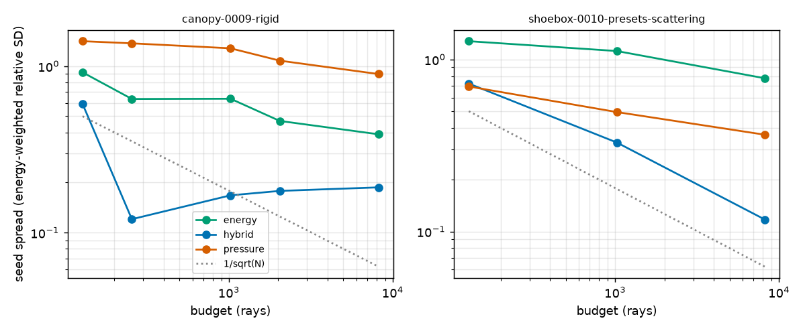
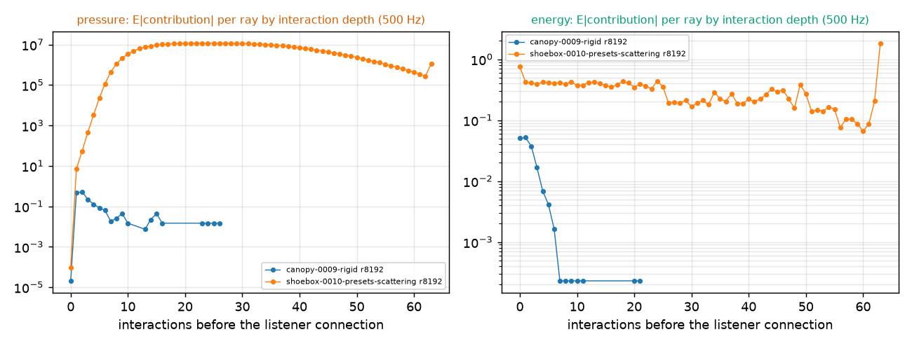
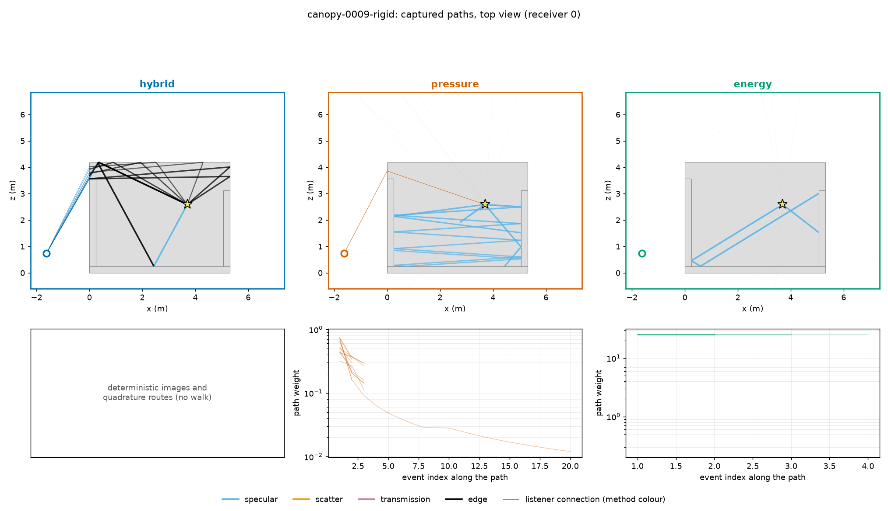
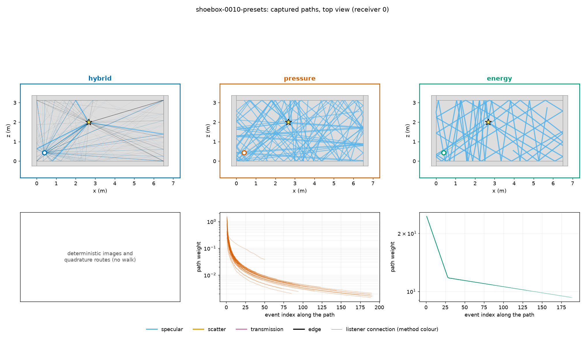
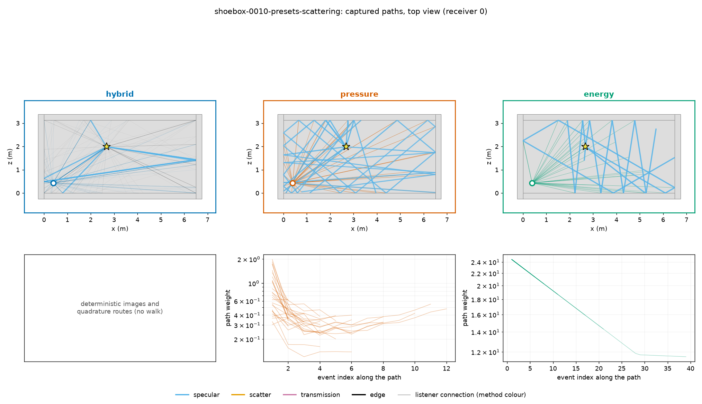

# Three acoustic methods as separate kernels — 6 November 2026

**Verdict: the energy loop is the most accurate single loop against the wave ground truth (4.0 dB level RMS over the suite, 2.0 dB in closed rooms, bias +0.8 dB), but it overestimates sound around thick walls; the pressure loop is unusable in rooms (+26 dB bias in closed rooms, contributions growing about 7.5x per interaction once surfaces scatter); the hybrid sits between them (5.7 dB) with a positive bias from the variance of its coherent early part.**
All three methods now run as separate kernels on the same scenes and write the common format, scored by `tools/method_compare.py` against the FDTD/BEM ground truth.
The pressure loop does not yet sample paths that continue through an edge (DD, DR); that step failed its control and is disabled (known gap below).

The user asked for every candidate method as its own, individually runnable kernel, scored against the wave ground truth before an architecture is chosen.
There are now three, selected by one setting, `TakeRender.Settings.method` (default `Hybrid`, unchanged):

| Method | Kernel | What it is |
|---|---|---|
| `hybrid` | `Transport.hlsl`, `CompleteDiffraction.hlsl`, `LateEnergy.hlsl` | the v14 renderer: phase-exact direct sound, first-order images and optional complete edge routes (D, DD, RD, DR, RR), plus the incoherent energy late field; no physics changes |
| `pressure` | `MethodPressure.hlsl` | one coherent complex-pressure path-tracing loop |
| `energy` | `MethodEnergy.hlsl` | one energy path-tracing loop (room acoustic rendering equation) |

`MethodCommon.hlsl` holds what the two loops share (band outputs, straight connections through transmitting walls, specular-chain detection, edge choice); geometry, BVH, media and the wedge kernels are the renderer's own (`Geometry.hlsl`, `Transport.hlsl`, `CompleteDiffraction.hlsl`).
`MethodTransport.cs` dispatches the two loops; `TransportSolver` runs it when the method is not `Hybrid`.
Pressure and energy are offline measurement kernels: they produce band responses, not audio, and audio rendering refuses them (`TakeRender.RequireAudioMethod`).

All numbers are measured on this Mac (Apple M5, 16 GB, Unity 6000.4.1f1 on Metal) in the isolated runner under `nice 19`, one job worker, `tools/heavy_guard.py` (one heavy job machine-wide, memory-pressure start/stop, 3 GiB footprint limit) and 50% work pacing, paused on battery.

## The two new loops

Both loops trace one ray per thread from the source; every ray carries all eight octave bands (125 Hz–16 kHz) as a vector, so the bands share one geometric path and its random numbers, and each band's weight is multiplied by its own coefficient divided by the probability of the choice that was made.
A path is a chain of vertices.
The *anchor* is the latest vertex that is not a delta event (the source, a scattering point or an edge point); between anchors the ray travels a straight line in the *unfolded* space of its mirror reflections.
Every listener contribution is the path's integrand divided by the probability density with which the path was sampled.
Nothing is clipped, fitted or rescaled; the only caps are the 2 s output horizon, an event cap of 65,536 interactions per ray (a safety bound that the horizon reaches first) and float range, and each is counted.

### Pressure

```text
for each ray:
    anchor = source; A[b] = 1 (unit point source, pressure 1/r)
    ray 0 only: connect source -> listener (direct sound, through transmitting walls)      [deterministic]
    connect the source through one edge (D) or one mirror and one edge (RD)               (BTM kernel K(z)/(m l))
    loop:
        draw a direction (uniform; cosine for a scattering point) and walk the delta chain:
            hit a surface; at it:
                connect the diffuse lobe to the listener and through one edge (Kirchhoff secondary source)
                choose transmission / scattering / specular with probabilities ∝ pressure amplitudes
                    sqrt((1-a)t), sqrt((1-a)(1-t)s), sqrt((1-a)(1-t)(1-s)) (or the impedance R(θ))
                scattering -> this point is the new anchor; draw a new direction
                specular/transmission -> multiply the coefficient, fold the mirror into the unfolding
                if the ray left the anchor within r of the listener image: retrace the exact image path
                    and score it / (probability of that detection cone)
            Russian roulette with survival min(1, |coefficients| / probabilities since the anchor)
```

**Assumptions.**
Specular reflection and transmission are deltas with the pressure coefficients above (sqrt of the material's energy fractions), spreading by the unfolded image distance, refraction ignored for spreading.
Edges use the Biot-Tolstoy-Medwin secondary-source kernel of the hybrid's complete routes (exact for rigid wedges) as the last interaction before the listener (D, RD), with a half-uniform, half-Cauchy edge-point density centred on Keller's point and the edge opacity.
**Known gap:** paths that continue through an edge point (DD, DR, edge chains) are not sampled.
That step was written and its control (the far side of a rigid cube, EDtoolbox reference) failed: on Metal every step from the source was rejected after the visibility and wedge tests, and four diagnostic runs did not find why; it was removed so the estimator stays consistent for the families it keeps.
Diffuse scattering has no mean pressure, so a coherent loop needs a model of one rough surface: the scattered part is a Kirchhoff secondary-source integral, `(i k/2π) sqrt((1-a)(1-t)s) sqrt(cos θi cos θo) e^{iφ(x)} / (l_in l_out)` per unit area, with a random phase `φ` fixed per surface cell of area `λ²/π`.
Averaged over phase realisations its energy is exactly Lambert's law with the scattered energy fraction (`(k/2π)² · λ²/π = 1/π`); one realisation is a coherent pressure, as a real rough wall is.
Branches are drawn in proportion to their pressure amplitudes, so a surface multiplies the path weight by the amplitude sum, which is above one whenever more than one branch is open (1.3–1.4 for the Church presets).
That growth is the expected failure of a coherent loop in closed rooms and is measured, not repaired.

**Output.**
Per band, a complex train of arrivals (sampled at 16 samples per centre-frequency period, linear deposits as `energy_from_arrivals`); the band energies follow by the comparison's band filters (`p_b = IFFT[G_b H]`, `MethodBands` in `MethodMeasurement.cs`, the same definition as `tools/method_compare.py`), and `complex.f32` is the train's transfer function at the ground truth's 15.625 Hz grid.
Per band and interaction depth the kernel also records the count, `Σ|c|`, `Σ|c|²` and `max|c|` of the listener contributions, which is how divergence is measured.

### Energy

```text
for each ray:
    anchor = source; intensity I[b] = 1
    ray 0 only: connect source -> listener (direct sound, energy transmission through walls)
    loop:
        if anchor is the source: connect through one edge (UTD at Keller's stationary point), one mirror and one edge,
                                 or two parallel edges (DD, double stationary phase)
        with probability 1/2: an edge ray: point uniform on an edge, azimuth uniform on Keller's cone,
            flux |D_UTD|² sin²β I_in / (densities); trace it to the next surface
        else: draw a direction (uniform; cosine for a scattering point), flux I D(ω) / pdf
        walk the delta chain:
            hit a surface; at it:
                connect the Lambert lobe (1-a)(1-t)s cos θo / π to the listener and through one edge
                choose transmission / scattering / specular with probabilities ∝ band-mean energy fractions
                scattering -> new anchor; break
                specular/transmission -> multiply the energy fraction; fold the mirror into the unfolding
                specular chain detection as in the pressure loop (exact image energy / detection probability)
            Russian roulette with survival min(1, energy factor / probabilities since the anchor)
```

**Edge kernel and why.**
The kernel must be a non-negative energy that can be transported.
The BTM integrand and the BEDRF of Cao et al. (arXiv 2306.01974) are signed pressure kernels (BEDRF is explicitly amplitude based and "not non-negative"), so they cannot be squared point by point.
The energy loop therefore uses the uniform theory of diffraction (Kouyoumjian & Pathak 1974, rigid faces) as an energy kernel, `|D|²`, as energy-based UTD tracers do (Tsingos et al. 2001): the diffracted ray leaves on Keller's cone with flux per unit edge length and azimuth `|D|² sin²β I_in`, whose ray-tube spreading gives `|D|² I_in m / (l (m + l))` at distance `l`; the Fresnel transition functions keep it finite at the shadow and reflection boundaries (auxiliary Fresnel functions of Abramowitz & Stegun 7.3.32–33, error ≤ 2·10⁻³).
`|D|²` falls as `1/f`, so the edge energy is frequency dependent, as it must be.
Two consecutive parallel edges (every wall end and slab of the box scenes) connect to the listener by the double stationary-phase result of the BTM double integral, `|p|² = |D₁|² |D₂|² I / (m d l (m + d + l))`, with UTD's `|D|²` at each edge and the shared-face multiplicity squared; an edge ray never continues into a second edge, and skew edge pairs are not connected.

**Specular connections without a receiver sphere.**
A point listener cannot be reached by a specular (delta) reflection from a sampled direction, and no unidirectional or bidirectional estimator can sample a point-source → mirrors → point-listener path (every connection would land on a delta vertex).
Options were a glossy lobe, a receiver volume, or detection with exact evaluation.
Our materials carry no roughness, so a lobe width would be invented and would bias every reflection.
Instead, at every delta vertex the listener's image in the anchor's unfolded space is computed; when the ray left the anchor within `r` (`specularDetectionRadius`, 0.25 m) of that image, the exact image path is retraced (any plane sequence with the same image is the same arrival) and scored with its own exact energy, delay and direction, divided by the probability that a ray from the anchor falls in that detection cone (`(1 − cos α)/2` for uniform rays, `(ŵ·n) sin²α` for cosine rays, the ray-tube area after an edge).
Unlike a receiver sphere it scores the exact arrival (no chord length, no `2r/c` time smear); it is unbiased whenever the cone lies inside the chain's visibility beam and biased only where an image's cone straddles a visibility boundary, i.e. within `r` of a reflection-zone edge; its variance equals a sphere of the same radius.

**Output.**
`energy.f32` (arrival energies, not band-limited; the scorer applies the band kernel) and `direction.f32` (±x, ±y, ±z).

## Validation

Analytic controls are `TakeChecks` cases in `Assets/Tests/Editor/MethodChecks.cs` (category `Methods`; all but the free field are `Slow`).
Edge references come from `btm_reference.py` in this folder: float64 BTM integrals of the same wedge kernel, which reproduce the independent EDtoolbox second-order cube field exactly (−0.1324 − 0.0776i at 125 Hz), band-filtered with the comparison's own filters.
They contain no renderer code, so the checks never compile the renderer's shader.

| Control | Pressure | Energy |
|---|---|---|
| Free field, every band | 0.998–0.9999 × 1/r² (cubic deposits; band-limited) | 1.000000 × 1/r², all in the arrival bin |
| One rigid plane (direct + image) | H(f) within 0.7–0.8% of the image amplitude at 375/500/750 Hz | image 0.95 × 1/rᵢ², total 0.98 |
| Rigid shoebox image lattice (α = 0.1) | first 30 ms 1.13 × lattice; whole response 3.5× (estimator variance squared into energy, see below) | total 0.9995, worst 20 ms window 8% |
| Diffuse shoebox (α = 0.2, s = 1) vs Eyring | – | T60 0.613 s vs 0.585 s (+4.8%) |
| Rigid half-plane (shadow) | H within 4.1% (250 Hz) and 1.9% (500 Hz) of the independent quadrature | +0.29 … +0.31 dB vs BTM, 250 Hz–2 kHz |
| DD over a 2 m wall | known gap (no DD) | +0.49 dB (2 kHz) … +1.58 dB (125 Hz) |
| DD over a 0.25 m wall (the suite's walls) | known gap | **+4.6 dB (2 kHz) … +8.1 dB (125 Hz)**, reported, not asserted |
| Far side of a rigid cube (EDtoolbox) | skipped: known gap | four symmetric DD paths add coherently in BTM, incoherently in any energy method (6 dB) |

Two measured limitations follow directly.
Squaring a coherent Monte Carlo estimate adds its variance to the energy: in the lattice control the pressure loop's late images are detected fewer than once each at 65,536 rays, so its late band energy is several times too high although the pressure itself is unbiased.
Ray-based double diffraction (UTD × UTD) overestimates BTM when the two edges are closer than a few wavelengths: across the suite's 0.25 m walls by 5–8 dB.

The existing `TakeChecks` regression with `hybrid` as default: see Regression below.

## Convergence and divergence

Two scenes, two seeds, 24 receivers each: `canopy-0009-rigid` (open) and `shoebox-0010-presets` with the presets' own scattering coefficient 0.12 (closed; the suite itself has no scattering).
Spread is the seed-to-seed standard deviation of every 1 ms histogram bin relative to its mean, energy weighted over receivers, bands and bins; level SD is the seed SD of each receiver's band total.

| Scene | Method | 128 rays | 1,024 | 8,192 | Level SD, 128 → 8,192 |
|---|---|---:|---:|---:|---|
| canopy | energy | 0.92 | 0.64 | 0.39 | 1.67 → 1.34 dB |
| canopy | hybrid | 0.59 | 0.17 | 0.19 | 24.8 → 0.74 dB |
| canopy | pressure | 1.41 | 1.28 | 0.90 | 48.1 → 2.61 dB |
| closed, s = 0.12 | energy | 1.28 | 1.12 | 0.78 | 2.35 → 0.33 dB |
| closed, s = 0.12 | hybrid | 0.72 | 0.33 | 0.12 | 0.22 → 0.03 dB |
| closed, s = 0.12 | pressure | 0.70 | 0.49 | 0.37 | 0.40 → 0.27 dB (truncated, see below) |



**Pressure divergence, measured.**
The kernel records, per band and interaction depth, the magnitude of every listener contribution before the 1/N average.
In the closed room with scattering the mean contribution per ray grows about 7.5× per interaction (7, 54, 460, 3,300, 22,000, 120,000, 440,000 at depths 1–7, 500 Hz, 8,192 rays): each surface multiplies the weight by the sum of its branch amplitudes, and a scattering branch also by the Kirchhoff factor `k ℓ / cos θ`.
The 32.32 fixed-point sums cannot hold the largest contributions: 474 million of them overflowed and were dropped (counted, never clipped into the sum) at 8,192 rays, 8.7 million at 128; the pressure numbers of that room are therefore truncated, and its apparently moderate seed spread understates the divergence.
In the open canopy without scattering the contributions stay bounded (0.01–0.5) and the spread falls with rays.
The energy loop's contributions stay bounded in both (about 0.4 per depth in the closed room).



The plateau near 10⁷ in the pressure panel is the top bucket of the magnitude histogram (2²³).

## Cost

GPU solve time per receiver (one source, one listener, all eight bands; nice 19, 50% pacing excluded):

| Method | 128–256 rays | 1,024–2,048 | 8,192 |
|---|---:|---:|---:|
| energy | 3–13 ms | 5–11 ms | 21–92 ms |
| hybrid (late rays = complete-route samples) | 3–26 ms | 18–36 ms | 23–176 ms |
| pressure | 7–33 ms | 9–33 ms | 41–156 ms |

The larger values are the closed room with a 2 s horizon.
Not included: the CPU band analysis of the coherent methods (hybrid and pressure: about 0.35 s per receiver for eight band FFTs of up to a million points), which is measurement-only.
Unity footprint per process: 2.37 GiB idle baseline in the runner (editor 1.65 GiB + shader compiler 0.60 GiB), 2.32–2.69 GiB for every render process, 2.93 GiB peak for the method checks.
The single-loop shaders compile in their own `Resources/Acoustics/PressureMethod.compute` and `EnergyMethod.compute`; the first pressure version made Unity's shader compiler grow to 48.8 GiB (float compare-exchange loops inlined dozens of times), which integer fixed-point sums, single call sites per helper and a compact wedge kernel removed.

## Path pictures

`tools/method_paths.py` draws each method's captured paths (48 rays, first 12 interactions drawn) from the renders' debug captures: segments coloured by the event that ends them, listener connections in the method's colour (comparison viewer colours: hybrid blue, pressure vermillion, energy green), and below, each path's weight against its event index.







The hybrid panel shows its deterministic routes (images and edge quadrature, from the ray debug capture); its late energy field is not captured.

## Suite runs

All 11 suite scenes (`.context/method-compare/data/suite.json`), all receivers (30–96 per scene), budgets 256 and 2,048 rays, seeds 0 and 1, written to `.context/method-compare/data/<scene>/<method>/r00256|r02048/<seed>/` and scored with `tools/method_compare.py score` (`.context/methods-2026-11-06/score/`).
Energy is written as arrival energies (`bandLimited` false, the scorer applies the band kernel) with directions; hybrid and pressure through the comparison's band filters (`bandLimited` true) with complex pressure on the ground truth's 15.625 Hz grid; every method records `wallModel` `absorption` (random-incidence absorption, not the ground truth's admittance).

Level error, dB RMS over receivers (bias in brackets), all bands with ground truth:

| Scenes | Budget | energy | hybrid | pressure |
|---|---|---:|---:|---:|
| open, in view | 2,048 | 2.2 (+0.7) | 3.4 (+1.9) | 9.9 (+5.3) |
| open, shadow | 2,048 | 6.0 (+1.5) | 8.1 (+5.1) | 15.3 (+2.1) |
| closed, all | 2,048 | 2.0 (+0.8) | 3.9 (+2.5) | 27.0 (+25.6) |
| all scenes | 256 | 4.9 | 9.6 | 21.3 |
| all scenes | 2,048 | 4.0 | 5.7 | 16.4 |

| Scenes | Metric, 2,048 rays | energy | hybrid | pressure |
|---|---|---:|---:|---:|
| closed | T30 error | 42% | 28% | 287% |
| closed | energy-time-curve distance | 19.2 dB | 5.8 dB | 31.3 dB |
| open | complex error (relative L2) | – | 134% | 1,600% |

Reading:
- The energy loop has the smallest level errors and almost no bias; its weakness is time structure at 1 ms (specular arrivals are detected sparsely at 2,048 rays, so its energy-time curves are noisy) and shadow zones behind thick walls (UTD double diffraction too loud, measured above).
- The hybrid's coherent early part is accurate in time (best energy-time curves) but its level is biased high and falls with budget (9.6 → 5.7 dB), the signature of Monte Carlo variance squared into energy; its `complex.f32` holds only the early part (no late field), so its complex errors are not a fair test.
- The pressure loop is dominated by its variance: closed rooms +26 dB, complex errors above 100%; open scenes in view are 10 dB off at 2,048 rays.
- Closed-room decay errors of energy and hybrid include the wall model: the ground truth's walls are locally reacting impedances, the methods use the random-incidence absorption.

## What is not verified

- The pressure loop's edge continuation (DD, DR, edge chains): disabled after its control failed; the cause was not found (time-boxed).
- Two seeds per budget only, so seed spreads are rough; the convergence study used 24 of 62 / 44 receivers.
- The suite has no scattering and no transmission; the scattering and Kirchhoff branches of both loops were exercised only in the closed study scene and the Eyring control.
- Energy double diffraction covers parallel edge pairs (every box scene); skew pairs are not connected.
- Overflowed pressure contributions (fixed-point range) are dropped, so the pressure results of rooms with scattering are truncated.
- 2D scenes, emission planes and moving sources are not supported by the two loops (3D, one point source, one listener per solve).
- The comparison's 2 GiB-per-run memory target could not be met: an idle Unity run in this runner already uses 2.37 GiB.

## Regression

Default method unchanged (`Hybrid`); the renderer's `Transport.compute` is unchanged and method solves never compile it.

| Run (`tools/unity_tests.py`) | Result | Peak footprint |
|---|---|---|
| Method checks (`TakeChecks.Method*`, `EnergyMethodDecaysAtTheEyringRate`) | 10 passed, 1 skipped (pressure DD, known gap) | 2.93 GiB |
| Quick tier, tests A–L (non-Slow) | 154 passed, 0 failed | 2.83 GiB |
| Quick tier, tests M–Z (non-Slow) | 162 passed, 9 skipped (opt-in measurements), 0 failed | 2.69 GiB |
| Quick tier, one process | stopped by the 3 GiB guard after 70–311 passing tests | ≥ 3.0 GiB |
| Full tier (halves, with or without the method checks) | stopped by the 3 GiB guard in renderer tests (`GpuAudioParity`, `PackedRouteFilters`, `SolidBoundary…`), no failures before the stop | 3.06–3.16 GiB |

The quick tier passes when split into two processes.
The full tier could not complete on this machine under the shared 3 GiB guard: an idle runner already uses 2.37 GiB, and the same renderer tests that pass at 2.83 GiB in one run cross 3 GiB in the next; it stopped in renderer tests both with and without the method checks, so it is a capacity limit of the runner rather than a regression, but the slow renderer tests (`SolidBoundary…`) are unverified after this change.

## Reproduce

```sh
PY=.context/fdtd-teacher/venv/bin/python
$PY tools/unity_tests.py run "TakeChecks.Method"                 # analytic controls (pressure and energy)
$PY tools/unity_tests.py run "TakeChecks.EnergyMethodDecaysAtTheEyringRate"
$PY tools/method_runs.py jobs suite --scenes <ids> --budgets 512 2048 8192 --seeds 0 1 2 --capture 0
nice -n 19 $PY tools/method_runs.py render suite                 # raw outputs in .context/methods-2026-11-06/raw
$PY tools/method_runs.py pack                                    # -> .context/method-compare/data (FORMAT.md)
$PY tools/method_runs.py study                                   # report.json, convergence and depth figures
$PY tools/method_paths.py canopy-0009-rigid shoebox-0010-presets # path pictures
$PY tools/method_compare.py score                                # the comparison's scorer
```
