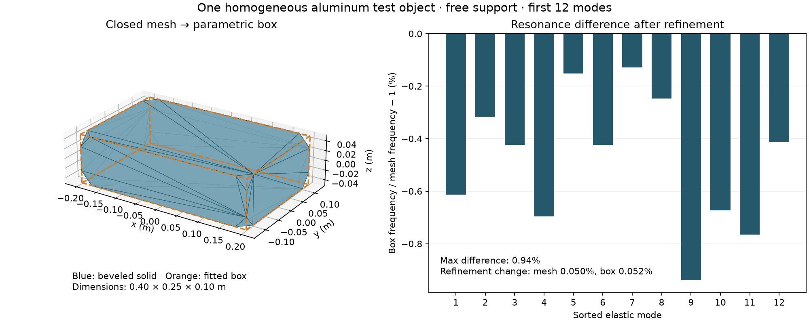

# Solid vibration and parametric approximation — 24 October 2026

The implemented slice exports a homogeneous Unity mesh/box, fits a closed mesh to an oriented box, bakes analytical plate or tetrahedral FEM modes, retunes uniform size/material properties, and drives shared modal state from sample-timed impulses. Output is mechanical displacement/velocity. Acoustic radiation and physical raindrop excitation are not yet connected to the ray renderer.

[Authoring, commands, units and limitations](../../simulation-contracts.md#primitive-and-solid-mesh-vibration-bake). [Numerical results](verification.json). [Source/artifact hashes](manifest.json). [Inputs, logs and reproduction script](validation.zip).

## Results

All **12 Python checks** passed, including three NGSolve checks. All **6 selected Unity EditMode checks** passed: four new runtime/exporter checks, an external Python→Unity pipeline probe, and the existing material round-trip regression. Unity ran with `-batchmode -nographics -disable-audio` in an isolated project; no foreground session or playback was used.

| Check | Result |
|---|---|
| Shared-state rendering split into 1, 17, 128 or 1,000-sample batches | Identical output within each implementation; resonance tails persist |
| Python bake exported to Unity, three impacts over 2,000 samples | Relative displacement/velocity response difference `1.56e-14`, using the same float32 impulse value |
| Simply supported thin plate | Frequencies, mass normalization, center excitation and closed-form impulse solution pass |
| Uniform scale/material retune vs fresh plate bake | Frequencies, positions and mass-normalized coupling agree to `1e-12` |
| Clamped 0.60 × 0.03 × 0.02 m aluminum beam | First two FEM frequencies 46.022 and 68.876 Hz; Euler–Bernoulli predictions 45.696 and 68.543 Hz; differences 0.715% and 0.485% |
| Rotated Unity cube exports | Both primitive and actual mesh JSON accepted by fitting and solid baking |
| Invalid geometry/material/support inputs | Open/disconnected solids and mixed materials rejected; six free rigid-body modes removed |

The approximation example is a free aluminum solid with dimensions 0.40 × 0.25 × 0.10 m and cut corners. Material values are illustrative: density 2,700 kg/m³, Young's modulus 70 GPa, Poisson ratio 0.33, loss factor 0.01. Its fitted box has **0.376 mm sampled surface RMS distance** and **0.209% volume error**. These are one-way geometric metrics, not acoustic accuracy measures.

Across its first 12 elastic modes, the final box/mesh frequency difference is at most **0.939%**. Independent order-3 mesh-size refinements from 0.045 to 0.035 m changed the source solid's spectrum by at most **0.0505%** and the proxy's by **0.0516%**. These observed changes support this example; they are not certified error bounds or validation of mode shapes, excitation, damping or radiated pressure. Sorted spectra do not establish individual mode correspondence.



The order-2 baseline took about 0.7–1.2 seconds per bake here. Completed order-3 bakes took 1.7–25 seconds, depending on geometry/discretization. An additional 0.025 m order-3 run was interrupted after more than five minutes and a sampled peak footprint of 5 GB; no result from it is used. Offline sparse factorization can become expensive well before a source mesh looks visually complicated. Keep the bake outside the runtime loop and validate the required frequency band, rather than refining blindly.

## Reproduce

The archive contains JSON inputs, the exact Python test log and Unity XML result, the external Unity probe and response, and environment versions. Tested with Python 3.13, NumPy/SciPy and NGSolve 6.2.2608; Unity 6000.4.1f1. NumPy/SciPy suffice for analytical plates; solid bakes need NGSolve too.

From the repository root, using an environment with those dependencies:

```sh
python -m unittest discover -s tools -p test_modal_bake.py -v
unzip docs/benchmarks/modal-bake-2026-10-24/validation.zip -d .context/modal-reproduction
python .context/modal-reproduction/reproduce.py .context/modal-reproduction/output
```

The reproduction script rebakes the archived solid/proxy refinements and checks Python against the archived Unity response. The external `ModalPipelineProbe.cs` can rerun that export/runtime path in an isolated Unity test project after setting its scratch `Root` to the extracted archive directory. Generate `panel-runtime.json` there with `modal_bake.py export` before running it. Unity filter: `ModalBakeChecks;ModalPipelineProbe;TakeChecks.Materials`.

The archive omits large solid NPZ banks because the inputs/settings reproduce them. Manifest bank hashes identify the original local results. Timing metadata and eigenvector signs/bases can differ between runs, so regeneration need not reproduce file bytes.
