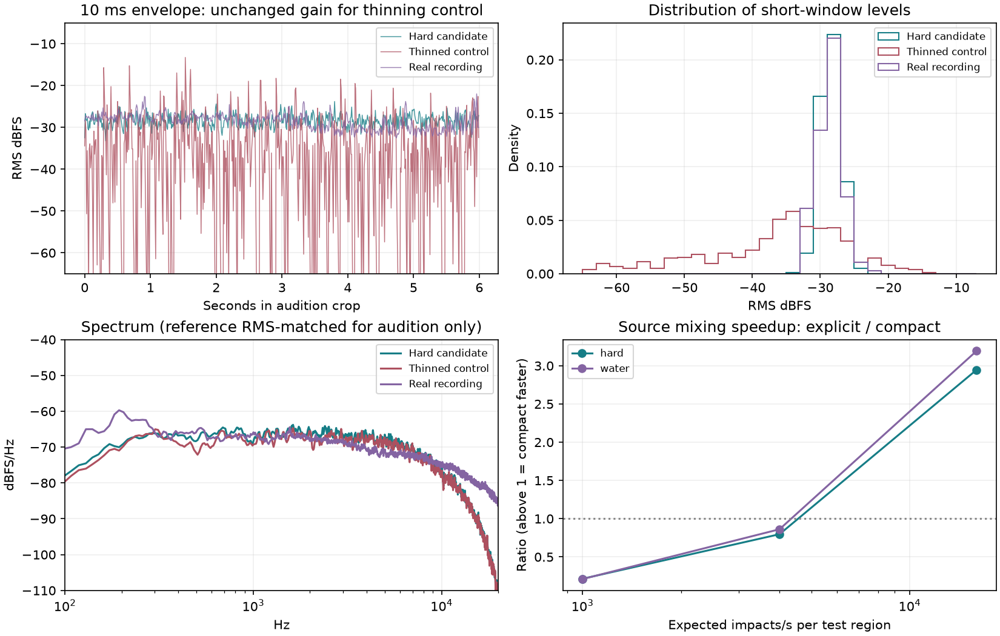

# Dense rain source experiment — 26 October 2026

The first source experiment is implemented and exported for listening. A bounded convolution mixer reproduces the explicit dense-drop mixture to floating-point precision. It is faster at high event density and slower at low density. This verifies the source-generation optimization, not realistic rain, spatial grouping or Church acoustics. **The user rejected the first timbre as still too clicky or artificial, then said the splash revision is better.** The revision is the current candidate for the small spatial experiment, not a claim of full realism.

## Implemented model

[`tools/rain_source.py`](../../../tools/rain_source.py) authors two response banks: a noisy hard/wet-surface impact family and a water family with optional damped bubble-like chirps. Each contains 32 responses spanning four illustrative size classes and eight variants, with 80 ms maximum support. Shapes have smooth support and zero integral. Event gain is not normalized to cancel intensity. Surface responses, size probabilities, coupling, decay and bubble occurrence are authored examples, not measured material properties. The water frequency uses the Minnaert relation; that does not calibrate airborne amplitude. No recording was fitted into these kernels and no structural resonator is enabled.

Each region uses a marked Poisson process reconstructed from `(seed, region, absolute one-second block)`, independent of audio batch boundaries. Intensity 1 means 4,000 impacts/s in the test region, not a measured rainfall rate. Uniformly distributed integer sample onsets permit simultaneous drops. A waveform index and amplitude select the immutable response; there is no per-drop GameObject, PCM copy or filter history. The prototype supports constant intensity per run; time-varying weather control is not implemented.

The explicit reference adds every complete waveform at its event sample. The compact path accumulates events into one impulse stream per response, multiplies their FFTs by the corresponding response FFTs, sums spectra, and performs one inverse transform per block. Overlap-add preserves the complete tail across blocks. Linearity makes this an exact aggregation for the chosen finite response bank at one common transfer location; it does not collapse distinct spatial paths exactly.

The reference and optimized paths use exactly the same events and kernels. There is no Gaussian replacement, event thinning or boosted missing-drop compensation in the candidate. A separately labeled thinning control keeps 1/64 of events and boosts their amplitude by eight, demonstrating the texture damage of this different approximation.

## Verification and measurements

Three independent unit checks pass: explicit versus compact mixing with simultaneous impulses and boundary/tail cases; identical events under irregular interval queries; and full authored-bank agreement across different block sizes. Run:

```sh
python -m unittest discover -s tools -p test_rain_source.py -v
```

The experiment covers two surfaces × three intensities × three seeds, each eight seconds at 44.1 kHz. Across all 18 cases, maximum sample error between explicit and compact mixing is **1.04 × 10⁻¹⁶** in float64. Source intensities change expected event count and power; they do not change a transport budget. Native outputs retain the full 80 ms response tail after the eight-second source interval.

At 16,000 expected impacts/s, the median explicit/compact mixing speed ratios are **about 3× for both surfaces**. At 4,000/s the compact method is slightly slower, and at 1,000/s explicit mixing is substantially cheaper. Timings include renderer construction, exclude event generation and analysis (generation is separately reported), and are single runs per seed. These are offline source-only CPU measurements with one FFT worker and nice 19; they are not live Unity, GPU transport or end-to-end performance claims.

Each float64 response bank uses 903,424 bytes. The 2,048-sample compact source mixer accounts for approximately 4.76 MiB of persistent and transient numerical arrays, excluding the shared bank, output, event list and FFT scratch. It does not allocate audio/filter history per drop. This does not establish how much of Church's 1.36 GiB transport/DSP storage an integrated spatial-field implementation would save.

For the first hard-surface seed, the dense candidate's excess kurtosis is about 0.49; the thinned control is 36.50. The 10 ms P90−P10 level spread is about 3.8 dB versus 43.8 dB. The real recording measures about 0.35 and 4.6 dB respectively. The comparison improves these texture statistics substantially, but they are not sufficient acceptance criteria. The candidate has less low-frequency body and weaker slow envelope modulation than the recording. No EQ or modulation was fitted to hide those differences, because the recording contains unknown surface and propagation effects.

Different region seeds produce waveform correlation of approximately −0.0035 (hard) and −0.0080 (water) in this sample. This is a descriptive check, not proof of complete independence or absence of perceptual repetition. The immutable bank has only 32 variants.



## Listening files and reference provenance

Files are exported under the Conductor workspace's `.context/rain-source-review/`:

| File | Contents |
|---|---|
| `reference-then-hard-prototype.wav` | Six seconds of recorded rain, 0.5 s silence, then six seconds of the dry hard-surface prototype. |
| `hard-rain-prototype.wav` | Eight seconds of the hard-surface candidate, plus its tail. |
| `water-rain-prototype.wav` | Eight seconds of the water candidate, plus its tail. |
| `real-rain-reference.wav` | Eight seconds of the existing real-rain excerpt. |
| `dense-then-thinned-control.wav` | Same response family: dense mixture followed by fewer/louder impacts. This is not the earlier Church render. |

All synthetic auditions use one gain of 6.016105854351045, selected with headroom for the thinning control. The recording separately uses gain 0.6768708009372549 to RMS-match the hard candidate over seconds 1–7. All cuts have 20 ms edge fades. There is no limiter or per-segment synthetic normalization. Every delivered WAV is finite and below full scale; the largest peak is 0.7781 in the deliberately bad thinning control. Native hard/water float WAVs are preserved in the experiment directory.

The reference is the existing `Assets/External/Church/Audio/RainCourtyard.wav`, derived from Joseph SARDIN's **Rain and Thunder #1 (0124)**, [BigSoundBank](https://bigsoundbank.com/rain-and-storm-s0124.html), CC0. The page identifies outdoor heavy rain; surface and microphone position are unspecified. The repository excerpt excludes the later thunder, is mono, and retains the original environmental acoustics. It is a general texture reference, not isolated dry impacts, a specific water/hard-surface reference, or calibrated ground truth. Existing asset preparation is documented in the [Church attribution](../../../Assets/External/Church/README.md).

## Reproduction and remaining work

With NumPy, SciPy and Matplotlib available:

```sh
python docs/benchmarks/rain-source-2026-10-26/run.py <new-output-directory>
```

The command refuses an existing output directory, exports banks and native/audition WAVs, verifies numerical agreement, records measurements/hashes, and draws the chart. It never plays audio. The retained [report](report.json) contains all seeds, native metrics, timings, source-bank/event hashes, provenance and audition gains. Three tests and the 18-case experiment were run after the final kernel change.

Listen to both candidate families before promoting their timbre. A small spatial/shelter comparison follows an accepted source: per-drop positions versus fixed patches, with directions, delays and occlusion accounted for. Source generation is now independent of ray count, but there is no ray renderer in this experiment. Existing Church files, 32-bounce settings, material assignments and rain clip are unchanged. The known indirect-transport spikes and missing roof radiation remain unresolved. No Unity process, foreground window, audio-device playback or persistent worker was started.

## Revision after the listening rejection

The first hard-surface bank has fast noise onsets with most energy in short transients. `make_splash_bank()` tests a quieter initial hit, a longer low-frequency component and irregular secondary noisy splashes. It retains 32 variants and the same size probabilities. Every event sample, voice index and gain is identical between the two profiles for a given seed/intensity. Response support increases from 80 to 120 ms; no room response, background recording, gain limiter or extra drops are added. This is an authored sound-design hypothesis, not a measured splash or material response. Water has not been revised.

The new [revision runner](revise.py) preserves the first experiment and its report:

```sh
python docs/benchmarks/rain-source-2026-10-26/revise.py <new-output-directory>
```

It renders three seeds at three intensities, verifies unchanged event schedules, and compares explicit and compact synthesis. Maximum absolute error over those nine cases is **1.32 × 10⁻¹⁶**. The three unit checks also pass with the longer bank included. This revision does not repeat the timing benchmark; the earlier speed ratios must not be attributed to its longer responses.

For seed 23 at intensity 1, excess kurtosis falls from 0.49 to 0.13, crest factor from 15.02 to 13.42 dB, and 10 ms P90−P10 level spread from 3.81 to 2.66 dB. The 125–500 Hz band fraction rises from 4.6% to 13.2%; the 2–8 kHz fraction falls from 61.4% to 36.7%. These describe reduced impulsiveness and a changed spectrum. They do not establish rain likeness. The real recording's level spread is 4.60 dB: this candidate may be too smooth. A listening result must resolve that, not another numerical acceptance threshold.

Files are in the Conductor workspace's `.context/rain-source-review/splash-revision/`:

| File | Contents |
|---|---|
| `previous-then-splash-revision.wav` | Six seconds of rejected v1, 0.5 s silence, six seconds of the revision. |
| `recorded-then-splash-revision.wav` | Six seconds of the same real recording, 0.5 s silence, six seconds of the revision. |
| `splash-revision-seed23.wav` | Eight seconds of revised rain plus its tail. |
| `splash-revision-seed47.wav` | Another realization at the same intensity and gain. |

The comparison uses one fixed audition gain per profile, matched over seconds 1–7 at seed 23/intensity 1. V1 retains its previous gain of 6.016105854351045. V2 uses 6.58628604961807 for both delivered seeds; the recording uses 0.676870800937255. No per-drop normalization or dynamic gain is applied. Exported float32 WAVs are finite with peaks below 0.271. Native PCM and bank are retained locally; hashes, metrics, gains and provenance are in [revision-report.json](revision-report.json). The recording is a texture reference with unknown surface/recording acoustics as described above, not isolated source data.

The previous source was **rejected**, not accepted because its mixer or metrics passed. After listening in the browser, the user said the revision **is better**. Keep it as the current candidate while testing space and shelter; that feedback does not establish measured surface realism. If later listening finds featureless hiss, use suitable isolated measured surface responses or an explicitly empirical texture model rather than calling further arbitrary transient tuning physical rain. The [2019 rain paper](https://haonancheng.cn/attaches/2019%20SIGGRAPH.pdf) supplements impact models with recording-derived material textures; it does not establish that our authored bank is adequate. Church integration remains deferred.

## Direct-sound shelter and grouping check

[`tools/rain_spatial.py`](../../../tools/rain_spatial.py) adds a small independent fixture with a 20 × 20 m rain catchment, an opaque roof/wall shelter and a 1.5 m wide, 2.3 m high doorway. This is a direct-path diagnostic, **not the Unity renderer, a moving walkthrough or a complete interior sound model**. It includes 1/r pressure attenuation, travel delay rounded to the nearest sample, and segment/box visibility. It omits reflection, diffraction, material transmission, head filtering and roof vibration. Church's existing 32-bounce configuration is untouched.

Rain lands on the roof first, or on exposed ground. No impacts occur on the sheltered ground. Source positions are reconstructed by absolute time block and remain identical under irregular queries. For each seed, all receiver and patch comparisons use the same events, gains, waveforms and first-hit surfaces. Patch centers are clipped to the five exposed surface regions, preserving the ground/roof boundary. Only the transfer position changes. The benchmark recomputes direct transfer per event to isolate position-grouping error; it is not yet a cached per-patch transport implementation or a performance result.

The reference retains individual positions. Alternatives group at 2, 1, 0.5 and 0.25 m widths. Three seeds and four receiver positions give 60 rendered cases. Controls verify inverse-distance amplitude, causal sample delay, roof blockage, the open doorway, partition-invariant source positions and patch containment. All six source/spatial tests pass:

```sh
python -m unittest discover -s tools -p 'test_rain*.py' -v
python docs/benchmarks/rain-source-2026-10-26/spatial.py <new-output-directory>
```

The individual-position reference is 10.09–10.56 dB quieter inside than outside over seconds 1–7, with no indoor gain adjustment. This is the direct airborne route through the opening, not a prediction of real building attenuation. Roof impacts have no direct path to the interior; hearing a real roof from below still needs the omitted mechanisms.

| Receiver | 2 m patches: isolated-event energy error | 0.25 m patches: isolated-event energy error |
|---|---:|---:|
| Outside | −0.08 to −0.01 dB | −0.006 to +0.001 dB |
| Inside | +1.06 to +1.43 dB | +0.07 to +0.10 dB |
| Doorway edge | +0.61 to +0.83 dB | +0.001 to +0.017 dB |
| Roof edge | −0.09 to −0.04 dB | −0.024 to +0.043 dB |

This energy proxy sums each event's isolated kernel energy after its direct gain; it excludes cross-event interference. Actual rendered RMS and short-window texture are reported separately. Interior visibility disagreement falls from 2.6–2.8% of all physical events at 2 m to 0.28–0.42% at 0.25 m. Counts alone are insufficient because visibility mistakes have unequal energy. Direction and delay errors also remain nonzero. These results support measuring finer groups near openings; they do not establish 0.25 m as a universal size or validate grouping reflected paths. A dedicated efficient patch renderer and its memory/cost study remain future work.

The browser listening page and WAVs are under the Conductor workspace's `.context/rain-source-review/shelter/`. `outside-then-inside.wav` plays the same six-second excitation window outside, then inside, separated by 0.5 s silence. Other clips compare individual positions with 2 m or 0.25 m patches. All use one common gain, with no per-receiver normalization or limiter. Native outputs retain source and propagation tails. These are mono, stationary-receiver comparisons. The [report](spatial-report.json) records field/bank hashes, visibility, energy/direction/delay errors, levels and file hashes; the [scene](spatial-scene.json) defines all geometry. The short CPU-only job completed and exited without launching Unity or playing audio.
