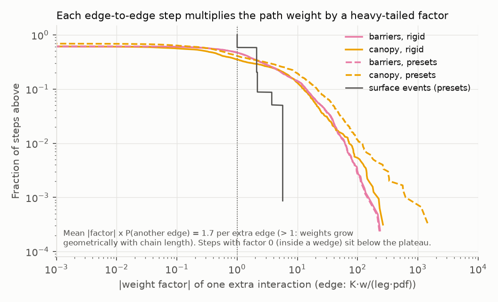
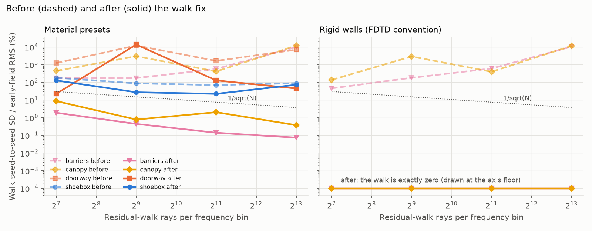
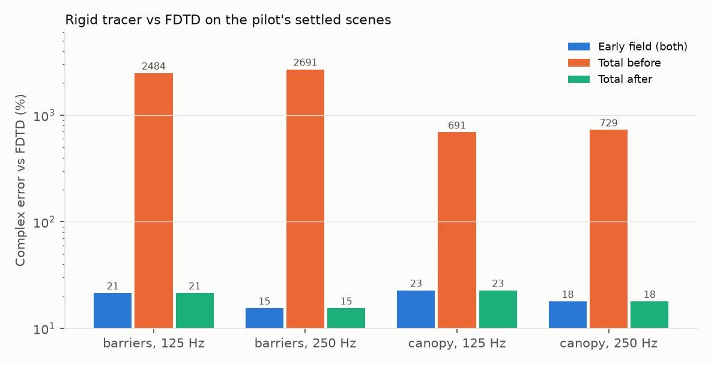

# Residual walk: why it did not converge, and the fix — 2 November 2026

**Verdict: in open scenes the walk now converges, and it no longer pushes the total away from the wave reference; in closed rooms it is still not usable.**
The walk's pure-edge chains (three or more consecutive diffractions) were the cause of the non-convergence in the pilot's barrier and canopy scenes.
Each extra edge multiplies a path's estimator weight by a heavy-tailed factor whose mean absolute value, times the chance of continuing, is 1.3–2.2.
Because that is above one, the expected absolute weight of an n-edge chain grows geometrically with n, while the signed series converges only through cancellation that path sampling cannot exploit.
No proposal density can repair this, so the walk no longer forms edge-to-edge legs when the complete routes are on (they integrate D and DD); two smaller weight errors in the surface branches are also fixed.
The walk can now be included in labels for open scenes (barriers, canopy), but not for rooms.
After the fix the rigid barrier/canopy totals equal the early field (15–23% from FDTD instead of 690–2,700%), the walk's seed spread in preset barrier/canopy scenes falls with rays, and the 125 Hz canopy-room map no longer degrades with more rays (29% at 512 rays/bin instead of 218–466%).
Closed rooms (shoebox, doorway, corridor, furnished) still do not converge: their surface paths branch into pressure amplitudes that sum to more than one per bounce, so the late tail's variance grows exponentially with bounce count; that is a property of the walk's coherent pressure model, not of a sampling density.

All numbers are measured on this Mac (Apple M5, 16 GB, Unity 6000.4.1f1 on Metal) under `nice 19`, one job worker and 20% work pacing.
Seed spread is the single-seed standard deviation of the walk family, relative to the RMS of the early field (every other family) of the same scene, over receivers and the 32 frequencies, as in the pilot.

## Root cause

The walk alternates two continuations at every interaction: sample an edge point (listener-guided Cauchy height proposal, half local/half global edge choice) or trace a uniformly random direction to a surface.
At an edge-to-edge leg the shader multiplies the weight by `K * cw / leg` (the previous edge's wedge kernel, shared-face multiplicity and leg length) times the opacity, divided by the edge probability (1/2) and the sampling density of the new vertex.
`TakeChecks.MeasureResidualWalk` (new, opt-in) records every walk arrival with its ray and bounce slot and the captured weight after every interaction; `walkmodel.py` re-evaluates each edge vertex in float64 and reproduces every captured rigid edge-to-edge factor above 0.001 (7,283 steps) to within 1%.
So the kernels, densities and selection probabilities are evaluated as designed; there is no singularity bug or PDF mismatch to repair at that level.

#### One extra edge (16,384 rays per bin, two receivers each, pilot scenes with the largest walk peaks)

| Scene | Steps | P(edge after edge) | Mean \|factor\| | Mean \|factor\| × P | Signed mean × P | Second moment × P | Median \|factor\| |
|---|---:|---:|---:|---:|---:|---:|---:|
| barriers-0001, rigid | 4,099 | 0.32 | 5.0 | **1.61** | 0.27 | 61 | 0.79 |
| canopy-0004, rigid | 3,184 | 0.26 | 4.8 | **1.26** | −0.15 | 65 | 0.30 |
| barriers-0001, presets | 4,234 | 0.32 | 5.0 | **1.59** | 0.28 | 60 | 0.78 |
| canopy-0004, presets | 2,998 | 0.24 | 9.2 | **2.24** | 0.22 | 495 | 0.54 |

The factor here re-pairs each leg's `1/leg` with the step that created it, so it is the integrand of one edge-to-edge transfer over the density that sampled it; its mean absolute value is the absolute transfer, independent of the proposal.
Legs along a shared face (multiplicity 1/2, grazing kernels up to |K| ≈ 13) carry about twice the mean |factor| of other legs (6.5–10.5 against 3.3–8.7).
An absolute transfer above one means the sum over chain lengths of E|weight| diverges; the walk only stops at 32 interactions, so long chains with ordinary-looking factors dominate.
The largest walk path in a 262,144-ray capture of barriers-0001 (3,185 times the early field at its receiver) has six edges, legs of 0.7–5.5 m, kernels of 0.07–0.32 and per-vertex inverse densities of 58–391; nothing about it is singular.
Its weight is simply the product of six such factors.
Hill tail-index estimates (top 30–100) of single-ray walk contributions in those captures are 0.5–0.9, i.e. heavier than any finite-variance estimator, which is why the pilot saw the walk's mean and spread grow with rays.



The same captures show two smaller defects in the surface branches (material presets):

- Transmission and diffuse scattering were drawn with their energy fractions t and s but weighted with pressure amplitudes, so a transmitted ray gained `1/sqrt(t)` (36 measured in the shoebox, about 100 for stone) and a scattered one `1/sqrt(s)` (2.9).
  With the edge/surface alternation every surface bounce multiplied the weight by 2.2–2.6; a captured doorway path grows from 0.005 to 2,560 in 14 bounces.
- A surface-to-edge leg reused the weight of the *continuation* drawn at that surface (transmission and scatter choices whose direction the edge leg discards), biasing it by `sqrt(1-t)(sqrt(s)+sqrt(1-s))` (1.15–1.37 for the presets) and adding the `1/sqrt(s)` spikes.

There is no double counting: with complete routes on, the walk already suppressed pure D and DD, and its diffuse surface-to-edge legs are disjoint from the specular RD/DR/RR routes.
With rigid walls the walk contained nothing but D³…D³² chains: rigid surfaces never scatter, so they neither connect to the listener nor start an edge leg.

## The fix (`Assets/Shaders/Transport.hlsl`, walk loop only)

1. **No edge-to-edge legs beyond the complete-route order.**
   After an edge vertex the walk continues with a surface event.
   With complete routes on, no walk path holds two consecutive edges; the legacy walk (`completeRouteSamples = 0`) keeps one edge-to-edge leg, i.e. its DD.
   Paths with edges separated by surfaces (S–D, D–S–D) remain.
2. **Branch draws in proportion to pressure amplitude.**
   Transmission is chosen with probability `sqrt(t) / (sqrt(t) + sqrt(1-t))` and scattering with `sqrt(s) / (sqrt(s) + sqrt(1-s))`, so every outcome carries the same bounded weight (the amplitude sum, 1.0–1.4) instead of `1/sqrt(p)`.
   The random-number sequence and sample dimensions are unchanged.
3. **Surface-to-edge legs restart from the surface vertex.**
   They use the vertex's weight divided by the probability that the edge branch is reachable (no transmission), and the vertex's material phase.

Expected values are unchanged for everything the walk still samples (2 and 3 change densities, not integrands); item 1 removes the D³+ family and its mixed variants with adjacent edges.
Two further edge-branch probabilities after a surface were measured and rejected: `1/(bounce+2)` and a probability proportional to the diffuse coefficient (both keep the per-bounce weight growth smaller in theory but made the preset rooms and the barrier ladder worse in practice; tables in `report.json`, keys `edgeSchedule` and `edgeChoice`).
No clipping, clamping, gain fitting or outlier rejection is involved.

## Convergence

Pilot protocol: calibration scenes (index 900, outside the pilot; barriers/doorway/shoebox are the pilot's own files), 256 complete-route samples, four seeds (two at 8,192), walk seed spread relative to the early field.

#### Material presets

| Scene | Before 128 / 512 / 2,048 / 8,192 rays per bin | After | Largest walk path / direct, before → after (8,192) |
|---|---|---|---:|
| barriers-0900 | 174% / 174% / 570% / 9,811% | **1.9% / 0.44% / 0.14% / 0.074%** | 308 → 0.0 |
| canopy-0900 | 441% / 2,969% / 412% / 11,784% | **8.7% / 0.78% / 2.0% / 0.38%** | 473 → 0.0 |
| doorway-0900 | 1,223% / 11,950% / 1,624% / 6,939% | 22% / 13,574% / 127% / 45% | 604 → 2 |
| shoebox-0900 | 180% / 87% / 70% / 89% | 127% / 27% / 22% / 72% | 3 → 1 |

#### Rigid walls

| Scene | Before 128 / 512 / 2,048 / 8,192 | After |
|---|---|---|
| barriers-0900 | 46% / 180% / 602% / 10,336% | 0 (no walk contribution) |
| canopy-0900 | 136% / 2,870% / 394% / 11,443% | 0 (no walk contribution) |

- In the open preset scenes the walk is now a small (well under 1% of the early field above 512 rays) and converging term; barriers falls by 4.3, 3.2 and 1.9 per fourfold budget, against 2 for 1/√N.
  Canopy is noisier (2.0% at 2,048 rays from one seed) but bounded.
- With rigid walls nothing is left in the walk: its only content was the D³+ chains.
  It still traces rays, at no measurable cost change in these open scenes (below).
- The closed rooms are not fixed.
  The doorway still has one 512-ray spike (a 14-bounce surface path whose weight grew 2.6 times per bounce, ending in a surface-to-edge leg), and the shoebox spread does not fall.
  See "What remains".



## Accuracy

#### Rigid tracer label against FDTD (pilot's settled scenes, 8 seeds × 512 rays, 65,536 complete samples)

| Family, frequency | Settled scenes | Early field | Total before | Total after | Early LoS / shadow |
|---|---:|---:|---:|---:|---:|
| barriers, 125 Hz | 6 | 21.5% | 2,484% | **21.5%** | 15.9% / 50.5% |
| barriers, 250 Hz | 6 | 15.5% | 2,691% | **15.5%** | 10.9% / 46.2% |
| canopy, 125 Hz | 4 | 22.7% | 691% | **22.7%** | 21.8% / 41.3% |
| canopy, 250 Hz | 4 | 17.9% | 729% | **17.9%** | 16.8% / 46.7% |

The early families are bit-identical to the pilot's; the walk family is exactly zero.
So the total now equals the early field instead of moving away from the wave field, but it does not move toward it either: the shadow error (41–51%) is unchanged.
What the walk dropped is a real physical family.
In these scenes DD is 25% of the early field's RMS (median; D is 38%), so a converged D³ term could be of order 10–20%; it is unmeasured, because neither the old walk nor the rejected third-order complete routes (28 October) produced a converged value.



#### 125 Hz canopy room against the numerical BEM reference (1,166 receivers, 65,536 complete samples)

| Walk rays per bin, seed | Before: whole / shadow | After: whole / shadow |
|---|---:|---:|
| 2, seed 0 | 29.24% / 86.92% | 29.24% / 86.92% |
| 2, seed 17 | 31.57% / 90.68% | 31.57% / 90.68% |
| 512, seed 0 | 465.5% / 885.8% | **29.24% / 86.92%** |
| 512, seed 17 | 218.5% / 888.3% | **31.57% / 90.68%** |

The 2-ray rows reproduce the accepted solid-bake result exactly (the old walk happened to add nothing at two rays); with more rays the old walk destroyed the map.

The other analytic controls (shoebox first-image lattice, half-plane and cube second-order quadratures, CPU/GPU audio parity) are part of the regression run below; none of them involves walk edge chains.

## Labels, regression and cost

#### Can the walk be part of a label? (pilot recipe: 8 seeds × 512 rays, 65,536 complete samples, material presets)

| Scene | Early-label SE | Walk-included label SE, before → after | Valid entries with the walk, before → after |
|---|---:|---:|---:|
| barriers-0000 | 6.2% | 100.0% → **6.2%** | 77% → 77% |
| barriers-0001 | 3.9% | 100.1% → **5.1%** | 15% → **98%** |
| canopy-0000 | 4.8% | 97.2% → **5.1%** | 0% → **97%** |
| canopy-0001 | 4.9% | 88.5% → **5.0%** | 13% → **98%** |
| corridor-0000 / 0001 | 4.9% / 2.0% | 99.8% / 97.2% → 85.2% / 58.7% | 8% / 0% → 2% / 0% |
| doorway-0000 / 0001 | 2.0% / 3.0% | 100.0% / 98.7% → 36.9% / 61.2% | 19% / 12% → 20% / 17% |
| furnished-0000 / 0001 | 8.9% / 3.4% | 100.1% / 99.8% → 96.2% / 64.1% | 23% / 2% → 0% / 0% |
| shoebox-0000 / 0001 | 0.7% / 0.7% | 47.7% / 85.7% → 22.0% / 99.9% | 0% / 0% → 16% / 64% |

SE is the dataset's relative label standard error and "valid" its per-entry acceptance rule (`tools/dlss_dataset.py`); the early field is unchanged by the fix.
**The walk can now be included in labels for open scenes (barriers and canopy): with it the label is as precise as the early field and three of the four scenes pass acceptance (barriers-0000 fails on its early field alone, as before).**
**It must stay out of labels for corridors, doorways, furnished rooms and shoeboxes**, where it still dominates the label's error (22–100%).
In the rigid FDTD subset the walk is exactly zero, so the rigid label is the early field either way.

#### Regression

The full `TakeChecks` suite (328 cases with the new test) passes except for one statistical case that the contract change required updating: `SurfaceBranchWeightsPreservePressure` pinned the old per-branch weight `coefficient / energy probability`.
It now asserts the amplitude-sum weight and, unchanged, that each branch's mean equals its pressure coefficient; with 8,192 rays the planar case missed that mean by 3σ (0.618 against 0.581 ± 0.013), so it uses 32,768 rays, where all six branch means are within 1.6σ.
The new `WalkEdgeRunsStopAtTheCompleteRouteOrder` checks that walk edge runs have length 1 with complete routes and 2 without, and that a rigid walk with complete routes writes no arrival.
CPU/GPU audio parity (spectral and IR, binaural, moving heads), the first-image room lattice, half-plane and cube second-order quadratures, solid-bake partition fields and mirror-prefix preservation all pass; 7 cases are opt-in measurements and skip.
The final shader reproduces the `after` ladder renders bit for bit; the rigid renders (FDTD subset, canopy BEM map) were made with a rejected edge-probability variant that cannot affect rigid scenes, and their early families are bit-identical to the pilot's.

#### Cost (median solve + readback per receiver, same pilot scenes, 20% pacing)

| Scenes | Live budget (2 rays/bin, 256 samples) | 1/4 budget | Label budget |
|---|---:|---:|---:|
| Rigid barriers/canopy (12) | 2.00 → 1.95 ms (×0.90 per scene) | 6.13 → 5.69 ms | 19.9 → 19.5 ms |
| Presets, two per family (12) | ×1.16 (barriers 0.7–0.9 → 1.8–2.2 ms) | 6.2 → 9.8 ms (×1.29) | 18.3 → 24.2 ms (×1.31) |
| 125 Hz canopy room (rigid, 1,166 receivers) | 2.8 → 4.0 ms | | 3.6 → 4.6–4.9 ms (512 rays/bin) |

Rays that previously died on a rejected second or third edge sample now continue through surfaces, and amplitude-proportional branch draws send 10–100 times more rays through transmissions into the solids (still correctly weighted); both add work in the preset scenes and the closed canopy room.
The "before" preset timings are the pilot's runs on 29 October–1 November, so machine load differs; the rigid open scenes, rendered in the same session as the presets, show no slowdown.

## What remains

- **Closed rooms.**
  A surface event splits into transmitted, scattered and specular branches whose pressure amplitudes sum to 1.3–1.4, and the walk alternates edge and surface continuations with probability 1/2.
  A single sampled path therefore carries a weight that grows by about 2.6 per bounce over up to 32 bounces, and the variance of the coherent late tail grows exponentially with depth, whatever the branch densities (three schedules were measured).
  Making the late tail converge needs a different late-field quantity (for example an incoherent energy tail), which is outside this change.
- **Higher-order diffraction.**
  D³ and longer edge chains are now absent from every render with complete routes.
  They need a deterministic or integral-equation treatment (an edge-source integral equation sums the signed series that sampling cannot); the 28 October third-order complete routes were unstable and remain unshipped.
- **Rain spikes.**
  The Church presets render with diffraction off, so the edge chains cannot explain their spikes; the transmission weights `1/sqrt(t)` (fixed here) and the per-bounce growth in closed rooms (not fixed) can.
  No rain or Church render was repeated, so this is not verified.
- **Cost.**
  Preset solves are 16% slower at the live budget (median; up to 2.3 times in barrier fields) and 31% slower at the label budget, mostly from the extra transmitted rays.
  Rigid open scenes are unchanged.
- The walk's random stream offsets the ray index by the seed, so seeds that differ by less than the ray count share most of their rays (found with consecutive diagnostic seeds; the pilot's hashed seeds are unaffected).
  Not changed.

## Reproduce

```sh
PY=.context/fdtd-teacher/venv/bin/python
B=docs/benchmarks/residual-walk-2026-11-02
# Diagnosis (GPU captures, then the float64 decomposition and fig2):
$PY $B/diagnose.py jobs > .context/residual-walk/diagnosis-jobs.json
nice -n 19 $PY $B/unity_jobs.py .context/residual-walk/diagnosis-jobs.json
$PY $B/diagnose.py analyze
# Convergence ladder (pilot protocol), per shader version:
$PY $B/walk.py prepare .context/residual-walk/after
nice -n 19 $PY tools/dlss_jobs.py --data .context/residual-walk/after render --batch 4
nice -n 19 $PY tools/dlss_jobs.py --data .context/residual-walk/after render --batch 2 --variant tracer-rigid --scenes barriers-0900-walk canopy-0900-walk
# FDTD accuracy (pilot's rigid barrier/canopy scenes; FDTD fields are read from the pilot):
$PY $B/walk.py fdtd-prepare .context/residual-walk/fdtd-after
nice -n 19 $PY tools/dlss_jobs.py --data .context/residual-walk/fdtd-after render --batch 6 --variant tracer-rigid
# 125 Hz canopy BEM map: copy .context/solid-boundary/ordered-full/scene.json with "rays": [2, 512],
# "seeds": [0, 17] into .context/residual-walk/bem-after/full/, list that directory in cases.txt, then
nice -n 19 $PY $B/unity_jobs.py --cases .context/residual-walk/bem-after/cases.txt
# Regression checks:
nice -n 19 $PY $B/unity_jobs.py --tests TakeChecks
# Tables and figures:
$PY $B/walk.py report
```

"Before" renders use the shader at `ab754fb` (`git show ab754fb:Assets/Shaders/Transport.hlsl`) in the same roots under `.context/residual-walk/before` and `bem-before`; the pilot's own renders (`.context/audio-dlss-data`, `.context/audio-dlss-walk`) are the rest of the "before" data and were reproduced bit for bit (walk family of barriers-0001 at 8 rays/bin).
Every Unity run synchronises the isolated runner, records source hashes in its `provenance.json` and runs under the pilot's guards (nice 19, one job worker, 20% pacing, 4 GiB process-tree guard, suspended on battery).

[Machine-readable results](report.json) · [diagnosis](diagnosis.json) · [float64 walk model](walkmodel.py).
