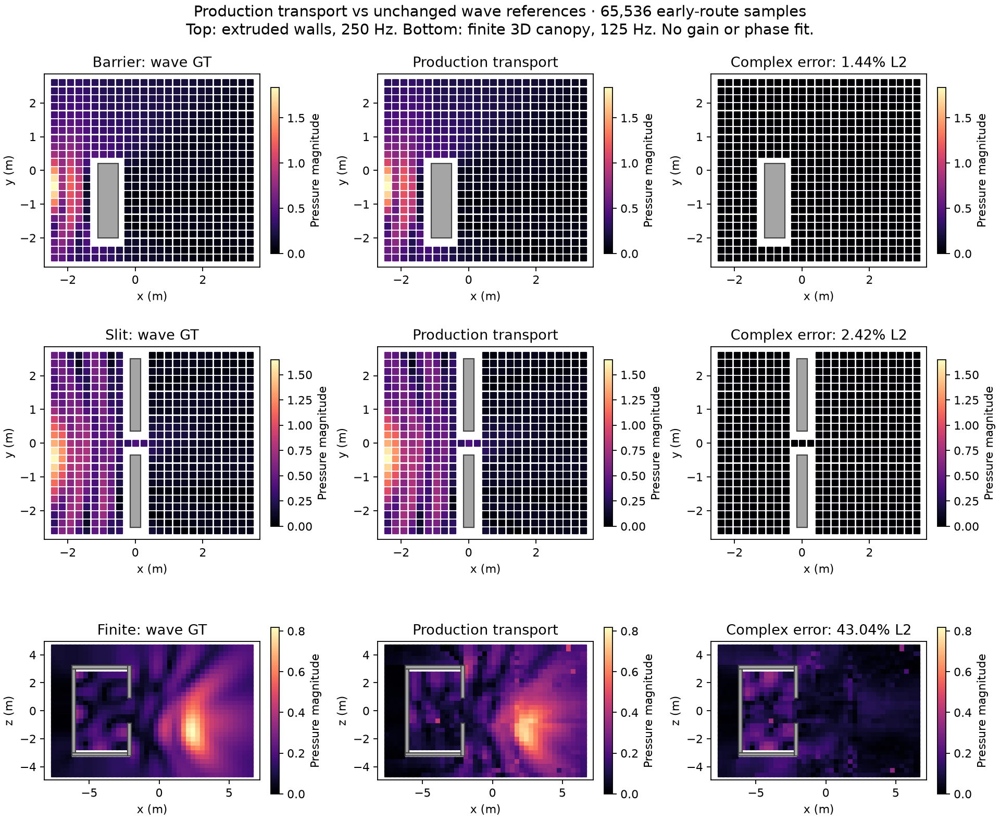

# Tuned diffraction in the shared audio renderer

The October 22 tuned `ScalableRoutes.compute` prototype is now promoted as
`Assets/Resources/Acoustics/CompleteRoutes.compute`. Its signed wedge kernel,
stable angle evaluation, incoming/outgoing Cauchy mixture, exact PDF and complete
one/two-edge integration live in `Assets/Shaders/DiffractionIntegral.hlsl`.
The canonical benchmark and the production planar adapter call that same code.

`Transport.compute` prepares D, DD, RD, DR and RR route families, then writes
individual signed arrivals into the ordinary transport buffer. Both CPU and GPU
synthesis consume physical delay, material spectrum, arrival direction, motion
ratio and source clock. Planar height symmetry retains both arrival directions.
This is not a tone-map lookup or a summed complex pressure used as an impulse.

Set **Complete route samples** (`completeRouteSamples`) above zero in the render
window or job settings, and `diffractionFactor=1`. Zero retains the previous walk
for comparisons and old serialized jobs. Sample count is per retained emission
site, shared across frequency bins; it is distinct from residual `raysPerBin`.
Small complete-route budgets sample topology with its exact selection weight.
They do not acquire high-budget accuracy just by using the same kernel.

Only the first two pure-edge walk arrivals are suppressed when the complete
routes are enabled. Every later walk slot, diffuse/transmitted prefix and the
32-interaction limit remain. This preserves existing behavior; it does **not**
turn the residual walk into a complete high-order image-source solver.

## Measured result

All final fields use the actual `TransportSolver`, 65,536 complete-route samples,
two residual rays/bin, seed 0 and unchanged numerical wave references.

| Field | Receivers | Original tuned prototype | Integrated runtime |
| --- | ---: | ---: | ---: |
| Extruded barrier, 250 Hz | 531 | 1.46% | **1.44%** |
| Extruded slit, 250 Hz | 509 | 2.36% | **2.42%** |
| Finite canopy, 125 Hz | 1,166 | Outside original model scope | **43.04%** |

Values are relative L2 complex-pressure error. The original four archived maps
(2,515 receivers) survive the shared-integrator extraction within 2.2e-8 relative
floating-point difference. Runtime planar draws use shifted Halton samples;
the archive uses its original Sobol draws, so those two runtime outputs need not
be bit-identical.

The finite canopy's previous first-image-only result was 50.05% overall and
100.19% in geometric shadow, with 257 silent receivers. New complete routes
remove the silent receivers, but shadow error **worsens to 125.51%**. At indoor
receiver 323, amplitude is 0.0583 versus reference 0.2084, with wrong phase.
At 128 samples, the five fixed probes have 172% / 286% error for seeds 0 / 17.
**The finite-room quality gate fails; the Church presets remain unchanged.**
A nonzero blocked signal is not evidence of a correct blocked-room response.

14 final correctness/parity cases and seven field-measurement cases pass.
Measurement cases assert finite output, not agreement with the reference; the
errors above determine physical quality. The four original-map controls and the
precise-angle control also pass. Correctness checks
cover CPU/GPU IR and spectral audio, moving binaural output, source births,
live/offline batching, ray capture, independent half-plane/solid diffraction,
and bit-exact preservation of every existing later walk slot in both dimensions.
A failed preservation test caught and fixed a buffer-offset error: the walk
must follow the direct/mirror prefix when complete routes append after it.



## Actual rain cost trial — rejected as a preset

The same 98-source, 84-triangle rain take was rendered silently through the
ordinary GPU audio pipeline with 128 complete samples and diffraction enabled.
Input scene/state/event hashes agree with the earlier first-image render.
Numeric storage rises **438,950,980 → 722,399,864 bytes (+64.6%)**. The new run
records 0.619 s host-observed transport and 22.571 s audio work over 196 responses.
Do not infer a speedup from the earlier 1.248 / 28.985 s: this run used nice 19
and explicit work pacing without the earlier macOS background task policy, and
both are single offline measurements, not realtime deadlines.

The unchanged-gain float WAV has **14.396 peak, 1.029 RMS and 67,723 samples
above full scale** out of 286,651. No limiter or normalization conceals this
failure. It was never played. The low-budget finite sampler is not a usable rain
preset. Raw metadata is in `rain-cost.json`; licensed PCM stays private.

## Scope and evidence

The original near-wave agreement was on rigid, infinitely extruded rectangular
walls with spherical point sources and at most two early interactions. Finite
3D edges retain actual support and segment visibility, using an extended
Cauchy proposal with uniform support. That extension is separately measured;
it cannot inherit the planar accuracy claim. Roof vibration remains deferred.

`report.json` records unchanged-reference complex-pressure errors, numerical
parity with the original shader, finite-room probes, sample budgets and seeds.
There is no gain fitting, phase fitting, output normalization or clipped weight.
`validation.json` and `evidence.zip` retain test results, inputs, raw fields,
source hashes and failed/canceled runs. Numerical wave references are not real
recordings. Licensed source PCM is excluded from the archive.

Recalculate the report with the repository NumPy environment:

```sh
OPENBLAS_NUM_THREADS=1 OMP_NUM_THREADS=1 VECLIB_MAXIMUM_THREADS=1 \
  .context/wave-planar/venv/bin/python \
  docs/benchmarks/runtime-diffraction-2026-10-27/analyze.py "$PWD" \
  docs/benchmarks/runtime-diffraction-2026-10-27/report.json
```

The shared renderer adds at most `samples * frequencyBins * 48` bytes of path
storage per emission per buffered response (twice that in planar mode), plus
DSP groups and bounded preparation scratch. Measure the actual source/site
count and batch size before choosing a sample budget. The 65,536-sample field
checks are numerical validation settings, not a realtime weather preset.
