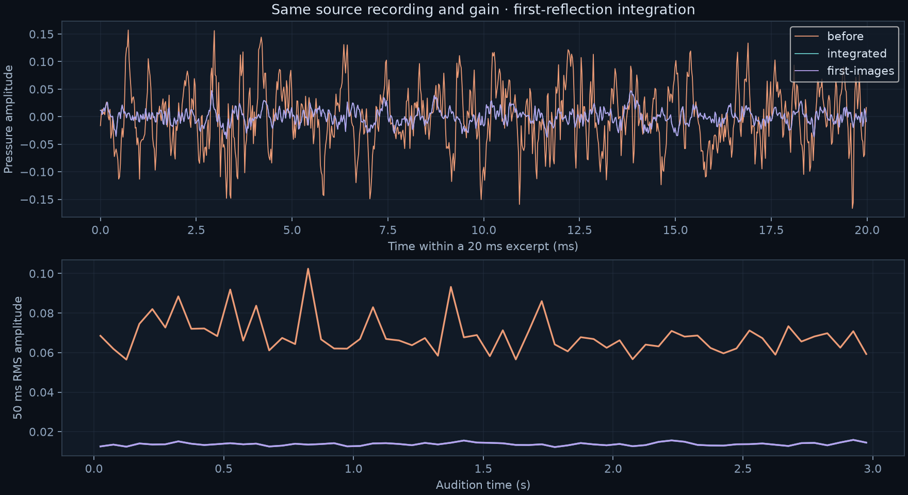

# First reflections integrated into live and offline audio — 27 October 2026

The previous improved solver was an editor-only static 2.5D pressure-map prototype. It returned complex pressure at a receiver, not the delays, directions and event clocks needed for production audio. The finite-3D renderer used by rain still used the older primitive sampler. This change closes the **first-reflection** part of that integration gap. It does **not** integrate the complete multi-edge/mixed-route prototype.

## Accepted runtime change

`ReflectionSampling.FirstImages` checks each candidate primitive's image route and retains every valid arrival separately. The candidate budget is `min(primitiveCount, max(reflectionCandidates, raysPerBin))`, with a default floor of 128. Retaining more emission events does not increase the candidates per event. Small scenes enumerate all primitives. Larger scenes retain `primitiveCount / candidateCount` probability compensation and require convergence checks. `PrimitiveBaseline` preserves the former estimator for comparisons. First images retain visibility, material phase, retarded source/mirror timing, Doppler and emission birth/phase. All existing surface/edge walk slots remain; the configured 32-interaction budget is preserved. Zero bounces remains direct-only.

The same per-pair layout feeds CPU IR, CPU spectral and GPU audio in live and offline rendering. GPU filters/work rows now reserve a conservative number of distinct geometric paths instead of one complete FFT per frequency record. Constant IOR permits direct/mirror sharing; walks also require constant transmission/scattering probabilities. Spectral attenuation remains separate. Dispersive/branch-dependent materials keep the necessary frequency capacity. The GPU rejects an invalid sharing contract before an out-of-range filter write. No clipping, gain fitting, path-weight cutoff or removed PDF factor supplies the improvement.

## Matched rain result

Seven boxes / 84 triangles, 98 identical recorded rain sources, stationary listener under the canopy. Two rays/bin, 32 interactions, 44.1 kHz mono, FFT 128, hop 32, 1.25 s horizon, BVH enabled, diffraction and air absorption disabled in both versions. Five seconds of input plus a 1.5 s tail; 286,651 output samples including the initial sample. Source/scene/state/event hashes, input gain, timing and all previous settings match.

| Measure | Before | Integrated |
|---|---:|---:|
| Reserved numeric storage (MiB) | 1484.5577 | 418.6163 |
| Material filter storage (MiB) | 840.0865 | 28.7423 |
| Transport (s) | 0.4891 | 1.2476 |
| Audio synthesis + delivery (s) | 24.0520 | 28.9848 |
| Preparation (s) | 1.8885 | 2.2196 |
| Paced render wall time (s) | 157.7731 | 190.7229 |
| Peak absolute amplitude, full render | 0.7723 | 0.0873 |
| RMS amplitude, audition | 0.0693 | 0.0138 |
| Relative RMS difference from first-image control (%) | 488.4423 | 1.0346 |

Storage falls **71.8%**, while the measured audio stage costs **20.5% more** and transport costs 0.758 s more. There are 133 active geometric groups instead of 62; input FFTs increase from 555,396 to 1,191,414. Neither render has samples outside ±1. Source gain is unchanged. The independent first-image comparison improves **488.44% → 1.035% relative RMS difference** (correlation 0.2472 → 0.99995). This is a restricted geometric control, not a full-wave accuracy percentage.

The three-second audition begins after two seconds of source warmup, aligned by the same 144-sample DSP latency. No per-version normalization. The independent control sums direct propagation and all **73 valid first images**, with the original material coefficient and fractional delays. It excludes higher-order scattering and is **not a full-wave reference**. Remaining difference from this control can contain retained walk contributions and numerical/resampling error.

Before, two primitive draws could place a large `84 / 2` compensated weight on a small subset of the first mirrors. The new version keeps all valid first mirrors with unit candidate weight. This removes that sampling error in this small scene without changing source gain or suppressing compensated edge/surface paths. It does not establish realistic individual-drop synthesis; the input remains the same recorded rain texture.

Timings are single offline host-observed runs on shared Apple M5 / Metal hardware, not repeat-based speed estimates or realtime deadlines. Transport includes synchronization/readback; audio includes synthesis/delivery. Wall time includes a 20% completed-work duty limit; Unity launch is outside the renderer's wall counter. Runs use background priority, nice 19, one job worker and a sampled 3 GiB parent-RSS guard. Prepared PCM is unchanged. No foreground player, microphone, game networking or speaker playback was used.

## Validation and failed approaches

**79 distinct focused cases pass across the accepted control runs.** The final regression run passes 59/59; bounded candidates, muted listeners, arbitrary-path reduction and legacy settings pass another 15/15. An additional event-budget control verifies that retaining 16 drops does not multiply each drop’s reflection budget; seven affected mirror cases pass again. Four earlier geometry controls verify exact room first images in 2D/3D at one ray and bit-identical preservation of every existing interaction through depth 32. Packed and full GPU audio agree within 1e-6; CPU/GPU relative RMS error stays below 5e-4 in the controlled comparisons, including moving binaural listeners, cuts, IR/spectral output, shared/global FFTs, dispersive media and frequency-dependent branch probabilities. Event birth/phase and short-burst live/offline/batched parity, moving-mirror/material clocks, debug captures, impedance phase, zero bounces and diffraction DSP pass. This is focused EditMode coverage on Apple M5/Metal; no standalone build or realtime deadline claim. Existing shader warnings remain. The local audition was checked at desktop and 390-pixel widths: no horizontal overflow or console errors, all three clips decode to three seconds and remain paused at time zero. The initial controls-current run passed 9/10, with its capacity-error failure resolved and retested later.

The first guard implementation prevented extra groups but failed to expose error 5 on Metal. Readback confirmed distinct delays and skipped group slots; replacing compare-exchange with atomic max did not help. The accepted version stops at the first capacity violation and emits the local error after the serial loop. Its deliberate invalid-arrival control now observes error 5 and throws. This is an observed execution difference, not a demonstrated diagnosis of the compiler/backend.

A preliminary mirror variant resampled valid image routes back into a small ray budget. It was replaced because retaining each delay avoids unnecessary echo variance. The generalized finite-3D complete-edge trial then failed its physical gate: at 38 predetermined 250 Hz probes and 128 rays, seed-0 complex-pressure error increased **489.43% → 1400.23%**, with median solve/readback **2.98 → 12.68 ms**. Seed 1 measured 415.87% error, but these nearby seeds are not independent replicates. These are diagnostic probes, not full-map scores. Earlier two complete-edge attempts failed shader compilation and supply no physical evidence. The first rain capture was stopped before completion to remove the event-count/quality-budget coupling; its partial audio is not a result. Two intermediate control runs were canceled while fixing wall-time-based test pacing; they are not passes. Rejected source snapshots and measurements remain in the archive.

Full higher-order mirror connections, exact mixed mirror/edge routes, diffuse reciprocity, general impedance wedges and high-variance finite-edge sampling remain unresolved. The renderer remains excluded from teacher approval. The rejected algorithm is absent from production.

## Evidence and reproduction

- [Rain measurements and input hashes](report.json), [focused Unity results](validation.json), [rejected-edge measurements](rejected-edge-report.json).
- [Source snapshots, raw numerical data, XML results, process samples and hashes](evidence.zip). This includes the accepted implementation and the rejected finite-edge attempt. Baseline production code is also preserved at `469b9b1`.
- `compare.py` reproduces the waveform figure/control and paused `view.html` audition from the private original take/fixture and two native renders. It requires NumPy/SciPy/Matplotlib. Run single-threaded at nice 19. Licensed rain PCM/WAVs and takes remain private and are excluded from the archive.
- `tools/capture_sequence.py --render-job ... --work-fraction .2 --max-resident-mib 3072` drives the actual `TakeBatch.Render` entry point in a closed isolated Unity project. The archived job and run report identify the settings and runtime/shader hashes.
- The archive's `check.py` records source hashes and runs selected EditMode cases with `ACOUSTIC_TEST_WORK_FRACTION=.2`; this paces test-process CPU time, while the render uses completed-work wall pacing. Neither mechanism is a global system CPU cap.
