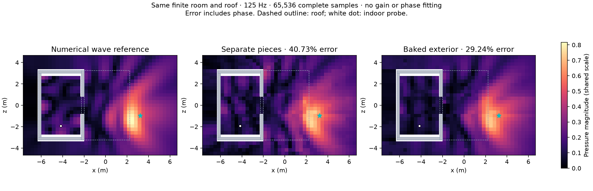

# Material-preserving solid boundary bake — 28 October 2026

The same physical solid now compiles to one acoustic exterior. The measured whole cube and two touching parts give **identical fields and audio**, versus the previous approximately 11.4% field discrepancy. Tested seeds 0/17, 0/125/250/500 Hz, three receivers, static and rotated/moving owner cases. This is a representation control, not a full-wave claim.

The real finite room/roof improves, but still misses substantial indoor sound:

| Same 125 Hz numerical reference | Separate objects, `511c81a` | Integrated solid bake |
|---|---:|---:|
| Whole-map complex relative L2 | 40.7271% | **29.2352%** |
| Directly occluded receivers | 123.9380% | **86.9216%** |
| Silent receivers | 0 | 0 |
| Median solve + GPU path readback | 5.563 ms | 3.080 ms |
| Triangles | 84 | 52 |



1,166 receivers; same seven finite wall/roof boxes, source, materials, 65,536 complete samples, seed 0, two residual rays/bin, 32 retained interactions and 1.25-second support. No reflecting floor was added. The shader and DSP are unchanged. All maps use a shared absolute pressure scale. Error includes complex phase; no gain/phase fitting, normalization, smoothing or limiter. Timings are single runs under 20% work pacing on shared hardware, not a universal speedup or realtime guarantee.

The Unity measurement creates actual child colliders/materials, invokes the editor baker, imports its asset and compiles through `SceneToTake`; it does not replace geometry with a hand-authored reference mesh. Output is one connected component, volume 28.06249988 m³ and area 233.24999905 m² versus analytical union 28.0625 m³ / 233.25 m². Small differences are from Unity's float input coordinates. Final Boolean time for this small room was 27.6 ms, excluding interpreter/import overhead.

## Remaining quality failure

At indoor receiver 323, numerical reference pressure is **0.168523 + 0.122584i**. The baked 65,536-sample seed-0 result is **0.085413 + 0.079003i**. At 1,048,576 samples it is **0.088668 + 0.064164i** (seed 0) or **0.093728 + 0.061011i** (seed 17): **47.48% / 46.49%** error. These seeds are diagnostics, not independent statistical confidence intervals.

At 128 samples, five-probe complex errors remain **170.53% / 400.47%**. Removing authoring seams does not make the low-budget sampler acceptable. The prior numerical reference refinement changes 0.43% overall / 1.36% shadow; it cannot explain these renderer discrepancies.

Captured indoor arrivals are dominated by DD, with D/RD/DR contributions; RR is zero there. Their summed pressure accounts for the total to less than 5e-6 absolute on both seeds. The retained residual walk makes no material difference in this measured two-ray case. Longer specular/mixed/diffracted paths and their sampling still need separate integration/validation. The bake is accepted; full-room fidelity and the rain preset are **not** promoted.

## Validation and audit trail

- Six Python controls pass: touching/overlapping solids and order, actual gaps, per-surface materials, coincident overlap priority, winding/exact-position weld, invalid mesh rejection.
- Fourteen final Unity cases pass: four field measurements; three partition field/audio controls; two authoring/material tests; five existing geometry/capture guards. CPU/GPU binaural audio matches within 2e-4; equivalent representations match field exactly on tested cases. Moving-owner velocities are included.
- A follow-up authoring check passes after fixing root `Geometry Source=None` to preserve ordinary members. Disabled groups also restore members. These assertions cover an actual silent-geometry failure, not just implementation structure.
- Whole-group motion and unlisted moving doors remain valid. Source geometry/relative motion changes are rejected. Warmed capture guard validation allocates zero managed bytes.
- Workers used a separate Unity project, nice 19, one job worker, 20% CPU/work pacing and a sampled 3 GiB parent-RSS guard. All workers exited; no foreground scene, speaker output or microphone was used.

The first batch-Boolean prototype gave 29.2363% overall / 87.3920% shadow error. It left coincident material precedence ambiguous. The accepted ordered Boolean assigns earlier members the exposed coating; its different triangle diagonals required rerunning the field. Both versions and their source hashes are retained. An intermediate C# variable-shadow compile failure is retained too; it was fixed before the successful compiled/final runs.

[Authoring and architecture](../../acoustic-solid-bake.md) · [numerical ledger](report.json) · [raw evidence, code snapshots and guarded runner](evidence.zip).

Unzip evidence at a scratch root. The archive retains repository-relative paths. Install `tools/solid-boundary-requirements.txt` plus Matplotlib for analysis, then run:

```sh
python docs/benchmarks/solid-boundary-2026-10-28/analyze.py /path/to/root
python -m unittest discover -s tools -p test_solid_boundary.py -v
```

Unity checks are under `TakeChecks` category `SolidBake`; set `ACOUSTIC_SOLID_PYTHON` to that environment. Wave fixtures use `ACOUSTIC_COMPLETE_WAVE_CASES` (newline-separated fixture-directory paths). The archive preserves the original absolute case list as provenance; regenerate it for the extraction location. Mac/Metal is the tested platform. Raw logs, source hashes, settings, fields, geometry input/output, reference and failed prototypes are included; no live footage is implied.
