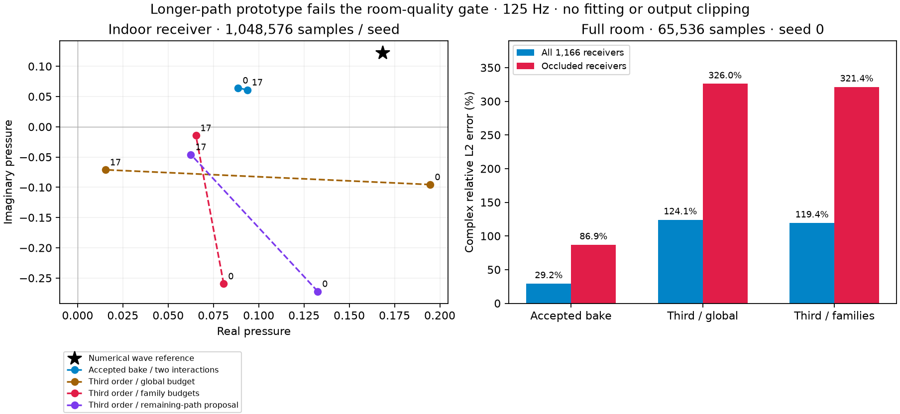

# Finite third-order path experiment — 28 October 2026

The material-preserving boundary bake remains the accepted change. Adding a third complete R/D interaction **fails the real-room quality gate**. The prototype is retained in the evidence archive rather than enabled in the renderer. A passing isolated-path test does not establish an accurate nonconvex room solver.

## What was tested

The prototype uses one finite physical-vertex evaluator for DDD, RDD, DRD, RRD, DDR, RDR, DRR and RRR. It unfolds each intervening mirror run, validates actual segments, integrates signed edge terms with their actual height PDFs, and carries delays, materials, arrival direction, source emission and per-vertex Doppler through the ordinary audio pipeline. It retains the existing two-order option and later residual-walk slots. There is no propagation cache, per-object response layer, gain fitting or output clipping.

Candidates are bounded rather than allocating a cubic route table. Conservative preparation rejects impossible endpoint wedge angles and exact invalid RRR paths. Third-order shader variants are compiled separately. The second sampling variant reserves a share of integration draws for each nonempty family so cubic route counts cannot starve D/DD/RD/DR. When a family has more routes than draws, it samples a stratified subset with the inverse-probability weight rather than silently truncating it. This controls allocation, not variance or physical completeness.

The final targeted variant guides each edge height with the whole remaining unfolded path, including the receiver, rather than stopping the proposal at the next edge. The physical integrand and PDF weighting remain unchanged. Reflected incoming-edge proposal guidance is still omitted; a uniform finite-edge mixture retains support. Fixed depth three also does not sum all room interactions.

The primary [EDtoolbox](https://github.com/upsvensson/Edge-diffraction-Matlab-toolbox) formulation uses a directional edge-pair integral equation. Its published scope is convex Neumann scattering. These finite mixed paths in a nonconvex room require their own validation; the prior planar wave match cannot be inherited.

## Same-room results

Same seven finite wall/roof boxes, rigid surfaces, source, receivers, 125 Hz numerical BEM reference, two residual rays/bin, 32 retained walk slots and 1.25-second support. The 1,166-receiver maps use 65,536 complete samples and seed 0. No reflecting floor was added. The reference's last refinement changes 0.43% overall / 1.36% shadow.

| Variant | Whole-map complex error | Occluded receivers | Median solve + path readback |
|---|---:|---:|---:|
| Accepted boundary bake / two complete interactions | **29.2352%** | **86.9216%** | **3.080 ms** |
| Third order / global integration allocation | 124.0855% | 325.9556% | 7.679 ms |
| Third order / per-family integration allocation | 119.3967% | 321.3638% | 24.655 ms |

Single runs under 20% work pacing on shared hardware; not repeated performance estimates or realtime guarantees. Diagnostics and cold compilation are excluded from these per-solve measurements. More paths increased both error and measured cost.

At the indoor probe, the reference is **0.168523 + 0.122584i**. At 1,048,576 samples, accepted two-order errors are 47.48% / 46.49% for seeds 0/17. Global third-order allocation gives 105.43% / 118.49%; family allocation gives 188.13% / 82.33%. With global allocation, D receives only 33/38 nonzero height contributions at a million samples, compared with 3,344 in the earlier two-order seed-0 run. Family allocation restores 41,520 D contributions in seed 0, but higher mixed families remain unstable. The seeded runs are diagnostics, not statistical confidence intervals.

The freshly compiled remaining-path proposal gives **0.132591 − 0.272046i** / **0.062552 − 0.045849i**, or **190.15% / 95.49%** indoor error. Solve/readback is 224.612 / 221.298 ms. Captured third-family values and the DDD control change, confirming that this run executes the new proposal. It still fails, so no additional full-room map is justified and no production extension is retained.

## Independent controls and failures

- RRR: analytic shoebox image lattice at exactly three reflections, rigid and absorbing walls; pressure and actual CPU/GPU binaural spectral/IR audio.
- RDR: independent SciPy adaptive finite-edge quadrature at 0/125/250 Hz, including common rigid rotation/translation/velocity. Refinement is approximately 4e-15. Common motion must preserve pressure and cancel Doppler.
- DDD: one specified physical cube route, independent 24/48/80-node tensor Gauss quadrature, stable to approximately 1e-15.
- Existing single-edge and cube two-order controls, retained later-walk behavior, and the disabled solid-root capture guard.

The early reserved-name HLSL failure, later explicit float3 array-initializer compile failure, audio-harness block-size failure, low-count DDD/RDR quadrature failures, and bad room fields are retained. Raising the RDR diagnostic budget to a million samples preserves its original 3.5% target; no threshold was loosened. The family-allocation run supplies 655 selected DDD heights and 221 selected RDR heights instead of the previous sparse counts. These diagnostics are expensive controls, not practical source budgets.

The family-allocation run passes **18/18** checks, including the excluded-root capture guard. Its five measurement cases assert finite results and diagnostic reconstruction; they do **not** assert success against the independent whole-room wave reference. The quality failure above remains decisive.

A subsequent `guided` run passed 9 runtime checks but is **invalid for validating its changed shader source**. Unity imported the changed conditional include without reimporting `Transport.compute`; fields, contribution counts, independent control values and compiler warning positions exactly repeat the prior binary. Source hashes alone do not prove those bytes executed. The `guided-fresh` run makes the include dependency unconditional (with its feature guard inside the file), verifies parent-shader reimport and repeats the checks. Both runs are retained. The fresh run passes **9/9** controls and measurements; its room field still fails the separate quality check.

The cached run's vertex export also tests a suspected right-angle corner cancellation problem. Routes touching an integer-index wedge sum to only about 1.2e-6 / 3.1e-7 pressure magnitude on the two seeds, with individual contributions below 1e-6. They cannot explain the observed ~0.1 spikes. No physical kernel change is justified by that hypothesis.

Two-order five-probe fields remain exact in the earlier specialized-kernel run; family-allocation code changes them by less than 1.9e-7 absolute / 8.3e-7 relative norm. The rejected implementation is removed from live Assets, so its buffers, kernel variants and setting do not add production complexity or cost.

These runs establish instability and a failed room-quality gate; they do not establish the fully converged third-order room field. A next experiment should separate sampling variance from missing room interactions with deterministic finite mixed-path controls and convergence checks before increasing depth again. The successful bake remains useful independently.

Final production source is restored to the accepted bake plus `0cbd066` capture fix. Its **5/5** focused Unity checks pass after removing the prototype: material/stale-geometry rules, interior-medium rejection, and whole/split static and moving fields with CPU/GPU audio. All three partition field comparisons are exactly zero on these tested cases. All owned test workers exited; no scene render or speaker output was started.

## Evidence and reproduction

[Machine-readable results](report.json) · [raw fixtures, outputs, failures and exact source snapshots](evidence.zip) · [accepted boundary workflow](../../acoustic-solid-bake.md).

Extract the archive at a scratch root. Paths are repository-relative. Each run's `provenance.json` hashes its exact tested files; `source/` retains those bytes. `resources.json` records exit status, work pacing and parent RSS. `reference.py` and `reference.json` retain the independent quadrature. Original absolute case lists are provenance; regenerate them for the extraction root. The evidence also preserves the unchanged numerical room reference and accepted two-order measurements.

Run `python docs/benchmarks/third-order-2026-10-28/analyze.py /path/to/extracted/root` with NumPy/Matplotlib to reproduce the report and figure. Independent `reference.py` quadrature additionally needs SciPy. The Unity solid-bake fixtures need `tools/solid-boundary-requirements.txt` installed in the interpreter named by `ACOUSTIC_SOLID_PYTHON`. Create an isolated copy of the repository at `0cbd066`, overlay the selected run’s `source/`, and use Unity 6000.4.1f1 Mac/Metal to run archived sources; never replace a live scene checkout to inspect an experiment. The guarded runner uses nice 19, one job worker, 20% CPU/work pacing and a sampled 3 GiB parent-RSS guard. A child shader compiler can still use one low-priority CPU core. No speaker, microphone or foreground game is required.
