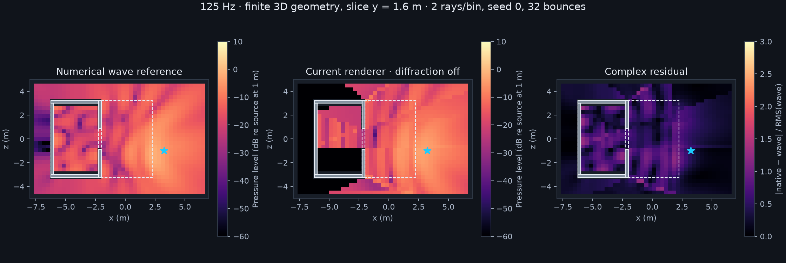

# Updated finite-3D renderer vs the numerical wave reference — 27 October 2026

Fresh measurement of runtime commit `21e64c0`, after first-image integration. The reference and archived baseline are unchanged. This is the **independent full-wave comparison**, not the direct-plus-first-reflection PCM control that reported 1.03% difference.

At the rain demo's two-ray, diffraction-off setting, whole-map complex-pressure error improves **55.92% → 50.05%**. The blocked region remains at **100.19% error**. The renderer returns zero pressure at **257 of 1,166 positions**. The first-image fix therefore gives a modest full-wave improvement here and does not solve the missing sheltered field.

| Rays/bin | Diffraction | Previous whole-map error | Updated whole-map error | Updated blocked-region error |
|---:|---|---:|---:|---:|
| 2 | Off | 55.92% | 50.05% | 100.19% |
| 2 | On | 55.92% | 50.01% | 100.19% |
| 128 | Off | 52.06% | 50.05% | 100.19% |
| 128 | On | 294.64% | 294.03% | 1236.64% |

Seed 0 is shown above; the report retains seeds 0 and 1. These nearby streams overlap and are not independent uncertainty samples. With diffraction off, all four updated ray/seed settings give the same field: the scene fits within the complete first-image budget and its rigid surfaces produce no diffuse connections. More rays do not add the missing higher-order/mixed path families. At 128 rays with experimental diffraction enabled, error remains **294.03%**, with large outliers. No failed algorithm was enabled to make the comparison.



The fixture uses the actual seven-box canopy/room geometry, a unit point source at ground-rain patch 39, a 125 Hz tone, and a horizontal receiver slice at y = 1.6 m. Both models use rigid surfaces; no reflecting floor or roof vibration is present. It is not the absorptive 98-source broadband rain mix. Native transport retains 32 walk interactions, 1.25 s support, the same BVH and five frequency bins; only the matching 125 Hz bin is evaluated. No gain fitting, phase alignment, smoothing or output normalization is applied. All pressure, level and residual scales are shared across before/after views.

The cached reference is a 3D Helmholtz boundary-element solve over the exact box union: 7,904 triangles, 3,954 DOFs. Refining its mesh from 0.35 to 0.25 m changes complex pressure by **0.43% overall / 1.36% in the blocked region**. A separate cached analytic rigid-sphere control at 125 Hz has **0.23% error**. These are numerical controls, not certified error bounds or a real-world recording. The reference is steady-state; the ray model has finite delay/depth support.

The new measurement completes 9,328 receiver queries: 1,166 positions × two ray budgets × two seeds × diffraction off/on. Its measurement harness passes; that means complete, finite data, not physical accuracy acceptance. One isolated Unity worker runs at background priority, nice 19, one job worker, 20% completed-work pacing and a sampled 3 GiB parent-RSS guard. Elapsed guarded run: 213.16 s; sampled parent RSS peak: 795.56 MiB. No foreground player, microphone, game networking or speaker playback was used. Warm transport medians in the report exclude audio synthesis and are not realtime deadlines.

The browser comparison adds a Before/Updated selector to the existing Acoustic Lab view. It preserves diffraction/ray/seed controls, shared scales, clickable receivers, phase display and opt-in animation. Outside, Under canopy and Inside room presets expose local amplitude and phase errors. Animation starts paused and stops when the tab is hidden. The earlier 3D benchmark and actual-rain listening page remain linked and explicitly labeled.

Browser QA checks desktop and 390-pixel layouts, Before/Updated selection, ray/diffraction controls and phase changes. No console errors or horizontal overflow were observed. Animation stays paused. The displayed blocked receiver near (-4.17, 1.60, -1.93) m has wave amplitude 0.2084 and native amplitude zero.

[Detailed measurements and provenance](report.json) · [Raw before/after fields, reference, source hashes and reproduction scripts](evidence.zip).

To reproduce from the unchanged reference and baseline, sync a closed isolated Unity project to `21e64c0`, then run:

```sh
python3 docs/benchmarks/wave-review-2026-10-27/render.py RUNNER NEW_MEASUREMENT --reference REFERENCE --hz 125
OPENBLAS_NUM_THREADS=1 VECLIB_MAXIMUM_THREADS=1 OMP_NUM_THREADS=1 nice -n 19 python3 docs/benchmarks/wave-first-images-2026-10-27/package.py REFERENCE NEW_MEASUREMENT OLD_MEASUREMENT NEW_PAGE
```

The package command requires NumPy/Matplotlib and the existing wave tooling. It checks source, geometry, receiver positions, settings, raw-field and reference hashes before rendering. The artifact links assume the existing local review folders beside `NEW_PAGE`; numerical data and exported figures remain standalone. Production code is unchanged by this measurement.
