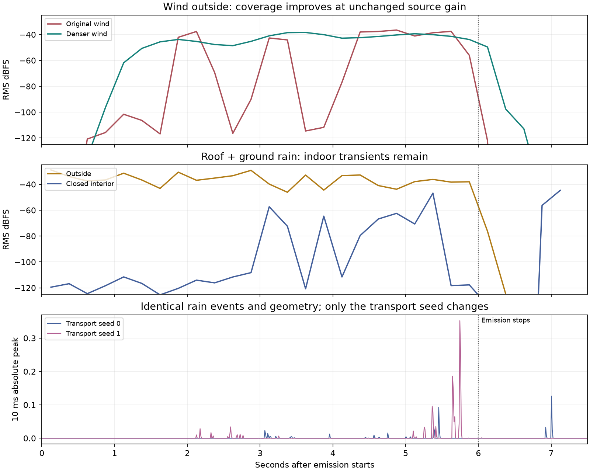

# Weather sound review — 26 October 2026

The short comparison renders current first-surface rain and canopy wind at matched outdoor and closed-interior receiver positions. Wind's sparse grain coverage was improved in both Church scenes. Rain's indoor transients remain a separate concern; these results do not validate realistic rain or a calibrated building response.

**Listening outcome:** the user rejected the rain as unrealistic. The source uses the same synthetic 24 ms noise tick for every impact, with only about 128 weighted events/s across 4,988 m². The transport checks below do not establish perceptual rain quality. The [source-model correction](../../simulation-contracts.md#rain-quality-rejection-and-source-model-correction--26-october-2026) separates dense impact excitation from ray budget and requires a dry-source listening check before another scene render. That replacement is not implemented by this review.

## Matched probes

[WeatherReview.cs](WeatherReview.cs) derives six-second source-only numeric takes from the first-surface capture. Scene geometry is held at the recorded 18 s pose, after the door closes. The outdoor receiver uses the recorded 1 s head pose, and the interior receiver uses the 18 s head pose. Both hear the same source events, gains and emissions. Rain is rendered separately at each receiver; wind uses two simultaneous receivers. These are stationary comparisons, not another walking take. They preserve geometry, source IDs, source PCM and original gain commands; each derivative has its own authenticated metadata.

All renders retain 32 bounces, FFT 128/hop 32, a 1.25 s path horizon, one response per batch, mono 44.1 kHz output and the existing disabled experimental diffraction setting. The launcher uses nice 19, background task policy, one Unity worker, a 20% completed-work duty budget and a 3 GiB sampled-RSS guard. Numeric allocations and process RSS are reported separately. These are offline results, not a live-performance claim or a hard system-wide GPU utilization cap.

## Wind coverage change

The original wind clip contains no large silent intervals, and the shared gust envelope is bounded. The canopy mask has about 136.49 m² of weighted support inside its 80 × 70 m footprint. Only 8 of the first 65 sampled grains have an unobstructed direct path to the outside receiver; none have one to the interior receiver. With about five overlapping grains, the original schedule repeatedly leaves no direct contribution outside.

The adopted schedule uses **2 s grains every 2,048 samples**, about 43 overlapping grains at 44.1 kHz, with **80 retained slots** for duration plus propagation/filter history. It keeps the same clip, mask, source seed and gain. Existing normalization compensates cadence and duration. `ChurchSequenceAuthoring.UpdateWindCoverage` applies the saved configuration to both scenes; `UpdateWeather` also authors it.

| Outside wind, 2–5.5 s | Original | Adopted |
|---|---:|---:|
| RMS level | −41.34 dBFS | −41.32 dBFS |
| Quarter-second P90−P10 level spread | 76.07 dB | 8.20 dB |
| Full render peak | 0.08127 | 0.04505 |
| Samples above full scale | 0 | 0 |
| Two-receiver numeric working storage | 0.358 GiB | 1.140 GiB |
| Renderer wall time at the work budget | 42.31 s | 78.62 s |

The average outdoor level differs by only 0.02 dB in this window. The measured dropouts are substantially reduced without raising source gain. This single-seed comparison is not a multi-seed convergence study. The indoor wind remains near −114.40 dBFS, about 73.09 dB below outside, so stronger coverage does not fix the room's strong attenuation.

The [coverage proxy](coverage.json) measures visible-grain Hann power, not received audio. Its four-second candidate uses a later steady-state window than the shorter candidates; compare those rows cautiously. The decision above uses the actual matched audio of the original and adopted schedules.

## Rain and material findings

The matched rain windows measure **−35.04 dBFS outside** and **−57.67 dBFS inside**, a difference of 22.63 dB. Full native WAV peaks are 0.59907 and 0.12645 respectively, with no full-scale exceedances. The indoor quarter-second P90−P10 spread is still 56.67 dB. Its largest peak occurs at approximately 7.006 s, one second after the source stops, in delayed sound. A steady-window average must not hide these transients.

A second render changes **only the transport seed** from 0 to 1, keeping the exact same indoor rain take and all other settings. Its largest peak is 0.35236 at 5.742 s. Within 10 ms of seed 0's largest peak, seed 1 is silent; within 10 ms of seed 1's largest peak, seed 0 reaches only 0.00000413. The source events, geometry, renderer/shader identities and output clocks match. This isolates strong transport-seed sensitivity from the drop generator, although two seeds do not establish convergence or identify the responsible estimator term. The delivered comparison retains seed 0; no favorable seed was selected and no peak limiter was applied. [Seed comparison](rain-seed-comparison.json).

The next transport investigation should retain these exact emissions and inspect the rare large indirect contributions, their selection probabilities and pressure weights before changing the drop schedule or gain. A repair needs held-out-seed and analytic controls; simply increasing material transmission would confound this diagnosis.

The material audit traces the assignment to `TakeDemo.BuildChurch`: non-frame doors receive wood and other imported collision meshes receive stone. Thus `CopperRoof` currently uses the **Church stone placeholder**, as do the other rain-hit objects. At the low endpoint, the exported stone energy transmission is about 0.00012958 per interface. This is the legacy illustrative propagation model, not measured transmission for a copper-clad roof assembly. No copper response was fabricated from the mesh name, and no indoor gain boost was added. Material-specific impact timbres and roof vibration remain deferred. [Material audit](material-audit.json).

## Delivery

The eight-second movie plays four seconds outside followed by the same four seconds of excitation inside. It sums independently traced rain and adopted wind at unity gain, trims only each renderer's declared latency, and applies 15 ms edge fades around the comparison cuts. No per-segment normalization or limiter is used. The movie uses two labeled reference stills from the previous picture capture; their camera positions/headings match the probe receivers. The animated minimap uses the new projected rain and adopted wind emissions. This is not a newly rendered walking film.

The optional wind clips provide original → adopted wind outside, and adopted wind outside → inside, at the same unchanged gain. The cropped examples cover source time 2–6 s; the native reports also measure the full tail. The mixed WAV peaks at 0.59880, and decoded AAC peaks at 0.61937 with no full-scale exceedances. Both movie tracks last eight seconds, with 192 frames at 1280 × 720/24 fps and mono 44.1 kHz audio. Artifact hashes are in [delivery.json](delivery.json); native level/resource measurements are in [diagnostics.json](diagnostics.json). All five render workers exited successfully and stopped; no playback or foreground editor was started.

## Reproduction

Copy `WeatherReview.cs` into the isolated runner's `Assets/Tests/Editor` and invoke `WeatherReview.Prepare` with `-reviewTake <first-surface-take>` and `-reviewOutput <new-probe-directory>`. Render `wind-baseline`, `wind-dense`, `rain-outside` and `rain-inside` jobs using `tools/capture_sequence.py --render-job`, one worker at a time. The unused `wind-long` and `wind-slow` takes are coverage candidates, not delivered renders. Remove the copied helper after use.

For the seed diagnostic, copy `rain-inside-job.json` to `rain-inside-seed1-job.json`, keep its `take`, change `settings.seed` to 1 and `output` to `rain-inside-seed1-audio`, and render into that output directory. Run `python compare_seeds.py <weather-review-directory> rain-seed-comparison.json` and `python plot.py <weather-review-directory> weather-levels.png`.

Run `python analyze.py <weather-review-directory> diagnostics.json`. `package.py` accepts that directory, the previous picture capture and a delivery directory. NumPy/SciPy/Pillow/Matplotlib and ffmpeg are required; nothing plays audio. The saved scenes were compared byte-for-byte, after trailing-whitespace normalization, with Unity's own `UpdateWindCoverage` output. The earlier engine regression suite was not rerun for this scene-configuration change.
