# Cleanup validation and measured bottlenecks

## Multi-edge failure diagnosis and a finite-edge numerical fix — 2026-10-20

**The main acoustic accuracy failure remains unresolved.** One numerical sampling bug is fixed; none of the experimental route/height proposals passed the full-map quality review. The runtime patch adds 19 shader lines net, two provenance version updates, and one atomic GPU sampling test family. It does not clamp pressure, reduce bounce depth, disable diffraction or change the edge kernel. The solver contract is now `integrated-edge-pressure-preview-v10`.

### What causes the large spikes

The captured 25-obstacle failure follows seven visible edge interactions. Its Monte Carlo weight reaches billions, and one listener contribution is about 73.8 million. Each hop divides by the probability of the selected edge and height; a rare complete route can therefore dominate a small ray budget. These are estimator weights, not physical amplification or energy carried by a ray. Signed pressure contributions require coherent cancellation. Increasing the number of interactions adds more of these difficult integrals.

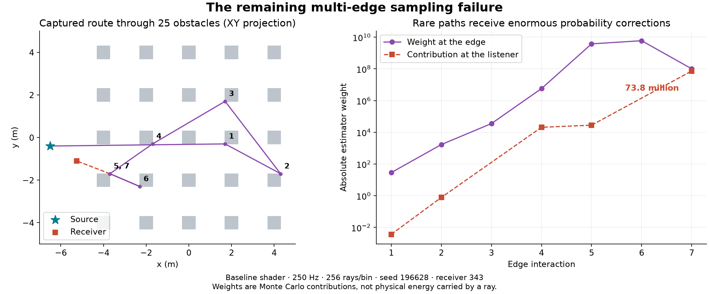

The captured planar listener contributions agree with independently evaluated double-precision edge kernels, to roughly 0.05% or better for the inspected paths. This supports a sampling-variance diagnosis for those failures, not a proof that every shader path family is physically correct. The existing CPU complete-route prototype is stable through orders two, four and six at the inspected one-box position. Neither result validates general 3D diffraction or mixed specular/diffraction paths.

### Accepted fix

The finite-edge Cauchy sampler previously computed its probability interval as `atan(upper) - atan(lower)`. For an edge spanning 0–1 m, a peak center at ±100 m and a 0.0001 m width, both float arctangents round to the same number: the computed interval is zero although the true interval is about 1e-8 radians. A valid proposal can then be discarded or badly placed.

The replacement computes the interval with a stable atan2 identity and a small-angle series, then interpolates the two endpoint directions with positive weights. It retains the same truncated Cauchy distribution and its full mixture PDF. Finite draws stay on the edge by construction. Infinite planar-edge arithmetic and the random-number sequence are preserved.

Five deterministic GPU cases check CDF quantiles, normalized density and finite-edge bounds against independent double-precision expressions, including near-endpoint draws. The surrounding diffraction, material, phase, moving-edge and debug-capture controls bring the final regression total to **36 passed, zero failed/skipped**. These are implementation controls, not 36 proofs of physical scene accuracy.

The final matched measurements contain 424 planar diagnostic rows with **bit-identical pressure and direct visibility**, plus 8,480 rows across all 1,060 positions, two frequencies and four seeds in the large 3D room. At 125 Hz, room complex error changes from 15,168.53% to 15,170.06%, positions within ±3 dB from 12.31% to 12.29%, and median warm transport/query time from 11.017 to 11.376 ms. This fix does **not** solve the multi-edge instability or establish a scene-quality/speed improvement.

### Experiments rejected

All trials retain 256 rays/bin, eight interactions, 0.4 s support and the same four seeds. They change proposals and their probability corrections, never fit amplitudes to the reference. Diagnostic subsets deliberately include baseline failures plus a regular spatial sample; they are useful for debugging, not an unbiased benchmark. Full maps are the acceptance check.

- Distance-weighted edge selection plus an incoming-kernel height proposal improved some failures but produced a worse outlier in the nine-obstacle case.
- Filtering geometrically invisible edges in planar scenes raised the 25-obstacle diagnostic median from 0.744 to 8.385 ms and still left huge errors. Finite 3D edges were not pruned using a single-point visibility test.
- The height proposal alone looked promising on selected failures at roughly unchanged cost. Its full-map results below reduced extreme complex errors but worsened local amplitude accuracy in two layouts. It was removed from the runtime patch.

| Full map | Complex error before | Experimental error | Positions within ±3 dB before → experiment |
|---|---:|---:|---:|
| planar-1 | 221.14% | 73.30% | 58.26% → 54.24% |
| planar-9 | 41,970.27% | 36,229.44% | 1.59% → 0.52% |
| planar-25 | 422,156,718.12% | 518,684.40% | 2.64% → 7.27% |
| room-12m-25 | 15,168.53% | 3,673.21% | 12.31% → 13.94% |

Errors are per-seed complex L2 error against the same refined wave fields, averaged over four seeds; fields are not averaged together first. The experimental column includes the first draft of the stable finite-edge sampler, which subsequently failed three of five new distribution checks and was corrected before the accepted patch. The spatial tradeoff alone was sufficient to reject the proposal. Four seeds and heavy-tailed contributions do not establish statistical convergence.

### Next experiment and acceptance criterion

The next candidate should allocate samples to complete visible diffraction routes and condition the edge-height integrals on the actual preceding/following vertices. The existing CPU prototype supplies an independent control for that experiment. Start in 2D, compare enumerated/stratified low-order routes at matched measured milliseconds, and inspect each interaction order separately. Do not call lowering the order a fix for missing higher-order physics. Complete-route sampling is a hypothesis to test, not a demonstrated cure for route-count growth or signed cancellation.

Promote a GPU candidate only after both amplitude and complex-pressure accuracy improve across whole maps, with per-seed spread, runtime and source hashes retained. Then repeat finite 3D controls and investigate missing mixed mirror/edge contributions. The current GPU output is not qualified as high-fidelity DLSS training ground truth.

All runs used the silent isolated Unity/Metal batch project at low priority, one numerical/GPU job at a time. There were no visible player windows, cursor capture, microphone or speaker playback. The previous study’s reference definitions, mesh uncertainty and three-computed-bin timing limits still apply.

[Measured ledger](benchmarks/edge-stability-2026-10-20.json) · [Raw trials, shader snapshots and reproduction scripts](benchmarks/edge-stability-2026-10-20.zip). Extract beside the existing spatial-accuracy archive; script paths are relative to the repository root. The archived experimental shaders are not installed in the runtime.

## Larger 2D and finite 3D acoustic accuracy — 2026-10-20

**The current GPU estimator is not a reliable wave-field approximation on this suite.** Exact direct visibility passes, but higher-order acoustic contributions can become extremely large. More rays do not reliably restore accuracy. The earlier low-error planar plots evaluated the separate CPU edge-integral prototype; those results must not be attributed to the live shader. No runtime/shader change was made for this measurement.

### What was actually measured

Apple M5, 16 GiB, macOS 26.5.1, Unity 6000.4.1f1 / Metal. Silent isolated batch runner, one worker, low priority. Numerical references use NGSolve 6.2.2608 with one CPU thread. One source, stationary geometry and receivers, complex scalar pressure; no HRTF, headphones/speakers, binaural localization test, source audio or DSP. These are controlled synthetic acoustic scenes, not the visual church asset.

- Planar layouts: a 12 × 11 m receiver map with 1, 9 or 25 rigid 0.6 m square obstacles. Geometry is infinitely extruded; the wave solver integrates 2D Helmholtz solutions over longitudinal wavenumber to reproduce a **3D point source**, matching our planar acoustic convention. This is 2.5D acoustics, not a 2D line-source wave.
- Finite rooms: 6 × 4 × 3 m and 12 × 8 × 6 m with four floor-to-ceiling pillars; another 12 × 8 × 6 m room has 25 obstacles of varying heights. Walls/floor/ceiling have dimensionless real admittance 0.2, pillars are rigid. These are actual 3D FEM solves, sampled on three XY height planes.
- GPU: BVH on, diffraction on, air absorption off, 16/64/256 rays per frequency bin, eight interactions and 0.4 s path support. Four seeds: 17, 65554, 131091, 196628. All runs calculate three FFT bins; frequencies scored are 125/250 Hz in planar cases and 62.5/125 Hz in rooms. No amplitude fitting, normalization to the reference, clipping of recorded fields or averaging of seeds in displayed maps.

### Accuracy by receiver position

The percentage error below is **complex pressure L2 error**, `100 * ||ray - wave|| / ||wave||`, averaged over individual seed runs. It includes amplitude and phase: zero output would score 100% error, and error can exceed 100%. “Within ±3 dB” is the fraction of receiver positions with approximately correct local amplitude; it does not establish correct phase. Neither is a binaural angle error.

| Scene | Hz | Probes | Complex error | Positions within ±3 dB | Median query ms |
|---|---:|---:|---:|---:|---:|
| planar-1 | 250 | 1014 | 221.14% | 58.3% | 0.420 |
| planar-9 | 250 | 960 | 41,970.27% | 1.6% | 0.589 |
| planar-25 | 250 | 880 | 4.22e+08% | 2.6% | 0.747 |
| room-6m-4 | 125 | 1145 | 1,913.38% | 13.0% | 5.720 |
| room-12m-4 | 125 | 1145 | 1,851.89% | 16.6% | 5.803 |
| room-12m-25 | 125 | 1060 | 15,168.53% | 12.3% | 11.017 |

Timing includes warm transport submission, GPU completion/readback and solver bookkeeping for one receiver query and **three computed bins**. It excludes cold compilation, solver/BVH construction, CSV writing, CPU complex summation and audio synthesis. It is neither GPU-only timing nor a full-band real-time audio benchmark.

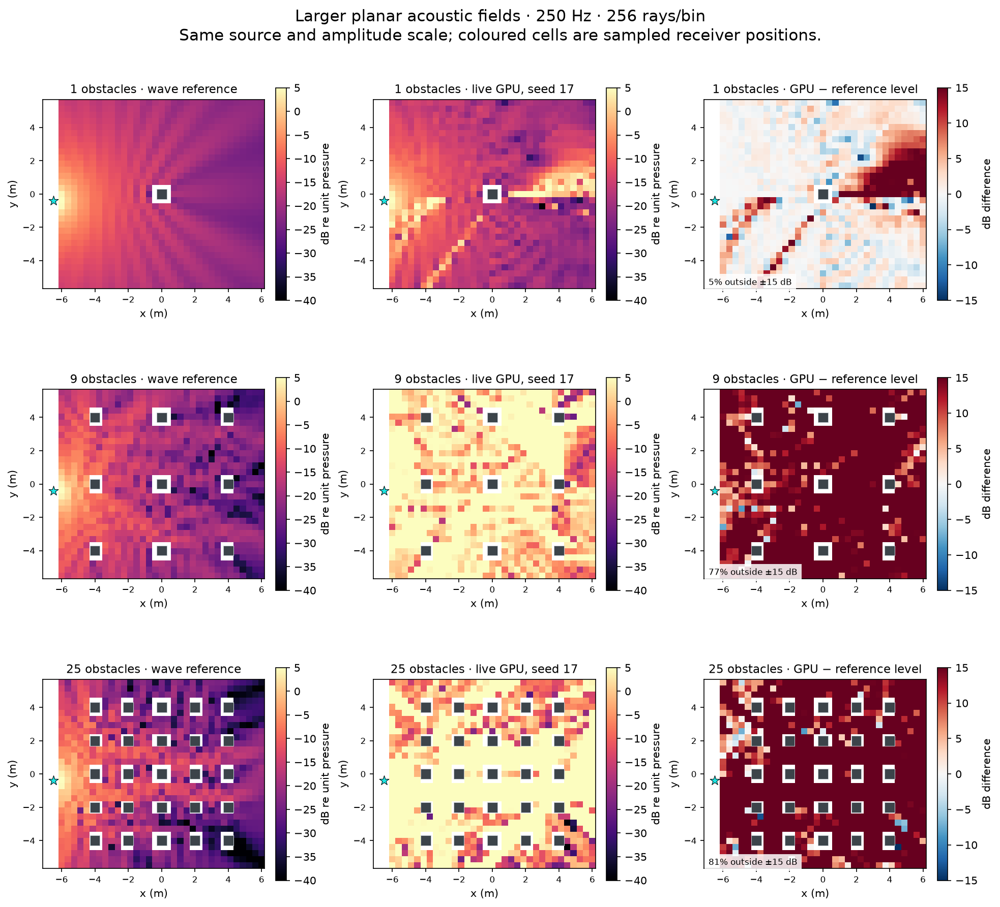

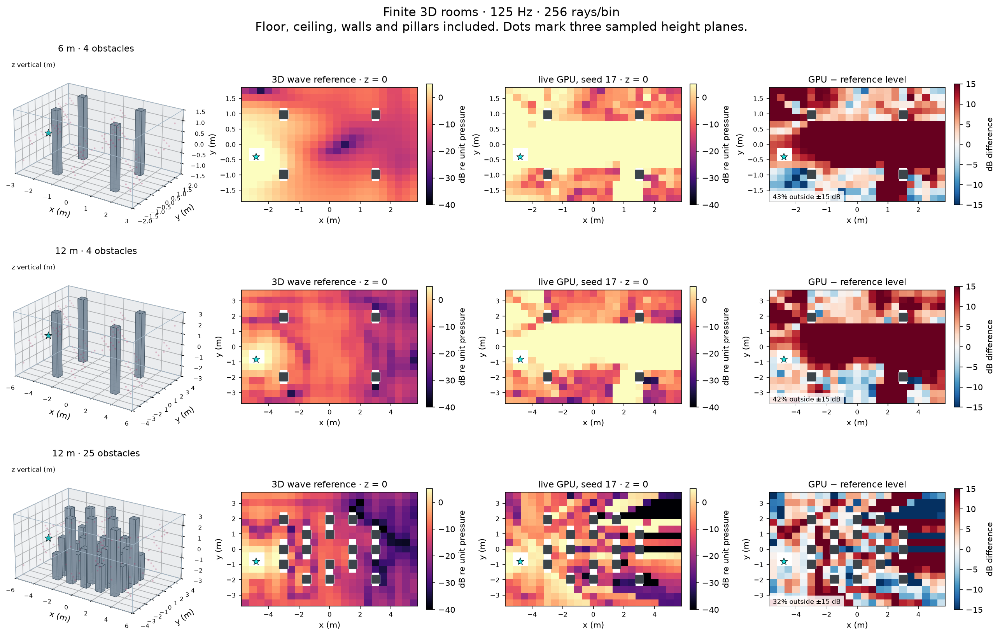

Same pressure color scale on reference/GPU plots. Level-difference colors saturate at ±15 dB; each panel states the fraction beyond that range. Numerical metrics retain all outliers. Every shown cell is an evaluated position, with no smoothing or seed averaging. Solid grey marks obstacles; cyan stars mark the source. The three height planes are static spatial samples, not a simulated walk.

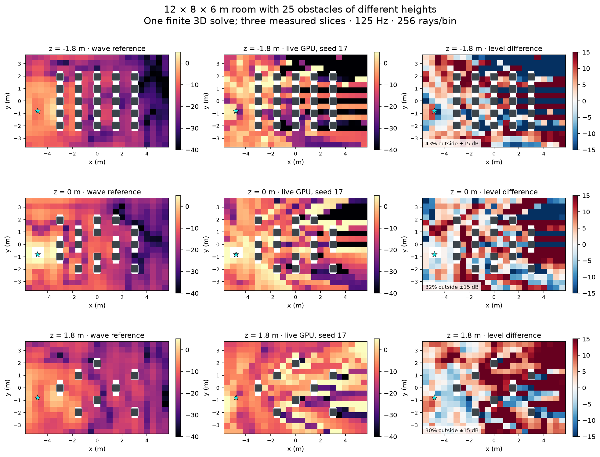

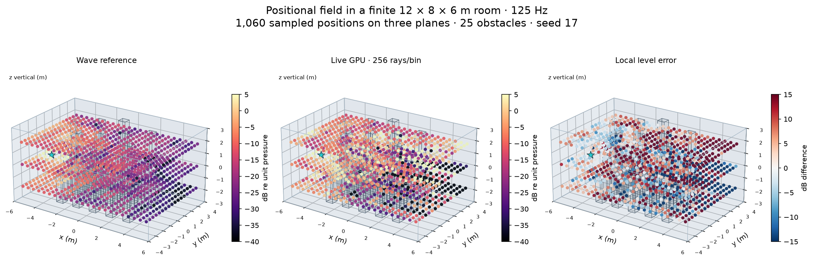

### Measured scaling

| Scene | 16 rays/bin ms | 64 rays/bin ms | 256 rays/bin ms | 16 → 256 complex error |
|---|---:|---:|---:|---|
| planar-1 | 0.423 | 0.414 | 0.420 | 677.42% → 221.14% |
| planar-9 | 0.519 | 0.543 | 0.589 | 1.59e+05% → 41,970.27% |
| planar-25 | 0.647 | 0.734 | 0.747 | 6.7e+09% → 4.22e+08% |
| room-6m-4 | 4.602 | 5.395 | 5.720 | 417.59% → 1,913.38% |
| room-12m-4 | 4.667 | 5.485 | 5.803 | 406.98% → 1,851.89% |
| room-12m-25 | 9.360 | 10.329 | 11.017 | 676.15% → 15,168.53% |

These small GPU jobs have a substantial dispatch/readback floor, so a 16× ray increase is not a 16× latency increase. It does increase attempted path work. Object count also changes occlusion, available edge paths and termination; these timings are measurements, not a proof of logarithmic BVH cost.

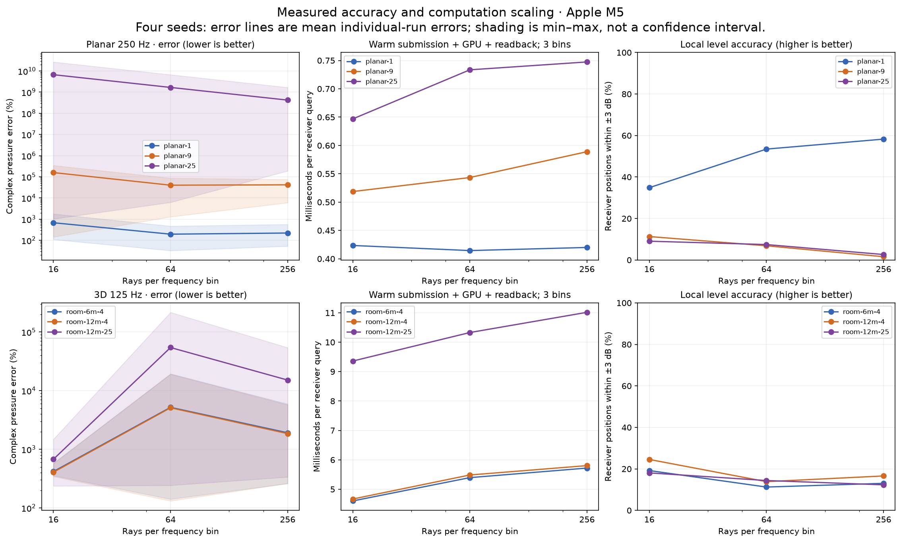

### Independent wave reference and its uncertainty

| Scene | Hz | Fine mesh h (m) | Unknowns | Last mesh change | Wave solve + map s | GPU transport map s at 256 |
|---|---:|---:|---:|---:|---:|---:|
| planar-1 | 125 | 0.35 | 65974 | 0.132% | 15.064 | 0.471 |
| planar-1 | 250 | 0.35 | 65974 | 0.242% | 15.258 | 0.471 |
| planar-9 | 125 | 0.35 | 61870 | 0.339% | 14.069 | 0.586 |
| planar-9 | 250 | 0.35 | 61870 | 0.578% | 13.874 | 0.586 |
| planar-25 | 125 | 0.35 | 62878 | 0.578% | 13.946 | 0.671 |
| planar-25 | 250 | 0.35 | 62878 | 0.655% | 13.669 | 0.671 |
| room-6m-4 | 62.5 | 0.45 | 68429 | 0.121% | 8.761 | 6.577 |
| room-6m-4 | 125 | 0.45 | 68429 | 0.134% | 8.174 | 6.577 |
| room-12m-4 | 62.5 | 0.9 | 67825 | 0.135% | 8.015 | 6.686 |
| room-12m-4 | 125 | 0.9 | 67825 | 0.488% | 8.364 | 6.686 |
| room-12m-25 | 62.5 | 0.9 | 80033 | 0.080% | 8.625 | 11.936 |
| room-12m-25 | 125 | 0.9 | 80033 | 0.260% | 8.021 | 11.936 |

Wave times are CPU assembly/factorization/evaluation for **one frequency and all probes**, with meshing excluded. GPU map time is the sum of measured transport queries for one seed; it computes three bins together. The implementations, frequency counts and scopes differ, so these columns are not a clean algorithmic speedup ratio. Timings are individual low-priority wave runs versus medians of many GPU queries, not precision hardware benchmarks.

Planar reference meshes h = 0.7, 0.5 and 0.35 m use polynomial order four, a 9 m physical radius and a 3 m absorbing layer, plus 48 longitudinal quadrature nodes. Finite 3D rooms use order four and two spatial refinements, h = 0.65/0.45 m for the small room and 1.3/0.9 m for the larger rooms. The observed last mesh change is **not a certified total error bound**. References solve steady-state waves; the ray path depth/support are finite, so the renderer error includes truncation as well as estimator/model error. Materials and the exp(+iωt), exp(-ikr)/r source convention match. No measured real-world truth or broadband accuracy is claimed.

A separate **fixed-resolution** size comparison holds h = 0.9 m, order four and 125 Hz constant: increasing the room from 72 to 576 m³ changes unknowns from 19,185 to 67,825 and wave solve/map time from 0.634 to 8.364 s (13.2×). Two sizes do not establish an asymptotic exponent. Main-table fine meshes use different h, so their similar times alone cannot imply size-independent wave cost.

At fixed wavelength resolution, the number of volume unknowns grows roughly with area in a 2D solve and volume in 3D; sparse factorization adds fill-in and memory costs. The planar point-source reference repeats solves across longitudinal quadrature nodes. The ray loop instead spends work on source–receiver pairs × bins × ray budget × path depth, with visibility traversal, edge proposals and divergence inside each step. Scene size in metres alone is not its cost parameter. The route-enumerating CPU prototype has combinatorial path growth with edge/mirror count and depth.

### Controls and depth/support sensitivity

Empty 3D space agrees with analytic exp(-ikr)/r to 0.000117% complex error. Across the main maps, direct-visibility disagreements with independent analytic pillar/box occlusion total **0**. These controls do not validate the higher-order acoustic estimator.

| Scene subset | Interactions | Support s | Complex error at 256 rays/bin | Query ms |
|---|---:|---:|---:|---:|
| planar-1, 60 probes | 2 | 0.4 | 53.05% | 0.399 |
| planar-1, 60 probes | 4 | 0.4 | 178.49% | 0.405 |
| planar-1, 60 probes | 8 | 0.4 | 251.00% | 0.384 |
| planar-1, 60 probes | 16 | 0.4 | 251.00% | 0.421 |
| planar-1, 60 probes | 8 | 0.8 | 251.01% | 0.414 |
| room-12m-25, 63 probes | 2 | 0.4 | 579.13% | 6.546 |
| room-12m-25, 63 probes | 4 | 0.4 | 21,709.34% | 8.297 |
| room-12m-25, 63 probes | 8 | 0.4 | 21,709.38% | 11.743 |
| room-12m-25, 63 probes | 16 | 0.4 | 21,709.38% | 18.771 |
| room-12m-25, 63 probes | 8 | 0.8 | 21,709.38% | 11.821 |

Subsets use every seventeenth point, selected without looking at errors. Four identical seed IDs and a fixed 256 rays/bin budget are used; changing support changes the sampling distribution, so differences include sampling noise. This is a diagnostic, not a tuned production preset or proof that two interactions are physically sufficient.

In these two subsets the large errors appear by four interactions; increasing depth further or doubling support from 0.4 to 0.8 seconds does not fix them. This makes insufficient late-path support an inadequate explanation for the observed blow-ups. Two-interaction output still has substantial error.

### The slower planar prototype

This is the unchanged Python/double-precision coherent edge-integral experiment: enumerate visible routes, integrate one/two-edge diffraction with guided Sobol samples, and add unfolded mirror/mixed connections through order two. It has **not been implemented for finite 3D**. Samples are per visible route, not a global rays/bin budget; comparing equal numeric budgets to GPU rays would be misleading. A fixed coarse receiver lattice is chosen before inspecting results.

| Layout | Probes | Samples per route | Seeds | Complex error | Shadow error | CPU seconds for subset |
|---|---:|---:|---:|---:|---:|---:|
| planar-1 | 98 | 32 | 1 | 9.49% | 17.58% | 0.107 |
| planar-1 | 98 | 128 | 4 | 3.64% | 14.34% | 0.114 |
| planar-1 | 98 | 512 | 1 | 1.94% | 5.93% | 0.174 |
| planar-9 | 96 | 32 | 1 | 46.56% | 132.22% | 7.126 |
| planar-9 | 96 | 128 | 4 | 26.74% | 82.95% | 8.225 |
| planar-9 | 96 | 512 | 1 | 20.91% | 69.27% | 12.202 |
| planar-25 | 94 | 32 | 1 | 96.08% | 228.97% | 31.782 |
| planar-25 | 94 | 128 | 4 | 57.24% | 152.37% | 34.547 |
| planar-25 | 94 | 512 | 1 | 53.80% | 137.90% | 40.613 |

32/512-sample rows use seed 17 as budget checks; 128-sample rows use all four seeds. These sparse-probe errors cannot be directly ranked against full-map GPU errors. The raw archive retains probe indices for matching comparisons. No interpolation of the sparse prototype samples is treated as a dense acoustic field.

Matched-position check at 250 Hz, four seeds, prototype 128 samples/route versus GPU 256 rays/bin. Time is for the same receiver subset; the GPU calculates three bins and the CPU prototype one frequency, so this is not compute matching.

| Layout | Prototype error | GPU subset error | Prototype s | GPU transport s |
|---|---:|---:|---:|---:|
| planar-1 | 3.64% | 177.71% | 0.114 | 0.046 |
| planar-9 | 26.74% | 53,449.78% | 8.225 | 0.059 |
| planar-25 | 57.24% | 3.46e+08% | 34.547 | 0.071 |

### Consequence for the implementation

1. Do not use the current larger-scene GPU output as a high-fidelity training target. More rays or an audio upscaler cannot establish that its expected pressure is correct.
2. Keep the exact BVH intersection path. The measured geometry/visibility controls pass; changing to SDF would not address these pressure errors.
3. Isolate one-edge, two-edge, reflection/edge and repeated-edge contributions against the existing coherent reference before increasing path depth. Check probability compensation, singular angular terms and cancellation at shadow boundaries. The present measurements locate the failure in acoustic estimation but do not prove one exact faulty line.
4. Require larger-scene stability and agreement in matched planar fixtures before transferring the coherent prototype to finite 3D. Retain phase, finite edge extent, material reflection and an honest path-support convergence check.

### Evidence and reproduction

[Raw measurements and benchmark scripts](benchmarks/spatial-accuracy-2026-10-20.zip) · [Unrounded result ledger](benchmarks/spatial-accuracy-2026-10-20.json).

The original combined batch wrote all 149,028 pressure rows and completion markers, then Unity marked it failed for exceeding its 180-second test timeout. That XML is retained. A follow-up with **17 separate tests passed**; 1,736 pressure values at fixed spatial subsets reproduced exactly, and every full map passed row-count, finite-value and point-order checks. The failed wrapper is not reported as a passed test.

Measured runtime commit `1d847f9fe0be7857031668624c476f173f0784fd`. Production shader/source hashes are in the GPU provenance files. The only temporary fixture change selects diffraction-on measurements; it calls the existing transport solver. Temporary Unity fixtures are removed after each batch. All raw files live in `.context/spatial-accuracy/`: scene JSON, wave NPZ/metadata, GPU CSV/XML/log/provenance, support runs, prototype fields and timings, and plotting/report scripts. `summary.json` stores unrounded metrics; the tracked benchmark ledger includes those metrics plus controls/support results.

Reproduce in a fresh output directory using the supplied `run.py` preparation/reference/GPU stages, then `prototype.py`, `analyze.py` and `plot.py`. The isolated runner must match the current runtime byte-for-byte and be closed. Scripts refuse to overwrite key measurement outputs. Numerical libraries are optional offline dependencies, not Unity/runtime dependencies.


## SDF versus BVH: measured 2D GPU geometry queries — 2026-10-20

**Keep the existing intersection approach for now.** The straightforward analytic and cached-grid SDF versions were slower on the larger cases and failed some geometry checks. Direct analytic box intersections are a promising simpler candidate for authored boxes; this test does not establish their performance on general meshes or rotated/moving objects.

These are **geometry-query measurements on the Apple M5 GPU using Metal**, separate from the earlier CPU diffraction maps. No wave transport, diffraction sampling, materials, frequency bins, audio synthesis or readback of acoustic responses is included. No runtime code was changed. Unity ran in the isolated batch runner with audio disabled and one worker; each final test suite took only seconds of benchmark execution.

All methods receive identical XY rays and axis-aligned box geometry. The segment and BVH kernels use the current production `Geometry.hlsl` and BLAS/TLAS construction. The independent oracle intersects boxes in double precision. A 0.1 mm closest-hit distance error is recorded as a failure. Closest-hit and any-hit occlusion queries are measured separately.

### Original environments

Median milliseconds for **4,096 closest-hit queries**. Each timing is submission plus GPU completion and a one-element readback, divided by eight dispatches. Seven batches are interleaved across methods after warmup. These are not isolated GPU timestamps. The write-only timing control is about 0.016–0.037 ms in these original/scaling rows; differences near that floor are not reliable speed rankings.

| Scene | Segments | Existing BVH | Direct boxes | Analytic SDF | Grid SDF + fallback |
|---|---:|---:|---:|---:|---:|
| One wall | 0.022 | 0.026 | 0.022 | 0.042 | 0.060 |
| Staggered | 0.024 | 0.029 | 0.022 | 0.101 | 0.164 |
| Slit | 0.019 | 0.031 | 0.025 | 0.036 | 0.047 |
| Corridor | 0.028 | 0.022 | 0.017 | 0.056 | 0.090 |

### Object-count scaling

The world stays 32 × 32 m for ray origins, boxes stay 0.36 × 0.70 m, and the same ray set is used throughout. Object sets are nested subsets of a shuffled 16 × 16 layout. Increasing object count also changes occlusion and how soon rays stop; this is measured scene scaling, not a fitted asymptotic complexity proof. Values are milliseconds for 4,096 closest-hit queries.

| Boxes | Segments | Existing BVH | Direct boxes | Analytic SDF | Grid SDF + fallback |
|---:|---:|---:|---:|---:|---:|
| 1 | 0.026 | 0.029 | 0.026 | 0.031 | 0.034 |
| 4 | 0.021 | 0.030 | 0.023 | 0.036 | 0.049 |
| 16 | 0.044 | 0.042 | 0.016 | 0.099 | 0.111 |
| 64 | 0.103 | 0.067 | 0.031 | 1.825 | 1.952 |
| 256 | 0.336 | 0.117 | 0.056 | 33.334 | 34.384 |

At 256 boxes, analytic SDF took **285× the existing BVH time** in this implementation. Direct box tests used **48% of the BVH elapsed time**, but use a simpler shape representation and do not support arbitrary meshes. These are query-level ratios, not whole-renderer speedups.

### Ray-count scaling and occlusion

At 256 boxes, using nested prefixes of the same ray set:

| Rays | Segments | Existing BVH | Direct boxes | Analytic SDF | Grid SDF + fallback |
|---:|---:|---:|---:|---:|---:|
| 256 | 0.338 | 0.120 | 0.052 | 2.637 | 2.837 |
| 1024 | 0.338 | 0.114 | 0.055 | 4.089 | 4.339 |
| 4096 | 0.336 | 0.117 | 0.056 | 33.334 | 34.384 |

At 256 boxes / 4,096 rays, the corresponding **occlusion** times are: Segments 0.338 ms, Existing BVH 0.067 ms, Direct boxes 0.054 ms, Analytic SDF 33.238 ms, Grid + exact fallback 34.475 ms. The BVH can terminate on any obstruction.

More rays do not produce a clean linear timing curve here: small jobs approach the synchronization floor and GPU parallelism, while larger random-ray sets expose longer SDF walks. At 256 boxes / 4,096 rays, analytic SDF averaged about 22 distance evaluations but the longest ray needed 2,825. At 64 boxes the maximum was 607. Those long walks are consistent with the large timing increase; we did not collect hardware counters to assign an exact fraction to divergence versus memory or arithmetic.

### Correctness and grazing rays

The three exact-intersection controls passed all **87,808 query checks per method**, including reused query prefixes. Both SDF variants produced 7 false hits among the original corridor's 4,096 queries, plus one false hit in the 256-box ray set. They also exceeded the 0.1 mm hit-distance threshold on some grazing hits (up to about 0.98 mm). These are candidate failures; the benchmark harness passing does not mean the SDF implementations passed geometry equivalence.

A separate control travels 20 m parallel to one wall; 256 identical rays are used to isolate the distance-to-wall effect. Every correct answer is a miss. The hit tolerance is 10 micrometres and the explicit safety limit is 4,096 steps. Reaching that limit returns **unresolved**, never a fabricated miss.

| Wall clearance | Analytic SDF steps | Analytic SDF time | Grid SDF time | Result |
|---|---:|---:|---:|---|
| 1 m | 20 | 0.027 ms | 0.026 ms | Correct misses |
| 5 cm | 401 | 0.068 ms | 0.112 ms | Correct misses |
| 5 mm | 4,001 | 0.408 ms | 0.866 ms | Correct misses |
| 0.5 mm | 4,096 | 0.420 ms | 0.879 ms | 256/256 unresolved |
| 5 micrometres | 1 | 0.022 ms | 0.017 ms | 256/256 false hits |

The 0.5 mm result is censored at the safety limit, not the time needed to finish the march. A smaller hit tolerance alone also does not fix long near-parallel walks. The exact intersection controls remain around the timing floor on this control.

### What was implemented and how it scales

- **Segments:** test the four wall segments per box using the current shader. Worst-case work grows with rays × objects, before any-hit early exits.
- **Existing BVH:** use the production object hierarchy and local mesh trees to skip primitives. Cost depends on traversal/overlap and primitive tests; logarithmic timing is not guaranteed.
- **Direct boxes:** solve the entry/exit intervals along X and Y directly. Still a linear object scan, but one compact analytic test per box. This is an experimental comparator, not a production replacement.
- **Analytic SDF:** at every march step, evaluate the exact box-distance formula for every object and advance by the minimum. Work grows with rays × distance evaluations × objects, with GPU latency sensitive to long walks.
- **Cached grid SDF:** bake a 512 × 512 float field over a 128 × 128 m domain (0.25 m cells, **1 MiB**). A sampled distance minus the distance to its cell center gives a conservative mathematical lower bound. Within one cell width, or outside the grid, fall back to exact analytic distances. This preserves the same geometry rather than silently rounding walls to the grid. Empty-space steps avoid the object loop; near-wall steps retain it, which explains why this cache does not remove the difficult cases. Float precision and the same hit tolerance still apply.

Grid bake/synchronization is measured separately in the raw ledger and excluded from query times; it ranged from 0.221 ms to 14.401 ms including first-use setup. Use the final ledger for exact per-case bake times. Shape storage for direct boxes/analytic SDF is 16 bytes per box; the grid adds 1 MiB. At 256 boxes that is 4 KiB of shape data before the grid. Mesh/BVH buffer sizes and CPU build timings are also recorded; this run does not measure moving-object updates, sparse grids, hierarchical SDF sampling, or an SDF nearest-distance BVH.

**Decision:** pursue the simple bounded acoustic ray loop using precise geometry intersections. An analytic box leaf inside the existing hierarchy is a reasonable next isolated experiment, since it could reduce primitive-test work without replacing diffraction or scene semantics. It has not been integrated or benchmarked in the full renderer. These results reject promoting the two tested SDF prototypes; they do not establish that every optimized SDF approach is slower.

### Evidence and reproduction

[Committed measurements and hashes](benchmarks/sdf-scaling-2026-10-20.json). Raw final data are `.context/sdf-bench/run03/results.json`, with 43 fixtures, seven timing samples per method, correctness counts, failure examples and step distributions. `run03/manifest.json` records hashes of the fixture, compute shader and reused production geometry/BVH files. `run03/tests.xml` records the successful harness execution. The earlier `run01` is the initial analytic-only comparison; `run02` is superseded because instrumentation lost miss-step counts. A common output write and explicit minimum-step/known-distance checks validate the final counters. Earlier runs remain available and are not pooled into the headline timings.

Reproduce with `.context/sdf-bench/run.py NEW_OUTPUT_NAME` from the main repo; it refuses to overwrite a run, stages only the temporary fixture/shader in the closed runner, disables audio, and removes staged files afterward. The current renderer and shaders remain unchanged.

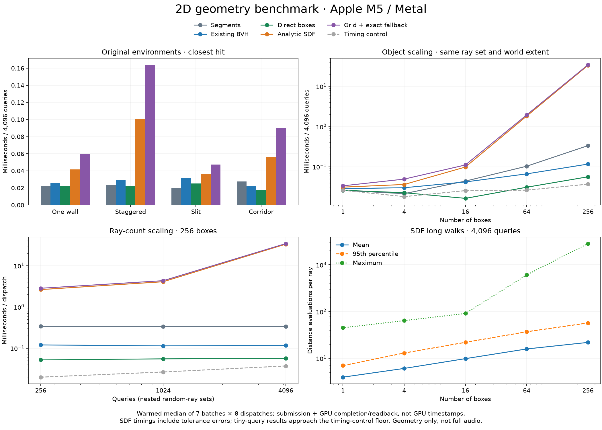

## Transport candidate audit — 2026-10-20

Implemented and measured all six candidates at their supported scope. **Only the surface pressure-weight correction is enabled in Unity.** The other methods are opt-in offline experiments. Baseline code remains at `c309d6b`. [Measurements, hashes and rejected variants](benchmarks/transport-candidates-2026-10-20.json).

The runtime divides surviving pressure coefficients by their event probabilities for legacy transmission/reflection/scattering choices. It removes the optical Schlick adjustment to the configured transmission fraction and handles total internal reflection before selecting a branch. Complex opaque impedance coefficients remain unchanged. A common debug-write point restores transmitted segments absent from the previous early-continue capture path. The contract is `integrated-edge-pressure-preview-v9`. Energy-only controls still do not determine physical reflection phase or a validated coherent diffuse law; this correction does not resolve those limitations.

**Verification:** 40/40 silent Metal cases passed: branch weights in 2D/3D, impedance phase, mirrors, propagation through media, diffraction, moving-edge Doppler, debug/audio agreement and CPU/GPU synthesis. Paired rigid-scene arrival arrays were unchanged. A tiny warmed solve/readback benchmark (5 bins, 128 rays/bin, four bounces, 41 alternating calls) measured **0.445 → 0.521 ms** for rigid diffraction and **0.436 → 0.446 ms** for legacy surfaces. This is a correctness fix with measured overhead, not a speedup. An extra opaque-material branch optimization was slower and was reverted. No windows, speakers or microphone were used.

| Candidate | Implementation | Result / disposition |
|---|---|---|
| Pressure weights | GPU branch compensation and transmission-debug repair | Retained in runtime. General diffuse normalization remains unvalidated. |
| Missing mirror/edge connections | Unfold mirror runs between edges and validate every physical segment; includes mirror→edge→mirror and edge→mirror→edge | Reciprocity passes through mixed order 3. Extra paths reduce some spatial jumps but worsen two-wall shadow error and cost much more. Offline only. |
| Better edge integration | Analytically integrate a Lorentzian angular-peak approximation, sample its signed complex residual; condition the final edge on the preceding sample | Improves the one-wall 256-sample ablation, but not universally at comparable elapsed cost. Opt-in `--control-variate`. |
| Weak-path termination | Roulette on continuation-weight magnitude with exact survival reweighting and stable sample dimensions | 32-scramble mean checks pass, including combination with residual integration. About 3.6–3.9% fewer edge-kernel evaluations in the walks, without a reliable speed/quality win. Opt-in `--roulette`. |
| Repeated reflection families | Closed or finite-support sums of four axial image families, including complex reflection loss and endpoint coupling | Matches 512 explicit round trips to `1.18e-14` relative error. Finite lossless support and a source at a modal node pass. This is a 1D plane-wave control, not general room-mode detection. |
| Local wave scattering | Object-local cylindrical-harmonic scattering operator, reused across source evaluations; longitudinal integration for point-extruded sources | Refined independent 2D FEM differs by 0.0097%. A 17-mode line-source operator differs from the exact series by 0.0127%; point-extruded series/quadrature controls also pass. Isolated rigid cylinders only; arbitrary meshes and multi-object coupling remain unimplemented. |

Walking ablations use 250 Hz, 31 positions/scene, four scrambles and 256 samples **per route**, with pure diffraction through order 2. Mixed-order-3 adds mirror-containing paths, not all third-order paths. The reference is the previously refined FEM point-source/infinite-extrusion field. No amplitude fitting, clipping, temporal smoothing or reference damping is added.

| Method | One-wall complex error | Two-wall complex error | Two-wall shadow error | Two-wall residual-jump p99 |
|---|---:|---:|---:|---:|
| Baseline route sampler | 3.71% | 15.30% | 54.15% | 0.1606 |
| Peak residual integration | 2.88% | 15.13% | 53.08% | 0.1538 |
| Extra mixed paths | 3.71% | 14.66% | 66.27% | 0.1074 |
| Roulette, scale 0.2 | 3.72% | 15.32% | 54.12% | 0.1603 |

Equal samples are not equal compute. In a **16-scramble budget sweep**, one-wall residual integration at 256 samples took 29.5 ms/walk with 3.39% error; plain sampling at 512 took 30.7 ms with **2.86%** error. For two walls these were 88.5 ms / 15.73% versus 94.1 ms / 15.79%. At 1,024 plain samples the two-wall error remained 15.52%. Neither residual integration nor extra sampling resolves that model mismatch. At 64 samples the residual estimator slightly worsened two-wall error/jumps. Python timings include geometry/connections and are not GPU predictions or realtime audio measurements.

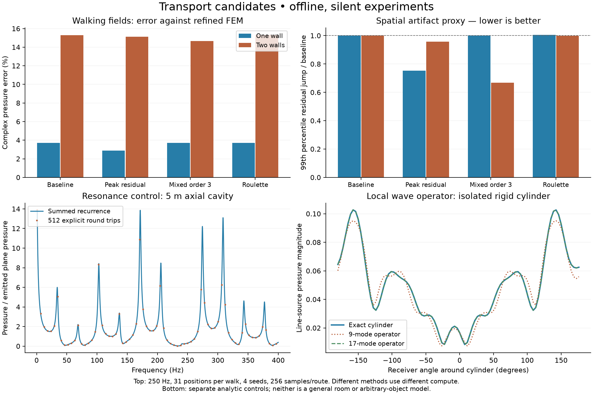

`tools/edge_integral.py --validate` runs 24 numerical controls. Defaults are unchanged; select `--samples N --control-variate`, `--roulette SCALE`, and `--mirror-depth 3` independently. It still enumerates routes for diagnosis, not scalable runtime use.

```sh
python tools/edge_integral.py OUTPUT.json --validate
python tools/transport_candidates.py axial OUTPUT_STEM
python tools/transport_candidates.py cylinder OUTPUT_STEM --fem
python tools/transport_candidates.py edges OUTPUT_STEM --scene SCENE.json --reference REFERENCE.npz --indices 0 1 2 --samples 256
```

Use fresh output paths and the existing scientific Python environment. The last command requires the matching stationary rigid 250 Hz point-extruded reference and verifies its scene hash. Use `OPENBLAS_NUM_THREADS=1 VECLIB_MAXIMUM_THREADS=1 OMP_NUM_THREADS=1` and reduced process priority. Raw controls, ablations, the GPU timing fixture and rejected trials are under `.context/transport-candidates/`. The closed Unity runner is under `.context/gpu-audio/runner/`.

## Minimal planar diffraction sampling — 2026-10-19

**Direction: 2D only.** A small offline prototype improves route sampling while retaining the existing signed wedge kernel. It is not installed in the realtime shader, and does not establish artifact-free audio. The current 2D convention remains a point source around infinitely extruded XY walls; the independently solved FEM references use the same convention.

The useful heuristic is **where to spend samples**, not a fitted loudness or delay. Enumerate all geometrically visible edge chains through the requested order, reject routes that cannot fit the physical delay horizon, then sample each complete chain. Knowing the next edge before sampling the current height avoids the earlier mismatch between a listener-guided first height and a subsequently chosen edge. Each conditional proposal mixes angular peaks of the current and preceding interaction. The complete normalized density remains in the pressure weight.

A scrambled Sobol pattern spreads samples through the joint height domain; reuse the same pattern as the receiver moves. Sampling half the symmetric height domain avoids redundant work. No shortest-route-only selection, per-scene gain, pressure clipping, frame averaging, or artificial rolloff is used. Higher orders are configurable; repeated edges after another edge remain possible. This is an experiment in the existing `tools/edge_integral.py`, using its current NumPy/SciPy dependencies and existing mirror-path code. There is no new runtime component, buffer, UI or shader variant.

```text
for each visible corner chain through configured order:
    reject if its minimum travel time exceeds the existing delay horizon
    for each persistent sample in the chain's joint sampling pattern:
        sample heights using the whole route and preceding angular peaks
        pressure = signed wedge kernels × spreading / joint proposal density
        accumulate pressure × exp(-i × 2π × frequency_Hz × physical travel time)
sum with direct, mirror, and supported mixed mirror/edge paths
```

This follows the secondary-edge-source path integral already used by the renderer, rather than inventing an amplitude model. [Antani et al.](https://gamma-web.iacs.umd.edu/BTM/FromRegion.pdf) describe visibility culling and multi-edge integration. The prototype uses SciPy's scrambled Sobol implementation with complete power-of-two sample sets, consistent with its [documented balance requirements](https://docs.scipy.org/doc/scipy/reference/generated/scipy.stats.qmc.Sobol.html). This specific proposal and allocation are our experiment, not an accuracy guarantee from those papers.

### Measured sampling improvement

Matched CPU implementations: same routes, same physical kernel, same two-edge-order limit, same mirror connections, **256 samples per route**, 16 seeds, 31 receiver positions and 250 Hz. Only ordinary random samples versus Sobol samples change. Error is relative complex-pressure L2 against the wave field; jumps are p99 changes in the complex residual along the walk.

| Walk | Random error | Guided Sobol error | Random residual jump | Guided residual jump |
|---|---:|---:|---:|---:|
| One thick wall | 5.70% | **3.97%** | 0.0473 | **0.0312** |
| Two staggered walls | 17.22% | **15.78%** | 0.1878 | **0.1631** |

Shadow-only errors remain **16.90% and 55.12%**, respectively. There were no exactly silent shadow samples in either method. At 64 samples per route the two-wall p99 jump slightly worsens (0.1902 → 0.1924), despite improved field error; more even sampling is not a universal artifact cure. Comparisons to the previous GPU walk are not compute matched: that renderer samples route discovery, uses four bounces, and lacks these general mixed specular connections. Do not describe its much larger errors as a measured GPU speed/quality gain from this prototype.

The 256-sample pure-edge work upper bounds average **1,363 and 3,336 kernel evaluations per point/frequency**, before visibility and mixed connections. The budget is per route, not per source/listener pair. Exhaustive route enumeration grows quickly with geometry and order. CPU wall times are recorded in the ledger; they are Python timings with system-load variation, not realtime GPU predictions.

A paired four-seed ablation uses the same samples and keeps the first two orders unchanged while adding orders three/four. One-wall error improves 4.18% → 3.75%, but two-wall error worsens **15.64% → 17.26%** and residual jumps worsen. The corresponding pure-edge work bounds grow by approximately 11× and 34×. We retain configurable order, but do not promote more bounces as a solution: the experiment still omits mixed reflection/edge classes above total order two.

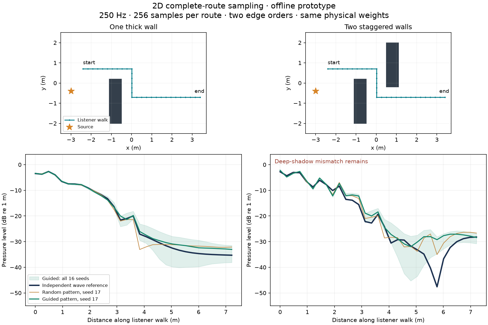

### Broader development scenes

All existing grid probes, four seeds, 256 samples per route, two edge orders, 250 Hz. These are separate full-map results, not the walk scores above. No held-out validation/test family was inspected.

| Scene | Probes | Whole-field error | Shadow error |
|---|---:|---:|---:|
| Thick wall | 531 | 2.60% | 11.67% |
| Staggered walls | 487 | 9.17% | 34.34% |
| Slit | 509 | 3.83% | 18.96% |
| Open corridor | 461 | 13.83% | 29.16% |

All **7,952 field samples** are finite; none of the **4,072 shadow samples** is exactly silent. The FEM references' last mesh changes range from 0.067% to 0.305%; earlier reference qualifications still apply. This is evidence of a useful candidate, not validation across frequencies, arbitrary materials or enclosed rooms.

### Reference repair and checks

A new near-boundary check exposed a defect in the old deterministic edge diagnostic: it split a narrow angular peak only out to eight peak widths, then jumped to a much wider phase panel. Both low quadrature orders could miss its tail. Geometrically spaced panels now resolve the peak continuously out to the domain boundary. For two probes 2 micrometres apart across the canonical half-plane shadow boundary, the false total-pressure change falls from **0.02346 to 0.0000006663**. This repairs the edge diagnostic; the independent FEM wave reference and live shader were not changed.

**15 numerical controls pass**, including sampled normalization/phase against refined integration, two-edge refinement/reciprocity, mirror distances, and shadow-boundary cancellation. At 65,536 samples per route, the canonical second-order integration error is below 0.18% through 250 Hz; these high-sample controls are not the 256-sample performance setting. A separate 203-position half-plane crossing at 256 samples has 0.86% complex error against the repaired integral. This checks stationary field continuity; it does not test streaming audio, HRTFs, moving-wall Doppler or audible clicks.

The repaired quadrature is also rechecked against both earlier 31-position refined walks. CLI export and protection against overwriting measurements are exercised. No Unity process, game window or speaker output was used.

Reproduce with the existing optional scientific environment and a fresh output stem:

```sh
OPENBLAS_NUM_THREADS=1 VECLIB_MAXIMUM_THREADS=1 OMP_NUM_THREADS=1 \
  nice -n 15 .context/wave-planar/venv/bin/python tools/edge_integral.py \
  .context/route-repeat --scene .context/wave-planar/staggered/scene.json \
  --points 240 270 300 196 190 --samples 256 --depth 2 --seed 17 --hz 250
```

Omit `--samples` for refined integration, or use `--validate` with a fresh JSON output path for the controls. NPZ output retains complex pressure by edge order, mirror connection classes, receiver positions and route counts. JSON records configuration, source/scene hashes and a declared pure-edge work bound. Raw repeats, arrays, controls and measurement scripts are under `.context/edge-minimal/`; the existing benchmark ledger contains `guidedPlanarRoutes`.

**Decision:** keep this as the minimal offline candidate. A runtime port should reuse `Edges`, `EdgeKernel` and `RayPath`, with measured bounded route work and the same physical weights. Before replacing the live path, require matched GPU time, dense temporal/broadband checks and better mixed-path completeness in the difficult two-wall shadow. We have not yet demonstrated sufficiently realistic deep-shadow audio or realtime performance.

## Planar edge estimator audit — 2026-10-19

**The large runtime artifacts are not fixed.** The new deterministic diagnostic separates integration noise from missing physical paths. Three sampling trials were measured and rejected; their shader variants stay under `.context/edge-audit/`. The retained runtime edit preserves the preceding edge vertex directly instead of reconstructing it from a rounded direction and distance. It is a numerical repair, not an audible artifact improvement: the 16-seed walk changes only about `3.5e-7` in relative response norm at 128 rays/bin.

`tools/edge_integral.py` evaluates stationary rigid boxes in the same point-source/infinite-extrusion model as `Planar2D`. It enumerates visible one-edge and two-edge chains and integrates their heights with double-precision quadrature, splitting panels around angular peaks and clipping the integration domain to the exact 0.1-second path-length horizon. It does not use the GPU's random sampler or proposal density. Source normalization, signed pressure, complex propagation phase and shared-solid-face multiplicity match the declared edge model. This is an independent integration of that approximation, not an independent wave solver.

The same helper unfolds and validates direct, first/second mirror, mirror–edge and edge–mirror paths. Every physical segment must be clear. These mixed paths exist in the **offline diagnostic only**; the runtime still lacks the corresponding general specular connections. The helper is restricted to disjoint rigid XY boxes, stationary source/probes at z=0, and the tested nondegenerate geometries. Exact corner-grazing total-field limits, arbitrary materials, moving boundaries and 3D transfer remain outside its validation.

Nine numerical controls pass: half-plane DC/complex pressure, two-edge refinement at three frequencies, two-edge reciprocity, analytic one/two-mirror distances, and nonzero mixed-path reciprocity. The GPU's existing half-plane, shadow-boundary, second-order/transformed geometry, moving-edge, transparency and debug checks also pass: **16 focused cases**. These controls establish their stated contracts, not overall acoustic realism.

The matched one-wall and two-wall walks each contain 31 measured positions at 250 Hz. Quadrature orders 8 and 16 agree to less than **0.00005%** in edge-response norm on both walks. Against the previously validated FEM wave fields:

| Offline diagnostic | Whole-walk complex error | Shadow complex error |
|---|---:|---:|
| One wall, direct + first mirror + edge orders 1–2 | 2.00% | 6.30% |
| Two walls, direct + first mirror + edge orders 1–2 | 21.58% | 62.17% |
| Two walls, also mirror–edge / edge–mirror and second mirrors | 15.42% | 53.14% |

The extra mixed paths improve the two-wall field but do not recover its deep interference minimum. Nor does the smaller field error guarantee a smaller residual jump at every position: the two-wall residual-jump p99 rises from 0.114 to 0.135 pressure units in this comparison. The refined Python integrations take 10.41 seconds for the one-wall walk and 27.17 seconds for the two-wall walk on one numerical thread. They are diagnostic controls, **not realtime implementations or compute-matched competitors**. The figure shows one explicit GPU seed; the ledger retains all seeds and outliers.

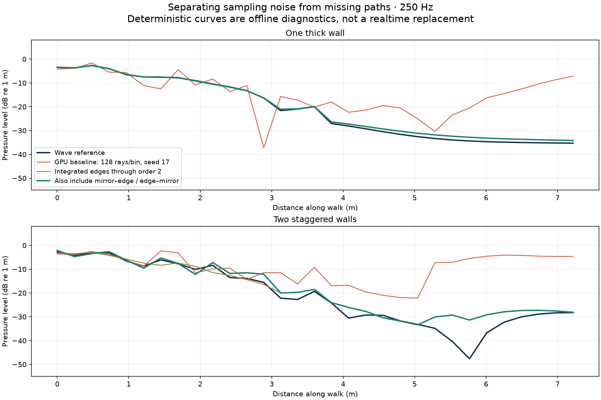

The GPU fixture now optionally writes `path-orders.csv` beside the existing total-response CSV. Slots distinguish direct sound, the separate first-mirror estimator, and subsequent bounce contributions, including arrival count and largest absolute path weight. For these rigid fixtures, those bounce contributions are pure edge paths. Summing the exported slots reproduces every recorded total within `1e-9`. The fixture also handles an omitted `receiverMotion` correctly: Unity can instantiate that optional object with a null velocity array.

Five-probe, four-seed measurements at 128/8,192 rays/bin identify large third/fourth-edge outliers. At the final two-wall walk point, the deterministic second-order result has magnitude 0.03947; the wave value is 0.03883. Individual low-budget second-order contributions reach 0.597. At 8,192 rays, the second-order average approaches the integral, while third/fourth-order spread remains large. This supports a sampling-variance diagnosis for those terms, not a claim that all higher-order physics is correct.

The broader trial uses both walks, 16 seeds, 8/128 rays per bin and four bounces. Settings are changed one proposal at a time:

| Proposal | Measured reason for rejection |
|---|---|
| Uniform reservoir of reachable planar edges | Five-probe 128-ray relative field error increases from 211% to 608%; a fourth-order contribution grows from below 0.6 to above 4.6. |
| Reachable edges plus an incoming/outgoing angular mixture | At 8 rays, one-wall silent shadow samples increase from 114 to 182 of 320. At 128 rays, the two-wall maximum pressure increases from 11.36 to 14.55. |
| Local/global reachable-edge mixture plus incoming angular mixture | One-wall 128-ray error improves from 176% to 60%, but two-wall error worsens from 422% to 473% and maximum pressure increases to 18.73. |

The original renderer's newly expanded 16-seed sweep also exposes a much worse 8-ray outlier: pressure magnitude 184.14. Earlier four-seed plots did not contain that seed. The trials preserve these failures. Equal-ray measurements are **not matched-time speedups**; warm submission/readback medians vary between approximately 0.4 and 0.9 ms across these short runs. The visibility trials additionally scan scene edges per sample and would need a separate scaling study before adoption.

**Next gate:** a continuation proposal must account for the complete edge chain, including how an earlier height was sampled before its next edge was known. Local visibility and a conditional proposal for only the next height do not reliably control that product. Compare a joint-chain sampler or deterministic low-order control with a sampled residual against the new order-resolved integrals before promoting it. General runtime specular–edge connections, higher-order convergence, temporal artifact repair and DLSS training remain unfinished. No failing sampler or gain clipping was added to production.

The existing [measurement ledger](benchmarks/planar-wave-2026-10-18.json) contains `edgeEstimatorAudit`: **14,208 measured responses from 11 successful GPU jobs**, per-method errors/dropouts/jumps, hashes, numerical controls and test counts. Raw inputs, CSV/NPZ/XML, failed setup logs and candidate shaders are under `.context/edge-audit/`. All jobs used silent batch mode, a closed isolated Unity runner and low process priority; numerical work used one thread.

Reproduce the numerical controls and selected probes with the existing optional scientific environment:

```sh
export OPENBLAS_NUM_THREADS=1 VECLIB_MAXIMUM_THREADS=1 OMP_NUM_THREADS=1
export PYTHONDONTWRITEBYTECODE=1
nice -n 15 .context/wave-planar/venv/bin/python tools/edge_integral.py \
  .context/edge-repeat/validation.json --validate
nice -n 15 .context/wave-planar/venv/bin/python tools/edge_integral.py \
  .context/edge-repeat/probes-q16 --scene .context/wave-planar/staggered/scene.json \
  --points 240 270 300 196 190 --order 16 --hz 250
```

Use a fresh output stem, repeat at another quadrature order, and compare complex responses. Set `"decompose": true` in a GPU measurement scene JSON to export the path-order breakdown through the existing `tools/compare_wave_field.py renderer` command. It does not change the transport workload or add runtime buffers.

## Complex materials and finite room references — 2026-10-19

The renderer now supports **complex local boundary admittance** through the existing transport and both CPU/GPU audio methods. Unity materials expose ordered real/imaginary admittance knots. Reflection uses the incidence angle and preserves negative and reactive phase, while propagation stays on its physical travel-time clock. Existing energy materials retain their behavior. Take v4 authenticates the added fields; actual historical v1/v3 manifests and v1–v4 round trips remain readable.

`tools/room_wave.py` adds eight small, finite 3D diagnostic scenes: low-loss box, resistive box, resonant surface, treated ceiling, coupled rooms, L-shaped room, corridor and simplified church. It reuses the existing scientific environment and Unity measurement fixture. The FEM reference solves the reflected field with an exact analytic monopole, physical wall boundaries and no PML escape path. The GPU receives the same inner boundary/materials, enclosed by an opaque outer shell to preserve solid winding. No new runtime solver framework or UI is added.

Independent controls check complex plane-wave reflection and a rectangular-room Green function summed independently of FEM/ray tracing. Refined worst relative errors are **0.03737%** for the impedance controls and **0.00620%** for the rigid-room controls. The modal sum itself changes by less than 5.5e-10 under truncation refinement. Each scene is additionally refined in mesh and polynomial order; a small solver residual alone does not approve a reference.

The pilot records 62.5/125 Hz at 33 ordered probes, with two seeds and 16/64 rays per bin, and diffraction off/on measured separately. GPU timing covers all 33 configured FFT bins (4 kHz sample rate, FFT size 64), eight bounces and 0.4 s support, not just the two reported frequencies. Each FEM solve also evaluates a two-second receiver walk directly at 2,001 positions. Raw complex-pressure NPZ arrays, CSV renderer samples and JSON provenance preserve phase and physical levels. Reports include field error and changes in the complex residual along the walk. These measurements exclude HRTF, DSP, output limiting and microphone/network transport.

All eight GPU measurements completed: **4,224 complex-pressure samples**, with **39 distinct focused Unity checks passing** across the final reruns. The 30 numerical control measurements are retained; all refined controls pass. The 67 reference solves include mesh/order refinement; the worst final mesh change is **0.2626%** across both the sparse probes and dense walk. This is observed numerical convergence, not a rigorous real-world error bound.

The diffraction-enabled baseline gives the following complex relative errors (RMS across two frequencies and two seeds). Lower is better; these are field errors, not perceptual scores:

| Room | 16 rays/bin error | 64 rays/bin error | 64-ray solve/readback |
|---|---:|---:|---:|
| Room | 198.1% | 298.2% | 5.15 ms |
| Resistive | 47.9% | 53.9% | 5.09 ms |
| Reactive | 87.9% | 156.2% | 5.04 ms |
| Treated | 197.2% | 240.2% | 5.07 ms |
| Coupled | 498.2% | 270.9% | 5.61 ms |
| Elbow | 426.8% | 349.7% | 4.51 ms |
| Corridor | 110.2% | 93.3% | 4.42 ms |
| Church | 834.9% | 452.6% | 7.55 ms |

The renderer remains far from the numerical field. The magnitude plots show abrupt changes where the wave reference is smooth; no per-method level adjustment was applied. Two seeds cannot establish asymptotic bias or rank close alternatives, and more rays do not consistently improve these runs. Code inspection identifies missing higher-order specular connections and triangle-dependent first-mirror selection as concrete next targets. Correct complex wall reflection does not by itself reconstruct a room's full standing-wave field.

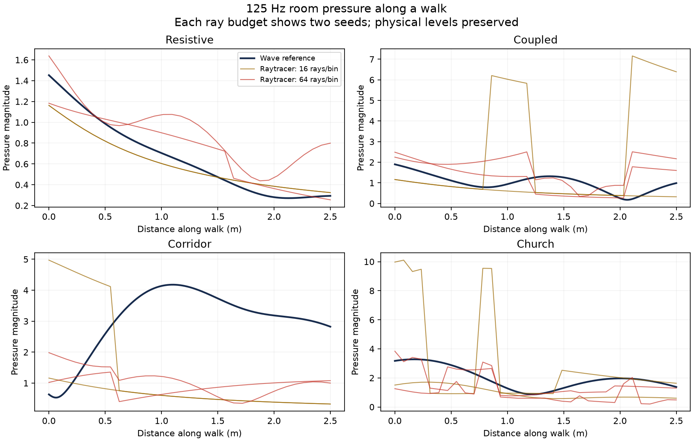

The [existing measurement ledger](benchmarks/planar-wave-2026-10-18.json) now contains `roomWavePilot`, including diffraction-off controls, hashes, costs and test counts. Raw arrays/CSV/XML are under `.context/wave-study/rooms-v2/`. These results are a baseline for kernel correction; they do not approve the current raytracer as a training teacher.

Reproduce in a fresh directory, using the existing closed batch runner:

```sh
# Optional Python environment: numpy, scipy and ngsolve==6.2.2608.
export OPENBLAS_NUM_THREADS=1 VECLIB_MAXIMUM_THREADS=1 OMP_NUM_THREADS=1
.context/wave-planar/venv/bin/python tools/room_wave.py prepare .context/rooms-repeat
.context/wave-planar/venv/bin/python tools/room_wave.py validate .context/rooms-repeat
.context/wave-planar/venv/bin/python tools/room_wave.py reference .context/rooms-repeat/room
.context/wave-planar/venv/bin/python tools/room_wave.py reference .context/rooms-repeat/room --mesh .45 --order 4
.context/wave-planar/venv/bin/python tools/compare_wave_field.py renderer .context/rooms-repeat/room \
  --runner .context/gpu-audio/runner \
  --unity /Applications/Unity/Hub/Editor/6000.4.1f1/Unity.app/Contents/MacOS/Unity
.context/wave-planar/venv/bin/python tools/room_wave.py report .context/rooms-repeat/room
```

Runner source must match the working runtime; the comparison helper checks this before launching. Measurements run silently in batch mode, with audio disabled. Reference solves run one numerical thread; the recorded jobs additionally use low process priority. Existing CSV/reference payloads are preserved rather than overwritten.

**Limits:** this is a low-frequency scalar-pressure benchmark, not a trained reconstruction model or a broadband moving-scene teacher. General moving-source/boundary wave references, decay estimation, real measured material calibration and directional targets remain outstanding. Existing analytic Doppler/media checks cover their specific contracts only. The raytracer still lacks validated high-order specular/edge combinations and impedance diffraction. An admittance table's passive real part does not prove its interpolated broadband causality. The new complex gain expands path records from 32 to 48 bytes (50% more path-buffer storage/traffic); material buffers stay 32 bytes, with no new transport dispatch or readback.

## Material, enclosed-room and motion controls — 2026-10-18

The [expanded experiment spec](simulation-contracts.md#materials-enclosed-spaces-and-motion) adds material/impedance controls, treated and coupled rooms, long corridors, a simplified church, moving receivers/sources and moving doors. These future wave-reference cases do not alter the frozen 25-scene exterior suite or its scores.

One small opt-in measurement in the existing `WaveFieldMeasurement.cs` now checks **direct plus first-order image reflections** against analytic geometry while a receiver moves at 1.25 m/s. It covers a 6×4 m `Planar2D` enclosure (point source, infinitely extruded sides) and a finite 6×4×3 m 3D box, with 33 positions over two seconds. Materials have uniform energy absorption 0 / 0.2 / 0.6 / 0.9, plus a frequency-dependent 0.1 / 0.4 / 0.8 curve at 125 / 250 / 500 Hz. These are declared synthetic surfaces with real positive reflection factors, not measured concrete/wood/curtain materials.

All **990 complex-pressure samples** are finite. Aggregate relative L2 error is **0.0001384%**; the worst dimension/material case is **0.0001780%**, against the declared 0.01% early-path control tolerance. Per-case median warm solve/readback times are 0.475–0.637 ms for five configured FFT bins; DSP, inference and cold compilation are excluded. Four planar or twelve spatial rays/bin cover each primitive once, with one reflection, zero scattering/transmission and diffraction disabled to isolate the analytic terms. This is not a performance comparison against the full diffraction method.

The same silent runner passes **10 focused cases in 3.27 seconds of test execution**, including the new measurement, source/listener and moving-mirror Doppler, material-speed propagation, moving/rotating interface clock derivatives and interior media. It validates the existing transport/DSP contracts exercised by those cases, not general moving-boundary wave physics. No runtime shader or audio path changed.

The remaining limits are substantive: current materials lack arbitrary complex reflection phase; the numerical wave helper only supports rigid stationary exterior geometry; these early images do not establish high-order room reverberation, decay or broadband continuity. Material wave comparisons require shared impedance/phase definitions. Finite rooms need matched interior boundaries and convergence of late response support. Frozen snapshots cannot certify moving-door dynamics. Those requirements and their implementation order are now explicit in the spec.

Reproduce just the early-path measurement with the existing isolated runner; the command creates its output directory and needs no scene JSON:

```sh
OPENBLAS_NUM_THREADS=1 VECLIB_MAXIMUM_THREADS=1 OMP_NUM_THREADS=1 \
.context/wave-planar/venv/bin/python tools/compare_wave_field.py renderer \
  .context/wave-study/room-control-repeat --room-control \
  --runner .context/gpu-audio/runner \
  --unity /Applications/Unity/Hub/Editor/6000.4.1f1/Unity.app/Contents/MacOS/Unity
```

The job is sequential, low priority, in batch mode with audio disabled. It writes `room-material-motion.csv`, test XML and provenance, and refuses to overwrite previous CSV measurements. Detailed measured values are appended under `roomMaterialMotion` in the existing [measurement ledger](benchmarks/planar-wave-2026-10-18.json); the original multi-case run is under `.context/wave-study/material-room-motion/`.

## Planar wave reference — 2026-10-18

**A small independent wave lab now measures the current planar renderer without changing its runtime.** It adds one optional numerical helper, `tools/planar_wave.py`, and extends the existing comparison command and opt-in Unity fixture. The initial suite contains free space, a thick barrier and staggered barriers at 250 Hz. All runs were silent, offline, sequential and low priority; NGSolve and numerical-library threading were limited to one thread.

The solver uses NGSolve 6.2.2608, geometry-fitted fourth-order finite elements, an exact FE point load, natural rigid boundaries, a radial absorbing layer (PML) and sparse direct solves. The [NGSolve Helmholtz/PML tutorial](https://ngsolve.org/ngsolve/docs/i-tutorials/unit-1.7-helmholtz/pml.html) describes the discretization. Point loads still have spatial discretization error. No ray paths, wedge coefficients, shortest routes or fitted diffraction gains enter the reference.

Our `Planar2D` shader represents a **3D point source around infinitely extruded walls**. Consequently, comparing it directly to one true-2D wave solve would use the wrong source physics. The new helper integrates a family of 2D fields over the longitudinal wavenumber, including evanescent contributions, to reconstruct that point-source field. It uses 48 Gauss–Legendre points on a deformed contour; independent count, tail and angle checks accompany the field. The implementation and source normalization are specified in the [contracts](simulation-contracts.md#implemented-offline-path). The current contour is checked for these exterior rigid fixtures, not arbitrary waveguides or moving boundaries.

### Accuracy and measurements

At 250 Hz, the refined analytic controls have **0.0152% complex relative L2 error in free space** and **0.0163% against an independent rigid-cylinder series**. Increasing polynomial order reduces the cylinder error to **0.00114%**. Seventeen analytic/refinement/reciprocity checks pass the declared 0.5% control tolerance. Reusing these controls across the three scene families requires identical frequency, wave speed, FEM and integration settings and solver-code hashes.

The GPU free-space field agrees with the finest numerical map to **0.00260%** complex relative L2, checking the shared phase and amplitude convention end to end.

The staggered-wall map contains **487 probes, including 291 in geometric shadow**. Mesh spacing decreases from 0.5 to 0.35 to 0.25 m. The last refinement changes complex pressure by **0.0710% overall and 0.2831% in shadow**. The three maps take **4.17, 9.90 and 18.50 seconds**, excluding mesh construction (0.09–0.56 seconds). Each field solve serves every probe. These are measured wall times for this fixture; they are not a same-geometry speed comparison against the finite-height 3D BEM.

The actual two-wall field is also audited by changing polynomial order, PML distance, PML thickness, PML strength, integration count, tail limit and contour angle one at a time. Increasing order changes shadow pressure by 0.3595%; increasing integration count from 48 to 72 changes it by less than 0.000001%. These separate corner/spatial resolution from integration error.

The initial scene suite completed these matched comparisons:

| Fixture | Probes | Final mesh change, whole map / shadow | 128-ray shadow error across seeds |
|---|---:|---:|---:|
| Free space | 575 | 0.0137% / n/a | n/a; whole-field GPU error 0.00260% |
| One barrier | 531 | 0.3055% / 0.1874% | 255–873% |
| Staggered barriers | 487 | 0.0710% / 0.2831% | 564–1,380% |

The seven-setting field audit above was run on staggered barriers. Free-space and single-barrier maps have analytic controls and mesh refinements, not the same full per-scene audit. All three isolated Unity measurements pass, including agreement between shader visibility and independent analytic segment/box visibility.

Across four independent GPU seeds, with four bounces and a 0.1-second delay horizon:

| Staggered-wall transport | Silent shadow probes / 291 | Shadow complex relative L2 error | Median warm solve/readback |
|---|---:|---:|---:|
| Diffraction disabled, 128 rays/bin | 291 | 100% | 0.435–0.498 ms |
| Integrated diffraction, 8 rays/bin | 202–242 | 126–144% | 0.436–0.480 ms |
| Integrated diffraction, 128 rays/bin | 0 | 564–1,380% | 0.486–0.542 ms |

More rays fill the holes but expose large weighted outliers. The four-seed mean still has 418% shadow error at 128 rays, with normalized RMS seed spread of 738%. Four seeds do not establish asymptotic estimator bias. The report now separates mean discrepancy and seed spread, retaining per-seed measurements. All transport timing includes submission, readback and CPU bookkeeping for five configured FFT bins; it excludes DSP and cold shader compilation.

Observed numerical stability is not a rigorous error bound or proof of real-world material accuracy. These are steady-state rigid fixtures; the reference includes all scattering orders, while the renderer truncates depth and delay. The raw response precedes HRTF, resampling, audio output and limiting. The fixtures support transport diagnosis; they do not yet qualify broadband moving-scene ML training labels.

### Multi-scene research pilot

The [experiment protocol](simulation-contracts.md#ray-transport-and-learned-reconstruction-experiment) now specifies candidate diffraction kernels, sampling methods, search ranges and learned reconstruction. The existing comparison tool generates 25 reproducible fixtures: eight geometry families with three variants each, plus free space. Twelve are development cases, six validation and six held-out test cases. This is a static rigid-wall transport benchmark; broadband motion/audio training remains future work.

The silent pilot measures four nominal development cases at 250 Hz and four seeds. It reuses byte-identical free/barrier/staggered measurements and adds a slit and open corridor. The slit has 509 probes and final mesh changes of **0.0674% overall / 0.2970% shadow**; the corridor has 461 probes and changes of **0.1238% / 0.1786%**. Their finest reference solves take 17.54 and 17.57 seconds respectively. Both new isolated Unity measurements pass.

The aggregate is RMS relative complex-pressure error, weighting each scene family and each nonempty lit/shadow region equally. It retains outliers and measures amplitude and phase together. Lower is better; it is not a perceptual quality percentage. The free-space control is excluded.

| Current renderer | Four-family error score | Mean warm transport/readback |
|---|---:|---:|
| Diffraction disabled, 128 rays/bin | 73.12% | 0.472 ms |
| Integrated diffraction, 8 rays/bin | 2,466.63% | 0.468 ms |
| Integrated diffraction, 128 rays/bin | 792.79% | 0.524 ms |

These scores are **provisional**: all four final mesh changes meet the 0.5% budget and the shared analytic controls pass, but only staggered barriers have the full seven-setting field audit. The three missing audits remain visible warnings. Validation/test fixtures have been generated and geometry-checked, not measured. Timings exclude DSP, inference and cold compilation; their small differences do not establish a speedup.

Disabling diffraction scores better here because some current diffraction samples are catastrophically large. It still returns zero throughout geometric shadow and is a deliberately incomplete control. More rays lower the aggregate error but do not consistently improve every scene. A successful replacement must recover shadow sound and reduce complex error without clipping contributions. No candidate kernel or neural-model improvement is claimed by this pilot.

Verification independently recomputes all three scores from raw CSV/NPZ, checks unequal-family weighting against a hand-computable example, rejects missing scenes/regions, validates all 34 generated pilot/study layouts and preserves all 72 earlier 3D comparisons and convergence values. Results and hashes are appended under `researchPilot` in the existing [measurement record](benchmarks/planar-wave-2026-10-18.json). Raw pilot outputs are in `.context/wave-study/pilot/`; the shader/runtime is unchanged.

### Reproduce

```sh
uv venv .context/wave-planar/venv
uv pip install --python .context/wave-planar/venv/bin/python ngsolve==6.2.2608 numpy scipy matplotlib
export OPENBLAS_NUM_THREADS=1 VECLIB_MAXIMUM_THREADS=1 OMP_NUM_THREADS=1
export PYTHONDONTWRITEBYTECODE=1
wave_python=.context/wave-planar/venv/bin/python
"$wave_python" tools/compare_wave_field.py prepare .context/wave-planar/repeat --planar staggered
nice -n 15 "$wave_python" tools/compare_wave_field.py validate .context/wave-planar/repeat
nice -n 15 "$wave_python" tools/compare_wave_field.py reference .context/wave-planar/repeat
nice -n 15 "$wave_python" tools/compare_wave_field.py audit .context/wave-planar/repeat
"$wave_python" tools/compare_wave_field.py renderer .context/wave-planar/repeat --runner .context/gpu-audio/runner --unity /Applications/Unity/Hub/Editor/6000.4.1f1/Unity.app/Contents/MacOS/Unity
"$wave_python" tools/compare_wave_field.py plot .context/wave-planar/repeat
```

Use `--planar free` or `--planar barrier` with another output directory for the other fixtures. Edit generated `scene.json` before computing; frequency choices must match configured Unity FFT bins. `audit` varies each FEM/PML/integration setting on the actual wall field independently. It records convergence evidence without declaring a solution exact. Larger frequency ranges need mesh/integration refinement and new validation. Analytic controls can be copied between family directories only when their checked control fingerprint matches; references and GPU measurements are scene-specific.

Validation also recomputes the existing 3D report: all **72 per-seed comparisons and all convergence values are unchanged**. Invalid singular-source, source-in-PML and source-inside-wall inputs are rejected before solving. These checks do not rerun or newly validate the 3D physical simulation.

Raw NPZ/CSV/logs and shared-scale pressure maps live in `.context/wave-planar/{free,barrier,staggered}/`. A compact [measurement record](benchmarks/planar-wave-2026-10-18.json) preserves settings, dependency versions, code hashes, analytic checks, convergence and per-budget results. The former 3D BEM command remains available with no NGSolve dependency; the planar command needs no Bempp. No editor window, mouse capture or speaker playback is used. The next transport change should improve these measured fields and then pass a compatible finite-height 3D check, rather than fitting a global gain or hiding outliers with audio smoothing.

## Independent wave pressure maps — 2026-10-18

**The current renderer produces missing shadow responses and very large pressure outliers against an independent wave solution. Raising the ray count alone is not a reliable fix in this fixture.** The runtime is unchanged; this adds one offline Python tool and one opt-in Unity measurement fixture.

[`tools/compare_wave_field.py`](../tools/compare_wave_field.py) solves the stationary 3D Helmholtz equation using Bempp-cl 0.4.2, continuous linear boundary elements and the combined Burton–Miller rigid-wall formulation. Its reference uses no ray paths, shortest-route search or wedge coefficients. The formulation is described in [Smigaj et al., equation 43](https://www.bempp.org/files/bempp-toms-preprint.pdf); [Bempp's operator documentation](https://bempp.com/handbook/api/boundary_operators.html) defines the double-layer and hypersingular operators. The exported reference is conjugated to the renderer's `exp(+i*omega*t)` convention.

Both solvers use the earlier staggered-wall layout: two closed boxes centered at `(-0.8,-0.9,0)` and `(0.8,0.9,0)`, with half-extents `(0.3,1.1,1.4)` and `(0.3,1.1,1.7)`. The monopole source is `(-3,-0.4,0.2)`. The map measures **1,178 points** in the plane `z=0.2`, including **712 geometrically shadowed points**. An independent analytic segment/box test agrees with every GPU direct-visibility result. Points inside walls or within the 0.15 m exclusion margin are omitted, rather than extrapolated into a solid. Finite wall heights matter: the image is a slice of a 3D solution, not a 2D cylindrical-wave approximation.

Source strength is identical: free-field complex pressure `exp(-i*k*r)/r`, with unit amplitude at one metre. Plots show dB relative to that unit, not calibrated physical SPL. There is no separate gain normalization, HRTF, audio playback or limiter. The GPU field is the coherent sum of every returned arrival's signed gain and propagation phase, including direct and reflected paths. Frequencies are 125, 250 and 500 Hz; the transport-only FFT8/sample-rate1000 configuration selects exact frequency bins without synthesizing audio.

The independent analytic monopole/rigid-sphere solution is checked at 100 receiver positions with 128, 512 and 2,048 mesh triangles. Increasing the analytic expansion from 40 to 60 terms changes none of the stored double-precision answers. The finest sphere errors and final wall-mesh changes are:

| Hz | Sphere complex relative L2 error | Wall mesh change, whole map | Wall mesh change, shadow only |
|---:|---:|---:|---:|
| 125 | 0.232% | 0.404% | 1.147% |
| 250 | 0.348% | 0.260% | 0.983% |
| 500 | 0.680% | 2.571% | 12.508% |

Wall meshes progress through 252, 608, 1,204, 2,000 and 4,420 triangles, with an additional **8,000-triangle solve at 250 Hz**. Mesh differences quantify observed stability, not a rigorous bound on remaining error. **The 500 Hz shadow map remains exploratory and needs further refinement.** Sphere agreement alone does not establish wall-map accuracy.

At 250 Hz, across seeds `17,65554,131091,196628`:

| Current transport configuration | Zero responses among 712 shadow points | Shadow complex relative L2 error | Median warm solve/readback |
|---|---:|---:|---:|
| Diffraction disabled, 128 rays/bin | 712 | 100% | 0.485 ms |
| Integrated diffraction, 8 rays/bin | 218–642 | 108–1,149% | 0.594 ms |
| Integrated diffraction, 128 rays/bin | 0–143 | 198–7,583% | 0.652 ms |

The error is `norm(predicted-reference)/norm(reference)` over the shadow points. Ranges describe four individual seeds, not a confidence interval or an averaged production renderer. This metric retains phase error and is deliberately sensitive to severe outliers. The higher ray budget fills many holes but can expose much larger weighted samples. At `(1.26316,1.37647,0.2)`, seed 17 / 128 rays produces pressure magnitude **69.636**, versus **0.02402** from the reference: **2,899 times too large (+69.24 dB)**. This is the location of the largest absolute complex error in that run; the reference's last local mesh change is 1.33%. Raw values are retained even where the map's color scale saturates.

These configurations use four bounces and a 0.1-second delay horizon. The BEM reference is steady-state and includes all scattering orders. Differences therefore include omitted transport and truncation as well as sampling/model errors. Historical shared-route, guided and bidirectional experiments are not included in this run. Diffraction-disabled silence is a diagnostic control, not an accurate alternative. These results do not approve a training teacher.

The Unity measurement passed and completed in **13.70 seconds**, silently in the isolated project. Timings above include submission, CPU bookkeeping and synchronous readback of all five transport bins; they exclude DSP, allocation and cold dispatch. They are not GPU-only kernel timings or a realtime speedup claim. BEM used two Numba threads; Apple Accelerate's BLAS thread count was not measured (the original OpenBLAS environment setting does not control Accelerate). The reproduction command below also sets its specific limit. The final 250 Hz solve took 132 seconds including compilation/evaluation. [Parameters, convergence, dependency versions, hashes and results](benchmarks/wave-field-2026-10-18.json). Raw CSV, compressed complex fields, logs and all three PNG reports are under `.context/wave-field/run/`.

Reproduce with an isolated Unity project containing matching runtime and test helpers. The script refuses to run on this working checkout or a locked runner. Bempp is an optional offline dependency; no Unity runtime package was added.

```sh
uv venv .context/wave-field/venv
uv pip install --python .context/wave-field/venv/bin/python bempp-cl==0.4.2 numpy scipy matplotlib
export OPENBLAS_NUM_THREADS=1 VECLIB_MAXIMUM_THREADS=1 OMP_NUM_THREADS=1 NUMBA_NUM_THREADS=2
export PYTHONDONTWRITEBYTECODE=1
.context/wave-field/venv/bin/python tools/compare_wave_field.py prepare .context/wave-field/repeat
nice -n 15 .context/wave-field/venv/bin/python tools/compare_wave_field.py validate .context/wave-field/repeat
nice -n 15 .context/wave-field/venv/bin/python tools/compare_wave_field.py reference .context/wave-field/repeat
nice -n 15 .context/wave-field/venv/bin/python tools/compare_wave_field.py reference .context/wave-field/repeat --mesh .2
nice -n 15 .context/wave-field/venv/bin/python tools/compare_wave_field.py reference .context/wave-field/repeat --mesh .14
nice -n 15 .context/wave-field/venv/bin/python tools/compare_wave_field.py reference .context/wave-field/repeat --mesh .1 --hz 250
.context/wave-field/venv/bin/python tools/compare_wave_field.py renderer .context/wave-field/repeat --runner .context/gpu-audio/runner --unity /Applications/Unity/Hub/Editor/6000.4.1f1/Unity.app/Contents/MacOS/Unity
.context/wave-field/venv/bin/python tools/compare_wave_field.py plot .context/wave-field/repeat
```

`prepare` writes an editable `scene.json`; change it before measuring. Unity requires frequencies on its configured FFT grid. `reference` can resume completed mesh/frequency pairs after checking the scene hash. `MeasureWaveField` skips ordinary test runs unless `ACOUSTIC_WAVE_OUTPUT` is set, and measures the existing transport rather than asserting it is physically accurate. The PNGs share scales, show signed level errors and trace a route around both walls; shaded route bands retain the range across seeds.

## Two-edge diffraction: amplitude correction and conditional sampling — 2026-10-18

**Accepted:** shared-solid-face multiplicity and stable grazing-face classification. **Rejected:** a conditional sampler specialized to parallel edge pairs. Solver provenance advances to `integrated-edge-preview-v7`; take payloads remain v3.

The previous two-bend test proved that a route existed, but did not check its pressure. The authors' [EDwedge2nd](https://github.com/upsvensson/Edge-diffraction-Matlab-toolbox/blob/67e53c4f510c0033821c9c879f91652d1a131244/toolbox/internal/EDwedge2nd.m) and [EDwedgeN](https://github.com/upsvensson/Edge-diffraction-Matlab-toolbox/blob/67e53c4f510c0033821c9c879f91652d1a131244/toolbox/internal/EDwedgeN.m) apply a factor of one half for each inter-edge leg along a shared solid face. Our product of ordinary edge kernels omitted it. Thin-sheet pairs retain their two-sided multiplicity, consistent with the authors' thin-plate correction in `EDmakeHODirs`.

The new shader helper compares the adjacent face planes in object coordinates, including coplanar faces made from different triangles. It applies the factor only to an edge-to-edge connection on the same object, and excludes pairs of open thin-sheet edges. It adds no buffers, dispatches, settings or scene components. This is a restricted shared-face correction, not a general solution for non-convex scattering, mixed thin/solid chains or mixed specular/diffracted paths.

The transformed-cube check exposed two additional numerical defects. A grazing angle could wrap from approximately zero to approximately `2*pi` after a rigid rotation and get rejected as inside the wedge. Separately, the ray/triangle test treated a roundoff-sized determinant as a real intersection and blocked coplanar connections. Wedge angles now classify face proximity with the existing `0.0001 m` visibility tolerance; segment/triangle parallel checks scale their single-precision tolerance with the determinant's operands. These fix geometry classification, without adding an audio fade or clipping pressure. The first two validation attempts retained their failures: shared-face weighting alone had complex DC error `0.15898`; fixing angle wrap alone reduced it to `0.07691`. The intersection correction addresses the remaining false blockers.

```text
continue an edge path:
    gain *= previousEdgeKernel / previousLegDistance
    if the two edges share a solid face:
        gain *= 1/2
    continue the existing travel, sampling and listener-connection code
```

Independent double-precision integration of the published second-order formula uses a rigid cube `[-1,1]^3`, source `(-3,0,0)`, receiver `(3,0,0)`, sound speed 343 m/s and four equivalent two-edge routes. Tensor Gauss–Legendre integration at 32, 64 and 128 nodes per edge agrees within `4e-15` in complex pressure. At DC the expected response is **0.16099048**: eight disjoint GPU seeds at 65,536 rays give **0.32532006 before → 0.16266003 after**. Checks at 125, 250 and 500 Hz include phase. This independently evaluates the authors' second-order model; it does **not** run the complete MATLAB toolbox or establish full-wave truth. The upgraded regression also covers a transformed cube and the DC response of the infinitely extruded 2D box with the same delay horizon.

The conditional sampling trial proposes the next point from a mixture of its own kernel's peaks and the preceding edge's peaks, with both normalized PDFs in the weight. In a known parallel two-edge route near a shadow boundary, 256 independent 32-sample estimates reduce relative complex RMSE from **239% to 55.5%**, and the largest contribution from **0.3430 to 0.01512**. Numerical reference convergence is below `8e-8` relative. This isolates integration on a known route; it excludes route discovery, other orders and audio synthesis. An individual diffraction order can change discontinuously at a shadow boundary, so its raw jump is not a total-field continuity test.

That improvement does not transfer reliably to the full GPU walk. Holding the amplitude correction fixed, the 720-solve, two-layout/five-pose/24-seed sweep gives:

| Rays | Largest contribution, existing sampler | Conditional sampler | Missing responses, existing → conditional |
|---:|---:|---:|---:|
| 8 | 3.039 | 3.039 | 90 → 90 / 240 |
| 32 | 4.424 | 6.759 | 69 → 69 / 240 |
| 128 | 3.083 | 3.658 | 20 → 19 / 240 |

The reproduced spike worsens **129.80 → 139.72** with that sampler. Median tiny-solve wall time rises about 4–6%; these include submission/readback and are not isolated GPU times. It remains an unshipped experiment. The accepted amplitude correction alone reduces the previous spike **259.61 → 129.80**, preserving sampled routes, but that is still unacceptable. Fading cannot turn this estimator into a reliable teacher. More general joint-path sampling and independent total-field validation remain necessary; Church diffraction and training eligibility are unchanged.

The final build passes **27 focused regression cases** and completes four measurement jobs. The thin-sheet two-edge control is byte-identical before/after. The cube's warm median solve time at 65,536 rays/bin, five bins and eight seeds is **9.63 → 9.82 ms**; this includes CPU submission/readback and does not measure complete audio rendering. Runtime changes total **28 net shader lines** across two existing files, plus the solver provenance revision; the conditional sampler adds no shipped code.

Focused results and measured timings are in the [measurement record](benchmarks/audio-quality-2026-10-18.json). Local reproducible Python integrals, experimental shaders and pinned author sources are under `.context/two-edge/`; GPU fixtures, CSVs, source hashes and logs are under `.context/path-timing/{cube-baseline,cube-face-weight,face-weight-motion,conditional-motion,face-weight-final,face-boundary-final,face-geometry-final,face-planar-final}`. All runs were silent, offline and limited to one low-priority GPU worker.

## Continuous spectral path timing — 2026-10-18

Commit `d413066` repairs how the existing spectral renderer turns successive ray responses into continuous audio. The accepted change is in audio synthesis and its scheduling. The geometric transport shader and scene materials retain their previous behavior; the diffraction experiments below were rejected.

For an arrival at time `t`, the source sample belongs to `t - delay(t)`. As a source or listener moves, that delay changes continuously. Its derivative also determines the Doppler read speed: `1 - delayRate(t)`. Previously, the old and new response each extrapolated its own delay and read its own source samples. Crossfading those filtered waveforms could mix two slightly different phases/pitches for the same physical path, producing artificial modulation.

The repair matches a persistent path across consecutive responses, then builds one cubic Hermite delay curve from the endpoint delays and their rates of change. Both response filters use that same source clock. The derivative of the same curve drives Doppler and the sinc antialiasing cutoff, keeping pitch consistent with travel time. Matching rejects ambiguous identities, discontinuities and curves that fail the monotone source-time condition. Paths that appear or disappear still use their own endpoint clock and the response gain transition; this does not solve unstable path discovery.

Conceptual before/after, omitting FFT/filter alignment details:

```text
before:
    oldInput = source[t - oldResponse.predictDelay(t)]
    newInput = source[t - newResponse.predictDelay(t)]
    output = fade(oldFilter(oldInput), newFilter(newInput))

after, for a matched persistent path:
    t = outputTime - declaredDspLatency
    delay, delayRate = interpolateDelay(previousResponse, currentResponse, t)
    input = sincRead(source, t - delay, readSpeed = 1 - delayRate)
    output = blendFilters(input, previousResponse, currentResponse,
                          gainTime = t, headPose = headAt(outputTime))
```

The acoustic response must be evaluated at the time represented by the delayed audio. Head orientation must remain tied to the current output time, so a propagation delay does not also delay a head turn. Live rendering therefore retains the needed recent pose observations and waits for a future endpoint when required; offline rendering evaluates the same anchors from the take. When matched GPU groups occupy the same compacted index, their source FFT is reused across both filters. Reordered matches stay correct but do not use that shortcut.

The implementation is contained in seven existing runtime files: `Doppler.cs` owns the CPU interpolation math; `SpectralAudio.cs` and `GpuAudio.compute` implement the CPU/GPU synthesis; `GpuAudio.cs` binds GPU matching/clock state; `TakeRender.cs` and `TakeRender.Live.cs` align solve/head times; `Take.cs` updates DSP provenance. Three existing test files change. Most of the commit's added lines are documentation and the 813-line measurement JSON, which also records the preceding investigation.

Two response banks remain. Matching uses topology identity and canonical frequency. Short-filter overlap outside the endpoint interval uses tangent continuation; this remains an approximation, not arbitrary-trajectory wave reconstruction.

The live/offline orchestrators solve the right endpoint at `max(0, output + responseStep - declaredDspLatency)`. Live retains only the observation history needed for that clock and waits for the required future observation when the response step exceeds DSP latency. Initial state is explicitly primed for that case. DSP latency, playback lead, scene data and the 32-byte arrival format are unchanged. Spectral gain interpolation spans the response interval; `transitionSamples` continues to control Direct/IR fades. A cut prevents interpolation across its solve knot. Current output-time head prediction is applied to both acoustic banks.

Measured on silent controls:

| Control | Before | After |
|---|---:|---:|
| Accelerating 4 kHz direct tone, fitted residual | -31.72 dBc | -68.67 dBc |
| Same motion with the previous half-step fade setting | -34.95 dBc | -68.67 dBc |
| Curved direct + rigid reflection, unfitted relative RMS | about 0.482% | 0.00947% |
| Head-turn HRIR control | about -58 dBc | unchanged |

The synthetic live consumer recorded 204,000 frames **bit-identical to the new offline render**, with zero underrun/late/overflow/budget misses. This uses the existing 16,384-frame lead and no graphics, physical microphone or actual device callback. It does not establish low-latency multiplayer capacity.

Three warm repetitions of each 4.5-second small fixture, one low-priority Metal worker: the moving two-path median total render time was **0.1990 → 0.1843 s**, with source FFTs **2,244 → 1,552**. The stationary median was **0.1063 → 0.1179 s**. These include CPU submission and readback, are not isolated GPU timings, and show a stationary overhead rather than a universal speedup. Matched paths with the same compacted index share their source FFT; reordered matches remain correct and synthesize separately. No extra path/spectrum readback was introduced.

**Final regression: 96/96 passing, 26.78 seconds in the test body.** Added one parameterized accelerating-clock regression with two independently varying paths and reordered groups/frequency bins, and updated existing transition/reuse assertions to the new contract. Existing FIR, source-stop, cut, head, live/offline, batching and CPU/GPU checks pass. The final silent consumer again had zero underrun/late/overflow/budget misses. Source changes add a net 139 runtime lines across seven existing files; three existing test files change. No new runtime dependency or source file.

Silent scene integration also completed: the saved 18-second Church walk plus tail rendered 926,101 frames in 7.83 seconds, peak 0.00713; the six-source multiplayer host take plus tail rendered 975,493 frames in 6.46 seconds, peak 0.13335. Both are mono, finite, have no samples over full scale, and include the measured response support. These are single cold scene renders, not before/after performance claims or evidence of live networking. Church retains its existing diffraction-off setting; the voice fixture retains diffraction. Binaural motion is covered separately by the HRIR controls.

One attempted client take failed, and remains excluded: `lan-3-atomic-final-client1` has an unmarked train jump from samples 716,184 to 717,066 at 44.1 kHz, implying 1,686 m/s. The renderer correctly rejects unsupported supersonic motion. The take was not repaired or overwritten; this capture defect remains separate from the timing change. The host take from that session has no such jump and completed.

[Before/after residual waveforms and spectrograms](../.context/path-timing/timing-comparison.png) use the independent direct-plus-image-source formula, declared latency, shared scales and no fitted gain/time shift. [Machine-readable measurements](benchmarks/audio-quality-2026-10-18.json) include the accepted change and rejected experiments. Local evidence, source checkpoints, WAVs, scripts and failed/accepted logs: `.context/path-timing/`. Earlier shader compile failures and a cut/parity bug were corrected before the accepted run; an obsolete spectral-fade assertion was updated to the new acoustic-time contract.

### Diffraction integration trials: not promoted

Derived and tested an exact normalized proposal for the absolute angular terms of the existing rigid-edge kernel. With fixed source and receiver, substituting `eta = asinh((z-zs)/rs) + asinh((z-zr)/rr)` gives an invertible component CDF and controls the narrow longitudinal peak without clamping the signed contribution. Double-precision density integration and the existing GPU half-plane/zone-boundary checks pass. This is consistency with that edge model, not an independent higher-order wave reference.

The same 720-solve two-layout/five-pose sweep and 12-seed spike-pose probe expose the remaining problem:

| Proposal | Zero responses at 32 rays / 240 solves | Largest path weight at 32 rays in sweep | Largest weight at actual spike pose, 32 rays |
|---|---:|---:|---:|
| Existing proposal | 69 | 8.85 | 259.61 |
| Exact weighted edge-envelope CDF | 68 | 8.35 | 123.39 |
| Exact CDF with fixed uniform component selection | 69 | 12.07 | 235.98 |
| Exact CDF plus previous-face adjacency | 67 | 23.29 | See retained CSV |
| Exact CDF plus coplanar-face candidate grouping | 75 | 9.78 | See retained CSV |

The weighted CDF reduces the reproduced spike and 128-ray seed spread, but its 8-ray maximum worsens (10.53 → 13.08). Fixed component selection and the candidate-list changes also fail the combined coverage/outlier gate; coplanar-face grouping reaches a 44.46 path weight at 128 rays. These are equal-ray transport probes, not matched-total-time audio benchmarks. **None is applied to production.**

The fixed-source/receiver envelope bound does not bound a whole multi-edge chain: an earlier point is proposed using the final listener, then its kernel is evaluated toward a subsequently sampled edge. Discrete edge choices also multiply inverse probabilities. The measured outliers establish a remaining integration problem; they do not identify which physical paths are correct. Next work must validate a restricted two-edge case independently and account for the full chain's conditional integrand before extending the proposal. The [authors' EDtoolbox](https://github.com/upsvensson/Edge-diffraction-Matlab-toolbox) is a possible external comparator for convex rigid scattering, not an already-run reference or a general room solver. Training-teacher approval and enabling Church diffraction remain blocked on that validation.

## Movement artifacts and rejected sampling changes — 2026-10-18

**Baseline investigation before the timing repair above, against `435a18c`.** No sampling change passed the acceptance gate in this phase. Fourteen new silent 48 kHz captures separate moving mono, stationary binaural turns and two-wall movement. Four candidate sampling changes were tested in the isolated imported runner and rejected. The source renderer, scene presets and output lead remain unchanged. [Machine-readable results](benchmarks/audio-quality-2026-10-18.json) retain the measurements; local WAVs, shader variants, CSVs, test results and analysis scripts are under `.context/audio-quality/`.

### What the movement captures establish

- **Two-wall transport is unstable.** With the same continuous 4 kHz input and 32 rays/bin, one seed reaches a PCM peak of **51.3033**, while other seeds have exact silent spans up to **0.7183 seconds** during the active interval. These are unclipped float WAVs: values above full scale would overload ordinary output, but have not been clipped in the measurement. A 256-sample response fade reduces abrupt transitions; it does not remove the large contribution or missing routes.
- **The spike is in transported arrivals.** At response samples 52,736 / 53,248 / 53,760, the same three-edge path's selected-bin weight changes from **-38.1664 → +259.4032 → +229.5154**. Its second and third edges belong to the same box. These are signed estimator weights, not physical ray energies. The diagnostic path dump is separate from timed runs. This localizes the source of the spike; it does not establish whether all of its magnitude is sampling variance or a multi-edge model defect.
- **The head-turn control is much closer to its stated target.** Sample-timed HRIR comparisons give about **-58 dBc** residual without response fades and **-56 dBc** with them, with maximum absolute residual below 0.00053. Turning, stopping and reversing cross the rear seam. This tests the existing HRTF implementation and motion approximation, not individualized binaural realism or an audibility threshold.
- **Accelerating direct motion still has clock error.** The smooth walk/stop control has fitted residual **-31.72 dBc**, or **-34.95 dBc** with the half-step fade. Constant-speed walking with that fade is **-60.89 dBc**. The reference accounts for changing distance and Doppler; constant gain/phase bias is reported separately. This is consistent with the response-time/linear-delay limitation documented below. A longer fade is not a general repair.

The earlier analytic captures used no response fade. Church and TrainStation actually use a 1,024-sample response step and 512-sample fade; a separate two-wall capture confirms missing output at their FFT/hop/cadence. **Church currently disables experimental diffraction, so the three-edge spike cannot explain artifacts in that authored configuration.** Transport instability and the response-clock issue must remain separate findings.

Local plots: [motion controls](../.context/audio-quality/movement-before/motion.png), [spike waveform/spectrogram](../.context/audio-quality/spike-waveforms/channel-1.png), [sampling comparisons](../.context/audio-quality/sampling-trials.png). The waveform report uses explicit declared latency removal, shared gain/scales and no guessed alignment.

### Sampling decisions

The transport-only sweep uses two box layouts, five listener poses, 24 disjoint seed ranges and budgets of 8 / 32 / 128 rays/bin: **720 solves per variant**. It evaluates a 4 kHz complex response with FFT 2, three interactions and the existing material/edge model. This isolates sampling cheaply; it is not a full-audio or equal-total-render-time benchmark. Every proposal retains the physical kernel. The guide includes all overlapping proposal probabilities and global support.

| Proposal | Zero responses at 32 rays, out of 240 | Largest absolute path weight at 32 rays | Decision |
|---|---:|---:|---|
| Current | 69 | 8.85 | Retain pending a validated replacement |
| Shifted strata without permutation | 81 | 9.09 | Reject: worse coverage; 128-ray coverage also worsens |
| Permuted strata | 57 | 68.67 | Reject: better coverage but larger outliers |
| Exclude the immediately previous edge, with corrected probabilities | 57 | 17.25 | Reject: better coverage but larger outliers |
| Guide toward the previous edge's adjacent faces | 67 | 18.18 | Reject: no combined improvement; 128-ray coverage worsens |

These are descriptive results, not estimated universal failure probabilities, physical-error scores or proofs of one proposal's expected variance. [Stratified sampling](https://www.pbr-book.org/4ed/Sampling_and_Reconstruction/Stratified_Sampler) motivates spreading samples and independently associating dimensions; it does not guarantee an improvement for this multi-edge integrand. An additional explicit-random-draw ablation produces identical transport values to current Metal output across the sweep: the suspected short-circuit dimension change does not occur on this tested backend. No production edit is justified for it.

At the actual spike pose, a separate 12-seed probe includes the problematic seed and uses non-overlapping ranges up to 8,192 rays/bin. Received complex magnitudes span **0.091–256.54** at 32 rays and still **0.169–2.093** at 8,192. This is evidence of poor reliability, not an error against a chosen reference. Increasing budget reduces that original sample's weight but does not establish convergence at a realtime budget. None of the candidate changes warranted the more expensive full-scene integration benchmark or deployment.

### Delivery and correctness checks

The normal-settings two-wall take also ran through `TakeRender.Live` with a separate wall-clock consumer, 256-frame blocks, final-output muting and the existing 16,384-frame lead. The consumer continued independently while GPU work completed; it did not wait for rendered output. **861 callbacks consumed 220,416 frames with zero underrun, late, overflow or callback-budget misses.** All **204,000 rendered frames exactly match offline PCM** after removing the lead. Maximum consumer wake delay was 2.33 ms, GPU/readback latency 20.44 ms, and completion-to-consumption delay 0.286 ms. This is synthetic-consumer delivery with no graphics or live networking, not a physical-device latency claim; the lead alone is 341.3 ms at 48 kHz.

**20 existing focused checks pass:** mute/capture preservation, backlog batching, sample-timed ears, response fades, the sampled rigid-edge integral against stored quadrature, shadow-boundary continuity and two-bend reachability. These do not establish independent multi-edge wave accuracy. The raw evidence retains one capture-fixture compile failure and one experimental-shader compile failure; both were corrected before measured runs. Failed runs are excluded explicitly, not reported as passing measurements.

**Status after the subsequent repair above:** acoustic response-time interpolation and Church/multi-source integration confirmation are complete. Sharp multi-edge integration and independent physics validation remain unresolved; training-teacher approval remains withheld. Retain the passing scheduler for the tested workload. No weight clamp, arbitrary volume reduction or extra production test framework was added.

## Remaining artifacts: measured causes and repair plan — 2026-10-16

**Investigation only; production remains `5a957e3`.** The next change should repair response timing, then diffraction sampling. No new renderer, scene preset, runtime dependency or production test was added in this pass. The numerical experiments below identify implementation work; they do not claim that these repairs have shipped. Existing BLAS/TLAS, GPU synthesis, continuous source clocks, sinc interpolation, muted callback capture and recording formats remain the foundation.

### Why the church has diffraction disabled

The October 15 generated-church sweep reached a WAV peak of 1.653 with eight rays/bin. `TakeDemo.BuildChurch` therefore explicitly sets `diffractionFactor=0`, and the saved Church scene retains that override. It is not a global removal of diffraction. Clipping by itself was insufficient evidence for disabling a physical effect: source gain, estimator variance and incorrect physics must be distinguished.

Reinspection of the retained transport data localizes the outlier: one first-edge quadrature contribution has pressure weight **-3.6259**, versus **0.04080** for the direct arrival. At sixteen rays its weight halves to **-1.8130**, as expected from Monte Carlo normalization; the unusually large sample remains. These are signed estimator weights, not an individual physical ray's energy. This explains why merely lowering master gain or increasing rays modestly does not repair the underlying sampling problem. The historical fixture is the generated church, not the subsequently imported cathedral.

Fresh GPU probes use the existing rigid half-plane fixture, 250 Hz, one allowed interaction, a 0.1-second horizon, and sixteen dispersed seeds (`index * 104729`). The receiver is at y = -1.005 m, 5 mm below the shadow-boundary y coordinate. The independent complex reference magnitude is 0.128735. The existing high-budget regression uses 65,536 rays/bin; it does not establish usable quality at the church's two rays/bin.

| Rays/bin | Seeds with zero received field | Relative complex RMS error across seeds | Received magnitude range |
|---|---:|---:|---:|
| 2 | 11/16 | 255.5% | 0–1.18769 |
| 8 | 5/16 | 127.3% | 0–0.41395 |
| 32 | 0/16 | 70.9% | 0.03984–0.33880 |
| 256 | 0/16 | 25.5% | 0.08341–0.20256 |

These are numerical errors against a rigid-screen reference, not listening scores or general room accuracy. The initial contiguous-seed probe reused overlapping ray-index ranges; the reported sweep uses dispersed seeds. Both raw runs are retained.

The current imported-church geometry also fails to gain reliable shadow coverage from simply enabling the flag. At 13.95 seconds of the saved walk, six of eight dispersed seeds with two rays/bin retain only the approximately 2.39e-10 straight transmitted contribution. At 32 rays/bin, one illuminated-side probe has magnitude 0.3593 while the disabled-diffraction range is 0.01475–0.01608. There is no independent church reference, so that outlier alone is not a quantified physical error. These are transport-only, single-frequency probes (three bins, selected bin 440 Hz), not full audio renders.

### 1. Align response time and preserve the path's source clock

`SpectralAudio` and `GpuAudio.compute` compensate declared DSP delay in source reads. However, response gains switch/fade using output-sample response boundaries, while their scene states are anchored to those same unshifted sample numbers. Consequently, a sample representing an earlier scene time can use attenuation from a later pose. Each delay is also extrapolated from one solve with a constant slope; curved distance-versus-time then produces phase error. Sinc improves the fractional read but does not correct either approximation.

Twelve new silent renders vary update step and fade independently where possible, using the saved no-wall and one-wall 4 kHz fixtures. At step 1024, extending the fade from 512 to 1024 reduces direct-only relative RMS error **0.1476% → 0.0120%**, but the curved two-path error only falls **0.4819% → 0.4044%**. At fixed fade 256, reducing the step from 1024 to 256 makes the curved case worse, **0.6957% → 1.3500%**. Preset tuning is therefore not a general repair.

An independent double-precision model reproduces the actual renderer's held gains, linear delay slopes and output-time blending to within **0.0096% relative RMS** in four cases. Its ablations localize the dominant errors: direct-only error is almost entirely gain timing; curved two-path error is mainly delay/phase approximation. This is stronger evidence than simply observing a beat in a spectrogram.

**Proposed invariant:** evaluate a persistent acoustic path at the physical arrival time represented by each output sample. Keep scene solve time, DSP output position and device presentation time distinct.

```text
arrivalSample = outputSample - declaredDspLatency
left, right = solved responses bracketing arrivalSample
for each geometrically matching path:
    delay = Hermite(left.delay, left.delayRate, right.delay, right.delayRate)
    gain/filter = interpolate endpoint responses at arrivalSample
    sourceSample = arrivalSample - sampleRate * delay
    readRatio = 1 - derivative(delay, arrivalTime)
    accumulate filtered sincRead(source, sourceSample, readRatio)
```

This is conceptual pseudocode: filter interpolation remains in the existing GPU/CPU DSP, not a new convolution mode or a full filter rebuild per output sample. Cubic Hermite interpolation uses the delay and delay derivative already supplied by transport. The source-read ratio must come from that same interpolated delay; otherwise the anti-alias cutoff and Doppler clock would disagree. Preserve positive causal source-time progression, explicit cuts and startup/shutdown behavior. Do not match unrelated paths by array slot or carry old delay slopes indefinitely. Check path identity and geometry compatibility; use controlled appearance/disappearance transitions only for changed paths. Head pose prediction remains tied to scheduled playback time, separately from the acoustic path's arrival time.

The producer must make the right-hand response available before rendering the interval. Offline rendering can read it directly. Live rendering should use its existing observation buffer/playback lead, with the required lookahead included in readiness/deadline checks. Do not silently add an arbitrary smoothing delay. Only after this timing contract is explicit should existing fade code be replaced.

A mathematical prototype using time-aligned gain interpolation and Hermite delay reduces the 1024/512 curved fixture's model error from approximately 0.484% to **0.000712%**; the direct fixture becomes **0.000455%**. This prototype uses exact geometric endpoint data, double precision and an analytic tone, bypassing shader arithmetic, resampling and filter synthesis. These are feasibility results, not shipped GPU accuracy or guaranteed performance.

**Files:** `TakeRender.Live.cs`, offline orchestration in `TakeRender.cs`, `GpuAudio.cs`, `GpuAudio.compute`, `SpectralAudio.cs`. Reuse the existing response banks and path representation where possible; response anchor/application timestamps and matching metadata need a deliberate change. Keep the CPU oracle straightforward and the GPU interpolation parallel.

**Acceptance:** exact constant-velocity direct tone; curved one-wall tone; stationary invariance; source/listener acceleration and explicit cuts; material-speed paths; path appearance/disappearance; head turns; CPU/GPU and live/offline parity. Independently vary response cadence and fade while preserving known latency. A suitable initial gate for the existing smooth analytic tone fixtures is below 0.1% relative RMS, with boundary residuals and spectrogram sidebands also reported; it is a numerical regression threshold, not an audibility claim.

### 2. Repair diffraction sampling inside the existing tracer

`TracePaths` currently flips a 50/50 edge-versus-surface coin when edge sampling is allowed. `SampleEdge` then mixes the blocking triangle's edges with all scene edges and samples a position along the chosen edge. The local proposal changes when the first blocker changes; small motion can therefore change which edge is selected even with a fixed seed. Rare choices can receive large inverse-probability weights. The same random stream is already shared across frequency bins and held stable across frames, so adding a fixed seed is not the missing fix.

Keep signed edge contributions, geometrical delay, multi-edge continuation and the shared ray loop. Improve the estimator in this order:

1. **Integrate the sharp boundary contribution reliably.** Use the rigid-edge integral's analytic near-apex treatment and numerical integration of its remaining smooth part. Preserve cancellation with the direct/reflected field on the same arrival-time clock. This follows the zone-boundary treatment in [Svensson, Calamia and Nakanishi, sections 2.1–2.2](https://dael.euracoustics.org/bin/EAA/aaua_dl?document_id=64830), rather than clamping large samples or adding an unrelated low-pass occlusion effect.
2. **Choose important edges consistently.** Reuse compiled edge IDs/adjacency and BLAS/TLAS to form a conservative local candidate set. Candidate support must persist across visibility transitions and include alternatives/multiple bends. Rank/sample by a contribution estimate with the correct probability, rather than only the current first blocking triangle. Keep global support for paths omitted from the local proposal.
3. **Evaluate the important edge connection as part of the ray vertex's listener connection.** Explore deterministic integration for those candidates while retaining sampled continuation for higher orders. Account for overlap between estimators so first-order paths are counted once. This needs measured extra vertex work/arrival storage; it is not a free one-line toggle and does not revert to the old shortest-edge route.

A small double-precision proposal test, integrating the known half-plane with transformed Gauss quadrature, gives at most **1.29% complex error** across the three near-boundary positions using at most 128 integrand evaluations, and **0.533%** with at most 256. This only integrates the known contributing edge and is not an equal-work comparison with GPU scene traversal. It is not the full analytic singularity-subtraction method and has not been ported. It shows that resolving the integral is a more promising direction than assigning the church tens of thousands of generic rays/bin. Fixed node counts are not proposed as a new scene limit; error and cost must be measured over frequency, geometry and visibility changes.

**Files:** `Transport.hlsl` (`SampleEdge`, `EdgeKernel`, `TracePaths`) and edge preparation in `RayTransport.cs`; reuse `DirectBvh` for candidate culling. Existing `RayTransportChecks` can hold focused regressions. Preserve multi-edge reachability and signed phase. Before enabling Church, pass both mean-error and variance/continuity checks at the intended budget, then render the actual mixed organ/bell/voice gains and measure deadlines. First-order half-plane success does not validate finite-wedge endpoints, impedance materials or multi-edge wave accuracy.

### Literature review and listener-guided sampling — 2026-10-16

**Research/design only.** Keep the current signed finite-edge integral and improve its sampling first. The recommendation to combine BEDRF with A* was premature: they address different problems, and a full combination would require a new estimator. The existing 32-byte arrivals, multi-edge loop, BLAS/TLAS and audio backend can remain the starting point. No production code or scene was changed for this review.

**What the sources establish:**

- [Schissler, Mückl and Calamia, *Fast Diffraction Pathfinding for Dynamic Sound Propagation* (2021)](https://doi.org/10.1145/3450626.3459751): silhouette-edge selection, planar diffraction geometry, an edge-visibility graph, bidirectional exploration, A* for additional higher-order paths, and UTD evaluation. Only the authors' abstract was accessible, including its [ResearchGate record](https://www.researchgate.net/publication/355019890_Fast_diffraction_pathfinding_for_dynamic_sound_propagation); the full ACM/author PDF was unavailable. Exact search costs, heuristic, graph-update rules and benchmark setup remain unverified. Its reported maximum speedup is not an estimate for this renderer.
- [Cao et al., *BEDRF* (2023), sections 3–7 and supplement](https://arxiv.org/html/2306.01974v1): a reciprocal signed interaction derived for plane waves at ideal wedges. Its directional importance sampler differs from our edge-position sampler. The integrator maps triangle hits onto edges and requires projection densities, visibility geometry, reverse-path bookkeeping and MIS. Section 5.5 explicitly makes outlier suppression biased. Reported auralization uses 12,000 diffraction samples and 36,000 reflection samples per frame; single-thread CPU times are roughly 30–205 ms, not evidence for our low-budget Metal target. Non-planar-wave exactness is unresolved, and creeping waves are unsupported. This is a useful alternative to evaluate later, not an accuracy or performance upgrade established by the paper.
- [Cao et al., *Interactive Sound Propagation with Bidirectional Path Tracing* (2016)](https://doi.org/10.1145/2980179.2982431), read through the [author-uploaded full text](https://www.researchgate.net/publication/317496717_Bidirectional_sound_transport): source/listener subpaths, balance-heuristic MIS, and variance-driven allocation across arrival times. This is an energy-response method. Its limitations include ideal specular connections and unfavorable source-count scaling in some scenes. Borrow proposal accounting and allocation ideas; do not copy its energy throughput into pressure transport. Its timing table includes substantial connection work, so fewer traced subpaths alone does not establish a faster GPU implementation.
- [Lawlor and Neumann, *Overwatch: The Elusive Goal; Play by Sound* (GDC 2016), slides 30–39](https://media.gdcvault.com/gdc2016/Presentations/Lawlor_Neumann_Overwatch_Play_by_Sound.pdf): combines ray obstruction and path diversion to control occlusion. These slides support the detour concept, but do not establish a voxel grid or a specific A* implementation. Our proposal below uses connectivity to guide integration, rather than treating that gameplay occlusion measure as acoustic pressure.
- [Antani et al., *Fast Geometric Sound Propagation with Finite-Edge Diffraction*](https://gamma-web.iacs.umd.edu/BTM/FromRegion.pdf): conservative region visibility reduces candidate edge pairs while retaining a finite-edge BTM model. This is a closer model match to our current code. A midpoint visibility test is not an equivalent conservative test for a whole finite edge.

**Mapping to the code.** `Transport.hlsl:EdgeKernel` already evaluates a signed rigid-wedge secondary-source term; `SampleEdge` samples edge IDs and longitudinal positions, and `TracePaths` supports successive edge events. `RayTransport.cs:Edges` already compiles sorted physical edges, wedge frames and primitive adjacency. This is not BEDRF, full bidirectional tracing, or an edge-visibility graph. The current material-opacity multiplier remains an approximation, and passing the existing two-bend reachability test does not validate multi-edge amplitudes. Preserve these distinctions when naming training references.

The smallest useful graph experiment is a **listener-distance guide for edge selection**, with the edge integral unchanged during the first comparison:

1. Build a coarse grid of acoustic free space from the scene's acoustic geometry. A 2D grid is enough for the initial corridor fixture; 3D requires air connectivity through openings and above obstacles. Character walkability is unsuitable: sound can pass through windows, over walls and through gaps too small for a player. Grid spacing is a measured quality/cost parameter, not a new fidelity claim.
2. Compute approximate distance-to-listener with a reverse Dijkstra search over nonnegative grid-link lengths. This supplies many source/vertex queries from one field; a separate A* per ray would repeat the search. For very few queries, a local A* may cost less than building the whole field. Reuse static topology; invalidate affected guidance on geometry changes. Head rotation alone does not change a distance-only field.
3. Associate guide openings/boundaries with actual compiled edge IDs. At a path vertex, score candidate edges by estimated coupling and remaining detour distance. A minimal ablation can rank by inverse estimated total route length; it is a proposal score, not a diffraction coefficient. Keep candidates on competing routes. Grid corners cannot become diffraction events, and actual legs remain straight between physical interactions.
4. Normalize those scores into an edge-selection probability and mix it with the existing globally supported edge proposal. Retain the current conditional position sampler initially so the effect of route guidance can be measured separately. Evaluate actual visibility, material response, signed kernel, travel delay and direction with the real geometry.

```text
on guide update:
    distanceToListener = reverseShortestPaths(acousticGrid, listener.position)
    publish an immutable guide version for the transport batch

when the existing loop samples an edge:
    guided = normalizedScores(candidatePhysicalEdges(vertex, distanceToListener))
    pEdge = (1 - exploration) * guided + exploration * globalEdgeProbability
    edge = sample(pEdge)                         // 0 < exploration < 1
    point, pPosition = samplePosition(edge)      // current position proposal first
    p = pEdgeEvent * pEdge(edge) * pPosition
    contribution = signedPhysicalContribution(edge, point) / p
    accumulateWithExistingSampleNormalization(contribution)
    continueThroughExistingSurfaceAndEdgeLoop()
```

If the guide is empty, use the global proposal with its actual probability. All overlapping proposal components count in `pEdge`, irrespective of which component generated the sample. Repeated candidate IDs must not accidentally multiply their probability. This normalization preserves the target edge integral under valid sampling; it does not establish the correctness of the current mixed reflection/material model. Deterministic edge integration, if introduced later, needs an explicit partition or residual estimator so the sampled branch does not count that contribution again.

**Continuity and sharing.** Reuse the geometry guide across sources and frequency bins for the same listener. Offline listeners share topology and have separate distance fields. Blend proposal distributions across guide updates and preserve stable sample dimensions; recompute each contribution and its PDF from the same guide version. Reuse proposals, not stale pressure or phase. An imperfect or stale guide may waste work, but real geometry checks and global sampling support prevent it from authorizing a nonexistent path or permanently deleting an alternative from the sampled domain. This does not guarantee low variance after a topology change. Keep transmission sampling outside an air-connectivity-only restriction. Reconstruct guide state deterministically from initialization during replay; no new take payload is required for this experiment.

**Where cost moves.** The guide adds grid construction, shortest-path updates, edge associations and GPU upload/storage. Do that outside the per-ray/per-frequency loop. Sampling must use a local candidate list, not scan every scene edge at every vertex. For scale only, a 100×100×20 m grid contains 200,000 cells at 1 m spacing and 1.6 million at 0.5 m; a float distance field alone occupies 0.8/6.4 MB per listener, before occupancy, associations or search storage. A sparse edge/portal graph could reduce empty-space work but adds graph construction and visibility maintenance. Prototype one guide representation, not multiple interchangeable frameworks. Reuse existing BVH queries, but do not treat BVH containment as acoustic connectivity.

**Why guidance is only part of the fix.** The existing one-interaction half-plane test still flips a 50/50 surface-versus-edge coin. With two independent trials, that alone gives a 25% chance of attempting no edge, even with perfect conditional edge selection. The recorded GPU result was worse: 11/16 dispersed seeds returned zero at two rays/bin. Stratifying event types or using a separately accounted edge connection can remove that particular coin-flip failure. Guidance then addresses wasted routes; resolving the near-boundary edge integral addresses extreme weights; the response-time repair above addresses motion-phase errors. None substitutes for the others. This probability calculation is not a new benchmark.

**Atomic experiment and decision gate:**

| Comparison | What it establishes |
|---|---|
| Current edge proposal vs guided proposal, with identical edge kernel and position sampler | Whether routing guidance reduces rejected paths and complex-response error at equal total time, including guide updates |
| Same proposals near a rigid half-plane boundary, with dispersed seeds | Whether mean, variance, zero-result rate and tails improve; a single known edge isolates the remaining integration problem |
| Two alternative openings; move listener through equal-route and cell boundaries; move/close a door | Whether guidance retains both routes, refreshes correctly and avoids added discontinuities |
| Two bends and one mirror-plus-edge fixture, compared with independent references | Multi-edge accuracy and the separate ideal-specular connection gap; nonzero output alone is insufficient |
| Saved church walk, then timestamped multiple sources | Whole-render time, synthesis/storage cost, waveform residuals and silent callback deadlines |

Use the existing offline fixtures and muted capture path, one low-priority worker. Compare at equal wall time as well as ray count; count guide construction/update time and bytes. Report absolute complex error near cancellation nulls rather than dividing by a vanishing reference. Do not enlarge the production test suite until the prototype answers whether the guide pays for itself. Changes would primarily touch `RayTransport.cs`, `Transport.hlsl` and the existing `RayTransportChecks`; whether grid preparation merits one small helper depends on the prototype. No measured speedup or line-count estimate is justified yet.

### 3. Repair reflection sampling and its physical contract

There are two distinct problems:

- **Early specular sampling depends on tessellation.** `FirstReflection` samples a short consecutive run of raw primitive IDs and weights each hit by `PrimitiveCount / RaysPerBin`. At a small budget it can miss important surfaces or give a rare hit excessive influence. Compile connected coplanar faces with compatible material into acoustic patches; find/validate mirror candidates on those patches using existing geometry and visibility queries. Preserve the actual reflecting footprint and moving-object transforms. A triangle seam must not create a new physical reflector. Re-triangulating the same wall should preserve the field and comparable sampling error.
- **Diffuse weighting has a model error beyond variance.** The existing stationary reciprocity audit reported 75.0% / 93.2% forward/reverse gaps in 2D/3D at high ray counts; that unchanged code was not re-benchmarked here. The current positive pressure connection and branch weights are heuristic. Derive a reciprocal scattering law and its proposal weights before claiming a training reference. An energy scattering fraction alone does not specify a coherent complex pressure response. The [Schissler et al. diffuse/reflection formulation](https://gamma-web.iacs.umd.edu/HIGHDIFF/paper.pdf) makes its energy transport and statistical reconstruction assumptions explicit; it is not a drop-in pressure-gain formula for this renderer.

Retain separate acceptance gates for coherent specular/rigid-edge cases and any statistical diffuse model. Symmetrizing the final gain, lowering volume or smoothing the output would conceal the failure without establishing conservation or phase correctness. More rays can reduce variance; they cannot remove a biased physical model. These changes belong in geometry preparation and `Transport.hlsl`, not a new application subsystem.

### 4. Scheduling: keep the passing path and measure the unresolved load

A fresh silent real-device callback probe replays four seconds of saved church motion (original take times 4–8 s), then three seconds of tail. It uses one 440 Hz source/listener, 44.1 kHz mono GPU spectral rendering, sinc, the full church geometry, 1024-sample device blocks, the existing 16,384-sample playback lead and batch capacity eight. The scene is empty visually: no user controls, microphone or graphical multiplayer windows are started.

**Result:** 302 response applications, **zero underrun/late/overflow/channel-mismatch/over-budget counters**, and **exactly matching live/offline PCM** over all 308,701 rendered frames after removing the declared queue lead. The final callback's 547 padded frames are zero. Minimum queue margin sampled on the main thread is 12,612 frames (~286 ms), not a continuously measured worst-case margin. Maximum GPU/readback latency is 51.85 ms and maximum completion-to-consumption delay is 0.0018 ms in this run. This does not justify a smaller playback lead or certify multiple voices, graphics contention, internet voice or another computer.

No new scheduler is justified by this passing case. Next, use this same muted capture path with the authored mixed sources and timestamped synthetic peer streams, one worker at a time. Attribute misses using queue margins and existing GPU/consumer counters. Optimize the measured bottleneck: producer polling for delayed consumption, batch sizing/dispatch or storage work for GPU backlog, and voice jitter handling for late source packets. Do not label all three as GPU stalls or enable overlapping batches before defining buffer ownership.

The disposable callback fixture needed corrections to initialize active source state at sample zero, signal queue completion, and account for device-block padding. Its earlier failures were fixture errors; the final `deadline-v4.xml` passes. No runtime workaround or relaxed waveform/deadline assertion was added.

### Implementation order and evidence

Implement the response-time contract with the analytic regressions first. Then repair the edge integral/proposal, preserving the current renderer in Git, and only re-enable Church after the low-budget boundary and authored-source checks pass. Follow with specular patch sampling and a defensible diffuse transport model. Reuse the silent callback comparison after each DSP/transport change; broaden load only to answer a specific unresolved capacity question.

Evidence: `.context/artifact-fixes/` contains the twelve renders and exact references, `measurements.json`, `clock_model.py` / `clock-model.json`, final dispersed-seed `edge-variance.csv` / `edge-summary.json`, `quadrature.py` / `quadrature.json`, `callback-v4.json`, callback/offline WAVs and numeric take, disposable driver, and XML/logs. Reference values are retained in `.context/integrated-diffraction/reference.json`. One silent headless Metal worker ran at a time, nice 15, two job workers. No speakers, user Editor, cursor capture or new production framework was used.

## Windowed-sinc default — 2026-10-16

New settings and all five shipped scenes now select the existing windowed-sinc resampler with radius 16. Linear remains selectable for explicit low-cost comparisons; previously saved render settings retain their recorded choice. No renderer, shader, queue policy or new runtime file is added. The additional declared DSP latency is 16 samples (0.363 ms at 44.1 kHz); the playback queue lead is unchanged. This addresses the artificial resampling sidebands isolated below, not all movement artifacts or the church's unresolved doorway shadowing.

A warmed offline comparison reuses the exact 18-second church walk and three-second tail: one diagnostic tone source, one mono listener, 52 objects / 12,761 triangles, 44.1 kHz, GPU spectral transport/synthesis, FFT 1024/hop 256, response 1024/transition 512, two rays/bin, 32 bounces, diffraction off and batch capacity eight. One warmup per mode is discarded; three measured runs per mode alternate order. On Apple M5/Metal, median whole-render time is **9.116 → 9.687 s (+6.26%)**; ranges are 9.103–9.166 / 9.581–9.837 s. Audio synthesis and its waits account for **3.455 → 3.921 s (+13.47%)** of those times. Numeric working storage differs by just 128 bytes. Repeated output hashes match within each mode; outputs are finite and unclipped, and tails cover sampled response support. This is one-pair offline throughput, not a realtime or multi-voice capacity result.

Validation: **197/197 checks pass** (196 atomic/offline cases and one silent real-callback smoke), including existing CPU/GPU parity cases for both interpolation modes, IR/Spectral and mono/binaural. Two new default-setting regression cases compare approaching/receding 4 kHz tones against the exact constant-velocity source clock, requiring less than 0.1% relative RMS error. Both fail with the old Linear default (2.949% / 2.939%) and pass with sinc. Existing sample-index fixtures that intentionally assume no sinc latency now select Linear explicitly; their assertions are unchanged.

Evidence: `.context/windowed-sinc/benchmark.json`, `summary.json`, retained WAVs and driver, and test XML/logs. Work used one silent batch worker at nice 15 with two job workers, without operating the user's open Editor, mouse or speakers.

## Analytic artifact isolation — 2026-10-16

The earlier church movement results do not excuse artificial flutter as physical beating. Against independent direct-plus-image-source waveforms, a silent one-wall probe exposes **0.116% relative RMS error at 440 Hz and 2.998% at 4 kHz** for a listener moving parallel to the wall. CPU and GPU agree within 3.69e-7 peak / 3.58e-6 relative RMS, localizing the discrepancy to the shared rendering approximation rather than GPU-only execution. A perpendicular-motion case also reproduces the analytically predicted physical envelope. The fixture uses an ideal rigid plane, zero scattering/absorption/diffraction, one source/listener, one ray/bin, one bounce, 44.1 kHz, FFT 1024/hop 256 and four seconds of motion; it removes stochastic transport from the comparison.

An empty-geometry control **confirms an artificial resampling component**. A 4 kHz source and receiver receding at 3 m/s should produce one tone near 3965.015 Hz with smooth distance attenuation. Linear interpolation introduces sidebands at 3579.300 / 4350.729 Hz, measured -43.20 / -40.04 dBc. The existing 16-radius windowed-sinc mode reduces those to -88.28 / -92.03 dBc (45.08 / 51.99 dB suppression). Whole-waveform relative RMS error falls **3.050% → 0.148%**. The two-path 4 kHz error falls **2.998% → 0.482%**; at 440 Hz it changes little, **0.116% → 0.113%**. This identifies one numerical artifact source, not the cause of every reported low-tone/head-turn artifact. Remaining error includes held response gains and local delay approximations; it is not a perceptual score.

Fourteen small offline renders are finite and unclipped. Comparisons use known declared latency and exact per-sample distances, without fitted alignment/gain, over 0.4–3.8 s after source startup. Sideband measurements use a Hann-windowed 1–3 s interval after compensating analytic distance attenuation. A 256-response/128-transition variant did not improve agreement over 1024/512; both cadence and transition changed, so that is a preset comparison, not an isolated cadence result. Single render times are warm/cache-order dependent and establish no cost comparison. No runtime, scene preset, default interpolation or production test changes were made; no realtime/network test or listening was performed. Evidence and formulas: `.context/two-path/report.md`, `resampling.png`, `measurements.json`, `sidebands.json`, retained takes/WAVs and disposable batch drivers. Next implementation candidate is the existing sinc mode, with separate measured full-scene cost and an analytic regression before changing defaults.

## Silent church movement diagnostics — 2026-10-15

Baseline `32ca25b`; no production code, scene, material or quality-setting changes. One silent batch worker at nice 15 with two job workers ran an 18-second isolated-physics route: settle, yaw/pitch turn, walk toward/back from the organ, open the entrance doors, exit and move sideways. Closed doors block, opened doors permit exit, and ground support remains intact; final player position `(12.00, 1.08, -46.27)`. Captured 901 observations at 50 Hz. Numeric diagnostic takes reuse these exact observations for every moving render; ordinary compact recording remains unchanged.

Source probes replace the organ clip with a 440 Hz, 0.25-peak tone or synthetic speech at the same emitter, unity gain, one listener. GPU spectral transport/synthesis, mono unless stated, 44.1 kHz, FFT 1024/hop 256, response 1024, transition 512, 32 bounces, seed 0, diffraction disabled. Offline batch capacity is eight to reduce memory. Each full render includes a three-second tail. Nine renders cover stationary/moving church and empty geometry, frozen orientation, six-second binaural motion, a four-ray variant, and short/full-route speech. All output is finite, unclipped, and has sufficient tail for the sampled response support. This does not test the authored mixed-source gains or realtime device deadlines.

- **Mono head rotation passes:** full moving output and the same trajectory with frozen orientations are byte-identical. During the isolated head turn, the stationary 440 Hz sine fit leaves about -133 dB relative residual. This offline mono case does not reproduce a head-turn pop.
- **Walking beats are reproduced:** the empty-geometry control follows the expected Doppler shift, measured at 447.686 Hz toward / 432.315 Hz away. The church adds level fluctuations. Probed reflected arrivals have different Doppler shifts; at six seconds, all 40/47 stable arrivals in frequency bin 10 agree with independent +/-10 ms delay derivatives within 0.00184 Hz for two/four rays. This supports multipath interference, but does not establish physical convergence of the sparse estimator.
- **Ray count matters:** over 5.2–6.8 seconds, the 5th–95th percentile envelope span is 3.047 dB at two rays/bin, 2.312 dB at four, and 1.789 dB without geometry. Relative to the empty-geometry envelope, standard deviation falls from 0.550 to 0.309 dB. These are observations, not error against a known acoustic reference; less modulation is not automatically more accurate.
- **Doorway shadowing needs work:** the direct visibility probe switches off at 13.93197 seconds. RMS falls from -52.03 dBFS over 13.7–13.8 seconds to -93.04 dBFS over 14.0–14.1 seconds. The corresponding ray probes lose the strong direct and near-direct arrivals, retaining weak indirect/transmitted paths. Four rays retain the cutoff (-99.06 dBFS in the latter window). This is present offline, independent of device scheduling. Missing diffraction and unvalidated indirect coverage remain concerns; blindly increasing rays or smoothing the final volume does not validate the physical model.
- **Binaural remains a separate case:** rotating the head changes ear levels by approximately 3.54/3.86 dB (5th–95th percentile). Finite/unclipped PCM and plots alone do not certify perceptual HRTF quality. Rapid scripted velocity changes also create legitimate short spectral transients; these must not be automatically labeled clicks.

Single full-route tone renders took **12.197 s / 22.596 s** for two/four rays and reported **869.6 MB / 1,717.4 MB** numeric working storage. Each produces 21 seconds of output including tail. The baseline runs first; cache/order/load are uncontrolled, so these are diagnostic costs, not a warmed comparative benchmark or a realtime capacity claim. Full-route speech rendered in 7.001 s, peak 0.00570. Source PCM, motion and event hashes are retained in the reports; tone two/four-ray and speech motion hashes match exactly.

Evidence: `.context/church-motion/report.md`, shared-scale waveform/spectrogram plots, `motion-summary.png`, take/render directories, source/driver fingerprints, `measurements.json`, `path-measurements.json` and worker logs. The diagnostic driver lives only in the disposable project and `.context`; the existing `tools/analyze_audio.py` produced the plots. No speakers, microphone, visible game window or cursor capture were used. No new runtime files/tests/dependencies. Real callback scheduling, network voice, compact-input replay and subjective listening were not exercised. Next: validate doorway diffraction/indirect transport, establish convergence before selecting training targets, and separately capture silent realtime callbacks to investigate remaining live-only artifacts.

## Darker cathedral polish — 2026-10-15

Replaced the simple furnishings with one reusable `Details.fbx`: carved pews, a stone altar, a three-tower organ façade, ring chandeliers, selected nave/apse window panes and low-poly surrounding ground. Added original leaded-glass patterns, stone paving, wall normal maps derived from the CC0 textures and scene-specific materials. Four warm candle lights and two cool window projections sit within darker ambient/directional lighting. Native outdoor fog hides the distant ground edge. No new runtime scripts, shaders, packages or lightmap bake; the existing builder grows by seven net lines.

Decorative meshes share simple acoustic/collision proxies. Import scale/axis conversion initially misplaced the new pew boxes; their final unit-scale parent keeps collision dimensions independent of the FBX visual transform. Windows and ground participate in both collision and acoustics, while candles/carving remain visual details. The final scene compiles **52 objects / 12,761 acoustic triangles / six sources / one listener**, retaining four player slots, source clips/gains and the same transport preset. Materials remain illustrative rather than measured acoustic coefficients.

Silent isolated physics checks pass the full nave walk, closed/open entrance doors, walking sideways into a pew (stops at `x=1.70`), and the 600-tick route through the doors and across the courtyard/ground seam (ends at `(48.00, 1.09, -41.47)` with ground support). Reloaded sources remain bound to their clips and manager. Flame/glass emission survives material reload; import settings preserve repeating stone, clamped light cookies and normal-map data.

Four 44.1 kHz mono GPU probes each play two seconds and drain three seconds of tail. Peaks: organ entrance **0.01453**, organ nearby **0.23738**, courtyard bell **0.03185**, screened indoor bell **5.85e-14**. All PCM is finite, below full scale, and the tail covers sampled response support (organ up to **1.65 s**). Single render wall times were **2.568 / 2.585 / 1.228 / 2.540 s** respectively. These static checks do not establish motion-artifact quality, measured RT60, combined-source headroom or realtime multiplayer deadlines; no performance gain is claimed. Full live recording/replay and network tests were not repeated for this visual pass.

Evidence is in `.context/church-polish/`: final screenshots, source-generation scripts, compiled-scene/walking logs, WAVs and waveform/spectrogram measurements. All jobs used one silent headless worker at reduced priority, leaving the user's Editor, mouse and speakers untouched. Previous appearance is checkpointed at `e471c69`; compact-input recordings require their matching scene/build.

## Imported church and authored audio — 2026-10-15

Replaced the generated church blockout with the CC0 medieval church by Daniel Andersson / AnyRPG. Added textured architecture, pews, altar, organ pipes, courtyard and warm pendant lighting. The existing scene builder now imports editable FBX parts and attaches the existing acoustic surfaces and door actors. Visual geometry is about 48k triangles; repaired, simplified architectural collision meshes plus furniture compile to **47 objects / 11,569 acoustic triangles / six source slots / one listener**. Four multiplayer slots, microphone/remote voices and input recording use the existing session. No new runtime scripts or packages; editor/test code shrinks by 37 lines.

BigSoundBank's CC0 bell recording and an original passage made from FreePats' CC0 Aeolus organ samples replace the automatic diagnostic clap. Both use preloaded mono PCM and 30-second loops. Texture import explicitly uses repeat wrapping and ordinary 3D textures; the project's 2D sprite defaults otherwise stretched the tiled UVs. Model imports stay readable for acoustic export/replay. [Licenses, download hashes and modifications](../Assets/External/Church/README.md).

An initial bell placed at the internal bell geometry was effectively inaudible at ground level because tower masonry screened it. The final emitter represents radiation at the front belfry opening `(0, 52, -4)`, with an audible path to the east courtyard. The unmodeled internal bell-to-aperture field is an approximation; the closed nave still receives effectively no bell at this ray budget. No occlusion bypass, extra reverb or renderer change was added. The bell recording contains original outdoor ambience, so it must not serve as a dry/calibrated training source.

Four silent, static, one-pair GPU renders use the authored gains, scene preset and final geometry. Each reads two seconds of source audio, stops the source, then drains a three-second tail (44.1 kHz mono):

| Probe | Peak | Sampled response support | Render wall time |
|---|---:|---:|---:|
| Organ, entrance | 0.01512 | 1.540 s | 1.130 s |
| Organ, near sanctuary | 0.22920 | 1.650 s | 0.941 s |
| Bell, east courtyard | 0.03190 | 0.228 s | 0.423 s |
| Bell, closed nave | 5.85e-14 | 0.195 s | 0.623 s |

All outputs are finite and below full scale, and the output tail covers sampled response support. Support is not RT60; these single renders are not a convergence, motion-artifact, combined-mix or realtime deadline benchmark. The diagnostic stop at two seconds deliberately truncates the source; its release transient is not part of the authored loop. Existing network code is unchanged; the larger scene's four-player deadlines and second-computer/internet behavior remain unverified.

The saved scene reloads with both clips/gains and manager bindings intact. Isolated physics walks pass through the nave (320 ticks, final `(0, 1.08, 8.40)`) and stop at the closed entrance before opening both doors and exiting (200 ticks, final `(0, 1.08, -41.47)`). The existing explicit Church recording/replay test follows this new route and compiles; its full live recording/replay run was not repeated. Validation used one silent headless Metal worker at nice 15 with two job workers; no user Editor interaction, mouse capture or speaker output. Evidence: `.context/church-assets/` contains screenshots, waveform/spectrogram analysis, takes, WAVs and worker logs. New compact-input recordings require this new scene/build; the previous church remains in Git at `626a737`.

## Atomic optimization pass — 2026-10-14

Baseline `0704a56`. Each change is measured and committed separately; rejected candidates remain documented rather than enabled. Evidence is under `.context/optimization-pass/`.

1. **Recorder block writes and pooled byte storage.** Three warmed runs writing 23.04 MB across three source streams: median **1.096 s → 0.0555 s** (19.7× throughput in this isolated stress workload). Queue capacity stays 128; no frames or sample metadata are dropped. PCM and block-log SHA-256 values are identical before/after. Existing saved-stream/gap/tampering regression passes. The allocation counter returned zero in both versions on this Unity runtime, so it is not used as allocation evidence. This measures buffered writes, not durable-disk flush latency or whole-scene speedup.

2. **Nonblocking failed-recording cleanup.** A controlled writer stalled for 200 ms makes the old synchronous join block for median **200.33 ms**; detaching and returning its cleanup task takes **0.0355 ms**. Cleanup retains ownership until writing finishes, pools are returned on fault, and incomplete takes still cannot finalize successfully. The focused test blocks IO, fills the unchanged queue, verifies immediate detach, then releases IO and checks idempotent cleanup. Normal successful completion still waits before hashing files. This is an injected-stall benchmark, not a measured end-to-end latency improvement.

3. **Rigid BLAS/TLAS.** Replaced the static-tree/moving-linear-list implementation in the existing files, with no new runtime files or settings. In a fixed-seed moving-mesh visibility workload (32 objects × 128 triangles, eight sources × eight listeners, 24 pose updates), three warmed runs give CPU median **2.941 s → 0.003223 s**, GPU synchronous solve/readback median **59.98 ms → 9.527 ms** (6.30×). Responses match within each backend. This workload benefits heavily from instance-box rejection; it is not a whole-render speedup. The complete station take remains byte-identical, including its tail. Station median **2.358 s → 2.150 s**, with overlapping before/after ranges (2.140–2.652 / 2.145–2.205 s), so this small-scene timing does not establish a reliable speedup. Numeric storage decreases by 20,252 bytes. Bounds update/upload costs are included. First-use shader compilation is excluded by a warmup. BLAS topology is immutable, TLAS topology is fixed and refitted, and all batch poses are conservatively covered. Static/dynamic direct, closest-hit, diffraction and audio paths share the same acceleration. All **188 atomic checks pass**, including moving-mirror Doppler with acceleration both off and on. A final warmed station rerun measures 1.783 s median (1.735–1.792 s) with the same waveform hash; timing variation is why no isolated station speedup is claimed. Runtime changes total one net line.

4. **Shader specialization experiment — rejected.** Compiled separate mono/binaural variants with constant channel counts. Three warmed station renders: baseline **1.783 s**, specialized **1.817 s**, restored baseline **1.874 s**. The candidate falls within the observed variation; no repeatable gain justifies doubling variants. It also changes compiler rounding (maximum sample difference 5.54×10⁻⁸, relative RMS 3.99×10⁻⁶). Removed the candidate; existing 2D/3D/BVH kernels and configurable shared/global FFT paths remain. Candidate source and all A/B/A results are retained locally.

5. **Cooperative grouping preparation.** One 64-thread workgroup per pair now clears its table and validates/hashes arrivals in parallel, reusing the existing member-link buffer for temporary keys. Group insertion and member order stay serial and deterministic. No new buffer, dispatch or path limit. Against the immediately preceding restored baseline, station median **1.874 s → 1.605 s** (14.3% less wall time), with disjoint warmed ranges 1.870–1.885 / 1.605–1.626 s. PCM remains byte-identical across every run. Eleven GPU/reference parity cases and three multi-pair reduction cases pass, including IR/Spectral, mono/binaural, interpolation choices and the global-memory FFT/hash fallback. This accelerates preparation, not the remaining ordered hash insertion.

6. **Per-pair material/input reuse.** Acoustic current/previous banks and invalidation now belong to each source/listener pair; head clocks and response fades retain their existing timeline. Unchanged pairs retain filters and may reuse identical zero-rate input FFTs while other pairs change. Station median **1.605 s → 1.556 s** (3.1% less wall time), with identical PCM; material builds **172,985 → 157,733** (8.8% fewer), input FFTs **1,200,503 → 1,169,999** (2.5% fewer). Six-pair metadata adds 88 bytes net; no extra GPU dispatch. All **190 atomic checks pass**. The two new cases compare CPU/GPU output through independent pair changes, fades, disable/reactivate and both FFT implementations, while asserting that only invalidated filters rebuild.

7. **Memory pooling and overlapping submissions — not enabled.** Permanent self-muted filter exclusion is already shipped; full dynamic compaction remains unimplemented. The station still reserves 294.46 MB of filters for 743 peak groups, but observed occupancy cannot bound future scenes or motion. A smaller live pool needs retained old/current rows, growth and an overflow/retry policy; clipping to observed peaks would change the audio. No arbitrary group cap was introduced. Submission overlap also remains unimplemented: the updated two-player run's maximum completed-PCM consumption delay is 0.29 ms on the host, whereas GPU/readback latency reaches 49.9 ms. That does not justify claiming that multiple in-flight batches will remove the larger delay. Protecting source-ring writes, scene uploads and ordered fades requires a larger ownership change; the current single-batch invariant is retained. These are explicit deferrals, not measured failed implementations or completed optimizations.

8. **Final validation and remaining limits.** All 190 atomic checks pass; the final Mac Development Player builds with zero errors (2,093 compiler warnings). Two-player synthetic voice capture/replay passes twice, with two saved nonzero streams, exact final replay poses and zero final-drain device underrun/late/overflow/channel-mismatch/over-budget counts. One repeat observes 10 concealed/late network packets on its client, so that repeat is not loss-free. Three simultaneous graphical renderers on this Mac still fail: all have 0.91–1.03 seconds of missed output (underrun and late counters overlap and must not be added), GPU/readback stalls reach 1.12 s, and clients also fail movement/voice completeness checks. The earlier recorder queue overflow did not recur. This is not evidence for independent-computer performance, a lower safe playback lead, or a finished high-fidelity training reference. The probe's top-level “passed” status alone does not guarantee device deadlines; final `live.json` counters are authoritative.

The existing single ComputeBuffer finalizer warning still occurs during player shutdown. Allocation/disposal audit found owners for all repository-created buffers. A temporary leak-detection build enabled allocation stacks, forced collection after replay cleanup and checked for leaks; it produced no allocation report before shutdown, but the warning persisted afterward. Root cause is **unresolved**; no suppression or speculative cleanup was retained. Instrumentation was removed before the final player build.

**Benchmarking constraint after user feedback:** do not foreground or operate the user's editor, launch visible player windows, capture the mouse, or emit test audio. Stop concurrent graphical-player stress on this working Mac. Reuse recorded captures/results and static review; any further execution must use a verified silent headless worker, one small job at a time, with reduced process priority. No lower-lead sweep or additional low/high quality render was run after this constraint. The existing 16,384-sample lead remains unchanged. The full filter pool and overlapping submissions remain deferred as described above; this pass does not claim every proposed optimization is implemented.

**Silent headless verification.** Refreshed the existing disposable runner snapshot from the current project, retaining its import cache and leaving the open Editor untouched. One `-batchmode -force-metal -job-worker-count 2` process ran at nice priority 15 through the existing `TakeBatch.Render` entry point. The probe confirmed batch mode, Play mode off and Metal compute; an OS window-list check found zero visible worker windows. Audio was disabled in the runner's settings and listener volume set to zero; the job read stored states/PCM and wrote WAV directly, without live playback or microphone capture. All 485,101 samples and the complete WAV hash match the previous station output (`2455437f8c6e36078e7fca537060e91cbd37273537ebe3e1c0bf086a210b1a9e`). Exit code 0. The single cold render took 20.03 s including first-use preparation, so this is a correctness/environment check, not a warmed performance comparison. Evidence: `.context/optimization-pass/headless/` (job, log, window check and render). No runtime code was added. Retain graphics initialization for GPU jobs: `-nographics` disables compute capability. Offline correctness and throughput do not validate real-device callback deadlines; the multiplayer smoke fixture still uses the device DSP clock and needs separate treatment before running without an audio device.

## Silent waveform inspection — 2026-10-14

Added `tools/analyze_audio.py`, a standalone offline inspector using NumPy/SciPy/Matplotlib. It accepts individual WAVs or explicitly sample-aligned comparisons, separates channels, preserves min/max waveform peaks, exposes time/frequency zoom and configurable FFT/hop, uses shared amplitude/dBFS scales, and writes PNGs plus hashed-input JSON measurements. No playback, window opening, Unity execution or runtime dependency. Spectral zoom reads the surrounding file samples rather than padding at selection boundaries. Checks cover a known bin-centered sine's absolute amplitude, spectral invariance under zoom, signed stereo PCM scaling, exact impulse timestamps, short/silent FFT ranges, and an end-to-end stereo comparison with a known leading offset and zero residual. See README for invocation and limits.

Applied it to the saved post-motion-fix station capture (`trainstation-20261015-000808-325-d926f2deef784b99853f624022759398`) and current headless output. After removing the recorded 16,384-frame playback lead, 485,101 frames agree within **8.38e-9 peak / 5.06e-10 RMS**; unlike the previous same-version live/offline comparison, this compares the older captured runtime with the optimized summation. Neither contains full-scale samples. The original final-drain counters are zero. Strong level changes near **7.6 s and 8.55 s** occur in both; they are not introduced by device delivery in this capture. This is an existing scripted recording, not a fresh reproduction of the user's latest listening session.

A single additional silent headless control preserves every source, clip/event and recorded pose/sample, removing geometry only; GPU rendering takes 1.05 s. The notches disappear. Relative room/control RMS changes from -10.22 to -19.46 dB across 7.54–7.57 / 7.65–7.68 s. Around the later notch it changes from -9.12 dB (8.49–8.52 s) to -17.89 dB (8.545–8.565 s), recovering to -9.13 dB (8.61–8.64 s). The opaque direct diagnostic omits transmission. Follow-up arrival dumps show only the straight transmitted contribution at the relevant original frequency bins: it crosses another wall near 7.593 s and a lamp post near 8.522–8.545 s. A separate 440 Hz transport probe with 1/16/128/1,024 rays per bin adds arrivals but does not establish convergence or remove the notch. All objects still use generic material curves. The level dips are not themselves proven erroneous. Evidence: `.context/artifact-inspection/` contains the report, plots, input copies, path dumps, measurements and batch logs. The user's Editor and speakers remained untouched.

## Church echo scene — 2026-10-15

Extended the existing Church scene and builder, preserving the shared session, door, player spawns, four multiplayer slots and microphone/remote-voice bindings. Added a two-slope vault, ribs, inset luminous window panels, altar and floor inlays. Visual trim has no duplicate colliders/acoustic faces. The compiled scene grows from 61 objects/612 triangles to **63 objects/636 triangles**, retaining five source slots and one listener. Stone and wood use separate editable, illustrative frequency curves. No new runtime code or dependencies.

The altar emits an original deterministic 25 ms dry noise clap (48 kHz PCM, seed 4827) every six seconds. Echoes come from the existing GPU spectral transport, without an added reverb effect. Source placement above the collidable altar prevents walking directly through its acoustic origin. Its prefab clip, gain and manager overrides are explicitly persisted. Mono is the speaker default; binaural remains selectable for headphones.

The original one-ray/five-bounce scene produced only 71–83 ms arrivals in a static entrance probe. More bounces alone did not repair the sparse edge-sampled walk. An atomic 2/4/8/16-ray sweep with diffraction enabled exposed full-scale overshoot at eight rays (peak 1.653). The selected Church preset disables experimental diffraction and uses **two rays per frequency bin and 32 bounces**. This is a scene preset, not a change to the renderer or station defaults.

Final silent probes, 44.1 kHz mono, one source and one listener, 3.25 seconds of output each:

| Position | Arrival range | Peak | Full-scale samples | Offline render time |
|---|---:|---:|---:|---:|
| Entrance | 74–894 ms | 0.01791 | 0 | 0.789 s |
| Near altar | 3–865 ms | 0.52875 | 0 | 1.016 s |

All output is finite, and the configured output tail covers the sampled response support. These are small correctness probes with warm caches, not repeated throughput benchmarks, measured RT60, convergence evidence or a four-player realtime deadline test. The long arrivals are quieter discrete echoes; dense cathedral reverberation remains unvalidated. Earlier two-process local multiplayer tests still apply to the unchanged network code; a second-computer/internet session has not been verified.

An isolated physics replay walks 366 fixed ticks through the central aisle and side-room door, ending at `(9.60, 0.08, 8.02)` without falling through the floor. Reloading the saved scene verifies its source overrides, all five source bindings and exact scene/state/event hashes against the rendered entrance probe. Inspection used one silent headless Metal worker at nice 15 with two job workers, without operating the user's Editor, mouse or speakers. Evidence: `.context/church-echo/` contains WAVs, GPU path dumps, `checks.json`, the waveform/spectrogram report, screenshot and worker logs. Scene edits require fresh compact-input recordings; the old scene is retained in Git.

## Silent realtime checks and consolidation — 2026-10-15

Added `AudioManager.muteOutput`: the existing callback consumes and captures PCM normally, then clears only the outgoing device buffer. Batch workers enable it automatically; scene and multiplayer probes share this path. Unity audio stays enabled, preserving AudioClip reads, DSP configuration and real callbacks. No virtual driver, OS routing change or additional rendering mode is needed. Capture remains before Unity mixer/device processing.

The three audio-disabled failures pass with the engine enabled. The comparison-camera failure was a synthetic GUI-event problem: in a headless process the fabricated mouse-down never enabled free camera mode. Calling the same explicit mode transition as the UI makes the existing floor sweep, sliding, follow and replay-isolation assertions pass. A control with the original hide flags also passes; no physics/hide-flag workaround was kept.

Consolidated mono/stereo file capture and duplicate allocation checks into a parameterized capture contract, with a separate overflow rejection case. Dedicated queue wrapping/underrun/late/overflow and concurrent-publication cases remain. Moved the single train-route test into `StationRecordingChecks`, removing its extra file and `.meta`. Removed forced Game-window opening and made station/church scene replays explicit; the existing station deadline benchmark and physical microphone check remain explicit. Added one small real-callback smoke in an empty scene rather than running a station to verify callback wiring.

Validation: **194 atomic/offline checks passed**, including all four previous failures. The new `AudioOutputTests.SilentOutputRecordsRealCallbacks` then passed after correcting its fixture to put the listener on a separate object from the source. It records two nonzero PCM blocks exactly, checks an advancing real DSP clock and completes without underruns. The atomic cases independently verify muted device buffers and zero callback allocation. Runs used one silent batch worker at nice 15 with two job workers; the user's open Editor, mouse and speakers were not operated. Heavy scene, multiplayer and microphone tests were not run. Evidence: `.context/silent-tests/checks.json`, `suite.xml` (194 atomic passes; initial callback fixture failure) and `device.xml` (corrected callback pass).

## Material travel-time derivative — 2026-10-14

Fixed a confirmed clock inconsistency in `EvaluateDirect`: straight transmitted paths used endpoint/local surface Doppler factors, omitting the effect of their intersection points sliding along interfaces as source/listener move. Material travel time changed correctly, but its reported slope could have the wrong sign. The existing crossing loop now differentiates the same piecewise-speed route, including rigid boundary velocity and retarded source motion. This adds **15 net shader lines**, no runtime files, traversal, buffers, dispatch or smoothing settings. It is consistency within the current straight-through model, not a refracted-wave solution.

At station time 8.521723 s, a centered ±1 ms independent solve gives delay rate **-0.02909265 s/s**. Before: **+0.00646222**; after: **-0.02909470**. The corresponding 440 Hz source-clock prediction changes from **437.1566 Hz** to **452.8017 Hz**, versus **452.8008 Hz** from the finite difference. These are clock predictions, not measured spectrogram peaks. All four station probes retain exactly the same delay, gain and crossed-interface identities. The full saved take renders silently in 1.94 s in one smoke run; this is not an isolated performance benchmark. The geometry-dependent level dips remain (the later notch is -17.87 dB relative to the control, previously -17.89 dB).

Validation: four new finite-difference cases cover 2D/3D, BVH off/on, faster/slower materials and translating/rotating boundaries. All four fail before and pass after. The broad atomic suite passes **190/194** in the audio-disabled headless snapshot. The other four fail identically with the unchanged shader: `CaptureMutation` and `GuardSnapshots` query the disabled DSP device; `ManagerCapture` cannot read its generated AudioClip with audio disabled; `ComparisonViews` fails its ground-sweep assertion. These were unresolved in this run; the 2026-10-15 follow-up above resolves all four without weakening their assertions. No visible Editor, Play-mode, microphone or speaker tests were run. Before/after WAVs and plots, slope evidence and baseline/candidate XML are under `.context/artifact-inspection/`.

## Parallel audio summation and muted-pair storage — 2026-10-14

Implemented in the existing `GpuAudio.cs` and `GpuAudio.compute`: **25 net runtime lines**, no new runtime files, dependencies or settings. Tests grow by 49 net lines. The previous implementation remains in Git at `00c1315` (runtime unchanged from `942db6a`). The estimates in the next section are historical; these measurements supersede them for this workload.

**What changed.** Summation now dispatches across frequency, path tile and listener/ear. Sixteen tiles each sum disjoint paths (`tile, tile+16, …`), then the existing inverse FFT reduces their partial spectra. Sixteen is an execution partition, not a limit on paths, bands or scene complexity. Both moving-head endpoints, response banks, sample clocks, Doppler and output fades are retained. A fixed order within and between tiles avoids floating-point atomics. The extra scratch is 262,400 bytes per mono listener at 1,025 bins.

The permanent self-monitor mask now doubles as a compact pair-to-filter-storage map. The station's local microphone/listener pair receives no filter rows; other source/listener identities, voice recording and transmission remain intact. Inactive remote slots retain their capacity because they may become audible. An all-muted scene uses one required eight-byte buffer sentinel and produces silence. Both shared-memory and large global-memory FFT paths use this map.

**Why summation first.** A temporary diagnostic repeated grouping or mixing/IFFT four times per submission on the same complete recording, interleaved with normal runs. Three runs per condition gave median wall times of 2.984 s normal, 4.053 s with repeated grouping and 6.676 s with repeated mixing. Dividing each increase by the three extra repetitions estimates approximately 0.356 s (12%) for grouping and 1.231 s (41%) for mixing. These are incremental workload estimates including submission overhead and cache effects, **not isolated GPU timestamps**. All diagnostic renders retained the original waveform hash. The repetition hooks were removed. Grouping remains unchanged except for skipping permanently excluded pairs.

**Measured station render.** Unity 6000.4.1f1, Apple M5, Metal; same recorded scene, motion, sources, seeds, acoustic budgets and full tail: 485,101 mono frames at 44.1 kHz, six source slots, one listener, 564 primitives, 474 responses and 60 PCM readbacks. Restored the original code for the baseline, then restored the final implementation. Each reported set excludes one warmup and contains three complete offline renders:

| Metric | Original | Final |
|---|---:|---:|
| Median wall time | 2.943 s | **1.878 s** |
| Wall-time range | 2.898–3.067 s | 1.860–1.940 s |
| Median audio scope, including GPU waits | 2.695 s | **1.594 s** |
| Material-filter allocation | 353,354,400 bytes | **294,462,000 bytes** |
| Total reported numeric working storage | 552,273,464 bytes | **493,643,464 bytes** |

This is **36.2% less whole-render time / 1.57× throughput** for this take. Filters save 58.89 MB (16.7%); the added reduction scratch leaves **58.63 MB net numeric savings** (10.6%). Numeric accounting excludes Unity/driver/process overhead. These are local measurements, not a guarantee for other machines or scenes. Earlier candidate timing varied more (2.29–3.37 s), which is why the final dispatch layout and original code were rerun.

**Tradeoff.** The extra reduction pass costs time for tiny workloads. A one-path mono control rendering 128 responses / 2.97 seconds of audio took median 0.0464 s before and 0.0704 s after across five warmed runs: approximately 0.19 ms extra per response. No special-case fallback was added for this already inexpensive case. Scratch grows with listener/ear count and FFT bins, not active path count. Grouping, source FFTs, dense input scratch and existing playback lead remain further costs; this does not establish lower voice latency.

**Audio agreement.** Against the original full-take WAV, maximum sample difference is **8.38×10⁻⁹**, relative RMS error **3.22×10⁻⁷**. The new summation order changes float rounding; repeated final renders have identical audio hashes. Original hash: `078033a5e787f65fe5c5c651873ba63863d7b285ddd1ec5e47d237f3fd79afbb`; final: `2455437f8c6e36078e7fca537060e91cbd37273537ebe3e1c0bf086a210b1a9e`. Transport results, acoustic budgets and source/upload/readback sizes remain unchanged.

**Validation.** Final code passes 186/186 atomic checks (70.75 s), both station/church capture/replay integrations (34.23 s), and the explicit solo device-deadline test (25.68 s, including warmup, 20 seconds of moving/turning and stop/drain). The added cases cover multi-source/multi-listener reductions with uneven group counts and an empty response, moving binaural endpoints, both FFT implementations, compact masked-pair storage and fully muted scenes. Existing IR/Spectral, partial-hop, cut, fade and CPU-reference checks remain passing. The Mac Development Player builds with zero errors and 1,854 warnings; existing shader/shutdown warnings remain.

Two simultaneous full-scene players pass voice recording and replay: 249 received packets each, two nonzero saved voice streams each, zero final pose error, and zero underrun, late, overflow, channel-mismatch or over-budget callback counts **including final drain**. Three simultaneous players still fail the stress test: host/client2 pass with three voice streams and zero final deadline counters, but client1 reports a source-recording queue overflow, 13,066 underrun frames and 1,764 late frames. Those counters overlap and must not be added. That client's recording is incomplete. The speedup does not establish reliable three-process operation, independent-computer voice, physical microphone quality or reduced playback latency. No buffer/quality changes were used to hide the failure.

Evidence: `.context/gpu-sum/` contains original/candidate snapshots, temporary profiling scripts, all repeated renders, waveform comparison, timing summaries and final test reports. `.context/voice-sync/lan-gpu-sum-*`, `lan-3-gpu-sum-*` and their saved takes contain player results and final-drain counters. These artifacts are local/ignored; measurements and runtime history are retained here and in Git. Unity is left stopped on the clean saved TrainStation scene with volume restored to 1.

## Efficiency and parallelism: estimated gains — 2026-10-14

**Recommendation:** profile grouping, source resampling/FFTs and output summation separately, then replace the hottest serial stage. Treat filter compaction as a memory project. Keep BLAS/TLAS and overlapping batch ownership behind measurements that justify their larger implementation cost. All proposals use the current C#/HLSL renderer and preserve its acoustic budgets.

**Baseline and confidence.** This report audits `942db6a` on Unity 6000.4.1f1 / Apple M5 / Metal. It adds no runtime implementation and runs no new performance benchmark. Numbers marked measured come from the completed capture/replay tests below. Stage speedups and time shares are explicit planning assumptions, not measured gains or statistical confidence intervals. A candidate can produce no improvement or regress; the positive ranges describe the stated scenarios only.

**What we actually know**

| Measured item | Result | What it establishes |
|---|---|---|
| Matching station offline rerender | 485,101 mono frames, 474 responses, 5.064 s wall time in one run | A concrete reference workload, not a repeatable timing distribution. Full scene, six registered sources, one listener, 564 primitives. |
| Numeric allocation in that offline run | 552.27 MB, including 353.35 MB of material filters | Filter storage is about 64% of reported numeric memory. This excludes Unity/driver/process overhead. MB means decimal megabytes. |
| Filter occupancy | 743 peak groups / 21,546 reserved rows per bank | 3.45% peak occupancy in that capture. The failed three-player host reached 1,114 groups, so 743 is not a safe capacity. |
| GPU work counters for the station rerender | 1,200,503 source FFTs; 172,985 material-filter builds; 60 PCM readbacks | Source FFT work must be profiled too. Counts are not durations and filter builds contain multiple transforms. |
| Live request-to-PCM-callback latency | Mean 18.14 ms, maximum 99.33 ms over 429 requests in the clean solo capture | Includes queued GPU work, transfer and callback scheduling. It does not isolate transfer cost or a kernel. |
| Completion-to-consumption delay | Maximum 1.59 ms solo; 2.24/2.27 ms in two-player snapshots | CPU consumption delay was small in these successful runs. Readback overlap cannot automatically reclaim the entire request duration. |
| Realtime validation | Solo and two players pass; three simultaneous renderers on this Mac fail | There is a contention/scaling problem. These tests do not establish how three independent computers would perform. |
| Unity capabilities queried in the running editor | `supportsAsyncGPUReadback=true`, `supportsAsyncCompute=false` | A separate Unity async compute queue is unavailable on this tested backend. |

The capability distinction is documented by [Unity](https://docs.unity3d.com/6000.0/Documentation/ScriptReference/SystemInfo-supportsAsyncCompute.html). Hardware ray-tracing or async-compute support through another native API would be a separate backend project.

**How to interpret the gain estimates**

Let `f` be the fraction of the original critical-path render time affected by a change and `s` its stage speedup:

```text
new time / old time = (1 - f) + f / s
whole-render time saved = f * (1 - 1/s)
whole-render speedup = 1 / ((1 - f) + f/s)
```

For example, making a stage 3× faster when it occupies 15% of total time saves 10% of total time: 1.11× whole-render throughput. A 5× kernel speedup is not a 5× renderer speedup. Fractions must describe non-overlapping critical-path work; cumulative readback timers cannot supply them.

| Proposal | Explicit estimate assumptions | Conditional whole-render gain | Code/validation cost |
|---|---|---|---|
| Parallel grouping | Grouping occupies 10–20% of time; its replacement is 2–5× faster | **5–16% less time** / 1.05–1.19× throughput | Medium–high: grouping/order changes in the audio shader and dispatch setup. |
| Parallel path summation | Summation occupies 10–30%; tiled reduction is 2–4× faster | **5–22.5% less time** / 1.05–1.29× throughput | Medium: partial-sum scratch, an extra pass and reduction parity checks. |
| Per-pair filter reuse | Grouping/filter preparation occupies 10–25%; 50–90% of that work is unaffected by each update | **5–22.5% less time** in that workload; potentially near zero during widespread geometry changes | Medium–high: per-pair bank ownership and invalidation rules. |
| Overlap PCM delivery with later submissions | 0–10% of the critical path is an avoidable submission/completion gap | **0–10% less time** if those gaps are removed; no gain when compute/graphics/unknown future input dominates | High: multiple in-flight buffer lifetimes across scheduler, transport and DSP. |
| Compact filter storage | Use rows for observed groups rather than every possible arrival slot | **94.8–96.6% less filter-row storage in the arithmetic examples below**; total render-time gain unknown | High for a live allocator; a permanent-pair exclusion is smaller and saves less. |
| BLAS/TLAS | Traversal is 5–15% of time in a small-scene scenario and improves 2–5× | **2.5–12% less time** before update overhead. If traversal dominates at 50%, the same stage gains imply 25–40% less time | High: hierarchy construction, local-space queries, transforms and CPU/GPU geometry parity. |

These ranges must not be summed or multiplied together. They share costs and change each other's workload. As an illustrative combined model only: grouping 10%, summation 20%, filter preparation 15%, all other work 55%; 3× grouping, 3× summation and half the filter work give `0.10/3 + 0.20/3 + 0.15/2 + 0.55 = 0.725`. That is **27.5% less time / 1.38× throughput**, about 3.67 s instead of 5.06 s for a workload with exactly those shares. Those shares have not been measured in this station run.

**1. Parallel grouping**

Current: [`AudioGroups`](../Assets/Resources/Acoustics/GpuAudio.compute) uses one GPU thread per source/listener pair to clear its hash table and scan its raw arrival slots. `AudioFilter` also accumulates a group's frequency members on a single thread before its parallel FFT. A client with one listener and a few sources exposes little parallelism in these parts.

Candidate: compact valid arrivals cooperatively, group equal keys, and construct frequency contributions with parallel work. Preserve the existing key: delay, direction, delay rate and, in Spectral mode, path identity. This changes execution, not which rays are considered equivalent. Start with a localized prototype; use its measured cost to decide between cooperative hashing and sorting.

The 2–5× stage target is an engineering hypothesis for sufficiently large input lists, not a consequence of using 256 threads. Synchronization, collision handling, sorting and small dispatches can erase the gain. Stable group IDs/order and controlled summation are necessary; unordered floating-point atomics can create nondeterministic training targets. CPU/GPU checks must exercise collisions, sparse/empty groups and multiple bins contributing to one filter.

**2. Parallel output summation**

Current: each frequency-bin lane in `AudioSum` walks every contributing group. For the small-FFT path, one GPU workgroup owns the complete listener/ear output transform. Parallelism across bins already exists; parallelism across the path dimension is limited.

Candidate: split groups into tiles, compute partial spectra in parallel, reduce those partials, then use the existing IFFT and overlap-save output. Start in the existing shader and `GpuAudio.cs`; a new runtime subsystem is unnecessary.

Cost: one extra pass and scratch proportional to `listeners * ears * tiles * spectrumBins * partialValueBytes`. For illustration, 12 tiles, 1,025 bins and a 16-byte value holding both head endpoints need about **0.20 MB per ear/listener**; the tile size is a tuning parameter, not a path cap. Smaller workloads may lose to dispatch overhead. Summation order changes rounding, so require repeatability plus existing waveform tolerances, rather than claiming universal bit identity with the previous serial sum. Preserve separate head endpoints, previous/current response semantics, and all arrival phase/Doppler information.

**3. Reuse filters per pair**

Current: acoustic change detection uses one global flag. Any changed arrival can switch the acoustic bank and cause filter reconstruction for other pairs. Head-only filter reuse and exact old/current zero-rate source-FFT reuse already exist; do not count them as new savings.

Candidate: retain material spectra for unchanged pairs and rebuild changed pairs. Initially, continue tracing and compare each pair's actual arrivals. Skipping tracing is a separate optimization requiring a complete dependency check. Source/listener motion includes velocity/activity; geometry or material changes can affect distant pairs. Head rotation is independent only when it does not also move geometry or change directivity.

Example: four pairs with equally expensive filters, one changed pair, and filter preparation taking 20% of total time imply `20% * 3/4 = 15%` less total time. Four reserved slots are not four equally expensive active pairs. The moving train may change most useful paths, making savings small.

Cost: the two global acoustic banks need per-pair ownership/references through response fades. A changed flag alone is insufficient. Test an unchanged pair while another changes, overlapping fades, cuts, mute/unmute and a source stopping with a still-audible tail.

**4. Overlap submissions and PCM delivery**

Current: [`GpuAudio`](../Assets/Scripts/Simulation/GpuAudio.cs) and [`TakeRender.Live`](../Assets/Scripts/Simulation/TakeRender.Live.cs) own one in-flight audio batch. The next source upload/submission waits until the previous readback is consumed. Offline already batches multiple responses into one PCM readback; that optimization is shipped.

Candidate: retain a small number of explicitly owned batch slots so batch N+1 can be submitted while N's output awaits CPU delivery. Preserve GPU order for streaming DSP state; do not run dependent response-bank mutations concurrently. Live submits available work immediately, without waiting to fill a larger batch or increasing the configured playback lead.

The output PCM storage itself is small: another 16,384-frame mono slot is 65,536 bytes before staging/metadata. The complexity is protecting source-ring ranges, pose slots, transport outputs and completion order. Existing source uploads use unsynchronized mapped writes: [Unity's SubUpdates contract](https://docs.unity3d.com/jp/current/ScriptReference/ComputeBufferMode.SubUpdates.html) requires us to prevent writes into ranges still being read by the GPU. The old single-readback lifetime rule must be replaced explicitly.

Measured completed-PCM consumption delays are only about 1.6–2.3 ms maximum in the successful runs. This weakens the case for a large speedup from callback overlap alone. The three-renderer failure may involve work already queued on the GPU or graphics presentation, which output double buffering cannot remove. Reject this larger change if a trace does not show useful submission gaps.

**5. Reduce filter storage**

Current allocation is `2 * reservedGroups * spectrumBins * 8 bytes`. At 21,546 rows per bank and 1,025 complex bins, that is **353,354,400 bytes**. Both response banks are included.

| Row-storage scenario | Filter bytes | Saving against current filter allocation |
|---|---:|---:|
| Current dense allocation | 353.35 MB | — |
| Hypothetical 743-row capacity per bank | 12.19 MB | 96.55% |
| Hypothetical 1,114-row capacity per bank | 18.27 MB | 94.83% |
| Smaller initial change: omit the one permanently self-muted pair out of six | 294.46 MB | 16.67%, or 58.89 MB |

The first two reduced capacities demonstrate waste; **they are not proposed hardcoded limits**. A real pool needs headroom, metadata, fragmentation allowance and retention of referenced old/current filters. A Unity GPU buffer cannot resize itself. Offline can count, grow and retry before accepting output; live needs provisioned capacity and an explicit overflow policy, with no silently dropped paths. Inactive remote slots may activate later, and finished sources can retain audible tails.

For the matching offline run's 552.27 MB numeric allocation, replacing only the filter array with the 743-row arithmetic case would produce **211.10 MB, 61.78% less numeric memory**, before pool overhead. This is not a forecast of process RAM reduction. Removing one permanently excluded pair is a smaller first step with a directly calculable benefit; preserve stable source/listener IDs through an internal storage map. Other consumers can still require that source's audio.

Smaller memory can reduce pressure and improve scalability, but currently unused rows are not all processed every hop. A 95% filter-memory reduction therefore does not imply 95% less compute or faster PCM delivery.

**6. BLAS/TLAS for moving geometry**

Current: [`DirectBvh`](../Assets/Scripts/Simulation/DirectBvh.cs) keeps static primitives in a world-space tree. Once an object moves, its primitives remain in a linear-test list. The GPU geometry code follows this static/dynamic split.

Candidate: a BLAS stores each rigid acoustic mesh's local primitives; a TLAS stores instance bounds/transforms. Object movement updates its top-level bounds while its local hierarchy remains reusable. Refit is cheap but can degrade traversal quality after large rearrangements, so rebuilding must remain an option. Deforming geometry needs a different BLAS update path. This structure can be implemented in portable HLSL; adopting DXR/Metal hardware traversal would be a separate decision. [NVIDIA's refit example](https://developer.nvidia.com/rtx/raytracing/dxr/dx12-raytracing-tutorial/extra/dxr_tutorial_extra_refit) illustrates the two-level update distinction, not an expected speedup on this Mac.

The 2–5× traversal scenario is most plausible when many detailed moving objects currently require linear primitive tests. The present 564-primitive station may gain little or regress after bounds updates and extra traversal overhead. Benchmark geometry-heavy scenes before this rewrite. Every relevant visibility, nearest-hit and medium query must retain consistent geometry/material IDs, transforms and surface velocity for Doppler; accelerating only the diagnostic direct ray does not accelerate the full renderer.

**Sharing and parallel offline generation**

One renderer already shares scene tables and uploads dry samples once per source. Keep those shared across all listeners; use multiple recorded listeners in a batch when memory permits. Independent takes can run on separate GPUs. Several full Unity processes competing for one GPU duplicate allocations and graphics work; their count is not a useful proxy for a single batched offline renderer's listener capacity.

Extra source-FFT reuse is legal only for identical source sample windows, Doppler mappings, time anchors and interpolation rules. Nearby delays or equal positions are insufficient. Entire rays cannot automatically be shared across listeners either: current edge sampling depends on the listener, and each endpoint needs its own visibility and arrival calculation. Reusing listener-independent path prefixes would change the estimator/work layout and deserves a separate correctness study. Arbitrary time chunks need source/DSP history or declared warmup; consecutive streaming samples are not independent jobs.

**Latency and the smallest next steps**

| Playback lead at 44.1 kHz | Queue contribution | Reduction from current lead |
|---|---:|---:|
| 16,384 frames, current | 371.52 ms | — |
| 8,192 frames, candidate | 185.76 ms | 185.76 ms |
| 4,096 frames, candidate | 92.88 ms | 278.64 ms |

These are arithmetic queue delays, not total mouth-to-ear measurements. Network presentation, source/device buffering, DSP latency and physical path travel remain separate. The smaller leads failed earlier revisions; the latest clock/startup changes need a fresh controlled sweep before changing the default. Lowering a lead has no inherent compute saving and can expose more deadline misses.

1. Reuse existing GPU stage markers to separate grouping, filter construction, source resampling/FFT, summation/IFFT and transport. Correlate submission, callback, publication and device consumption; report unavailable stage timing honestly. Recheck 16K/8K/4K lead at identical quality after warmup, including the first sound and stop/tail.
2. Prototype the larger measured serial stage: grouping or summation. Change one at a time and compare warmed repeated offline renders plus normal-graphics device deadlines. Keep only a gain larger than the observed run-to-run noise.
3. Add per-pair filter reuse if actual unaffected-pair work is substantial. Consider permanent-pair storage exclusion as the smaller memory change.
4. Undertake a compact allocator or multiple in-flight batch ownership only when memory pressure or exposed submission gaps justify them. Add BLAS/TLAS when moving-geometry traversal is material.

For each candidate, retain ray/bounce/FFT budgets and seeds; compare waveform/phase behavior, moving-head Doppler, fades, cuts and full tails using existing independent CPU/GPU checks. Add one focused regression for the changed invariant. Measure median and tail delivery times, memory, and callback misses separately. Repeat same-Mac contention and eventually independent-computer voice; do not call a faster offline export a latency fix. No percentage in this report establishes readiness of the experimental indirect renderer as a physical training teacher.

Evidence: source at `942db6a`; `.context/audio-fixes/warmed/live-result.json`, `live-mono.json`, `waveform.json`; `.context/voice-sync/lan-audio-fixes-final-*` and `lan-3-audio-fixes-*`; `.context/audio-fixes/ComputeSupport.cs`. Successful player JSON producer snapshots precede stop; the prior validation section also checked saved post-drain `live.json`. Raw artifacts are local/ignored. The measured results and estimate assumptions above remain in Git.

## Motion-clock and playback-boundary fixes — 2026-10-14

The fixes use the existing scene session, GPU producer and output ring. There are no new runtime files, dependencies, quality presets or smoothing filters; runtime scripts grow by 54 net lines. Scene fixed steps now advance from the capture's audio clock; captured poses and clip events use the last completed simulation tick's sample index. Network pose snapshots use that same pose time; microphone/voice samples retain their own measured source-clock mapping. A new capture resets the mapping at the current tick. Walking continues while a saved recording's acoustic tail drains. Deterministic test controls use the existing session directly instead of a separate FixedUpdate helper.

The initial GPU response/filter preparation completes **before** starting the playback clock, without generating audio or advancing the scene. Live submissions are bounded by the configured playback lead, preserving multi-response catch-up work. At stop, pending audio fills the ring before synchronous take/stream finalization; remaining output drains normally. Final `live.json` counters now include the drain. SceneSession disables display VSync waits and targets 60 visual FPS. Playback lead, source-history/observation capacities, rays, FFT and response cadence are unchanged.

TrainStation defaults to the existing **mono** speaker output; binaural ear filters remain selectable for headphones. This avoids summing two already-filtered ear channels through the Mac speakers. The closed sliding door moves 15 cm into alignment with its wall, sealing the previous 5 cm depth gap that admitted a one-response direct-path flash. The opening still works. These are two scalar scene edits, mirrored in its builder.

Validation on Apple M5 / Metal, Unity 6000.4.1f1:

- Final checks pass: **180/180** atomic checks, **2/2** station/church capture/replay integrations, and the explicit station device-deadline test including stop/tail and continued scene movement while saving. The Mac Development Player builds successfully (zero errors; 1,880 warnings, also present in the prior build).
- A fresh 10-second walk/turn capture plus its full one-second tail produces **485,101 mono frames exactly equal** to the offline rerender after removing the declared playback lead: maximum error 0, zero differing frames. Final underrun, late, overflow, channel-mismatch and over-budget callback counts are all zero. Preparation takes 0.815 s in this run, outside the playback timeline.
- Forward motion is 6 m/s instead of alternating approximately 5.17/6.46 m/s. The 880 Hz free-field control using the fresh captured motion has **0.0279 Hz** pitch standard deviation over seconds 1–3.6, versus **1.6153 Hz** for the earlier captured motion. This compares different runtime captures following the same scripted route; room geometry and ear filtering are removed only in these diagnostic rerenders.
- The final two-window host/client test passes: each receives 249 Opus packets, saves two nonzero source streams, and replays offline with 0 m / 0° final pose error. Both report zero concealed voice frames, late packets, underrun, late-output and overflow samples. Their saved `live.json` reports also remain zero after the tail drains. This uses synthetic voices on one Mac; it does not validate independent device clocks or physical speech quality.
- Replaying identical old states with only the door gap sealed reduces the isolated flash's peak envelope from approximately 0.01516 to 0.00538. Smaller geometry-dependent envelope dips remain; they have not been established as either bugs or physically validated interference.


A later three-window same-Mac run at unchanged acoustic settings still **fails**: host/client observation queues fill, with 1,434/1,164 device underrun frames at failure. This is not a passing multiplayer realtime result. An experiment waiting for GPU work when the observation queue fills caused multi-second stalls, much worse audio loss and a source-history overrun; it was removed. A separate experiment sizing batches by current output headroom collapsed catch-up into one-response submissions and was also removed. Increasing buffers or lowering ray/FFT quality would obscure these results, so neither is shipped.

The proven scope is the controlled SceneSession motion clock and the measured single-renderer startup/stop path. Arbitrary external transform writers, independent computers, physical microphone-to-peer speech quality, Windows/DirectX, calibrated indirect pressure physics and model training remain separate validation/work. The existing 16,384-frame lead (~372 ms at 44.1 kHz) still prevents calling this low-latency voice. Preparation and correct scheduling do not make an overloaded renderer realtime.

Evidence: `.context/audio-fixes/warmed/` (full take path, live/offline reports, canonical WAV comparison and scripts), `pitch-result.json`, `motion-fixed.png`, `door-envelope.png`, tests under `.context/audio-fixes/`; multiplayer logs/results under `.context/voice-sync/lan-audio-fixes-final-*`, `.context/voice-sync/lan-3-audio-fixes-*` and the rejected `lan-3-backpressure-*`. These artifacts are local and ignored; source changes and this report are retained in Git.


## Movement artifacts: waveform and spectrogram diagnosis — 2026-10-14

Measured against `0fab953`, with no renderer, scene, quality or buffer changes. The user listens on the Mac's built-in speakers. A fresh, scripted TrainStation walk/turn captured the bell and full numeric states; train audio was muted. This reproduces the actual controller/capture/render pipeline, but is not a recording of the user's exact listening session. Device volume was temporarily zero; analysis uses captured PCM before device/mixer processing. Unity is restored to the clean, stopped TrainStation with volume 1.

**A capture-clock defect produces artificial Doppler modulation.** During unobstructed forward walking the player advances 0.60 m per observation: five 20 ms simulation ticks at 6 m/s. Recorded audio timestamps instead alternate between roughly 92.88 and 116.10 ms. `RayTraceManager.TakeSampleNow` timestamps the current pose with `AudioSettings.dspTime`; `CaptureTakeState` and `AcousticTake.Interpolate` derive velocity from those timestamp differences. Consequently the renderer sees alternating forward speeds near 6.46 and 5.17 m/s. These observations occur about ten times per second in this Editor run; this is not a claim about all foreground frame rates.

To isolate that effect, rerender the same recorded poses with geometry removed, mono output and a continuous 880 Hz source. The received pitch alternates around 893.1/896.6 Hz, despite steady walking. Repeat with the identical ordered poses timestamped by their recorded simulation ticks, recomputing velocities. Over seconds 1–3.6, pitch standard deviation falls **1.6153 → 0.0279 Hz**; 10th/90th percentiles change **893.124/896.569 → 895.292/895.367 Hz**. The remaining small variation includes changing source bearing and measurement/filter error. This control changes the pose-to-audio timing; it is not a sample-aligned before/after runtime fix. Both controls retain the same spectral GPU DSP, so this identifies bad motion timing independently of room reflections, HRTF and playback deadlines.


**Binaural output also has a speaker-crosstalk risk.** A smooth, stationary-position head-turn control with one direct 880 Hz path produces up to 9.27 dB of additional cancellation when its left/right ear signals are averaged, relative to their mean separate envelopes (4.82 dB at 440 Hz). The channels can approach opposite phase. This is an equal-channel summation probe, not a measurement of the Mac speakers or the user's ears; actual acoustic mixing depends on placement and room. Preserve binaural output for headphones. Speaker listening needs an appropriate output mode; the existing mono render is a useful isolation control. Merely averaging the already filtered ear signals retains their cancellation.


**Playback scheduling does not explain the movement artifact in this capture.** Removing the known 16,384-frame lead makes the monitored live PCM and offline binaural rerender exactly equal for all **623,616 frames before recording stops** (14.14095 s, both channels). There is a separate **1,024-frame / 23.22 ms zero interval immediately at the stop boundary**, samples 623,616–624,639, where the offline tail is nonzero. The full-file 6.9% relative RMS difference comes from this boundary interval; it must not be attributed to walking. Stop/drain handling remains to be diagnosed. This result does not supersede previously measured multiplayer deadline failures.

**The station has additional geometry-dependent envelope changes.** The actual bell is a repeating four-note chime (440/554.365/659.255/880 Hz plus second harmonics), not a permanent single sine. Its 880 Hz note has a dip near 3.19 s in both binaural and mono room renders, absent from the no-geometry mono control. Direct visibility also opens for just one response near 3.088 s. Those results locate an additional contribution in transport/geometry; they do not yet distinguish legitimate occlusion/interference from unstable sampled paths. Do not flatten all envelope changes or disable diffraction on this evidence.

The next runtime change should give scene poses a coherent simulation-to-audio clock mapping and derive translation/rotation rates from that same timeline. Audio playback and microphone/network streams must retain a common sample clock; replacing the clock wholesale with `tick * fixedDeltaTime` would ignore initialization offsets, pauses, stalls and external sources. Add a focused regression using a constant-speed trajectory with uneven audio observations, and repeat the live waveform comparison. Then isolate the station visibility/path changes and the stop-boundary gap. No larger lead, lower fidelity, wider fades or added smoothing were used in these experiments.

Evidence under `.context/tone-artifacts/`: `motion-timing.png`, `speaker-cancellation.png`, `live-spectrogram.png`, `live-waveform.png`, `isolated-envelope.png`; JSON metrics and render reports; `Render.cs`, `ReplayLive.cs`, `Isolate.cs` and Python analysis scripts. Full capture: `Recordings/trainstation-20261014-230953-108-80ea683f142345388c6d6ae2e62fde25`. All are local ignored artifacts. The capture helper's later “Capture did not drain” error is a harness error: `SceneSession.SaveRecording` restarts live audio, whereas the helper waited for Idle. The saved take/monitor are complete; the helper's final counters belong to that restarted session and are not evidence for the recorded interval.

## Further cleanup — 2026-10-14

The next pass removes **two runtime lines and nine characters** across four existing files. GPU summation computes `sourceSpectrum * materialSpectrum` once per path/bin/ear, then shares that product between the two head-motion endpoints. It adds no pass, buffer or cache; ears still reduce separately. PCM and diagnostic/path readbacks use Unity's bulk native-to-managed copy, retaining ownership and validation. One added assertion in the existing integration fixture checks that diagnostic paths and sample timestamps also match across batch sizes. An isolated Editor copy benchmark (16,392 floats, 4,000 copies per trial, elementwise/bulk/bulk/elementwise order) measured **117.15 / 127.89 microseconds** per elementwise copy versus **2.35 / 2.36 microseconds** per bulk copy, with identical values. This measures the copy operation, not GPU readback latency or whole-render speed.

**177/177 TakeChecks passed.** The same 22.18-second station render took **6.232 / 5.982 / 5.982 s before** and **6.051 / 6.071 / 5.917 s after**. These timings do not establish a total speedup. Multiplication reassociation changes rounding: maximum PCM difference is **4.66e-9** and relative RMS difference is **1.13e-7**. All three new WAV hashes agree (`817972539a084638a64b22c082a5cbb81c2bfd77afc1904bba6ba41394285631`); diagnostic files remain byte-identical (`7fbe5b91c14ed150fcc6398f0bed5609281a1d05bd4abbbfd681bfdc9ab93656`). FFT counts, ray budgets, buffer capacities and playback lead are unchanged. The live station deadline check also passed: **882,688 device frames**, zero underrun, late, overflow, channel-mismatch or over-budget callback counts, with the existing 16,384-frame lead.

An additional eight-line offline experiment queued DSP before waiting for direct diagnostics. Its WAV and diagnostic files were byte-identical, but wall times were **6.091 / 6.756 / 6.440 s**, with no demonstrated improvement over the baseline. That candidate was removed; its patch and measurements remain under `.context/pipeline-continuation/`. Offline diagnostic waiting is still deferred work.

Three-player diagnostics used the previous matching standalone build. The profiled windowed run again filled the host observation queue; both clients saved/replayed all three voices but missed audio deadlines. The usable client-2 profile records `GfxDeviceMetal.WaitForLastPresent` up to **1.399 s**; the main-thread LateUpdate scope peaks at **20.03 ms**. This identifies a presentation wait under load, not isolated acoustic GPU execution time. A separate `-batchmode` run retained real device callbacks and the full acoustic workload: both clients had zero output underrun/late frames, but the host still filled its 16-observation queue and stopped. It reported 1,024 missed frames at failure; its last producer snapshot had no underruns yet. This is not a fix or an equivalent graphics workload. Profiling overhead and differing runs prevent attributing the whole difference to presentation. No new scheduler, larger queue/lead, dropped observations or lower quality were introduced.

The final Mac Development Player rebuilt successfully (12.74 s, zero errors, 1,880 warnings). Its unprofiled three-player run still **failed overall**: host queue overflow stopped capture, with 113,665 underrun and 103,424 late frames; client 1 had 8,192 underrun and 7,168 late frames; client 2 had neither. Underrun/late counts overlap. All peers received 498 voice packets with zero concealed/late packets. Both clients saved/replayed all three source streams; their maximum final pose errors were 1.91e-6 m / 0 degrees. Host capture/replay did not complete. This rules out packet loss as the explanation for that run's output gaps, but does not locate the user's newly reported artifacts in a specific session. Numerical checks and the clean single-station deadline run are not proof of artifact-free interactive playback.

Evidence: `.context/pipeline-continuation/` and `.context/voice-sync/lan-3-continuation-*`. The larger per-pair, memory-layout and acceleration-structure proposals below remain deferred.

## Lean implementation — 2026-10-14

Checkpoint **`a56a728`** implements offline PCM batching, acoustic/head bank separation, exact old/current input FFT reuse for zero-rate spectral paths (and IR), one-pass source timeline loading, single-encoding host broadcasts, and CPU backend selection without unused direct buffers. Removed the unused playback overload and unreachable cut condition. Runtime change: **21 net lines / 1,433 net characters across seven existing files**; tests add 12 net lines in existing fixtures. No new files, packages, settings, filter cache or spectrum allocation. Two work counters use spare PCM-header words. General per-pair invalidation, extra per-listener prediction/reduction passes, compact filter storage and BLAS/TLAS remain deferred until their measured savings justify the code.

**177/177 TakeChecks passed**, including five focused shared/global-FFT cases proving head-only updates leave filter scratch untouched, zero-rate paths use four input FFTs for four hops, and nonzero Doppler anchors correctly require six during a two-hop fade. CPU waveform agreement remains within the existing tolerance. The station deadline test passed for **886,784 device frames**, with zero underrun, late, overflow, channel-mismatch or over-budget callback counts and the unchanged 16,384-frame lead.

The same 22.18-second station take remains byte-identical: SHA-256 `e5b98b2a87aad25ce9d205fc91f40b57f317fca4822919b291eca5f93e0affcd`. With eight responses per batch, PCM readbacks drop **956 → 120**, material-filter storage stays 117,784,800 bytes, and total reported numeric storage increases by 229,612 bytes for batching and counters. Before wall times were **7.190 / 6.281 / 6.021 s**; after were **6.249 / 6.650 / 6.475 s**. These do not establish an overall station speedup. A follow-up interleaved batch-size sweep on the new code measured **10.782 / 10.675 s at capacity one** versus **7.730 / 7.579 s at capacity eight**; that supports batching within this run, not an old/new renderer speedup. All outputs match. The sweep RPC timed out at 30 seconds, but the script completed all four renders and independently saved complete reports.

The rebuilt Mac player succeeded in 12.85 s with zero errors and 1,881 warnings. Two standalone players connected, exchanged 249 packets each, saved/replayed two nonzero source streams, and reported zero concealed/late packets, underrun/late output frames, or final pose errors. A three-process same-Mac stress run **failed overall**: both clients saved/replayed all three voices, but the host filled its live observation queue; host/client missed-frame counts were 21,506 / 8,192 / 5,120. Host late frames were 9,217 and clients' late counts matched their underruns; these overlap and must not be added. This change does not resolve multi-process scheduling stalls or establish multi-machine voice latency.

Evidence: `.context/pipeline-cleanup/` (compile, atomic/end-to-end checks and benchmark reports); `.context/voice-sync/lan-pipeline-cleanup-*` and `lan-3-pipeline-cleanup-*` (synthetic multiplayer reports and archived takes). The detailed approved proposal below remains the reference for deferred work.

## Pipeline audit — 2026-10-14

Historical audit and approved proposal against `6fca941`, before the implementation reported above. It used saved measurements without changing runtime code or running new tests. Its baseline results do not establish the correctness or speed of unimplemented proposals.

### Current execution and evidence

Live: Unity observations and source audio → interpolated response batch → GPU transport → GPU path grouping/filter preparation → delayed/Doppler-adjusted source FFTs → material and ear filtering → per-listener summed output → PCM readback → device queue. Source audio uploads once per source; transport/path spectra stay on the GPU. Live already queues multiple responses before one PCM readback. The callback consumes prepared PCM and does not trace rays.

Offline: reconstruct compact scene inputs once when necessary → load numeric take → batch transport → **wait for direct diagnostic responses → prepare/render/read back audio separately for each response** → write listener WAVs and reports. `TakeRender.RenderDirect` creates `GpuAudio` with its default one-response capacity even when transport uses a larger batch. Reuse the existing `PrepareInput` / `QueueRender` / `BeginReadback` API; a second offline DSP implementation is unnecessary.

Multiplayer clients normally render their local listener and multiple dry sources. Offline supports multiple entries in the take's listener list, but collecting several clients does not automatically produce one canonical multi-listener timeline: each client records its actual presented state and decoded source streams. Preserve each client's low/high pairing. Additional offline listener trajectories must be explicit dataset inputs.

Existing station runs (`.context/audio-reliability/head-hop-{reduction,repeat1,repeat2}.json`) contain 977,988 stereo frames at 44.1 kHz: 22.18 seconds, two sources, one listener, 53 objects, 564 primitives, identical output hashes.

| Measurement | Recorded result | Interpretation |
|---|---|---|
| Total wall time | 6.102 / 7.040 / 7.044 s | Repetition matters; do not claim a speedup from the fastest run alone. |
| Audio scope | 5.119 / 5.927 / 5.929 s | Includes submission, computation and waiting; not isolated GPU kernel time. |
| PCM request-to-completion | 5.017 / 5.819 / 5.829 s over 956 readbacks | 120 transport batches still lead to 956 audio waits. Batching audio by eight would require 120 readbacks; speedup remains unmeasured. |
| Transport solve scope | 0.555 / 0.628 / 0.609 s | Includes completion/diagnostics, not just traversal. |
| Filter allocation | 117,784,800 bytes; capacity 7,182 groups; peak 743 | Dense worst-case storage, about 10.3% peak occupancy in this take. Not permission to cap future workloads at 743. |
| Transfers | 7,854,496 bytes upload and the same readback | Small compared with filter storage; frequent synchronization matters more than nominal byte totals here. |
| Static BVH | 408 of 564 primitives; two builds/classification updates | 156 primitives end up outside the static hierarchy. |
| Reused responses | 484 of 956 | Reuse exists, but is decided after transport and uses one global change flag. |

The saved two-process physical microphone probe allocated **353,354,400 filter bytes per renderer** (21,546 reserved groups), with peaks of 746/743 groups. Authored source slots reserve memory even when unused. Host/client missed 68,618/15,360 output frames; these cumulative counts include startup. Earlier four-player profiles show approximately one-second `GfxDeviceMetal.WaitForLastPresent` stalls. The final foreground single-editor deadline probe passed, so failures are intermittent and workload-dependent. DSP optimizations alone do not establish reliable low-latency voice. The station's 16,384-sample output lead is about 372 ms before other latency.

### Before/after pseudocode report

The `-` lines describe the audited `6fca941` implementation; `+` lines describe the approved proposal. These are algorithm sketches, not compilable patches. The implementation status above identifies the completed subset. A **response** is one acoustic update, a **hop** is one emitted audio block, and a **group** combines compatible frequency-bin arrivals into one path filter. Reuse must follow these actual dependencies:

| Data | Depends on | Reuse scope |
|---|---|---|
| Compiled geometry/material tables | Authored scene and material configuration | Session/job |
| Source samples | Source timeline, gain/activity and sample interval | All paths/listeners consuming that source |
| Acoustic path response | Geometry, source/listener transport state, solver settings and sampling | Affected source–listener pairs |
| Material filter | Group membership and frequency gains | Unchanged acoustic response |
| Source FFT | Exact delayed/resampled source window | Matching paths and response states within a hop |
| Predicted head orientation | Listener pose/time anchor, angular velocity and output time | All paths arriving at that listener |
| Ear filter | Head orientation, arrival direction and measured ear dataset | Matching direction/ear state |
| Output mix | All audible source/path contributions | One listener/ear |

#### 1. Batch offline audio instead of waiting after every response

Files: `TakeRender.cs:220,260,280`, `GpuAudio.cs:183,252`; live already uses the batching API in `TakeRender.Live.cs:200`.

```diff
 for each transport batch:
     evaluate recorded states
     submit ray tracing for all responses in this batch
-    wait for direct diagnostic results
-    for each response:
-        upload its new source samples
-        apply response
-        render its audio
-        read back PCM and wait
-        write its WAV samples
+    upload the batch's finalized source interval once
+    for each response:
+        apply response at its original sample timestamp
+        queue its audio into the batch output
+    request one PCM readback after the queued audio
+    wait for the batch, then write its WAV samples
+    if direct diagnostics were requested:
+        collect and write those diagnostics before releasing the batch
```

**Why better:** the saved station job has 956 responses and transport capacity eight. This changes 956 PCM readbacks into `ceil(956 / 8) = 120`. It removes waits and headers, not the required audio samples or FFTs. Transport and DSP can stay ordered on the same GPU queue without a CPU wait between them. It uses the existing `PrepareInput`, `QueueRender`, `BeginReadback` and completion operations.

**Cost and invariant:** give `GpuAudio` the batch capacity and retain its pose/source/output buffers until completion. For one stereo listener, eight 1,024-frame responses require 65,536 PCM bytes instead of 8,192; total memory also includes staging buffers and other data. Preserve partial final responses, source availability, cuts, diagnostics and sample ordering. Live must continue submitting whatever is ready; it must not wait for eight responses to accumulate.

**Check:** identical output across batch sizes, including the final partial block. Count 120 readbacks for this saved workload and measure repeated wall times; an eightfold reduction in readbacks is not an eightfold speedup claim.

#### 2. Separate acoustic data from head updates

Files: `GpuAudio.cs:114–145`, `GpuAudio.compute:72,144,205`, `SpectralAudio.cs:61`.

Today, a rotating head sets the same global flag used for changed path gains. That causes new material-filter FFTs even when the source, paths and materials are identical.

```diff
 arrivals = trace(sceneState)
- changed = arrivalsDiffer || headChanged || headHasAngularVelocity || cut
- if changed:
-     switch the entire response bank
-     for every pair:
-         regroup arrivals
-         rebuild material filters
-     save head poses and the shared response time anchor
-     start the response fade, unless this is initialization or a cut
+ acousticChanged = uninitialized || arrivalsDiffer || pairActivityChanged
+ headUpdate = headChanged || headHasAngularVelocity
+ if acousticChanged:
+     acousticData = regroupAndBuildFilters(arrivals)
+ else:
+     acousticData = retainExistingAcousticData()
+ if acousticChanged || headUpdate || cut || uninitialized:
+     next.acousticData = acousticData
+     next.pathClockAnchor = thisResponseSample
+     next.head = poseAndAngularVelocityAnchoredAtThisSample()
+     previous = current
+     current = next
+     fadeLength = initialized && !cut ? configuredTransition : 0
+     initialized = true
```

**Why better:** a head-only update becomes a small pose/clock update. Old and new head states can refer to the same acoustic rows and material spectra. We retain the old/new response transition, but avoid rebuilding its identical acoustic ingredients.

**What must stay correct:** within-hop head interpolation and between-response crossfading are two separate operations. Keep both. Replacing them with one interpolated quaternion changes the result. Also preserve the existing path-time anchoring: unchanged delay/rate numbers can produce different input samples when their anchor changes. Sharing a material filter does not automatically authorize sharing its FFT input.

This first change still traces each response; it removes downstream rebuilds. Skipping tracing itself requires proving its full inputs unchanged. Listener rotation can affect transport if that object also rotates geometry or source directivity, so there is no universal “ignore rotation” rule.

**Later refinement:** localize acoustic invalidation once the above is correct:

```text
source-only change       → its listener pairs
listener-only change     → its source pairs
geometry/material change → conservatively all potentially affected pairs
head-filter-only change  → that listener's head state
```

Keep clock/cut/fade rules separate from this acoustic dependency map. An unchanged pair's filters can survive another pair's change without prematurely discarding its active output transition.

**Cost/check:** separate lifetimes and references add some state but remove expensive rebuilds. Test that pure head updates leave material spectra untouched, while the independent head oracle, cuts and response fades still pass. Per-pair invalidation needs a separate two-pair isolation test.

#### 3. Share work within each audio hop

Files: `GpuAudio.compute:107,266,275`, `GpuAudio.cs:193–211`.

**A. Predict orientation once per listener and active head history.**

```diff
+ for each listener and active head history:
+     rotationStart = predictOrientation(hopStart)
+     rotationEnd   = predictOrientation(hopEnd)
 for each path:
-    rotationStart = predictOrientation(itsListener, hopStart)
-    rotationEnd   = predictOrientation(itsListener, hopEnd)
     localDirectionStart = inverse(rotationStart) * path.arrivalDirection
     localDirectionEnd   = inverse(rotationEnd) * path.arrivalDirection
     earBlend = lookupDirectionalEarFilters(localDirectionStart, localDirectionEnd)
```

Prediction currently repeats for each path. The direction transform and ear lookup remain path-dependent. During a correction fade, old and new pose histories need their own predictions. A separate dispatch can cost more than the saved arithmetic for small workloads; benchmark the placement.

**B. Multiply source and material once before applying the ear filters.**

```diff
 for each path, frequency bin and active response:
+    filteredSource = sourceSpectrum * materialSpectrum
     for each ear and head endpoint:
-        sum += sourceSpectrum * (materialSpectrum * earSpectrum)
+        sum += filteredSource * earSpectrum
```

This reuses common multiplication across two ears and, during motion, two head endpoints. The source FFT and material spectra are already shared by the ears; the repeated multiplication is the opportunity. Fuse into an existing pass where possible. If multiple material filters share one raw source FFT, do not overwrite that shared input. Extra intermediate writes can erase the arithmetic saving; floating-point reassociation also changes last bits.

**C. Reuse exactly identical source windows during response transitions.**

```diff
 for each hop:
     for current response and previous response while its fade is active:
         for each path group:
-            samples = readDelayedDopplerWindow(source, pathClock, hop)
-            inputSpectrum = FFT(samples)
+            window = describeExactSamplingOperation(source, pathClock, hop)
+            if a matching window was already transformed in this hop:
+                inputSpectrum = useThatSpectrum()
+            else:
+                inputSpectrum = FFT(readWindow(window))
             apply material and ear filters
```

The descriptor includes source identity, FFT window position/length, delay, delay rate and time anchor, sampling/interpolation rules, and input-availability semantics. Equality must imply the same source positions, tap weights and boundary behavior—not merely similar delay values. Start by aliasing matching old/current rows when their acoustic groups are unchanged; this does not require a global cache or a hash table over every source.

For a stationary path, a head correction can require two different ear responses but the same source FFT. Two paths at different delays, or with different Doppler clocks, generally need different source FFTs. Two different recordings also cannot share just because their sources occupy the same position.

**Cost/check:** keep shared rows alive through both consumers; the existing scratch is overwritten when switching responses. Any retained scratch/indexing must earn its memory and dispatch cost. Count unique FFTs, compare to the independent CPU output, and test both identical and deliberately different source clocks. Expired old-response work is already skipped; retain that optimization.

#### 4. Diagnose live stalls without adding another scheduler

Files: `TakeRender.Live.cs`, `GpuAudio.cs:230`, `RayTraceManager.cs`, `AudioManager.cs`.

The live pipeline already works asynchronously. It does not wait for GPU completion in the audio callback. The unresolved issue is timely progress through Unity's producer/callback loop under load.

```diff
 submit ready transport/audio work
- measure request-to-readback-callback elapsed time
+ record CPU submission time
+ measure GPU start/end when the profiler/backend exposes them
+ record readback callback time
+ record completed PCM publication time
+ correlate with the device sample interval that consumed or missed it
 continue observing and pumping without blocking
```

**Why better:** the current readback duration bundles computation, transfer and callback scheduling. Separating those measurements distinguishes a slow kernel from finished GPU work whose callback/publication was delayed. Use existing markers and counters where they suffice. Unavailable GPU timing stays unavailable rather than being inferred from wall time.

**There is no proven scheduling fix in this diff.** Prior profiles found roughly one-second Metal presentation waits. Adding a second queue or making the callback wait would not resolve that. Retain immediate publication when owned PCM completes, small ready batches, and the fast device ring consumer. Do not wait for a full batch in live mode.

**Tradeoff/check:** profile one standalone client with normal graphics and a minimal-presentation workload, then contention separately. A dedicated native producer could decouple more work but adds significant code and synchronization; a normal C# task cannot simply own Unity graphics/scene operations. Evaluate that only after measurement. Do not increase the existing ~372 ms output lead to call a deadline failure fixed.

#### 5. Store filters for useful groups instead of every possible arrival slot

Files: `GpuAudio.cs:42–67`, `GpuAudio.compute:144`; this is a later memory change.

```diff
- capacity = sources * listeners * worstCaseArrivalSlotsPerPair
- filters = allocate(2 * capacity * spectrumBins)
- filterAddress = responseBank * capacity + pair * slots + group
+ count and compact active groups for the response
+ reserve filter rows for those groups in a checked storage pool
+ group.filterRow = its assigned storage row
+ filters[group.filterRow] = material spectrum
+ retain rows referenced by current or fading responses
+ release rows only after their last GPU reader completes
```

**Why better:** raw arrival storage has a conservative upper bound; actual grouped material filters are much fewer in the measured scenes. The station reserves 7,182 filter rows per bank but reached 743 active groups. Multiplayer reserves 21,546 and reached about 746. These figures show an opportunity, not a safe universal capacity.

**Important implementation cost:** the GPU cannot resize a Unity `ComputeBuffer` by itself. Exact allocation from GPU counts introduces a CPU readback; a preallocated pool needs overflow handling and lifetime tracking. Offline can grow and retry before accepting output. Live cannot silently drop paths or publish a partially rendered block; it needs sufficient provisioned storage or an explicit failure. This is why compaction should follow simpler DSP changes.

A smaller initial option is storage mapping for permanently excluded pairs, while retaining stable source/listener IDs. Initially inactive multiplayer slots can activate later, and ended sources can still have audible tails; neither can be discarded without accounting for that lifetime.

**Check:** compare output at the same quality, stress capacity changes and overlapping response lifetimes, and report actual memory. Do not set a new cap from the measured 743-group peak. Increasing FFT resolution currently grows both traced frequency bins and spectrum width, so worst-case filter storage grows roughly quadratically when both sizes scale together.

#### 6. Keep moving objects accelerated with BLAS/TLAS

Files: `DirectBvh.cs:52`, `Geometry.hlsl:65,179`, `Transport.hlsl:122`; defer until traversal measurements warrant it.

```diff
 scene setup:
-    build one world-space BVH for currently fixed triangles
+    build a local triangle BVH for each acoustic mesh       # BLAS
+    build a BVH over the objects' world-space bounds        # TLAS

 when an object first moves:
-    remove its triangles from the static BVH
-    keep them in the linear-test list for the session
+    update/refit its world bound in the TLAS
+    keep its local triangles and BLAS unchanged

 intersect(ray):
-    visit static BVH candidates
-    test every dynamic triangle until the query can finish
-    transform candidate triangle vertices into world space
+    visit candidate objects through the TLAS
+    transform the ray into each candidate object's local frame
+    traverse that object's BLAS and test candidate triangles
+    transform the accepted hit/normal back as required
```

**Why better:** rigid movement changes an object's placement, not its mesh. A train can retain its triangle hierarchy while moving. Local traversal also avoids rotating/translating every candidate triangle for each ray. The same object-local structure could accelerate closed-volume containment queries that currently scan triangles.

**Tradeoff:** two traversal levels, refit work and additional buffers/code can lose to the simpler scheme on small scenes. Preserve 2D/3D intersection conventions, baked scale, activity flags, and consistent distance/normal handling. Bounds must match the pose/time used by each query, including any supported retarded query; changing acceleration does not justify changing the motion model.

**Check:** compare hits and rendered output to brute-force traversal for moving/rotating/nested geometry. The measured station solve scope is only 0.56–0.63 s, while DSP/completion is 5.12–5.93 s, so this is not the first speed optimization.

#### 7. Consolidate source setup and network serialization

**A. Build every source's activity history in one pass.** `TakeRender.cs:337`.

```diff
- for each source:
-    for every stored frame:
-        read the entire scene frame
-        extract this source's active flag
-    scan all events and keep this source's events
+ create all source signal objects
+ for every stored frame:
+    read the entire scene frame once
+    for each source:
+        append its active flag at that frame's sample
+ for each recorded event:
+    append it to signals[event.sourceIndex]
```

**Why better:** for S sources and F frames, full-frame reads fall from `S * F` to `F`; the necessary `S * F` source-flag checks remain. Event scanning falls from S scans to one. Preserve event order, sample timestamps, end-of-take handling and the distinction between clips and streams. This is setup savings, not a change to acoustic quality or steady-state ray cost.

**B. Serialize a host broadcast once.** `MultiplayerSession.cs:284–298`.

```diff
- for each recipient:
-    bytes = serialize(kind, payload)
-    send(recipient, bytes, deliveryMode)
+ if there are recipients:
+    bytes = serialize(kind, payload)
+    for each recipient:
+        send(recipient, bytes, deliveryMode)
```

**Why better:** one encoding/allocation for a payload shared by peers. The host's own microphone packets and world snapshots currently pass through the repeated serialization path. Network transmission still scales with recipient count; this does not reduce the necessary per-peer bytes. Forwarding already-encoded remote packets is a separate path and should remain so. Keep the payload immutable until the send API has consumed it, preserve reliability, and serialize a timestamp once for the shared event.

**Check:** compare signal timelines and serialized packet bytes. Only shared broadcasts use this change; individualized welcome/state messages remain individual.

**C. Optional shared immutable setup for offline comparisons.** `Hrtf.cs:97`, `GpuAudio.cs:100`.

```diff
 for each low/high render:
-    compute all ear spectra and construct angular lookup tables
+    use job-owned ear tables keyed by dataset, sample rate and FFT size
```

Resampled HRTF taps are already cached; spectra and GPU angular layout rebuild per renderer. Reuse can reduce startup work, but sharing GPU buffers adds ownership complexity. The recorded preparation cost is about 0.25–0.27 s per run; start with batching and source setup, and add this only if repeated short jobs make setup significant. Avoid a permanent unbounded cache.

#### 8. Reduce validation and recording overhead only with safe ownership

Files: `SceneToTake.cs:144,277`, `SourceStream.cs:94`.

**A. Deep validation versus explicit revisions.** Conditional design, not a safe deletion today:

```diff
 at every accepted observation:
-    scan hierarchy, components, mesh vertices/indices and material values
-    reject changes to the captured scene contract
+    check a captured scene revision
+    reject a changed revision
+    perform deep validation at compilation or an explicit structural edit
```

This works only if **every relevant mutation advances the revision**. Unity meshes/materials can change in place while keeping the same object identity; the project does not yet enforce that revision invariant. Keep the current checks until a controlled edit path covers those mutations. Saved mic probes measured total validation of 88/42 ms, with maxima of 2.76/1.23 ms, so this was not the measured long stall. Do not build a large editing framework to save that small cost.

**B. Reuse capture buffers only if allocation is significant.**

```diff
 on recorded PCM block:
-    ownedCopy = new float[count]
+    ownedCopy = tryRentBuffer(count)
+    if unavailable: mark recording incomplete; do not block the producer
     copy input into ownedCopy
     enqueue ownedCopy to the disk writer

 disk writer:
     write samples and their availability/gap metadata
+    return ownedCopy after the write, including failure cleanup
```

The copy is still necessary while producer and writer run independently. Buffer reuse can reduce garbage collection, but introduces return/exception/queue ownership rules. The existing bounded queue correctly refuses an incomplete capture; retain that behavior. Do this only if allocation profiles justify the extra code. Canonical source PCM is required for microphone replay and training; input events cannot recreate it.

#### 9. Make small code deletions and flatten backend selection

**A. Allocate only the selected CPU implementation.** `TakeRender.cs:414–432`, `SpectralAudio.cs:48–50`.

```diff
 construct CPU mixer:
-    allocate direct-render buffers
-    if raytraced transport:
-        construct SpectralAudio
-        inside SpectralAudio, if synthesis is IR:
-            construct ImpulseResponseAudio and forward calls to it
+    if direct transport:
+        initialize existing direct implementation and its buffers
+    else if synthesis is IR:
+        construct ImpulseResponseAudio
+    else:
+        construct SpectralAudio
```

Keep one selection point in the current owner and allocate only the chosen state's arrays. Remove IR forwarding from `SpectralAudio`; keep simple dispatch in the owner. No new interface hierarchy, backend plugin system or file split is required. Update memory accounting and shape checks so they do not rely on direct-only arrays being allocated in every mode.

**B. Remove a provably unreachable condition.** `RayTraceManager.cs:401,417`.

```diff
 if sample == previousSample:
     pumpPendingAudio()
     return

 for each object:
-    if explicitlyCut || (sample == previousSample && previousStateWasCut):
+    if explicitlyCut:
         markCut()
```

**C. Remove the repository-unused playback overload.** `AudioManager.cs:179`.

```diff
- StartPcmStream(rate, capacity, lead, optionalCapture)
  StartPcmStream(preparedQueue)
```

All current repository callers use the prepared queue. Confirm callers/serialized bindings when implementing, then remove the wrapper rather than maintaining two setup routes.

**Why better:** fewer allocations, fewer forwarding branches, and one obvious setup route. These are small cleanups; there is no evidence here of hundreds of safely deletable legacy lines.

Keep the independent CPU synthesis reference and direct transport oracle. Full raytraced transport still requires the GPU. Keep IR as an explicit comparison method, with Spectral remaining the live default; keep the large-FFT fallback, overlap-save padding/history, Doppler, tails, cuts, availability and failure checks. Retain small migrations while old takes need them. Previous implementations belong in Git rather than alternate runtime copies. Renaming serialized `directSettings` or the public `RenderDirect` entry point needs a deliberate migration and does not improve performance itself.

#### 10. Shared rays across listeners: an offline algorithm experiment

File: `Transport.hlsl:538–603`. This is not needed for the normal one-listener multiplayer client.

```diff
- for each source–listener pair:
-    trace a separately seeded population of paths
-    sample diffraction with that listener's proposal
-    evaluate arrivals for that listener
+ for each source:
+    trace shared path prefixes under a defined sampling distribution
+    at useful vertices:
+        evaluate listener-specific connections and visibility
+        apply the correct sampling weights
+        accumulate each listener's delay, direction and frequency response
```

**Why it could help:** shared prefixes avoid repeating early scene intersections for multiple listeners. Listener connection rays and per-listener DSP remain, and the number of connection tests may become the dominant cost.

**Why defer:** current RNG seeds, diffraction proposals and first reflections depend on the pair. Reusing those samples unchanged would change the estimator. This needs a new sampling/weighting contract and equal-error/equal-time evaluation, not just moving a loop. Frequency sharing is similarly conditional because material interactions/refraction/scattering can vary with frequency. Do not replace configurable frequency resolution with arbitrary bands to claim a speedup.

Training can already process one listener trajectory at a time. Multiple client takes retain their own actual decoded audio and presented state; do not merge them as if those timelines were identical. The current comparison runner varies response step only, and its raytraced teacher remains unvalidated. General ray-budget pairs and additional listener trajectories require explicit dataset contracts.

### Proposed execution after the small, behavior-preserving changes

```text
once per session or offline job:
    compile scene and prepare immutable tables
    construct only the chosen CPU/GPU backend
    prepare all source timelines in one pass

for each ready batch:
    retain its observations and source interval until completion
    submit transport for the batch
    upload finalized source samples once per source

    for each response at its recorded sample:
        rebuild changed acoustic groups/material filters
        update head and path clocks without rebuilding identical materials

        for each hop:
            predict each active listener head history once
            transform each distinct source sampling window once
            for each still-active response state:
                apply its material and directional ear filters
                sum paths/sources before the listener/ear inverse transform
            keep valid overlap-save samples
            apply existing head-endpoint interpolation and response fades

    read completed PCM once for the batch
    offline: write samples and requested diagnostics
    live: publish to the existing device queue as soon as complete
```

This is dataflow pseudocode, not permission to fuse every step into one kernel. Global synchronization and scratch ownership still determine actual dispatch boundaries. The existing GPU already packs two moving-head endpoint outputs into one complex inverse FFT per ear; retain that rather than adding an inverse FFT per path. CPU/GPU transfer of intermediate paths is not introduced.

### Order, expected code impact and acceptance

| Order | Work | Expected code impact | Acceptance |
|---|---|---|---|
| 1 | Offline batching; single-pass source setup; small deletions | Reorganize existing calls, fewer redundant paths | Same audio across batch sizes; correct partial blocks; fewer readbacks |
| 2 | Acoustic/head separation | Some state separation; fewer filter rebuilds | Head-only changes do not touch material spectra; same head/fade contract |
| 3 | Per-hop factoring and exact source-window reuse | Small factoring first; retain scratch only if justified | Fewer FFTs with independent CPU/oracle agreement; distinct clocks stay distinct |
| 4 | Per-pair invalidation and network fan-out | Local ownership changes; small serialization simplification | Unaffected pair remains correct; identical shared packet bytes |
| 5 | Reprofile deadlines and memory | Extend existing measurements | Repeated standalone deadlines and wall/memory results |
| Later | Compact filter storage; BLAS/TLAS; shared listener rays | Substantial new indexing/traversal/estimator code | Same quality or a declared, measured algorithm change |

Use the existing atomic test files: head-only filter reuse; batch-size equivalence with cuts/final partial output; equal versus unequal Doppler windows; and two-pair isolation. Retain the time-domain head oracle, CPU/GPU parity, large-FFT checks, source-record/replay tests and a live station deadline test. No new test framework is needed.

Benchmark the same saved take at unchanged quality with warm repetitions. Report wall time, GPU timing when available, readback count, material rebuilds, unique input FFTs, peak memory, bytes transferred and numerical error. Measure one live client before same-Mac contention and include head/voice latency and missed deadlines. Unimplemented designs contain no measured speedup claim. See the implementation status above for completed work and its actual measurements.

## Head motion and local voice follow-up — 2026-10-13

Spectral synthesis now advances the listener's orientation from each pose timestamp using valid world-space angular velocity. It evaluates ear filters at both ends of each FFT hop and interpolates their output samplewise. Head time is explicitly **rendered output time before playback lead**; source history still carries the declared DSP/propagation delay. Missing velocity and listener cuts hold the supplied pose. New observations correct the constant-velocity prediction through the existing response fade. This does not predict arbitrary future turns or alter already queued audio.

The GPU keeps pose anchors per response bank, reuses existing blend scratch, and packs two real endpoint outputs into one complex inverse FFT. One path reduction reads material/source spectra for both endpoints. FFT dispatch count and pose-upload size are unchanged; the extra persistent GPU state is 64 bytes per listener. The CPU reference uses separate inverse transforms to check the GPU packing independently. Shared ear-table initialization replaces duplicated setup. IR's existing response-frozen head behavior is retained; scene defaults remain Spectral. DSP provenance now distinguishes the changed spectral head contract.

The same production-GPU tone probe runs at 44.1 kHz with FFT1024/hop256, response1024/fade512, one unit-gain path, fixed 50 ms propagation delay and amplitude 0.2. Both before and after supply angular velocity. Each two-second render is compared after startup to independent per-output-sample time-domain HRIR filtering:

| Tone / yaw speed | Previous relative RMS error | Hop-interpolated head error |
|---|---:|---:|
| 1 kHz / 90°/s | 3.98% | 0.0091% |
| 1 kHz / 360°/s | 14.44% | 0.0556% |
| 6 kHz / 90°/s | 19.93% | 0.1780% |
| 6 kHz / 360°/s | 62.85% | 1.0511% |

These measure agreement with the declared output-time filter contract, not perceptual quality or physical head-to-headphone latency. The high-frequency fast-turn residual includes interpolation across measured HRTF cells. Source/scene motion, acceleration and display stalls remain separate concerns.

**173/173 core checks passed** in 22.22 s. Five new cases cover the CPU reference, both GPU FFT implementations, arbitrary world-axis rotation, invalid velocity and listener cuts against direct time-domain HRIR filtering; partial-hop reads and existing response-fade/CPU-GPU tests also pass.

On the same saved two-source station input used below, the final implementation rendered 977,988 stereo frames (22.18 s) in **6.102 / 7.040 / 7.044 s**, with identical WAV SHA-256 `e5b98b2a87aad25ce9d205fc91f40b57f317fca4822919b291eca5f93e0affcd`. The previous frozen-head implementation's single comparable measurement was 6.725 s; these runs do not establish a speedup. The first, two-pass endpoint reduction took 8.617 s; combining endpoint accumulation produced the same WAV. Material-filter allocation remains 117,784,800 bytes for this take.

Realtime results remain workload-dependent. The initial background Editor deadline run missed **5,121 frames (~116 ms total)**, with 3,072 overlapping late frames; no overflow, channel mismatch or over-budget callbacks occurred. After the final reduction change, a foreground Editor run passed for **882,688 frames**, with all five deadline counters zero, at the unchanged 16,384-frame lead. Maximum readback completion remained ~197 ms. The implementation and foreground/background conditions both changed, so this is not an isolated scheduling A/B. Main-loop/display stalls and the existing ~372 ms playback lead remain unresolved; no buffer increase or quality reduction was made.

The real-device follow-up used **Unity Editor as host plus one standalone peer on this Mac**. The host captured 218,112 canonical 48 kHz samples (4.544 s; RMS 0.01135) through `MicrophoneInput`; the peer sent the usual synthetic tone. The host received 249 peer packets and the peer received 228 microphone packets, with **zero concealed frames or late packets on both**. Both saved two nonzero source streams and replayed offline with the microphone closed, zero final position error and zero angular error. The development probe mutes hardware output during this device case to avoid speaker feedback; PCM callbacks still ran. This verifies microphone/network/render-input/recording/replay plumbing, not headphone quality or physical mouth-to-ear latency.

That two-process run **failed realtime audio delivery**: the host reported 68,618 underrun/late frames (~1.56 s total), the peer 15,360 (~0.35 s). These cumulative counters include startup; they are not isolated steady-state device measurements, and underrun/late counts overlap. Maximum probe update gaps were 299 ms / 187 ms. Functional probe status is therefore reported separately from deadline quality. No second computer was available, so separate-machine/internet conversation quality remains untested.

An exploratory comparison of the host dry microphone and the peer's decoded dry stream produced 0.128 normalized waveform correlation under one global alignment after eight-sample averaging; 186 ms windows with independently searched offsets gave 0.325–0.745. Opus and receiver clock conversion change that waveform, so these are not proof of corruption, clock accuracy or speech quality. Treat voice timing/quality as unvalidated and use each client's saved canonical input for its own replay/training pairs. The alignment reports remain local with the takes. The local canonical microphone contains 200,391 data samples at 44.1 kHz; the receiver contains 201,395 after its existing clock correction. Recording finalization marks 1,025 host / 1 peer samples as missing, all after the microphone epoch ends; preserve those validity flags when selecting training windows.

The Mac development player rebuilt in 15.25 s with zero errors and 1,881 warnings. Its project fingerprint matches the saved, stopped TrainStation Editor scene. Before-change code is retained at `3ca5173`; local probe scripts, raw head PCM, benchmark reports, device results and private takes are under `.context/head-timing/` and `.context/audio-reliability/head-hop-*`.

## Audio scheduling and GPU work — 2026-10-13

GPU DSP no longer dispatches the previous response after its crossfade has ended. The hop containing the fade end still renders both responses; subsequent hops render only the current response. This skips input FFT/mixing work without changing paths, filters, fidelity, latency or output buffering. `GpuAudio` tracks the response sample on the CPU, so no new shader or GPU readback is needed. Existing CPU/GPU crossfade tests now exercise a fade ending inside a hop, as well as partial-hop delivery. **168/168 core checks passed in 53.95 s.**

On the same saved station input (`.context/spectral-renderer/comparison-223907-inputs`), total offline render time was **10.057 s before / 6.725 s after**. Both produced 977,988 stereo frames with the exact same WAV SHA-256, `b0b709a9d02cb9b3e477504c61f6d1a8e5c61705f2b91688ae828dc577d9621a`. This is one before/after pair, not a statistically established 33% gain. A shader-only intermediate measured 7.016 s; the final implementation also avoids dispatch overhead. The prior implementation remains in Git at `98a7ce4`.

Reports now include GPU PCM request-to-callback time and callback-to-consumption delay. The former includes GPU execution, transfer, PCM copy and Unity's callback scheduling; it is **not a GPU kernel timer**. Multiplayer probes also save producer diagnostics and maximum update gaps. The final moving-station deadline run passed (24.75 s) for 886,784 frames with zero underrun/late/overflow or over-budget callbacks. Maximum readback completion latency was 186.2 ms; callback-to-consumption delay was 5.2 microseconds. These figures localize the delay upstream of final publication, without assigning it all to GPU arithmetic.

A full runtime profile identified **1.028 s and 1.047 s `GfxDeviceMetal.WaitForLastPresent` waits** in two standalone clients. Their longest acoustic `LateUpdate` calls were 12.9–13.1 ms. Thus at least these long stalls are display-presentation waits blocking Unity's main loop, where the acoustic producer and readback callbacks run. The captures retain only the last 2,000 frames; they do not account for every earlier miss. Disabling VSync in an experimental build did not make the four-process workload reliable: three producers still filled their observation queues. That experiment was reverted. No queue/buffer sizes or ray budgets were increased to hide missed deadlines.

Same-Mac synthetic multiplayer runs are recorded separately from device tests:

| Run | Connection, capture and replay | Audio delivery |
|---|---|---|
| Two players, first shader-guard build | Both passed | Host missed 48,128 frames; client 101,377 |
| Two players, warm repeat | Both passed; no late/concealed voice packets | Zero missed output frames |
| Two players, final delivery build | Both saved/replayed two voices; 249 received packets each, no late/concealed packets | Zero underrun or late output frames |
| Four players, final dispatch optimization | Host saved/replayed all four voices; three clients overflowed observation queues | 159,643–257,262 missed frames per process |
| Four players, runtime profiling enabled | All saved/replayed four voices; no late/concealed voice packets | Host 0; clients 2,048 / 37,888 / 54,273 missed frames |

The four-player test also exposed timestamp-only recording-folder collisions when clients initialized in the same millisecond. New scene recordings keep the readable timestamp and append a GUID. The original colliding run is excluded from performance comparisons. Functional replay success does not imply clean audio; four players sharing this GPU remain an unsuccessful realtime stress case. Separate-computer internet quality is unmeasured.

Head-only GPU probes hold source, listener position, gain and propagation delay fixed, using 1 kHz / 6 kHz tones and 90°/s / 360°/s yaw. After startup, none produced silence runs; residual sample steps at FFT-hop boundaries were no larger than interior maxima. Relative RMS differences from a per-output-sample HRIR interpolation oracle were 3.98% / 14.44% at 1 kHz and 19.93% / 62.85% at 6 kHz. These quantify a filter-update/timing approximation, not a perceptual score or an independently validated physical oracle: the reference schedules head orientation on the output clock, while the source includes DSP latency. Moving the reference head schedule back by the declared 1,024-sample DSP latency reduces those differences to 1.51% / 5.49% and 7.74% / 25.70%, with identical rendered PCM. Head-pose/audio clock alignment and faster directional interpolation need a consistent physical timing contract before changing the renderer.

The initial physical microphone test skipped because Unity reported no macOS permission. After the user enabled access, refreshing through `Application.RequestUserAuthorization` updated Unity's cached status without restarting. The explicit device test then passed (9.96 s NUnit duration): it received at least one second of canonical microphone samples and verified that stopping closes the opened device even after the selected device name changes. No microphone audio was saved or transmitted. Synthetic multiplayer transport was tested separately; physical microphone-to-peer playback and mouth-to-ear latency remain unmeasured. Follow-up evidence: `.context/audio-reliability/microphone-authorized.json` and `permission-refresh-result.json`. The final Mac development player rebuilt in 13.30 s with zero errors and 1,869 warnings; its fingerprint matches the saved, stopped TrainStation editor scene. Evidence is in `.context/audio-reliability/` and `.context/voice-sync/lan-*`; takes and raw profiler captures remain local.


## Spectral scene default — 2026-10-13

TrainStation, Church and all three 2D acoustic scenes now select Spectral synthesis. New settings and serialized settings without a synthesis field also default to Spectral. Explicitly serialized IR/Spectral selections keep their enum values. The previous IR default was retained for backward compatibility; it was unsuitable for these moving scenes because its frozen-delay crossfades do not provide continuous Doppler. The existing GPU/CPU spectral implementations are reused. The production change is six settings lines; ray budgets, buffering and shaders are unchanged. The existing default-selection test now covers the new default and both explicit selections.

Validation: **168/168 TakeChecks passed** (41.99 s), including CPU/GPU agreement and Doppler. The station's explicit device-deadline test passed for **886,784 frames** after warmup with movement/head turns: **zero underrun, late, overflow, channel-mismatch or over-budget callback counts**. This single approximately 20-second run does not resolve the intermittent scheduling stalls measured below, nor establish head-only artifact-free rendering. The macOS development player rebuilt successfully; the final incremental build took 2.96 s with zero errors and 1,539 warnings. Its fingerprint matches the editor, whose saved TrainStation is stopped and selects Spectral.

The diagnostic findings below describe the preceding IR configuration. Evidence and build/scene verification are in `.context/artifact-audit/spectral-*`; the refreshed standalone is `.context/voice-sync/Acoustics.app`.

## Windowing and live artifacts — 2026-10-13

The current station uses GPU IR synthesis. Its FFT convolution uses **overlap-save**: source history is retained, the transform is sized for the pressure FIR plus HRIR and output hop, and only the final valid hop is emitted. CPU IR uses partitioned overlap-add. These are linear convolution methods, not Hann-windowed STFT reconstruction; adding a Hann window to the existing blocks would change the output. The comparison spectrogram's Hann window is display analysis only. See `GpuAudio.cs`, `GpuAudio.compute`, `ImpulseResponseAudio.cs`, and [overlap-save's valid-output rule](https://www.dsprelated.com/freebooks/sasp/Overlap_Save_Method.html).

Fresh focused checks passed: **14/14 independent time-domain convolution cases** (1.02 s) and **4/4 CPU/GPU IR/spectral response-crossfade cases** (1.12 s). They exercise fractional delays, ear filters, block boundaries and changing responses. They establish agreement with those numerical contracts, not artifact-free physical rendering or realtime delivery.

The explicit `StationDeliversAudioBeforeItsDeadline` test **failed twice**, including a warm repeat, on Unity 6000.4.1f1 / Apple M5 / Metal. Each measured 885,760 device frames after two seconds of warmup, with player/head motion and a moving train. The existing station preset remained unchanged: 44.1 kHz, FFT1024/hop256, response step1024, transition512, binaural GPU IR, one ray/bin, five bounces, and 16,384-frame output lead (~372 ms).

| Run | Underrun frames | Total missing audio | Late frames | Overflow / channel mismatch / over-budget callbacks |
|---|---:|---:|---:|---|
| First | 5,123 | 116.2 ms | 5,123 | 0 / 0 / 0 |
| Warm repeat | 14,343 | 325.2 ms | 14,343 | 0 / 0 / 0 |

Underrun and late counters describe overlapping failures and must not be added. Durations are totals across each approximately 20-second measurement, not single continuous gaps. `AudioManager.PcmQueue.Consume` emits zeros for unavailable frames and advances the device clock; late PCM is then discarded. Those transitions can cause clicks and gaps. The callback itself stayed within budget (maximum ~69–71 microseconds); producer scheduling, GPU completion and publication timing need profiling to isolate the upstream stall. These Editor runs do not establish standalone-player performance.

Both current source clips have zero-valued loop endpoints, so a simple endpoint step is less likely. Current summed output clipping was not measured. Moving-delay phase interference remains a separate question: IR holds each path delay fixed between responses and crossfades old/new output over 512 samples (~11.6 ms), with responses spaced 1024 samples (~23.2 ms). A numerically correct fade can still combine differently phased signals; this audit has not isolated that as the audible cause.

No runtime code or scene settings changed. Next work should isolate the missed producer deadlines, then evaluate moving-delay continuity with deadlines satisfied. Evidence: `.context/artifact-audit/` contains the two deadline results and producer reports, clip measurements, scene preset and focused test results.

The user subsequently localized the artifacts to movement/head turns. An offline probe now isolates motion through the production **GPU audio backend**, supplying a single synthetic unit-gain path rather than tracing the station. It renders a 1 kHz tone for 88,064 frames at 44.1 kHz, using the station's FFT/hop/response/fade sizes above. Delay starts at 50 ms and increases linearly with receiver speed / 343; gain stays constant to isolate delay behavior. GPU readback is awaited, so device underruns cannot explain these results.

| Synthetic motion | Synthesis | RMS error relative to continuous-delay tone |
|---|---|---:|
| Stationary | IR | 0.00048% |
| Receding at 1.7 m/s | IR | 20.93% |
| Receding at 12 m/s | IR | 133.98% |
| Receding at 12 m/s | Spectral | 0.185% |

The oracle is `0.2 * sin(2*pi*1000*((sample-DspLatencySamples)*(1-speed/343)/44100-0.05))`, excluding the first 250 ms. Errors can exceed 100% when phases differ; they are not a perceptual rating. A phase-independent sine/cosine fit over the interior 1.5 seconds confirms the fast IR case has the wrong dominant tone: the expected Doppler frequency is **965.015 Hz**, but **1008.081 Hz** accounts for about **96.3%** of output energy. These frequencies differ by the 43.066 Hz response-update rate. The spectral case's residual after fitting the expected tone is 0.076% RMS. Thus stepped IR delay causes temporal aliasing/sidebands in this controlled case; a crossfade that passes its numerical contract does not make it continuous-delay propagation.

A separate binaural probe holds the path fixed and turns the head at 90 degrees/second. IR output differs by 3.42% RMS from convolution with the same HRTF interpolated at every output sample. This measures the existing filter-update approximation; it does not isolate a perceptible click or establish a physically exact moving-ear reference. Head-only audible artifacts still need separate reproduction under live load.

Motion distortion is therefore a second demonstrated problem alongside underruns. The existing spectral backend already has continuous path-delay evolution and is the implementation to reuse/evaluate for moving audio; changing the scene default alone is not established as a complete fix. IR remains useful for fixed-response convolution. No runtime or scene changes were made during this follow-up. `Motion.cs`, `motion.json`, `motion-analysis.json` and raw rendered/oracle floats are saved in `.context/artifact-audit/`.

## Station and session UI polish — 2026-10-13

TrainStation keeps its editable Unity geometry and now has consistent station materials, carriage/roof/door trim, boarding wayfinding, and a ground surface extending beyond the fog horizon. The ground collider and acoustic surface expand together. Decorative trim adds no acoustic surfaces; the station still has 47. Church and TrainStation share simple player visuals; heads inherit the existing voice transform, so received and replayed head orientation needs no additional runtime updater. Avatar collision now matches the walking controller's narrower body.

The existing uGUI panel groups capture, replay, microphone/network and mouse settings. It hides while walking, displays session/player state, hides connection setup while connected, gives saved runs readable local timestamps, and explains why replay is disabled until saving. Empty join codes cannot be submitted. The R shortcut only runs with the cursor locked, preventing join-code typing from saving a recording. No runtime files or packages were added; two visual materials were added.

Validation: **166/166 TakeChecks passed** (21.02 s); **StationEndToEndTests.RecordingReconstructsAndReplays passed** on the final ground (33.06 s), including boarding/departure and input reconstruction; **ChurchEndToEndTests.ChurchWalksThroughDoorAndReplays passed** (25.37 s). Live UI checks covered initial action availability, online/LAN field switching, join-code editing, duplicate-build prevention, and saving into the live/replay-ready state. Three avatar head-inheritance checks passed after the final hierarchy changes. The macOS development app rebuilt successfully (12.86 s, zero errors, 1,874 shader/deprecation/Pipeline warnings); its build fingerprint matches the editor. Cosmetic changes do not establish improved acoustic fidelity or a performance gain. Scene/build identity changes require new recordings or the matching historical checkout for old input-only takes.

Evidence and previews are in `.context/polish/`. The synthetic/manual preview take was archived there rather than left in the normal saved-run chooser.

## Timestamped voice and Relay — 2026-10-13

The existing microphone, codec and network components now send separate dry Opus streams with source sample indices and estimated session capture timestamps. The host preserves those timestamps; each receiver renders its own acoustics. Pose snapshots retain their original sample time. The wire protocol advances to 4; peers still require matching scene/build inputs. Internet hosting uses Multiplayer Services 2.2.4's Relay API with DTLS and anonymous authentication. LAN remains available. No new runtime source files or second acoustic engine were added.

**166/166 TakeChecks passed** (40.77 s), including codec impulse alignment, exact final sample counts, packet reordering/loss, payload-before-start, buffered speech across microphone restarts, cursor startup/drift and changing resampler ratios. The explicit real-device microphone test passed (8.29 s), without saving or transmitting device audio. The Mac Development Player built with zero errors and 1,869 existing warnings.

The initial player run exposed a Concentus phase-integer overflow when changing fractional resampling rates. The adapter now bounds reduced phase denominators so their product fits signed int, retaining common exact ratios. The regression exercises repeated rate changes at both 44.1 and 48 kHz. SDK 2.2.0 also had an unguarded Editor-only callback in its Player assembly; the 2.2.4 patch fixes it while retaining UTP 2.6.0. Package-cache/vendor code was not patched.

| Standalone run on this Mac | Routing / capture / replay | Voice concealment / late packets | Output underrun frames |
|---|---|---|---|
| Two players, LAN, normal scene settings | Both passed; both distinct voices saved and replayed offline | Host 1 / 1; client 0 / 0 | Host 39,936; client 1,024 |
| Two players, actual internet Relay, normal scene settings | Both passed; 249 packets received per process, both voices saved and replayed offline | Both 0 / 0 | Host 0; client 3,072 |
| Four players, Relay, 1,024-sample response step | All connected; run failed after GPU observation-queue and source-writer overflow | Timing degraded under contention | 30,721–130,048 |
| Four players, Relay, 4,096-sample response step | Host saved/replayed all four voices; three clients failed with full GPU observation queues | Timing degraded under contention | 141,313–276,480 |

The two-player replay position errors were below 1e-5 m, with zero measured final angular error. All eight saved two-player speaker identities matched their distinct synthetic tones. The coarse four-player host recording contained all four expected tones. A functional pass does not mean clean realtime audio: the four-process stress tests failed overall, and four independent computers remain untested. Relay connectivity is verified, but physical microphone/network/DAC synchronization accuracy and conversational latency are not established.

Reducing the station output lead failed the explicit device deadline gate: 4,096 samples missed 10,264 frames after warmup; 8,192 samples missed 130,109 frames (late-output counts overlap and must not be added). These were separate runs with variable machine load, not evidence that a larger buffer causes worse performance. The existing **16,384-sample scene lead is unchanged**, about 372 ms at 44.1 kHz, plus the 100 ms network presentation buffer and other device latency. Renderer scheduling and shared-GPU contention remain performance work; no buffering increase or fidelity reduction is hidden in this change.

Evidence: `.context/voice-sync/` contains core/device/deadline results, the build summary, per-process LAN/Relay results and logs, and `source-tones.json`. Synthetic takes were moved into its `takes/` folder so ordinary recording selection does not treat test tones as user sessions.

## Audio continuity and multiplayer verification — 2026-10-07

**155/155 TakeChecks passed** in 36.38 seconds on Unity 6000.4.1f1 / Apple M5 / Metal. Four new cases compare changing gain, delay and head orientation against a sample-wise crossfade between independently rendered static responses. CPU/GPU and IR/spectral outputs agree within 2e-5, including partial-hop delivery and an unchanged second listener. These detect DSP discontinuities; they do not validate the physical transport model.

The previously benchmarked 530,501-frame station WAV peaks at 0.105865, with no samples above full scale. Both source clips start/end at zero. Its largest adjacent-sample change (0.082844) occurs at sample **90,112**, exactly at a recorded listener teleport. Cuts currently bypass response fades; this is a known hard discontinuity, not evidence that ordinary motion smoothing failed. Cut windows require explicit treatment in training data.

The explicit station device test passed for 885,760 frames after warmup: **zero underrun, late, overflow, channel-mismatch or over-budget callback samples**, with the existing 16,384-frame lead. The earlier failed deadline run remains recorded below; one passing run does not resolve intermittent stalls. The explicit microphone capture/open-close check also passed (7.22 s); it saved and transmitted no device audio.

Standalone tests ran one host plus clients on this same Mac, using distinct synthetic tones, native scene settings, and a separate recording per player. `MultiplayerSmoke` now accepts `--acoustics-players=N` and requires all participants' streams. Its pass status covers networking, recording and offline replay; audio deadline counters are reported separately.

| Local processes | Response step | Networking / recording / replay | Audio delivery |
|---|---:|---|---|
| Host + one client | 1,024 | Both passed; both saved two voices; no concealed/late voice packets | Host missed 1,024 frames (~23 ms); client missed zero |
| Host + three clients | 1,024 | All connected/exchanged voice; two clients failed with full live-observation queues | 33,793–52,317 underrun frames per process; this run failed |
| Host + three clients | 4,096 | All four passed and saved four voices; all 16 participant/stream tone identities matched | Host missed zero output frames; clients missed 362,280–398,382 (~8.2–9.0 s); each process concealed 124–332 voice frames |

Successful replays ran offline with the microphone closed; maximum final position error was below 1e-5 m and angular error below 0.05°. The coarse-response run proves four-player routing/capture/replay, **not clean realtime speech**. Increasing the response step did not cure contention. Four independent computers, actual conversational voice quality and internet connectivity were not tested. Physical reference acceptance remains blocked by the transport failures below.

The Mac player rebuilt with zero errors and 1,869 existing warnings. No runtime renderer or scene defaults changed. Local evidence is under `.context/audio-quality/`: test XML/status files, waveform/cut/clip checks, per-process results and `multiplayer-summary.json`. Synthetic takes were moved into that directory's `takes/` folder, outside the ordinary recordings list.

## GPU response storage and diagnostics — 2026-10-07

The baseline is preserved at `83a62da`. GPU filter construction now skips the staged large FFTs when responses are unchanged, and audio transforms skip the unused previous bank. Dispatches still occur, but those shader stages return before touching FFT scratch. Persistent material spectra are shared by both ears; each response bank keeps its own head blend so crossfades retain the previous orientation. No paths, precision, FFT sizes or configured budgets are dropped.

The same six-source station take now reserves **563,674,197 numeric bytes versus 916,339,093: 38.49% less**. Material filters use **353,354,400 bytes**, half their previous allocation. The remaining extra head-blend bank slightly offsets that saving. These are allocated numeric buffers, not process memory. The run peaks at **744 grouped paths out of 21,546 reserved slots per bank**, so a future compact allocator still has room to improve; none is introduced here.

Three runs retaining separate ear filters, but using the new command submission/diagnostics, took **5.03–5.28 s**, median **5.275 s**. Three final shared-filter runs took **5.16–5.34 s**, median **5.264 s**, for **12.03 seconds of audio**. These sequential controls show similar total cost, not an established speedup. The original HEAD baseline has one 4.81 s run. New WAVs are repeatable; against HEAD, maximum sample difference is **2.98e-8**, relative RMS **8.17e-8** (141.76 dB SNR). Moving ear composition into reduction permits tiny floating-point rounding changes. Direct diagnostic responses remain bit-identical.

`run.json` and `live.json` gain `gpuAudio` response/reuse, active/peak group, capacity and filter-byte fields, delivered in the normal PCM readback. The comparison window displays them in its existing details foldout. The station reuses **52/519 responses**, including its frozen tail; the separate motion probe found only **10/476 (2.1%)** during the recording. Any changed pair/head currently invalidates the whole batch. Existing underrun/late/overflow and callback counters remain the deadline measures.

Command-buffer scopes label direct transport, sampled tracing, comparison, grouping, filter construction, input resampling/FFT, per-ear reduction/IFFT and PCM output. A real Metal System Trace confirmed these labels and recorded **4.034 s of Unity compute-encoder active intervals** during a separately profiled run. That is not a per-kernel breakdown: Metal coalesces stages under one encoder label, intervals may overlap, and profiling increases wall cost. The profiled run is excluded from the timing comparison. Only sanitized aggregate performance data is retained; the raw Instruments metadata contained inherited environment values and was removed.

The physical audit adds `DirectBenchmark.MeasureReciprocity` to the existing benchmark utility. On an asymmetric finite wall, swapping source/listener yields a **75.0% 2D / 93.2% 3D** discrepancy in mean first-order reflected complex pressure at 250 Hz, even at 65,536 rays/bin across eight non-overlapping seed ranges. The mirror controls agree. Raising the ray budget reduces noise but does not remove this bias. These are reciprocity discrepancies, not accuracy percentages against a measured room. Diffuse weighting therefore remains a known model failure; exact specular-to-edge connections remain incomplete. Neither is disguised with a gain correction, and raytraced renders remain excluded from teacher approval even when temporal renders agree.

**150/150 TakeChecks passed in the normal Unity Editor (38.02 s)**, including 11 CPU/GPU parity cases, unchanged large-FFT scratch preservation and the new training-gate regression. The earlier batchmode run passed 148/149; the comparison-camera ground-sweep case failed there and in an isolated batch rerun, then passed in the normal Editor. This records the environment distinction rather than calling the batch suite green. [Full measurements, provenance, seeds and limitations](benchmarks/gpu-improvements-2026-10-07.json).

The explicit station device-deadline test **failed**: after two seconds of warmup, its 885,760-frame interval recorded **4,096 underrun / 3,072 late frames**, zero overflow, channel mismatch or over-budget callbacks. Underrun and late counters overlap. At 44.1 kHz this is about **93 ms of missing output**; lead remains 16,384 frames. Maximum observed pose gap was 5,120 frames (116 ms), and maximum GPU batch completion was 200 ms. The final producer snapshot precedes the last callback and therefore reports only 3,072 underrun frames; the test's atomic queue counters are authoritative. No lead increase or deadline relaxation was made. Station walking/boarding/recording/replay passed separately (33.33 s), as did Church walking/door/replay (25.90 s).

The Mac app at `.context/voice/Acoustics.app` rebuilt successfully and matches the project's multiplayer fingerprint. The final cached build reports zero errors and one warning. The first build emitted 1,877 warnings, including the existing Metal function-analysis warnings; its successful result also counted a Pipeline 30-second request timeout as one error. Scheduling the repeated build outside that API wait removed the tooling error. No standalone multiplayer/device run was repeated for this change.

## GPU audio scratch storage — 2026-10-07

Reduced DSP scratch allocations without changing the transport, audio math, dispatch count or summation order. Shared-memory FFTs retain only the nonredundant input-spectrum bins. Larger FFTs reuse one pair's filter-preparation scratch while keeping the full input spectra needed for listener reduction. Persistent old/new filters remain independent; no ray, group or FFT cap was added. The original code remains at `305c949`.

The same six-source station take (GPU IR synthesis, one binaural listener, 564 triangles, 530,501 frames at 44.1 kHz, FFT 1,024/hop 256, five bounces and batches of eight responses) now reserves **916,339,093 numeric bytes**, down from **1,092,671,557**: **176,332,464 bytes / 16.14% less**. This reports allocated CPU/GPU numeric storage, not peak process RSS. Separate two-source/two-listener allocation probes at FFT sizes 1,024 and 2,048 reduced total DSP storage by 15.97–24.95% across mono and binaural output.

All eight offline renders produced **bit-identical WAV and direct-response hashes**, with identical scene/state/event/source/settings hashes and finite output. Three original runs took 18.44–19.23 s; three candidate runs took 6.99–8.95 s. Restoring the original code gave an **8.49 s** control; restoring the tested candidate gave **6.92 s**. Workstation variability prevents attributing the large initial timing difference to this optimization. Memory reduction is established; a stable throughput improvement or realtime deadline is not.

Unity 6000.4.1f1 / Apple M5 / Metal: **148/148 TakeChecks passed**, including 11 CPU/GPU audio parity cases and a new large-FFT binaural case. Existing cases exercise multiple sources/listeners, head motion, response fades, cuts, inactive listeners, partial-hop delivery and both synthesis modes. [Reports, hashes, allocation probes and test outcomes](benchmarks/audio-scratch-2026-10-07.json). `sharedReport` plus each run's `report` reconstructs its full renderer report. Remaining memory is dominated by worst-case persistent filter banks; grouping/reduction costs, Windows/DirectX and live device deadlines need separate measurements.

The Mac player at `.context/voice/Acoustics.app` rebuilt successfully with zero errors and 1,834 warnings; it was not launched. Compiler warnings remain, including the transport warnings from the existing normal/debug variants.

## 2D ray debugger — 2026-10-07

**Acoustics → 2D Ray Debugger** captures segments from the actual GPU transport into a frozen XY view. Pair/bin selection, a configurable probe ray budget, propagation scrubbing, path filtering, material/weight inspection and pan/zoom work without editing scene assets. One Editor window is added; no package or scene component is required. Direct, mirror, sampled surface/edge and listener legs share the renderer's travel-time calculation. The normal shader variant has no debug buffer or readback. The window probes frozen geometry with zero velocities; it is not an in-flight live-audio capture. [Workflow, layout and limits](simulation-contracts.md#2d-propagation-debugger).

Unity 6000.4.1f1 / Apple M5 / Metal: **147/147 TakeChecks passed** in 12.35 seconds after shader warm-up, including six new debugger cases. These cover unchanged path sampling/arrival values in 2D/3D with BVH on/off, per-medium segment timing, mirror endpoints, muted-pair clearing and return to the normal shader variant. The initial focused run passed five cases; the sixth test incorrectly assumed inactive listeners stop transport tracing (listener gating belongs to DSP). Correcting it to test a muted pair produced the passing full run. Big Room, SampleScene and SmollRoom each captured successfully without dirtying the scene; window scroll, pan and propagation animation were exercised. SampleScene captured seven diffraction legs at 64 rays/bin. Existing Metal compiler warnings remain. No standalone rebuild or performance claim is part of this Editor feature.

Raw local validation: `.context/ray-debugger/core.xml`, `focused-first.xml`, `scene-checks.txt` and `view.png`.

## Integrated edge trial — 2026-10-07

The previous renderer is preserved at annotated tag `checkpoint/pre-integrated-diffraction-2026-10-07` (`5c67dda`). The experiment replaces the separate shortest-edge search with signed rigid-wedge samples inside the GPU path loop. Multiple edges can participate in one path; the existing arrival format and IR/spectral audio backends retain the resulting delay and phase. Four edge-only kernels and their route buffer are removed. [Contract and limits](simulation-contracts.md#integrated-edge-trial).

Validation on Unity 6000.4.1f1 / Apple M5 / Metal: **139 numerical/transport cases pass, plus two independent signed-arrival CPU/GPU audio cases**. The edge checks cover complex half-plane pressure, shadow-boundary continuity, 2D/3D, BVH/brute traversal, two-bend visibility and timing, moving-edge Doppler, transparent geometry and binaural IR/spectral agreement. The first broad run timed out during cold compilation of the planar BVH shader; that case passed after caching. The two new impulse fixtures initially requested an oversized mixer block; correcting the fixture made both pass. The Mac standalone rebuilt successfully with zero errors and 1,090 warnings; it was not launched. Raw outcomes remain in the report. These checks do not establish a full-wave multi-edge reference or complete specular–edge transport.

The same six-source, one-listener station take renders 530,501 stereo frames (~12 seconds), FFT1024/hop256, one ray/bin, five bounces, response step1024 and batches of eight. The final experiment's two warmed runs took **11.916 and 24.013 seconds**; a fresh checkpoint control took **19.620 seconds** under the concurrent workstation load. The older quiet-session checkpoint measurement was 5.806 seconds. This variation does **not** establish a speedup or a realtime deadline. The two experimental WAV hashes match each other exactly, and the fresh checkpoint WAV matches its historical hash. All samples are finite; direct diagnostic hashes and source/scene/state/event hashes are unchanged.

Reserved numeric storage falls from **1,245,290,965 to 1,092,671,557 bytes (12.3%)**, because diffraction now shares bounce slots. More rays still grow per-arrival audio storage. Metal reports register-pressure warnings for the BVH trace kernels as well as potentially-uninitialized-function warnings; compilation and occupancy need attention before claiming a realtime improvement. General impedance materials, exact specular–edge connections, vertex corrections and independent multi-edge physical convergence remain open. The preview is excluded from teacher approval. [Full reports, model references and test outcomes](benchmarks/integrated-edge-2026-10-07.json).

## Transport cleanup — 2026-10-07

All five scenes now use one renderer. Big Room, SmollRoom and SampleScene retain their editable native 2D walls and source/listener objects, with explicit take bindings. The legacy shader, audio backend, precomputation controls, compute helper and geometry exporter were removed; Git revision `05a5477` retains them. `Monitor Live` selects audible or silent capture.

`Geometry.hlsl` owns shared intersection and static-BVH traversal. `Transport.hlsl` contains direct transmission, edge diffraction, first mirror and sampled reflection calculations; `Transport.compute` contains dispatch entry points. Mirror visibility now uses the BVH for other objects and preserves retarded-pose checks on the reflecting object. Descriptive names and formatting replace compressed transport code. Scene export is `SceneToTake`; GPU batch ownership is `TransportSolver`.

Normal GPU playback submits transport and DSP without the extra opaque diagnostic dispatch/readback. The completed PCM readback fences batch reuse; cancellation fences outstanding transport before freeing buffers. Explicit diagnostics and offline response exports retain the probe pass. CPU direct transport and CPU DSP references remain available. No dependency or acoustic-model changes were introduced.

The same six-source station take produced **bit-identical WAV and diagnostic response hashes**. One offline run took **6.98 s before / 5.81 s after**; solve/wait was **1.04 / 0.88 s**, audio work **4.26 / 3.88 s**. Numeric working storage stayed **1,245,290,965 bytes**. These timings include Editor scheduling and writes and do not establish a speedup or realtime deadline guarantee. [Full reports and provenance](benchmarks/transport-cleanup-2026-10-07.json).

Validation: 140/140 core/GPU tests passed; the silent-source playback check passed after the final source-control change. All five scenes compiled their bindings without missing scripts. Station and Church recording/replay each passed in isolation. Runtime/shader code in `Assets/Scripts` and `Assets/Shaders` shrank from 9,360 to 7,643 lines and 39 to 34 files. The final Mac standalone build succeeded with zero errors and 1,301 warnings. The combined EndToEnd selection reproduces the pre-existing Church observation-clock and Station null-path failures. Run the scene fixtures separately while investigating the combined-run failure; do not describe the combined suite as passing. Metal also retains its existing potentially-uninitialized-function shader warnings.

## Dominant-edge diffraction — 2026-10-07

Replaced the wavelength/proximity branch with one explicit, visible source–edge–listener route per pair. Route geometry runs once on the GPU and frequency bins share it. Low-ray-budget sound no longer depends on a random ray happening to hit near a corner. Coplanar triangle seams and collinear 2D joins are excluded; both legs must be clear. The scalar knife-edge magnitude softens the opaque-screen shadow boundary at strength 1 and retains path delay, arrival direction and local Doppler. [Contract and limitations](simulation-contracts.md#edge-diffraction-2026-10-07). The previous renderer remains in Git at `f7bd12a`.

**Unity 6000.4.1f1 / Apple M5 / Metal:** 139/139 numerical checks passed (32.67 s), including 13 new diffraction cases. These cover 2D/3D and BVH/brute traversal, an independently integrated Fresnel reference (<0.4 dB for the tested shadow cases), grazing continuity, ray-budget independence, moving edges, visibility and transparent/same-side geometry. CPU/GPU binaural audio agrees for IR and spectral synthesis with moving edges and head rotation. The standalone app rebuilt with zero errors; compiler warnings remain. It was not relaunched.

**Scene validation limitation:** station walking/recording/replay passed in an isolated run (33.10 s), and Church walking/door/replay passed separately (24.70 s). Combined category runs failed on recording-path/observation-clock state; a fixture serialization experiment did not resolve this and was reverted. The aggregate runner issue remains open. These results do not support claiming a clean combined end-to-end run. Raw failures and passing selections are retained below.

One before/after offline render used identical saved station multiplayer source/pose inputs: six sources, one binaural listener, 564 triangles, 530,501 stereo frames (12.03 s), FFT 1,024/hop 256, response step 1,024, five bounces and batches of eight responses.

| Measurement | Previous proximity model | Explicit edge route |
|---|---:|---:|
| Renderer wall | 6.234 s | 4.744 s |
| Solve/wait bucket | 0.794 s | 0.987 s |
| Audio/wait bucket | 4.775 s | 3.344 s |
| Reserved numeric memory | 1,092.6 MB | 1,245.3 MB |

These are one Editor run each, not medians or isolated GPU timer measurements. No statistical speedup or realtime deadline claim is made. Memory grows **14.0%** because the existing DSP reserves worst-case filters for the extra arrival slots. Scene/state/event/source and direct-diagnostic hashes match; wet output changes as intended and contains only finite samples. PCM upload/readback volumes are unchanged. Both runs use numeric `diffractionFactor=1`, whose meaning changed from proximity radius to pressure strength. [Full reports, provenance and test outcomes](benchmarks/diffraction-2026-10-07.json).

The model remains a single dominant thin-screen magnitude approximation. Thick obstacles needing multiple corners, diffracted reflections, full wedge/impedance physics and complex Fresnel phase are not implemented. The preview remains ineligible as a physical training teacher.

## Microphone, LAN voice and offline multiplayer replay — 2026-10-06

Implemented in the actual Unity project; previous scene/session foundation is preserved at `e605dc7`. Church and TrainStation have four editable player/spawn slots, opt-in microphone controls, Host/Join over direct LAN, owner-driven player/head poses, host-driven actors and nearby door requests. One local head renders all audible sources. Managed Concentus 2.2.2 supplies Opus/Speex; NGO 2.7.0 and Unity Transport 2.6.0 supply transport/clocks. There is no separate network renderer or NetworkObject hierarchy for each prop.

Take v3 stores the exact canonical source samples consumed by the renderer, with source-block availability/loss status, clock epochs and hashes. Solo movement stays compact. LAN takes save actual presented numeric poses plus geometry/clip inputs and per-source PCM; wet output is optional. Completed takes replay from the scene picker with networking and microphone off. Numeric replay feeds the existing queue ahead of playback and respects its capacity. Save drains tails across frames; it no longer tries to push an entire tail into a full output queue. Self-muted pending microphone data cannot stall other audible sources.

**Validation: Unity 6000.4.1f1 / Apple M5 / Metal.** 126/126 numerical cases passed in 39.92 s; 3/3 scene end-to-end cases passed in 36.43 s (one overlaps the numerical suite). Scene cases include walking onto the departing train, door interaction, compact reconstruction and replay. The explicit MacBook Pro Microphone test passed: one second through production capture/resampling, zero microphone PCM saved/transmitted, and correct closure of the originally opened device even after the configured device name changes. Unity reports 7.05 s for that test run and 12.24 s including its fixture lifecycle; domain reload adds wall time.

Two Development Players ran each scene on localhost with synthetic 440/660 Hz voice through production Opus, transport, source history, capture and offline replay. Host captures lasted 18 s, clients 11 s; both peers moved and the shared actor moved. These are one final run per scene, with all prior failed trials retained in the [machine-readable results](benchmarks/multiplayer-2026-10-06.json).

| Scene | Voice packets received, host/client | Concealed voice frames / late packets | Final replay error | Live underrun / late PCM frames |
|---|---:|---|---|---|
| Church | 249 / 248 | 0 / 0 on both peers | 0 position, 0 orientation | 0 / 0 on both peers |
| TrainStation | 249 / 249 | 0 / 0 on both peers | Host < 0.000001 m, client 0; both 0° | Host 0 / 0; client 1 / 1 |

Underrun and late counters overlap; do not add them. The single station frame is about 23 microseconds at 44.1 kHz. Capture counters are measured continuously, not queried after the live renderer has been destroyed. Both peers save nonzero local/remote source files and replay without a server or microphone. Final pose checks supplement the numerical timeline tests; they are not a claim that distributed physics is deterministic.

**GPU upload fix:** two High offline exports exhausted system memory; macOS reported 73,864 MB for the second killed Editor. Repeated updates of the large source-history buffer were replaced with mapped writes of new ranges. The previous PCM readback completes before these unsynchronized writes; the whole next input batch is uploaded before any readers dispatch. History reserves the pending batch as well as filter/path support. This invariant matters because [Unity SubUpdates](https://docs.unity.com/en-us/engine/6000.6/script-reference/unityengine/computebuffermode/subupdates) does not supply automatic write/read synchronization. The managed upload scratch buffer is also removed. Earlier 1,024/2,048-step live trials had queue failures; the final 1,024-step preset passes both scenes without increasing playback lead.

The same saved multiplayer source/pose input now exports **618,701 stereo frames (14.03 s including tail)**: Low step 4,096 in **4.34 s**, High step 256 in **14.60 s**, FFT 1,024/hop 256, five bounces, transition 256. Source hash is identical across both. Low WAV/diagnostic-response hashes are unchanged from before the upload fix. Sampled Editor footprint peaked at **4.8 GB** during the successful run; numeric working buffers are approximately **912 MB**, a different measurement. This is one run, not a statistical benchmark. RMS difference 0.000618 and SNR 29.54 dB describe disagreement between budgets, not physical error or teacher acceptance.

**Remaining limits:** playback lead is still 16,384 samples (371.5 ms at 44.1 kHz), plus DSP/device delay; remote presentation adds 100 ms. Two-machine LAN, four simultaneous players, longer sessions, ADC timing, drift correction and AEC remain open. Managed codec resampling has numeric coverage, but Windows/DirectX and other microphone hardware need their own checks. Existing Metal warnings remain. Saved takes can provide paired training inputs, but spectral transport is still an unvalidated teacher and model training/enrollment are not implemented. Synthetic smoke takes were moved out of the ordinary recordings list; no speech was enrolled in training.

Raw local evidence: `.context/voice/core-results-final.xml`, `e2e-results-final.xml`, `device-results.xml`, host/client results 11 (Church) and 12 (station), `render-pair-result.json`, `render-memory.json`, and `comparison-20261007-013650/`. The standalone app is `.context/voice/Acoustics.app` (TrainStation first, Church included). [Usage](../README.md#microphone-and-lan-multiplayer).

## Shared scene session and Church — 2026-10-06

Implemented `SceneSession` for input, actor stepping, save/replay and cursor ownership. `StationDemo` now only advances the train. `SlidingDoor` is shared by station and church. Renamed the existing recorder/reconstructor to `SceneRecording`/`SceneReplay`, preserving their asset GUIDs; new compact headers use `scene-input-from-init-v1` with player and ordered actor settings. The station-v2 payload reader remains; matching project/build requirements remain strict. No microphone/network runtime or package dependency was added.

Added the editable Church blockout and common Player/TestSpeaker prefabs. Station retains its source clips and authored motion; its player now uses the shared prefab. Church contains 54 registered objects, 612 acoustic triangles, one source and one binaural head. Station remains 53 objects, 564 triangles, two sources and one head. All five project scenes load without missing scripts. Church uses the existing diagnostic chime and provisional material preset; its three-second tail and current transport are not physically validated church labels. Old room/legacy-renderer retirement and material migration remain pending.

Unity **6000.4.1f1, Apple M5, Metal**: **110/110 numerical/format/GPU cases passed** (26.23 s). This includes both input schemas and independent actor-ID/order/settings checks. The separate EndToEnd selection passed **3/3**: Church walking/door entry/replay, station walking aboard/motion/replay, and the existing offline comparison (already counted among the 110). Both scene journeys match exact state/event hashes after isolated reconstruction and final live replay transforms. Test waits remain bounded; generated captures are removed by teardown. Compile and scene-reference checks passed.

Realtime remains **intermittent**: the first explicit 20-second device test measured 882,688 frames and failed with 117,760 new underrun frames and the same number of late frames (~2.67 s, overlapping counters). Overflow, channel mismatch and callback-budget counters were zero. A diagnostic rerun with unchanged runtime/audio settings passed: 886,784 frames and zero misses; maximum async completion 102.5 ms, maximum observation gap 5,121 frames (~116 ms), maximum validation 0.422 ms. The second run does not erase the first failure or establish its cause. Lead stayed 16,384 samples (~371.5 ms); no latency increase, weakened threshold or scheduling fix was applied.

Local evidence: `.context/scene-session/numeric.json`, `e2e.xml`, `realtime-first.xml`, `realtime-diagnostics.xml` and `church.png`. Test timings exclude some domain-reload overhead; individual scene case durations include setup and cannot be added to the root duration. Windows/DirectX, standalone builds, Church physical convergence and actual multiplayer/microphone collection have not been validated by this change. [Multiplayer training capture contract](simulation-contracts.md#turning-multiplayer-captures-into-training-examples).

## Test suite cleanup — 2026-10-06

Replaced the manual menu/batch runners with selectable Unity Test Framework cases in the existing C# files. Removed obsolete legacy FFT tests, redundant comparison runs, shared assertion counters and reflection wrappers. Fixtures own their scenes/files; CPU convolution uses pairwise parameter coverage with dedicated boundary regressions. Three assembly definitions and two friend declarations replace the wrappers; no new C# files or packages. Test C# remains nine files: 161,469 → 162,834 bytes (+0.85% including the new integration coverage).

Unity **6000.4.1f1, Apple M5, Metal**: **107/107 default cases passed**, no failures or unexpected skips. Unity reported **54.86 s** for the suite; Play-mode reload overhead makes elapsed time longer. The 106 numerical/integration cases took **20.90 s**; all 106 passed again in **24.97 s** after final source cleanup. Station recording/reconstruction/replay took **40.70 s including setup**, checking exact state/event hashes after walking aboard, departure, jumping and head movement. Offline comparison is the other default end-to-end case. The explicit realtime case is excluded from this count.

The separately selected realtime test passed in **29.41 s including setup**. After warmup, it measured **885,760 device frames** (~20.1 s at 44.1 kHz) with **zero new underrun, late, overflow, channel-mismatch or over-budget callback counters**. The Game view was active and the train/player moved. Playback lead remained **16,384 samples (~371.5 ms)**. This short run does not establish low latency or eliminate the earlier scheduling failures below; no runtime DSP optimization was made by this cleanup. Existing Metal shader warnings remain.

Local raw results: `.context/test-runner/suite-final.xml` and `realtime-final.xml` (final numerical rerun: `numeric-final.xml`). [Run instructions](../README.md#checks). Tests report individual cases, not the historical assertion totals below. DirectX and standalone validation remain open.

## GPU audio port 2026-10-06

Raytraced audio now defaults to GPU DSP, with **Audio Backend → Cpu Reference** retaining the original CPU algorithms. Scene/settings, the source-event timeline, live/offline scheduling and PCM output stay shared. GPU path grouping, material and directional ear filters, continuous Doppler sampling, path FFTs, per-ear sums/IFFT and response fades no longer require CPU path/spectrum readback. IR and Spectral both work in 2D/3D with multiple sources/listeners. No packages or scene-format changes were added. Previous production code is preserved at `33d8a50`; the older legacy GPU accumulation/IFFT remains in Git and in the legacy scenes.

**Validation:** 2,168 core, 5,458 GPU, 12,487 transport and 44 new audio assertions pass on Unity 6000.4.1f1 / Apple M5 / Metal. The new fixtures compare GPU/CPU IR and Spectral output for mono/binaural, linear/sinc delay, movement, head turns, source stops, receiver fades/cuts, short deliveries, circular-history wrap and larger transforms/group tables. Live/offline output and response-batch invariance pass in both dimensions with two sources and two heads. These are numerical checks, not independent physical experiments. Repeated station output hashes match for every configuration after fixing a shared-memory barrier for small FFT filters.

Same numeric station take: 21.1766 seconds plus a one-second tail, 44.1 kHz, two sources, one binaural listener, 53 objects and 564 triangles. Full-quality runs use FFT 1024 / hop 256, one ray per frequency bin and five bounces. Low/High differ only in response step (2048/512). Three sequential warmed Editor runs per GPU configuration:

| Configuration | GPU median wall | GPU range | Earlier CPU wall (one run) |
|---|---:|---:|---:|
| IR Low | 7.77 s | 6.72–9.62 s | 10.26 s |
| IR High | 16.70 s | 16.10–22.52 s | 31.93 s |
| Spectral Low | 9.26 s | 8.89–10.17 s | — |
| Spectral High | 17.38 s | 15.74–17.67 s | — |
| Spectral smoke (smaller grid) | 5.21 s | 3.92–5.24 s | 115.11 s |

CPU figures are recorded earlier in [the Doppler benchmark](benchmarks/doppler-2026-10-06.json); they were not repeated alongside this run. The smaller spectral smoke uses FFT128/hop64/one bounce. Its acceleration ratio does not establish a full-budget CPU/GPU speedup; no completed full-budget CPU spectral baseline is claimed. GPU and CPU IR Low/High and the matching spectral smoke differ by less than 2.2e-6 peak and 7.8e-5 relative RMS, with identical diagnostic response hashes. All three GPU repetitions match bit for bit within each configuration.

The full station budget reserves about **387 MB of numeric working storage**, mostly worst-case GPU filter/path capacity; this is not process memory. Streaming source/pose uploads and PCM/metadata readback are each about 7.8 MB for the take. Routine full-path readback is gone; small direct diagnostic probes remain. Offline wall includes allocation, dispatch, completion waits and writing. `responsePreparationSeconds` is CPU submission time, not shader execution, and GPU work can finish during the PCM wait. Timing variation includes Editor scheduling and output writes; the report retains all runs rather than selecting the fastest.

**Live:** a 20-second station run with scripted walking/head turns and the moving train recorded and finished without queue exhaustion. The initial implementation's readback per observation was replaced with one readback per known audio batch; DSP can be dispatched immediately after tracing. No compilation ran during this final scene test. Maximum pending observations were four. The interval from the two-second snapshot to just before stopping accumulated **48,144 underrun frames and 48,144 late frames**; these overlap and must not be added. There were no overflows, channel mismatches or callback-budget overruns. The largest observation gap was 12,287 samples (~279 ms). The 16,384-sample lead remains unchanged. This is improved throughput and functioning capture, **not a deadline-safe or low-latency claim**.

Remaining costs include serial grouping per pair, per-bin path reduction, worst-case filter storage and control-thread/readback cadence under graphics load. GPU timer queries and Windows/DirectX/standalone deadline validation remain open. Directional training exports, inference and physical validation of diffuse/diffraction heuristics are still separate work. [Raw reports, source hashes, waveform errors and live counters](benchmarks/gpu-audio-2026-10-06.json).

## Doppler and separate synthesis routes — 2026-10-06

Direct source/listener motion now uses retarded emission time and velocity-derived delay rates. The optional spectral route resamples each path's source time and applies short material/ear filters with overlap-save. The previous scene-IR convolver is retained as `ImpulseResponseAudio` and remains the default. IR snapshot crossfades do not provide continuous Doppler. [Contract and limits](simulation-contracts.md#continuous-doppler-and-synthesis-methods-2026-10-06).

**Validation:** 2,168 core, 5,458 GPU and 12,487 transport assertions pass in Unity 6000.4.1f1 on Apple M5/Metal. Analytic source/listener and normal moving-mirror tone tests pass with crossfades disabled; tests cover linear/sinc resampling, pitch-up alias rejection, material speed and slow two-medium root convergence. Static convolution/long-HRIR oracles pass for both synthesis methods. The previously failing station pose at sample 698,368 now passes.

Single warmed IR renders reuse the same 21.1766-second take (53 objects, 564 triangles, two sources, one head), FFT 1024/block 256, one ray per bin, five bounces, static BVH, batches of 64 and a 44,100-sample tail. Low/High change response cadence only. These are throughput observations, not a controlled speedup comparison with the previous measurements.

| IR render work | Low: step 2048 | High: step 512 |
|---|---:|---:|
| Renderer wall time | 10.257 s | 31.933 s |
| Transport/staging/readback waits | 0.634 s | 2.086 s |
| Response/filter preparation | 7.031 s | 26.545 s |
| Audio synthesis excluding preparation | 1.920 s | 2.520 s |

The full-take **spectral smoke** uses FFT 128/block 64, one bounce, one ray per bin and response step 2048. It completes in **115.105 s**, with 3.152 s preparation and 110.902 s synthesis. This smaller workload verifies the new route end to end; it is not comparable fidelity to the IR runs above. All three WAVs have the expected frame count, finite PCM and matching recorded hashes.

The earlier full-budget spectral trial ended incomplete: a fixed-point material travel-time solve failed at sample 698,368. A response-only probe reproduced the failure; a bracketed solve fixed it. That trial also crossed an overnight interruption, so its wall timing is unusable. No completed final full-budget spectral Low/High benchmark or realtime claim is made. The per-path CPU method remains opt-in; acceleration/complex moving-boundary physics and training-teacher validity remain open. [Raw reports, hashes and validation](benchmarks/doppler-2026-10-06.json). Previous production code remains at `6cc47f1`.

## Renderer correctness repairs — 2026-10-05

This earlier repair established the scene-IR method now retained as `ImpulseResponseAudio`: partitioned linear convolution and a circular source-spectrum history. Full propagation/fractional delay and HRIR support no longer wrap inside a synthesis window. Response fades operate on output samples; unrelated indirect slots are no longer interpreted as velocity. Frequency sampling uses a configurable integer rays-per-bin budget and seed. First-order image-source mirrors are separate from the scattering-controlled diffuse preview. Compact recording failures invalidate the save, and reconstruction preserves initial source/surface activity. [Current contract and remaining limits](simulation-contracts.md#renderer-repairs-2026-10-05).

**Validation:** 2,168 core, 5,458 GPU and 12,275 transport assertions passed in Unity 6000.4.1f1 on Apple M5/Metal. New independent tests cover integer/fractional linear/sinc convolution, full long HRIRs, replaced indirect slots, listener fades, analytic mirror gain/time and shared edges, legacy settings migration, failed saves and activation. Existing streaming/batch/multiple-endpoint checks also pass. Assertions are not independent physical experiments; DirectX remains untested.

Reused the same 21.1766-second station take (53 objects, 564 triangles, two sources, one head), reconstructed before changing its project revision. Both final renders use one ray per bin, five bounces, FFT 1024/block 256, static BVH, 64-response batches and a 44,100-sample tail. Low/High change response cadence only.

| Latest measured render work | Low: step 2048 | High: step 512 |
|---|---:|---:|
| Renderer wall time | 15.173 s | 54.726 s |
| Transport/staging/readback waits | 0.609 s | 2.633 s |
| Response/filter preparation | 10.791 s | 46.284 s |
| Source-block convolution and output synthesis | 3.023 s | 4.475 s |

Filter preparation is included in `audioSeconds`, and is now also reported as `responsePreparationSeconds`. Whole-job wall time includes preparation and file writes; it excludes CLI compilation, the already-completed input reconstruction and final output hashing. Earlier optimized passes measured 14.307 s Low and 35.626 s High. A final empty-partition FFT skip preserved their WAV hashes exactly; these variable timings do not demonstrate a speedup from that change. Both final reports cover observed response support (23,452 samples) with the requested tail. Working numeric buffers are approximately 84 MB, not total process memory.

**Live is still not realtime-safe.** A 25.52-second recorded run with scripted walking/head input saved and reconstructed successfully. Its producer spent 32.98 s in CPU audio work. The instrumented run also compiled its control probe during Play (5.96 s), causing a large observation/completion stall, so its counters are not a clean production latency benchmark. It recorded 1,771,520 underrun frames, 1,038,405 late frames and no callback-budget overruns or overflows. These overlapping counters span the queue lifetime/draining and must not be added or converted to a percentage of take duration. Playback lead remains 16,384 frames (371.5 ms at 44.1 kHz). Filter rebuilding and response delivery require further work; no low-latency claim is made.

Diffuse pressure weights/PDFs, higher-order mirror connections and diffraction remain unvalidated, so training eligibility remains false. [Raw reports, provenance, hashes, test counts and live/replay evidence](benchmarks/renderer-repair-2026-10-05.json). The old implementation remains at `1586cbb`, and the independent audit at `332f8f3`.

## Earlier material travel time and head interpolation — 2026-10-05

Raytraced paths now accumulate travel time and pressure attenuation per traversed medium: `time += distance * IOR / airSpeed`, `gain *= exp(-damping * distance)`. Air absorption applies only to air segments. Closed meshes/2D loops define solid interiors; open sheets have zero thickness. Containment handles native collider geometry, mirrored winding, interior sources and nested solids. All surface materials on one closed object must share its interior IOR/damping. Overlapping solids use the smaller enclosed volume, with object-order ties; this is a deterministic authoring convention, not a mixed-medium physical model. Indirect rays use the incident and destination media for refraction instead of unconditionally exiting into air.

Both shared audio modes now interpolate the paired KEMAR filters on the measured azimuth/elevation grid. The spectral mixer also honors `transitionSamples` with old/new response crossfades at synthesis hops, retaining each response’s own delay/frequency mapping. Cuts reset the transition and Doppler history. TrainStation and its builder enable 512-sample transitions (11.6 ms at 44.1 kHz). World arrival directions stay in the existing 32-byte GPU path; the per-arrival 710-direction GPU search is removed. No new packages or take payloads are required. Solver/DSP provenance versions distinguish the changed output.

**Validation:** Unity 6000.4.1f1 / Metal passed 2,159 core checks, the existing GPU suite and 9,686 spectral checks. New fixtures cover analytic delay/loss through nested slabs; endpoints inside solids; open sheets; moved/inactive volumes; reflected paths within a solid; native 2D/3D box/sphere/capsule exports and mirrored geometry; frequency-dependent speeds; measured-HRIR reproduction; angular boundary/rear-seam continuity; ear symmetry; the exact WOLA transition envelope and cuts; and live/offline/batch agreement with transitions enabled. Counts are numerical assertions, not independent physical scenarios or listening evaluations.

The same reconstructed 21.1766-second station take completed three Low/High comparisons (2,048/512 response steps, otherwise identical settings including 512-sample transitions). Low wall times were **11.167 / 12.059 / 6.352 s**; High **9.696 / 14.845 / 10.674 s**. Output samples were finite, and each quality produced identical WAV hashes across all three runs. These variable Editor measurements establish repeatable output and completion, not a speedup. The second CLI call timed out at 25 seconds while its Unity job continued; its completed manifest and outputs were subsequently verified. [Settings, provenance, timings and hashes](benchmarks/material-head-fixes-2026-10-05.json).

**Remaining limits:** deterministic source-to-listener transmission still follows a straight connection, while indirect rays refract; this is not a general refracted-path boundary-value solver. Diffraction/reflection normalization, exact convolution and moving-boundary acoustics remain approximations. HRTF interpolation is linear over generic measured filters, with elevation clamping outside their coverage. These fixes do not remove the existing realtime buffering and Editor deadline misses documented below.

## Directional spectral renderer — 2026-10-05

TrainStation now selects the shared **GPU raytraced spectral preview** instead of the direct-only baseline. The old 2D shader and the direct CPU/GPU mode remain intact. The new path adapts reflection/scattering, transmission/refraction, material/air loss and edge diffraction to both segments and 3D triangles, retaining arrival direction through per-ear KEMAR filtering. FFT/hop, rays, bounces and response cadence are configurable. Delay-derived frequency reconstruction passes approaching/receding tone checks; it remains a frozen-geometry approximation, not a retarded-time moving-boundary solver.

The source/event timeline, native object extraction, static/moving BVH, asynchronous batches and compact recording workflow are shared. There is no new package or external dependency. Source spectra are shared across listeners; delay/frequency/ear coefficients are prepared once per response. `responses.bin` remains direct diagnostic probes; raytraced WAVs include the richer transport. Neither those probes nor this preview establish a physically converged training dataset.

**Validation:** 1,417 core checks, the existing Metal FFT/direct/BVH/batch suite, and 6,416 spectral numerical checks passed. The latter cover versioned material round trips, 2D/3D transmission/reflection/diffraction, head rotation, moving/static BVH agreement, identity gain/latency across FFT/hop choices, approaching/receding Doppler, and multi-source/listener live/offline agreement with irregular observations, teleport cuts, sound events and tails. GPU batch sizes one/four produce byte-identical spectral WAVs in the fixtures. DirectX has not been tested.

A new **21.1766-second compact station recording** (`station-20261005-223835-007`) includes the automatic train departure. The matching scene contains 53 objects, 564 triangles, two sources and one binaural head at 44.1 kHz. Both renders use 512 rays/pair, five bounces, FFT 1,024 / hop 256, static BVH, 64-response batches and a one-second output tail. Low/High change response step only: 2,048 / 512 samples. These are temporal quality settings, not converged ray-budget references.

| Timed work | Low | High |
|---|---:|---:|
| Renderer wall time | 6.358 s | 8.669 s |
| Preparation | 0.376 s | 0.413 s |
| Motion evaluation | 0.044 s | 0.192 s |
| Solve, staging and readback waits | 0.483 s | 1.681 s |
| Response preparation and audio synthesis | 5.025 s | 5.945 s |
| WAV/probe writes | 0.418 s | 0.418 s |

Compact-input reconstruction took **1.132 s**, shared by both runs. **The entire reconstruction + comparison job took 16.584 s**, including warmup, both renders, final hashes and sample comparison. Individual renderer wall times end before final hashes. These are single-run measurements, not medians; caches were warm. CPU spectral synthesis dominates this workload. The output difference has RMS 0.000937 and peak 0.01544; this measures disagreement between response cadences, not physical error. Training eligibility remains false. [Raw timings, settings, hashes and live diagnostics](benchmarks/spectral-station-2026-10-05.json) preserve the measurement.

**Live limitation:** explicit nonblocking readback polling reduces delayed delivery, and the station lead is now 16,384 frames (**371.5 ms**) plus FFT latency (**23.2 ms**), path/HRIR and device latency. A 7.3-second stationary run had no deadline misses. The moving 21.2-second run had 8,192 late/underrun frames (**0.186 s**) and a 371.5 ms maximum observation gap; no overflow or callback overrun. A separately instrumented 40.2-second followup had 77,824 missed frames and a 1.045 s observation gap, including an in-Play native property inspection and stop. Do not treat the live path as underrun-free or low-latency production audio. Improving main-thread scheduling/synthesis cost is still required; a larger playback buffer is a latency tradeoff, not a compute optimization.

At that revision the phase/material coefficients and diffraction were geometric heuristics, and WOLA was not exact arbitrary-length convolution. The repair above replaces its DSP with partitioned linear convolution; the physical-model limits remain. See [the operating contract](../README.md#render-offline) for supported controls and limitations. Original pre-integration code is preserved at `6e83274`; subsequent commits retain this combined path.


## 2026-10-05 static geometry BVH

The current BVH now indexes **only geometry whose pose has stayed fixed**. The first position/rotation change removes an object's primitives from the tree for the rest of that solver session; moving geometry uses the existing exact direct intersection tests. Stopping or returning to the initial pose does not put it back. The tree rebuilds only when membership changes, and every GPU batch shares one tree. This replaces the previous per-response moving-bound refits and node snapshots, without adding scene tags, recording fields, dependencies or another traversal mode.

Both station recordings finish with **408 static and 156 moving triangles**. Each performs only **two tree builds**: initialization and train departure. Continued motion and later stops cause no more rebuilds. The older full BVH needed 11,425 updates at High in the three-lap run. Pose comparisons and direct tests of moving triangles still have a cost; eliminating refits does not eliminate all motion work.

Measured code: **`2e1951f`**. The prior implementation remains in Git at `3b9ffb6` and the earlier optimization commits below. Reused the same takes, quality steps, hardware, harness and three-repetition/warmup method described in the next section; GPU capacity remains 64. The machine was on battery during this pass and even the fresh brute-force baselines were substantially slower than the earlier session. The cause of that timing shift was not isolated. Compare methods **within this pass**, not the absolute times across sessions, and do not infer duration scaling by comparing these two take lengths.

Median complete offline render seconds, including validation and output files:

| Case | Short brute force | Short static BVH | Three-lap brute force | Three-lap static BVH |
|---|---:|---:|---:|---:|
| CPU Low | 0.420 | 0.403 | 5.208 | 5.144 |
| CPU High | 0.945 | **0.759** | 12.613 | **11.637** |
| GPU Low | 0.411 | 0.399 | **4.861** | 5.196 |
| GPU High | 0.779 | 0.737 | 11.382 | 10.527 |

CPU High total time fell **19.7% on the short take and 7.7% on the three-lap take**. The short ranges were 0.901–0.967 s versus 0.758–0.760 s; long ranges were 12.404–12.975 s versus 11.564–11.725 s. CPU solve time fell from 0.235 to 0.081 s short and 3.022 to 2.084 s long. Other work limits the overall improvement: the long static-BVH CPU High run spent 4.560 s evaluating motion and 2.378 s writing output.

GPU results are mixed. Long Low regressed; High median totals improved, but the long High ranges overlap (10.525–11.476 s brute versus 10.502–10.568 s static BVH), and file-writing variation contributes. The option therefore stays **off by default**, available as **Static geometry BVH** in render settings and **Direct Settings → Use Bvh** on the manager. No live-latency improvement is claimed by these offline runs.

The GPU High numeric-buffer estimate is **2,935,164 bytes** with this static split, compared with 2,860,130 for brute force and 5,130,253 for the earlier BVH that stored a tree per response frame. This is buffer accounting, not total process memory.

**1,417 core checks plus Metal GPU checks passed.** Added fixtures cover first motion inside a batch, mixed fixed/moving geometry in 2D/3D, returns/stops, moving endpoints, activity changes and a formerly static object moving late until no static geometry remains. Warmed CPU solves still allocate no managed memory. All four new benchmark groups preserve the original same-backend response/WAV bytes exactly, at both qualities, including the complete three-lap outputs.

[Raw samples](benchmarks/station-2026-10-05.csv) now contain **132 measured renders**, including 48 new samples under `static-short-brute`, `static-short-bvh`, `static-long-brute` and `static-long-bvh`. Full local reports and one output per case are under `.context/traversal-benchmark/` with those names. The reproduction call below still applies; `useBvh=true` now selects this static/moving split. `bvhStaticPrimitives` reports final membership, and `bvhUpdates` now counts tree builds including initialization, rather than per-pose refits.

## 2026-10-05 station offline benchmarks

This earlier pass measured the **full moving-geometry BVH**, since replaced by the static split above. **Keep offline GPU batching enabled; keep BVH optional.** Batching reduced the short station recording's high-quality GPU render from **1.020 s to 0.361 s (2.83×)** with byte-identical responses and audio. BVH helped CPU rendering during the short, mostly stationary take, but its moving-geometry maintenance cost outweighed traversal savings in the three-lap take. The station still defaults to CPU with `useBvh=false`; offline GPU renders use the existing 64-response batch setting. No scene objects or sound assets changed for these measurements.

### Workload and timing

Measured in the actual project's Unity **6000.4.1f1** Editor on **Apple M5 / Metal**, in Edit mode. Both recordings use the real TrainStation geometry: **53 objects, 564 triangles, two sources, one binaural listener**, 44,100 Hz stereo, linear fractional delay, 64-sample transitions and no appended tail. The take fixes the scene, recorded motion and source events for every run.

| Recording under `Recordings/` | Duration | Output frames | Low responses | High responses |
|---|---:|---:|---:|---:|
| `station-20261005-195909-093` | 12.701315 s | 560,128 | 274 | 2,188 |
| `station-20261005-192306-273` | 95.805556 s | 4,225,025 | 2,064 | 16,505 |

Low uses a **2,048-sample response step** (46.44 ms); High uses **256 samples** (5.805 ms). Both use the same direct/opaque transport and binaural DSP. These labels change response cadence, not reflection fidelity, sample rate or ray count; neither is an approved reflection-training reference.

Each case has one discarded warmup and three measured repetitions, alternating case order. Tables show median **whole-render wall seconds**, including opening/checking the take, preparation, motion evaluation, tracing, GPU staging/readback waits, DSP, writing WAV/responses and final output hashes/reports. File caches are warm. The harness report and duplicate-output deletion happen outside this timer. Component times below come from the median-total repetition; they are not independent medians.

Inputs here are existing full diagnostic takes. **Reconstructing compact inputs into a numeric take is a separate, untimed preparation step**, shared by Low and High. No gameplay/physics rerun, visual rendering or live audio deadline is included. These results measure offline throughput, not live latency. At CPU High, only 20.62% of short-take frames and 2.74% of long-take frames contain nonzero audio under the direct/opaque model. Do not extrapolate their DSP cost to continuously audible scenes or reflections. Larger geometry and DirectX remain unmeasured.

### Whole-render results

Short recording, seconds:

| Implementation | CPU Low | CPU High | GPU Low | GPU High |
|---|---:|---:|---:|---:|
| Original brute force, synchronous GPU | 0.201 | 0.452 | 0.313 | 1.020 |
| BVH, full hierarchy refit | 0.207 | 0.410 | 0.314 | 0.979 |
| BVH, refit affected branches | 0.193 | 0.384 | 0.283 | 0.933 |
| Brute force, GPU batches of 64 | 0.204 | 0.449 | 0.205 | **0.361** |
| BVH, GPU batches of 64 | 0.198 | **0.390** | 0.213 | 0.423 |

The final brute-force GPU High range was **0.358–0.371 s**, versus **0.995–1.175 s** originally. Its solve/staging/readback time fell from 0.636 s to 0.035 s. Batching removes thousands of individual waits; it does not change intersection physics. CPU execution still solves one response at a time. The small Low CPU differences are within observed run variation; one BVH Low repetition took 0.502 s, retained in the raw data.

Three-lap recording, median seconds (minimum–maximum):

| Backend | Brute force | BVH |
|---|---:|---:|
| CPU Low | **0.928** (0.921–0.953) | 0.982 (0.953–0.983) |
| CPU High | **2.462** (2.454–2.672) | 2.598 (2.582–2.663) |
| GPU Low, batch 64 | 1.126 (0.933–1.130) | 1.019 (0.973–1.038) |
| GPU High, batch 64 | **2.007** (1.973–2.023) | 3.057 (2.729–3.144) |

BVH High regressed 5.5% on CPU. High solve time, including BVH maintenance, rose from 0.689 to 0.819 s on CPU and from 0.226 to 0.910 s on GPU. GPU BVH also stages a hierarchy per response frame; its reported numeric working buffers grow from 2,860,130 to 5,130,253 bytes. These are buffer estimates, not total process memory. Low GPU totals overlap substantially and include variable file-writing costs, so they do not establish a BVH improvement. There was no synchronous-GPU baseline run for the long take.

### Remaining costs

Final brute-force GPU High, seconds:

| Work | Short take | Three-lap take |
|---|---:|---:|
| Open/validate inputs | 0.016 | 0.034 |
| Prepare renderer | 0.015 | 0.050 |
| Evaluate recorded motion | 0.116 | 0.861 |
| Solve, stage and wait for readback | 0.035 | 0.226 |
| Audio DSP | 0.082 | 0.094 |
| Write responses/WAV | 0.047 | 0.378 |
| Final hashes/report/disposal | 0.024 | 0.178 |
| Total, including other loop/setup work | **0.361** | **2.007** |

Motion evaluation is the largest measured component after batching. Output writing and hashing also matter. Optimize those only against the same recordings and exact-output checks. BVH build/update and upload/dispatch counters are nested diagnostics, not extra times to add to the table. With asynchronous batches, `dispatchReadbackSeconds` measures submission work; it is **not GPU kernel execution time**. `solveSeconds` includes the completion wait. The total does not require estimating GPU execution from CPU submission timestamps.

### Correctness and preserved history

All optimized short-run `responses.bin` and stereo WAVs match the baseline **byte-for-byte within each backend**, at both qualities. Long-run BVH and brute-force outputs also match exactly. Every repetition matches its own case's hashes. CPU versus GPU retains the original small numerical differences: short-take RMS error 7.22–7.87e-8, maximum 2.53e-6; long-take RMS 2.45–2.50e-8, maximum 2.18e-6. Cross-backend output is not claimed byte-identical.

**1,387 core checks plus Metal FFT/direct/BVH/batched/live-offline checks passed.** Coverage includes 2D/3D, moving/rotating/inactive/empty geometry, multiple source/listener pairs, zero-allocation warmed CPU solves and batch sizes 1/3/8/64 preserving responses and audio with cuts, gain/stop events, tails, multiple listeners and both delay filters. The Editor was left in Edit mode with TrainStation clean and the manager Idle.

| Git revision | Preserved implementation |
|---|---|
| `877c21c` | Original renderer plus repeatable benchmark harness; before BVH/batching changes. |
| `7c892fc` | CPU/HLSL BVH and brute-force correctness comparisons. |
| `2c9ffb6` | Refit only hierarchy branches affected by moved geometry. |
| `0d6e11b` | Offline GPU response batching with exact-output checks. |
| `fdb6ec8` | Keep one inspectable output per benchmark case; measured code used for long runs. |

Old source is kept in Git, without duplicate runtime files. [Raw measured samples](benchmarks/station-2026-10-05.csv) preserve all **84 measured renders from this pass**, full revisions, input/output hashes, settings that vary and timing components, alongside the later static-BVH pass. Full local reports and one output per case live under `.context/traversal-benchmark/{baseline,bvh,sparse,batched-brute,batched-bvh,long-brute,long-bvh}/`; recordings and binary outputs are not committed.

### Reproduction

In the graphics-enabled Editor, stop Play and invoke [DirectBenchmark.Run](../Assets/Editor/DirectBenchmark.cs) from an Editor script/native Unity CLI wrapper. It uses immutable recorded geometry rather than the open scene. For the measured settings:

```csharp
DirectBenchmark.Run(
    "Recordings/station-20261005-192306-273",
    ".context/benchmarks/new-run", // Must not exist.
    "<current git rev-parse HEAD>",
    new TakeRender.Settings {
        listenerOutput = TakeRender.ListenerOutput.Binaural,
        delayFilter = TakeRender.DelayFilter.Linear,
        transitionSamples = 64,
        maximumResponsesPerBatch = 64,
        useBvh = false
    }, lowStep: 2048, highStep: 256, repetitions: 3);
```

The async Editor operation writes progress to `benchmark.json`; wait for `complete=true` and an empty `error`. Switch `useBvh` for the traversal comparison. Set `maximumResponsesPerBatch=1` for the original synchronous GPU scheduling. For a new compact recording, reconstruct once using its matching scene/code revision, then supply the generated numeric take to this harness. Do not launch a second Editor against the already-open project. The harness requires a graphics device; CPU-only `-nographics` jobs remain supported by `TakeBatch.Render` separately.

## 2026-10-05 compact capture cleanup

- Removed unreferenced `TrainVisualLoader` and `AudioConvolve`, plus the duplicate FFT scene/component. Automated FFT/direct GPU checks remain.
- Reduced `ComputeHelper` from 553 to 101 lines. Legacy manager/audio code now lives in explicit partial files, retaining serialized component references; current Inspectors omit legacy controls.
- Station capture writes input states, sample/tick timing, source events, identity metadata and small diagnostics by default. Full poses/geometry/PCM/output audio are optional diagnostic reference data.
- `StationReplay` reconstructs in Edit mode and is shared by Inspector rendering and batch jobs. It uses public scene/controller/audio preparation APIs and the same initialized simulation step. Explicit ground queries replace reliance on Play-only collision callbacks.
- 397 core checks and Metal FFT/direct/batched/live-versus-offline checks passed. The three-lap, 4,801-tick recording reconstructed byte-identical states/events and stereo audio across 4,225,025 frames; its five replay files occupied 39,176 bytes. Artifact: `Recordings/station-20261005-192306-273/`.
- A clean Git checkout at `2ad3c7e` and a fresh batch Editor (`-nographics`, no live audio) rebuilt a normal six-file recording. State/event hashes and all 896,001 non-silent stereo frames matched the original Editor's offline reconstruction exactly. The generated comparison opened successfully in the native comparison window. Inputs: `Recordings/station-20261005-194749-220/`; job, output and equality report: `.context/cleanup/checkout-job-final.json`, `checkout-render-final/`, `checkout-comparison-final.json`.
- That recovery test exposed unstable compiler module IDs across checkout directories. New Editor recordings validate relative project paths and file contents instead; older recordings and Player builds retain their original identity checks. Matching Git history supplies the files, but automatic checkout is still not implemented.
- Batch parsing now preserves absent/null comparison and reference jobs. Unity's inline JSON serializer previously instantiated those optional objects, triggering unrequested work. The parser uses the already-installed Json.NET 3.2.2 package, now declared directly. Regression checks cover optional jobs; the final batch run produced only `low/` and `high/`, with no reference render.
- A separate replay cadence test measured 4.90 and 9.99 FPS with identical final scene positions. The test deliberately throttles the Editor; it checks simulation accuracy, not uninterrupted output at those cadences. Artifact: `Recordings/station-20261005-193400-102/`.
- The default station now uses CPU tracing and 8,192 lead frames (185.8 ms at 44.1 kHz), down from 24,000 (544.2 ms). A 32.6-second standalone Mac run recorded only six compact files, with zero underrun/late/overflow samples. Maximum observation gap: 1,025 samples; maximum direct solve: 0.996 ms. Built app and report: `.context/cleanup/Station.app`, `.context/cleanup/player-result.json`.
- The background Editor remained near 10 FPS even with higher requested frame-rate caps. The three-lap capture had one 1,024-sample deadline miss and a 9,215-sample observation gap. Replay can also miss deadlines at this cadence or during script compilation. The smaller lead is not a guarantee against Editor stalls. Standalone measurements are reported separately.

## Earlier measurements

Historical measurements from 2026-09-29: Unity 6000.4.1f1, Apple M5 CPU/GPU, Metal, using an isolated validation project. At that time the main project was still on Unity 2022.3.62f3; it has since migrated to Unity 6000.4.1f1. The numbers below are unchanged, were not rerun for the documentation consolidation, and do not establish Windows/DirectX results. See the [README](../README.md) for current operation and [design contract](simulation-contracts.md) for planned work.

## Correctness

- 263 CPU checks passed, including input mutation rejection, immutable observed knots, bounded long-session history, analytic fractional-delay FIR accuracy, live/offline equality, recorder wrap/overflow, concurrent capture finalization, and reference acceptance/rejection.
- GPU FFT, transformed 2D/3D direct fixtures, batched asynchronous completion/disposal and live/offline equality with both delay filters passed on Metal.
- CPU and GPU Play-mode walkthroughs completed with editable native objects, moving listener/occluder, source events, saved input/output files and subsequent offline comparisons. Disabling the manager released its session and output queue.
- The actual Editor CLI completed a three-budget comparison. An exact-agreement reference gate rejected the moving take while leaving its completed measurement outputs available.
- No runtime files, packages or assembly boundaries were added for this cleanup. The existing implementation files were extended.

## Scene validation

The warmed mesh/material fixture performed 1,000 validations with zero managed allocations. Its total duration was about 3.2 ms. Snapshots compare shared mesh data and authored shape/material inputs; they do not regenerate scene geometry.

The earlier walkthrough spent 778 ms validating 26,632 polls, including duplicate audio timestamps. The final CPU walkthrough spent **2.76 ms** across **130** validations; 28,451 duplicate polls serviced pending rendering without revalidating or rewriting accepted poses. Maximum validation cost was 43.8 microseconds. Preparation, including snapshot warmup, is reported separately (35.4 ms in this run). These are observations from comparable three-second runs, not a general speedup guarantee.

## Live output

Both walkthroughs used one source/listener, 60 triangles, 44,100 Hz audio, a 256-sample response step and a 4,096-sample monitoring lead (92.9 ms). They recorded 129 distinct pose observations each. Both reported zero underrun, late, overflow and over-budget callback samples/counts at producer stop; output capture finalized without overflow.

The CPU run used linear delay filtering; the GPU run exercised a 16-sample-radius causal windowed-sinc filter. Their DSP times therefore represent different configurations. GPU maximum submit-to-consumption completion time was 14.74 ms. Output WAVs preserve component PCM before downstream Unity mixer/device processing, and callback records include the DSP clock relative to the take origin.

## Direct traversal throughput

Controlled all-miss fixture: 16 source/listener pairs, static triangles outside every path, warmed backend, eight measured calls per case. CPU and synchronous GPU calls each solve one response frame. GPU batches contain eight frames per call; their column divides elapsed batch time by eight. All GPU figures include readback/wait overhead. This measures throughput; batch latency and live scheduling must be assessed separately.

| Triangles | CPU ms/response | GPU sync ms/response | GPU batch ms/response |
|---:|---:|---:|---:|
| 64 | 0.209 | 0.388 | 0.051 |
| 4096 | 13.010 | 3.633 | 0.204 |
| 65536 | 207.502 | 25.780 | 2.939 |

At the time of these earlier measurements, traversal scanned every primitive per pair. The near-linear scaling motivated the optional BVH now measured above; large-scene BVH scaling has not yet been rerun. Batching reduces dispatch/readback overhead but does not change the brute-force traversal algorithm. Configurable FFT/STFT, validated indirect responses and converged ray-budget training references remain future work.

## Reproduction

Run `TakeChecks.Run` or `TakeChecks.RunGpu` with Unity's `-executeMethod` flag; omit `-nographics` for GPU checks. The walkthrough and controlled traversal automation, logs, CSV, takes, monitored PCM, offline renders and CLI outputs are retained locally under `.context/validation/cleanup/`. The temporary automation is outside the runtime codebase.

Unity Editor SearchDatabase logged its previously observed startup indexing exception during Play-mode entry. The capture, finalization and comparison checks above completed. This issue is recorded in the retained logs; no project upgrade was made during these cleanup measurements. The subsequent main-project migration is separate from this report.
