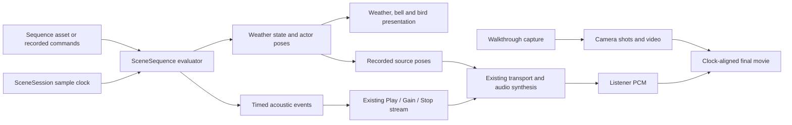

# Acoustic simulation and reconstruction: design contract

Updated 2026-10-24 against main-repo checkpoint `b16ab86`; individual sections retain their implementation dates. This is the single design specification for runtime cleanup, scenes, microphone/clip sources, simulation, capture, comparison, multiplayer, datasets and learned reconstruction. It replaces the separate architecture, comparison, remaining-work, scene-assets and training plans. Examples describe proposed contracts unless explicitly marked implemented.

[README](../README.md) remains the operating guide for actual APIs and workflows. [Cleanup results](cleanup-results.md) contains the current station offline benchmarks and explicitly dated historical measurements.

**Design audit, 2026-10-24:** [seeded emission sampling and batching](#seeded-emission-sampling-and-batching) specifies shared point/plane/polyline sampling, procedural event reconstruction, sample timing, GPU ownership and validation. Its first version-6 masked-burst slice is implemented at `e9f33af`; polyline sources remain proposed. Bursts are a granular ambience model, not individual physical drops. The [primitive and solid-mesh vibration bake](#primitive-and-solid-mesh-vibration-bake) adds a separate mechanical reference and shared resonator; acoustic radiation and physical rain excitation are not yet integrated.

Planning update, 2026-10-18: [artifact reduction and sampling](#artifact-reduction-and-sampling-plan) defines the next investigation. It does not change the implementation status of the earlier sections.

**Presentation plan, 2026-10-24:** [sequenced church walkthrough and environment behavior](#sequenced-church-walkthrough-and-environment-behavior-planned) specifies the ordered bells → birds → wind/clouds → rain → lightning/thunder film, shared sample-clock behavior, scene/replay integration and visual acceptance. It preserves the existing reverberation and defers vibration/radiation integration. This section is a design, not implemented footage.

Research update, 2026-10-18: the [planar wave reference](#wave-reference-suite-research-and-implementation-plan) is implemented and benchmarked. The [ray/learned reconstruction experiment](#ray-transport-and-learned-reconstruction-experiment) defines candidate kernels, search ranges, a reproducible scene suite and an aggregate score; the replacement kernels and neural models remain proposed.

**Current direction, clarified 2026-10-19:** the product goal remains **realtime 3D acoustics in large, dynamic environments**. Use 2D scenes as the inexpensive development/validation stage. Keep heuristics in route/sample allocation; retain signed pressure, physical delay, frequency dependence and the existing wedge kernel. The [complete-route sampling experiment](cleanup-results.md#minimal-planar-diffraction-sampling--2026-10-19) is an offline diagnostic, not the intended exhaustive runtime algorithm. `Planar2D` retains its declared point-source/infinite-extrusion convention, so its matched wave reference remains valid.

**Production approach, narrowed 2026-10-20:** use one iterative stochastic ray-tracing loop with surface and edge events. A fixed launch budget explores alternate reflection/diffraction paths, with one sampled continuation per bounce; alternatives do not create an exponentially branching ray tree. Explicitly sample edges because ordinary rays do not reliably hit zero-width edges. Keep guidance small: local geometric candidates plus a broad-support proposal, correct branch/edge/point densities, and stable sample dimensions across motion. Diffraction also contributes in lit regions. Preserve signed pressure and physical delay/phase, validate every segment, and count overlapping arrival techniques once or combine them with derived weights. Ideal specular connections require reflection-law solutions, not arbitrary straight receiver connections from mirror hits.

The existing `TracePaths` already has this loop structure; alternate paths are not a newly added feature. Its rare high-weight samples and missing general specular/edge connections remain defects to solve. Previous local/global and visible-edge proposal changes failed broad tests, so a simpler description does not establish a fix. Keep exhaustive route enumeration in the offline diagnostic. Defer route graphs, caches and new edge hierarchies; reuse BLAS/TLAS, edge records and the GPU response pipeline. Compare each sampler/connection correction at a fixed total budget against the 2D wave reference before finite-3D validation. Finite nonparallel edges require new proposal bounds/densities; planar height symmetry and height-independent visibility do not transfer. The [BEDRF paper](https://arxiv.org/html/2306.01974v1) supports local edge interactions in a path tracer, but its full integrator adds triangle–triangle intersection and biased outlier suppression; adopting it wholesale would not satisfy the minimal-code direction.

**Offline experiment, 2026-10-21:** `edge_integral.py --route-budget` now counts visible planar continuations and addresses complete routes by integer rank. It covers all routes when they fit the budget and samples ranks otherwise, preserving the physical integrand and selection weights. Its budget bounds pure-edge height samples; geometry setup and the existing enumerated mirror/mixed stage remain explicit costs. This CPU diagnostic is not a finite-3D implementation or a qualification of the renderer as training truth. [Results and limits](cleanup-results.md#bounded-complete-route-monte-carlo--2026-10-21).

**GPU follow-up, 2026-10-21:** the pure-edge height integration now has an opt-in HLSL implementation with shared CPU route planning, identical sample coordinates, parallel complex reduction and full-grid CPU parity checks. It is an offline stationary planar experiment; direct/mirror/mixed work remains on CPU, and live transport/finite-3D contracts are unchanged. [Measured 2D maps and explicit stage costs](cleanup-results.md#complete-route-gpu-integration--2026-10-21).

**Sampling tuning, 2026-10-21:** a narrower height proposal gives modest improvements at 65,536 samples, with mixed held-out/seed results and little difference at 1,048,576. Keep width scaling opt-in and accept the numerical inverse-CDF correction; do not change the physical kernel or declare the field training truth. [Selection, held-out checks and whole-map results](cleanup-results.md#gpu-sampling-tuning--2026-10-21).

**Physical boundary bake, 2026-10-28 (implemented):** explicit `AcousticSolid` groups replace fixed closed members with their material-preserving exterior before shared scene compilation. The Editor regenerates that exterior automatically, cached by the group's local-frame source hash and stored with the scene; there is no manual bake. The group may move rigidly without regeneration; independent doors stay separate. Capture never uses a boundary from a different source hash, and running captures reject relative motion. Different surface responses are retained, but one group must share interior IOR/damping, matching the existing owner-medium model. Original source geometry stays editable; old takes retain their original triangles. [Authoring contract](acoustic-solid-bake.md). This removes the measured cube partition discrepancy and improves the finite room from 40.73% to 29.24% complex error; it does not establish full-wave accuracy. [Validation](benchmarks/solid-boundary-2026-10-28/README.md).

**Workflow:** edit a native 2D/3D scene → walk or run a scenario → record once → render the same take at several budgets → compare sound and cost → generate validated examples → train and deploy optional reconstruction.

**Invariant:** the take determines scene and source inputs; the render configuration determines computation. Changing quality never changes the recorded experiment.

Contents:

1. [Status and decisions](#1-status-and-decisions)
2. [Code and dependencies](#2-code-and-dependencies)
3. [Unity scenes and assets](#3-unity-scenes-and-assets)
4. [Capture and saved inputs](#4-capture-and-saved-inputs)
5. [Physics, representations and configuration](#5-physics-representations-and-configuration)
6. [Shader contracts and ownership](#6-shader-contracts-and-ownership)
7. [Live, offline and audio rendering](#7-live-offline-and-audio-rendering)
8. [Reconstruction and temporal upscaling](#8-reconstruction-and-temporal-upscaling)
9. [Example generation and dataset format](#9-example-generation-and-dataset-format)
10. [Models, training and deployment](#10-models-training-and-deployment)
11. [Audio comparison and benchmarking](#11-audio-comparison-and-benchmarking)
12. [Multiplayer](#12-multiplayer)
13. [Implementation sequence and acceptance](#13-implementation-sequence-and-acceptance)

**Implemented:** shared sessions, compact solo replay, imported Church scene, microphone capture, LAN voice/gameplay and offline client replay on Church and TrainStation. **Remaining:** legacy/material migration, physical acoustic validation, LakeForest, broader hardware/network tests and learned reconstruction. [Section 13](#13-implementation-sequence-and-acceptance) defines delivery gates; scene demos do not establish teacher accuracy.

Review the [runtime changes](#runtime-cleanup-and-shared-scene-session), [scene designs](#scene-composition), [recording formats](#scene-independent-input-and-stream-recording-implemented), [microphone pipeline](#microphone-and-streamed-source-audio), and [multiplayer contracts](#12-multiplayer).

## 1. Status and decisions

| Capability | Current implementation | Planned work |
|---|---|---|
| Unity authoring and capture | Native 2D/3D geometry export, rigid motion, activation, stable IDs, source events, immutable take files; editable station, train service with stops and walking aboard, and door with two sources and one binaural listener; imported Church scene with the same session/player/door and compact recorder. | Church acoustic validation and LakeForest; migrate the old rooms as small 2D/3D fixtures. |
| Replay and computation | Shared compact scene-input reconstruction, pose replay/scrubbing, CPU/HLSL direct solvers with optional static BVH plus direct tests for moving objects, shared live/offline timeline and mixer, per-source stream files, saved-take picker, offline client replay, WAV/response export, batch jobs and measured offline benchmarks. | Portable decorative snapshots and continuous audition remain deferred. |
| Directional spectral preview | Shared 2D/3D GPU transport with multi-bounce reflection/scattering, transmission/refraction, air/material losses and experimental signed edge sampling within the path loop. Configurable frequency grid, selectable scene-IR or continuous path-clock spectral synthesis, interpolated per-arrival KEMAR orientation, samplewise response crossfades and first-order image-source reflections; same live/offline implementation. Closed 2D/3D objects use per-medium speed/damping, including nested solids and interior sources. | Physical normalization/convergence, higher-order mirror connections, directional dataset export and validation of complex moving boundaries. The preview is not an approved training reference. |
| Multiple endpoints | Every source/listener pair; mono or binaural mix per head; one monitored listener. | Larger workload benchmarks and explicit local receiver selection for multiplayer. |
| Comparison | Coarse/fine schedules, metrics/reference gate, native audio A/B/Difference, waveform/spectrogram plots and synchronized listener/top-down/free-camera views. | Per-pair target checks, learned outputs and validated reflection comparisons. |
| Runtime | Bounded PCM/capture queues, GPU transport and DSP with asynchronous PCM batches, selectable CPU reference, fractional-delay FIR, provenance and diagnostics. | Lower measured latency/memory and reconstruction scheduling. |
| Distributed sources | Version-6 seeded finite masked-plane bursts, legacy fixed sites, per-pair packed transport/DSP, spectral GPU/CPU synthesis. | Synthetic coherent polyline and thunder source model; measured full-profile event-density/latency budgets. |
| Microphone and networking | Opt-in device capture, timestamped source streams, Opus voice, LAN host/join, presented-state recording and local acoustic rendering of remote voices. | Two-machine and four-player testing, measured hardware timing, clock-drift correction and echo cancellation. |
| Learning | Not implemented. | Validated teachers, dataset loader, models and inference. |

The current project uses Unity **6000.4.1f1**, C# and HLSL. Earlier CPU/Metal checks and the repaired legacy FFT are documented in the README. Windows/DirectX still needs its own checks. The legacy reflection shader has different physics and is not a validated reference.

The first physically validated indirect dataset model remains geometric **energy** transport. The implemented spectral preview instead synthesizes pressure using idealized square-root energy coefficients and path phase; it is explicitly excluded from that validation gate. Signed pressure/complex transport is a separate phase-bearing capability, followed by models that reconstruct those quantities. Full rendered-audio spectrogram enhancement is another experiment, not a prerequisite for improving acoustic responses.

Temporal upscaling is now an explicit requirement: low-cost solves may run less frequently than reconstructed response updates. Ray budget, solve cadence, response output cadence, response resolution and audio sample rate are separate controls. Test each reduction independently before combining them.

Critical constraints:

- Dense replay cannot recover motion never captured. High-rate labels initially describe the recorded interpolated trajectory, not unobserved physical ground truth.
- More rays reduce estimator noise; they do not supply absent diffraction, transmission, room modes or material phase.
- Sparse history may contain no evidence of a newly opened path. Limit prediction age, retain fresh direct visibility and count fallbacks; do not treat a network's uncalibrated confidence as proof.
- History duration, IR support, STFT window and lookahead are different time scales. Report each.
- Valid silence/zero energy is different from missing data. Clip inactivity does not erase the scene's unit-input response.
- A speedup must include inference, transfers, synthesis, DSP, graphics contention and deadlines. Extra output frames or FFT bins alone do not demonstrate recovered information.

Still unresolved before their respective milestones: the indirect estimator's receiver/PDF normalization; phase-bearing reference physics; measured latency/memory thresholds on target workloads; and model sizes/quality thresholds selected from baseline evidence. These are explicit deliverables, not silently chosen defaults.


### Direct sound without room reverberation, 2026-10-24

The existing Raytraced/Spectral renderer supports optional `maxBounces = 0`. The user's clarified scope retains Church's previous 32-bounce profile and existing reverberation; only object-vibration/radiation integration is deferred. Zero bounces keeps deterministic direct arrivals for each point or plane site, including retarded travel time, distance/air attenuation, occlusion, material transmission/interior travel and the selected listener filters. It sets the indirect ray count to zero, skips the trace dispatch and reserves no indirect path/filter rows. Reflections, scattering and diffraction are absent even if the diffraction factor is positive. No new transport enum or separate rain kernel is needed.

For `F` frequency bins, each source/listener pair owns `F * directSiteCapacity` slots at zero bounces; positive bounce counts retain the existing additional `F * raysPerBin * (maxBounces + 1)` slots. Plane `samples` still bounds spatial sites or retained seeded bursts. Seeded bursts need ray coverage only when indirect transport is enabled; direct-only evaluation visits every retained burst independently of `raysPerBin`. Event seeds, world positions, timing, gain and batch ownership use the existing shared contracts. The older `Transport.Direct` baseline still rejects planes; select **Raytraced + Spectral + zero bounces** for direct plane audio.

This optional mode removes renderer-generated room reflections, not acoustics embedded in source recordings. Delayed direct sound and finite source/material/HRTF filter tails still complete after a source stops; zero bounces must not truncate those. The physical drop/object-radiation integration remains deferred. Analytic impulse/occlusion/transmission checks, seeded live/offline CPU/GPU comparisons, streamed input and silent Church renders at the historical zero-bounce checkpoint `f65f212` are recorded in [direct-sound verification](benchmarks/direct-sound-2026-10-24/README.md). Those scene measurements do not describe the restored 32-bounce profile.

### GPU audio execution, 2026-10-06

The CPU DSP remains a correctness reference in `SpectralAudio.cs` and `ImpulseResponseAudio.cs`. `GpuAudio.cs` owns GPU buffers/readback and `Resources/Acoustics/GpuAudio.compute` owns GPU DSP. Shared code is limited to useful contracts and scheduling: scene/state layout, settings, source events, integer sample clocks, live/offline orchestration and the existing PCM queue. No new package or public scene representation is required.

```text
CPU: evaluate scene / source events; upload poses + new dry source samples
GPU: trace → group compatible arrivals → material + head filters
     → source-time resampling → parallel path FFTs → tiled per-ear sum → IFFT
     → valid overlap-save samples → response fade → finished PCM
CPU: async PCM completion → live queue, or wait → offline WAV
```

Transport paths now use 48 bytes after the impedance/plane extensions; direct diagnostic responses remain 32 bytes in GPU memory. Direct-only probes remain available for diagnostics; the CPU reference explicitly requests full path readback. GPU groups match delay, arrival direction and delay rate, plus topology identity in Spectral mode, the plane's clip phase/offset and full burst birth identity. Material bins become a short FIR, composed with the complete interpolated KEMAR ear response. Spectral uses continuous emission-time clocks; IR fixes the rate to zero and evaluates the equivalent sum of delayed path filters. The CPU IR reference instead uses a partitioned scene FIR. Both GPU modes use overlap-save, apply travel delay once and retain old/new response banks for samplewise fades.

GPU storage keeps two acoustic banks per source/listener pair and two shared head/clock response banks. Arrival or listener-activity changes rebuild only the affected pair; unchanged pairs retain their acoustic bank even while another pair changes. Current/previous ownership is stored per pair, so fading responses can share unchanged filters while retaining independent time anchors. Ear spectra are composed during reduction. Each bank computes its own four-direction blends at hop endpoints, reusing the existing blend scratch sequentially. For moving heads, two endpoint outputs are packed as `A + iB` into one complex IFFT; real/imaginary output holds the two real ear signals, interpolated samplewise across the valid hop. Static heads retain one endpoint. No extra FFT dispatch or path/spectrum readback is needed. Unchanged acoustics skip grouping and material filter construction even when the head changes. Matched spectral endpoints use the same interpolated source clock and reuse source FFTs when their compacted group indices agree. Reordered matches remain correct and synthesize separately. IR reuses unchanged input clocks and stops dispatching old-response work after its fade. Fully stationary spectral responses skip the redundant old mix.

**Spectral head clock (retained in `*-complex-spectral-v4`).** A listener pose observed at scene/response sample `s` anchors rendered output sample `s`, before playback lead. Within that response interval, valid world-space angular velocity in radians/sec predicts `q(n) = exp(omega * (n-s)/rate) * q(s)`. Ear filters use the arriving ray in that local head frame at hop start/end. DSP latency delays source history; it is not silently subtracted from the head timestamp. Both acoustic endpoints use the current output-time head prediction. Missing velocity or a listener cut holds its supplied orientation; an acoustic cut prevents path interpolation across its solve knot. Constant-velocity prediction is an approximation corrected by each new observation, not knowledge of future input. It cannot correct already queued PCM or remove output lead. IR retains response-frozen head filtering. The CPU reference uses two ordinary real-output inverse transforms for moving heads and independently checks GPU packing.

The existing eight-word PCM header carries bit-preserved response/reuse counts, current/peak group counts, material-filter constructions and executed source FFTs. The last two counters use previously unused header words and add no readback bytes. `gpuAudio.pathCapacity` is the worst-case group reservation for one response bank across all pairs; `activeGroups`/`peakGroups` count each pair's current bank, not both fade banks together. `filterBytes` counts both banks' material spectra, excluding ear tables, path records and scratch. Acoustic invalidation is per pair for arrival/activity changes; head updates do not invalidate material filters. `reusedResponses` still means the whole response was unchanged, whereas `materialFilters` counts constructed group filters and `inputFfts` counts executed group source transforms, including any fading response work. Nonzero angular velocity reanchors each response even if two supplied orientations happen to match. Counts describe completed PCM; they are not isolated GPU timings. Live reports retain the existing device deadline counters.

Persistent command buffers delimit `Acoustics.GPU.Direct`, `Trace`, `Compare`, `Group`, `Filters`, `InputFFT`, `Mix`, and `PCM`. These command scopes are distinct from CPU submission markers. On supported backends, [CommandBuffer samples](https://docs.unity.com/en-us/engine/6000.0/script-reference/unityengine/rendering/commandbuffer/beginsample) support GPU profiling. Unity's GPU Usage module does not support macOS Metal; [Metal System Trace](https://developer.apple.com/documentation/xcode/metal-developer-workflows) confirms the stage labels, but can coalesce multiple scopes into one encoder. Do not assign that encoder's time to the first label or add overlapping intervals as wall time.

Dry source samples are uploaded incrementally to a bounded GPU circular history. Response poses occupy separate batch slots until consumed; GPU metadata resets are dispatched in order, not overwritten by CPU writes while earlier responses are queued. Live submits all known intervals in a batch before reading PCM, and can submit DSP immediately after tracing without waiting for diagnostic probes. No audio-thread GPU work or waits are introduced. Offline queues the configured response batch through the same DSP API, uploads its source interval once, and waits once for its PCM delivery. It still retains the direct diagnostic transport readback required by its response file. Larger FFTs use staged global-memory transforms when they exceed the 2,048-element shared-memory fast path; this is an implementation threshold, not a user FFT cap. GPU resource limits still apply.

Scratch storage follows buffer lifetime. The shared-memory FFT path stores only `fft/2 + 1` complex input-spectrum bins per possible group; the listener reduction never reads the conjugate half. The global FFT path retains full pair-indexed input rows for the later listener sum, while its separate filter-preparation buffer reuses one pair's rows and is also large enough for the final listener/ear transforms. Different acoustic responses retain independent persistent filter storage; head-only response transitions can share it. Input scratch is reused in place after the current-response reduction, so exact old/current window reuse adds no spectrum buffer. Path summation now partitions every pair's groups into 16 strided tiles per listener/ear/bin, then reduces their partial spectra in a fixed order before the IFFT. This adds one dispatch per rendered bank/hop and `listeners * ears * 16 * bins` float4 scratch values, reused after each inverse transform. Both head endpoints share the source-times-material product. The partition limits no acoustic paths or frequency bins. Summation order changes float rounding; CPU agreement uses the existing numerical tolerance and repeated GPU renders must remain reproducible. There is no group/ray/FFT cap; both CPU-reference and GPU synthesis modes remain supported.

Reports include the selected DSP contract, GPU-audio shader hash, streaming upload/readback bytes and numeric working storage. CPU dispatch/preparation time is not GPU execution time. Initialization uploads and transport transfers are excluded from the audio byte counters. Filter allocation reserves worst-case path capacity only for audible pairs. The immutable self-monitor mask maps original pairs to compact filter pairs (or -1); it never renumbers scene identities or removes recorded/transmitted voice. An all-muted scene retains an eight-byte empty-buffer sentinel. `pathCapacity` still describes all raw arrival slots; `filterBytes` reports the actual allocation. Temporarily inactive sources retain capacity. Grouping still uses one work item per pair; a general active-group allocator and parallel grouping remain possible later work. Windows/DirectX needs its own validation. Training export/inference, general moving-boundary physics and a low-latency guarantee remain outside this port. [Actual measurements and tests](cleanup-results.md#gpu-audio-port-2026-10-06).

### Continuous Doppler and synthesis methods, 2026-10-06

The previous renderer is preserved at `6cc47f1`. The new `Synthesis` setting separates scene-IR convolution from path-wise spectral rendering. No new dependency, scene representation or recorder is needed. Existing serialized settings select `ImpulseResponse` (0); `Spectral` (1) is explicitly opt-in; both modes now support GPU DSP and a CPU reference. Direct transport uses its own continuous-delay mixer and ignores this setting.

For a stationary homogeneous medium, let `n` point from the source at emission to the listener at reception. With velocities relative to that medium:

```text
q = receivedFrequency / emittedFrequency
  = (c - dot(listenerVelocity, n)) / (c - dot(sourceVelocity, n))
emissionTime = receiverTime - travelTime(receiverTime)
delayRate = 1 - q
```

The direct solver solves `c*delay = |listenerNow - sourceNow + sourceVelocity*delay|`, then evaluates the direction and ratio. Thus source and listener motion have distinct factors. At a moving surface, the outgoing/incoming frequency ratio is `(1-dot(surfaceVelocity,incoming)/incomingSpeed) / (1-dot(surfaceVelocity,outgoing)/outgoingSpeed)`. Surface point velocity is linear velocity plus `angularVelocity × (hit-center)`. Segment speed is `airSpeed/IOR`. These local factors assume subsonic, nondispersive propagation; moving-fluid advection and Mach shocks are not modeled. See [time-varying delay Doppler](https://www.dsprelated.com/freebooks/pasp/Doppler_Simulation.html) and [physical delay-line modeling](https://www.dafx.de/paper-archive/2002/DAFX02_Smith_Serafin_Abel_Berners_doppler_leslie.pdf).

Straight transmission through materials is an approximation: it does not refract at interfaces. Its Doppler must differentiate that actual piecewise-speed travel time, including crossings sliding along stationary surfaces, rather than applying only endpoint/local boundary factors. For travel time `T(emissionPosition, listenerPosition, geometryNow)`, implicit differentiation of `delay = T(sourceNow - sourceVelocity*delay, listenerNow, geometryNow)` gives:

```text
q = (1 - dot(gradientListener(T), listenerVelocity) - geometryRate(T))
    / (1 + dot(gradientSource(T), sourceVelocity))
```

The existing intersection loop accumulates those gradients and the rigid boundary-motion term; no extra ray traversal or history is needed. This makes the source clock consistent with the chosen route while its crossed interfaces remain unchanged. Finite-difference tests independently move/rotate the scene and compare solved travel times in 2D/3D, with acceleration off/on and faster/slower material speeds. This does not validate refracted paths, visibility changes or general moving-medium physics.

The GPU receives 80-byte states: position, quaternion, linear velocity, angular velocity and flags, each in a 16-byte lane. `VelocityValid` is required; cuts invalidate velocity. CPU/GPU direct solves match. The 32-byte path keeps direction XYZ, delay-rate W, delay seconds, pressure gain, frequency-bin index and a topology/sample hash. It does not estimate velocity by differentiating unrelated slots.

`SpectralAudio` continuously reads source history at the path's emission time. Persistent paths match by topology/sample identity and canonical frequency across two solves. Hermite delay interpolation and its derivative define one source clock for both endpoint filters; ambiguous or non-monotone matches use independent endpoint clocks. Response gains interpolate at `outputSample - declaredDspLatency`, with solves bracketing that time. The producer requests the right endpoint at `max(0, output + responseStep - declaredDspLatency)`, preserving existing DSP latency; live observation history/readiness supplies the required endpoint. Cuts prevent interpolation across their solve knot. The short filter uses endpoint tangent continuation outside the knot interval. The 32-bit hash is not a collision-free geometric identity, and changing topology, moving-source acceleration at retarded time, and finite-filter overlap remain approximations. Linear interpolation is inexpensive but aliases pitch-up; windowed sinc widens its source support and low-passes when `q>1`. No extra pitch shifter is applied.

The native `N/2+1` material bins define an `N`-tap centered pressure basis. Each path applies that short response and its complete interpolated HRIR to the time-warped signal with zero-padded FFTs and overlap-save. The transform length covers `N + HRIR length + block - 2`; the valid last block contains no circular wrap. Propagation stays in the source clock, outside the short filter. This still performs short-filter convolution mathematically, but constructs no long scene IR or propagation-delay partitions. Declared DSP latency remains `N` plus sinc radius. `ImpulseResponseAudio` retains the previous partitioned scene-FIR algorithm; it deliberately ignores path delay rate and crossfades frozen responses. It is not a continuous moving-Doppler implementation.

Direct transmission brackets the emission-time root using per-medium segment travel times (fixed-point proposals alternate with bisection to resolve slow convergence) while other boundaries remain at their solve pose. First planar mirrors iterate the source emission and rigid mirror pose at interaction time. The validated moving-wall case is normal translation. Frequency-dependent material coefficients remain evaluated on the configured bin grid; frequency changes between successive interactions and the distinction between phase/group velocity in dispersive materials are not tracked. Oblique/rotating moving surfaces, acceleration and changing occlusion require further validation. Diffuse/diffraction paths use local velocity factors but frozen geometry/delays; their pressure estimator and full moving-path timing remain preview approximations. The tail freezes final pose and velocity, instead of extrapolating motion beyond the recording. Reported support is not a proof of arbitrary moving-wave tail completeness.

Silent realtime testing keeps Unity audio enabled. `AudioManager.muteOutput` suppresses device samples after `PlaybackCapture` copies the selected listener PCM; it preserves consumption, capture and deadline counters. Batch workers enable it automatically, and scene/multiplayer probes select it explicitly. The existing pause flag still suppresses the signal before recording. Offline WAV rendering remains independent of the device; this mute adds no virtual-device dependency and does not capture Unity's final mixed output.

Output/capture report version 3 adds delay rate to direct diagnostic rows (six float32 values per pair, after the frame sample). Comparison opens old v1/v2 reports. Take binaries and compact station input logs are unchanged. These diagnostic rows still cannot reconstruct indirect WAV content.

Validation includes analytic approaching/receding source and listener cases in 2D/3D, equal source/listener velocity, and approaching/receding planar mirrors. Rendered tone frequency/coherence checks disable crossfades; a separate sinc fixture rejects a tone shifted beyond Nyquist. Both synthesis methods pass the independent static convolution/long-HRIR oracles and streaming/batch tests. This establishes those numerical cases, not a validated room teacher or realtime performance. [Measurements](cleanup-results.md) record the station cost.

### Renderer repairs, 2026-10-05

The scene ABI, compact replay format, shared live/offline renderer and PCM handoff queue remain intact. No new package or runtime subsystem was added. The pre-repair implementation remains in Git at `1586cbb`; audit checkpoint `332f8f3` preserves its independently measured failures.

This historical repair at `6cc47f1` established the algorithm now retained by `ImpulseResponseAudio`. The optional spectral route is described above. The repaired IR DSP implements uniform partitioned **linear convolution with overlap-add**:

1. An acoustic grid of `N/2+1` real-signal bins defines a centered finite `N`-sample pressure FIR. Equal delay/direction arrivals combine on this grid; individual bins have the same finite-basis meaning.
2. Each directional FIR is linearly convolved with the complete interpolated HRIR. Propagation delay is deposited once using the selected linear or normalized windowed-sinc fractional-delay FIR. It is not a phase rotation inside a synthesis window.
3. The resulting FIR is partitioned into `B`-sample blocks; each uses a zero-padded `2B`-point FFT. A sample-keyed circular history retains source blocks. IFFT output halves overlap-add without circular aliasing.
4. Response transitions crossfade old/new **output samples**, preserving the same input history. Listener disable fades output to silence once; Source Stop gates future emission while allowing earlier sound to finish. Cuts switch responses immediately. Unchanged responses reuse their filter bank.

`N` is acoustic frequency resolution, `B` is convolution work granularity, and response step is scene-solve cadence. They are separate controls. Total declared DSP latency is `N` samples, plus sinc radius when enabled; propagation and measured HRIR timing remain separate. HRIR length is not constrained to fit `N`. Maximum acoustic delay bounds storage. `responseSupportSamples` is the conservative maximum observed FIR/block support; `tailCoversResponseSupport=false` explicitly identifies a requested tail that may truncate it. These fields do not automatically extend the requested render.

The mathematical guarantee is convolution of this declared finite response, not a wave-accurate material/room model. A finite band basis can spread a transient around its delayed center. No slot-derived velocity or pitch shift remains. Continuously crossfaded moving responses pass approaching/receding tone fixtures; coarse held responses and arbitrary changing path topology still need a better physical motion model.

Transport now uses an integer `raysPerBin`, with total rays `(N/2+1)*raysPerBin`, weight `1/raysPerBin`, and an explicit seed. Every bin is covered. Frequency bins share random samples to retain broadband coherence, while each still evaluates its own material interactions. Old serialized total-ray settings round up to complete per-bin budgets. Each ray also samples a first-order image-source mirror candidate, with primitive-sampling normalization and shared-edge deduplication. Specular pressure uses the square root of the unscattered reflected energy; the existing diffuse connection now uses scattering. A perfect mirror no longer creates the old arbitrary diffuse first arrival.

**Transport limitations remain:** first-order specular fixtures establish geometric gain/delay for a single planar mirror, not convergence of a complex scene. Low primitive budgets can miss mirrors or yield high weighted variance. Higher-order perfect-mirror connections are incomplete; diffuse pressure weights/branch PDFs and edge diffraction remain preview heuristics. The renderer is still excluded from the training-reference gate. Increasing rays does not change this status.

Compact saves now complete only after the required station input recorder finalizes. Construction, tick, observation or finalization failure invalidates `take.json` and reports failure. Offline station reconstruction preserves authored initial source/surface enabled flags and actual primitive membership. Unsupported runtime activation changes fail recording explicitly; adding a general activation event system is outside the current input contract.

Independent checks compare integer/fractional impulse delays and full ear-filter output against time-domain convolution over multiple grids, blocks and callback chunks; they also cover receiver fades, changed indirect slots, mirror gain/time, legacy settings migration, invalid saves and initial activation. Existing live/offline, medium and batch-invariance checks remain in place. [Measurements and validation](benchmarks/renderer-repair-2026-10-05.json) record the actual station workload. Numerical convolution correctness does not certify realtime scheduling. At that milestone, GPU transport read paths back for CPU synthesis. The GPU port above removes routine path readback; the station still has a 16,384-frame playback lead, and head prediction cannot alter already queued PCM.

The padding/overlap distinction follows [linear FFT convolution](https://www.dsprelated.com/freebooks/sasp/Convolving_Long_Signals.html) and [zero padding](https://www.dsprelated.com/freebooks/sasp/Zero_Padding_Time_Domain.html). The separate mirror connection reflects the [delta-distribution nature of ideal specular reflection](https://www.pbr-book.org/4ed/Reflection_Models/Specular_Reflection_and_Transmission); it does not validate the diffuse estimator.

### System audit, 2026-10-05

The pre-repair audit of `1586cbb` is historical. Its impulse/convolution failures and CPU synthesis bottleneck were addressed by the repairs and GPU port above. Keep the raw [audit](benchmarks/system-audit-2026-10-05.json), [repair results](benchmarks/renderer-repair-2026-10-05.json) and [measured history](cleanup-results.md); do not treat old failing counts as current failures.

Current limits relevant to new scenes:

- Higher-order specular connections, diffuse-pressure normalization and diffraction are not validated room references. More rays alone do not approve training labels.
- The station uses five bounces, a one-second output tail and 16,384 samples of playback lead. These are scene settings, not universal fidelity/latency requirements. Tail coverage is reported, not extended automatically.
- Spectral head filters advance within each hop from measured angular velocity; observations and queued PCM still limit responsiveness. Measure head-to-audio latency as well as throughput.
- Only absorption/scattering have arbitrary authored knots; other material coefficients still use eight-band conversion. Complete that migration rather than expanding legacy packing.
- Static BVH traversal works; moving objects leave it for direct tests. Nearby-edge and containment searches still have linear scans. Profile larger scenes before choosing BLAS/TLAS or another hierarchy.
- Compact replay is station-specific and depends on matching project/build identity. Hashes cannot recover missing assets or uncommitted code.
- Low/High currently changes response cadence only. Per-pair directional export, independent ray-budget comparisons and learned reconstruction remain planned.

The selectable test suite now covers 107 default cases plus an explicit device-deadline case; measured results and limits are in [cleanup results](cleanup-results.md#test-suite-cleanup--2026-10-06). These tests are numerical/software evidence, not physical calibration.

### Edge diffraction — 2026-10-07

The dominant-route implementation described below is checkpointed at `checkpoint/pre-integrated-diffraction-2026-10-07` (`5c67dda`). The current trial is `integrated-edge-impedance-preview-v8`; v8 adds complex boundary reflection without repairing the remaining edge-model limitations.

`geometric-spectral-preview-v5` removes the random-ray proximity branch. Geometry preparation keeps boundary/crease edges and adjacent primitive IDs, discards coplanar triangle seams and collinear 2D joins, and excludes surfaces transparent across the entire configured grid. Edges have stable sorted IDs. One GPU geometry query per source/listener pair finds the shortest valid route through a finite edge. In 3D the constrained minimum of the two leg lengths chooses the edge point; 2D endpoints are point edges. Both legs must be visible, both endpoints must be in air, and the endpoints must straddle an adjacent face plane. Moving objects use current poses and the existing static-BVH/dynamic traversal.

Frequency evaluation uses signed `nu = sqrt(4 * pathExcess / wavelength)`, negative on the clear side, with the pressure-magnitude fit in [ITU-R P.526-16, section 4.1, equation 31](https://www.itu.int/dms_pubrec/itu-r/rec/p/R-REC-P.526-16-202511-I%21%21PDF-E.pdf). This imports the scalar thin-screen approximation, not a validated acoustic wedge solution. The independent test reference numerically integrates the Fresnel integrals. In shadow the arrival uses the full detour delay, final-leg world direction and local source/edge/listener velocity ratio. On the lit side it attenuates the direct field near the boundary instead of adding a duplicate. Surface transmission reduces the diffraction contribution; air attenuation and inverse-distance spreading apply along the route. Default strength 1 makes the opaque-screen grazing transition continuous; lowering strength intentionally weakens shadow sound and does not preserve that full-field boundary condition.

The geometry query writes a 48-byte GPU route per pair. The unchanged 32-byte `RayPath` ABI has one additional frequency-bin block at the end of each pair's response when diffraction is enabled. The original direct/mirror/bounce offsets remain intact. Frequency evaluation and both CPU-reference/GPU audio paths consume these arrivals; no additional route readback is needed. `diffractionFactor` now means pressure strength (default 1, zero disabled), replacing its previous proximity-radius meaning. Take payloads remain v3; the solver contract and shader hash distinguish changed rendering behavior. Saved numeric factors are preserved, and the demo presets explicitly use 1.

Limits: one dominant route, geometry frozen at solve time, magnitude-only thin-screen field and a paraxial path-excess surrogate. This is not UTD or a finite-edge wave integral. Endpoint-clamped paths are approximate vertex behavior; general wedge angles/impedance, complex diffraction phase, multiple-edge chains, diffracted reflections and low-frequency finite-body scattering remain open. Fully transparent geometry does not generate edge sound; a solid that needs two corners stays blocked by this first-order path. Near competing equal-length edges, selecting one route can switch direction; existing audio response fades handle output transitions but do not create a multi-edge field. The spectral preview remains excluded from teacher approval.

### First-reflection runtime integration, 2026-10-27

`ReflectionSampling.FirstImages` is the default in live and offline transport. For each retained emission site and frequency, it checks `min(primitiveCount, max(reflectionCandidates, raysPerBin))` cyclic primitive candidates and retains every valid image-source arrival separately. The default candidate floor is 128. Retaining more emission events does not increase the candidates per event. Candidate pressure includes `primitiveCount / candidateCount`; enumeration therefore has unit weight, while bounded sampling retains its probability compensation. Candidate count does not merge different delays or replace event birth/phase, material phase, retarded mirror timing or Doppler. `PrimitiveBaseline` retains the old per-ray mirror estimator for comparisons. Zero bounces allocates neither mirror nor walk arrivals.

The direct, first-mirror and existing surface/edge ranges share one per-pair layout. All configured walk interactions remain. GPU audio reserves filters by a conservative geometric group bound: constant material IOR permits frequency sharing for direct/mirror routes; walks additionally require constant transmission and scattering probabilities. Frequency-dependent attenuation still has its own coefficients. Dispersive or frequency-dependent branching keeps the required separate capacity. Arbitrary injected test arrivals use full capacity; a violated transport bound raises an error before an out-of-range filter write. No amplitude clipping or path-weight threshold supplies the saving.

This is a partial integration. The older improved complete-route pressure-map prototype was static 2.5D and did not output live arrival clocks. The attempted finite-3D complete-edge port failed its wave-reference gate and remains offline. Higher-order mirror and exact mixed mirror/edge connections, diffuse-model reciprocity and high-variance finite-edge sampling are still unresolved. [Measured rain output, cost, controls and rejected experiment](benchmarks/runtime-mirrors-2026-10-27/README.md).

### Integrated edge trial

The trace loop samples either a surface leg or an edge point, with selection probabilities included in the pressure weight. An edge can connect to the listener and continue to another edge within `maxBounces`; there is no shortest-route selection or separate edge-search dispatch. Samples keep total medium travel time, arrival direction, signed pressure and local interaction Doppler. Frequency bins share samples for coherent broadband reconstruction.

Rigid wedge directivity follows the secondary-edge-source integral in [Svensson, Calamia and Nakanishi (2009), equations 1–6](https://doi.org/10.3813/AAA.918181). A quadrature sample contributes signed pressure at its own geometrical delay. Summing those delayed contributions creates the complex frequency response in the existing DSP. Sequential edge terms follow [Antani et al., equations 2–3](https://gamma-web.iacs.umd.edu/BTM/FromRegion.pdf). Edge coordinates use a mixture of Cauchy proposals around the stationary travel-time point; candidate selection mixes the current occluding face's edges with the whole scene so alternative/multiple edges retain sampling support.

`integrated-edge-preview-v7` applies the shared-solid-face factor `1/2` per inter-edge leg from [EDtoolbox's second-order formulation](https://github.com/upsvensson/Edge-diffraction-Matlab-toolbox/blob/67e53c4f510c0033821c9c879f91652d1a131244/toolbox/internal/EDwedge2nd.m), preserving the multiplicity of thin-sheet pairs. The same-object face-plane comparison is independent of triangle seams and rigid object pose. Grazing-angle classification uses the visibility tolerance, and parallel intersection tests account for float precision at the geometry's scale. A cube second-order complex-pressure test and an extruded 2D DC test now supplement reachability checks, including rigidly transformed scenes. This is agreement with that restricted published model, not full-wave validation. The tested conditional sampler failed the broader moving-scene outlier gate and was not adopted; [results](cleanup-results.md#two-edge-diffraction-amplitude-correction-and-conditional-sampling--2026-10-18) retain the evidence.

Scene preparation adds an exterior wedge angle and face basis to each edge (80 bytes), plus primitive-to-edge adjacency. Closed object winding supplies outward normals. Coplanar seams, collinear joins and fully transparent surfaces remain excluded. At v7, `RayPath` stayed 32 bytes; v8 extends it to 48 bytes for complex material gain. Edge arrivals still use ordinary bounce slots. The old route buffer and extra per-pair frequency block are removed. No recording format, audio backend or package is added. Moving interactions apply their incoming velocity factor on arrival and their outgoing factor when the next leg is actually selected, so edge sampling cannot inherit the direction of an unused surface ray. Planar mode models spherical point sources around geometry infinitely extruded perpendicular to XY; it is not a cylindrical-wave solver.

This is an experiment, not an approved training teacher. More rays reduce sampling noise but do not validate the model. The current mixed diffuse/surface weights remain preview approximations; exact specular–edge connections, general impedance wedges, vertex corrections and a moving-boundary wave solution are incomplete. Non-rigid surface coefficients only scale rigid-edge strength. Finite delay truncation and low ray budgets can miss substantial edge response. Increasing rays also grows the current per-arrival DSP reservation; high-budget transport tests do not establish practical full-audio memory or realtime throughput. Multi-edge visibility and timing tests establish reachable paths, not agreement with an independent full-wave solution.

`DirectBenchmark.MeasureReciprocity` now quantifies one of these limits with the actual transport. For a stationary reciprocal wall, swapping the omnidirectional source and receiver should preserve its scalar transfer. At 250 Hz and 65,536 rays/bin, eight seeds give relative forward/reverse reflected-pressure gaps of **75.0% in 2D and 93.2% in 3D**; first-order mirror controls agree. These are reciprocity violations, not measured-room accuracy percentages. The gap persists as sampling noise falls. The diffuse connection currently combines a source-direction proposal with a cosine/path-length pressure weight without a reciprocal, physically justified scattering kernel. Symmetrizing a gain would not establish energy conservation or a pressure/phase model. The next transport change needs that derivation and independent references before altering training eligibility. Ideal specular-to-edge paths additionally require constrained reflection connections (for example unfolded mirror/edge paths); diffuse next-event sampling cannot satisfy a delta reflection by increasing ray count. [Fixtures, seeds and measured results](benchmarks/gpu-improvements-2026-10-07.json).

An [independent 3D wave-field audit](cleanup-results.md#independent-wave-pressure-maps--2026-10-18) now compares total complex pressure around two finite rigid walls with a Helmholtz boundary-element reference. It exposes missing shadow responses and large sample outliers in the current renderer. Its reference has separate analytic-sphere and mesh-refinement checks; it does not reuse our edge kernels. The fixture is stationary and excludes binaural DSP, materials and moving-boundary timing. The 500 Hz shadow field needs further reference refinement. This evidence does not approve the current renderer as a training teacher.

### Wave reference suite: research and implementation plan

**Planar estimator audit (2026-10-19):** `tools/edge_integral.py` now supplies deterministic one/two-edge integrals and unfolded mirror/mixed-path controls for stationary rigid extruded boxes. The existing GPU measurement optionally exports individual bounce contributions. Nine numerical controls and 16 focused GPU cases pass; two 31-position walks and 16 GPU seeds separate sampling noise from missing path classes. Three visibility/angular proposal trials failed the combined coverage/outlier checks and remain unshipped. Only a previous-vertex roundoff repair enters runtime. The offline mixed paths are not yet runtime features; artifact repair and teacher approval remain incomplete. [Results, limits and reproduction](cleanup-results.md#planar-edge-estimator-audit--2026-10-19).

**Decision:** use a cheap planar wave lab first, then confirm transferable improvements in 3D. The optional NGSolve backend in `tools/planar_wave.py` now runs through `tools/compare_wave_field.py`: true-2D analytic controls, 2.5D point-source reconstruction, and matched `Planar2D` GPU measurements. Initial fixtures are free space, one thick barrier and staggered barriers. The existing finite-wall 3D Bempp reference remains a separate check. The broader scene/material/training coverage below is still a plan; a solver's name or residual is not an accuracy certificate.

#### Physical model and dimensionality

For ordinary sound propagation in stationary air, solve linear pressure acoustics with declared density, sound speed, sources and boundaries. For homogeneous air at one angular frequency, this is `laplacian(p) + (omega/c)^2*p = -q`. The heterogeneous form uses density and bulk modulus inside the differential operator. Reflection, diffraction, interference, multiple scattering and enclosure modes then follow from the solved field; there is no manually selected diffraction route or bounce limit. Numerical bandwidth, discretization and boundary models still limit the result.

The initial suite uses rigid boundaries and lossless homogeneous air so propagation errors can be isolated. Add frequency-dependent complex impedance and explicit fluid interfaces after that passes. An absorption coefficient does not determine reflection phase. Porous layers, compliant panels, narrow thermoviscous passages, wind and moving boundaries require their corresponding physical models; inventing more material sliders cannot supply them. Perfectly rigid closed cavities have undamped resonances: use analytic modal frequencies or a declared finite-duration excitation, rather than silently adding damping to obtain a finite harmonic response at a pole.

Three different targets must remain explicit:

| Target | Physical meaning | Appropriate comparison |
|---|---|---|
| True 2D | Field and source are invariant in the third direction; a point in the drawing represents an infinite line source. | A cylindrical-wave tracer or solver with matching source units. |
| 2.5D | Geometry is infinitely extruded, but the source is a 3D point source. | The intended physics of our current `Planar2D` mode. |
| 3D | Finite geometry and point sources in space. | The existing finite-wall Bempp fixture and eventual authored rooms. |

True 2D uses a Hankel-function free-space response, with far-field pressure decaying approximately as `1/sqrt(r)`; 3D point-source free-field pressure decays as `1/r`. True 2D also has a physical temporal tail behind the wavefront. Changing the attenuation exponent alone does not make the current planar renderer a true 2D wave model. [Barnett's wave Green functions](https://users.flatironinstitute.org/~ahb/dartmouth/notes/waveequation.pdf) derive the dimensional difference.

**Preserve the current renderer's physical contract.** The implemented planar reference validates its numerical backend on true-2D analytic controls and uses 2.5D reconstruction when comparing against `Planar2D`. A Fourier transform along the extruded direction turns the 3D problem into a family of 2D solves with transverse squared wavenumber `k^2-kz^2`. Integrating those fields over `kz`, with the source/receiver separation and correct Fourier normalization, reconstructs the point-source response. Resolve the propagating/evanescent transition, evanescent contribution and integration tail explicitly; a single 2D solve or inverse-distance correction is insufficient. This is established in [2.5D acoustic BEM research](https://dael.euracoustics.org/confs/fa2023/data/articles/000196.pdf). Validate this integration in free space and against an independently converged extruded-geometry case. Finite-height walls are a different 3D problem. A 2D slice through a solved 3D field is useful for visualization, but is not a matched reference for infinitely extruded `Planar2D` geometry.

#### Solver choice and research relevance

| Method | Role in this project | Main accuracy/cost issue |
|---|---|---|
| Existing 3D BEM | Finite-height 3D transfer check: the implemented Bempp tool and its analytic-sphere/refinement controls. | Current frequency/geometry coverage is limited; the 500 Hz shadow result still needs refinement. |
| High-order FEM, locally refined in size and polynomial order | Implemented planar reference: NGSolve, geometry-fitted meshes, Helmholtz pressure, rigid boundaries and an exterior PML. Impedance interfaces and a 3D FEM audit remain extensions. | Corner resolution, wavelength dispersion, source singularity and artificial-boundary error all need separate checks. |
| High-order boundary integrals with corner treatment | Independent audit of selected homogeneous, rigid scattering cases; chunkIE's Neumann formulation with RCIP is a concrete candidate. | Singular/near-singular quadrature, corners and formulation resonances need treatment. MATLAB toolchain is an additional dependency. |
| High-order time-domain DG / spectral elements | Later broadband wave movies, long impulse responses and extensions needing time evolution. | Spatial and temporal convergence, stable causal impedance boundaries and radiation boundaries. |
| k-space pseudospectral / FDTD | Alternative time-domain cross-check if appropriate for a fixture. | An efficient propagation scheme still needs accurate geometry, high-contrast interfaces and wall conditions. |

NGSolve has published [high-order complex Helmholtz examples](https://docu.ngsolve.org/latest/i-tutorials/unit-1.7-helmholtz/helmholtz.html) and a [2D PML implementation](https://ngsolve.org/ngsolve/docs/i-tutorials/unit-1.7-helmholtz/pml.html). The tutorial's outgoing Robin condition is not a general material model. The initial implementation uses curved geometry and global mesh/order refinement; local corner grading remains an improvement. It injects an FE point load instead of a source blob and checks the resulting error analytically. An incident/scattered-field split could reduce source discretization error further. The tested NGSolve version is pinned to 6.2.2608.

[chunkIE's rigid-corner example](https://chunkie.readthedocs.io/en/latest/guide/chunkgraphbvps.html) combines a regularized integral formulation with recursively compressed inverse preconditioning (RCIP) for singular corner densities. This is a full boundary-field solution, independent of our sampled wedge formula. It is a candidate audit backend, not a drop-in Python replacement: MATLAB and Octave are not currently on this machine's PATH, and compatibility/installation has not been tested. Do not port an entire BEM library to avoid that dependency.

Recent research supports these method families rather than establishing one universally most accurate solver. [Wang, Palha and Hornikx's 2024 open-source DG work](https://research.tue.nl/files/339147521/IN_2024_3868.pdf) supplies a room-acoustics implementation; [Kraxberger et al., DAGA 2026](https://pub.dega-akustik.de/DAGA_2026/files/upload/paper/155.pdf) apply matrix-free high-order DG and PML to noise barriers. Those results motivate a later scalable transient backend; their application-scale performance is not a benchmark for this Mac or proof of our 2D adapter. [k-Wave](https://www.k-wave.org/documentation.php) provides k-space pseudospectral propagation with heterogeneous material parameters and absorption; its homogeneous-medium temporal accuracy does not establish rigid-corner accuracy for our fixtures. Neural surrogates and reduced-order models remain approximations to a validated reference, not independent ground truth.

#### Scene families

Generate small parameterized acoustic fixtures, not new art scenes. Use one physical geometry description for the reference and renderer, and preserve the reference mesh separately. These families isolate different errors:

| Family | Variations | What it establishes |
|---|---|---|
| Free field | Distance, source strength, frequency, source/receiver swap | Dimensional spreading, phase, source normalization and arrival time. |
| Plane reflector and circular obstacle | Incidence angle, radius, receiver ring | Image-source and analytic cylinder-series checks; reflection and curved scattering. Use analytic infinite-plane geometry or explicitly account for finite edges. |
| Single wedge / finite thick barrier | Exterior angle, thickness, grazing positions | Shadow transition, edge phase and near-corner resolution. Infinite-wedge analytic tests and finite barriers are distinct fixtures. |
| Staggered two- and three-wall arrangements | Separation, rotation, overlap, listener route | Multiple diffraction, reflection/edge combinations, missing paths and outliers. Include the reproduced failure. |
| Door/slit and coupled cavities | Opening width relative to wavelength, wall depth | Aperture diffraction, coupling and resonances. |
| Straight duct, L-bend and U-bend | Width, bend angle, source offset | Cutoff/modal behavior, repeated interactions and deep shadow. |
| Rectangular enclosure | Aspect ratio, rigid versus declared impedance walls | Analytic mode locations, standing waves and decay when loss is physically specified. |
| Concave/convex shapes and obstacle groups | Curvature, spacing, resolved surface roughness | Focusing, multiple scattering and the limits of a ray-only representation. |
| Material/interface controls | Complex wall impedance, fluid density/speed, slab thickness | Reflection phase, transmission and refraction after rigid cases pass. |

Vary size relative to wavelength (`k*size`, gap/wavelength), source/listener positions and physical material parameters. Frequencies are configured per experiment, without a fixed band count. Survey frequency responses adaptively around narrow resonances; use a sufficiently dense uniform frequency grid when reconstructing a finite-duration waveform. Start with tiny analytic controls and the failing walls, then expand to the other families. Transformed copies check coordinate invariance but do not count as independent physical layouts.

#### Reference acceptance and output

Every accepted reference binds geometry/source/material definitions, dimensionality, units, Fourier convention, source phase, boundary conditions, requested frequency/time range, solver revision/settings, mesh and refinement results. Use float64/complex128 in the offline numerical reference. No peak normalization, fitted phase offset or delay alignment is permitted to hide mismatched source conventions.

Acceptance requires evidence beyond one fine run:

1. Match analytic free-space, plane-reflection and circular-scattering controls. Check cavity mode locations separately. Evaluate both pressure and phase where the signal supports it.
2. Vary mesh size and polynomial order independently; refine corners and near-boundary evaluation. Tighten quadrature and solver tolerance. A small residual only proves that the discrete system was solved accurately.
3. For exterior FEM, change PML thickness, strength and distance from the physical scene independently. For 2.5D, refine the longitudinal-wavenumber integral separately from the spatial solve. For transient solvers, refine the time step, source injection and receiver interpolation.
4. Check selected difficult cases with the independent boundary-integral implementation. Agreement between implementations sharing the same physical assumptions still does not validate real material data.
5. Check source/receiver reciprocity with matching source normalization, causal propagation and physical energy balance. Local pressure can exceed free-field pressure through focusing or interference; a local amplitude cap is not an energy-conservation test.

Each run records observed convergence changes and unresolved discrepancies, not a fabricated confidence interval. Set an explicit reference error budget substantially below the desired tracer error before tuning; choose absolute and relative tolerances together so pressure nulls do not create meaningless ratios. Refinement failing to meet that budget leaves the case diagnostic-only, with the failure retained in the report. The existing 500 Hz BEM shadow map remains in that category. Neither convergence alone nor agreement at a few frequencies proves broadband real-world fidelity.

Reuse the current JSON/NPZ/CSV tools. Store complex transfer `H[source, probe, frequency]`, probe positions, validity, convergence evidence and hashes. Optional pressure gradients/particle velocity support later intensity checks; they do not uniquely specify a complete angular arrival distribution. Save selected full-field snapshots for visualization, not every field at every simulation time by default. Geometry matrices/factorizations can be reused for multiple source right-hand sides at a fixed frequency; many receivers evaluate the same solved field. Changing materials/frequency generally changes the operator. Versioned computed references are reusable offline outputs, not a new runtime scene database.

For audio comparisons, both methods receive the same known source spectrum, passband and time support. Frequency spacing controls the periodic time window; extend it until wraparound/truncation is below the declared error budget. Verify interpolation before using maps to synthesize a moving receiver. A field plot animated at one tone is not a broadband propagation simulation.

#### Tuning and validation of the ray tracer

Compare the actual complex transfer before HRTF, resampling, output limiting or listening normalization. Retain per-source responses before mixing. Use the same physical source model, geometry, material parameters and bandwidth; report ray delay/order truncation independently from reference error.

Across independent ray seeds, separate the complex mean error (model/estimator bias) from variance (sampling noise). A biased mean after ray-budget convergence calls for correcting or extending the transport model. Large seed variance with a converged mean calls for better integration/proposals. Tune sample allocation, joint connection proposals, quadrature, valid MIS weights, bounce/support convergence and reuse. Do not fit one global diffraction gain to compensate for missing specular-edge paths, wrong source dimension or incorrect material phase.

Report a small set of complementary quantities: complex-field error; absolute and logarithmic amplitude error with declared null handling; phase/group delay where meaningful; missing responses, worst outliers and seed spread; and spatial/temporal derivative error against the reference. For enclosure waveforms add early arrival timing and supported decay/modal metrics. Compare movement residuals against the reference's own interference pattern: physical beats must not be scored as artifacts. Hold geometry families and parameter regions out of tuning, group related trajectories in the same split, and show quality-versus-compute curves including full DSP cost before claiming realtime gains. Use transport-only timing to isolate a kernel change, clearly labeled.

Stationary geometry admits a Green-function history calculation for moving sources/receivers: evaluate the source at emission position/time and receiver at reception position/time. A sequence of frozen responses at the current source position is not an exact Doppler teacher. Moving walls require a time-dependent boundary solution and are a separate milestone. Begin with fixed sources and static receiver probes, then a moving receiver, then moving sources and finally moving geometry. Arbitrary 3D scenes, binaural head scattering and material realism need their own 3D validation even after this suite passes.

If a converged ray method cannot represent a feature such as a cavity mode or subwavelength aperture response, record the capability gap. Tuning cannot manufacture missing physics. A wave/ray hybrid or learned residual can be considered after the reference establishes what information the low-cost representation lacks.

#### Implemented offline path

```text
prepare a shared scene.json: source, probe grid, rigid boxes, frequency bins
mesh the XY air region; remove rigid boxes; surround it with an absorbing layer
for each frequency:
    for each longitudinal-wavenumber integration point q:
        solve [-laplacian_xy - (k² - q²)] G = delta(source)
        evaluate G at every probe from this one field solution
    pressure = conjugate(4 * integral_0^infinity G(q) dq)
run the actual Planar2D GPU transport at the same probes, frequencies and geometry
compare complex pressure, amplitude, seed spread, missing responses and computation time
```

NGSolve's high-order H1 elements and sparse direct solve provide the numerical engine; no PDE implementation or Unity package was added. Rigid surfaces use natural zero-normal-derivative conditions. The outer Dirichlet boundary lies behind a radial PML. The point load evaluates FE basis functions at the actual source position; source discretization error still needs refinement. `G` is the unit-delta 2D Green function; the factor 4 is the inverse Fourier normalization times the renderer's `4*pi` point-source normalization. Conjugation converts the solver's outgoing `exp(-i*omega*t)` convention to the renderer's `exp(+i*omega*t)`.

For this exterior rigid problem at source/receiver `z=0`, the implementation deforms the positive longitudinal-wavenumber contour below the outgoing branch point, `q=t*exp(-i*angle)`. Gauss–Legendre quadrature covers a finite `t` interval. This avoids sampling the propagating/evanescent branch point directly; it still needs order, tail and contour checks. Analytic Hankel free space and cylindrical-harmonic rigid-cylinder solutions independently check normalization and scattering. This contour implementation is not claimed to support ducts, guided modes, lossy layered media or moving boundaries without further analysis.

`validate` checks those analytic controls, reciprocity and independent FEM/PML changes; it only marks success after every check completes. `reference` records mesh refinements and complex128 NPZ fields. `audit` independently varies polynomial order, PML radius/thickness/strength and integration count/limit/angle on the actual scene. The report retains numerical changes rather than labeling a field exact. Solver/scene hashes prevent mixing incompatible outputs. Analytic controls may be reused between scene families only with the identical checked control fingerprint. All dependencies stay in an optional Python environment.

#### Remaining sequence

1. Use these matched controls to repair the existing model/estimator and compare quality against measured compute. Keep the current runtime until a candidate improves held-out cases. Four seeds diagnose gross variance; they do not establish asymptotic bias.
2. Expand from the initial three fixtures to openings, three-wall paths, oblique layouts and cavities, with the appropriate source, radiation and resonance checks. Improve corner refinement before broad high-frequency sweeps.
3. Verify transferred changes against the existing finite-height 3D wave reference and vertical/oblique probes. Shared sampling strategies can transfer; spreading laws, PDFs, finite edges and out-of-plane propagation require their own checks.
4. Add broadband/moving-receiver references and training examples only after transport agreement and numerical accuracy meet a declared budget. Preserve geometry-family train/validation splits. Moving sources, moving walls, binaural head scattering and materials each need further physical validation.

### Ray transport and learned reconstruction experiment

**Question:** can sparse acoustic paths plus a small causal reconstruction model approximate a converged wave field on unfamiliar geometry, with less total computation and fewer motion artifacts? The benchmark infrastructure below exists; the replacement kernels and neural models are proposals. Publication novelty and speedups are not established by the current implementation.

#### Candidate kernels and integrators

Keep the source normalization, complex-pressure output and scene compiler fixed. A *kernel* defines the physical interaction; a *sampler/integrator* estimates its contribution. Compare those axes separately before combining their winners. Keep the existing `RayPath`/spectral pipeline while an alternative is being verified.

| Candidate | Concrete change | Why test it / principal risk |
|---|---|---|
| Frozen baseline | Current `integrated-edge-preview-v7`, including failures. | Establishes reproducibility; higher ray count is not ground truth. |
| Corrected secondary-edge integral | Derive and test complete path weights, measures, shared-face terms and valid mirror→edge/edge→mirror connections. Integrate the first-order edge contribution deterministically; sample the remaining orders without counting that term twice. | Closest to the present implementation. Separates missing physics/path classes from sampling variance. Independent wedge/two-edge integrals and full-wave maps are required. |
| BEDRF | Prototype the published local, reciprocal edge interaction and its sampler, then its edge-intersection/path-space treatment. Preserve signed pressure. | A strong candidate for integration into the existing ray loop. Wedge agreement does not establish arbitrary high-order accuracy; its geometry/intersection machinery can cost more than ordinary rays. |
| UDFA filter approximation | Evaluate the published two-/four-term diffraction filters as complex transfer functions on the configured frequency grid, for the paths being compared. Keep the published sign/zone-transition rules. | A deliberately cheap physical baseline and possible input to the neural residual. Higher-order extensions are approximations; smoothness alone does not establish accuracy. No switch to a separate IR-only audio backend is implied. |

The [BEDRF paper](https://arxiv.org/abs/2306.01974) derives a local convex-wedge model with reciprocal, signed interactions and a specialized importance sampler. Its reported limitations include creeping waves and the cost of edge intersection. Treat its claimed infinite-wedge agreement as a restricted control to reproduce. [Kirsch and Ewert's UDFA work](https://doi.org/10.1051/aacus/2024059) supplies an inexpensive filter approximation with explicit boundary transitions and higher-order limitations. Neither is assumed better than the current secondary-source model before measurement. [Monte Carlo secondary-source diffraction](https://www.eurasip.org/Proceedings/Eusipco/Eusipco2011/papers/1569424561.pdf) and [multiple importance sampling](https://graphics.stanford.edu/papers/veach_thesis/) motivate the integration experiments; optical nonnegative-energy rules cannot be copied blindly into signed acoustic pressure.

For a fixed physical kernel, compare these integrators in order:

1. **Stratified / scrambled low-discrepancy sampling.** Allocate stable dimensions by interaction and bounce; share geometric samples across frequencies. Measure independent scrambles, and keep the current hash sampler as the control. This changes sample placement, not amplitudes.
2. **Conditional integration and control variates.** Resolve a narrow final-edge integral with a small deterministic quadrature while sampling the earlier path. Alternatively, subtract a cheap analytically integrated approximation and sample its residual. Account for quadrature bias and extra visibility work. The former conditional-Cauchy experiment failed full-scene tests; do not rebrand that implementation as a proven improvement.
3. **Bidirectional connections with MIS.** Grow source and listener subpaths and connect valid vertices. Evaluate forward/reverse densities in the same path measure, include strategy probabilities/Jacobians, and handle delta mirrors with constrained connections. This may help obstructed paths; it can also spend more work on rejected connections. A reciprocity test alone does not prove correct normalization.
4. **Temporal path reuse.** Revalidate cached geometry/path identities and recompute current delays, directions and weights. Mix reused proposals with fresh samples using the correct combined density. Retiming must be per path/component: one phase rotation of the entire response cannot align several different arrivals. Compare against plain temporal averaging so reduced noise cannot conceal added lag.

A distance grid or A* result may guide proposal probabilities. It must retain support for alternatives and never become a separate shortest-route pressure contribution. Preserve signed cancellation, and do not clip large samples to make the score look better. Shared geometry traversal across frequencies and GPU-resident accumulation are execution optimizations to benchmark independently of physical model changes.

#### Initial search space

These are editable experimental choices, not runtime limits or a fixed acoustic band scheme. A parameter is varied only after its PDF, normalization and physical meaning are established. Start with one factor at a time; use a small randomized search over the surviving interactions rather than the Cartesian product.

| Parameter | Initial values | Condition / interpretation |
|---|---|---|
| Ray budget per bin | 8, 32, 128, 512 | Work/quality curve; compare measured compute as well as equal counts. |
| Path depth | 2, 4, 8 | Truncation convergence, not a fitted diffraction gain. |
| Delay support | 0.1, 0.2, 0.4 s | Separate support study; hold fixed during an estimator comparison. |
| Sampler | Current hash; stratified; Owen-scrambled Sobol | Independent seeds/scrambles, stable dimensions. |
| Edge-event allocation | 0.25, 0.5, 0.75 | Include selection probability in the estimator; retain surface paths. |
| Global edge proposal share | 0.1, 0.25, 0.5 | Remaining share uses a justified local/conditional proposal; global support stays nonzero. |
| Along-edge proposal scale | 0.5×, 1×, 2× derived scale | Evaluate the exact changed density. The scale changes sampling, not physical amplitude. |
| Conditional quadrature points | 1, 4, 8, 16 | Compare equal wall time; 1 is the stochastic control, not accurate quadrature. |
| Bidirectional source/listener work | 25/75, 50/50, 75/25 | Count both tracing and connections in the budget. |
| MIS heuristic | Balance; power with exponent 2 | After deriving densities in a common measure. |
| History duration | 0, 20, 80 ms | Causal history at a declared update cadence; report lag and invalidation cost. |
| Reused proposal share | 0, 0.5, 0.8 | Fresh samples remain present; no stale-pressure blending. |

Do not search physical speed, material values, `diffractionFactor`, per-scene gain/phase offsets or reference tolerances to reduce error. Keep rigid-wall strength at its declared physical value. First run pilot controls for a small candidate set; then evaluate roughly 16 sampler configurations on development scenes as an initial search budget, expanding only where results justify it. Correctness failures eliminate a candidate before tuning. Repeat close comparisons with additional seeds instead of selecting a lucky realization.

#### Frozen scene suite

`tools/compare_wave_field.py suite OUTPUT --profile study` prepares **25 JSON fixtures**: one free-space control plus three physical variants of each of eight families. This creates inputs only. Every fixture uses the same XY domain, source `(-3,-0.4,0)`, point-source convention, rigid disjoint boxes, probe-generation rule and solver settings. Slit walls are finite in XY and infinite in Z; they are not claimed to be infinite-plane analytic slit fixtures. Source/geometry/receivers match the GPU measurement exactly.

| Family | Three variants | Purpose | Split |
|---|---|---|---|
| Thick barrier | Thickness 0.24 / 0.60 / 1.20 m | Single-object diffraction, lit/shadow transition | Development |
| Staggered barriers | Center separation 1.2 / 1.6 / 2.2 m | Multi-edge paths and the reproduced failure | Development |
| Single slit | Opening 0.35 / 0.70 / 1.40 m | Aperture transmission and interference | Development |
| Open corridor | Clear width 1.1 / 1.7 / 2.5 m | Repeated reflections and spectral structure | Development |
| Double slit | Each opening 0.25 / 0.45 / 0.70 m | Interference between distinct openings | Validation |
| Offset doorways | Opening 0.35 / 0.70 / 1.10 m through two offset screens | Coupled apertures, difficult path discovery | Validation |
| Three alternating barriers | Vertical offsets scaled by 0.75 / 1 / 1.25 | Higher-order shadow paths | Held-out test |
| Pillar cluster | Nine square pillars, width 0.3 / 0.6 / 0.9 m | Many competing paths and multiple scattering | Held-out test |

The manifest freezes scene hashes, family, variant and split. Development has 12 scenes, validation 6 and test 6; the free-field control is excluded from the headline score. Rotations, source/receiver swaps and mesh tessellations are invariance checks, not independent scene families. The benchmark uses disjoint boxes to avoid accidentally comparing a FEM solid union with overlapping primitive boundaries. Joined L/U rooms, oblique polygons, curved obstacles, materials and finite-height 3D scenes need their own matched geometry/reference controls and are subsequent extensions.

The default `pilot` profile creates nine nominal fixtures and uses **250 Hz, four seeds and 8/128 rays per bin**. Only its four development families plus free space are run during setup; validation/test metrics stay uninspected. The study profile requests **125/250/500 Hz, eight seeds and 8/32/128/512 rays**, with four bounces and 0.1 s support as the frozen initial baseline. These three frequencies sample different wavelength regimes, not full-band audio. A higher frequency or difficult opening may require more reference refinement than the generated mesh defaults. A generated fixture is not an accepted reference.

This compact suite is for method selection and regression. It is too small to train and substantiate a general neural model by itself. Generate additional geometry seeds from development families for training, split by complete geometry/trajectory, and never split neighboring probes or frequency bins from one scene across training and test. Once validation results influence design, they are development evidence; reserve fresh layouts/families for the final paper test.

#### Path length and resonance experiment — proposed 2026-10-20

**Experiment status, 2026-10-20:** [all six candidates have scoped implementations and measurements](cleanup-results.md#transport-candidate-audit--2026-10-20). The runtime retains the legacy surface branch-pressure correction and debug-capture repair (`integrated-edge-pressure-preview-v9`). Unfolded mixed paths, angular-peak residual integration and roulette are optional `edge_integral.py` experiments. `transport_candidates.py` checks axial recurrence and an isolated-cylinder wave-scattering operator. These do not establish general room resonances, arbitrary-object corrections or an overall runtime sampler improvement; extra mixed paths worsen some shadow metrics. The production loop and defaults otherwise remain as described above.

Reuse physical path travel time and complex interaction gains. Coherent path addition already produces interference; an arbitrary source-to-listener length does not establish a cavity resonance. Look for recurrent reflection families, including return position/direction, and compare geometry/opening size with wavelength. These are candidates for analysis, not an automatic resonance boost.

For a stationary plane-wave round trip, let `tau = sum(segmentLength / mediumSpeed)` and `g(f)` be its physical complex reflection/loss factor, excluding propagation phase and Monte Carlo inverse-PDF weights. Then `q(f) = g(f) * exp(-i*2*pi*f*tau)`. Phase alignment (`arg(q) = 0 mod 2*pi`) identifies candidate resonances; loss controls their width and decay. For two rigid terminations separated by `d` in uniform air, the axial control has `f_n = n*c/(2*d)`. Source/listener coupling determines the observed strength and spatial nodes.

Where every repetition really has the same scalar multiplier, sum the family analytically as `H_family = A/(1-q)` for `abs(q)<1`; `A` includes entry/exit coupling. This can replace many bounces. Preserve declared finite delay support with a finite series, and count any already traced repetitions only once. General point-source spreading, diffraction and moving boundaries do not automatically satisfy this recurrence. Repeated wall IDs alone are insufficient. A lossless pole requires a finite-duration experiment or modal-frequency analysis, not artificial damping. The [digital-waveguide treatment](https://www.dsprelated.com/freebooks/pasp/Digital_Waveguide_Theory.html) provides the physical feedback basis; applying it to our traced path families remains unvalidated.

Start with a tiny axial plane-wave control, checking peak frequencies, physical damping and source/listener dependence against explicit repeated reflections. Then compare spatial fields with a wave reference using the same dimensional/source convention; our point-source infinite-extrusion model is not a closed 2D line-source cavity. Measure error and cost before runtime integration. Keep this within the existing transport experiment; no separate reverb subsystem or per-room fitted gain.

**Amplitude and termination review, 2026-10-20:** distance contributes physical delay/phase, spreading and medium loss; a wavelength match on one arbitrary path does not justify increasing its amplitude. Add complex path contributions before taking magnitude or energy. A deterministic weak-path cutoff can remove a collectively important tail or one side of a cancellation. Use it only with a bound on the omitted receiver response; a small current weight alone is not such a bound. The current shader's weak-path stop is `gain == 0`, alongside its existing finite depth/delay support and geometric rejection rules. Its `gain` includes inverse sampling probabilities and excludes the separately stored complex material factor, so it is not physical ray energy.

Test [Russian roulette](https://www.pbr-book.org/3ed-2018/Monte_Carlo_Integration/Russian_Roulette_and_Splitting) as an efficiency candidate: choose a survival probability from the magnitude of the complete complex continuation weight, retain nonzero probability for any potentially nonzero future contribution, and divide surviving pressure weights by that probability. Do not divide by its square root or base survival on signed real pressure. Use stable per-path sampling dimensions across motion. This preserves the estimator's mean within its existing support, but increases variance; our existing rare high-weight diffraction samples make aggressive roulette especially risky. Compare cost against complex-pressure error, worst-seed outliers, spatial residual jumps and decay, including an enclosure where many individually weak arrivals matter. Saved intersections need not reduce fixed-slot GPU allocation/readback or later DSP cost.

Priority remains: audit pressure coefficients and branch/PDF weights; restore missing valid specular/mixed connections; reduce diffraction variance with conditional integration/control variates and stable sample placement; then compare roulette and repeat-family summation as separate changes. Material impedance support already exists; use physically sourced phase/loss data rather than more gain controls. If converged ray results retain a systematic wave error, evaluate a wave-derived local scattering correction as a larger, separately measured candidate. No runtime change is implied by this review.

#### Materials, enclosed spaces and motion

**Extension status (2026-10-19):** the frozen 25-scene rigid exterior suite is unchanged. Complex local-admittance materials now run through the existing GPU transport and CPU/GPU DSP. `tools/room_wave.py` supplies an independent finite-3D interior Helmholtz reference, analytic impedance/rectangular-room controls, eight diagnostic room fixtures and dense moving-receiver fields. The existing Unity measurement compares the same exposed surfaces and materials. Moving-source/mirror/media regressions remain analytic controls; general moving-door wave labels, broadband decay, measured materials and learned reconstruction remain unimplemented. Keep room results separate from the exterior wave score.

Use a small set of diagnostic scenes first, then combine the successful dimensions. Do not multiply every room by every material and trajectory. Suggested additions, with three geometric variants per family when promoted to the study:

| Scenario | Initial variants / contents | What it exposes |
|---|---|---|
| Single reflecting panel | Normal, oblique and near-grazing incidence; synthetic and measured surface impedances | Reflection magnitude, sign/phase, angle dependence and interpolation. |
| Transmitting partition | Declared fluid layer first; thin panel and double panel later | Delay through the material, interface reflections, frequency-dependent transmission and resonances. |
| Sealed rectangular room | 6×4×3, 8×5×3, 12×4×3 m; source/receiver inside | Discrete modes, early image paths, repeated reflections and decay. |
| Treated room | Same room: all hard, absorptive ceiling, one absorptive wall | Material placement and directional decay, without changing geometry. |
| L-shaped room | Two connected legs; vary throat width and leg length | Multiple turns, occlusion and non-diffuse decay. |
| Coupled rooms | Two rooms joined by a 0.4 / 0.9 / 1.8 m doorway | Energy exchange, multiple decay slopes and sound through an opening. |
| Long enclosed corridor | Vary length/width; reflective versus absorptive ends | Flutter echoes and repeated specular paths. |
| Simplified church | Nave, ceiling, side aisles and pillars; empty versus seating | Longer tails and many competing paths; later finite-3D transfer test. |
| Moving receiver | Walk past a panel, through a doorway and along the room | Shadow transitions, interference, path reuse, response latency and Doppler. |
| Moving source | Approach/pass/recede, then accelerate and stop | Retarded emission time, source Doppler and continuity across update intervals. |
| Moving geometry | Translating blocker, sliding door, rotating door; source/listener fixed first | Occlusion changes, reflected Doppler, stale visibility and persistent acoustic tails. |

Use the existing church scene as a later application test after a small geometry-matched reference works. Art complexity is not an independent acoustic family. Start its wave comparison in a declared low-frequency range; a full-band 3D cathedral reference is a separate compute commitment. A 2D enclosed cross-section represents a line-source cavity, and a 2.5D extrusion is an infinite waveguide. Neither substitutes for a finite 3D room with floor and ceiling. True-2D cavity experiments need a matching line-source tracer convention; the current `Planar2D` point-source pipeline is not that convention.

**Material contract.** Existing energy materials retain `sqrt((1-a)*(1-t)*(1-s))` specular pressure, where `t` is the transmitted fraction of the energy remaining after absorption. `AudioMaterial.admittanceCurve` now optionally replaces these surface controls with normalized complex admittance `Y=rho_air*c_air/Z`, under `exp(+i*omega*t)`. `MaterialDefinition` stores `admittanceReal`/`admittanceImag` on its arbitrary, ordered frequency grid; interpolation is linear in Hz and endpoint-clamped. Both solvers use these exact table values. The boundary is opaque, smooth and locally reacting: no simultaneous energy absorption/scattering/transmission. Finite values and `Re(Y)>=0` are enforced. This is a passivity check, not proof of broadband causality or a measured material calibration.

For wave validation, define a locally reacting boundary by complex surface impedance `Z(f)` in Pa·s/m, with the stored Fourier convention, density and sound speed. For a plane wave incident at angle theta from the normal, `R=(Z*cos(theta)-rho*c)/(Z*cos(theta)+rho*c)`. For an opaque boundary, absorption is `1-|R|²`; it does not determine reflection phase. The [COMSOL impedance documentation](https://doc.comsol.com/6.3/doc/com.comsol.help.aco/aco_ug_pressure.05.023.html) explicitly distinguishes these quantities and describes measured impedance and porous-layer boundaries. A normal-incidence impedance match is not an angle-independent material match.

The initial material controls are rigid, synthetic resistive, and a passive reactive surface. Sweep normalized resistance `Re(Z)/(rho*c)` through 0.5 / 2 / 8, then a causal mass-spring-damper surface whose resonance crosses the test band. The first two resistances give equal normal-incidence absorption but opposite reflection signs, exposing the current phase limitation directly. Keep these physical input variations distinct from algorithm hyperparameters; both solvers receive identical material definitions. Add real hard mineral/wood surfaces, porous absorbers, carpet/curtains and panels only with source, thickness, backing/mounting, frequency range and measurement convention recorded. Diffuse-field absorption tables can support a declared energy approximation, not uniquely determine complex impedance or coherent scattering. No invented material coefficients or conversion from a roughness slider to a wave reference.

Material tables are stored once and referenced per exposed boundary. Reflection now uses `R=(cos(theta)-Y)/(cos(theta)+Y)`. Its signed real and imaginary gains multiply along reflected paths, independently of geometric propagation delay. CPU/GPU IR and spectral synthesis reconstruct Hermitian spectra; DC/Nyquist remain real. This does not turn impedance-edge diffraction into a validated kernel: edges still use the rigid approximation, and boundary coefficients are not evaluated in a moving material's local frequency frame.

Take schema v4 authenticates the added material fields; v1–v3 retain their original checksums/readers. Input-only gameplay logs are unchanged. The path ABI is 48 bytes (formerly 32): existing direction, delay, real gain, frequency and identity occupy the first 32 bytes; imaginary gain occupies byte 32. In the current layout, byte 36 carries legacy phase or burst clip offset, and bytes 40/44 carry burst birth low/high; these were originally padding. Path-buffer traffic/storage increases by 50%; the 32-byte material buffer reuses its reserved lanes. No extra transport dispatch or CPU/GPU transfer is introduced. Solver/DSP provenance versions distinguish the new implementation. Preserve boundary names in the FEM mesh and compile the same exposed faces for rays. For closed rooms, mesh the connected interior air and apply physical wall boundaries; do not leave a PML escape path or create cracks with overlapping boxes. A fluid partition needs pressure/normal-velocity continuity and density/speed/loss on both sides. Glass/wood panel vibration requires an explicit structural or equivalent panel model; bulk density and sound speed alone are insufficient.

**Implemented room pilot.** `room_wave.py prepare OUTPUT` generates low-loss, resistive, reactive, ceiling-treated, coupled, L-shaped, corridor and simplified-church scenes. All are diagnostic development fixtures, not a held-out ML test set. The reactive table samples `Z/(rho*c)=0.5+i*(f/125-125/f)` (mass–spring–damper); the interpolated table remains the declared boundary model. Initial frequencies are 62.5/125 Hz, with arbitrary settings editable in JSON. Each scene has 33 GPU probes and a two-second, 1.25 m/s receiver walk evaluated directly at 2,001 FEM positions. These are scalar tone fields, not broadband waveforms or binaural labels.

The optional NGSolve backend solves the smooth reflected field and adds the exact `exp(-i*k*r)/r` monopole. Its weak Robin term is `+i*k*Y*u*v`, with the analytic incident boundary derivative on the right-hand side; there is no PML escape boundary inside a closed room. Plane-wave impedance controls verify phase/sign; a separately summed rectangular Neumann Green function verifies total room pressure and source normalization away from resonances. Mesh and polynomial order are varied independently. Solver/configuration hashes bind NPZ results, and renderer/fixture/boundary hashes bind CSV measurements. Failed or unresolved reference refinement stays visible.

The exposed FEM faces become the inner surface of an opaque solid shell in the Unity fixture. Their winding is reversed from outward-air to outward-solid, and inaccessible outer faces close the shell. This preserves the tracer's existing solid/wedge convention without treating the air cavity as a solid obstacle. No runtime geometry special case is added. The outer shell cannot contribute a visible path to an enclosed source/listener.

**Room reference.** Check rigid rectangular mode frequencies against `f=(c/2)*sqrt((nx/Lx)²+(ny/Ly)²+(nz/Lz)²)` and early arrivals against independently enumerated image sources. The analytic image control is a restricted geometric reference; general lossy/angle-dependent rooms still need a wave solution. [Pyroomacoustics documents the shoebox image method and its order truncation](https://pyroomacoustics.readthedocs.io/en/stable/pyroomacoustics.room.html). Sweep frequencies densely around modes and refine bandwidth, frequency spacing and response duration independently. A perfectly sealed lossless cavity has no finite decay time, and steady forcing at an eigenfrequency has no finite steady-state solution. Use it for mode/finite-time controls; add declared physical loss for decay measurements instead of silently regularizing the solver. Estimate T20/T30/EDT only where bandwidth, decay range and fit quality support them. Four bounces and 0.1 s are not adequate room-tail defaults: extend order/time until the measured residual tail and results converge.

**Motion reference.** Separate three levels:

1. With a fixed source and fixed boundaries, evaluate a converged wave field along the receiver trajectory. For a tone, the physical signal is `Re(H(x_receiver(t),f)*exp(i*2*pi*f*t))`; spatial phase already creates receiver Doppler. For broadband signals, reconstruct the fixed-source field over sufficient frequency/time support before sampling it along the route. Validate interpolation against direct solves at intermediate positions. This is the cheapest trustworthy motion starting point.
2. For moving sources in stationary geometry, solve the retarded emission-time relation; fixed-position frequency responses simply stitched together omit motion effects. Begin with analytic direct/mirror cases and compare arrival time and its derivative, then a validated transient wave solver. Keep the physical source-strength convention explicit when assessing moving-source amplitude.
3. For moving boundaries, use analytic translating-plane controls first, then a transient solver with a verified moving-boundary formulation. A sequence of frozen Helmholtz solves is a quasi-static approximation, not full dynamic ground truth. Benchmark its error as speed, opening rate and acoustic memory increase. Previously emitted waves can remain after a door closes; do not reset the tail.

Initial trajectory values: receiver 0 / 0.5 / 1.5 / 4 m/s, source 0 / 1.5 / 5 / 15 m/s, blocker/door translation 0.25 / 1 m/s and door rotation 15 / 60 degrees/s. Add smooth start/stop/reversal curves and head yaw 0 / 90 / 180 degrees/s; orientation tests require a validated directional/binaural target and cannot be scored against a scalar pressure map. Sweep renderer update intervals 4 / 16 / 32 ms separately from physical speed. Temporal/spatial sampling of the reference must be refined until interpolation and phase error meet the reference budget; these example values are not recording limits.

Reproduce procedural trajectories from scene/asset/code hashes, source waveform hash, initial state, seed, a sample-clock origin and motion parameters. Evaluate position, rotation, velocity and acceleration consistently from the same curve at each requested time. Do not add full pose dumps to gameplay recordings just for these controlled experiments. A physics-driven replay still needs its existing reproducibility checks; input logs alone do not prove two runs followed the same trajectory.

**Scoring and training.** Keep separate stationary-field, room-decay and motion scores with equal family weights inside each. Retain complex error, frequency-dependent decay/early-arrival error, waveform residual and residual-change percentiles, dropouts, Doppler error, and measured total cost/latency. Preserve real interference in the target; do not punish every amplitude beat or optimize a smoothness-only loss. Do not mix dimensionless field error, milliseconds of delay and seconds of decay into an unexplained overall number. Split by entire room geometry, material configuration and trajectory; reserve unseen combinations and new families, not neighboring frames. Phase/material limitations and invalid references remain visible failures, not training labels for the neural model to conceal.

Implementation order: early-path material/room controls → impedance boundary/evaluator agreement → lossy rectangular and coupled-room references → moving-receiver wave trajectories → moving-source and boundary wave references → combined church scenarios. Reuse the existing fixture, wave helper and JSON/NPZ/CSV reports. No new runtime framework or simulation dependency is introduced by this specification.

#### One headline number, with visible failure measures

The implemented `score OUTPUT --split development` consumes complete per-scene reports. For each scene, frequency, seed and geometric region, compute:

```text
e_region² = sum(|H_method - H_wave|²) / sum(|H_wave|²)
scene_error² = mean over frequency, seed, and nonempty lit/shadow regions of e_region²
score (%) = 100 * sqrt(mean over families(mean over variants(scene_error²)))
```

Lower is better; values above 100% are valid. Equal family/variant weights prevent a dense scene from dominating; equal lit/shadow weights prevent direct sound from hiding diffraction failures. This is one explicit evaluation choice, not a perceptual quality scale. Preserve per-scene scores, separate shadow error, seed-mean discrepancy/variance and the worst seed/region. Do not normalize each method's level, fit phase, clip outliers, or pool “all” and “shadow” as if they were disjoint. Reports now expose disjoint `lit` and `shadow` metrics as well as the whole map.

Missing scenes, seeds, frequencies or mismatched renderer/workload provenance invalidate the aggregate. Numerical controls, mesh/order/PML/integration refinement remain separate from method error. The initial reference budget is 0.5% observed change in both whole-field and shadow norms; this is not a rigorous error bound. The score stays **provisional** if per-scene audits are absent or outside that budget. Unresolved references are reported, not silently omitted from the denominator or assigned zero error.

Show the score against measured cost. Initial timing is transport submission/readback only. Paper claims must additionally include inference, DSP, geometry uploads, guide construction/update, memory, cold/warm behavior and end-to-end latency. Compare methods at matched total time by adjusting their work budgets, including a faster non-neural method with more samples. The current small runs are about 0.5 ms including readback; a network may cost more than the work it saves.

Before motion/audio claims, add dense, ordered receiver trajectories: cross a shadow boundary, pass a slit, move down a corridor, reverse direction, then pause. Keep static sources/geometry first. Compare spatial/temporal finite differences of **complex residual error** against the wave reference, so real interference is not counted as an artifact. Report residual-jump percentiles, tones/sweeps, sidebands/dropouts and causal latency. Three isolated tones do not support broadband waveforms, decay estimates or waveform-based training. A dense uniform frequency grid needs sufficient time support and wraparound checks; head rotation additionally requires a validated directional/binaural target.

#### Neural reconstruction experiment

Start with `H_prediction = H_base + network(features, history)` in complex pressure. Features must be available at runtime: sparse path delays/directions/signed contributions and PDFs, source/listener pose and motion, frequency, ray budget and declared geometry/visibility features. Normalize lengths by wavelength where useful. Never feed wave-reference values, test-scene IDs or future poses into inference. Preserve direct/validated mirror terms separately when assessing the residual; learn physically missing wave effects only after correcting known estimator defects.

| Choice | Initial search | Purpose |
|---|---|---|
| Model | Per-frequency residual MLP; small causal GRU | Separate spatial correction from temporal reconstruction. |
| Hidden width | 32, 64 | Measure inference cost; enlarge only if underfitting is demonstrated. |
| MLP depth | 2, 3 hidden layers | Small architecture comparison. |
| History | 0, 20, 80 ms | Same history study as the non-neural baseline. |
| Learning rate | 1e-4, 3e-4, 1e-3 | Initial optimizer search. |
| Weight decay | 0, 1e-4 | Generalization ablation. |
| Loss | Complex normalized error weight 1; amplitude term 0 / 0.1; residual-difference term 0 / 0.1 / 1 | Temporal term matches the reference's change, not a blanket smoothness penalty. |
| Sparse frequency stride | 1, 2, 4 | Only after a validated dense frequency dataset exists; preserve phase/delay structure. |

A causal network in frame time does not automatically produce a causal acoustic filter: verify dense-grid response support and Hermitian consistency before audio rendering. Use a staged small random search and successive halving with equal training work, then retain validation Pareto candidates. Record teacher-generation and training cost separately from inference savings. Ablations remove rays, geometry features and history individually; compare against deterministic interpolation/reuse and the best corrected non-neural tracer at equal compute. Training on a higher-ray output is a separate weak-teacher experiment, not a replacement for wave targets. Start offline; exporting the winning tiny network into the GPU pipeline is conditional on an actual end-to-end benefit.

Prior work already combines [learned scattering with ray tracing](https://arxiv.org/abs/2010.04865), and [ray-to-wave image translation](https://www.jstage.jst.go.jp/article/jrsj/44/6/44_44_633/_article/-char/en) is also published. Our hypothesis is a phase-preserving, temporally stable, inexpensive reconstruction that generalizes across geometry; a related-work review and measured advantage over relevant baselines are still required.

#### Run order and minimal implementation

1. Generate and inspect fixtures; reuse existing analytic controls only with matching fingerprints. Run the four-family pilot, retaining failures. No full search starts implicitly.
2. Validate corrected secondary-edge and single-wedge BEDRF prototypes before integrating more path classes. Run sampler changes as isolated experiments. UDFA supplies a cheap approximation baseline.
3. Promote promising configurations to the development study, resolve reference failures, then select on validation. Keep the test split untouched until settings are frozen.
4. Add dense frequency/trajectory targets, then train the small residual models and benchmark total GPU/audio cost. Validate transfer on finite 3D cases before claiming general realtime acoustics.

Reuse `tools/compare_wave_field.py`, `tools/planar_wave.py` and `WaveFieldMeasurement.cs`. The suite is JSON data, not new Unity art scenes or runtime components. No new benchmark framework, training service or model dependency is needed for this first stage. References run one low-priority CPU job at a time; GPU measurements use the existing isolated silent runner.

```sh
python tools/compare_wave_field.py suite .context/wave-study/pilot
python tools/compare_wave_field.py suite .context/wave-study/study --profile study
# Explicitly run validate/reference/audit/renderer/plot on selected scene directories.
python tools/compare_wave_field.py score .context/wave-study/pilot --split development
```

### 2D propagation debugger

Open an existing 2D room and **Acoustics → 2D Ray Debugger**. Select its manager, source/listener pair, FFT frequency bin and probe rays per bin, then **Capture**. The window compiles the registered native geometry through `SceneToTake`, observes the current enabled objects, and dispatches the actual direct, mirror and sampled transport kernels. The probe clones renderer settings and overrides only the ray budget and transport selection; it does not edit the scene, play audio or alter the live solver. Source activity means enabled source component, not whether a clip is currently playing. Capture is synchronous and can stall the Editor, especially on the first Metal shader compilation.

The scene and captured segments stay frozen together. **Play/Pause** animates one propagation sweep over four wall-clock seconds; **Travel ms** scrubs the same data. Its right-hand numeric field sets the visible time range, up to the solver's delay horizon. The initial range covers captured interactions and arrivals. Mouse wheel zooms, drag pans, **Fit** frames geometry, and the path selector isolates direct/mirror/walk paths. Click a segment to inspect interaction material, accumulated time and signed pressure weight. Weights are Monte Carlo contributions, not physical energy per drawn line. Listener connections report the actual final `RayPath` pressure gain; intermediate segments report their current estimator weight (mirror legs use their final contribution).

`TransportSolver.CaptureRays(state, pair, bin)` returns a 48-byte segment ABI: `float4 start`, `float4 end` (XYZ and accumulated seconds), `uint kind`, `int material`, `uint path`, `float pressure`. Path 0 is direct; sampled ray `r` uses `1+2r` for its mirror candidate and `2+2r` for its random walk and receiver connections. Reflection, scatter, transmission, diffraction, listener arrival, escape and rejected candidate are distinct events. A segment is colored by the event at its endpoint; a transmitted incoming leg has the preceding medium's speed. Travel timestamps come from the shader's material-aware integration. Rejected edge proposals are optional dotted lines and are not successful propagation. Direct rays stopped by an opaque surface are also marked rejected. Escapes extend only to the configured delay horizon; exhausting the bounce budget leaves a partial walk, not a listener arrival.

The opt-in `ACOUSTIC_DEBUG` shader variant reserves `primitiveCount + 1 + raysPerBin * (2 + 2*maxBounces)` segment slots for one pair/bin, without append atomics or a separate capture cap. Direct root iterations replace prior proposals; mirror candidates record only validated connections; sampled walks record each accepted interaction and listener connection. No debug storage/readback exists in normal playback. The capture returns CPU data and disposes its temporary GPU buffer; the window also disposes its temporary solver immediately. Normal transport buffer sizing still includes the full configured frequency grid, so a large probe ray budget can be expensive even though capture traces only one bin.

The initial window is a **frozen geometry probe**, with velocities zero, in Edit or Play mode; it is not the exact in-flight live audio response or a moving-scene replay. It projects XY while retaining the full 3D length of sampled points on infinitely extruded 2D edges. This displays the implemented sampler, including its approximation limits, not the complete wave field. The segment ABI can represent 3D paths, but a 3D viewer and capture of live motion states remain future work.

## 2. Code and dependencies

Keep one codebase and reuse existing components:

```text
Assets/
  Scripts/
    Scene/         AcousticSurface, AudioMaterial, SceneToTake
    Simulation/    RayTraceManager, Take, TakeRender, TransportSolver, DirectBvh, TakeComparison
    Audio/         AudioManager, RaytracedAudioSource, Hrtf
    Demo/          movement, scene controls and 2D fixtures
  Shaders/         Transport.compute, Geometry.hlsl, Transport.hlsl
  Editor/          TakeEditor, TakeDemo, TakeComparisonWindow, TakeComparisonAudio/View,
                   SceneReplay, DirectBenchmark
  Tests/Editor/    TakeChecks and numerical fixtures
  Scenes/         editable Unity scenes
  Prefabs/        shared environment and actors
  Materials/      visual and acoustic assets
  Audio/          clips and mixer
  Resources/      KEMAR HRIR data and attribution
  External/       imported assets and provenance
Packages/         Unity package manifest
ProjectSettings/
tools/            import_kemar.py; later take_dataset.py, train_reconstruction.py
experiments/      resolved experiment configurations and small fixtures
docs/
  simulation-contracts.md
  cleanup-results.md
```

Use the existing runtime/editor/test assemblies. No additional package hierarchy, generic plugin framework, scene database or orchestration service. Preserve Unity `.meta` GUIDs. Retire legacy code/assets only after checking references and replacement coverage.

Keep `DirectBvh`, `TransportSolver`, `RayTransport`, the two CPU synthesis implementations and `GpuAudio`. Extend those boundaries when required; do not add duplicate Bvh/IndirectSolver/AcousticDsp layers or empty files. Rename misleading entry points such as `RenderDirect` when their callers are migrated together.

Dependencies flow Unity authoring → numeric scene/state → solver → response → audio rendering. Capture and normal simulation work without ML. Offline uses the same C#/HLSL solver and DSP. A small Python job loop is sufficient if existing Editor/batch jobs become tedious. NumPy/PyTorch serve training; SciPy is optional for independent DSP checks. Test ONNX → Unity `com.unity.ai.inference` before substantial training. Networking adds Netcode for GameObjects/Unity Transport only at its milestone. Pin compatible versions then.

Current binaural rendering adds no runtime package: measured KEMAR coefficients are bundled as a Unity resource. The standard-library Python importer verifies the source archive hash and reproduces the asset. Retain [Gardner/Martin attribution and conversion details](../Assets/Resources/Acoustics/ATTRIBUTION.md) when distributing data or derived outputs.

Start hardware measurements on the available Metal machine; verify the same layouts and fixtures on DirectX before claiming support. HLSL sharing is useful but does not prove equal performance. A different compiler/backend needs a measured reason, not a parallel architecture. [Unity compute documentation](https://docs.unity3d.com/6000.0/Documentation/Manual/class-ComputeShader.html).

### Runtime cleanup and shared scene session

This is a focused extraction while building the second scene, not a renderer rewrite.

| Existing code | Change | Deletion/reuse condition |
|---|---|---|
| Legacy renderer | Removed after migrating Big Room, SmollRoom and SampleScene to the shared 2D renderer. | Git retains the old renderer; current scene objects, clips and material assets remain editable. |
| `SceneToTake.cs`, `AudioMaterial.cs` | Numeric scene export retained; old 2D projection removed. Packed material authoring conversion still feeds existing material presets. | Preserve GUIDs and compare exported geometry/coefficients; never delete shared code by filename alone. |
| `StationDemo.cs` | Input, session startup/save/replay and cursor handling now live in `SceneSession`; train service/motion remains in the existing station component. | No `ChurchDemo` or `ForestDemo` copies of the recorder. `SlidingDoor` is shared by station and church. |
| `SceneRecording.cs`, `SceneReplay.cs` (renamed) | Evolve to scene input recording and reconstruction, retaining the station-v2 reader. | Same initialization/step code live and offline; remove train-specific settings from the shared contract. |
| `RaytracedAudioSource.cs`, `TakeRender.Signal`, `TakeRender.Live` | Add a stream source alongside clips, with bounded source history and explicit availability. | CPU/GPU and mic/network use this same sample-read boundary. |
| `RaytraceControlPanel`, `TakeEditor`, comparison window | Replace station-specific session calls with shared ones; preserve existing views/diagnostics. | One small control surface; no per-environment menus. |

`SceneSession.cs` and `SlidingDoor.cs` implement the shared scene clock and door. `MicrophoneInput.cs` and `SourceStream.cs` deliver canonical source history; `MultiplayerSession.cs` and `VoiceCodec.cs` handle LAN poses/voice. Recording/replay reuse the existing take format and preserve older clip-only readers. Keep the independent CPU oracle and genuine IR/Spectral algorithms.

The shared session owns the player/head, manager, fixed-step index, input mode and explicit ordered list of supported scene actors. Its live fixed steps advance to the latest completed tick on the audio timeline, before multiplayer presentation and LateUpdate capture. The pose timestamp is `round((tick - captureStartTick) * stepSeconds * sampleRate)`; it never advances into unknown future source events. `SampleInput(tick)` can supply deterministic generated controls before each step; reconstruction consumes the saved controls through the same `Step` method. Actor initialization and stepping form one small contract in the session file; no reflection registry or generic service framework. Use persisted actor IDs for order and interaction targets. Authoring changes require a new capture; arbitrary scripts/rigid bodies are not silently replayable.

```text
initialize authored scene:
    validate fixed bindings and actor settings
    initialize actors, player and head once; synchronize colliders
    open recording at tick/sample zero before accepting movement or sounds
step(tick, acceptedInput):
    record consumed input/accepted interaction at this tick
    advance train/doors/other supported actors in stable order
    synchronize changed collider transforms
    advance head and walking controller; complete the physics step once
    publish completed tick for the existing audio observation mapping
```

Unity performs the live physics step; isolated reconstruction explicitly simulates its physics scene once. Neither path double-steps controllers. Native physics repeatability remains a tested build/platform property. Reconstruction copies only supported components and remaps their references; it must not start a second live session or microphone. Unsupported actors fail before recording, with full numeric capture available only as an explicit alternative.

Extend `AudioMaterial`'s existing knot structure to include absorption, scattering, transmission, acoustic index and interior damping at arbitrary ordered Hz knots. Continue the declared linear-Hz/clamped interpolation; `c_material = c_air / index`, with damping in nepers/metre. Require finite values, positive index, nonnegative damping, coefficients in [0,1], and absorption + transmission <= 1 under the selected energy contract; scattering partitions reflected energy. Asset migration preserves the old evaluated values and records its version. Do not silently clamp invalid measurements or claim the physical-property sliders are measured material data.

Package cleanup follows actual dependency use: remove unused demo/import packages only after checking assets, serialization and an Editor/Player compile. Keep tooling packages in use. Source line count alone is not a reason to merge independent algorithms or remove validation.

## 3. Unity scenes and assets

### Components and geometry

Use ordinary Unity GameObjects, native primitives, transforms, colliders, meshes and animation. Extend `AcousticSurface`, `RaytracedAudioSource` and `RayTraceManager`; do not introduce parallel replacements. A receiver remains an explicitly registered transform until a separate component earns its cost.

| Role | Contract |
|---|---|
| Geometry | `AcousticSurface` selects mesh/collider/proxy and acoustic material, optionally per submesh. |
| Source | `RaytracedAudioSource` binds a prepared clip or proposed stream input and issues sample-timed source events; source identity is independent of storage. |
| Receiver | Registered head transform; configurable omnidirectional mono or binaural left/right output. One head is one receiver, distinct from Unity's native AudioListener. |
| Session | Manager owns identity tables, capture/replay state and numeric resources; stays active outside the captured hierarchy. |
| Motion | Exactly one controller, animator or physics owner per moving object; acoustics observes its result. |

Auto geometry prefers MeshFilter then a supported collider. Explicitly select Collider on proxies; never export coincident mesh and collider surfaces. Readable selected meshes produce triangles. Supported 3D colliders include boxes, MeshCollider meshes and uniformly scaled spheres/capsules with declared curve tolerance. A cooked convex collision hull is not necessarily the mesh asset. Native cylinders use their mesh if their capsule collider is an unsuitable approximation.

Planar2D uses supported Box/Polygon/Edge/Circle/Capsule Collider2D shapes in XY, including offsets. Open edges remain open; out-of-plane movement fails validation. No projection of arbitrary 3D rooms into approximate line segments. Unsupported compound/scaled shapes need explicit proxy children or meshes.

Fixed authoring scale is baked into local geometry. During a take, translation/rotation and activation may change; topology, material, scale/shear, roster, hierarchy and clip bindings remain fixed. Reject changes visibly instead of silently changing labels. Capture actual world poses and estimated velocity/acceleration, including angular quantities and validity; replay disables motion writers and applies the observations rather than rerunning physics.

IDs are unique per placed instance, persisted before capture, sorted into stable numeric tables, and never derived from display names or Unity instance IDs. Disabled objects retain their indices. Source/listener tables map to object indices; pair order is `sourceIndex * listenerCount + listenerIndex`.

### Scene composition

Use three environments with multiplayer as an optional mode on each. All remain editable Unity scenes, with metre-scale geometry and one shared player/session setup. Initial sizes below are authoring starting points, not solver limits.

| Scene | Editable layout and interactions | Acoustic purpose and acceptance |
|---|---|---|
| `TrainStation` (implemented) | Preserve the single platform, automatic perimeter train/stops, ordinary walk-on carriage and waiting-room door. | Moving source/receiver, Doppler, moving-platform replay and indoor/outdoor transitions. Keep the existing train sound. |
| `Church` (imported, editable) | CC0 medieval church with textured architecture, pews, altar, organ and tower-bell sources; two opening entrance doors lead to a courtyard. Separate collision/acoustic meshes retain walls, roofs and doors while omitting tiny decorations. Materials remain illustrative. | Separated early arrivals, decaying reverberation, material variation, occlusion and head rotation. Play an impulse/sweep/dry speech; later speak through the mic. Validate simple subfixtures before interpreting the full hall. |
| `LakeForest` | Start with an approximately 120 m outdoor mesh clearing, shoreline, water plane, rocks, a tree cluster and a cliff across the water. Walk a loop from open shore into trees and behind rock cover; use two independently positioned test sources. | Long arrival times and distinct cliff echoes, ground/water differences, occlusion, scattering and larger static workloads. Measure each effect by changing one scene element. |

The church must not fake success with a Unity reverb zone or reverberant source recording. The acoustic solver creates the response. Vary bounce budget, rays, delay horizon and render tail independently; retain complete measured decay or label truncation. Report early-arrival timing, band decay curves and EDT/T20/T30 only where their fitting ranges and noise floor support them. Do not call a one-second tail a measured multi-second RT60. Higher-order mirror/diffuse limitations may require transport work before this becomes a teacher; low-frequency room modes are outside geometric validation.

The outdoor scene uses mesh terrain/acoustic proxies because the current exporter does not support Unity Terrain. Water starts as a planar reflective approximation with declared coefficients; no underwater solver, wave motion, wind refraction or vegetation-volume model is implied. Tree trunks/large branches/rocks participate through simple meshes/colliders; decorative leaves initially do not. Forest reverberation is frequency-dependent and must be checked separately from hall reverberation ([measured bamboo-forest example](https://doi.org/10.1121/1.1354988)). Add canopy/ground detail only when its acoustic role and cost are measured.

```text
Church / LakeForest / TrainStation
  Simulation       RayTraceManager + AudioManager + shared SceneSession
  World            fixed geometry, movable actors, persistent acoustic IDs
  Player           reused controller + camera/head + optional mouth source
  Sources          test speaker(s), clip or streamed PCM
  Presentation     scene lighting and existing minimal UI
```

Create a shared player prefab and test-speaker prefab when the church uses them. Keep unique architecture in its scene; prefab only repeated pews/columns/trees and genuinely shared actors. No scene copies for Low/High or multiplayer. The current `Platform.prefab`, `Train.prefab` and `StationLoop` remain station assets. Visual calibration stays below unit-scale motion roots; acoustic proxies have explicit shapes/materials and no coincident duplicate surfaces. Keep the player's collision capsule out of acoustic geometry initially so it does not enclose its own head/mouth.

All scenes expose walking/look/jump, the existing Save run, and listener/top-down comparison views. Recreate these views from the replay timeline; storing two videos with every take is unnecessary. Video export can be an explicit later output. Use ordinary nearby door interaction. Mic controls add one explicit enable/mute control with a recording indicator; device/gain/self-monitor settings appear when the cursor is released. No boarding button, horn/restart buttons, repetitive interaction notifications or separate game menu is required. Detailed renderer/material/benchmark settings stay in the Inspector/comparison window. A scripted route feeds the same accepted-input path as manual movement.

Retain small 2D/3D room fixtures by migrating the existing rooms; a separate large AcousticLab environment is not required. They supply analytic single-wall/door/empty-space tests without loading scenery. Static scenes use the existing BVH first. Profile primitive, edge and volume queries before adding per-mesh BLAS plus instance TLAS; visual tree instancing alone does not accelerate acoustic tracing.

### Selected assets, lighting and materials

Keep the Built-in Render Pipeline and existing Kenney Train Kit 1.1. Select existing FBX assets `train-diesel-c`, `railroad-straight`, optional `railroad-curve`, `train-carriage-box` and `train-connector`. Use native geometry for platforms, shelters, rooms and doors. Detailed rails/bolts are decorative unless an experiment requires them. Imported models may stay unreadable when explicit collider proxies supply acoustics. No new model importer is required. The kit is CC0; retain its local license. [Kenney source](https://kenney.nl/assets/train-kit).

Optional visual imports, not downloaded by this specification: Poly Haven [Kloofendal 48d Partly Cloudy Pure Sky](https://polyhaven.com/a/kloofendal_48d_partly_cloudy_puresky), initially 2K EXR, and [Concrete Floor 02](https://polyhaven.com/a/concrete_floor_02), selected maps up to 2K. Preserve CC0/source/author/resolution/hash records. Keep unused vendor duplicates untouched until a dependency audit.

Use shared Standard materials for concrete/painted metal/safety paint, Skybox/Panoramic for the sky and existing unlit/text support for markers. Normal maps use normal import; roughness/masks use linear data and the Standard workflow's proper channel packing, including `smoothness = 1 - roughness`. Visual textures do not define acoustic coefficients.

A reusable lighting prefab, if needed, contains a directional sun, light probes, reflection probe and a few local lights. Share a LightingSettings asset and sky material between station scenes; RenderSettings and baked data remain scene-specific. Bake fixed architecture after layout settles; moving trains/doors/players use probes and realtime direct shadows. Check open/closed doors because a static bake cannot represent every state. Keep numerical room fixtures neutrally lit. Church uses window/door daylight and a small number of local lights; LakeForest reuses sun/sky/probes. Check performance with these visuals enabled. No graphics pipeline migration or post-processing package is required.

Visual materials and `AudioMaterial` assets stay separate. Preserve existing materials; add numerical fixtures `IdealRigid` (absorption/scattering 0/0) and `IdealAbsorber` (1/0) for the later energy solver. Both remain opaque in today's direct solver. Measured real materials need sourced curves; guessed values are not measurements.

Generate documented impulse, sweep and seeded-noise fixtures. Preserve the horn for preview while resolving its provenance before distributed datasets; existing wind/meme clips lack adjacent source records and stay out of controlled datasets. Identify already-reverberant recordings. Prepare dry PCM before capture; avoid simultaneous native AudioSource playback duplicating the custom renderer. No purchased audio library, speech service or asset catalog is required.

Asset scope for the new scenes: build church walls/arches/pews from native primitives and simple authored meshes first. Use shared stone/plaster/wood Standard materials; select only needed maps from the [Poly Haven texture library](https://polyhaven.com/textures) after layout acceptance. For outdoor visuals, the optional [Kenney Nature Kit](https://kenney.nl/assets/nature-kit) supplies CC0 trees/rocks; import only used models with its license. Use the existing Built-in material shaders and a simple Standard water surface initially. A custom animated water shader is decorative later work, not an acoustic dependency. No new asset download is implied by this document.

Store scenes in `Assets/Scenes`, shared player/speaker/door prefabs in `Assets/Prefabs`, environment-only prefabs under their environment folder, visual and acoustic material assets separately under `Assets/Materials`, and external models/licenses in `Assets/External`. Reuse existing locations rather than adding a package tree. Asset hashes/provenance bind training recipes. Placeholder acoustics must be labeled as such until sourced coefficients replace them.

### Sequenced church walkthrough and environment behavior (planned)

**Implemented and verified, 2026-10-25; original design audited against `45575b1`.** The [completed walkthrough and validation](benchmarks/church-sequence-2026-10-25/README.md) shows a visible character encountering tower bells, birds, building wind/cloud cover, rain, then lightning and thunder. Preserve the existing source/transport system and Church's 32-bounce reflections. Defer structural vibration, physical drop excitation and object-radiation synthesis. Swinging an authored bell and animating leaves are presentation behavior, not modal simulation.

The concrete implementation uses `SceneSequence` (authored data plus numeric evaluator), `SceneSequenceActor` (fixed-step binding adapter), and the three presentation components below. `ChurchSequenceAuthoring` saves original reusable meshes/materials and the sequence into ordinary Unity assets. `ChurchPresentationCapture.CaptureSequence` supplies normal walking/interaction input and records offscreen; picture-camera cuts leave the acoustic listener at the player's head. No event-type transport kernels are added.

The existing scene-input manifest already stores versioned actor settings, initial scene dependencies and project hashes. The initial implementation embeds the complete sequence definition there through `ActorSettings.settings`, instead of adding a redundant unauthenticated sidecar. Cue IDs, seed, weather/pose tracks and source binding IDs are retained in that definition; scene dependencies authenticate binding transforms, clips, visual profiles and shelter data. `events.bin` retains the exact accepted acoustic samples. Reconstructing inputs remaps sequence bindings into the isolated rig and consumes those recorded events without re-emitting them. Interactive overrides and sequence multiplayer/late-join support remain future work.

Audio commands are compiled once at the capture rate and drained through an inclusive sample cursor: each command with `sample <= observation` is submitted exactly once before that observation. Repeating an observation is harmless. Seeking backwards requires reset/reconstruction. A new audio capture during an existing sequence restores active clip phase/gain at its new sample origin and rebases future commands; it starts a new propagation history, as existing capture restart does. A single scheduler owns the scene's scheduled commands. Two overlapping or touching activities on the same bound source are rejected before capture; future polyphony requires explicit voices.

#### First film and visible cause of each sound

Target a roughly 60-second sequence at 1920 × 1080, 30 fps, followed by enough held footage to include the renderer's remaining audio tail. Use the saved Polished Low Poly art direction with an authored clear-to-storm lighting profile. Walk with the existing collision controller and avatar animation. Primarily follow the character in third person; permit a short belfry cutaway and a view toward the strike. The listener stays at the character's head throughout, including cutaways. A first-person alternate can reuse the same take.

| Time | Action and framing | World/audio behavior |
|---|---|---|
| 0–4 s | Establish the church exterior and walking character. | Clear sky, readable daylight, light breeze. Weather and bell sources wait for their cues. |
| 4–14 s | Character looks toward the tower; show the moving bell and clapper clearly. | Play one authored bell phrase; align each visible contact with an annotated strike in its PCM. Existing acoustics supplies distance and echoes. |
| 14–24 s | Continue along a planted courtyard path; frame a calling bird before it moves. | One or two audible birds call in order, with a small visual flock if useful. Leaves move gently; bell decay can overlap. |
| 24–34 s | Approach the entrance as the weather changes. | Clouds visibly thicken and move; sunlight/shadows soften, ambient light cools, wind and leaf rustle rise. Birds quieten or take shelter. |
| 34–44 s | Rain becomes visible against both the sky and dark masonry. | Ramp rain sound and visual density together. Show falling streaks, exposed-ground splashes and gradual wetting. Wind bends streaks and foliage consistently. |
| 44–52 s | Reveal a lightning strike while retaining the character's listening position. | One shared strike cue produces the bolt, brief scene illumination and thunder emission. The renderer supplies acoustic travel time; do not add another arbitrary thunder delay. |
| 52–60 s | Character walks under cover/through the entrance; end looking back toward rain. | Exterior rain continues visibly through openings and becomes acoustically screened by the existing geometry. Finish the source envelope, then hold the shot for delayed sound and echoes. |

Times are an editable first storyboard, not constants embedded in behavior scripts. The bell phrase's actual transient spacing determines its animation. The route must be measured against the scene before locking these times; a camera must not hide teleportation, clipping or impossible walking speed. The film should communicate events through visible motion/light first. Optional small event captions belong to a diagnostic export; the normal video hides the current source labels and controls.

#### Audited starting point

| Existing code/data | Reuse and missing work |
|---|---|
| `SceneSession.Step`, `PlayerController`, `ChurchAvatarPresenter` | Already provide explicit simulation steps, collision walking and manually advanced animation. Drive recorded movement inputs; do not animate the player root through walls. |
| `ChurchPresentationCapture` | Already renders offscreen and encodes video, but its short route is hardcoded and its movies are silent. Extend capture for a sequence, independently rendered PCM and final muxing. |
| `RaytracedAudioSource`, `RayTraceManager.RecordSourceEvent` | Reuse Play/Gain/Stop and source registration. The current method timestamps at `CaptureSampleNow` (normally the current pose tick), and cannot accept an arbitrary scheduled sample. Add an explicit timestamp entry point instead of tying cue onset to an `Update` call. |
| `SceneSession.startSounds` | Starts bell/organ/rain/thunder together today. A sequence must explicitly own its source bindings so this list does not start them a second time. Preserve ordinary autostart behavior outside the sequence. |
| `AudioSourcePlane` and `RainMask.png` | Keep one logical rain source and its existing fixed sites for this film. The mask describes exposed ground; it is not a volumetric roof/interior test for visual rain. |
| `ChurchVisualPreset` | Owns materials, ambient/fog and named light settings today. It must provide a style baseline; weather then derives final lighting from that baseline, without two scripts overwriting the same properties. |
| Imported church `Bell` mesh | A bell model exists; inspect/split its fixed frame, swinging body and clapper and author the correct pivots. No assumption that the whole imported mesh can swing. |
| Current source assets | Bell contains ambience and a phrase; thunder has eight seconds of leading silence in a 42-second loop. Prepare and document cue-ready regions/assets. Bird calls, bird presentation and suitable wind-reactive foliage still need asset work. A tree texture is not a rigged tree. |
| `SceneRecording` / `SceneReplay.Rig` | Compact replay currently supports only train/door actors, rejects arbitrary rigid bodies and activation changes, and has no environment-cue record. Add one explicit environment actor adapter and recorded environment data before claiming replay support. |
| Built-in rendering; Timeline 1.8.11 already installed | Keep the current render pipeline. The first sequence needs a small numeric asset, not a new cinematic framework. Timeline can later edit/compile that same data, or author camera-only animation; it must not become a second audio scheduler. |

#### Code boundaries

Use **one sample clock, one sequence state, and one emission path**. Different visible actors can have different components; their audio all uses the existing transport/DSP. A bell, a bird and thunder do not require separate ray kernels.



Proposed files are responsibility boundaries, not a requirement for a class per effect:

| Location | Responsibility |
|---|---|
| `Assets/Scripts/Demo/SceneSequence.cs` | Serializable sequence definition and numeric evaluator: stable IDs, seed, typed parameter tracks, actor paths and sorted cues. Start with weather tracks, but keep scheduling independent of weather or Church. Own no cameras, renderers, materials, GPU audio buffers or Unity `AudioSource`. Keep small value types together here. |
| `Assets/Scripts/Demo/SceneSequenceActor.cs` | Existing `SceneActor` adapter. Initialize/reset the evaluator, advance from the session clock, apply bound actor tracks and expose due acoustic events. Supply settings identity and isolated replay bindings. No private `Update` clock or replacement actor hierarchy. |
| `Assets/Scripts/Demo/EnvironmentPresentation.cs` | Apply evaluated weather to sky/clouds, lighting/fog, rain/splashes, surface wetness and shared foliage wind. Cache explicit bindings and reuse property blocks; no name search or per-particle object creation each frame. |
| `Assets/Scripts/Demo/BellPresentation.cs`, `BirdPresentation.cs` | Apply local pose/animation at a supplied sequence time. Each prefab owns its visual references and authored motion. Neither calls Play based on animation/render callbacks. Split these because their visual behavior differs, not their audio pipeline. |
| `Assets/Editor/ChurchPresentationCapture.cs` | Add sequence capture/validation and camera framing to the existing tool. Keep route/shot data outside runtime weather behavior. Own encoder invocation, progress and outputs. |
| `Assets/Sequences/ChurchWeather.asset` plus prefabs/art assets | Author the sequence and its bindings before recording. Reuse the church scene; no second hand-maintained copy of its architecture. Wind-capable foliage/cloud/rain materials live with their art assets. |

Make the sequence opt-in on the scene/session. The character's scripted route is a source of `SceneRecording.Input`, separate from the environment actor. In normal play the same environment behavior can run while the user walks freely. Gameplay can issue a typed cue or weather transition to the evaluator at a recorded sample; it does not need to know the film's shot list. Do not introduce a global event bus, plugin registry, weather-specific audio managers or a generic property-path animation system.

Store the authored definition in an immutable ScriptableObject; each session owns a separate evaluator/cursor. Keep scene Transform/Renderer/source references on the actor and presentation bindings, addressed by stable IDs in the asset. Validate duplicate/missing IDs and fixed clip/profile compatibility before recording. Never store transient playback state back into the shared asset.

#### Shared abstractions and future behavior

**Refinement, 2026-10-24:** generalize scheduling and ownership, while keeping the meaning of each behavior local to its actor/profile. The planned sequence types are named `SceneSequence` rather than `EnvironmentSequence` because trains, doors, machines and footsteps need the same timing/replay services. These names describe proposed code, not an implemented framework.

Three kinds of behavior need distinct semantics:

| Kind | Examples | Contract |
|---|---|---|
| **Occurrence** | Bell phrase/strike, bird call, lightning strike, future foot contact | One accepted event has a stable identity, source-time sample, target and typed profile. It may cause several visual/audio consequences with different durations. |
| **Activity** | Rain shower, wind rustle, engine running, repeated bell peal | A stable instance starts, receives parameter changes and stops. Updates do not restart its waveform or reseed it. Stopping emission leaves existing particles and acoustic tails to finish. |
| **State** | Cloud cover, wetness, a door's open fraction, bird perched/flying | Values persist between events. Store initial conditions and accepted changes, or reconstruct from versioned deterministic inputs. Wetness is not the same thing as whether rain is currently active. |

These are small data/lifetime contracts, not three new services. Implement the current cases with explicit structs/enums and existing actor methods; extract shared code only when actual behaviors use it. For example, one `LightningStrike` occurrence supplies both a flash and thunder emission. Their common cause is recorded once; their appearance and listener arrival are evaluated on their appropriate clocks.

| Generalize now | Keep specific |
|---|---|
| Sample clock, ordered dispatch, reset/replay and deterministic seed derivation | Bell swing, bird flight, cloud shading and rain rendering |
| Immutable profiles, stable scene bindings and separate per-run state | The parameters and units within bell/bird/weather profiles |
| Occurrence/activity identity, accepted start/update/stop and retained tail ownership | Which actor permits overlap, retriggers, finishes a phrase or fades out |
| A shared weather value queried at `(position, sample)`; initially uniform | How a tree, bird, cloud or rustle emitter responds to that value |
| Existing source representation composed from signal, spatial support and schedule | The generator for a recording, granular ambience or future physical impact |
| Recording of accepted causes and resulting acoustic events, with explicit ownership | Asset preparation, contact annotations and effect-specific visual animation |

The sequence orders **when** to request a behavior; its actor/profile owns **what** that request means. Keep `BellPhrase`, `BirdCall` and `LightningStrike` as explicit initial implementations, dispatching through known scene bindings. Do not add a case for every species/weather preset to the transport, or turn the sequence evaluator into an all-purpose actor AI. Reuse the existing `SceneActor`; no generic state-machine editor, reflection-based property binding, plugin loader or global event bus is needed.

**Keep identities separate.** An actor is a persistent world object, a profile is reusable configuration/assets, an occurrence/activity identifies one execution, and an acoustic source slot is renderer storage. Ten strikes from one bell are ten occurrences, not ten persistent scene objects. Two birds sharing a clip still have different poses and activity. Reusing a buffer must not change the recorded identity or random choices. Introduce slot generations only if reusable source slots are actually implemented.

**Lifetime and overlap.** Treat scheduled, emitting, draining and finished as the relevant lifetime stages. Each behavior declares a small overlap policy: reject, restart, or explicit overlap. Choose prepared bell phrases and fixed bird/thunder voices for the first film. A stop ends future emission at its recorded time; a hard truncation, if ever needed, is a different explicit operation. Visual completion, acoustic completion and safe buffer retirement are separate. Restarting an activity creates a new identity/epoch, while parameter updates retain its identity. Do not implement a general voice pool before the existing fixed-source registration/history contract can support it.

**Parameters and blending.** Give every controlled value a unit/range and one writer. The style preset supplies a baseline; the shared weather state determines its adjustment. Gameplay/sequence requests feed that same owner instead of writing competing light, gain or wind values. For the initial sequence, conflicting same-target/same-time assignments are invalid; when interactive overrides are added, record the resolved transition and its start value/time. Do not silently introduce last-`Update`-wins behavior, a numeric priority system or universal blending rules. Pressure gain, power density, rain amount and wind speed are different quantities even when represented by floats.

**Reusable sampling boundary.** Keep signal generation, spatial support and emission scheduling distinct, extending the existing [emission contract](#seeded-emission-sampling-and-batching). A rustling patch may reuse plane sampling; a bird uses a moving point; a later thunder model may use a line with its own correlation/emission law. Sharing sampling/transport does not imply playing the same waveform independently at every spatial sample. Preserve source/event identity and normalization when changing quality; additional visual particles do not create acoustic events.

Track the following extensions with the requirement that would justify implementing them:

| Future behavior | Boundary to preserve now | Implementation trigger / status |
|---|---|---|
| Footsteps, doors closing, object contacts | Record contact time, position, target/surface identity and typed contact data when available; actor simulation accepts the event, presentation follows it. Animation callbacks are not the sole acoustic clock. | First interactive contact sound. Reuse existing material/asset mappings; physical excitation and new mechanical properties remain deferred. |
| Repeated/overlapping strikes and calls | Separate occurrence identity from source storage; preserve tails, positions and history. | A real scene requires simultaneous independent voices. Measure fixed-voice cost first; do not prematurely pool or silently steal voices. |
| Roof drips, runoff and drying | Persistent per-region state can outlive rain; later emission can have the rain activity as a causal parent. | A requested water-interaction scene. Wetness visuals are in the film; water simulation, dripping emitters and structural roof sound are future work. |
| Local showers, gusts and moving shelter | `WeatherAt(position, sample)` and a separate shelter query, with explicit world coordinates and dependency versions. | First spatially varying region or moving cover. Begin with uniform weather/static shelter; do not allocate a weather grid now. |
| Birds reacting to weather, footsteps or thunder | A reaction consumes a world event/state and creates another accepted occurrence with a stable identity; it does not inspect the final listener WAV. | First behavior interaction. The initial film uses authored reactions; a physically heard reaction would need the reacting actor's own arrival/perception model. |
| Interactive control and interruption | Start/update/stop semantics, single ownership, recorded acceptance time and overlap policy. | User/gameplay control of an effect. Small explicit actor state transitions are sufficient before any behavior-graph tool. |
| Multiplayer and late join | Follow existing host authority for shared causes, stable event IDs and server-time mapping; keep local presentation separate from authority. | Enabling sequence playback in multiplayer. Clients need current activities/phase/state plus relevant history or an explicit cold start, not merely a random seed or replay of every old cue. |
| Long captures and seeking | Serializable numeric state plus the ordered event log; visual and DSP history are distinct. | Measured replay-from-zero cost warrants checkpoints. Rebuild from initialization initially; snapshots/cache infrastructure remain deferred. |
| Larger worlds and multiple listeners | Budgets for visual instances, active acoustic sources, retained events and rays are independent. A camera's culling cannot delete a shared acoustic cause. | Measured source/DSP bottleneck. Any acoustic prioritization/approximation requires an explicit error/retirement policy; ordinary visual LOD is not permission to drop sound. |
| Vibration-based emitters and coherent channel sources | Typed physical excitation can later replace a clip generator while retaining timing, pose, source identity and transport boundaries. | Separate validated radiation/source models. Deferred; their phase, directivity and persistent state cannot be replaced by a generic gain parameter. |

The existing multiplayer loop steps shared `SceneActor`s only on the world owner. A future sequence adapter must therefore separate authoritative decisions from client presentation/reconstruction; putting all visual evaluation solely in `SceneActor.Step` would freeze it on clients. Do not label the first single-player film as multiplayer-ready before that adapter and its late-join checks exist.

**Scope decision:** add the shared identity/lifetime/ownership contracts to the design now, implement only the concrete film behaviors first, and use the table as the extension backlog. No extra kernels, scene services, per-leaf/per-drop objects or acoustic material parameters follow merely from this generalization.

#### Minimal state and cue contract

The shared weather controls are **cloud cover** `[0,1]`, **rain amount** `[0,1]`, and **wind velocity** in world metres/second. Rain amount is an authored intensity for this ambience model, not a claim of measured rainfall. A style profile maps these controls to lighting, fog, particle density and rustle/rain level. Keep a global gust seed/profile and object-level foliage flexibility, rather than independent wind settings on every leaf or sound source. No new acoustic material parameters are needed for this presentation pass.

Evaluate weather curves and gusts from absolute sequence time. Clouds, foliage, rain drift and rustle share the same wind state, with stable spatial phase variation. Derive wetness from accumulated rain over the sequence, so it does not disappear when rain stops. First-film wetness can remain after the storm; drying/evaporation is separate work. Freeze the authored profiles and initial state for a recording.

Conceptual numeric records, compiled for the capture sample rate:

```text
Sequence: version, seed, durationSamples, weatherKeys[], actorPaths[], cues[]
WeatherKey: sample, cloudCover, rainAmount, windVelocity
Cue: occurrenceId, sample, kind, targetBindingId, profileId
Cue kinds initially: BellPhrase, BirdCall, LightningStrike
Activity command: activityId, sample, targetBindingId, start/update/stop
```

Profiles supply the fixed clip binding/region, visual motion and relative onset annotations; they are not a universal bag of optional properties. Add typed parameters to a concrete cue/activity only when needed, with declared units rather than one universal physical `strength`. Weather keys compile to the rain/rustle activity's start, parameter updates and stop. A continuous rain/wind envelope belongs to the weather track, not thousands of discrete rain cues. At a fixed version, derive randomness from `(sequence seed, target ID, cue ID, property tag)`. Camera changes, ray budgets, particle counts and iteration order must not alter the acoustic events.

Author times in seconds; quantize once to integer samples when starting/compiling a run and retain those exact values. Drain commands through each observation's inclusive sample with a retained cursor; process time-zero cues explicitly so repeated evaluation cannot duplicate them. Sort equal-time commands by the authored array ordinal retained in the definition. Validate conflicting commands on one source before capture. Visual `Evaluate(time)` does not change the numeric simulation or emit audio; drawing a frame or scrubbing a camera cannot emit sound again.

The current Gain event is a step, not a ramp. Initially sample gradual rain/rustle envelopes on the existing fixed simulation grid and record those exact Gain events; use conservative level changes and verify discontinuities numerically and in a later listening review. Keep the weather envelope on the logical source's shared event clock: baking it into rain PCM would shift it differently at the plane's decorrelated clip offsets. Do not claim sample-smooth automation that the code does not implement. If this fails the audio-quality gate, add one shared, versioned gain-ramp contract to CPU/GPU source evaluation; do not hide it with visual fades or a separate soundtrack. Count retained events against `maximumSignalEvents`.

#### Clock, scheduling and replay

Extend `RayTraceManager` with an explicit-sample source-event entry point and have its current convenience API delegate to it. Validate registration, nonnegative samples and ordering, and route each accepted event once to both the writer and live renderer. Merge scenario events with other accepted source commands in sample order. Submit events for a simulation interval before publishing the observation that allows audio through that interval; reject or explicitly reschedule a late interactive request rather than retroactively changing consumed PCM. Precompiled scenario events retain their exact sub-tick samples.

Keep event emission outside the isolated actor's transform evaluation. The live/capture adapter drains its numeric events into the shared event stream; input replay consumes the recorded acoustic events and evaluates actor poses without generating them again. Source and listener poses still use the existing fixed-step observation/interpolation contract. Rendering at 24, 30 or 60 fps changes picture sampling, not physics, cue times or emitted PCM.

Persist the versioned sequence definition in the existing scene-input actor settings, with exact accepted samples in the acoustic event log and binding/profile dependencies authenticated by the existing scene/project hashes. These records already travel with input exports. `SceneReplay.Rig` explicitly remaps `SceneSequenceActor` bindings. A seed alone cannot recover changed assets, algorithms or interactive commands. An eventual interactive-override log must be similarly authenticated and exported; it is not implemented in this authored film. Older supported actor kinds retain their behavior; unsupported sequence versions fail validation rather than replay a static scene.

Initialize and register every acoustic source/clip before capture. Change poses and events during a take, not source membership, clip references, plane masks or mesh topology. Keep registered source objects active; hide purely visual children as needed. Seeking backwards restores initial numeric state and replays to the requested sample; reset/re-simulate seeded visual particles. Resume audio from the reconstructed event/history state, not by calling Play for every visible object.

#### Per-effect behavior

**Bells.** Author the bell body/yoke/clapper with fixed support geometry. Animate coherent swing and clapper contact against measured transient markers in one bell phrase, and let the phrase's existing decay continue. Retain the current fixed belfry radiation point for this approximation. Visual mesh motion must not accidentally move/rebuild the acoustic tower or claim simulated bell vibration. `Play` on the same source restarts its waveform, so overlapping long-decay strikes cannot be implemented by repeatedly restarting it. Use a prepared phrase for the first film; separately driven bells later need explicit fixed voices or an upstream shared excitation mix. Show an actual close enough belfry view, not just a label above the tower.

**Birds.** Start with at most two persistent audible birds and fixed registered sources; additional distant flock members may be visual-only. Chirps use verified clip regions and cue times; beak/body motion follows those annotations. Bind moving source position to its bird actor on the simulation clock. Deterministic perched/short-flight paths are sufficient for this film. Defer flock AI. Do not move a pooled source to an unrelated location while its earlier sound is still propagating, swap its clip during capture, or allocate an acoustic source per animated feather/bird in the distant flock.

**Wind and foliage.** Use branch bending and smaller leaf flutter with authored stiffness/vertex weights, stable per-instance phases and common wind direction. Leave trunks/supports rooted; expand renderer bounds to include shader displacement. Use a wind-capable material—the current Standard materials will not move just because a wind field exists. One persistent rustle source per featured grove is enough initially; foliage count does not increase ray count. Foliage motion and wind are visual/emission controls, not changes to acoustic wave speed or a structural-vibration model.

**Clouds and lighting.** Show moving cloud structure and increased coverage, not only reduced exposure. A cloud layer compatible with the built-in pipeline is sufficient; volumetric weather is not required. Derive directional-light intensity/color, sky/ambient probe, fog and window-light contribution from the selected style baseline plus weather. Preserve candle warmth. Reapply weather after a style change without accumulating multiplicative darkening. Fix exposure during lightning so the flash is visible; avoid per-frame full reflection/GI rebakes. Exact sky/ambient/reflection treatment must be checked in the offscreen path as well as Play mode.

**Rain.** Use bounded particle/render batches for streaks near the viewer plus a cheaper distant layer; world-space drops should not slide with the camera. Camera-local density/LOD only affects pictures. Keep rain audio's existing world-fixed plane/mask and sample budget independent. Bake a reusable static shelter/height representation from the same architecture: the current ground mask can identify exposed ground splashes, while falling rain must terminate at the first roof/ground surface and remain absent inside covered rooms. A separate height map or small near-field collision pass is required; a 2D ground mask alone is insufficient. Wet/splash the roof exterior where visible without inventing deferred roof-vibration audio. Keep particle count bounded and allow existing drops to land when emission stops. Do not create one GameObject, acoustic source or ray solve per visible drop.

**Lightning and thunder.** One strike record owns its world anchor, seed, flash pulse pattern and thunder event. Make the visible strike and the audio source position agree with the chosen point-source approximation. Prepare a non-looping thunder clip with the authored eight-second lead removed; retain and document the recording's internal roll. Emit at the strike time and let transport add distance delay exactly once. Do not animate the flash from the delayed listener WAV. An extended lightning-channel source remains future work; the existing recording is not dry pressure from a simulated channel. Verify the strike stays within the configured delay horizon and is legible in the shot.

**Shelter transition.** Show the character crossing a real boundary. Rain remains visible outside through doorways/windows; splash/wetness excludes interior surfaces. Existing occlusion/transmission/reflections determine the heard change. No receiver-zone switch that mutes all outdoor rain when the listener enters a building. Static shelter data must be regenerated when architecture changes; dynamic door occlusion is already acoustic, while rain through arbitrary moving roofs is beyond this first static shelter bake.

#### Capture, source cost and output

Reuse the existing silent/offscreen batch workflow. First produce a low-resolution storyboard/contact sheet, then short bell, foliage/rain and lightning clips; inspect those before the full film. Frame every requested behavior clearly enough to judge motion. Keep camera poses, character head poses and environment state in the capture report. Verify the walk is collision-safe and animation is actually advancing, not a sliding avatar.

Record the scene/source events and poses once, render its audio with the existing engine, then render pictures from the same timeline. Video frame `f` samples world time `f/fps`; the PCM sample rate is independent. Compensate only the reported algorithmic DSP latency when aligning WAV and video, and render sufficient additional PCM to do that without clipping the end. Preserve acoustic travel delay and reverberant tails. Extend the final held shot for the declared drain interval. A belfry/strike camera cut does not teleport the acoustic listener. Export a clean movie with audio, the unnormalized float WAV/take, cue/state report and a few representative frames; a separate diagnostic movie may show source/cue labels.

Plan the complete source roster before rendering. Existing Church has eight registered sources; inactive intervals still reserve substantial filter/FFT memory. Each additional point source/listener pair at the current `F=513`, two rays/bin and 32 bounces adds `F * (1 + 2 * 33) = 34,371` path slots before downstream DSP storage. Count one rain plane, one bell phrase, one thunder source, the small audible bird set and a featured rustle region; share clips/visual instances instead of adding sources per leaf/drop. Measure the existing full-profile memory and a short render with the new roster before launching the film. Batch size can be tuned without changing source events; do not silently disable reverberation or lower acoustic quality to make a capture finish. Any later source partitioning must preserve IDs, seeds, history, phase and linear summation and pass parity before use.

Bird/rustle assets and new visual models require provenance in the existing asset README. Reuse current bell/rain/thunder sources where suitable; document edits and onset annotations. Save capture-specific source selections/envelopes as sequence data, not destructive edits to the original PCM or permanent changes to normal scene autostart.

#### Implementation order and audit gates

1. **Resolve assets and route:** inspect the bell hierarchy, choose licensed bird/rustle clips and foliage, author cue-ready audio/onset markers, and verify the exterior-to-cover walk. Preview clear, overcast and rainy lighting with the existing art style.
2. **Shared sequence and replay:** implement the numeric asset/evaluator, explicit event timestamps, source ownership and one environment actor adapter. Prove an ordered bell/bird/thunder sequence with simple visuals and a captured/reconstructed take before adding weather complexity.
3. **Weather and actor presentation:** implement shared weather state, bell/bird animation, wind-capable foliage, shelter-aware rain and the strike/lighting cue. Inspect short clips for synchronization, frame-rate independence and visual legibility.
4. **Full capture:** preflight the complete audio roster at the retained profile, capture the walk/take, render PCM and frames, align/mux, then inspect frames and motion around every transition. Commit reproducible code/data and the final media/evidence locally.

| Audit | Acceptance |
|---|---|
| Repeated evaluation, time zero, frame skips and seek/restart | Each cue produces the same ordered sample-time events once; reset/replay reconstructs state. No render callback emits audio. |
| Live vs offline vs reconstructed input | Matching event/pose identities; PCM agreement within established renderer tolerance. Saved environment settings/asset changes are detected. No duplicate autostart/replay emissions. |
| Bell/bird contact timing | Visual contact/onset within one video frame of its source cue. Received onset additionally includes renderer travel time; the annotated recorded phrase, not a guessed sine period, drives sync. |
| Lightning timing | The visual strike and emitted thunder share a sample origin; known-distance fixture verifies one travel delay after DSP-latency alignment. Captured storm is not compared against an assumed arbitrary pause. |
| Particle/shader timing | Same seed and fixed stepping reproduce the inspected sequence on the supported setup. Camera cuts and visual budgets do not change event/PCM hashes. No claim of cross-device bitwise particle images. |
| Rain shelter and wind | No visible rain/splashes inside the sampled covered rooms; rain remains visible beyond openings. Clouds, drops and leaves use the declared wind direction; wet surfaces stay wet after rain stops. |
| Audio and end of film | Every event has audible input, finite/unclipped rendered PCM, no unintended waveform restart or abrupt envelope artifact, and preserved tail support. Any delivery gain is one documented global gain, not per-shot normalization. |
| Cost and scene scope | Source count/capacity and measured capture costs reported. Church's 32-bounce profile retained. No modal/radiation integration or per-particle acoustic objects. |

**Design audit result:** this requires new sequencing and presentation, not new acoustic transport. The main integration risks are the present-time-only event API, simultaneous autostart, unsupported replay actors, phrase/loop timing, source-buffer cost, and mistaking the ground rain mask for 3D shelter. The boundaries above address those explicitly; no implementation or render is claimed by this spec.

Unity references supporting the implementation choices: [explicit particle simulation and restart](https://docs.unity3d.com/6000.0/Documentation/ScriptReference/ParticleSystem.Simulate.html), [fixed particle seeds](https://docs.unity3d.com/6000.0/Documentation/ScriptReference/ParticleSystem-useAutoRandomSeed.html), [shared-material per-instance values](https://docs.unity3d.com/6000.0/Documentation/ScriptReference/MaterialPropertyBlock.html), and [Timeline's authoring role](https://docs.unity3d.com/Packages/com.unity.timeline@1.8/manual/index.html). These APIs support controlled stepping/authoring; they do not establish acoustic accuracy or guarantee identical rendered images across hardware.

## 4. Capture and saved inputs

### Numeric scene and time

Unity objects resolve into existing `AcousticTake.Scene` tables: objects, local primitives, material curves, source bindings, receiver bindings and prepared clips. Per-observation `State[]` follows the object table. The proposed stream table extends source storage without changing object/primitive GPU layouts. No GameObject, Transform, AudioClip or GPU padding crosses the file boundary.

Units are metres, seconds, Hz and radians; quaternions are xyzw. One fixed sample rate and clock origin belong to each take. Live audio follows integer samples mapped from `AudioSettings.dspTime` ([Unity clock contract](https://docs.unity3d.com/6000.0/Documentation/ScriptReference/AudioSettings-dspTime.html)). In `SceneSession`, poses and clip-control events use the completed simulation tick on that timeline; attaching the current DSP polling timestamp to an older fixed-step pose is invalid. Microphone/network PCM retains its sample-clock mapping. A new capture resets the tick/audio origin without resetting the current scene pose; multiplayer pose stamps and looping scene-clip offsets share that origin. Generic captures without a stepped scene adapter still timestamp the supplied transforms at the DSP observation. Silent capture keeps its configured rate. Device-rate changes or clock discontinuities end a segment. All future adapters must preserve sample-time identities.

Existing capture observes in LateUpdate. It preserves the first observation at each sample, counts duplicate polls and never rewrites a knot already consumed live. At recorded samples return stored float32 poses/motion exactly; between them use linear position and shortest-path quaternion interpolation. Hold the prior pose across a marked cut. Record observation gaps and interpolation version. More frequent reads of unchanged frame state do not constitute finer observations.

Velocity comes from consecutive observed poses; acceleration from velocity estimates; angular derivatives use relative quaternions. Initial/cut derivatives are invalid. Between observations, the declared interpolation determines velocity, not independent acceleration integration. Timestamp-mismatched Rigidbody velocity and visual pose cannot be combined; endpoint motion includes rotation about an offset where applicable.

One voice per source is implemented: Play restarts it, Stop ends it, Gain changes it. Multiple simultaneous voices on one source are deferred. Same-sample events retain append order. Events apply inside half-open audio blocks at exact samples, with clip offset/loop policy recorded; reject commands for already consumed audio.

Source inactivity stops new emission while preserving already-emitted tails. Geometry/listener activation follows the response schedule. An initial or mid-session segment must explicitly capture source phase/state and any required pre-roll; the current UI starts voices after capture begins. Playback, timing and source content are independent of reconstruction quality.

### Implemented files and versions

New take inputs use version 6, adding authenticated generator version, burst period and duration. Version 5 added authenticated plane axes, density masks, spatial sample counts and seeds. Version 2 introduced transmission/IOR/damping, version 3 added source streams, and version 4 added complex admittance. Versions 1–5 remain readable using their original scene checksums; missing coefficients use zero transmission/damping and IOR one. Current direct render and monitored-output manifests use version 3, adding propagation delay rate to the version-2 directional records and channel metadata. Existing version-1 response files contain delay/gain only; readers must dispatch on the manifest version rather than infer row widths. Old take inputs remain usable for mono or binaural rendering. Version-5 fixed-site planes retain their original behavior; enabling bursts is an explicit source-definition change.

```text
take/
  take.json           schema/completion, scene tables, clock, provenance, hashes
  geometry.bin        local primitives
  states.bin          timed observations
  events.bin          source events
  clip-0.f32          prepared mono PCM per unique clip
  monitor/            optional output.wav, timing/application logs and manifests
run/
  run.json
  responses.bin       existing direct responses only
  listener-0.wav      one summed mono/stereo float32 WAV per listener
```

Binary types are little-endian, with explicit serialization and no padding:

| Payload | Record |
|---|---|
| Geometry | Three float3 vertices plus int32 object/material indices: 44 bytes. |
| State frame | int64 sample followed by 80 bytes/object: position3, quaternion4, velocity3, angularVelocity3, acceleration3, angularAcceleration3 as float32; uint32 flags. |
| State flags | Active=1, Geometry=2, Source=4, Listener=8, Cut=16, VelocityValid=32, AccelerationValid=64. |
| Event | int64 sample/clipOffset, int32 sourceIndex/action, float32 gain, byte loop: 29 bytes. |
| Direct frame v3 | int64 sample then six float32 values per pair: delay, pressure gain, direction XYZ and delay rate; `8 + 24*P` bytes. |
| Direct frame v2 | int64 sample then float32 delaySeconds/pressureGain/directionX/Y/Z per pair: `8 + 20*P` bytes. Direction points from the listener toward the arrival's origin in world coordinates. |
| Direct frame v1 | Legacy delaySeconds/pressureGain only: `8 + 8*P` bytes. |
| Clip | Mono float32 at take rate, content-hashed. |

The current downmix is channel averaging and resampling is linear. Replace or independently validate that preparation before high-fidelity audio claims; paired runs must always share exact prepared PCM and processing identity.

Run/output manifests bind `channelsPerListener`, `hrtfDataset`, `hrtfHash`, `hrtfTaps` and the DSP contract. WAV frames order left then right for binaural output; internal blocks order [sample,listener,ear]. Sample counts, queue capacities and lead always measure frames. Output-capture application rows contain int64 scheduledSample/consumedSample/applicationTicks, int32 pairCount, then six float32 values per pair in v3 (five in v2). Callback rows remain unchanged. Capture preserves both ear channels; overflow, channel mismatch or interrupted shutdown leaves it incomplete.

Capture validates geometry/materials, bindings, scale and hierarchy without rebuilding geometry every observation. Mesh scanning still costs O(mesh data) and must be profiled. Complete manifests publish only after payloads close and hash successfully. Reject incomplete files, unsupported formats, mismatches and non-finite data.

Keep two replay meanings separate: a new render evaluates the saved take with new settings; original-run review plays captured component PCM and uses actual response-application/queue logs. Component PCM includes underruns but excludes downstream device processing. Exact original playback does not imply bit-identical simulation across GPUs.

Offline numeric replay needs no original Unity scene. The current in-scene pose replay needs matching persisted take object IDs/assets and suspends all motion writers, including configured extra scripts; stopping restores them. For compact inputs the authored scene/build remains required; numeric full takes retain their acoustic geometry, while current decorative comparison views still require matching scene assets. A portable visual-snapshot system is deferred. Seeking cached output PCM only reads the requested audio range; seeking a new simulation must reconstruct sufficient dry/response history and tails, or be explicitly marked a cold start.

### Compact scene recording

`SceneRecording` is the default station/church recorder. It stores consumed input changes, sample-stamped source events and the audio-sample/completed-tick mapping from scene initialization. It references the authored scene and runtime revision instead of retaining runtime snapshots. Train, door, look and walking share `SceneSession.InitializeSimulation` / `Step` in live playback and reconstruction.

| File | Contract |
|---|---|
| `input.json` | `scene-input-from-init-v1` (also reads `station-input-from-init-v2`): scene identity, project content hash (Editor), runtime module, engine/platform, Git revision/dirty status, timestep, player and ordered actor IDs/types/version/settings, counts/completion and checksums. |
| `input.bin` | Little-endian 25-byte changes: int64 tick, float32 movement X/Y and look X/Y, byte jump/interact flags. Held axes persist; look/buttons apply once. |
| `input-observations.bin` | Little-endian int64 audio sample plus int64 completed tick. Begins at (0,0); sample times increase and tick counts never decrease. |
| `take.json`, `events.bin` | Scene/source identity tables, source PCM and geometry hashes, audio rate/duration, and source-event records. Payload hashes do not require storing the payloads. |
| `live.json` | Small timing and deadline report. Not needed to replay. |

Full poses, geometry, prepared PCM and monitored audio are omitted by default. **Retain Full Reference** explicitly adds those diagnostic payloads. Existing full takes remain readable. Hashing, source events and timing metadata use the same writer in both modes; there is no second acoustic file format.

Play begins capture at initialization. Save completes it; another run starts by re-entering Play. Stopping Play also finalizes input data. Scene-reload playback runs sequentially from zero; there are no seeks, checkpoints, cached playback or artificial duration limits. Reopening requires matching scene/code/engine/platform and simulation settings. Live output checks device sample rate; offline reconstruction uses the saved rate independently.

`SceneReplay` is an Editor operation available in Edit mode, from the Inspector and in batch jobs. It builds an isolated [Unity preview scene](https://docs.unity.com/en-us/engine/6000.3/script-reference/unityeditor/scenemanagement/editorscenemanager/newpreviewscene), uses the same initialization/step methods and regenerates an ordinary acoustic take. It checks authored geometry/source hashes and optionally compares original full observations. Runtime playback does not require this generated take. Walking support is queried explicitly so reconstruction does not depend on Play-only collision callbacks.

The current adapter covers shared walking/sliding-door inputs in Station and Church, plus the station train. Arbitrary scene edits, rigid-body behavior and cross-platform determinism are not promised. Editor project identity hashes all files under `Assets`, `Packages` and `ProjectSettings` with relative paths; it excludes generated `Library` contents and checkout location. Older manifests without that hash retain their original module/scene checks; Player recordings require the matching runtime build. Preserve the matching Git revision/assets; identity hashes cannot recover missing source files. The README describes current usage and validation.

### Scene-independent input and stream recording (implemented)

Keep compact recording from initialization as the default for the new supported scenes. Record the scene/build identity, fixed actor settings, accepted input changes, interactions, source events and sample-to-completed-tick map. Train/door motion is reconstructed by the same actor code; static geometry stays in the authored scene. The new `scene-input-from-init-v1` header identifies its actor/input contract and preserves the old station-v2 reader. Keep the existing 25-byte local walking/look/button records and 16-byte observation mapping. The header binds the player and ordered actor IDs, component contract versions and immutable initialization settings; new action payloads require a versioned contract rather than untyped event blobs. Do not weaken project identity to make old recordings open against changed code.

**Microphone audio is new input data and must be saved.** Neither Git, input buttons nor an RNG seed can reconstruct speech. Compact mic takes therefore add the source PCM and timing metadata, while continuing to omit regenerable poses/geometry/asset clips and optional monitored output. Live mic preview without saved source data is allowed, but that run cannot be offered as replayable/renderable mic data.

Acoustic take **v3** implements streamed sources; v1/v2 files retain their existing interpretation. `SourceDefinition.streamed` selects source history by source index; otherwise the existing clip index applies. `mutedListenerPlusOne` excludes one receiver (zero means audible to all). Resolve bindings before capture; a disabled mic can occupy its source slot from initialization. Stream tables are separate from immutable clip assets and finalized independently of the geometry/scene identity, avoiding an end-of-recording change to the scene hash. The completed take manifest authenticates all stream descriptors and the shared source-block log path/hash; no unauthenticated sidecar determines rendering.

| Stream record | Meaning |
|---|---|
| Stream descriptor in take manifest | `sourceIndex`, relative `file`, `sha256` and int64 `samples`; mono float32 at the take rate, beginning at scene sample zero. Device/codec/processing details live in `streamEpochs`. |
| `source-<index>.f32` | Little-endian canonical PCM entering source gain/transport, written sequentially; file length is `4 * sampleCount`. No per-block files and no load-entire-recording requirement. |
| `source-blocks.bin` | Shared append-only timeline: int32 source index, int64 first scene sample, int32 frame count, int64 available-at scene sample, uint32 status = 28 bytes/record. Spans are ordered/nonoverlapping per stream and cover its payload. |
| Status values | Captured/decoded data; intentional silence; missing capture; concealed network loss. A bit identifies discontinuity. Unknown values or unaccounted ranges are invalid. |
| Clock metadata | Device/remote origin, source rate, mapping/resampler version, epoch changes and measured uncertainty. Availability denotes completed canonical input, not inferred acoustic capture time. |

Gaps occupy their declared timeline and contain the exact silence/concealment used live, with status preserved. Intentional mute is valid silence; missing input is not. Start/Stop/Gain remain separate source events and apply once; Stream Play/Stop gates emission without restarting or looping the sample cursor (`clipOffset=0`, `loop=false`). Muted device input is not retained. Restarting capture records a discontinuity and new clock mapping without changing past samples. Source data outside declared active/recorded intervals is known silence only where that policy is explicit.

Use checked 64-bit absolute sample/file positions; chunk lengths remain bounded integers. Memory depends on response/DSP history and pending I/O, not take duration. At 48 kHz, mono float32 costs 11.52 MB/minute before lossless compression. Optional ZIP archival preserves exact bytes; lossy voice packets are transport data, not the sole canonical training/replay payload. Do not add a codec dependency just to archive local recordings.

Finalization stops emission, copies accepted remaining capture data, closes/hashes stream files and then publishes take completion. Disk overflow/failure marks the saved input incomplete; it cannot silently produce a valid replay. Offline treats saved stream blocks as a bounded file-backed source and never opens the microphone or network. Reconstruct compact movement once into an ordinary numeric take, then reuse that immutable result and exact source samples for all quality variants.

Single-player replay from zero remains sequential: no checkpoints, seek cache, geometry snapshot or duration cap is required. Multiplayer additionally needs the accepted multi-actor timeline and authoritative corrections; exact client acoustic replay records the interpolated state it consumed, as section 12 specifies.

## 5. Physics, representations and configuration

### Solver families and independent controls

The supported direct baseline computes opaque visibility, delay `distance / soundSpeed` and pressure gain `referenceDistance / max(distance, minimumDistance)`. Planar2D uses the same point-source spreading convention with planar paths; it is not a cylindrical 2D wave equation. Surfaces are two-sided; epsilon/normal policies belong to the model version.

The first indirect estimator adds opaque geometric reflection/scattering. Before accumulation is implemented, derive emission/directional PDFs, path weights, reflection/scattering sampling, receiver acceptance measure and dimension-specific normalization. Validate free field, full absorption, a reflecting plane and an ideal specular room. A small independent image-source oracle is appropriate for those restricted fixtures, not another scene engine. [Allen–Berkley image-method paper](https://users.umiacs.umd.edu/~ramanid/cmsc828d_audio/AllenBerkley79.pdf).

Energy absorption/scattering coefficients do not determine complex pressure reflection coefficients. Phase-bearing transport needs measured/derived complex data or a declared idealized model. Transmission, air loss, source directivity, diffraction, room modes and moving-boundary wave propagation are separately validated extensions. Initial solves freeze geometry at a scene sample.

| Setting | Meaning |
|---|---|
| `dimension`, `physicsVersion` | Geometry and physical approximation. |
| `raysPerPairPerBand`, `samplerVersion`, `seed` | Sampling cost/noise. |
| `maxReflectionOrder`, `supportSamples` | Truncation/bias; changing these is not just reducing noise. |
| `solveStepSamples` or explicit solve samples | How often actual transport is solved. Today's direct API calls this `responseStepSamples`; preserve that API. |
| `outputStepSamples` or explicit output samples | How often the renderer requests a held/reconstructed response. Proposed, independent of solves. |
| Frequency grid and delay-bin edges | Response resolution; explicit arrays and units, not fixed bands. |
| `sampleRate` | Dry/output audio sample clock; fixed by the take. |
| DSP/STFT settings | Transform, block/window/hop, synthesis and buffering. |
| History, prediction limit and deadlines | Available model context and maximum accepted age/horizon. |
| Memory/batch limits | Execution capacity; never silently redefine physics or normalization. |

Author material curves at arbitrary ordered frequency knots, with interpolation/out-of-range conventions. The current energy curves interpolate linearly in Hz and clamp outside their knots. Transport bands have ordered nonoverlapping edges within [0, Fs/2] and a declared coefficient evaluation rule. Validate coefficients and grid bounds; interpolate once into the requested material-by-band table. More sampled bands do not create new measured material detail. During migration, keep eight-band packing only in the legacy adapter; remove it after its scenes/materials are migrated.

Sampling keys use named seed stream, snapshot identity, pair, band, global ray index and bounce. Do not derive them from frame count, worker ordering or dispatch size. Record actual counts. Start with independent sampling per pair/band; shared paths require correct PDFs. Low/reference seeds are independent. Tiling normalizes against the complete estimator budget, not each tile.

### Response quantities

For one scene sample, all response quantities describe unit excitation; source gain is applied once in DSP. The indirect target excludes deterministic direct sound. Every payload declares quantity, dimensions, units, grids, phase/time origin, normalization, origin and `includesDirect`.

| Quantity | float32 layout | Semantics |
|---|---|---|
| DirectPath | `[P,5]` | Implemented v2: delaySeconds, pressureGain, world directionX/Y/Z. Unit listener-to-arrival-origin direction; zero for coincident endpoints. |
| BandEnergy | `[P,F,D]` | Nonnegative incoherent sum/integral of squared unit-input path gains per delay bin, evaluated at the declared band model. |
| PressureIR | `[P,K]` | Signed response to a discrete unit impulse; `K` is support in audio samples. |
| ComplexTransfer | `[P,Q,2]` | Real/imaginary pressure transfer bins for one response; `Q=N/2+1` for even real FFT size N. |
| AudioSTFT | `[channel,frame,Q,2]` | Real/imaginary coefficients of actual source/listener audio with declared frame starts. This includes the sound content. |

BandEnergy is not a sound spectrogram, per-second density or calibrated SPL. Summing frequency bands does not establish broadband physical energy without a source/filter weighting convention. A blocked direct path can coexist with nonzero indirect energy. Missing output is never valid zero.

PressureIR and ComplexTransfer are equivalent representations only with matching full transform/support conventions. Use forward sign `exp(-i2πkn/N)`, inverse factor `1/N`, real DC/Nyquist and conjugate symmetry. Energy → pressure needs explicit synthesis; `sqrt(energy)` or FFT(energy) does not recover physical phase. Tag origin as estimated energy, synthesized pressure or validated traced pressure.

An IR's sample axis is propagation delay. The sequence of IRs/transfer functions is scene time. Audio STFT frames are analysis time. No code may conflate these axes because their tensors happen to have the same dimensions.

### Configurable DSP and STFT

A STFT configuration declares sample rate, window length W, FFT size N, hop J, analysis/synthesis windows, overlap normalization, causal/centered alignment, exact frame origin and boundary padding. Initially accept only validated supported sizes with `0 < J <= W <= N`; capabilities need not be fixed at 1024 or one thread-group size.

Bin spacing is `Fs/N`; effective resolution depends on window duration/shape. Increasing N with unchanged W zero-pads the same observation. Reducing J adds overlapping frames, not automatically new physical detail. Centered analysis needs future audio and its lookahead counts toward latency. SciPy provides an independent transform/window reference, not a Unity runtime requirement. [ShortTimeFFT](https://docs.scipy.org/doc/scipy/reference/generated/scipy.signal.ShortTimeFFT.html).

Partitioned FFT convolution has independent block/partition/FFT lengths and must implement linear convolution without circular wrap. Validate a short CPU convolution oracle, impulse/tone/noise responses, absolute level, block invariance, transform round trips and first/last frames. Merely multiplying matching STFT bins is not a general exact implementation of long, time-varying convolution.

## 6. Shader contracts and ownership

### Existing direct ABI and proposed indirect ABI

The current CPU/HLSL direct ABI is:

| Direct struct/buffer | Offsets/stride |
|---|---|
| Primitive | float4 a/b/c at 0/16/32; uint object/material/pad/pad at 48/52/56/60; 64 bytes. Local vertices; 2D uses a/b. |
| State | float4 position/rotation/velocity/angularVelocity at 0/16/32/48; uint flags/padding at 64; 80 bytes. |
| Source/listener bindings | int32 object indices, 4 bytes each. |
| Direct response | float4 direction at 0 (xyz world listener-to-arrival-origin, w=delay rate); float32 delay/gain at 16/20; reserved zero at 24/28; 32 bytes. v3 diagnostic disk rows remain separately packed to six floats. |
| Spectral path | Same first 24 bytes; uint frequency bin/identity at 24/28; float32 imaginary gain at 32; uint cyclic clip phase at 36; padding at 40/44; 48 bytes. |
| Material | float4 absorption/scattering/transmission/slowness at 0; float4 interior attenuation/admittance real/admittance imaginary/boundary mode at 16; 32 bytes. |
| Optional BVH node | float4 boundsMin/boundsMax at 0/16; uint left/right/first/count at 32/36/40/44; 48 bytes. World TLAS / local BLAS bounds; a separate int32 array maps leaves to original primitive IDs. |

The future indirect world-space ABI uses full 16-byte record lanes. It is separate from direct's local-geometry/state layout:

```hlsl
struct GpuTriangle { float4 a, b, c; uint4 ids; };    // 64 bytes
struct GpuSegment  { float4 a, b; uint4 ids; };       // 48 bytes
struct GpuMaterialBand { float4 coefficients; };    // 16 bytes
struct GpuBvhNode { float4 boundsMin, boundsMax; uint4 links; }; // 48
struct GpuEndpoint { float4 positionRadius, rotation; uint4 ids; }; // 48
struct GpuEnergyArrival { float4 directionDelay; uint4 ids; };     // 32
```

C# mirrors use sequential Pack=4, Vector4 and an explicit four-uint struct; assert every size/offset and verify distinctive values with a GPU echo fixture on each claimed backend. No bools, float-encoded IDs or implicit layout. Scalar arrays remain 4-byte elements. Absolute time stays int64 on CPU/files; kernels use relative times and deterministic sample keys.

Primitive ids are object/material/stablePrimitive/flags (active bit 0); unused vertex lanes zero. 2D coordinates are XY with unused lanes zero. Normals derive from geometry with the declared hit-side rule. Material table is `[material*F + band]`, coefficients absorption/scattering/0/0; band records contain lower/center/upper Hz/0.

BVH links are left/right/firstPrimitive/count. BLAS leaves have a positive primitive count; TLAS instance leaves use UINT_MAX count, left=BLAS root, first=object ID. Internal nodes have valid children and count zero. Empty geometry has zero nodes. A separate primitive-index array preserves primitive identity and per-object ranges through BVH ordering.

Endpoint fields are world position + receiver radius (source radius zero), quaternion xyzw, and object/flags/0/0. Radius is an estimator parameter whose normalization must converge, not an unexplained gain control.

Energy arrivals hold world listener-to-arrival-origin direction + delaySeconds and source/listener/reflectionOrder/flags, valid bit 0. This direction is opposite the final ray's propagation direction; a hit position alone cannot identify it. Indirect order starts at 1. A separate buffer holds `[arrival, activeBand]` energy; global band equals batch base plus local band. Initialize every valid element. Coherent pressure arrivals require their own descriptor, not reinterpretation.

### Geometry, memory and scheduling

CPU and HLSL use local per-object mesh trees (BLAS), beneath world instance bounds (TLAS). Rigid motion refits only TLAS bounds; the primitive IDs and local trees stay immutable. Each GPU batch unions every sampled pose into its instance bounds, then intersections use the exact frame pose. Local boxes are transformed to world space during traversal, which also handles arbitrary rotations projected into 2D. Conservative padding covers CPU/GPU rounding; exact nearest-hit ties resolve by primitive ID. `bvhUpdates` counts initial build and changed bound refits; `bvhPrimitives` includes all accelerated primitives, replacing the old static-membership diagnostic. Only the TLAS prefix is uploaded on refit. Brute force remains available as the 2D/3D correctness oracle. Topology stays balanced but may become spatially inefficient after large instance rearrangements; deforming meshes and hardware ray-tracing backends are separate work.

Memory estimates precede submission:

```text
energy response      4 * P * F * D bytes
pressure response    4 * P * K bytes
complex response     8 * P * Q bytes
arrival scratch      capacity * (32 + 4 * activeBandCount) bytes
```

Include masks, reduction, history, DSP and model tensors in the full budget. Tile pair/band/ray work and offline output; resident live responses must fit. Initialize/bind valid storage even for zero logical counts, pass explicit counts, and guard every kernel index before access. Use a race-free reduction and no CPU hit-count readback merely to launch the next GPU pass.

An overflow invalidates a solve. Offline retries fitting partitions with identical sampling identity/normalization; realtime uses a declared fallback. No partial response can masquerade as complete.

One session owns buffers; submitted work keeps immutable inputs/output slots until completion and readback retirement. Keep the current one-in-flight direct batching until more slots have measured value. Cancellation prevents publication but does not free in-use buffers. Copy request-owned readback before release.

Proposed boundary, implemented as concrete methods rather than a plugin framework:

```text
SolveRequest:
  generation, scene/state/config hashes, requested scene sample
  ordered pairs, physics, quantity/grid, budget, seed
ResponseFrame:
  same identity + pair validity/activity
  deterministic direct result + indirect payload
  solve counts, overflow/truncation, timing and publication information
```

A request hash includes evaluated state bytes, not only timestamp. Reconfiguration/seek changes generation. Actual transport completions publish monotonically by scene sample; stale completions are counted and cannot replace newer source data. Predicted outputs have a separate output-sample cursor: a late actual solve may refresh predictor history for future outputs without rewriting audio already consumed.

### Primitive and solid-mesh vibration bake

**Implemented 2026-10-24:** `tools/modal_bake.py` prepares one homogeneous, isotropic, linear-elastic physical object. It provides analytical rectangular plate modes, solid box/closed-mesh finite-element modes, mesh-to-box approximation, uniform size/material retuning, ordered-spectrum comparisons and a mechanical impulse renderer. `ModalBody` consumes the same modal data in Unity. This is structural displacement/velocity, **not acoustic pressure**. It does not enable physical rain in the Church scene or change existing propagation/take semantics.

**Authoring.** `AudioMaterial.density` is shared; `modalYoungModulus`, `modalPoissonRatio` and `modalLossFactor` specify elasticity and internal loss independently of the legacy rigidity/porosity propagation heuristics. Defaults are illustrative, not calibrated measurements. These fields are consumed by modal export and are not part of the existing take material definition. Geometry and support belong to the object; event forces belong to the source generator. Loss factor is not inferred from stiffness or density. Initial per-mode viscous damping uses `zeta = loss/2`, the lightly damped approximation to structural loss; mounting/radiation losses are not included.

`Tools > Acoustics > Modal Bake > Export selected mesh` writes flat triangle/vertex arrays in metres, with world rotation/scale baked relative to the selected object's world origin. `Export selected box collider` instead preserves the primitive's dimensions and right-handed frame. It rejects mixed acoustic materials and sheared box transforms. Export is read-only with respect to the scene. Both exports explicitly start with `support: "free"`; edit mounting before baking a fixed object. A fitted proxy does not replace rendering/collision geometry automatically.

Minimal input (dimensions and position are metres):

```json
{
  "version": 1,
  "geometry": {"kind": "plate", "size": [0.4, 0.25, 0.002]},
  "material": {"density": 2700, "young": 70000000000, "poisson": 0.33, "loss": 0.01},
  "support": "simply-supported"
}
```

`geometry.kind = box` uses a solid's three dimensions; `mesh` uses `vertices` and `triangles` (flat or Nx3 arrays). `obj` takes a `file` relative to the JSON, with triangulated faces and metre coordinates. Optional primitive `center` and `basis` provide a proper rotation with basis vectors in matrix columns. Solid support is `free` or `clamp-x-min`, `clamp-y-min`, `clamp-z-min`, evaluated in the geometry frame; plate support is explicitly `simply-supported`. Mesh-derived proxies must be fitted in the free configuration before choosing supports in their new frame. Disconnected shells, open/inconsistently oriented surfaces and degenerate triangles are rejected. Exact duplicate rendering vertices are welded. Edge checks and signed volume do not certify absence of self intersections; the selected source must represent a valid solid. Volume meshing uses existing Netgen, not automatic arbitrary mesh repair.

**Approximation.** `fit` evaluates oriented enclosing boxes from exact area-integrated surface moments and up to 16 distinct dominant face-normal directions. It selects the smallest-volume candidate, not a guaranteed globally minimum box. Output includes dimensions/frame, volume fill/error and deterministic sampled, one-way source-surface-to-box distances. These are geometric metrics, never a certificate of matching resonances. Bounding-box decomposition into disconnected resonators is not performed. To accept an approximation acoustically, compare direct and proxy bakes after independently refining their discretizations; the current `compare` command reports sorted frequency-spectrum differences only, not mode correspondence, excitation, decay or radiation error. A thin fitted box can be explicitly changed to `plate` with declared support; it is not silently assigned plate boundary conditions.

**Mechanical bake.** Plate modes use Kirchhoff thin-plate formulas, with mass normalization `sqrt(4/(rho*a*b*h))`. Initial eligibility requires `h/min(a,b) <= .05`; retained modes additionally satisfy `h*sqrt((m/a)^2+(n/b)^2) <= .1`. These conservative model limits are not an error bound. The sorted mode prefix stops at the requested count/frequency/model limit and is reported. Solid modes use vector elasticity on tetrahedra, consistent mass, configurable FE order and mesh size, and deterministic-start shift-invert Lanczos (`scipy.sparse.linalg.eigsh`). Free connected solids must produce exactly six discarded rigid-body modes; clamped boundary degrees of freedom are eliminated. The solver checks positive elastic eigenvalues, relative residuals and mass orthogonality. Input/tetrahedral volumes must agree within 1%; frequency convergence still needs independent mesh/order refinement. No coupled air load, nonlinear impact/contact, plasticity, joint compliance or arbitrary anisotropy is claimed.

The NPZ bank stores float64 `frequencies[mode]`, `positions[vertex,xyz]`, `shapes[mode,vertex,xyz]`, int32 `triangles[face,corner]`, and JSON metadata including inputs, units, method/version and solver report. Mode shapes have units `kg^-1/2` and are mass normalized. FEM fields are sampled on a surface subdivision at twice the FE order; the portable bank uses piecewise-linear barycentric interpolation between those samples. That interpolation has its own approximation error. Plate samples resolve each retained sinusoid with at least eight intervals per half-wave. The NPZ contains mechanical data only, with no arbitrary pressure gain.

**Parametric reuse.** At fixed Poisson ratio, unchanged ideal supports and homogeneous material, uniform scale `s`, Young's modulus and density changes give:

```text
frequency_new = frequency_old / s * sqrt((E_new/E_old)*(rho_old/rho_new))
shape_new     = shape_old * sqrt(rho_old/(rho_new*s^3))
position_new  = s * position_old       # scale about bank coordinate origin
```

Retuning changes mass-normalized coupling as well as frequency, and can change internal loss. It does not invent omitted modes if the shifted band needs them. Nonuniform scale, Poisson ratio changes, new supports or changed topology need a new bake. Acoustic radiation must later be recomputed consistently; a pitch change alone is not a complete acoustic retune. Stored solve reports describe the original mechanical discretization, with retune factors recorded separately.

**Shared runtime.** `export` writes a flat JSON bank for `new ModalBody.Bank(json)`. Multiple bodies share that immutable bank and have independent state. `Bank.Couple(triangle, barycentric, vector, coefficients)` projects an impulse in N s, or an observation direction, onto the modes. `ModalBody.Render` takes sorted integer-sample impacts within the current batch, sums coincident impacts into the existing modal velocity and advances the exact damped-oscillator recurrence. Sampling occurs after impulses at that sample and before advancing to the next. State persists across batches, and stopping new impacts leaves ringing intact. All retained modes must lie below Nyquist. No clipping, automatic energy normalization, listener attenuation or propagation delay is applied. Finite contact forces can be supplied as time-distributed impulses; a physically validated raindrop force law remains work. The Python `Resonator` and `impulse` command provide the independent reference/diagnostic path.

Commands (NumPy/SciPy; NGSolve also required for solid bakes):

```sh
python tools/modal_bake.py fit exported-mesh.json fitted-box.json
python tools/modal_bake.py bake fitted-box.json box.npz --modes 32 --mesh-size 0.03 --order 2
python tools/modal_bake.py bake exported-mesh.json mesh.npz --modes 32 --mesh-size 0.03 --order 2
python tools/modal_bake.py compare mesh.npz box.npz approximation.json
python tools/modal_bake.py retune box.npz larger.npz --scale 2 --young 100000000000 --density 7800
python tools/modal_bake.py export larger.npz unity-modal.json
python tools/modal_bake.py impulse box.npz impacts.json mechanical.npz --rate 48000 --samples 48000 --batch 1024
python -m unittest discover -s tools -p test_modal_bake.py -v
```

CLI outputs require new paths. `impacts.json` has `observation: {triangle, barycentric: [u,v,w], direction: [x,y,z]}` and `impacts: [{sample, triangle, barycentric, direction, impulse}]`; directions are unit vectors and impulse is N s. The diagnostic output has displacement in metres and velocity in m/s; it is intentionally not a WAV. Batch size is not a physical parameter. The source NPZ SHA-256 in exported JSON is provenance, not a self-authentication of editable JSON.

**Deferred integration (clarified user decision, 2026-10-24):** retain all existing source/propagation behavior, including Church's 32-bounce reflections and reverberation. Postpone physical drop excitation, object vibration/radiation integration and the associated source-scaling work. Keep the implemented standalone mechanical bake/approximation tools without connecting them to scene playback. Existing propagation's physical accuracy still needs validation.

When revisiting this work, first validate one plate's radiation and measure its cost. Avoid allocating a full source/listener DSP pipeline per scene object. Shared-input response accumulation is a candidate optimization for compatible signal clocks and linear responses; preserve spatial coupling, phase, delays and persistent tails. Independently driven objects still need state or an explicitly validated approximation. A global ray budget bounds work, not audio error or power bias from undersampling.

**Deferred integration boundary:** map physical drop excitation into shared body state, convert coherent surface velocity into acoustic emission, and validate that radiation against a declared boundary model before routing it through the existing ray renderer. Do not replay wet rain excerpts as individual physical impacts, emit every surface sample as independent noise, or add structural transmission on top of the same legacy transmission contribution. Water-impact/bubble excitation remains a separate mechanism; the solid resonator does not generate it.

Primary references: [modal FEM implementation](https://github.com/cxzheng/ModalSound), [plate/eigenfrequency analysis](https://www.comsol.com/multiphysics/eigenfrequency-analysis), [SciPy generalized shift-invert solver](https://docs.scipy.org/doc/scipy/reference/generated/scipy.sparse.linalg.eigsh.html), [modal radiation](https://www.cs.columbia.edu/cg/transfer/). Validation and source/artifact hashes: [modal bake evidence](benchmarks/modal-bake-2026-10-24/README.md).

### Seeded emission sampling and batching

**Implemented first slice 2026-10-24; original design audit used `b16ab86`.** One source definition describes shape, signal and schedule. A seed reconstructs procedural inputs; shared transport/DSP renders them. Keep one numeric emission helper, small shape-sampling functions and the existing renderer. No per-drop GameObjects, per-weather transport kernels, new service or general event framework.

#### Rain quality rejection and source-model correction — 26 October 2026

The user rejected the first-surface rain's audible realism. Correct placement and finite output do not satisfy this requirement. The current source repeats one 24 ms synthetic noise transient, at 44,100/344 ≈ 128.2 births/s across 58 × 86 = 4,988 m². Before shelter, a wholly contained disk of horizontal radius 5 m receives only about 2.02 candidate impacts/s in expectation. All impacts share the same PCM and material-independent timbre. Area/cadence power normalization makes this sparse representation energy-weighted; it does not reproduce the event density or temporal texture of physical rainfall. The measured transport-seed-dependent peaks are an additional, independent defect.

**Proposed replacement, not implemented:** separate the rain excitation rate from transport resolution. A seeded drop process determines impact count, size/strength, time and struck surface independently of ray budget, listener and batch boundaries. Generate varied dry impact responses, then accumulate dense excitation into bounded, persistent surface patches for propagation. Preserve individually resolved events where the spatial approximation needs them. The resolved and aggregated contributions must partition the same excitation, with no double counting or enlarged sparse impacts substituted for the missing texture.

Keep the existing first-hit shelter query and shared transport/DSP. A patch must respect surface identity and acoustic discontinuities; it cannot bridge a roof and covered ground or average across an opening. Patch grouping approximates spatial transfer, so validate refinement near the head and occlusion boundaries. Multiple listeners share the same world excitation; changing transport detail must not restart or reseed it. Dense drop generation must not allocate a full path/filter history per drop. Version the changed source semantics instead of silently reinterpreting generator 3 or historical takes.

An impact-response asset can initially supply a small bank of dry variations for a surface class. This is distinct from propagation absorption/transmission and from a future structural radiation model. Existing density/rigidity/porosity do not identify a measured impact timbre. Do not relabel a wet rain excerpt as one dry droplet or infer calibrated copper sound from a mesh name. Roof vibration remains deferred; the current phase cannot promise realistic structural roof drumming indoors.

**Acceptance order:** first compare dry source textures with a real-rain reference, explicitly documenting any audition-level matching; then exercise a simple exposed/covered patch; finally replay the Church outside/inside probe at unchanged playback gain. Preserve seed/batch identity, stable statistical level and texture as transport detail changes, and report patch approximation and runtime cost. Fix indirect sampling spikes independently using unchanged source inputs. The current rain remains rejected until the source and transported result both pass listening review; no new scene render is justified by a gain or seed tweak alone.

Research basis: Liu, Cheng and Tong's [Physically-based Statistical Simulation of Rain Sound (2019)](https://haonancheng.cn/attaches/2019%20SIGGRAPH.pdf) combines varied impact models, material sound textures and statistical clustering into area sources. This motivates separating dense excitation from propagation cost; the patch contracts above are our proposed design, not an implementation or validation of that paper.

The subsequent [rain-audio research review](rain-audio-research.md) compares this with the 2023 compact-bank follow-up, spatial event-loudness textures, perceptual texture statistics and measured roof/water mechanisms. It refines the proposal: dense rain can be synthesized statistically without instantiating every physical drop, while explicitly represented events retain identity. Fixed world-space patches are an experiment, with spatial/correlation errors to measure; they are not yet a validated architecture. The small reference experiment must distinguish source likeness, aggregation error and transport variance before any runtime replacement.

The [dry-source prototype](benchmarks/rain-source-2026-10-26/README.md) now groups marked event impulses by their immutable response waveform and convolves each group in bounded blocks. This reproduces explicit mixing at one transfer location without thinning events. It validates a source-mixing optimization only: dry timbre acceptance, distinct spatial transfers and integration with the current source/path clocks remain work. No scene or generator-version semantics changed.

After the first timbre was rejected, the user preferred the splash revision. A subsequent [direct-sound fixture](benchmarks/rain-source-2026-10-26/README.md#direct-sound-shelter-and-grouping-check) preserves source events while comparing individual transfer positions against fixed surface-clipped patches. Coarse patches introduce visibility and energy errors around the doorway; finer patches reduce them in this geometry. This is a standalone diagnostic, not a selected production patch size, efficient patch-transfer implementation, full indoor model or change to Church's 32-bounce renderer.

The subsequent clarification rejects the rain source itself as still unnatural. The [recording-based audition](benchmarks/rain-source-2026-10-26/README.md#source-rejection-and-recording-based-texture-audition) evaluates empirical dense texture separately. Its seeded passage clock is not a physical drop clock, its recording acoustics are not dry material response, and its finite bank does not establish independent regional fields. It must not replace the current emission semantics or add an unoccluded background layer without a source/propagation and energy-partition design. No runtime adoption is implied by the listening prototype.

#### Implemented contract and authoring

`AudioSourcePlane.burstPeriodSamples = 0` preserves fixed sites. Set a positive period and a duration of at least four samples to opt into generator version 1; both use the take/live capture rate. `samples` then bounds retained bursts, including propagation/filter history. With positive bounces, each burst source receives `max(raysPerBin, samples)` launches per bin; unrelated sources keep their own budget. Remaining launches are distributed evenly and each emission is normalized by its own launch count. Zero bounces evaluates every retained burst directly. Exceeding the authored retained-event capacity remains an explicit error. This guarantees coverage, not live performance. Church now uses one-shot first-surface impacts and canopy grains, with 32 bounces and an explicitly bounded preview profile.

The 26 October Church wind schedule retains 80 slots for 2 s grains every 2,048 samples at 44.1 kHz. Its matched render reduces exterior coverage gaps at unchanged gain, with increased memory cost. The same [weather review](benchmarks/weather-review-2026-10-26/README.md) finds large transport-seed-dependent indoor rain peaks with unchanged emissions. Emission coverage and indirect estimator stability are separate validation requirements; the source change does not establish a converged room response.

[Emission.cs](../Assets/Scripts/Simulation/Emission.cs) owns counter randomness, the weighted plane CDF and bounded preparation arrays. Generator 1 uses the source's stable UTF-16 ID, seed, full epoch/sample index and separate property tags. Random integers use multiply-high mapping; fixed golden vectors lock the decisions. The CPU prepares these decisions once and uploads exact integer clocks; the GPU does not independently regenerate the source. CDF thresholds partition all `2^32` integer outcomes, reserve support for every positive mask cell, and return the quantized PDF. Burst pressure uses `sqrt(density/pdf)` times cadence/window/clip normalization, so quantization does not apply the mask twice. Source gain is an RMS pressure-density control under the independent-noise approximation; copying a legacy gain unchanged need not preserve loudness.

Each logical source still has one Play/Stop/Gain stream. Births are unique within it: cadence intervals do not overlap, and a restart closes the previous epoch before new births. Thus `(logical source, 64-bit birth)` is the full identity for this one-site-per-event model. The 48-byte path stores birth low/high at bytes 40/44; the high bit of the phase word selects a burst, leaving 31 bits for the clip offset. Legacy paths retain their 16-bit cyclic phase and zero birth. This simpler value representation replaces the proposed descriptor arena/generations: copying a path into a DSP bank copies its entire burst clock. Multi-site coherent strikes still need a separate explicit site identity before implementation.

Generator 1 has one fixed-duration Hann window with exact zero endpoints and explicit cyclic excerpt reads. Source gates, gain and restart checks run at every resampling tap. The 16-byte per-source GPU clock includes the full Play epoch so old bursts cannot resume after a restart. Emission origins use the recorded pose at birth and remain fixed; cached origins and retained live observations cover the required history. The source's later velocity does not produce Doppler for a stationary impact.

Generator 2 (`oneShotImpacts`) uses the same integer births and masked positions, but reads the complete dry PCM once from sample zero. Its duration follows the decoded capture-rate clip. It adds no Hann window, phase offset or looping within an impact; nonzero Play offsets are rejected. The source-level loop flag enables the repeating emission schedule. Pressure normalization is `sqrt(period / sum(clip²)) * sqrt(density/pdf)`, preserving the model’s expected area power when cadence changes. The GPU source descriptor carries the mode without consuming another path phase bit. This is an uncalibrated sampled impact field, not a simulation of every physical droplet or an impact-material solver.

Generator 3 (`oneShotImpacts` + `projectImpacts`, spatial scenes only) keeps generator 2's clocks, dry PCM and incoming-plane power normalization. Place the sampling plane above the scene. At each event time, trace vertically downward to the nearest active acoustic triangle using the recorded geometry and that exact observation/interpolated pose. Two-sided intersections prevent mesh winding from letting rain through roofs. The impact emits 1 mm along the normal toward the incoming ray, keeping the origin on the air side of the transport epsilon. Its world position is then frozen through its tail. The event time is the **impact time**; no falling-particle integration or flight-time delay is implied.

The existing two-level BVH supplies the query; local mesh trees are immutable and instance bounds refit only when poses change. Cache hits and misses once per retained birth. A miss stays silent without rerolling, moving its time, or renormalizing surviving impacts. The mask now describes incoming rainfall rather than manually cut-out shelter; first-hit geometry prevents an additional impact on ground underneath a roof. Geometry not included in the acoustic snapshot cannot intercept rain. The existing material transmission/reflection model acts at the struck surface, but all hits still share the source's dry PCM; neither absorption curves nor density are claimed to determine a calibrated impact timbre. Structural vibration/radiation, splashes, porous canopy throughfall and slanted rainfall remain deferred.

Generator 3 is authenticated by the existing version-6 scene hash and rejected by older readers that only support generators 0–2. Existing generator 0–2 takes keep their exact schemas and semantics. The minimap projects births against the same saved geometry and skips misses; its separate visualization calculation does not feed audio.

A response at output sample `t` prepares candidate emission times over `[max(0,t-H-2*step), t+2*step)`, where `H` is `Settings.HistorySamples`; enumeration additionally accounts for burst duration. The extra interval puts short bursts in both interpolation banks before their output can begin. Live rendering waits for the corresponding control/pose observations and requires at least one response step of playback lead. Warm-up cannot cache future origins before those observations arrive. Existing fences protect each batch's upload buffers; no per-burst PCM copies, GameObjects or registered sources are created.

`RayTransport.Layout` supplies cumulative per-pair path ranges to transport, CPU synthesis and GPU synthesis together. Direct jobs are packed by actual per-source capacity; FFT/filter rows use the same ranges. Storage remains conservatively allocated to each source's authored burst capacity, with unused candidates zeroed; it is not dynamically compacted every frame. Mask/clip statistics are prepared once, world origins are cached, and old fixed-site scenes share their immutable emission table across solve frames. Geometry still uses the common response grid; sampling a new origin at its birth does not claim exact moving-occluder propagation between solves. Insertion solves for future external/channel events remain unimplemented.

The following audit table describes the **pre-change baseline** and the decisions it motivated. General line-source and external-trigger requirements below remain design work; this change ships the masked-plane burst path and shared packed renderer. Evidence is recorded in [seeded-emission validation](benchmarks/seeded-emission-2026-10-24/README.md).

#### Audit findings and decisions

| Evidence in the current code | Consequence and design decision |
|---|---|
| `AudioSourcePlane.Sample` generates shifted Halton sites, nearest-texel mask density and `sqrt(area*density/count)` weights. `RayTransport` uploads them once. | This implements a stationary finite noise-source approximation, not individual impacts. Keep it readable as the version-5 source model. |
| `TracePaths` selects `(rayIndex + fixedSeedOffset) % planeSampleCount`; zero-density sites return immediately. | When rays per bin are fewer than sites, the same subset is used across bins/updates for that seed. Some indirect launches are wasted or whole sites receive no indirect coverage. Importance-sample supported locations and report coverage; do not describe repeated identical samples as increased fidelity. |
| `ApplyEmission` multiplies indirect pressure by site count; each ray has its own inverse-ray-count weight. | This compensates selection in pressure, but is not a guarantee of correct finite-budget power for independent signals. See the normalization counterexample below. |
| `Signal.Append(Play)` restarts the source's sole voice; GPU plane reads use one logical source clock and a cyclic `emissionPhase`. | A random clip phase is not an independent event clock. Add derived finite-emission clocks without inserting every procedural burst into the source command log. |
| `GpuAudio.compute` / `SpectralAudio` group by delay, direction, topology and clip phase; GPU indexing assumes constant `AudioSlots` per pair. | New emissions need explicit identity in grouping/matching; packed transport alone does not fix DSP indexing or memory. Migrate both sides together. |
| `SlotsPerPair` uses the largest plane sample count for every source/listener pair. GPU filter/scratch storage is sized from that capacity. | Use per-pair ranges instead of global-max padding. Share PCM/BVH/materials; budget per-emission filter history explicitly. |
| `SetActivity` keeps tracing a source once it has ever been active. Current two-bank storage owns acoustic response revisions. | Finite emission retirement requires the actual arrival/history support and completion fences. Two acoustic banks do not replace the lifetimes of multiple overlapping emissions. |

Source locations: [plane sampling](../Assets/Scripts/Audio/AudioSourcePlane.cs), [transport setup](../Assets/Scripts/Simulation/RayTransport.cs), [HLSL transport](../Assets/Shaders/Transport.hlsl), [source clocks](../Assets/Scripts/Simulation/TakeRender.cs), [GPU allocation](../Assets/Scripts/Simulation/GpuAudio.cs), [GPU DSP](../Assets/Resources/Acoustics/GpuAudio.compute), [CPU DSP](../Assets/Scripts/Simulation/SpectralAudio.cs). Current Church validation and limits remain in [scene presentation](scene-presentation.md#masked-rain-plane--23-october-2026).

#### Inputs, identities and random access

Separate authored input from derived work:

| Saved input | Derived execution data |
|---|---|
| Stable source ID, generator version/seed, sample rate and epoch start; shape/mask and signal assets with hashes; schedule, gain and envelope parameters. | Events required by the current source-history interval, sampled origins, clip offsets, work ranges and GPU descriptors. |
| Accepted external triggers and parameter changes at integer samples, plus existing scene motion and microphone/network PCM. | Acoustic paths, filters, FFTs and finished PCM. |

The seed replaces a persistent procedural-event list, not the state needed to render pending sound. A derived emission may be regenerated when its inputs remain available, or cached until its tail retires. A moving shape's earlier pose cannot be recovered from its seed alone. One canonical emission description must serve every receiver, frequency and render budget.

Use stateless integer random access with the source seed and counter tuple `(sourceID, epochID, eventIndex, propertyTag, counter)`. Property tags isolate start jitter, shape choice, within-element coordinates, duration and clip offset. Use explicit wrapping uint operations with CPU/HLSL golden vectors; include both words of long indices. Keep the full identity tuple as identity: a 32-bit random hash is not a unique event ID. A derived emission's identity is `(eventID, siteID)`: rain bursts initially have site zero; one line strike has multiple spatial samples. A slot/generation pair identifies a resident descriptor and must map back to that identity. Source IDs do not change when tables are reordered.

Use separate render keys for spatial quadrature and ray direction/bounce sampling; neither ray count, frequency count, listener index, dispatch order nor batch size enters source generation. Do not advance `UnityEngine.Random` or depend on a sequential RNG replay from scene start. The [counter-based RNG design](https://github.com/DEShawResearch/random123) is the relevant reference; adopting a new RNG package is unnecessary. Integer decisions must match exactly across CPU/GPU; positions and rendered floating-point PCM need declared numerical tolerances, not a cross-device bit-identity promise.

**Initial random-access schedule:** a versioned, jittered burst cadence with one event in each authored interval of `P` integer samples. This is an inexpensive ambience model, not a claim of a Poisson raindrop process. `P`, burst duration and envelope change the source realization and are fixed across Low/High renders. A physical impact process with a different count law is a later source-model experiment.

```text
eventID = (sourceID, epochID, i)                 // i >= 0, integer
start(i) = epochStart + i*P + UniformInt(seed, eventID, "time", P)
duration(i) = SampleDuration(seed, eventID)     // positive, authored maximum
origin(i) = SampleShape(seed, eventID)
signal(i) = SelectSignalAndOffset(seed, eventID)
```

`UniformInt(..., P)` returns an integer in `[0,P)` with a specified integer mapping. The generator version fixes that mapping and schedule, not just the hash function. Checked 64-bit arithmetic handles CPU/file clocks; GPU uses two uint words and bounded local differences. Arbitrary numbers of events may share one audio block; block size is not a scheduling parameter. One-shot thunder can instead use the exact externally accepted trigger timestamp and its seed.

For an emission-time lookup interval `[u,v)` and maximum burst duration `D`, visit only:

```text
first = max(0, floorDiv(u - epochStart - D, P))
last  = floorDiv(v - 1 - epochStart, P)
for i in [first, last]:
    derive event(i)
    keep it if start(i) < v and end(i) > u
```

This range conservatively includes shorter events that may already have ended; filter them rather than dropping a partially overlapping event. `floorDiv` means mathematical floor, including negative pre-roll. Obtain `[u,v)` from the DSP's actual required source interval, including maximum propagation delay, fractional resampling, material/HRIR support and overlap-save history. Do not substitute only the output block or one STFT window. Enumerating an hour into a take costs work proportional to the required interval, not the elapsed hour. Shared descriptor identity prevents duplicate accumulation where consecutive batches overlap.

An accepted schedule/signal-model change starts a new versioned epoch at its sample. Shape/mask changes still require a new take initially. Gain automation changes amplitude at emission time without restarting the schedule or reseeding events. Stop closes that epoch's emission gate; it does not erase earlier arrivals. Gate input at emission time, with any authored fade applied there. Play/restart gives a new epoch identity. Existing single-voice clip behavior stays unchanged. Arbitrary many-voice authoring is not a dependency of procedural bursts.

#### Shape sampling and source signals

Return `(localPosition, elementID, actualProbability)` from a small sampler. Geometry determines sampling; the name “rain” or “thunder” never selects a propagation kernel.

| Shape | Preparation | Sampling |
|---|---|---|
| Point | Position/pose binding. | Return its origin with discrete probability one. |
| Masked plane | Cell weight `m_j * area_j`; effective emitting area `M = sum(m_j * area_j)`. | Select a supported cell by weight, then uniform coordinates inside it. |
| Polyline | Segment weight `density_j * length_j`; retain actual endpoint geometry. | Select a segment by weight, then uniform distance along it. |

Start with one shared cumulative-weight table and binary search: source origins are generated once per event, not once per ray/frequency/listener. Alias lookup is an optional replacement if measured useful at larger event counts; it needs a preprocessing table and gives constant-time discrete selection. [PBRT sampling reference](https://www.pbr-book.org/4ed/Sampling_Algorithms/The_Alias_Method). Use identical canonical table bytes and integer selection thresholds on CPU/GPU, hash/version the preparation rule, and return the actual discrete probability after quantization. Do not silently erase positive support. An all-black mask produces no emissions and zero power, without rejection loops or division by zero.

For constant density within a selected cell, the continuous position PDF is `cellProbability / cellArea`; for a segment it is `segmentProbability / segmentLength`. Preserve these units. Sampling more strongly in bright cells already applies the density distribution; multiplying by the mask again without deriving the weight would apply it twice. Plane area follows transformed axes; initial take-fixed scale/mask/shape contracts remain. Static masks are authored shelter data, not dynamic roof detection. Polygonal/mesh surfaces can follow only when a real scene needs them.

A rain impact/burst freezes its world origin at its start sample, using the accepted source pose at that time; a lightning strike similarly freezes its channel. Retain that derived origin if the needed pose history is about to expire. This prevents later plane motion from dragging an old impact. Existing continuous attached emitters continue using their recorded trajectories. New events at different positions must never match as one moving path and create false Doppler.

Rain begins with finite, smoothly windowed excerpts from the existing stationary-noise clip. Reuse the immutable clip; store only offsets/times in derived descriptors. Envelopes have zero endpoints, and loop wrapping is explicit. Finite one-shot clips zero-extend rather than wrap. Fixed offsets into one recording only approximate independent signals: inspect correlation among overlapping excerpts and periodicity; do not claim random offsets make arbitrary tonal clips independent. The seed defines the same waveform for a burst's direct, reflected and diffracted arrivals.

Thunder can use a finite branched polyline with an explicit signal/correlation model and per-element emission timing. Sound originates along the channel; unequal travel times help produce the roll ([NOAA](https://www.weather.gov/safety/lightning-science-thunder)). Start validation with a synthetic dry pulse and a declared coherent line-source model. Replaying a recording that already contains a distant rolling arrival along every segment would apply that spatial/time spread again. A plausible thunder asset/model, atmospheric refraction and near-channel nonlinear shock behavior are not provided by the current linear acoustic renderer. Keep the existing point recording until the line prototype is validated.

For that coherent line prototype, the curve and shared pulse are source inputs; sampled sites approximate its spatial integral and carry separate `siteID`s. Increasing quadrature samples is a render-quality change, with correct linear weights and stable sample prefixes. Increasing independently driven noise sites or changing the rain burst cadence changes the source field. Do not conflate these two uses of shape sampling or invent independent segment waveforms when refining a coherent line.

#### Normalization and ray allocation

Three operations need different weights:

1. **Actual discrete events:** positions/times/waveforms are inputs. Their gain comes from the authored signal model. Changing render rays never changes their count or gain.
2. **Approximating a continuous source:** coherent pressure density `a(x)` sampled with PDF `q(x)` uses `a(x)/(N*q(x))`. Independent unit-power noise representing power density `rho(x)` uses `sqrt(rho(x)/(N*q(x)))`. These are different source contracts. Refining independent noise sites changes the source realization, not just transport quality.
3. **Sampling propagation of fixed inputs:** path selection uses the actual selection/continuation PDFs and ray counts exactly once. This estimates a sum of the fixed signals; it does not redefine their physical power.

For stationary zero-mean rain excerpts, let `sigma²` be the clip's mean-square signal after its documented preparation, `w[n]` the burst envelope and `W = sum(w[n]^2)`. With cadence `P`, effective mask area `M` and pressure-density gain `G`, a source-model normalization is:

```text
burstAmplitude² = G² * M * P / (sigma² * W)
expected total emitted power = G² * M
```

This is the long-run independent-noise approximation before propagation, not a guarantee of constant instantaneous listener RMS. Do not renormalize to the number of currently audible events, listener location or ray count. A silent clip remains silent; do not amplify near-silent excerpts individually. Actual discrete impacts may instead preserve measured per-impact energy and let intensity change the event rate. That is a different source setting. Noise correlation and clip/environment coloration remain measurable limitations.

**Audit correction to the earlier shared-budget proposal:** unbiased pressure does not imply correct finite-sample power. For `K` independent equal-power signals, selecting `R` distinct signals uniformly and multiplying their pressure by `K/R` gives expected power `K/R` times the full sum. With 16 signals and 4 selected, that is **4× power, +6.02 dB**, even though the pressure estimator is unbiased over selections. With-replacement sampling has its own additional variance; a square-root compensation would change the fixed-waveform estimator rather than repair it.

The first correctness baseline therefore evaluates every represented emission's direct path and allocates at least one indirect launch to every retained emission in each evaluated frequency bin, with per-emission launch-count normalization. A logical source gets total budget `R`, distributed evenly first; `R >= K` is an explicit coverage requirement for this baseline. More rays refine each emission's paths. A finite ray estimate still has transport noise; this coverage rule does not establish accurate reverberant power.

If the requested source density/tail makes that baseline too costly, report the required budget and measured cost. Offline tiles all work; live requires a fitting profile and reports an overload rather than silently dropping bursts. Subsampling whole independent emissions below that coverage floor, or replacing them with aggregate stochastic power, is a separate measured approximation. It must pass power, covariance and temporal-artifact checks before becoming a low-cost mode. A fixed total ray budget bounds launches, not guaranteed sound quality or total FFT/filter memory.

Keep per-emission ray sequence prefixes stable as budgets change. A path's matching key includes emission identity and geometric sample/topology identity; allocation changes must not interpolate unrelated paths. Keep current deterministic direct/first-mirror accounting: this change must not duplicate an arrival already counted by another connection technique.

#### Batching, clock offsets and memory ownership

Derived data has three levels; no shader branches on weather names:

```text
Source/epoch → derived emission descriptors → trace/DSP work ranges

Emission: full identity mapping; frozen origin or pose binding;
          start/end; clip reference/offset; envelope; source weight
PairRange: logical source, listener, firstPath, pathCapacity
TraceJob: pairRange, emission handle, frequency, firstRay, rayCount, outputBase
```

Pack ranges using cumulative counts in a stable order. Jobs describe ranges of work, not one CPU object per ray. The CPU can enumerate candidate IDs/counts and submit one preparation dispatch without GPU count readback. Generate/sample each emission once and reuse it across frequency/listener jobs. Initially allow conservatively sized zero-gain candidates so compaction/count scans are not a prerequisite; retained work is uniquely owned by event ID. Use the same prepared source inputs for all receivers. Per-shape kernel specialization waits for profiling.

Both tracing and DSP must consume per-pair ranges. Replace `query*SlotsPerPair`, `g/AudioSlots`, `g%AudioSlots` and equivalent bank/filter-address assumptions together. Do not turn each burst into a registered Unity source with the old full pair capacity. Retain logical-source mute/monitor semantics. One PCM copy per distinct clip, one scene BVH/material table, and shared shapes remain; independent positions/signals still require independent acoustic work.

The initial design considered a descriptor index/generation in the two unused uint lanes at offsets 40/44. The implemented one-site burst model instead carries its full birth sample directly there, as specified above; a future multi-site model must revise this mapping explicitly. Group/match/reuse keys compare full emission identity as well as geometric path identity. Repacking a pair may change group addresses, so unchanged inputs/filters are reused by verified identity and bank ownership, never merely by equal compacted indices. Any future descriptor table must retain full event/site identity and integer times.

Current direct work is roughly `T*L*F*S*max(K_s)` and path capacity is `T*L*F*S*(max(K_s)+R*(B+1))`, where `T` is solve frames, `L` listeners, `F` bins, `S` logical sources, `K_s` retained emission count, `R` rays per source/bin and `B` bounces. Packed capacity becomes roughly `T*L*F*sum_s(K_s+R_s*(B+1))`; actual frames may have different counts. This removes padding, not the traversal or DSP cost of valid paths. Filter storage still scales with live path/group count times DSP FFT bins and response banks. Report allocated/resident estimates separately from actual touched work; no speedup percentage is assumed.

Keep four independent offsets:

| Offset | Contract |
|---|---|
| Buffer range/index | Storage address only; may change after a completed batch. |
| Emission start | Absolute integer sample; never derived from dispatch position or STFT hop. |
| Clip offset | Which samples produce the dry signal. |
| Travel delay | Continuous physical time from transport; applied once. |

```text
RequiredEmissionInterval(outputBatch, transportSupport, dspSupport) → [u,v)
derive/cache overlapping emissions; prepare their trace jobs
trace at the declared scene solve times and necessary emission-birth knots
for output samples through the existing spectral DSP:
    e = descriptor(path.emissionHandle)
    t = retardedEmissionTime(outputSample, path)
    local = t - e.startSample
    dry = ReadWindowedSignal(e, local)       // zero outside emission support
    accumulate filtered/resampled contribution through the existing DSP
```

For example, output batch `[100000,101024)`, emission start `100200` and static delay `150.5` samples give local arrival `350.5`, before separately reported implementation latency. Fractional resampling handles this; neither onset nor delay rounds to a batch/hop. Evaluate the window/gate in the source-time sampling function, including interpolation taps; masking finished output would cut off delayed/filter energy.

Births inside a solve interval must enter its transport work even if a burst is absent at both interval endpoints. Known static procedural origins can be prepared for that interval. An external trigger or pose-dependent birth needs its accepted inputs and an insertion solve at that timestamp before dependent PCM is published. It must not be postponed to the next regular solve or faded in as a replacement of an unrelated event. Output chunks may split at such knots while retaining the absolute STFT/solve schedule. Path-response interpolation stays within one emission; the burst envelope controls its onset/end.

A descriptor may retire only when no future output within the declared propagation/filter support can read it, no acoustic bank/history references it, and all submitted GPU/readback work using it has completed. A recycled slot increments generation. Candidate regeneration recovers source metadata; it does not reconstruct discarded acoustic filters, moving-scene history or already emitted PCM. Seeking/late join therefore requires source/scene reconstruction and DSP pre-roll, or an explicit cold-start result. Keep all upload ranges immutable until their existing completion fence; no GPU/file work enters the audio callback.

Retained event count grows approximately with `eventRate * (maximumBurstDuration + propagationSupport + DSPHistory + queuedTime)`, not only currently playing grains. Long lightning channels can exceed the configured ten-second delay support: validate requested support and report truncation rather than clamping arrivals or silently raising memory. Reuse existing offline partition/retry and live overload reporting. Partitioning must retain all work and normalization; memory-budget changes must not alter the source schedule or divide gain by the local tile size.

#### Replay, implementation sequence and acceptance

Capture hashes bind generator version, seed, shape/mask/table recipe, clip preparation, envelope, schedule, source pose policy and accepted epoch/trigger timeline. Extend the take schema when these fields ship; preserve version-1–5 readers and original semantics. Compact takes still require matching scene/assets/build; numeric takes must carry the numeric definitions needed for offline replay. A code commit hash is provenance, not a substitute for required input assets. Multiplayer shares the agreed epoch/trigger timestamps and definition identity; each client's ray budget can differ without changing the rain. Microphone/network PCM remains recorded input, never synthesized from a seed.

Implementation order keeps each step measurable:

1. Add the pure numeric generator/shape helper and independent CPU fixtures. Freeze integer decision vectors, source signal and timing contracts before GPU integration. Keep existing `AudioSourcePlane` authoring and legacy samples readable.
2. Implement one masked-plane finite-burst path with the existing spectral renderer and CPU/GPU parity. Extend signal access, grouping keys and emission lifetime together. Use existing source Play/Stop/Gain as epoch controls; do not build arbitrary polyphonic gameplay APIs first.
3. Migrate pair ranges and DSP address calculations together. Compare packed vs unpacked execution at identical finite-burst inputs; compare old fixed-site vs new bursts as a separate source-model experiment. Add alias lookup/compaction only if their measured savings justify code and storage.
4. Exercise the same helper with a synthetic polyline pulse, then choose suitable thunder emission assets/model. Keep IR, dynamic shelter masks, arbitrary mesh emitters, procedural lightning geometry and particle synchronization outside this first change. Current point/clip/microphone behavior must remain covered.

| Atomic responsibility | Independent acceptance evidence |
|---|---|
| Procedural identity/time | Same descriptors under shuffled work, changed batch sizes, direct interval lookup vs sequential enumeration, long clocks/indices, epoch changes and stop/restart; exact integer decisions on CPU/HLSL. |
| Shape sampler | Analytic plane/segment coordinates and probabilities; black/gray masks, total emitting area, rotated/scaled shapes, degenerate/all-zero input and finite-precision support. CDF/alias must describe the same declared distribution if both are implemented. |
| Signal/normalization | Known finite clip and envelope; emission-time gain/gating, clip wrap vs zero extension, coherent cancellation vs independent-noise power, correlation and the 16/4 subsampling counterexample. |
| Propagation identity | Analytic direct/mirror delays for a fixed event, overlapping emissions at different origins, preserved old origins/tails, no false Doppler on birth or slot reuse. Geometry/transport physics tests remain independent. |
| Scheduling/ownership | Mid-hop event that starts/ends between solves; fractional arrival across a batch boundary; delayed tail past Stop; long pre-roll; reused slot/in-flight response; full result under smaller memory tiles. |
| Format/replay | Saved definitions regenerate exact inputs; changed seeds/assets/generator versions fail identity checks; old takes retain behavior; lower ray quality leaves emission descriptors unchanged. |

Keep two end-to-end cases: a silent offline Church rain walk and a simple line-strike scene with direct/mirror arrivals. Compare CPU/GPU synthesis and several batch partitions on the same absolute solve/hop grid. Use existing `PlaneSourceChecks`/DSP fixtures and offline diagnostics rather than another test runner. Run synthetic checks offscreen with audio disabled; no microphone/network/foreground Unity session is needed for this specification.

Benchmark event preparation, mask sampling, upload, traversal, filters, FFT/mix and readback separately, plus whole-job cold/warm time and peak working buffers. Vary source/event density, delay support, listeners, ray budget, FFT grid and batch size one at a time. Save waveform/spectrogram residuals, RMS/power bias, cross-correlation, onset/tail error, residual jumps, capacity/coverage and deadline failures. Source-definition changes are separate experiments, not Low/High training pairs. Renderer invariance tests keep source inputs and absolute solve schedule fixed; physical accuracy still needs the existing independent references.

**Design-audit evidence:** scratch arithmetic checks passed 1,200 randomized interval-enumeration/partition cases, including clocks above `2^32` and `2^48`, and three envelope-energy examples. The independent-signal counterexample gives power ratios 8, 4 and 1 for `(K,R)=(8,1),(16,4),(16,16)`. These validate the stated arithmetic, not Unity scheduling, GPU implementation, listening quality or real thunder/rain physics. The runtime implementation and its independent checks are recorded separately in the linked validation evidence; this earlier arithmetic audit alone is not runtime evidence.

## 7. Live, offline and audio rendering

| Mode | Inputs | Execution |
|---|---|---|
| Live | Captured Unity observations, effective source events and available clip/stream PCM. | Bounded work against output deadlines; select one monitored receiver. |
| Offline replay | Evaluate immutable take at requested sample positions. | Same solver/DSP; wait and stream results. Wall time never advances scene time. |
| Scripted generation | Explicit simulation ticks and virtual sample clock. | Record one take first, then reuse it for all render budgets. |

Scripted routes evaluate motion from declared time; physics scenarios record actual stepped results and tick-to-sample mapping. Do not accumulate wall-clock deltaTime or promise cross-machine physics determinism. Fix parameters before capture and preserve independent scene/motion/signal seeds.

Before playback starts, the GPU prepares the initial transport response and filters, and completes that work before setting the capture clock origin. Preparation emits no samples and advances no scene ticks. Live GPU batches are bounded by the configured playback lead as well as the maximum response count; a missed deadline does not shrink catch-up work to one response. Stopping fills the playback ring with pending output before synchronous recording finalization, then drains the rest normally. Final `live.json` counters include that drain. Station display presentation runs without VSync waits on the acoustic submission thread, with a 60 FPS visual target. Station defaults to mono output for speakers; binaural ear filters remain the headphone option.

Current live direct rendering waits for a closed observation interval before interpolation. Record observation, submission, completion, publication and actual application timestamps. Prediction is a new explicit policy; it must not silently change existing live/direct replay semantics.

```text
capture or evaluate scene state
submit due actual solves while a slot is free
retire completions; validate identity and publish to response history
for each due output sample:
    choose compatible direct and indirect response/reconstruction
    apply source events, synthesize/convolve, produce bounded PCM
audio callback:
    copy prepared PCM; fill missing range with silence; count underruns
```

No scene access, allocation, locks, inference, GPU waits or file I/O in the audio callback. Current control-thread mixing may move to one owned worker if measured necessary. GPU features/inference/DSP compete with graphics; CPU execution may win for small workloads. Capturing detailed rays is an opt-in diagnostic cost.

For time-varying rendering, the conceptual contract is `y_l[n] = sum_s sum_k h_sl[n,k] * x_s[n-k]`, where n is the output sample and k propagation delay. Our frozen-scene responses approximate h under a declared application/transition policy. They do not solve retarded-time propagation through moving boundaries. Preserve source history across response updates and render already-emitted tails.

The direct and Spectral paths use velocity-derived continuous source-time resampling. Direct retains optional response fades; Spectral interpolates persistent path clocks and endpoint gains over acoustic solve intervals. Windowed sinc with radius 16 is the default interpolation for new settings and all five shipped scenes; Linear remains an explicit cheaper comparison. Recorded render settings retain their selected interpolation. Sinc adds `sincRadius` samples of declared DSP latency without changing playback queue lead. Spectral is the default synthesis for new settings and all five shipped acoustic scenes, including TrainStation and Church. IR holds frozen scene responses and remains an explicit comparison method; switching frozen delays with output fades does not reproduce continuous motion. The motion approximation and remaining physical limits are defined above; no duplicate pitch shift is applied.

Energy synthesis uses a documented filter bank, normalized band overlap and reproducible phase/noise whose response energy matches the target. Maintain temporal continuity; independent random synthesis each frame causes audible changes unrelated to the geometry. Pressure/complex responses use compatible convolution. Bounded old/new filter transitions preserve history; cuts/seeks obey their declared reset/pre-roll policy.

**Implemented direct binaural rendering:** each receiver is one head pose with two ear channels. Direct paths retain world listener-to-source direction, delay and pressure gain. Inverse head rotation converts direction into +X right, +Y up, +Z forward. The shared live/offline mixer interpolates the bundled MIT KEMAR compact HRIRs on their measured azimuth/elevation grid, composes the result with the fractional-delay FIR once per response and crossfades old/new filters under the existing transition policy. Source gain is applied once; pressure/occlusion gain is applied once. No additional native Unity spatialization is applied to the output driver. Mono remains the default for old settings; the station explicitly selects Binaural.

The measured dataset contains 710 mirrored directions, 128 taps/ear at 44.1 kHz, with paired ear gain/timing preserved. Filters resample once at preparation for other rates. Both outputs sum all source paths; there are no independently traced ear receivers. Source history includes the HRIR support, and offline tail settings must cover the desired propagated/filter tail. Geometric delay is added once. The dataset's bulk measurement delay was cropped by its authors; its remaining timing is not a calibrated absolute eardrum arrival. Do not add an ear-offset ITD on top of measured ITD. `dspLatencySamples` reports fractional-delay FIR latency separately from the HRIR's time response. Coincident endpoints use the frontal filter convention; unmeasured elevations clamp to the measured elevation range. Interpolation wraps azimuth continuously across the rear seam. The spectral mixer uses the same angular interpolation with output-time head prediction and acoustic-time response interpolation. `transitionSamples` applies to Direct/IR; spectral cuts prevent interpolation across their solve knot. It does not infer Doppler from path-slot correspondence.

This is a generic far-field mannequin model for headphones, not personalized HRTFs, near-field head scattering, headphone equalization or complete wave acoustics. The raytraced preview preserves each arrival direction through per-ear synthesis; validated directional reverberation and directional dataset export remain future work. Scalar band energy cannot recover directional reverberation without extra arrival data or an explicit diffuse assumption. Keep mono reference checks. Binaural tests verify ear timing/level, head rotation, stereo routing/capture and live/offline sample agreement on CPU and Metal.

Use the active Editor for authoring-time jobs, or batch mode when that project is closed. A second Editor must not share the open project. Existing CPU batch jobs can use -nographics; HLSL jobs need a graphics device. A built worker is an option when simultaneous authoring/jobs justify it, not required infrastructure. Interrupted runs restart initially; resumability later must restore DSP history and verify all identities.

### Microphone and streamed source audio

Capture, resampling, stream persistence and playback are implemented. The clock-drift/physical timing requirements below remain acceptance work; the current fixed rate mapping reports unmeasured uncertainty explicitly.

The new source path supports a local microphone, decoded remote voice and saved streamed PCM. These are producers of the same source samples; they do not introduce a third renderer or a new shader family. Existing clips remain the simplest source. A microphone emitter follows the player's mouth transform; each client has one local listening head, whose two ears remain the existing binaural output.

```text
local mic → capture cursor → mono/rate/clock conversion ─┐
network voice → jitter/decoder → mono/rate/clock conversion ├→ timestamped source history
saved stream → bounded file reads ──────────────────────┘
asset clip → existing event-driven source reads ───────────→ CPU reference or GPU DSP
                                                        → listener PCM queue
canonical stream input + timing/status → recording writer
```

**Implemented source boundary.** `TakeRender.Signal` reads clips or `SourceStream` using the existing DSP sample interface. Live streams have bounded circular history, absolute int64 positions and a committed availability frontier; saved streams use paged file reads. There is no audio-provider plugin hierarchy.

```text
append(source, firstSample, pcm, availableAtSample, status):
    validate finite data, ordering and retained capacity
    copy into owned source storage; publish only after the copy completes
    enqueue the same canonical bytes + timing/status for recording
prepareOutput(first, count):
    derive conservative source ranges from declared delay/resampling/filter support
    if any required stream range is still pending: defer this bounded job
    upload newly committed samples once; run existing CPU or GPU synthesis
    retire history only after every reader's required range has advanced
```

A missing future block is not silence and must never be uploaded as zeros that become permanent source history. Before capture begins/after a known stop, explicitly defined ranges are silence. At a real live deadline, apply the declared gap policy once, record its status and count it; late data cannot replace samples already used. Offline reads the recorded decision, or reports missing inputs, rather than obtaining better data for High than Low. Range-readiness checks use conservative DSP bounds without GPU path readback; test those bounds for every supported Doppler/filter configuration. Retention covers maximum acoustic delay plus actual DSP/resampling support; capture-buffer capacity and output playback lead are separate quantities. GPU submission/readback and file writing stay outside the device callback.

**Unity capture.** `MicrophoneInput` owns one selected device and an ordinary looping capture clip. Drain only newly committed samples using its cursor into reusable buffers; never reread/resample the full capture clip every frame. Unity provides the looped clip and current recording position ([Start](https://docs.unity3d.com/6000.4/Documentation/ScriptReference/Microphone.Start.html), [GetPosition](https://docs.unity3d.com/6000.4/Documentation/ScriptReference/Microphone.GetPosition.html)). Its loop length bounds memory, not session duration. Enable through the platform microphone permission flow; handle refusal, absent/disconnected devices and shutdown explicitly. Merely opening a scene or replay never enables the microphone.

Convert the actual captured channel layout to mono and resample to the fixed session rate with a stateful, anti-aliased resampler. Preserve phase/history across chunks; validate 44.1/48 kHz and varying chunk sizes against an independent oracle. Do not use the current whole-clip linear resampler as a high-fidelity stream converter. The renderer consumes and the recorder stores the exact same post-conversion samples, before source gain and virtual propagation. Device/OS processing, optional gain control/noise suppression and conversion versions are provenance; processing must not differ between paired runs.

**Clocks and gaps.** Unwrap the device cursor into a monotonic frame count. Map capture-frame positions to scene emission samples using an explicit origin/rate mapping; track clock drift without discontinuously jumping the source timeline. `GetPosition` is not a calibrated hardware ADC timestamp: record estimated offset/uncertainty and measure capture-to-output latency with a loopback fixture. A long poll gap can hide whole buffer wraps; detect ambiguous/overwritten data and mark loss rather than treating the cursor as proof of continuity. If exact lost-frame positions cannot be established, close the capture epoch and record the uncertain interval; do not invent sample-accurate recovery. Device/rate/clock resets end a capture epoch (or the take when its fixed-rate contract changes). Resampling drift correction has a saved version; saved canonical PCM is authoritative on replay.

Capture timestamps, canonical-sample availability, render publication and device-consumption timestamps are distinct. In live synthesis, block waiting/resampler lookahead adds measured latency; it never shifts the recorded emission time or duplicates physical propagation delay. The current ~372 ms playback lead is a known obstacle to comfortable voice monitoring. Report capture, resampling, network/jitter, renderer scheduling, DSP and device buffering separately from simulated path travel time. Reduce lead only after device-deadline tests pass with scene graphics; no new latency guarantee follows from adding a mic selector.

**Controls and output.** Mic starts disabled. Enabling it is an explicit action with a small active/recording indicator; mute stops retaining/transmitting speech and commits intentional silence while earlier echoes drain. Expose device and level controls in the existing released-cursor panel. Local processed self-monitoring is opt-in for acoustic experiments, with a headphone-first workflow to avoid speaker feedback. Save its audibility mask/timing in render provenance so a live/offline comparison uses the same sources. Remote listeners still hear the source when local monitoring is off: apply a local source/listener audibility mask, not a global source mute. Do not also play the microphone clip through Unity's native spatializer.

The first implementation does not invent acoustic echo cancellation. A later voice backend may supply AEC using the actual speaker-output reference; ordinary room reflections from our solver are not microphone feedback cancellation. For live usability, microphone failure should disable that source and give a concise reason without stopping walking/other audio. Saved gaps remain visible in diagnostics and training eligibility.

**Recording and training.** Section 4 defines saved stream bytes and availability/status. 'Dry' here means before virtual acoustics; a real microphone may already contain room reverberation, noise and device processing. Label that origin. Use generated impulses/sweeps or suitable dry recordings for controlled physics checks. Save manual mic takes for playback and reuse; do not automatically enqueue them for training. When selected for an acoustic comparison, Low/High receive identical canonical speech, motion, preprocessing and gap decisions. Windows affected by capture loss remain identifiable and are excluded from clean-source teacher claims. Response reconstruction can still train using synthetic source signals; mic speech is an additional end-to-end workload.

Implementation touches `RaytracedAudioSource`, scene source export/guard validation, manager session setup, `Signal`/Live scheduling and the take reader/writer. Stream sources do not need dummy AudioClips; fixed source identity and input kind replace the current mandatory-clip guard. Add one capture component and keep bounded stream storage alongside existing source types. GPU filters, transport and output callback remain the same except for availability-aware submission and local audibility selection.

## 8. Reconstruction and temporal upscaling

**Training plan, 2026-10-28:** [audio DLSS training plan](audio-dlss/README.md) proposes a hybrid teacher (3D FDTD below a 0.5–1.4 kHz crossover, converged tracer above), a procedural scene generator shared by teacher and Unity renders, family-level held-out splits, and staged gates. The FDTD prototype has only passed a closed rigid-box mode check; it is not yet a qualified teacher.

### Experiments and model boundary

“Audio DLSS” here means our learned acoustic reconstruction, without dependency on NVIDIA's graphics DLSS SDK. Its useful analogy is reusing noisy current/history information with motion and validity, not copying an undocumented frame count. NVIDIA describes temporal reconstruction and stability/responsiveness tradeoffs, not a universal context size we can adopt. [NVIDIA technical overview](https://research.nvidia.com/labs/adlr/DLSS4/).

| Experiment | Inputs → target | Prerequisite |
|---|---|---|
| Direct temporal pilot | Coarse delay/gain → dense direct responses. | Existing renderer plus per-pair checks; deterministic baselines first. |
| Indirect denoising | Low rays → checked high-ray energy at identical samples/grids. | Validated energy estimator. |
| Temporal response upscaling | Sparse solves/history/current observed motion → responses on a denser scene-time grid. | Same-model dense references and availability-aware query context. |
| Combined reconstruction | Sparse low-ray solves → dense high-ray targets. | Isolated denoising and temporal reports. |
| Pressure/complex reconstruction | Low-cost phase-bearing response → matched IR/complex response. | Pressure/material-phase teacher and consistency checks. |
| Audio spectrogram reconstruction | Cheap rendered audio STFT, known dry signal and available context → high-quality audio STFT. | Validated audio targets, synthesis and streaming transform schedule. |
| Cross-grid reconstruction | Explicit coarse response/STFT grid → explicit finer grid. | Separate input/output descriptors and trained mapping; no silent resize. |

Ray budget, response cadence, delay-bin resolution and frequency grid can all be reduced, but changing bounce/support/physics is a different bias problem. Do not claim denoising evidence proves reconstruction of omitted physical effects.

PressureIR and ComplexTransfer preserve the reusable scene response. AudioSTFT contains the played content and requires held-out source recordings/content families as well as scenes. A complex spectrogram predicts real/imaginary values, not just an image of magnitude. Spectral-domain audio super-resolution is demonstrated by AERO; its result is evidence of feasibility, not a chosen realtime architecture or verified acoustic solver. [AERO](https://arxiv.org/abs/2211.12232).

A temporal request explicitly names:
```text
ReconstructionRequest:
  generation, take/scene identity, pair IDs
  targetSceneSample, inputDecisionSample, target quantity/grid
  actual low response history + scene/publication samples + masks
  available query observations + their timestamps
  model/preprocessing identity, reset epoch and prediction-age limit
ReconstructionOutput:
  targetSceneSample, quantity/grid, pair validity, prediction
  completion/application timing, model identity, fallback reason
```

Actual solve history and generated responses are separate. Initially feed actual low solves only, not earlier predictions. Finite external history avoids uncontrolled recursive drift. If a recurrent/prediction-feedback model is later used, train/evaluate full unrolled sequences with its own predicted history and explicit reset rules.

For illustration, solve every 20 ms and request output every 5 ms. These are example cadences, not presets. At each target, evaluate one requested response using available history and its age; several target times may share the latest actual solve. Current observed motion can help, but a closed door/new reflection invisible in the inputs remains unidentifiable.

### Causal and buffered modes

Realtime forecasting uses low responses with scene sample s <= target t and publication time a <= decision d. Offline/buffered interpolation may use a later endpoint only as a separately labeled lookahead mode with its waiting latency. It cannot qualify a no-lookahead model.

Define all timestamps in the take clock:
```text
d = t + playoutLeadSamples - inferenceAndDspReserveSamples
eligible low: s <= t AND a <= d
prediction horizon = t - latest eligible low scene sample
response age at decision = d - latest eligible low scene sample
```

Budgets are nonnegative, reserve <= lead. Freeze model inputs at d; include inference, synthesis and publication overhead in the measured reserve. Physical propagation delay remains in the response. Late model completion cannot rewrite consumed samples or shift output to make metrics look better.

Two availability modes are supported in the dataset design:

- **replay-delayed-v1:** a low result at s becomes available at the first captured observation strictly after s, plus saved solve delay. This reproduces the need for a closed interpolation interval under an idealized schedule, not measured GPU speed.
- **measured-publication-v1:** record actual accepted publication samples and the last captured-observation index used by each solve. Reconstruct features only from that bounded prefix. Existing offline run timings are insufficient; this log is new work.

Both modes must validate timestamps against their capture/pose availability policy. Restrict training targets to before the final captured observation; held terminal tails are DSP evaluation. A target without enough closed input history is unavailable, not padded observed silence.

Keep latest H eligible valid actual responses in increasing scene time within the reset epoch; use actual spacing. Left-pad with index -1 and zero values/validity. Reset on seeks, incompatible configurations, pair changes, teleports and relevant discontinuities/activation changes. Sound Play/Stop alone changes excitation and does not reset the unit-response model. Previous-target loss windows use their own deadlines.

Temporal query context uses **latest-observation-hold-v1**: choose the latest observation q <= t received by d and use that actual pose/motion, with age (t-q)/Fs. Do not silently interpolate it from a future observation or extrapolate it to t. More sophisticated prediction is a different recorded input policy. Measured mode needs observation receipt times; idealized mode assumes receipt at its sample and labels that assumption.

Fresh direct visibility can gate stale indirect prediction or request an early actual solve. Its cost belongs to the budget, and the same gate/schedule must be replayed for comparisons. First temporal models do not receive a new raw geometry tensor or assume arbitrary moving obstacles are inferable from endpoint motion. Evaluate those failures explicitly.

Runtime has configured maximum prediction horizon, observation age and response age, with validation-selected limits. Reject unsupported grids, non-finite outputs, stale generation or missed deadlines. Validate quantity constraints, support and fixture-derived gain/energy limits; a finite tensor alone is not validated acoustics. Prefer a compatible valid low response within its age limit; otherwise retain current deterministic direct output with the declared bounded indirect transition/fade. Never hold stale indirect output indefinitely. With cross-grid models, the fallback needs a validated explicit mapping or that configuration is unsupported.

### Three time scales and phase consistency

History spans scene updates; IR support spans propagation delay; audio/STFT context spans signal samples. Past history does not itself add steady-state lookahead, although startup warmup and actual solve/processing delay remain. A long IR can be reconstructed at one current scene time without future scene observations.

For phase-bearing targets, retain absolute delay and phase origins. Moving arrivals must shift consistently; averaging unaligned pressure IRs can cancel them and erase energy. Known bulk-delay alignment may be an explicit reversible model preprocessing step, but restore it for absolute timing metrics and never align evaluation outputs opportunistically. Preserve real-signal spectral symmetry and check the resulting IR's support/causality.

For AudioSTFT, validate inverse reconstruction and phase continuity through overlapping frames. A denser STFT hop is not a higher acoustic solve rate. A larger FFT with unchanged analysis window is zero-padding. Sample-rate/bandwidth extension is a separate learned inference task, not guaranteed recovery of missing frequencies.

For moving scenes, snapshot transfer functions cannot simply be multiplied by source STFT bins and claimed to implement arbitrary time-varying propagation. Use the declared convolution/transition renderer and score audible clicks, smearing, phase/arrival errors and latency alongside tensor losses.

## 9. Example generation and dataset format

### Collection and teacher acceptance

A resolved recipe records scene/layout family, dimension, geometry/material variation, endpoint placements, motion curves, source-event schedule, capture/tick schedule, length and independent scene/motion/signal seeds. Resolve ranges before capture using authored traversable bounds. Manual and scripted captures use the same take format. Include environment family (station/church/outdoor), source origin (asset/generated/mic/decoded voice), source PCM/preprocessing hashes and gap/availability metadata. Group speaker and original utterance/session ancestry before windowing; recording does not automatically enroll microphone speech into training.

The recordings browser and batch entry point share the job contract in section 11. Selecting a take for replay never changes its inputs or its dataset membership. Generating pairs is explicit, and successfully rendered comparisons become training examples only after the acceptance and availability checks below.

Start with open paths, wall/door crossings, moving obstructions and multiple pairs; add reflection rooms after solver validation. Include stationary/slow/fast motion, valid zeros, activity transitions, long gaps, cuts and cold/warm starts. Keep difficult valid examples even when the low result is poor.

```text
assign related layout/trajectory/session families to splits
for resolved recipe:
    take = capture once
    low runs = render sparse and/or low-ray variants
    teacher = render dense and/or high-ray reference
    validate identity, physics, quality and publication assumptions
    retain failures with reasons
    for accepted pair and target timestamp:
        build available history and query context at its own deadline
        append an index row referencing original payloads
validate descriptors, hashes and split isolation; publish complete dataset
```

Generate low-ray runs separately; merely decimating the teacher does not simulate low-ray noise. Pure cadence experiments can reuse rows only when budget, estimator, state and sample identities truly match. Use named RNG streams derived through a versioned stable hash, never Python's built-in hash.

Direct teachers require per-pair delay/gain tolerances in addition to the existing finer-run mixed-WAV gate; cancellation can hide pair errors. Dense references resolve only the captured interpolation. Physics/rapid-motion validation needs finer capture or analytic trajectories as well.

For stochastic targets, predeclare K >= 2 independent reference seeds at identical sample/grid/physics settings. Compute mean and unbiased sample variance; do not cherry-pick seeds. Failed jobs rerun under the same identity or leave the target unaccepted. Check increasing budgets, receiver/support convergence and analytic fixtures; small variance alone cannot certify low bias. Use explicit absolute/relative tolerances and a near-zero floor. Report rejection counts by scene/category, not just accepted-set scores.

For pressure teachers, average only samples estimating the same phase-aligned physical quantity. For synthesized audio, share synthesis version/seed and mark synthesized phase. Live underrun PCM is diagnostic evidence, never the offline target.

### Files and identities

Preserve existing take/run payloads; no file per window, copied Unity scene, database or dataset pickle:

```text
<data-root>/
  takes/...                        existing take files
  runs/...                         runs may also remain inside take folders
  datasets/<name>/
    dataset.json
    generation.json                resolved recipe and quality configuration
    bundles.jsonl
    examples.jsonl
    derived/<bundle-id>/           availability and teacher statistics only
  training/<run-id>/
    config.json, preprocessing.json, metrics.json, checkpoints/, export/
```

Metadata paths are relative to the dataset directory; artifact paths are relative to artifact_root, itself relative to that directory. Hash exact bytes with SHA-256, binding manifests as well as payloads. Do not recreate Unity JsonUtility scene hashes with Python JSON serialization. No cyclic self-hash: dataset identity is the finalized dataset.json file hash; that manifest binds index hashes and bundle payload identities.

| dataset.json field | Required contract |
|---|---|
| schema | acoustic-training-dataset-v1; explicit failure for unsupported formats. This remains a draft until a writer exists. |
| experiment, quantity, dimension | One compatible response experiment per dataset. |
| artifact_root, sample_rate, history_frames | Portable root, fixed positive rate and H. |
| grid | Direct channel order; or complete frequency/delay/FFT/STFT grids, units, origin and direct-inclusion policy. |
| context_schema, query_schema | Exact feature order/units; query_schema is none for initial denoising. |
| availability | Timing mode, lead/reserve, delays or publication-log identities, context receipt policy and maximum ages. |
| split_groups | Explicit group → train/validation/test mapping. |
| bundles, examples | File, row count and SHA-256. |
| generation, complete | Resolved generation.json filename/SHA-256 and completion status. |

Each bundle binds take/scene/state/event hashes, stable pair mapping, run/config/code hashes, low variants/seeds, reference ensemble, descriptors, quality report and split ancestry. The generation configuration is saved with its descriptor/hash, not an unresolvable hash alone. Link layout-family, trajectory-family and multiplayer-session ancestry; all connected related groups remain in one split.

Every numeric descriptor declares file, dtype, shape, axes, units, logical C order, byte_offset, byte_length and whole-file SHA-256; explicit byte strides describe interleaving. byte_length is the addressed span beginning at byte_offset. Validate sizes/offset products before mapping. Use <f4, <i8 and |u1 for float32, sample/index int64 and byte masks. Timestamps remain integers; the direct propagation-delay field remains float seconds.

Direct scalar addressing dispatches on the render manifest version (independent of take-input version):

```text
C = {1: 2, 2: 5, 3: 6}[formatVersion]
frame r, pair p, channel c:
offset = r*(8 + 4*C*P) + 8 + 4*C*p + 4*c
c=0 delaySeconds; c=1 pressureGain; c=2,3,4 direction XYZ; c=5 delayRate
[R,P,C] strides = [8+4*C*P, 4*C, 4]
initial offset = 8
nonempty addressed span = (R-1)*(8+4*C*P) + 4*C*P
full file length = R*(8+4*C*P)
```

Use an unaligned structured dtype/explicit strides, not float32 reshape of timestamps. A mono temporal experiment may select delay/gain, but its descriptor must state that selection; retain the other stored channels. Delay rate has units seconds/second. Preserve directions and head rotations for binaural experiments; unit vectors use the coincident-zero convention and require directional validity/normalization rather than generic scalar interpolation. Missing channels in old formats must not be misread as stored zeros.

Future response runs use response-samples.i64 [R], responses.f32 [R,P,...quantity axes...] and pair-valid.u8 [R,P], described in run.json. Energy uses [R,P,F,D], pressure [R,P,K], complex [R,P,Q,2]. Separate active endpoints from numeric validity. Declared grid sizes can differ only in a named cross-grid experiment with both descriptors.

Availability data uses low-available.i64 [R]. Measured mode adds low-observation-cutoffs.i64 [R] and observation-received.i64 [capturedObservationCount], all bound to the producer's exact run. Record decisions/skips/resets needed to reproduce adaptive scheduling. Publication refers to a whole response unless the producer actually publishes pairs independently.

Energy teacher aggregates are target-mean.f32 and target-variance.f32 [R,P,F,D], with K recorded. Accumulate offline in float64, store finite float32; variance has squared-energy units, standard error sqrt(variance/K). Original runs stay referenced. Other quantities require their own uncertainty semantics.

Example rows identify bundle/low variant/pair, target frame/sample, decision sample, H low indices, reset epoch, optional prior target and query observation index. Invalid history uses -1; index boundaries and hashes are checked. The previous target window can be built on demand without a duplicate row.

This JSON is a **timing fixture**, not production tuning; placeholders and complete:false make it non-usable:
```json
{
  "schema": "acoustic-training-dataset-v1",
  "experiment": "direct-temporal-resolution-v1",
  "quantity": "DirectPath",
  "dimension": "Spatial3D",
  "artifact_root": "../..",
  "sample_rate": 44100,
  "history_frames": 4,
  "grid": {"channels": ["delaySeconds", "pressureGain", "directionX", "directionY", "directionZ"]},
  "context_schema": "relative-motion-v1",
  "query_schema": "none",
  "availability": {
    "mode": "replay-delayed-v1",
    "solve_delay_samples": 128,
    "playout_lead_samples": 768,
    "inference_and_dsp_reserve_samples": 256,
    "max_prediction_samples": 512,
    "max_response_age_samples": 1024,
    "max_observation_age_samples": 512,
    "observation_receipt": "sample-time-assumed"
  },
  "split_groups": {"fixture-family": "train"},
  "bundles": {"file": "bundles.jsonl", "rows": 1, "sha256": "<sha256>"},
  "examples": {"file": "examples.jsonl", "rows": 1, "sha256": "<sha256>"},
  "generation": {"file": "generation.json", "sha256": "<sha256>"},
  "complete": false
}
```

With observations every 256 samples, low step 512 and high step 128: target frame 12 is t=1536, d=2048. Low frames 0–3 have samples [0,512,1024,1536] and availability [384,896,1408,1920]. Low frame 4 is excluded:
```json
{"example_id":"fixture-p0-t1536","bundle_id":"fixture","low_variant":"low-0","pair_index":0,"target_frame":12,"target_sample":1536,"decision_sample":2048,"low_frames":[0,1,2,3],"reset_epoch":0,"previous_target_frame":11,"query_observation":-1}
```

Training-only scales and checkpoints stay outside Assets. Memory-map payloads read-only with a bounded worker-local handle cache, copying selected minibatches before normalization. Do not load all overlapping windows into RAM.

The proposed **acoustic-audio-training-dataset-v1** reuses bundle/hash/split/availability rules with quantity AudioSTFT and a listener/channel-frame example unit. Required input_grid and output_grid contain the full STFT configurations, explicit frame starts, sample rates and analysis/synthesis delays. Store spectra as float32 [frame,listener,channel,frequencyBin,realImag] and validity as bytes [frame,listener,channel]; explicitly select one mono channel or paired left/right channels. Binaural datasets bind the HRTF identity, head orientations and renderer settings; preserve interaural timing/level and split related ear examples together. Example rows replace pair_index with listener_index/channel_index and reference low frame indices plus the target frame. A target timestamp identifies the declared analysis-frame origin, not automatically its availability: the whole required audio window must exist by the decision deadline.

Bind original low/high rendered PCM, exact dry PCM/events, pre-roll, renderer/phase origin and any optional source-conditioning ranges. If dry conditioning is selected, its samples/availability and source order are part of the feature schema; do not expose future streaming audio. Use the same audio sample rate initially while varying acoustic budget/cadence or explicit STFT grids. Bandwidth/sample-rate extension adds an explicit sample-clock mapping as its own experiment. Missing phase is not silently filled with teacher phase. The response-v1 reader must reject this audio schema unless it implements these distinct axes and timing rules.

## 10. Models, training and deployment

### Exact initial response features

For energy denoising, minibatch axis P represents independently processed pair examples:
```text
lowEnergy        float32 [P,H,F,D]
historyValid     mask    [P,H]
context          float32 [P,H,12]
targetEnergy     float32 [P,F,D]
targetValidity   mask    [P,F,D]
targetUncertainty        [P,F,D]   supervision/quality metadata only
prediction       float32 [P,F,D]
```

History schema **relative-motion-v1**, oldest to newest:

| Columns | Values |
|---|---|
| 0–2 | Source minus listener world position at the low response's scene sample. |
| 3–5 | Relative linear velocity in m/s; zero if either endpoint's velocity is invalid. |
| 6 | Both velocities valid, 0/1. |
| 7–8 | Source/listener active with their role enabled, independent of clip playback. |
| 9 | (target sample - low scene sample)/Fs. |
| 10 | (decision sample - low publication sample)/Fs. |
| 11 | log1p(raysPerPairPerBand); zero for deterministic direct data. |

Planar features have zero third spatial/velocity component. First energy experiments use a uniform budget per pair/band; nonuniform band budgets require their own feature schema. Poses used to build low-response context are bounded by that solve's observation cutoff. No future teacher, scene ID, camera image or dry spectrum appears in this input.

Temporal models add **temporal-query-v1 [P,12]**, built from the latest available held observation q:
```text
0–2   current observed source-minus-listener position, metres
3–5   observed source velocity, m/s
6–8   observed listener velocity, m/s
9     both velocities valid; otherwise zero columns 3–8
10    (target_sample - q)/Fs
11    (target_sample - latest_low_scene_sample)/Fs
```

Individual velocities distinguish common motion through the world from a stationary relative pose. Current endpoint activity and cuts gate/reset outside the graph. Query receipt and freshness checks are mandatory. Visibility gates can use the deterministic direct path outside this feature schema, with their cost counted; new geometry features require a named schema instead of hidden inputs.

No valid low history means unavailable/fallback. Valid zero response remains observed data. Initial padding is zeroed after preprocessing with validity appended. Do not normalize Boolean masks.

### Candidate graphs and losses

Begin with a small energy network, using two exported inputs:
```text
low_log_energy [P,H,F,D] → padded convolution H→W
context        [P,H,13]  → flatten → linear projection to W → broadcast-add
                         → L residual blocks (two 3×3 convs + ReLU each)
                         → 1×1 head + Softplus
                         → normalized linear energy [P,1,F,D]
```

The 13th context value is history validity. The temporal variant adds the 12 query values to the conditioning projection through a declared third input. H, W, L and grids are config values chosen against measured cost; no hardcoded band count or unbounded tensor. Padding is across frequency/delay, never future scene history.

Multiply output by saved per-band scale s[f] and apply activity masks outside the graph. Record this adapter in the model manifest. Float32 energy history costs 4*P*H*F*D bytes before context, activations, gradients and optimizer state.

Fit s[f] as RMS over unique accepted training pair-target frames, with an explicit positive floor. Multiple low variants do not multiply a target's weight. Fit continuous context normalization only on training examples; retain invalid-velocity flags, zero invalid groups after normalization, and record all-zero bands/features. Validation/test use frozen statistics.

Energy loss is a configured weighted sum of masked absolute error in E/s, log1p(E/s) error, and reference-matched temporal derivative error. Use actual sample spacing; exclude resets/discontinuities. Score absolute energy, decay and arrival timing separately. Never hide failed targets as zeros or allow one aggregate loss to mask level errors.

Direct pilot input is [P,H,2], with distinct delay/gain units and deterministic hold/motion-aware baselines. A network is optional if a cheap baseline suffices.

Pressure reconstruction uses signed outputs [P,K]; complex reconstruction uses real/imaginary outputs [P,Q,2]. Use compatible finite-history convolution candidates, preserving transforms and phase origins. Supervise absolute waveform/complex error plus delay/energy and multi-resolution spectral checks; phase losses in near-zero bins need masks/floors. Do not reuse the energy Softplus/log transform for signed/complex data. Final architecture/weights require the validated pressure teacher and a measured pilot.

Full-audio STFT reconstruction needs its own streaming model experiment with real/imaginary outputs, known source conditioning where used, explicit analysis/synthesis latency and waveform reconstruction losses. Hold out dry recording families; random crops of one clip cannot cross splits. Model families like spectral encoder-decoders are candidates, not accepted realtime implementations. Do not add a GAN/diffusion pipeline before a small baseline shows a need.

Each checkpoint initially supports one quantity, physics/dimension and declared input/output grids/history policy. Simulator configurability does not imply arbitrary model configurability. Pair counts can be chunked into verified batch sizes with explicit padding masks; padding pairs cannot affect other outputs. Start separate 2D/3D checkpoints unless held-out evidence supports combining them.

### Training and evaluation loop

Python, NumPy and PyTorch are the proposed tools. Use MPS where verified on this Mac, CPU for tiny checks, or CUDA on another measured machine; backend identity belongs in results. Cross-backend bitwise reproducibility is not promised. [PyTorch MPS](https://docs.pytorch.org/docs/main/notes/mps.html).

Split before windowing: all related layouts/trajectories/takes, alternate budgets/seeds/listeners and multiplayer segments/client views remain grouped. Sampling chooses groups/takes then windows so long captures do not dominate. Persist category weights and RNG state. Evaluation uses the full accepted distribution and includes rejection/fallback rates.

```text
verify completed dataset, payload hashes, split isolation and availability
fit training-only normalization; save preprocessing identity
initialize small model + configured AdamW
for each epoch:
    for group-balanced minibatch:
        load causal histories, query context and targets
        also build previous target's window at its own deadline if needed
        predict, restore units, compute masked losses
        zero gradients, backpropagate, optional configured clipping, optimizer step
    evaluate fixed validation sequences without gradients
    save last checkpoint and best under the frozen selection rule
    stop under the declared training/early-stopping budget
reload best; evaluate held-out test with frozen baselines
export; verify Python/Unity numerical parity and total live cost
```

Save model/optimizer, epoch/update, sampler/RNG state, dependency/backend versions and dataset/config/preprocessing hashes. Resume only against matching identities. Record failed/over-budget trials. Test once after model selection; changes prompted by test results require fresh held-out evidence.

Loader starts with one process and bounded read-only mmap handles; tune workers only from RAM/throughput evidence. Overfit one tiny fixture to prove units/targets/gradients connect, then evaluate generalization. Test realistic variable publication delay, gaps, warmup, cuts and long sequences; an ideal timing fixture does not qualify a live system.

Compare raw/held low output, causal deterministic reconstruction, the model and spending the model's cost on more rays/more solves, all at matched information and allowed latency. For temporal experiments, report error versus prediction horizon and transition regime, not only average error. Combined budgets require the isolated reports first.

### Deployment

Before expensive collection/training, export an untrained representative graph and verify actual Unity import, supported operators/shapes, CPU/GPU numerical parity and realistic tensor cost. Pin an explicit compatible ONNX opset: the reviewed Unity 2.4 documentation advertises 7–15, so newer exporter defaults cannot be assumed compatible. [PyTorch exporter](https://docs.pytorch.org/docs/main/onnx_export.html), [Unity model support](https://docs.unity3d.com/Packages/com.unity.ai.inference@2.4/manual/index.html).

Export weights/graph plus tensor names/shapes, quantity/grids/phase origin, preprocessing, history/query/reset/fallback policy, supported dimensions/physics, ages/lookahead, code/data hashes and parity fixtures. Put only a selected deployment model and its manifest in Assets/Models; bulk data/checkpoints stay outside Assets/source commits.

The adapter runs low solve → available history/query → bounded inference → output validation → response renderer. Measure feature construction, upload/readback, inference, postprocessing and DSP under scene graphics load. A model is accepted only with held-out improvement over simple/equal-cost compute baselines and declared latency/memory/deadline limits. No guaranteed speedup follows from the architecture.

## 11. Audio comparison and benchmarking

**Live station controls:** the train service and original `train_horn.mp3`/room chime start automatically on Play. Service cruises at 12 m/s with 3 m/s² acceleration/braking, stopping at the same platform for 10 seconds each lap, including startup. Capture starts automatically before movement and sound. Esc reveals grouped session, replay, voice/network and mouse controls; only a compact status line remains while walking. Save run (R while walking) finalizes capture; the R key is inert while editing UI fields. The world keeps moving during audio drain, and saving resumes live monitoring with restarted clips. New run starts a fresh solo recording; the action becomes Leave session while connected and Return to live during replay. Walking starts on Play. Esc releases the cursor and reveals mouse sensitivity; left- or right-click inside the scene resumes walking, while UI clicks leave the cursor available. E opens/closes the nearby waiting-room door. Entering and leaving the carriage uses ordinary walking across the level platform edge; there are no boarding teleports, prompts, pose cuts or special boarding state. The normal station dwell is unchanged, and player parenting stays stable. The walking controller tracks its supporting collider in local coordinates, applies the floor’s translation/yaw before sweeping walking and gravity, and inherits floor velocity on jumping or stepping off. Benches leave a clear aisle; normal collision remains active aboard. Detailed source controls, replay, rendering and diagnostics remain in the Inspectors/comparison window. The full take format is unchanged; the station adds the initialization input sidecar described in section 4.

The station has two asset sounds, four reserved voice slots, and one listener (mono for speakers, optional binaural for headphones); older rosters need their matching scene for pose replay, while offline audio remains self-contained. Capture records actual late-frame poses, not a separately simulated trajectory. Movement and gravity use one CharacterController sweep per simulation tick, including sub-millimetre steps. Wheels align to the rails; emitters lie outside the opaque train proxy. The passenger carriage uses separate floor/side/roof geometry. Mouse sensitivity is independent of render-frame duration. Autonomous passengers remain future work.

**Implemented:** Tools → Acoustics → Compare audio opens comparison.json without a running scene. Select a recorded listener by name/index; new reports also retain its stable ID and relative take directory. Low/High waveforms and spectrograms use equal scales and a shared cursor. Low/High/Difference (low-high) audition preserves sample position on switches, with one shared gain initially unity. Preview restarts at the preserved sample and may have a gap; a 5 ms edge fade affects audition only. The original WAVs and numerical metrics are unchanged. Later add model output as another aligned run.

The window displays RMS/peak error, reference RMS/SNR state, input/settings/HRTF identities, reference eligibility, budgets and stage timings. Recorded live counters are explicitly attributed to the input take's capture, separately from offline budgets. Validate selected audio hashes, WAV headers/shapes, completion, quantities and low/high settings before inspection. Only a selected listener/range is loaded, bounded to 30 seconds and 2,000,000 frames. AudioUtil reflection is isolated and signature-checked, with clip cleanup; plots/files remain usable if preview is unavailable.

Display spectrograms use configurable power-of-two FFTs, periodic Hann, one-sided peak-amplitude dBFS, shared color limits and linear frequency. Time display decimation is explicit in the effective hop; pooled frequency rows retain the largest bin, and the final window zero-pads. These visualization arrays are not an ML dataset or streaming synthesis implementation. Complex stereo training remains a distinct stage requiring full phase, transform and timing contracts.

Optional listener and top-down views use an isolated preview scene cloned from the matching open scene's transforms, static mesh/text renderers, lights and solid 3D colliders. Evaluate recorded world poses parent-first at the same audio cursor, holding the last pose during tails. No gameplay, rigidbody simulation or audio runs in this copy. Free inspection uses a small spherical CharacterController against the copied colliders, so the camera stops/slides at ground and walls. Free-camera movement only changes inspection; Follow listener disables that controller and restores the exact recorded head view. Existing takes are never corrected or resimulated to match later scene changes. Top-down source/listener markers share that pose sample. Camera textures update at most 30 Hz and are released with the preview scene on close/reload/Play transitions. Matching IDs do not establish visual asset equivalence: current materials/meshes/lighting may differ from capture. This is interactive recorded-pose rendering, not encoded video or measured sound/display synchronization.

Per-pair responses remain essential: summed audio may conceal one source's error through cancellation or masking. Offline produces all listeners; live chooses a receiver. Two-source/two-listener parity fixtures exist, but arbitrary scaling has not been established.

Earlier train observations were about 10 FPS, maximum pose gap ~116 ms and GPU completion wall time up to ~201 ms. A 24,000-sample lead at 44.1 kHz (~544 ms) avoided underruns in that short run. These are historical smoke-test observations, not target latency or isolated GPU execution measurements. Diagnose observation cadence and scheduling in Editor and standalone before adding load.

| Area | Required measurements |
|---|---|
| Capture/scene | Validation, observations/gaps, extraction, BVH build/refit, changed/uploaded bytes. |
| Solver | Actual rays, pair/band/bounce/arrival counts, overflows/truncation, execution timing if available. |
| Scheduling | Submission/completion/publication/application, queue occupancy, scene/response ages, prediction horizon, stale/discarded updates. |
| DSP/model | Synthesis/convolution, features, transfers, inference, postprocess, memory, lookahead, fallback rates/reasons. |
| Audio/capture | Callback duration/deadline, underrun/late/overflow samples, allocations, writer throughput/incomplete capture. |
| Whole workload | Warm p50/p95/p99 and maxima, cold start separately, repetitions, real-time factor, actual end-to-end latency and peak memory. |

Do not sum overlapping durations to claim latency; correlate timestamps. GPU submission/completion wall time is not GPU execution. Mark unavailable counters unavailable. Run profiling without training competing for the same device; measure minimal graphics and actual station presentation separately. Detailed overlays/path capture must be identified in results.

For the direct baseline, worst-case traversal scales O(R*S*L*G) and CPU mixing about O(N*S*L*C*Ktap), where C is one or two output channels and Ktap includes the HRIR. These formulas do not account for spectral rays/bounces/group FFT work. Current version-3 direct diagnostic bytes are R*(8+24*S*L), output about 4*N*L*C excluding headers. Binaural filter preparation also searches the measured directions and composes the FIR per response; profile that cost when increasing pair count or update rate. These guide sweeps, not arbitrary capacity guarantees. Tiling/pair batching preserves identity and normalization.

Record hardware, Unity/backend/build, device sample rate, audio buffer, visual workload, seeds and deadlines before a realtime acceptance claim. Use same take/physical model/output range across comparisons. Include static/open/blocked paths, moving doors/trains, fast motion, empty geometry, large counts and cuts. Score absolute level, arrival time, decay, phase where meaningful, clicks, staleness and deadline misses. No automatic time shifting or separate amplitude normalization.

### Artifact reduction and sampling plan

**Planned, 2026-10-18.** First isolate movement artifacts, then improve the responsible mechanism. Keep the production spectral renderer, existing tests and offline reporting. No new runtime framework, scene UI, learned model or replacement audio pipeline is required for this investigation.

**Execution:** [motion captures, proposal trials and silent delivery results](cleanup-results.md#movement-artifacts-and-rejected-sampling-changes--2026-10-18) are complete. Four candidate sampling changes failed the combined quality gates and were not promoted. The [response-time repair](cleanup-results.md#continuous-spectral-path-timing--2026-10-18) is now implemented and passes the analytic motion controls. The final 96-check suite passes, and silent Church/six-source host replays complete. Four subsequent edge-integration/candidate experiments also failed the combined quality gate and remain isolated. Independent multi-edge validation and a stable replacement estimator remain open; no training teacher is approved. One saved client take is excluded because of an unmarked supersonic train jump; see the report.

The [current measurements](../.context/audio-quality/README.md) establish two separate facts: direct timing/attenuation and one rigid reflection closely match analytic controls; the stationary two-wall fixture has missing output and strong seed dependence. At 32 rays/bin, two of four sequences were silent; at 128, all contributed but output levels spanned 7.28 dB. These small-sample results do not identify the cause of movement artifacts or establish a physically correct occluded response. The local evidence directory is gitignored; its source/settings hashes and raw results must accompany any shared result.

#### 1. Isolate the failure with existing captures

Use one immutable source/pose timeline per fixture across every comparison. Separate position changes from head rotation before combining them. Start with continuous tones for diagnosis, then confirm identified changes with the dry bell/speech inputs. Retain unmodified PCM; plots and listening comparisons share scales/gain. Remove only declared DSP latency, never fitted time shifts. Report absolute gain/phase bias separately from residual after a constant gain/phase fit.

| Fixture | Change from its control | Evidence and interpretation |
|---|---|---|
| Unobstructed mono | Walk away, then stop; keep orientation fixed | Analytic distance attenuation and travel-time/Doppler; local amplitude/pitch residual and worst 1 ms residual. Investigate the measured moving gain discrepancy without assuming it is audible. |
| Unobstructed binaural | Stay at one position; turn, stop and reverse through the rear seam | Left/right output against sample-timed evaluation of the existing HRIR data; ear level/time differences and transient residual. Mono rotation remains an invariant control. Expected ear modulation is not an artifact. This checks implementation, not individualized HRTF realism. |
| Two-wall occlusion | Walk around the walls with fixed head; repeat with turning only if needed | Missing indirect output, seed spread, gain/phase evolution, arrivals and event-aligned transients at visibility changes. Genuine interference and shadow transitions are allowed; waveform smoothness alone is not a correctness criterion. |

Extend `.context/audio-quality/source/QualityCapture.cs` and `measure.py`, reusing `tools/analyze_audio.py`. Reuse `HeadPoseMatchesSampleTimedHrir`, `ResponseChangesMatchContinuousOutputCrossfade` and existing Doppler checks instead of duplicating their coverage. When an output defect appears, feed a small known arrival sequence directly into the existing DSP fixture: failure there isolates synthesis; clean DSP with unstable transported arrivals points toward transport. CPU/GPU agreement checks implementation consistency, not physical truth.

Keep the initial 48 kHz settings fixed, including FFT, hop, response step, sinc, bounce limit and path support. The earlier occlusion sweep used FFT 128, while analytic controls used 1024; they are different workloads. Reproduce the small fixture first, then confirm findings at the normal spectral settings. Vary ray budget and response cadence separately, only where the first captures indicate a problem. Include the complete measured response tail, or mark truncation explicitly.

#### 2. Make the smallest evidence-backed correction

| Finding | Next change to evaluate | Acceptance evidence |
|---|---|---|
| Known arrivals produce unwanted jumps | Audit persistent path identity, delay/phase clocks and response/head interpolation in the existing spectral DSP | The isolated analytic/HRIR comparison improves; arbitrary block boundaries and existing transition tests still pass. Do not mask phase errors with a longer gain fade. |
| Transport misses routes or produces rare oversized contributions | Audit the current estimator first, then try one better proposal inside its existing edge/surface loop | Correct full selection probabilities; improved coverage and seed stability at measured comparable cost; no regression in supported analytic controls. |
| Static indirect response stays inconsistent with independent physics as budget increases | Correct the physical model or explicitly restrict its supported cases | Independent one-edge, then two-edge rigid geometry comparisons, with geometry, dimensionality, frequency range and solver convergence stated. |
| Offline sound is clean but silent realtime delivery fails | Change batching/publication/polling only where timestamps show delay | No lost/duplicated sample ranges or measured deadline misses in the declared run; report latency and compute tradeoffs. |

For sampling, verify edge/surface branch probabilities, local/global mixture probabilities, along-edge density, geometric conversion factors, and normalization with rejected paths. Preserve support for valid routes. Start by testing stratification and guidance of the existing proposal; keep bidirectional/MIS work conditional on remaining measured shortcomings. Do not introduce a separate shortest-route sound contribution. A guidance table's construction, refresh, memory and fallback costs count toward its budget.

Use reproducible sample identities across motion. Independent seed trials must have disjoint seed-plus-ray-index ranges at the largest tested budget; adjacent seeds currently overlap. Shared choices across frequency bins are correlated geometric samples, not additional independent paths. Report valid nonzero contributions, largest absolute contributions and seed spread; signed/complex cancellation makes a naive positive-weight effective-sample-count score inappropriate. Do not clamp large weights, renormalize each render, or average moving responses solely to hide variation. A bounded diagnostic arrival dump may explain a failing interval; keep it out of the normal readback path and disable it for timing.

Diffraction validation should use published canonical solutions or an independently converged external wave calculation before considering new solver code. Start with one rigid edge, then a supported two-edge configuration. Check arrival timing, complex pressure and frequency-dependent shadow behavior with declared conventions. Room-decay/material calibration follows those checks; a short low-bounce response is not a church reference. Neither a higher-ray run nor exhaustive enumeration of our own approximation establishes physical truth.

#### 3. Measure delivery without disturbing the desktop

All initial captures use the existing isolated imported Unity runner, Metal batch mode, low priority and two job workers, with one GPU run at a time. No interactive scene, mouse capture or speaker playback. Keep the user's open project untouched. Verify runner/source hashes and retain settings, scene/source/pose hashes, hardware, seeds, raw PCM and completion status.

For scheduling, first exercise `TakeRender.Live` and `AudioManager.PcmQueue` with a silent consumer advancing at the declared sample rate/block size while production completes asynchronously. Never wait for GPU completion before advancing the consumer and then call that realtime success. Separate deterministic queue/fault tests from a wall-clock delivery measurement. Capture pre-mute PCM and correlate response sample, submission, completion, publication and consumption; report existing underrun/late/overflow counters without double-counting overlapping misses. Reuse existing diagnostics; add a timestamp only if it resolves an attribution gap.

This proves only the exercised synthetic-consumer workload. Actual device callbacks, graphics contention, speaker/headphone acoustics and physical microphone latency remain separate. The existing explicit `StationDeliversAudioBeforeItsDeadline` test is not part of the initial offline batch. Any later device check must preserve final-output muting while still consuming/capturing audio and must not surface an interactive window.

#### 4. Compare, retain or reject

Benchmark unchanged production first. Evaluate one change at a time against the same input, physical model, output range and settings. Begin with a few repeated warm runs and independent seed trials, increasing repetitions only when variability prevents a decision. Report all failures and sample counts; a few trials do not support universal dropout probabilities or reliable tail percentiles.

Publish both equal-ray comparisons (algorithm overhead) and a small quality-versus-wall-time curve (useful work per cost). Include cold preparation separately and amortized over the declared run, guidance refresh, transport, synthesis, transfers and peak memory. Report achieved timing mismatch instead of asserting exact compute matching. Submission/readback wall time is not isolated GPU execution time. Profile without diagnostic path dumps; hardware contention remains part of the reported conditions.

Keep deterministic correctness gates distinct from descriptive quality measurements: finite output, complete capture, sample/timing identity, analytic tolerances, and zero deadline violations for the tested delivery run. Calibrate any new numerical tolerance from precision/reference uncertainty and injected defects; do not invent a universal inaudibility threshold. A sampler change must improve the coverage/variation-versus-cost tradeoff on held-out seeds and a second layout without changing the intended estimator. If the evidence is mixed, retain the current implementation and record the tradeoff.

Only after the isolated cases improve, replay one Church walk/door/head-turn take and one existing saved multi-source voice take through the changed pipeline, silently. These are two integration confirmations, not a new test framework or proof of live networking. Add an atomic regression to the appropriate existing test file for each confirmed bug; remove temporary instrumentation after retaining reproducible evidence. Training targets stay unapproved until the relevant physics and continuity checks pass.

**Expected edits after this plan:** capture/analyzer scripts first; then only the implicated `Transport.hlsl`/`RayTransport.cs`, `GpuAudio.compute`/`SpectralAudio.cs`, or `TakeRender.Live.cs`/`GpuAudio.cs` scheduling code. This is a conditional file map, not a commitment to rewrite each file. Put permanent assertions in the existing transport, Doppler, GPU audio or binaural test files. Keep one local measurement report with before/after waveforms, spectrograms, settings, metrics and cost; this section remains the shared plan.

### Recordings entry point and replay scope (planned)

Extend the existing comparison window with Open recording/folder and available recordings; retain Inspector replay/render actions. No separate main-menu framework is required for church, outdoor or mic work. Discovery reads manifests, not whole payloads. Show supported completed runs and concise reasons for corrupt/incomplete ones. Do not build automatic scene snapshots, a database, checkpoint system or playback cache in the first delivery.

Opening behavior depends on the actual saved inputs:

| Recording | Playback/render contract |
|---|---|
| Compact scene inputs | Load the matching authored scene/build and replay from initialization; stream mic PCM from its saved payload. Missing revision/assets is an actionable error, not silent substitution. |
| Full/generated numeric take | Use saved state/geometry/PCM for offline rendering without re-running gameplay. Current listener/top-down visual previews need matching scene assets; a geometry-only fallback can be added in the same viewer when needed. |
| Completed offline audio | Play the selected listener's compatible Rendered/Low/High/Difference output. Keep its original sample mapping and declared DSP/propagation latency. |
| Captured monitored output | Available only when explicitly retained; call it Recorded and keep its callback/lead mapping. Regenerated output is never labeled Recorded. |

Opening a take never activates a live microphone or joins a server. Select the recorded listener initially; another listener needs its own render. Missing monitored output does not invalidate valid source inputs. Audio and views share an int64 take-sample clock; measured output follows actual consumed audio, not frame deltaTime. For compact replay, no seeking/checkpoints are promised. Existing numeric comparison range/scrub behavior remains; continuous bounded audition is separate work, not a prerequisite for these scenes.

Use the existing Save → finalize/drain → replay/render lifecycle. Keep walking controls usable during capture and restore the user's scene/controls after preview. Source mute stops new emission; pending reflections remain. Handle failed saves explicitly and never silently drop required microphone payloads.

Batch generation stays a small saved JSON job list around `TakeBatch` and existing render/comparison methods. Resolve a compact run once, then reuse its immutable numeric inputs for every budget. Jobs bind scene/source hashes, code, settings, seeds and target acceptance. Publish a complete dataset only after its referenced files and gates pass. The open Editor runs jobs sequentially; do not start another Editor on that same project. Optional later lossless archive export preserves bytes; portable decorative snapshots/standalone browser/seek caches are deferred until required.

## 12. Multiplayer

Multiplayer is a mode for the same Church, LakeForest and TrainStation assets, not a copied environment or a second acoustic engine. The first network acceptance run is two separate processes, then two machines over LAN/direct IP. Test independent walking/head direction and a shared door/speaker before adding voice. Player count is configured and benchmarked; two is the validation starting point, not a hardcoded maximum.

Use **Netcode for GameObjects 2.7.0 + Unity Transport 2.6.0** for connections, clocks and message delivery. The implementation reuses the authored acoustic/player transforms through numeric world snapshots rather than creating a second NetworkObject prefab hierarchy. Host owns shared actors and accepted interaction/sound events; clients own local input/camera and receive authoritative state. World snapshots run at 30 Hz with a bounded interpolation history; measure control latency. Competitive rollback, host migration and public matchmaking remain deferred. Physics is simulated by the authoritative owner; peers do not infer identical outcomes from input alone ([Unity network physics](https://docs.unity3d.com/Packages/com.unity.netcode.gameobjects@2.7/manual/advanced-topics/physics.html)).

### Internet hosting

Use the Muck-style **Host → share code → Join** flow. Muck players describe hosting, lobby IDs and Steam invitations; that is evidence for the interaction, not documentation of Dani's transport or audio synchronization internals ([firsthand Muck lobby report](https://steamcommunity.com/app/1625450/discussions/0/4514381702616987718/)).

The implementation pins Unity Multiplayer Services 2.2.4 and uses its Relay allocation/join-code API around the existing NGO/UTP connection setup. A separate Lobby/Sessions lifecycle is not needed for this flow. This supports an internet join code without asking friends to configure router ports; it requires a linked Unity Services project and player authentication. Keep direct LAN connections for development. Our connection code starts NGO once after configuring Relay ([create a Relay session](https://docs.unity.com/en-us/mps-sdk/create-session), [join by code](https://docs.unity.com/en-us/mps-sdk/join-session)).

The hosting player runs the shared world and forwards voice. Relay carries network traffic; it does not run Unity, physics or acoustic shaders. Every player, including the host, renders one local head. Host departure ends the session and finalizes takes. A future dedicated server can own that same world/forwarding role without a microphone, listener or DSP clock; current initialization still depends on those and is not a dedicated-server implementation.

If Steam-only distribution becomes a requirement, use Steam Lobbies/invites with modern Steam Networking Sockets instead of building a second concurrent hosting backend. Lobby discovery and game/voice transport are separate responsibilities ([Steam lobbies](https://partner.steamgames.com/doc/features/multiplayer/matchmaking), [Steam networking](https://partner.steamgames.com/doc/features/multiplayer/networking)).

### World, sound and listener ownership

- Assign session-stable IDs to players, scene actors and acoustic sources; verify scene/clip/build identities at join. Map IDs to the existing numeric source/receiver tables.
- Replicate accepted events once with event ID, source/target, action, gain, clip offset/loop state and server tick/emission time. The host must not apply an event once locally and again through its client path.
- Join state includes current actor transforms/settings and playing voice phase/start time. Replaying old broadcasts is not a substitute for current state.
- Each client renders all audible emitters for **its local head only** in ordinary gameplay; it need not synthesize every other player's ears. Multiple receivers remain available for explicit offline experiments.
- Only the local player's camera/input and one output AudioListener are active. Remote player heads/mouths provide pose/source data, not extra native audio outputs.
- Local acoustic quality is independent of network tick/packet rates. No response tensors, ray buffers, wet PCM or HRTF outputs are replicated as gameplay state.

Use one declared presentation clock for replicated remote actors, voice and scene events, mapped to the client's fixed acoustic sample rate. Record server/client clock corrections and input availability. Align voice emission and remote mouth/occluder presentation on that clock; do not synchronize by packet-arrival time. Track local-head pose/application latency separately. Late commands advance phase or expire according to their timestamp, never rewind consumed audio or restart a continuing clip from zero. Explicitly benchmark the extra delay from transform interpolation as well as audio queues.

### Microphone voice transport

NGO does not itself supply the required voice codec/jitter pipeline. The runtime pins managed **Concentus 2.2.2** for Opus and Speex resampling; its license, upstream revision and package/DLL hashes are included in `Assets/External/Concentus`. A voice SDK is acceptable only if decoded PCM can enter our source pipeline and automatic spatialized playback can be disabled. Do not write a codec. Codec packet duration/bitrate/loss handling are saved settings and are independent of our STFT grid ([Opus specification](https://www.rfc-editor.org/rfc/rfc6716)).

```text
local canonical mic → encoder → timestamped packets → remote jitter buffer
  → decoder / declared loss concealment → fixed-rate canonical stream
  → existing local raytracing + binaural rendering
```

Keep each speaker's dry mono voice separate. The host forwards the original compressed frames and capture timestamps after checking source ownership; it does not decode/re-encode for forwarding or mix listeners together. Existing scene clips use timestamped source/clip/start/stop/phase events, not continuous audio uploads. A genuinely live external source uses the same streaming contract as a microphone.

Wire contract (NGO protocol version 4):

```text
VoiceStart  reliable: sourceId, epoch, epochSessionTime, firstSample48, codecDelaySamples
VoiceFrame  unreliable, unordered:
    sourceId, epoch
    firstSample48: int64          // first encoder-input sample in this epoch
    captureSessionSeconds: double // estimated session time of that sample
    opusBytes                    // one 960-sample / 20 ms frame
VoiceStop   reliable: sourceId, epoch, finalValidSample48Exclusive
```

Session identity is bound to the connection; 48 kHz/mono/960 samples are protocol constants. The sample index supplies frame order, so no duplicate sequence counter is needed. Codec/device restarts begin a new epoch. A frame carries its own sample/time anchor so lost frames do not erase synchronization. Hold frames that precede their reliable start metadata within the same bounded prebuffer; do not assume ordering between reliable and unreliable messages. Stop distinguishes real input from padded codec output. Use the encoder's reported lookahead to align decoded samples, trim once per epoch, and flush the final valid input; never subtract a hardcoded delay from every frame. Late join has no prior decoder state and must record that discontinuity ([Opus timestamp semantics](https://www.rfc-editor.org/rfc/rfc7587.html#section-4.1), [Opus codec delay](https://opus-codec.org/docs/opus_api-1.5/group__opus__encoderctls.html)).

Use `NetworkDelivery.Unreliable` for voice, with ordering owned by each speaker's jitter buffer. The installed UTP adapter maps `UnreliableSequenced` to one sequenced pipeline per connection: a newer world packet or another speaker's packet can cause an older, still-useful voice packet to be discarded before our reorder buffer sees it. Keep reliable controls separate. Fit each frame within the tested transport MTU after all headers; do not rely on fragmented voice or retransmission. A LAN PCM fixture may isolate timing during tests but is not the shipping bandwidth plan.

The jitter buffer orders frames and finalizes each playout range once. Duplicates are ignored; late packets cannot replace committed speech. Record packet gaps and the actual decoder concealment/silence used. Adaptive jitter delay/clock drift must preserve a declared monotonic scene-time mapping, with corrections recorded. Starting a remote voice waits for its prebuffer without blocking the audio callback. Codec work runs on the control thread; the audio callback only consumes prepared PCM.

Each receiving client can hear a different acoustic result because its head and occlusion differ. It can also receive different packets; do not hide those differences behind a shared host recording. Local self-monitoring uses the pre-encode source only when enabled, avoiding a second looped-back copy. Muting/disconnect stops new emission and drains retained paths; a disappearing source's data slot remains valid until no pending renderer work references it.

### Sample clocks and presentation

There are three different clocks: the host's session clock, each microphone's sample counter, and each listener's output sample counter. A nominal 48 kHz rate does not make different devices run in lockstep. Maintain measured sample/time anchors and a slowly updated rate:

```text
captureTime(n) = anchorSessionTime + (n - anchorSample48) / measuredSamplesPerSecond
outputSample(t) = outputAnchor + round((t - sessionAnchor + presentationDelay) * outputRate)
```

The second equation maps an emission time into the client's canonical source timeline; it does not itself calculate an ear arrival time or device playback deadline. Clock corrections only affect uncommitted samples. Apply slow rate correction through stateful resampling; a device reset or large discontinuity starts a new epoch rather than skipping/repeating an arbitrary chunk of speech.

Reuse NGO clock synchronization, with one explicit adapter for estimated host-now. In the installed 2.7 implementation, the converged client estimate is `NetworkTimeSystem.LocalTime - LocalBufferSec`; the host uses its own network time. Verify this conversion against known-clock tests, handle NGO hard resets, and record remaining uncertainty. Do not substitute buffered `ServerTime` or unadjusted `LocalTime` interchangeably ([NGO time semantics](https://docs.unity3d.com/Packages/com.unity.netcode.gameobjects@2.7/manual/advanced-topics/networktime-ticks.html)). Advance timing with monotonic unscaled time, independent of a local audio device or `Time.timeScale`.

Anchor microphone samples from observations of the unwrapped device cursor paired with that session clock. Back-project the first sample of a captured block from those observations; `Microphone.Start()` call time, packet send time and packet arrival time are not capture timestamps. Unity cursor polling does not expose a precise hardware ADC timestamp, so report its uncertainty and measure device latency instead of claiming physical sample accuracy. Account for capture resampling and codec delay separately.

Timestamp source/head poses when sampled in that same session coordinate. Preserve client pose sample time through the host; separately timestamp host-owned actors and authoritative corrections. Relabeling the latest client pose with host receipt time loses its relationship to microphone capture. Interpolate mouth/occluder poses and schedule voice on one declared remote presentation timeline. Retain local input/head responsiveness as a separate measured policy.

Example: speech and a mouth pose refer to session time 12.000 s. Different clients may receive them at 12.035 s and 12.065 s. An illustrative 100 ms prebuffer schedules both against 12.100 s in their local mappings, rather than against their different arrival times. Packets missing their deadline are concealed and marked. This example excludes render/device latency; the renderer adds the actual acoustic path travel time once. The network layer never adds another distance/speed-of-sound delay.

The audio deadline must include codec availability, jitter buffering, GPU preparation, queued output and DSP/device latency. With current station settings, 100 ms presentation plus 16,384 output-lead samples at 44.1 kHz already accounts for about 472 ms before other latency. Remote visual presentation must account for queued audio when measuring audiovisual alignment; sharing timestamps alone does not fix a delayed output queue. Reduce and benchmark the render lead before calling conversation responsive. Synchronization means consistent emission/scene timing, not identical ear waveforms or guaranteed simultaneous physical speaker output on different machines.

At the existing 32 kbit/s target, one active voice averages about 4 kB/s of codec payload. With four simultaneous speakers, each client receives three streams, about 12 kB/s before headers. The host's payload egress is approximately `(players - 1)^2 * 4 kB/s` (36 kB/s for four), including its own voice and forwarding the others. Relay overhead is additional. This is a small-party design; larger rooms require measured routing/bandwidth decisions, not server-side rendering of every listener.

### Implementation boundary and acceptance

| Existing file | Responsibility |
|---|---|
| `Network/MultiplayerSession.cs` | Session/Relay connection setup, common clock conversion, original pose timestamps, voice forwarding and unordered delivery. |
| `Audio/MicrophoneInput.cs` | Cursor/sample-based capture anchors and explicit timing uncertainty. |
| `Network/VoiceCodec.cs` | Sample-indexed frame metadata, codec-delay/end-padding handling and drift-aware canonical output. |
| Existing scene UI/session and live renderer scheduling | Host/code/Join controls; one presentation/deadline mapping and measured output lead. No second menu framework or acoustic engine. |

Keep tests focused: (1) known clock offset/drift/reset and microphone startup delay; (2) two speakers with reordered/duplicate/lost frames and world traffic, including payload-before-start and stop-before-final-frame; (3) codec impulse timing and exact valid length; (4) source/pose/clip-event alignment at the renderer's sample boundary. End-to-end acceptance uses two separate machines over the internet, then the intended player count: measure mouth-to-ear latency, clock error, packet concealment and renderer underruns; record and replay each client's actual consumed PCM/poses. Same-Mac connectivity tests cannot establish internet audio quality. No new test framework is required.

### Recording and replay

Both host and joining players currently save a **client acoustic recording**. It keeps the actual interpolated scene states/events consumed by that renderer and the canonical decoded pre-acoustic PCM, including concealment. Local input alone cannot reconstruct remote interpolation, packet loss or authoritative physics corrections.

Keep this distinction explicit: compact deterministic single-player takes remain compact. Exact network-client acoustic capture opts into the existing portable numeric take, with geometry/clip payloads, full `State[]` observations (including static poses), and streamed source samples. Sparse pose encoding and geometry deduplication are later measured storage optimizations. Monitored output remains optional. Never advertise an input-only network recording as exact client replay.

Low/High comparisons for a client reuse that client's exact scene/source timeline, with identical network artifacts. Separate experiments can evaluate codec/network quality, but cannot count those errors as acoustic reconstruction error. All host/client views of one session and their voice-speaker ancestry stay in the same dataset split.

The implementation keeps one fixed, authored roster for the entire take. Joining activates a reserved slot; leaving freezes its last pose and ends its voice stream. A used slot is not reassigned until a new session, which preserves speaker identity and retained source history without segment stitching. Four slots are authored by default, with the roster/spawn points editable. Roster exhaustion requires a new session. Host departure finalizes the client recording; replay is offline. Segment overlap/pre-roll and slot reuse remain future work.


### Implemented runtime boundary

`MicrophoneInput` handles permission, the looping Unity device ring, mono conversion and stateful Speex rate conversion. Whole-ring cursor ambiguity interrupts the capture epoch instead of guessing. `SourceStream` is bounded live history or a paged file reader. Unfinalized input is distinct from zero: live CPU/GPU scheduling waits for finalized audible source samples. A source excluded from every rendered listener does not stall the other sources. A bounded worker writes per-source float32 PCM and the 28-byte block records; incomplete captures cannot be used as completed takes. Streamed sources cannot loop or seek their emission clock.

`MultiplayerSession` owns Relay/direct connection setup and approval (matching project inputs/scene/roster), owner-controlled player poses, host-controlled shared actor poses and validated nearby door requests. One local head renders all voices; remote avatars do not create AudioListeners. `VoiceCodec` uses managed Concentus Opus, 48 kHz mono, 960-sample packets, 32 kbit/s, complexity 5. Reliable epoch/start/stop messages are separate from unordered unreliable voice payloads; per-speaker buffers handle ordering, payload-before-start, final padding and consecutive capture epochs. Late join supplies the speaking epoch and current frame index; missing decoder history is not represented as pristine source audio. No competitive anti-cheat or arbitrary replicated gameplay scripts are implied.

Outgoing microphone timestamps come from paired device-cursor and normalized NGO session-clock observations. Each frame carries its first source sample and estimated capture time; the host forwards those unchanged. Player snapshots preserve the original pose sample time. The receiver removes encoder-reported delay and corrects source/output clock drift with a stateful resampler, limited to 0.5% rate correction and updated at most once per second. The presentation buffer remains fixed (100 ms default); a late epoch can get an explicitly recorded additional prebuffer. Local-head and queued-output latency still require measurement; shared timestamps do not establish audiovisual alignment by themselves.

Source epochs save the chosen initial mapping into the client's absolute sample timeline. `uncertaintySeconds=-1` explicitly means physical ADC/network timing uncertainty was not measured. Replay uses the actual committed, resampled PCM and presented observations, without rerunning network clocks. Adaptive jitter sizing, AEC and physical device latency measurement remain open. The station keeps its 16,384-sample output lead because the 4,096- and 8,192-sample deadline probes both missed audio; low-latency conversation is not an established result.

A network take uses the existing portable numeric take payloads, including static geometry/clip snapshots and full State[] observations. This deliberate initial storage tradeoff avoids implementing an additional network physics reconstruction path. Solo input takes keep their existing compact format, plus required source audio. Network gameplay input and every wire packet are not required for this acoustic replay and are not archived. Monitored WAV/callback capture is independent and opt-in. Acoustic tails drain across frames against available output capacity, rather than synchronously overflowing the recorder/device queue at save.

### Turning multiplayer captures into training examples

Capture at the **source-history boundary**, immediately after receive-side decoding, concealment and rate/clock conversion, before source gain, propagation or HRTF. Commit those same canonical samples once to live source history and the recording queue. A separate recording of the microphone or speaker output is not an exact copy of what the acoustic renderer consumed. Keep one mono stream per source; do not premix speakers or store a stereo file for every source/listener pair. Local mic uses its pre-encode canonical stream; each remote source uses that client's post-decode canonical stream.

```text
session.json                         session ID, capture consent/provenance, segment index
  client ID → ordered segment paths, scene-time offsets, warmup/gap status
client-<id>/segment-<id>/
  take.json                          scene/build/material/source IDs, local receiver
  states.bin                         actual presented poses at acoustic observations
  events.bin                         accepted emission/gain/mute changes
  source-<index>.f32                  canonical pre-acoustic mono samples
  source-blocks.bin                  firstSample/count/availableAt/status (section 4)
  clock mapping                      sender epochs → this segment's sample clock
```

Take version 3 implements the per-take source files/block log and manifest clock epochs below. A separate session index and training-enrollment system are not implemented. Keep clock mappings in the segment manifest initially; use sample-indexed records only if updates become numerous. Compact solo takes reconstruct geometry and clips from matching scene assets; numeric LAN takes already contain them. Finalization binds all payload hashes/counts and marks completion last. A bounded writer queue moves disk IO off the audio callback; an overrun makes the capture incomplete instead of silently dropping speech. Runtime playback can continue even if recording fails.

| Recorded identity/state | Why training needs it |
|---|---|
| Session/client/segment IDs; stable source, receiver and pseudonymous speaker IDs | Join the right views, preserve source ownership and avoid split leakage. No dependence on transient network object IDs. |
| Scene/build/material/clip hashes, solver version and settings | Reconstruct exactly the acoustic problem; distinguish asset changes from quality changes. |
| Local head pose and presented remote mouth/occluder poses at observed samples | Reproduce this client's spatial input, including interpolation and authoritative corrections. Do not substitute the host's different timeline. |
| Canonical source samples, absolute emission sample, block availability, loss/concealment/discontinuity status | Preserve what was audible and what was known at each deadline. A muted sample, an unavailable sample and a concealed sample are different facts. |
| Sender epoch/rate and clock mapping changes; codec/resampler/jitter settings | Explain alignment and degradation without requiring the decoder or network to run identically later. |
| Local monitoring/source-listener mask; HRTF and ear-layout identity | Reproduce self-voice routing and binaural labels without treating two ears as two players. |

A raw packet log and sender-side clean mic copy are **optional diagnostics** for a separate codec/network experiment. They cannot replace receive-side canonical PCM. Do not store both by default. Likewise, wet monitor WAV is an optional audit output, not the training master. Speech is a real recorded asset: participants explicitly opt into dataset collection, with a visible recording state; training selection is a separate choice. Retain permitted-use provenance and source ancestry so excluded speech can be removed from derived examples.

Offline generation uses the existing reconstruction/render path:

1. Validate/finalize a client segment and resolve its exact scene/build. Compile fixed geometry once and open saved source streams with bounded reads. Input-only solo runs first reconstruct their motion; network client runs read their observed poses directly.
2. Select the target: directional acoustic response/IR for transport reconstruction, or the existing complex STFT/waveform target for audio reconstruction. Store the exact target axes, units, time origin, FFT/window/hop and directional representation. Both ears can be derived from one reconstructed directional response; an ear-output model declares the HRTF explicitly.
3. Render Low and converged High against **identical** source samples, scene trajectory, event times, interpolation rules and source/receiver masks. Vary the declared ray/bounce/response-time budgets only. A finer acoustic solve samples the saved trajectory; it does not invent unobserved authoritative motion. Network tick density and pose interpolation error remain separate limitations.
4. Produce causally ordered training windows containing Low features, available motion/material/direction metadata, persistent-history reset flags and valid/loss masks, with High targets. Model inputs stop at the deployment deadline; an offline teacher may use additional computation, but must not leak future speech, future poses or later packet arrivals into the student's features. The already-finalized received timeline defines the label problem.
5. Preserve pre-roll long enough for the selected propagation horizon and DSP/filter state, not just one STFT window. At startup/join/leave/clock-reset boundaries either restore valid history or mask the affected windows. Record actual tail truncation; missing tails are not target silence. A noncausal lookahead experiment must declare and benchmark its added latency separately.
6. Split by related session, speaker and scene/layout ancestry **before** windowing. All clients, ears, quality variants and overlapping windows from a session stay together. Keep held-out layouts/materials, speakers, source overlap, rapid turns, moving occlusion and network-loss conditions. Save seeds and low/high/reference settings with each generated run.

Acoustic reconstruction learns missing acoustic detail with the same decoded speech in both budgets. High must not use clean sender speech while Low uses lost/concealed receiver speech: that would silently turn the task into codec enhancement or missing-speech synthesis. Keep concealment windows labeled; report their results separately, and exclude ambiguous timing/capture failure windows. Test single-source and overlapping talkers; per-pair response labels are reusable across dry clips, while mixed audio targets must include all contributing sources.

Do not label today's maximum budget “ground truth” automatically. Church higher-order reflection/diffuse limits still need physical checks and convergence. Approve the teacher per target, then compare learned reconstruction to unmodified Low, simple temporal interpolation and spending the same total GPU time on more simulation. Report held-out quality, head/voice latency, deadline misses, memory and total render-plus-inference cost. Microphone, LAN transport and streaming persistence are implemented; model training, hardware timing validation and a validated teacher remain later stages.

The implementation uses `SceneSession` for session ownership, `MultiplayerSession` for transport/transform binding, and `MicrophoneInput`/`VoiceCodec` for source delivery. Reuse the authored transform roster through the NGO message adapter; avoid a networking class per prop. Reuse the microphone stream/history, recording writer and local DSP.

## 13. Implementation sequence and acceptance

The shared SceneSession, generic scene input recording/reconstruction, shared player/speaker prefabs and editable imported Church scene are now implemented. Church uses CC0 architecture, separate bell/organ sources, an acoustic collision proxy and illustrative material/transport settings; see the asset attribution and validation report. Microphone streams, LAN sessions and saved-source replay are also implemented. The old room scenes now use the current renderer. Material calibration, LakeForest and model training remain planned. Keep each change reviewable and reuse the independent CPU/GPU oracles.

| Stage | Smallest concrete change | Completion gate |
|---|---|---|
| 1. Shared session + cleanup | Extract common input/capture/replay from StationDemo while creating the imported Church scene. Migrate the two old room fixtures, then delete unused legacy renderer/UI/helpers. Complete material-knot migration before relying on new material presets. | Station walking/boarding/save/replay still works; a scene with no train records/reconstructs identically; old supported takes remain readable; no missing scene/prefab scripts. |
| 2. Church | Editable architecture, common player/speaker/door, listener/top-down views and impulse/sweep/dry speech. | Correct simple early-arrival fixtures and full tail reporting; repeated capture/render comparisons; measure ray/bounce convergence before teacher eligibility. |
| 3. Local microphone | One capture component, canonical streaming source/history, timing/gaps and versioned saved source files. | Permission/device lifecycle, bounded wrap/drift/resampling, clip-stream CPU/GPU parity and exact saved-input replay. Actual device test reports latency and deadlines with church graphics. |
| 4. LakeForest | Mesh terrain, shoreline/cliff, acoustic tree/rock proxies and the same session/mic tools. | No ground/collider failures; independently explainable distant arrivals; static BVH agreement and measured primitive/edge/volume/DSP costs as geometry scales. |
| 5. Network world, then voice | Host/join, ownership/state/clock mapping, local receiver, then Opus/jitter feeding the same stream path. | Two processes and two machines; independent control/occlusion, one event application, late join, rate mismatch, loss/reorder/disconnect and replay of actual client inputs. |
| 6. Dataset/reconstruction | Validate selected teacher/target, export per-pair data, then existing cadence/ray/temporal training plan. | Identical low/high scene and source inputs, loss/status/availability masks, source/session/layout split isolation, reference convergence and held-out quality/cost benefit. |

A recordings picker can extend the existing comparison window when needed; portable visual snapshots, new menu frameworks, checkpoints and automatic caches are not dependencies of these stages. No new compiler or render pipeline is required. BLAS/TLAS, filter reuse and scheduling changes follow measured bottlenecks; compare whole-job memory/latency/deadlines, not CPU dispatch time alone.

Atomic tests should cover one contract and use synthetic data; physical microphone/network/hardware timing is a separate category. Reuse the existing test files/fixtures instead of adding another runner. The development-only `MultiplayerSmoke` remains synthetic by default. Explicit `--acoustics-microphone=host` captures and saves a few seconds from the host microphone while peers send known tones; reports include canonical microphone sample count/RMS, received packets, replay and deadline counters. The probe mutes hardware output to avoid same-machine speaker feedback while still rendering and consuming PCM. Silence is valid microphone input, so packet/capture/replay success does not establish speech quality or physical mouth-to-ear latency.

| Test responsibility | Independent check |
|---|---|
| Scene initialization/steps | Same accepted inputs produce matching observations for supported actors; one owner steps each actor/physics scene. |
| Stream storage | Absolute positions survive wrap; pending differs from silence; late overwrite is rejected; retention/overflow and source end preserve needed history. |
| Stream conversion/clock | Chunk-size-invariant anti-aliased conversion, known tone/impulse timing, sample-rate mismatch, drift, reset and ambiguous capture-wrap loss. |
| Stream files | Exact PCM/count/hash round trip, explicit gaps/status, interrupted save rejection and old clip-only readers. |
| DSP boundary | Identical finite clip and chunked stream yield matching IR/Spectral CPU/GPU outputs, including delayed tail and two sources/heads. |
| Voice delivery | Synthetic packet sequence proves reorder/dedup/deadline/concealment behavior; accepted event IDs apply exactly once. |
| Materials/transport | Knot migration and energy bounds; analytic wall/door/medium fixtures, BVH/brute-force agreement and declared decay/convergence tests. |

Keep a few end-to-end scenarios: the existing station lifecycle; a church walk/door/saved-stream Low/High replay; a two-client scene with independent audible occlusion and voice loss/rejoin; and the explicit real-device deadline test with graphics. A smaller outdoor route is a scene smoke/benchmark fixture, not a duplicate of every unit test. Missing hardware is an explicit skip, not simulated success. There is no zero-bug guarantee; bounded waits and resource cleanup prevent ordinary failures from contaminating later tests.

Benchmark each scene with the same saved input, warmup policy and declared CPU/GPU/quality settings. Save code/scene/material/source hashes, wall time, stage scopes, device deadlines, source-to-output and head-to-audio latency, peak buffers, upload/readback bytes and geometry/source/listener counts. Report repetitions and failures; preserve previous implementations in Git. Microphone and network recordings are deterministic *inputs for replay*, not proof that real devices or distributed physics repeat identically.

Before expensive labels, approve the selected teacher's physics and convergence. Before calling voice usable or reconstruction faster, set workload/hardware-specific latency, memory and quality targets from the prototype measurements, then enforce them. Unchosen Opus package/version, measured material curves and final latency targets are explicit implementation decisions; do not silently fill them with arbitrary constants.

## Tuned complete early routes (v12)

`completeRouteSamples > 0` selects the shared wave-benchmark integral for D, DD,
RD, DR and RR routes in the ordinary `TransportSolver` response. The original
prototype, the planar runtime adapter and the route-integration reference share
`DiffractionIntegral.hlsl`: signed wedge coefficients, precise angle span,
incoming/outgoing Cauchy sampling, exact PDF and complete one/two-edge integration.
Candidate topology is prepared once per emission/receiver/pose; height samples
share geometry across frequency bins. Truncated candidate sets stratify the
nonempty route families and retain the selection-PDF weight.

Complete arrivals append after the existing direct/mirror/walk prefix. Walk
addresses must derive from that prefix, never from the end of a pair. Only pure
D/DD walk outputs are suppressed; later walk records remain unchanged. Retaining
32 walk interactions does not supply all possible high-order specular/mixed
connections. Every complete arrival retains delay, signed/complex material gain,
direction, velocity ratio and emission birth/phase. Planar height symmetry creates
two directions. Both live/offline and CPU/GPU DSP consume the same path ABI.

The near-wave validation applies to rigid infinitely extruded rectangles and
spherical point sources. Finite 3D edges use their actual support and visibility,
with an extended Cauchy proposal; full-room accuracy is a separate gate and has
not passed. Do not substitute infinite walls for finite roofs to improve a score.
Old jobs retain zero complete samples; the render window exposes the explicit
budget. The [integration evidence](benchmarks/runtime-diffraction-2026-10-27/README.md)
separates algorithm recovery, audio correctness, finite-room accuracy and cost.

**Finite 3D correction, 28 October:** the finite height proposal uses transverse
radii in the current edge frame. Total 3D remaining distance cannot substitute
for that radius when source and receiver have different axial heights. For a
single edge the eta-zero centre is `(zs*rr + zr*rs)/(rs + rr)`; multi-edge guidance
projects each remaining leg while retaining uniform support and the exact PDF.

Complete finite DD connections use the exterior limit for visibility along a
shared solid face. Internal mesh seams must not obstruct that surface path.
Half multiplicity requires coverage of the **whole** inter-edge segment by the
union of coplanar active triangles, independently of owner IDs; a genuine gap
retains full multiplicity. World poses participate in both checks. Visibility
offsets use the existing tolerance and do not alter arrival vertices or delays.
This does not construct a union boundary for arbitrary overlapping solids or
complete higher-order paths. The residual walk remains unchanged. See the
[finite-room audit](benchmarks/finite-diffraction-2026-10-28/README.md) for the
independent controls, representation comparison and remaining quality failures.
