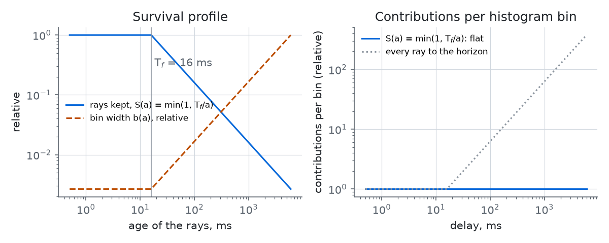
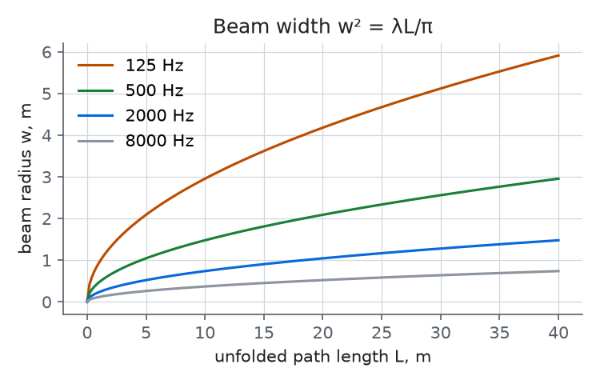
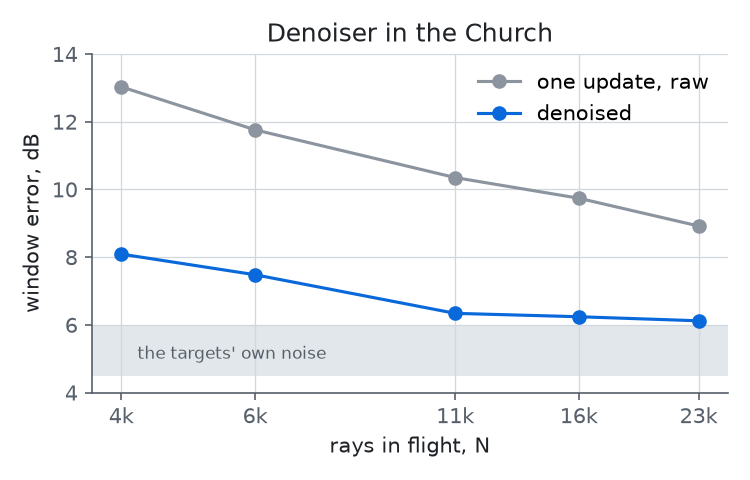
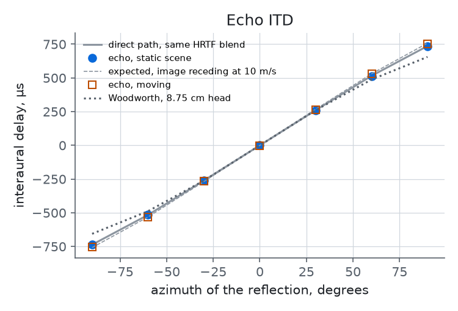
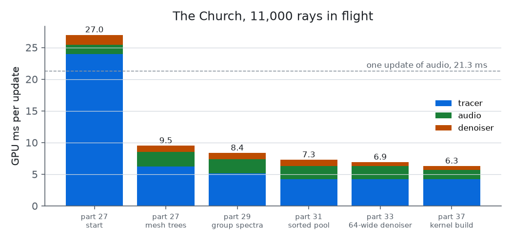
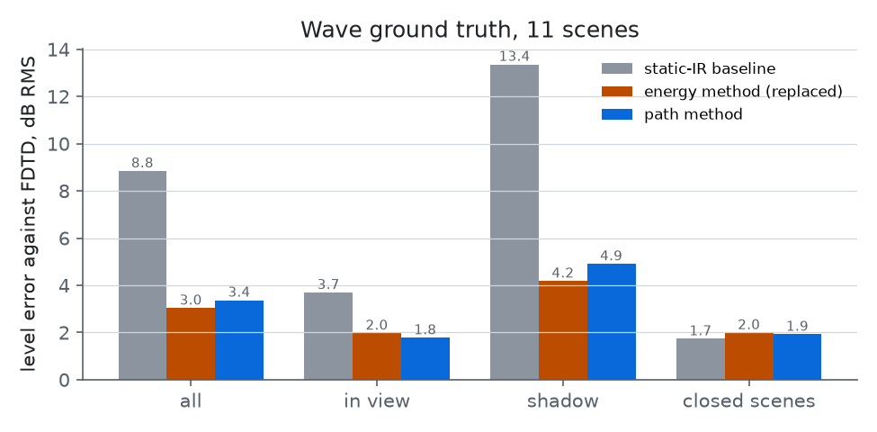

# Rays as sound in flight: a realtime acoustic path tracer

Walk up the nave of a stone church toward the organ, and the sound changes the way it should: the direct sound grows, the early reflections off the pillars and the floor arrive from their own directions, and the five-second tail hangs in the vault.
Open the west doors and step outside, and the organ reaches you through the porch, diffracted round its edges and reflected off the courtyard.
On the station platform a train sounds its horn as it leaves and comes round again, and its echoes off the canopy and the waiting room shift in pitch by their own amounts.

All of this is traced, not baked.
Every 21 ms of audio, a GPU path tracer advances about eleven thousand rays per source through the scene, scores what reaches the listener, cleans the result with a small learned denoiser, and convolves the source with the resulting binaural response, in about 6 ms of GPU time on a laptop (an Apple M5).
This post describes the four ideas that make that work, what they are measured against, and what is still wrong.
The full method, with its derivations, is in [docs/method.md](method.md); the lab notebook with every experiment, including the failed ones, is [here](benchmarks/path-denoise-2026-11-12/README.md).

## The usual approach, and its problem

Game audio usually bakes: an impulse response is precomputed at a few probe points, and the game crossfades between them.
That cannot follow a door that opens, a train that moves, or a listener who walks somewhere the probes did not anticipate.
Realtime acoustic ray tracers usually trace a fresh batch of rays every frame into an energy histogram and average over frames to fight the noise.

Two things go wrong with that design.
First, a fresh batch of rays per frame treats the scene as frozen for the whole length of the response: a reflection two seconds into the tail is computed through the scene as it is now, not as it was when that sound was emitted.
For an opening door or a passing train that is plainly wrong: sound is heard before it could have got there.
Second, averaging over frames is a temporal filter whose length trades lag against noise, and nobody can choose it right for both a static listener and a moving one.

## Idea 1: the rays are the sound in flight

Here the rays persist.
A ray's state (position, direction, path time, flux per octave band, the geometry of its current specular chain: 160 bytes) lives in a GPU buffer across updates.
Every update advances each live ray by exactly one update period of path time, stopping it in mid-segment if necessary, and launches a new cohort of rays from wherever the source is at that moment.
Everything the rays meet during the update is scored against the listener at that moment.

The subtle part is when a contribution is heard.
A connection from a scattering point to the listener made now is heard after its own travel time, so it is deposited into a ring of future histograms, in the slot of the update during which it arrives.
The ring is exactly as deep as the longest connection can be: ⌈3Dn / cΔt⌉ + 1 slots, with D the scene's diagonal and the factor three for a connection through two edges.
New rays advance half a period in their first update, which centres every update on its own time instead of lagging by half a period.

The result is a response in retarded time: the listener hears, along each path, the sound that left the source when it must have, through the scene as it was where and when each reflection happened, to the resolution of one update.
The checks make this concrete.
With the same random numbers, cutting a full static solve into 16 ms updates reproduces it to a few parts in 10⁵, so stopping, resuming and the ring lose nothing.
A source passing a rigid plane at 100 m/s puts its image at 40.88 ms against a retarded 41.05 ms, where a frozen scene would say 30.00 ms.
Behind a door that opens, the listener hears nothing until the first sound through the opening can arrive, and then the open room's level.

Persistence also changes the economics: an update pays for one period of every ray's life, so its work is the number of rays in flight.

## Idea 2: how many rays of each age

If rays persist, how many should be kept at each age?
Keep them all and the population grows without bound; launch the same number every update and stop them by plain Russian roulette, and the choice of survival time becomes a tuning knob.

The answer falls out of the histogram's own resolution.
Its bins are 0.25 ms wide up to T_f = 16 ms and then widen in proportion to delay (each is 1/64 of its start time), because the ear's resolution of a dense tail is relative.
A bin at delay τ of width b(τ) collects contributions from the n(τ) rays of that age, so its relative variance goes as 1/(n b).
At a fixed cost, the number of rays in flight N = ∫ n dτ / Δt, minimising the summed relative variance of all bins, ∫ dτ / (n b²), gives by Cauchy–Schwarz n ∝ 1/b, that is

S(a) = min(1, T_f / a):

every cohort is brought, after each update, to the share n̄ S(a) of the population, by splitting or roulette with weights divided by the ratio applied.
Every bin then gets as many contributions as a fine bin, and the share of new rays per update, n̄ = N / (1 + Σ S(a_k)), follows from the same profile; nothing is chosen by hand.
The splitting ratio depends only on each cohort's count after the walk, which is the past, so the estimator stays unbiased, and N can change from one update to the next, which the auto-budget below uses.

*Left: the fraction of rays kept against their age, and the histogram's bin width. Right: the result, a flat number of contributions per bin; tracing every ray to the end would spend almost all the work on the late bins.*

In the Church, at 11,000 rays in flight, this launches about 1,900 new rays per update, against 256–512 for the earlier per-update solver with a tuned survival time at the same GPU cost.
Population control also sorts the pool, by direction octant and then by a Morton code over quantile cells of the rays' own positions, so that neighbouring GPU threads trace similar rays; that is worth about 0.6 ms of the Church's 4.2 ms tracer.

## Idea 3: beams as wide as the Fresnel zone

Specular reflections are the hard case for a Monte Carlo acoustic tracer, because a point listener is never hit by a ray.
The textbook remedies are a receiver sphere, which is biased near beams, and an exact connection of each specular chain to the listener's image, which is unbiased but, it turned out, unusably heavy-tailed: outside the church a single solve played 13 dB below its own mean.

The fix is to admit that geometric acoustics has a resolution.
After its first specular reflection every ray segment scores at the listener with a normalised Gaussian kernel of its distance ρ from the listener's image, K(ρ) = 2/(πw²) exp(−2ρ²/w²).
Its width is the narrowest Gaussian beam that spans the unfolded path: a beam of waist w₀ has radius w₀√(1 + (z/z_R)²), z_R = πw₀²/λ, and minimising its radius at the ends of a path of length L puts the waist at mid-path and gives

w² = λL / π,

within 12% of the first Fresnel zone's radius at mid-path.
No constant is tuned.
Two geometric rules make it exact for the image lattice of a room: the kernel is truncated at the listener's clearance from the nearest surface (beyond it a ray may belong to a neighbouring image), and each scored segment must see the listener from its point of closest approach.

*The beam radius against path length per band: metres at low frequencies, which is the scale on which the wave field is smooth anyway.*

Against an FDTD ground truth of eleven scenes the beams beat the exact connection in level, early decay, T30 and energy–time error, overall and in shadow, while costing less in rooms.
Outside the church they closed a 4.6 dB gap between the exact connection and an independent energy method.
Diffraction stays explicit: scattering points connect to the listener through sampled edges with the uniform theory of diffraction, whose reflection-boundary terms are weighted by one minus the beam kernel so that the beam's smoothing and UTD's transition are not counted twice (the weight follows from UTD's own transition argument, again with no constant).

## Idea 4: a denoiser that knows the rays persist

At realtime budgets each update's histogram is noisy: about 10 dB of window error in the church at 11,000 rays.
Persistent histograms are an unusual input for a denoiser.
Consecutive updates share their rays, and the same cohort that sits at delay t in one update sits at t + Δt in the next.

The network is small: a one-dimensional dilated convolution along the delay bins, eight layers 64 channels wide, 144,000 parameters, fed the last four updates' histograms and contribution counts and two exponential moving averages.
It does not output energies directly.
It outputs non-negative weights on its unbiased inputs, and each band's energy per time segment is then rescaled to a convex combination of the inputs' totals, so the band levels stay unbiased for a static listener and the network only decides where within a segment the energy goes and how much history to trust.
It is trained Noise2Noise: the targets are the same retarded-time quantity traced with eight times the rays and independent seeds, noisy but unbiased, so an L2 loss converges to the clean answer.
One model covers 4,000 to 23,000 rays in flight.

*Window error in the church against the population, before and after the denoiser. The grey band is the noise of the targets themselves.*

It runs as a hand-written compute kernel in 0.64 ms, matching the PyTorch model to 2 × 10⁻⁵.
Honestly measured, it beats the best equal-compute temporal filter (a bias-corrected moving average with its decay chosen on validation) only modestly, by about 0.1 dB of window error on held-out room families; most of its gain over a single update is the averaging any filter would do.
Its real advantage is that it needs no decay constant, and it holds up at the low populations a tight budget forces.

## From histogram to ears, on the GPU

The early part of each response is rendered as discrete echoes and the rest as a dense field.
A delay bin is one echo while its contributions share one arrival: at least two of them, one delay rate (spread no larger than the mean) and one direction (the same test on the arrival direction).
An echo is an impulse at its mean delay with the head-related interaural time difference of its direction, taken from the HRTF set's own cross-correlation peaks, and while anything moves it slides at its mean delay rate, which gives each reflection its own Doppler shift.
The rates are carried exactly: each ray accumulates the logarithm of the product of its legs' frequency ratios, (1 − v_b·s)/(1 − v_a·s), through moving reflectors and scatterers.

*The interaural delay of a single echo, static and with the image receding at 10 m/s, against the direct path through the same HRTF blend: within 4 µs, a sixteenth of a sample.*

The dense field fills each 0.25 ms slot with Gaussian noise whose two ears are mixed, band by band, to the HRTF set's diffuse-field coherence with the band energy exact.
One kernel per ear is built every update on the GPU and convolved by uniformly partitioned overlap-save; partitions with few impulse groups are summed from fixed spectra instead of transformed, and the crossfade between updates corrects for the power a linear crossfade loses between two noisy estimates.
The CPU reference takes 432 ms to build one church update's kernels; the GPU takes about 0.3 ms.

## Realtime, measured

*GPU time per 21.3 ms update in the church at 11,000 rays in flight, through the optimisation rounds.*

The update now costs about 6.3 ms of GPU time: 4.2 ms for the tracer (edge distribution, walk, population control and sort), 1.45 ms for the audio and 0.64 ms for the denoiser.
The largest single step was replacing median-split mesh trees with surface-area-heuristic trees traversed in each mesh's own frame, which took the walk from 18 to 6 ms: the walk is latency-bound, a dispatch lasting as long as its longest serial chain of traversals.
An unbiased lottery on rays that bounce more than 16 times in one update, and the sorted pool, took most of the rest.
An auto-budget picks N from a budget in milliseconds with a rule that provably approaches its target from one side, without a gain to tune.

In the playable showcase the church runs at 11,000 rays in flight with the scene's rendering at 60 Hz and no audio underrun in its scripted walks, at a whole-frame GPU time of about 9 ms.
The station plays two sources, which share the GPU; see [method.md, section 12](method.md#12-cost) for its current population.

## Validation, and what it says

The suite is eleven scenes solved by an FDTD wave solver.
Against it the path method's level error is 3.4 dB RMS overall, 1.8 dB in view of the source, 4.9 dB in acoustic shadow and 1.9 dB in closed rooms; a game-style static convolution reverb built from the ground truth itself scores 8.9, 3.7, 13.4 and 1.7 dB.

*Level error against the wave ground truth. The energy method is the independent tracer this one replaced; it is slightly better overall but biased near specular beams, which a controlled porch exposed.*

Analytic checks run in the test suite: the free field and a rigid plane exactly, a shoebox's image lattice within 1.5% in every 20 ms window, a half-plane within 0.3 dB of the Biot–Tolstoy–Medwin solution, Eyring decay within 4%, diffuse-field leakage through walls and through a hole within the reference's own uncertainty, and the Doppler and ITD checks above.

## What is still wrong

- Diffraction into deep shadow is heavy-tailed per update. Outside the church, where every interior sound arrives diffracted, a single update plays close to the median of its estimate, about 9 dB below the mean, though the mean agrees with the independent method. Listener-side sampling was built and did not fix it; diffraction as an event of the walk is the open route.
- The method transports energy, not pressure: no interference and no room modes at low frequencies.
- UTD assumes long edges, and most of the church's edges are short at low frequencies; that bias is unmeasured.
- Early decay times at realtime budgets are poor on the wave suite for every variant, and the denoiser's decay curves lag its window errors.
- The denoiser is not told about motion and loses to a moving average for a listener walking down a corridor.
- Echoes of a static scene sit at their bin's centre, up to half a bin from their true delay.
- Hardware ray tracing is unavailable to Unity's compute shaders on Metal; it would save at most about 2 ms.

Every number above comes from a derivation or a measurement, and the estimators are unbiased except where this post says otherwise.
